<!-- source: DeepWiki mcp.deepwiki.com · repo pyg-team/pytorch_geometric · page 2 Data Structures · fetched 2026-10-21 -->

# Data Structures

<details>
<summary>Relevant source files</summary>

The following files were used as context for generating this wiki page:

- [test/data/test_batch.py](test/data/test_batch.py)
- [test/data/test_data.py](test/data/test_data.py)
- [test/data/test_dataset.py](test/data/test_dataset.py)
- [test/data/test_feature_store.py](test/data/test_feature_store.py)
- [test/data/test_graph_store.py](test/data/test_graph_store.py)
- [test/data/test_hetero_data.py](test/data/test_hetero_data.py)
- [test/data/test_storage.py](test/data/test_storage.py)
- [test/loader/test_dataloader.py](test/loader/test_dataloader.py)
- [test/test_edge_index.py](test/test_edge_index.py)
- [test/test_hash_tensor.py](test/test_hash_tensor.py)
- [test/test_index.py](test/test_index.py)
- [torch_geometric/data/batch.py](torch_geometric/data/batch.py)
- [torch_geometric/data/collate.py](torch_geometric/data/collate.py)
- [torch_geometric/data/data.py](torch_geometric/data/data.py)
- [torch_geometric/data/dataset.py](torch_geometric/data/dataset.py)
- [torch_geometric/data/feature_store.py](torch_geometric/data/feature_store.py)
- [torch_geometric/data/graph_store.py](torch_geometric/data/graph_store.py)
- [torch_geometric/data/hetero_data.py](torch_geometric/data/hetero_data.py)
- [torch_geometric/data/in_memory_dataset.py](torch_geometric/data/in_memory_dataset.py)
- [torch_geometric/data/separate.py](torch_geometric/data/separate.py)
- [torch_geometric/data/storage.py](torch_geometric/data/storage.py)
- [torch_geometric/edge_index.py](torch_geometric/edge_index.py)
- [torch_geometric/hash_tensor.py](torch_geometric/hash_tensor.py)
- [torch_geometric/index.py](torch_geometric/index.py)
- [torch_geometric/testing/__init__.py](torch_geometric/testing/__init__.py)
- [torch_geometric/testing/decorators.py](torch_geometric/testing/decorators.py)

</details>


## Purpose and Scope

This document describes PyTorch Geometric's core data structures for representing graphs and their attributes. These structures form the foundation of the library's data handling capabilities, providing flexible containers for homogeneous graphs (`Data`), heterogeneous graphs (`HeteroData`), and mini-batches (`Batch`). The document covers the storage architecture, attribute classification system, batching mechanisms, and serialization formats.

For information about custom tensor types (`EdgeIndex`, `Index`, `HashTensor`), see [Custom Tensor Types](#2.2). For dataset classes and loading pipelines, see [Dataset Classes and Processing](#3.2). For data loading and sampling, see [Data Loading and Sampling](#3.3).

## Overview of Data Structure Hierarchy

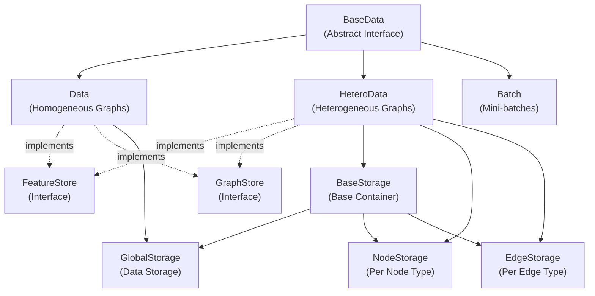

**Class Hierarchy:** PyTorch Geometric's data structures follow a two-level design. At the top level, `BaseData` defines the common interface for all graph containers. Concrete implementations (`Data`, `HeteroData`) implement the `FeatureStore` and `GraphStore` interfaces for tensor attribute management. At the storage level, `BaseStorage` provides dictionary-like containers specialized for node, edge, and global attributes.

Sources: [torch_geometric/data/data.py:48-442](), [torch_geometric/data/hetero_data.py:43-118](), [torch_geometric/data/storage.py:54-396]()

## Data Class (Homogeneous Graphs)

The `Data` class represents homogeneous graphs where all nodes and edges share the same types. It uses a single `GlobalStorage` instance to store all attributes.

### Architecture

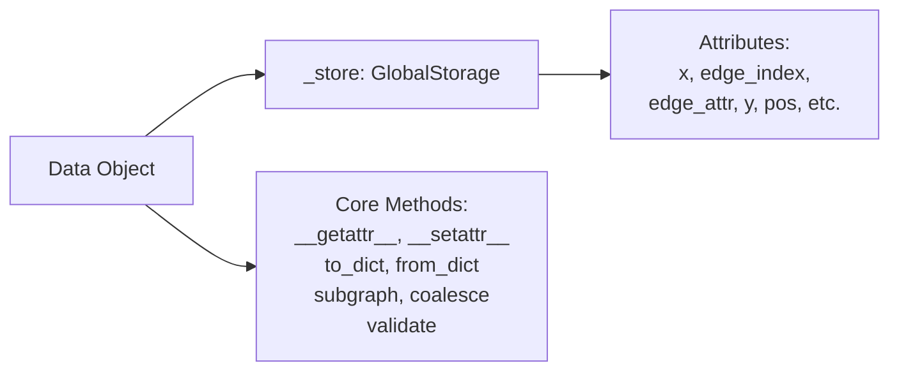

**Key Components:**
- **`_store: GlobalStorage`** - Single storage backend at [torch_geometric/data/data.py:537]()
- **Attribute Access** - Transparent property-style access via `__getattr__` at [torch_geometric/data/data.py:555-562]()
- **Dictionary Protocol** - Implements `__getitem__`, `__setitem__`, `__delitem__` at [torch_geometric/data/data.py:577-585]()

### Standard Attributes

| Attribute | Type | Shape | Description |
|-----------|------|-------|-------------|
| `x` | `Tensor` | `[num_nodes, num_features]` | Node feature matrix |
| `edge_index` | `Tensor` or `EdgeIndex` | `[2, num_edges]` | Graph connectivity in COO format |
| `edge_attr` | `Tensor` | `[num_edges, num_edge_features]` | Edge feature matrix |
| `y` | `Tensor` or scalar | Varies | Ground-truth labels (node/graph level) |
| `pos` | `Tensor` | `[num_nodes, num_dimensions]` | Node position matrix |
| `time` | `Tensor` | `[num_edges]` or `[num_nodes]` | Timestamps for temporal graphs |

Sources: [torch_geometric/data/data.py:472-518]()

### Example Usage

```python
from torch_geometric.data import Data
import torch

# Create a simple graph
data = Data(
    x=torch.randn(3, 16),                    # 3 nodes, 16 features each
    edge_index=torch.tensor([[0, 1, 1, 2],   # Source nodes
                             [1, 0, 2, 1]]),  # Target nodes
    y=torch.tensor([0]),                      # Graph label
)

# Access attributes
print(data.num_nodes)      # 3
print(data.num_edges)      # 4
print(data.is_directed())  # False (has reciprocal edges)
```

Sources: [test/data/test_data.py:13-148]()

### Attribute Classification

The `Data` class automatically classifies attributes as node-level, edge-level, or other:

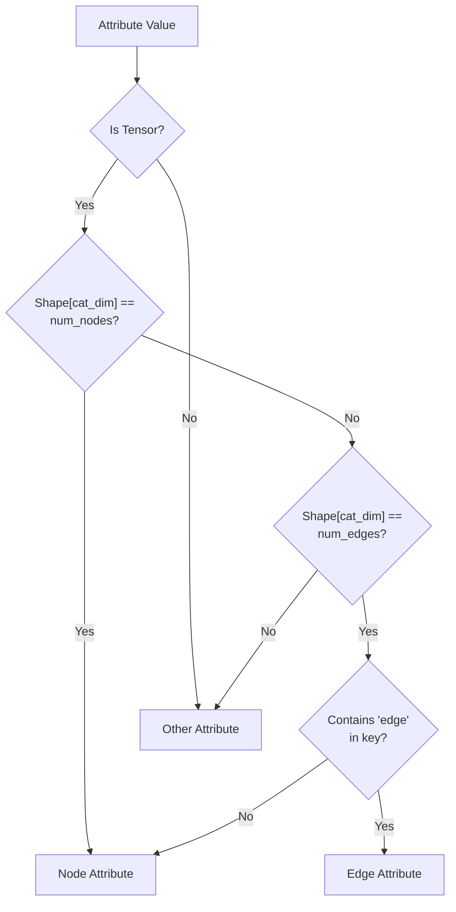

**Classification Logic:** Implemented in `GlobalStorage.is_node_attr()` at [torch_geometric/data/storage.py:783-831]() and `GlobalStorage.is_edge_attr()` at [torch_geometric/data/storage.py:833-881](). Results are cached in `_cached_attr` dictionary using `AttrType` enum.

Sources: [torch_geometric/data/storage.py:48-51](), [torch_geometric/data/storage.py:783-881]()

### Operations

**Subgraph Extraction:** The `subgraph()` method at [torch_geometric/data/data.py:724-764]() extracts induced subgraphs:

```python
# Extract nodes [1, 2, 3]
subset = torch.tensor([1, 2, 3])
subdata = data.subgraph(subset)
# Relabels nodes 1->0, 2->1, 3->2 and filters edges
```

**Coalescing:** The `coalesce()` method at [torch_geometric/data/data.py:271-278]() removes duplicate edges and sorts `edge_index`.

**Validation:** The `validate()` method at [torch_geometric/data/data.py:673-707]() checks:
- `edge_index` has shape `[2, num_edges]`
- All indices are non-negative
- All indices are within `[0, num_nodes)`

Sources: [torch_geometric/data/data.py:724-764](), [torch_geometric/data/data.py:271-278](), [torch_geometric/data/data.py:673-707]()

## HeteroData Class (Heterogeneous Graphs)

The `HeteroData` class represents heterogeneous graphs with multiple node and edge types. It maintains separate `NodeStorage` and `EdgeStorage` instances for each type.

### Architecture

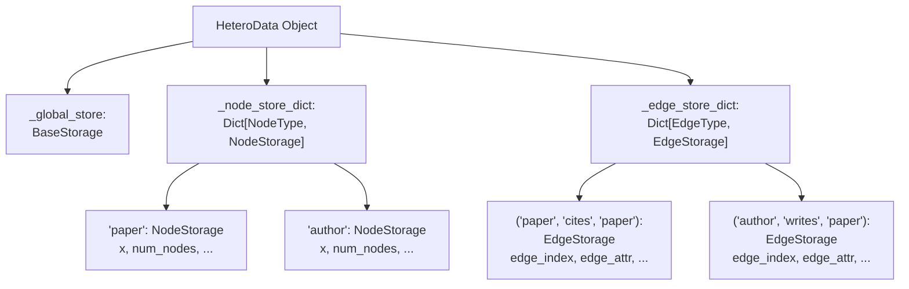

**Storage Organization:** Each node type gets a `NodeStorage` instance (key is `str`), and each edge type gets an `EdgeStorage` instance (key is `(src, rel, dst)` tuple). Global attributes are stored in `_global_store`.

Sources: [torch_geometric/data/hetero_data.py:119-134]()

### Accessing Types

```python
from torch_geometric.data import HeteroData

data = HeteroData()

# Node-level data
data['paper'].x = torch.randn(100, 128)
data['author'].x = torch.randn(50, 64)

# Edge-level data
data['author', 'writes', 'paper'].edge_index = torch.randint(0, 50, (2, 200))
data['paper', 'cites', 'paper'].edge_index = torch.randint(0, 100, (2, 500))

# Access metadata
print(data.node_types)    # ['paper', 'author']
print(data.edge_types)    # [('author', 'writes', 'paper'), ('paper', 'cites', 'paper')]
```

**Indexing Syntax:** The `__getitem__` method at [torch_geometric/data/hetero_data.py:176-190]() handles three access patterns:
1. Single string: returns `NodeStorage` for that node type
2. Tuple of 3 strings: returns `EdgeStorage` for that edge type  
3. Any other key: returns global attribute

Sources: [torch_geometric/data/hetero_data.py:176-190](), [torch_geometric/data/hetero_data.py:258-283]()

### Edge Type Canonicalization

Edge types can be specified in multiple ways and are canonicalized to `(src, rel, dst)` tuples:

```python
# All equivalent:
data['author', 'writes', 'paper']
data[('author', 'writes', 'paper')]
data['author', 'paper']  # Uses default relation 'to'
```

The `_to_canonical()` method at [torch_geometric/data/hetero_data.py:656-695]() handles this conversion using `DEFAULT_REL = 'to'`.

Sources: [torch_geometric/data/hetero_data.py:656-695](), [torch_geometric/typing:18-19]()

### Heterogeneous Operations

**Subgraph Extraction:** The `subgraph()` method at [torch_geometric/data/hetero_data.py:698-793]() accepts a dictionary mapping node types to subsets:

```python
subset = {
    'paper': torch.tensor([0, 5, 10]),
    'author': torch.tensor([2, 8])
}
subdata = data.subgraph(subset)
```

**Node/Edge Type Filtering:**
- `node_type_subgraph()` at [torch_geometric/data/hetero_data.py:795-812]() - Keep specific node types
- `edge_type_subgraph()` at [torch_geometric/data/hetero_data.py:814-865]() - Keep specific edge types

Sources: [torch_geometric/data/hetero_data.py:698-865]()

## Storage Architecture

### BaseStorage Class

`BaseStorage` at [torch_geometric/data/storage.py:54-396]() provides a dictionary-like container with additional PyTorch tensor operations.

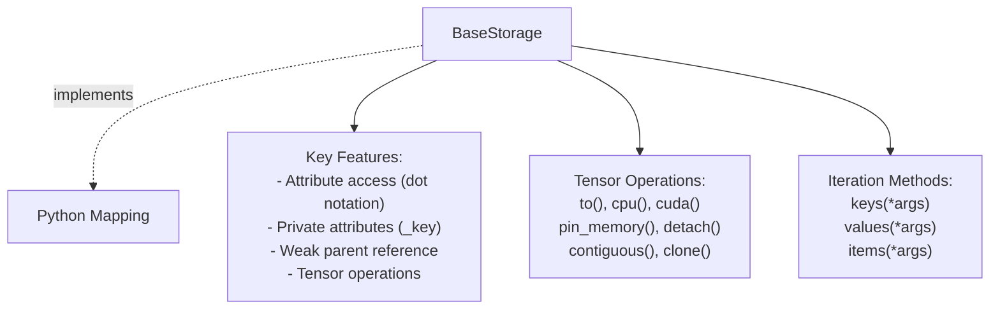

**Key Features:**

1. **Attribute Access:** At [torch_geometric/data/storage.py:89-109](), allows `storage.x` in addition to `storage['x']`
2. **Private Attributes:** Keys starting with `_` are stored in `__dict__` instead of `_mapping`
3. **Parent Reference:** Weak reference to parent `Data`/`HeteroData` object at [torch_geometric/data/storage.py:104-105]()
4. **Filtered Iteration:** Can iterate over subset of keys: `storage.values('x', 'edge_index')`

Sources: [torch_geometric/data/storage.py:54-203]()

### NodeStorage and EdgeStorage

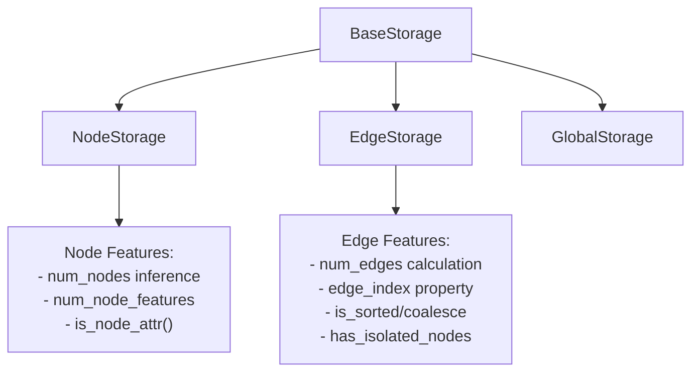

**NodeStorage** at [torch_geometric/data/storage.py:397-531]():
- **`num_nodes` Property:** Infers from `x`, `pos`, `batch`, or `edge_index` at [torch_geometric/data/storage.py:421-466]()
- **`can_infer_num_nodes`:** Checks if inference is possible at [torch_geometric/data/storage.py:407-418]()
- **Attribute Classification:** Uses heuristics based on tensor shape and key names

**EdgeStorage** at [torch_geometric/data/storage.py:533-757]():
- **`edge_index` Property:** Extracts from `edge_index`, `adj`, or `adj_t` at [torch_geometric/data/storage.py:558-567]()
- **Graph Operations:** `is_sorted()`, `sort()`, `is_coalesced()`, `coalesce()` at [torch_geometric/data/storage.py:677-724]()
- **Bipartite Support:** Handles edges between different node types via `is_bipartite()` at [torch_geometric/data/storage.py:755-756]()

Sources: [torch_geometric/data/storage.py:397-757]()

### GlobalStorage

`GlobalStorage` at [torch_geometric/data/storage.py:759-882]() combines both `NodeStorage` and `EdgeStorage` capabilities for homogeneous graphs:

```python
# Disambiguation when num_nodes == num_edges
# - Prefers node classification if 'edge' not in key
# - Uses cached results to avoid re-computation
```

The classification logic at [torch_geometric/data/storage.py:783-881]() handles ambiguous cases by checking key names and caching decisions.

Sources: [torch_geometric/data/storage.py:759-882]()

## Batching System

### Batch Class

The `Batch` class at [torch_geometric/data/batch.py:57-218]() dynamically inherits from either `Data` or `HeteroData` via metaclass magic.

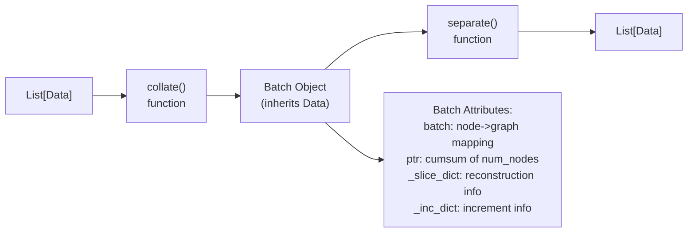

**Dynamic Inheritance:** The `DynamicInheritance` metaclass at [torch_geometric/data/batch.py:16-49]() creates new classes like `DataBatch` or `HeteroDataBatch` on-the-fly based on the base class of input data.

Sources: [torch_geometric/data/batch.py:16-49](), [torch_geometric/data/batch.py:57-81]()

### Collate Pipeline

The `collate()` function at [torch_geometric/data/collate.py:37-146]() merges multiple graphs into a single disconnected graph:

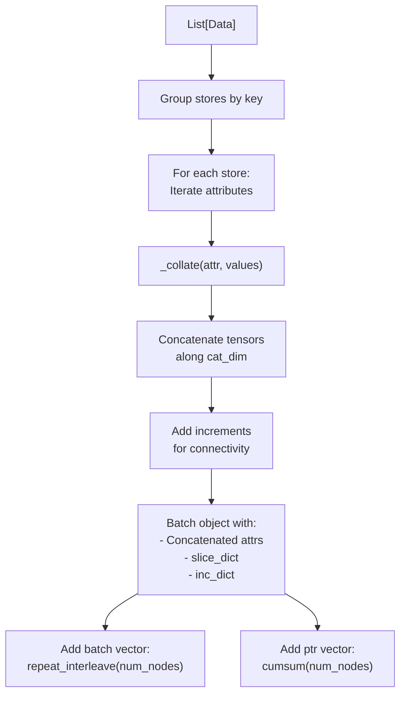

**Key Steps:**

1. **Grouping:** Organize stores by `_key` (node type or edge type) at [torch_geometric/data/collate.py:68-71]()
2. **Concatenation:** Call `_collate()` at [torch_geometric/data/collate.py:149-247]() for each attribute
3. **Incrementation:** Add cumulative sums to connectivity attributes at [torch_geometric/data/collate.py:168-174]()
4. **Batch Vector:** Create `batch` mapping nodes to graph IDs at [torch_geometric/data/collate.py:140-144]()
5. **Slice Dictionary:** Store reconstruction information at [torch_geometric/data/collate.py:85-131]()

Sources: [torch_geometric/data/collate.py:37-146]()

### Increment Calculation

The `get_incs()` function at [torch_geometric/data/collate.py:250-281]() calculates how much to increment each attribute:

```python
# For edge_index, increment by cumulative number of nodes
incs = cumsum(torch.tensor([0, num_nodes[0], num_nodes[1], ...]))

# For edge attributes with 'index' in name
incs = cumsum(num_nodes)
```

The `__inc__()` method is called on each data object to determine increments at [torch_geometric/data/data.py:657-671]() and [torch_geometric/data/hetero_data.py:361-371]().

Sources: [torch_geometric/data/collate.py:250-281](), [torch_geometric/data/data.py:657-671]()

### Separate Pipeline

The `separate()` function at [torch_geometric/data/separate.py:15-56]() extracts individual graphs from batches:

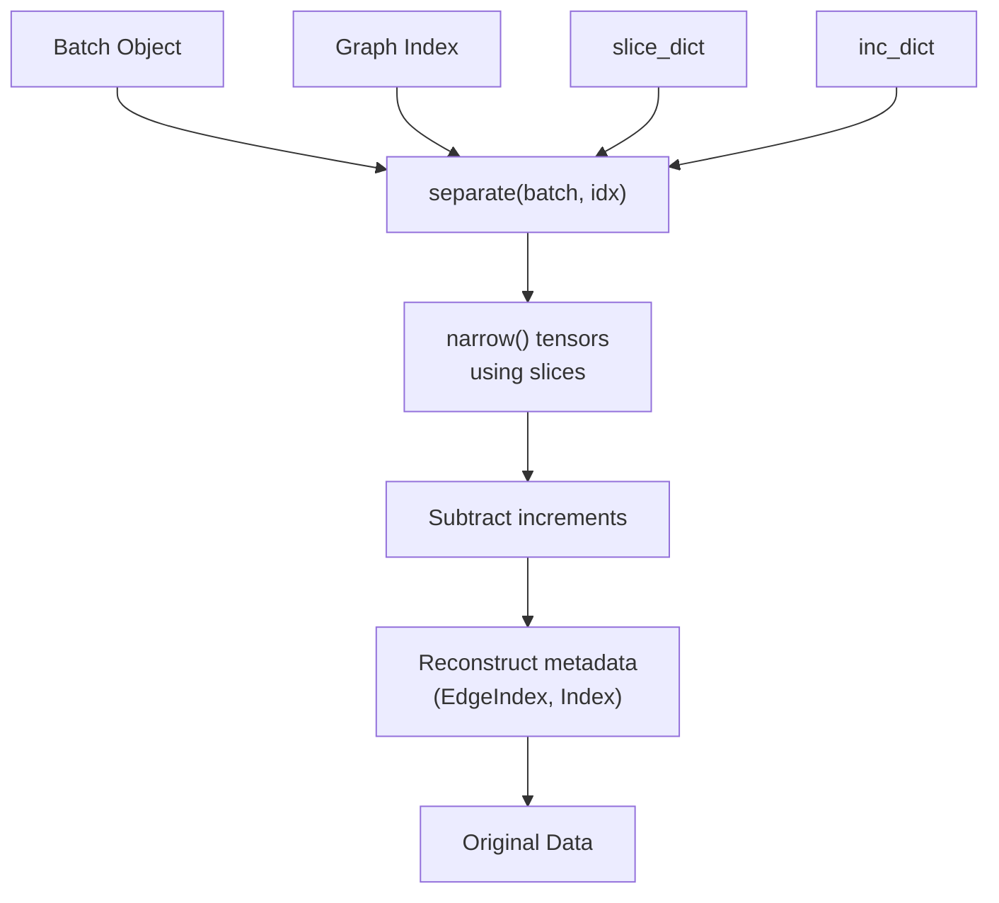

**Reconstruction Steps:**

1. **Narrowing:** Use `narrow()` to extract tensor slices at [torch_geometric/data/separate.py:70-77]()
2. **Decrementing:** Subtract increments to restore original indices at [torch_geometric/data/separate.py:90-93]()
3. **Metadata Restoration:** Restore `EdgeIndex` and `Index` metadata at [torch_geometric/data/separate.py:79-88]()

Sources: [torch_geometric/data/separate.py:15-156]()

### Example Batching

```python
from torch_geometric.data import Data, Batch

data1 = Data(x=torch.ones(3, 8), edge_index=torch.tensor([[0, 1], [1, 2]]))
data2 = Data(x=torch.ones(2, 8), edge_index=torch.tensor([[0, 1], [1, 0]]))

batch = Batch.from_data_list([data1, data2])

# batch.x: [5, 8] tensor (concatenated)
# batch.edge_index: [2, 4] tensor with incremented indices
#   [[0, 1, 3, 4], [1, 2, 4, 3]]
# batch.batch: [0, 0, 0, 1, 1] (node->graph mapping)
# batch.ptr: [0, 3, 5] (cumulative node counts)

# Extract original graphs
data1_reconstructed = batch[0]
data2_reconstructed = batch[1]
```

Sources: [test/data/test_batch.py:15-109]()

## Concatenation and Incrementation Rules

### `__cat_dim__()` Method

The `__cat_dim__()` method determines the dimension along which attributes are concatenated:

| Attribute Pattern | `cat_dim` | Explanation |
|-------------------|-----------|-------------|
| `edge_index`, `adj` | `(0, 1)` | Sparse tensors concatenated diagonally |
| Contains `'index'` or `'face'` | `-1` | Increment along last dimension |
| Other tensors | `0` | Concatenate along first dimension |

Implementation at [torch_geometric/data/data.py:649-655]() for `Data` and [torch_geometric/data/hetero_data.py:352-359]() for `HeteroData`.

Sources: [torch_geometric/data/data.py:649-655](), [torch_geometric/data/hetero_data.py:352-359]()

### `__inc__()` Method

The `__inc__()` method determines how much to increment attributes:

| Attribute Pattern | Increment | Explanation |
|-------------------|-----------|-------------|
| Contains `'batch'` | `max(value) + 1` or `dim_size` | Increment batch IDs |
| Contains `'index'` or `'face'` | `num_nodes` | Increment node indices |
| Other | `0` | No increment |

Implementation at [torch_geometric/data/data.py:657-671]() for `Data` and [torch_geometric/data/hetero_data.py:361-371]() for `HeteroData`.

Sources: [torch_geometric/data/data.py:657-671](), [torch_geometric/data/hetero_data.py:361-371]()

## Serialization and Persistence

### Dictionary Conversion

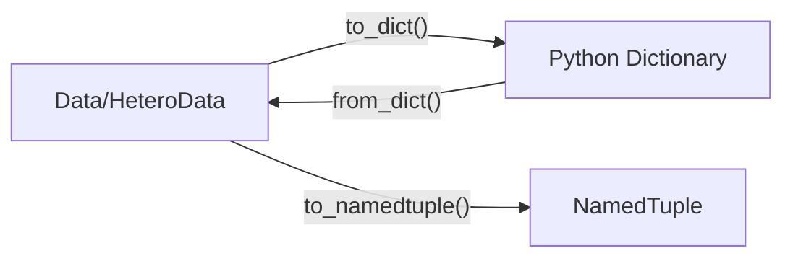

**`to_dict()` Method:**
- For `Data`: Returns `_store.to_dict()` at [torch_geometric/data/data.py:638-639]()
- For `HeteroData`: Returns nested dictionary with `_global_store` and per-type stores at [torch_geometric/data/hetero_data.py:300-306]()

**`from_dict()` Class Method:**
- Reconstructs object from dictionary at [torch_geometric/data/data.py:965-969]() and [torch_geometric/data/hetero_data.py:136-151]()

Sources: [torch_geometric/data/data.py:638-639](), [torch_geometric/data/data.py:965-969](), [torch_geometric/data/hetero_data.py:136-151](), [torch_geometric/data/hetero_data.py:300-306]()

### InMemoryDataset Storage

The `InMemoryDataset` class at [torch_geometric/data/in_memory_dataset.py:32-344]() provides efficient storage for datasets that fit in memory:

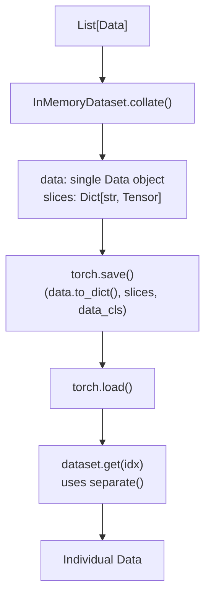

**Storage Format:**
1. **Collation:** All graphs merged into single `Data` object via `collate()` at [torch_geometric/data/in_memory_dataset.py:145-162]()
2. **Slices:** Dictionary storing slice indices for each attribute at [torch_geometric/data/in_memory_dataset.py:85]()
3. **Reconstruction:** Use `separate()` to extract individual graphs at [torch_geometric/data/in_memory_dataset.py:101-121]()

**File Format:** Tuple of `(data.to_dict(), slices, data_cls)` saved via `torch.save()` at [torch_geometric/data/in_memory_dataset.py:127]().

Sources: [torch_geometric/data/in_memory_dataset.py:32-344](), [torch_geometric/data/in_memory_dataset.py:124-162]()

## Device Management and Memory Operations

### Device Conversion

All data structures support standard PyTorch device operations:

```python
data = Data(x=torch.randn(10, 16), edge_index=torch.randint(0, 10, (2, 20)))

# Move to GPU
data = data.to('cuda:0')
data = data.cuda()

# Move to CPU
data = data.cpu()

# Pin memory for faster GPU transfer
data = data.pin_memory()
```

Implementation via `apply()` method at [torch_geometric/data/storage.py:196-202]() which recursively applies functions to all tensor attributes.

Sources: [torch_geometric/data/data.py:358-386](), [torch_geometric/data/storage.py:236-303]()

### Copy Semantics

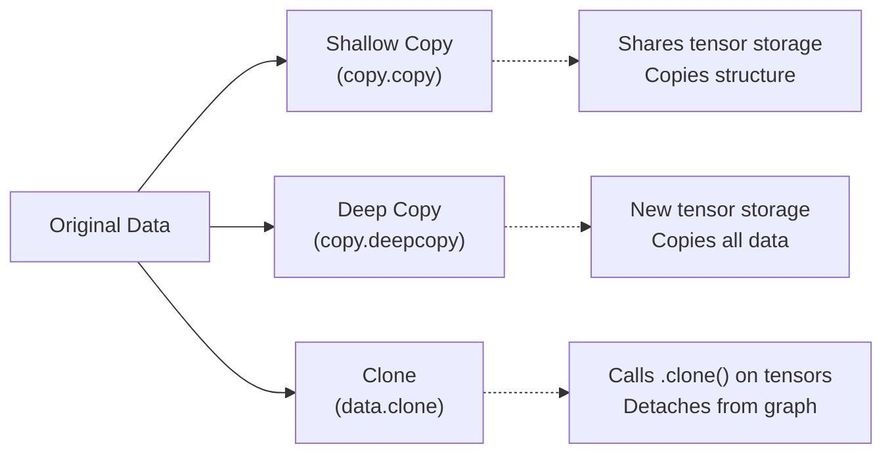

**Copy Operations:**

1. **Shallow Copy:** `copy.copy(data)` at [torch_geometric/data/data.py:587-593]() - Copies structure but shares tensor storage
2. **Deep Copy:** `copy.deepcopy(data)` at [torch_geometric/data/data.py:595-600]() - Creates new tensor storage
3. **Clone:** `data.clone()` at [torch_geometric/data/data.py:346-350]() - Calls `.clone()` on all tensors

Sources: [torch_geometric/data/data.py:587-600](), [torch_geometric/data/data.py:346-350](), [torch_geometric/data/storage.py:135-148]()

### Shared Memory

For multi-process data loading, data structures support shared memory:

```python
data = Data(x=torch.randn(100, 64))
data.share_memory_()  # Move to shared memory

# Now accessible from multiple processes
```

Implementation at [torch_geometric/data/storage.py:272-276]() applies `.share_memory_()` to all tensor attributes.

Sources: [torch_geometric/data/storage.py:272-276](), [test/data/test_data.py:364-382]()

## Graph Utilities and Transformations

### Graph Property Checks

Both `Data` and `HeteroData` provide methods to check graph properties:

```python
data = Data(edge_index=torch.tensor([[0, 1, 1, 2], [1, 0, 2, 1]]))

# Check properties
data.is_directed()         # False (has reverse edges)
data.is_undirected()       # True
data.has_self_loops()      # False
data.has_isolated_nodes()  # False
data.is_sorted()           # True if edge_index is sorted
data.is_coalesced()        # True if no duplicate edges
```

Implementation:
- **`is_undirected()`:** Checks if reverse edges exist at [torch_geometric/data/storage.py:741-750]()
- **`has_self_loops()`:** Checks if any `edge_index[0] == edge_index[1]` at [torch_geometric/data/storage.py:735-739]()
- **`has_isolated_nodes()`:** Uses `contains_isolated_nodes()` utility at [torch_geometric/data/storage.py:726-733]()

Sources: [torch_geometric/data/data.py:240-328](), [torch_geometric/data/storage.py:677-750]()

### Temporal Graph Operations

For dynamic/temporal graphs with `time` attributes:

```python
data = Data(
    x=torch.randn(100, 64),
    edge_index=torch.randint(0, 100, (2, 500)),
    time=torch.rand(500)  # Edge timestamps
)

# Sort by time
data = data.sort_by_time()

# Filter to time window
data = data.snapshot(start_time=0.2, end_time=0.8)

# Get events up to time
data = data.up_to(end_time=0.5)
```

Implementation at [torch_geometric/data/storage.py:348-394]() in `BaseStorage`.

Sources: [torch_geometric/data/storage.py:305-394](), [torch_geometric/data/data.py:280-312]()

### Connected Components

The `connected_components()` method extracts disconnected subgraphs using union-find:

```python
data = Data(
    x=torch.randn(5, 16),
    edge_index=torch.tensor([[0, 1, 2, 3], [1, 0, 3, 2]])  # Two components
)

components = data.connected_components()
# Returns List[Data] with separate graphs
```

Implementation:
- **Union-Find Algorithm:** At [torch_geometric/data/data.py:933-960]() for `Data`
- **Heterogeneous Version:** At [torch_geometric/data/hetero_data.py:490-588]() for `HeteroData`

Sources: [torch_geometric/data/data.py:908-960](), [torch_geometric/data/hetero_data.py:490-588]()

## Special Considerations

### Attribute Name Conventions

PyTorch Geometric uses naming conventions to automatically handle attributes:

| Pattern | Treatment | Example |
|---------|-----------|---------|
| Contains `'index'` | Incremented by `num_nodes` | `edge_index`, `face_index` |
| Contains `'batch'` | Incremented by batch ID | `batch`, `node_batch` |
| Contains `'edge'` | Classified as edge attribute | `edge_attr`, `edge_weight` |
| Contains `'node'` | Classified as node attribute | `node_id`, `node_label` |
| Starts with `_` | Private, not serialized | `_parent`, `_cached_attr` |

**Warning:** These heuristics can cause issues if attribute names contain these substrings unintentionally. Always verify batching behavior with `__cat_dim__()` and `__inc__()`.

Sources: [torch_geometric/data/storage.py:44-45](), [torch_geometric/data/data.py:649-671]()

### Weak References and Parent Tracking

Storage objects maintain weak references to their parent `Data`/`HeteroData` objects:

```python
# In BaseStorage.__setattr__
if key == '_parent':
    self.__dict__[key] = weakref.ref(value)
```

This allows stores to access parent methods like `__cat_dim__()` without creating reference cycles. Access via `self._parent()` at [torch_geometric/data/storage.py:104-105]().

Sources: [torch_geometric/data/storage.py:104-105](), [torch_geometric/data/storage.py:308-311]()

### Cached Attribute Classification

To avoid repeated type checking, attribute classifications are cached:

```python
# In GlobalStorage
self._cached_attr: Dict[AttrType, Set[str]] = defaultdict(set)

# Check cache before classification
if key in self._cached_attr[AttrType.NODE]:
    return True
```

Cache is invalidated when attributes are modified at [torch_geometric/data/storage.py:82-84]().

Sources: [torch_geometric/data/storage.py:82-84](), [torch_geometric/data/storage.py:495-524]()

---

