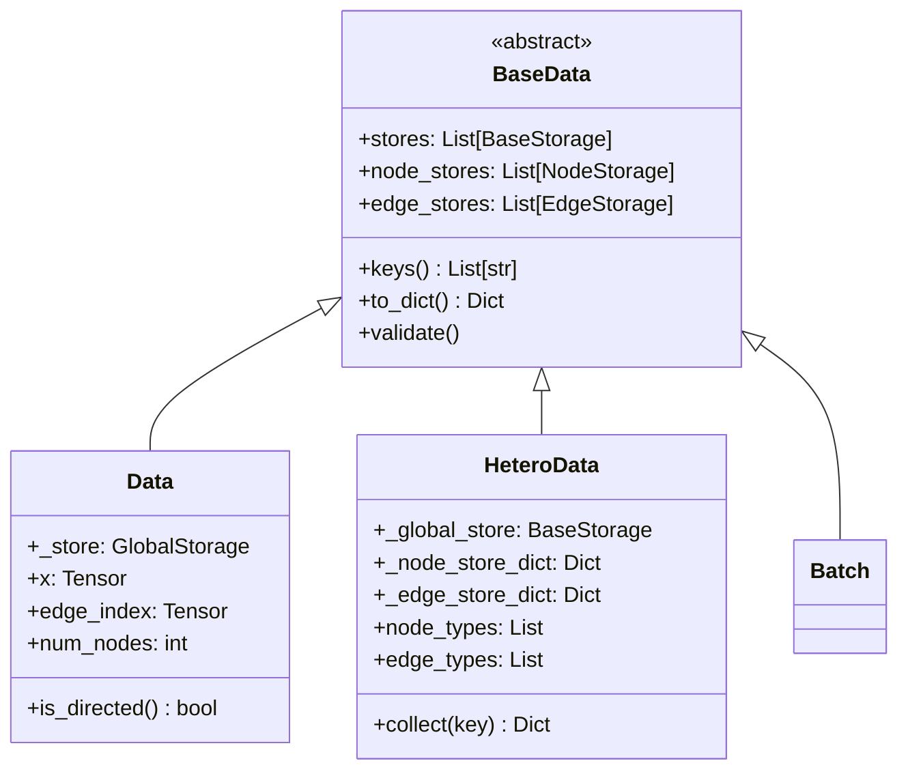
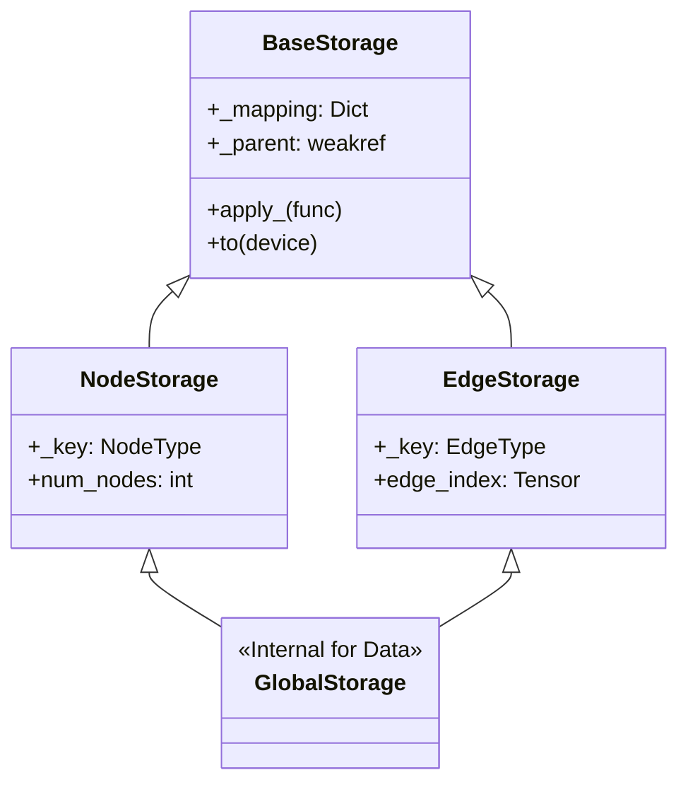
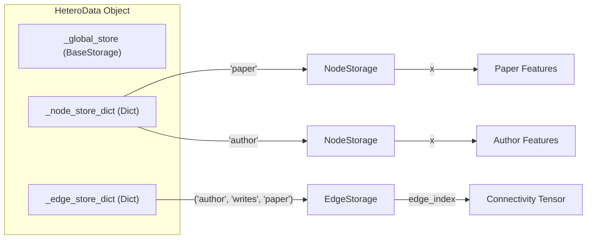
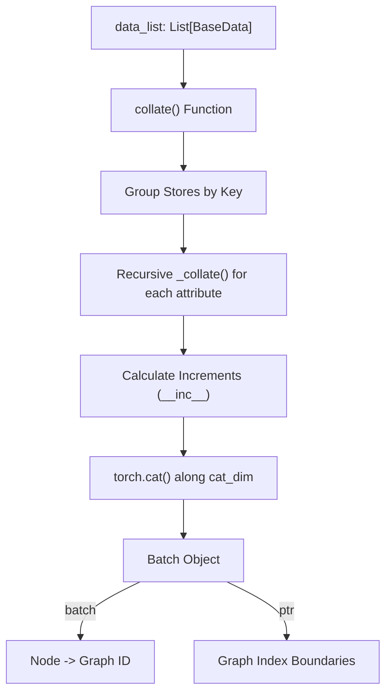

<!-- source: DeepWiki mcp.deepwiki.com · repo pyg-team/pytorch_geometric · page 2.1 Data and HeteroData Classes · fetched 2026-10-21 -->

# Data and HeteroData Classes

Relevant source files

The following files were used as context for generating this wiki page:

- [docs/source/_templates/autosummary/class.rst](docs/source/_templates/autosummary/class.rst)
- [docs/source/_templates/autosummary/inherited_class.rst](docs/source/_templates/autosummary/inherited_class.rst)
- [docs/source/modules/data.rst](docs/source/modules/data.rst)
- [test/conftest.py](test/conftest.py)
- [test/data/test_batch.py](test/data/test_batch.py)
- [test/data/test_data.py](test/data/test_data.py)
- [test/data/test_dataset.py](test/data/test_dataset.py)
- [test/data/test_feature_store.py](test/data/test_feature_store.py)
- [test/data/test_graph_store.py](test/data/test_graph_store.py)
- [test/data/test_hetero_data.py](test/data/test_hetero_data.py)
- [test/data/test_storage.py](test/data/test_storage.py)
- [test/io/test_fs.py](test/io/test_fs.py)
- [test/loader/test_dataloader.py](test/loader/test_dataloader.py)
- [test/utils/test_laplacian.py](test/utils/test_laplacian.py)
- [test/utils/test_mesh_laplacian.py](test/utils/test_mesh_laplacian.py)
- [torch_geometric/data/__init__.py](torch_geometric/data/__init__.py)
- [torch_geometric/data/batch.py](torch_geometric/data/batch.py)
- [torch_geometric/data/collate.py](torch_geometric/data/collate.py)
- [torch_geometric/data/data.py](torch_geometric/data/data.py)
- [torch_geometric/data/dataset.py](torch_geometric/data/dataset.py)
- [torch_geometric/data/download.py](torch_geometric/data/download.py)
- [torch_geometric/data/extract.py](torch_geometric/data/extract.py)
- [torch_geometric/data/feature_store.py](torch_geometric/data/feature_store.py)
- [torch_geometric/data/graph_store.py](torch_geometric/data/graph_store.py)
- [torch_geometric/data/hetero_data.py](torch_geometric/data/hetero_data.py)
- [torch_geometric/data/in_memory_dataset.py](torch_geometric/data/in_memory_dataset.py)
- [torch_geometric/data/makedirs.py](torch_geometric/data/makedirs.py)
- [torch_geometric/data/separate.py](torch_geometric/data/separate.py)
- [torch_geometric/data/storage.py](torch_geometric/data/storage.py)
- [torch_geometric/io/fs.py](torch_geometric/io/fs.py)
- [torch_geometric/loader/mixin.py](torch_geometric/loader/mixin.py)
- [torch_geometric/utils/laplacian.py](torch_geometric/utils/laplacian.py)

This page details the core data structures used in PyTorch Geometric (PyG) for representing graphs: the `Data` class for homogeneous graphs and the `HeteroData` class for heterogeneous graphs. These classes provide the foundation for all graph operations, from simple data manipulation to complex neural network training.

## Data Structure Overview

PyG represents graphs as objects that encapsulate connectivity, features, and metadata. Both `Data` and `HeteroData` inherit from `BaseData`, which defines the basic interface for data access and manipulation.

Title: Data Class Hierarchy

Sources: [torch_geometric/data/data.py:48-91](), [torch_geometric/data/data.py:471-488](), [torch_geometric/data/hetero_data.py:43-118]()

## Storage System Architecture

PyG utilizes a specialized storage hierarchy to manage tensors efficiently. Attributes are not stored directly on the `Data` object but within `Storage` objects that wrap Python dictionaries and provide tensor-aware functionality.

Title: Storage Entity Relationship

- **BaseStorage**: The root class providing dictionary-like access (`__getitem__`, `__setitem__`) and tensor transfers (`cuda()`, `cpu()`, `to()`) [torch_geometric/data/storage.py:54-106]().
- **NodeStorage**: Specifically tracks node counts via `num_nodes` and manages node-level attributes like `x` and `pos` [torch_geometric/data/storage.py:397-430]().
- **EdgeStorage**: Manages graph connectivity via `edge_index` and attributes like `edge_attr` [torch_geometric/data/storage.py:533-560]().
- **GlobalStorage**: A unified storage used by the `Data` class to handle both node and edge attributes in a single container [torch_geometric/data/storage.py:759-780]().

Sources: [torch_geometric/data/storage.py:54-106](), [torch_geometric/data/storage.py:397-532](), [torch_geometric/data/storage.py:533-756](), [torch_geometric/data/storage.py:759-881]()

## The Data Class

The `Data` class represents homogeneous graphs. It uses a single `_store` (of type `GlobalStorage`) to hold all attributes.

### Key Implementation Details
- **Attribute Inference**: PyG automatically guesses `num_nodes` based on `x.size(0)` or `edge_index.max() + 1` if not explicitly set [torch_geometric/data/data.py:170-185]().
- **Batching Behavior**: The methods `__cat_dim__` and `__inc__` control how attributes are concatenated during mini-batching. By default, attributes containing "index" are incremented by the number of nodes [torch_geometric/data/data.py:554-557]().

### Common Methods
| Method | Description | Source |
| :--- | :--- | :--- |
| `validate()` | Checks for consistent tensor shapes and valid indices | [torch_geometric/data/data.py:304-335]() |
| `is_undirected()` | Verifies if the graph is undirected via `is_undirected` util | [torch_geometric/data/data.py:421-423]() |
| `coalesce()` | Removes duplicate edges and sorts the adjacency matrix | [torch_geometric/data/data.py:270-282]() |
| `subgraph()` | Returns a new `Data` object containing only specified nodes | [torch_geometric/data/data.py:365-385]() |

Sources: [torch_geometric/data/data.py:170-185](), [torch_geometric/data/data.py:270-440](), [torch_geometric/data/data.py:471-1019]()

## The HeteroData Class

`HeteroData` represents heterogeneous graphs by maintaining multiple storage objects—one for each node type and edge type.

### Internal Mapping
- `_node_store_dict`: Maps `NodeType` (string) to `NodeStorage`.
- `_edge_store_dict`: Maps `EdgeType` (triplet tuple) to `EdgeStorage`.
- `_global_store`: Stores graph-level metadata.

Title: HeteroData Data Flow

### Type Resolution
`HeteroData` provides "canonical" type resolution. Accessing `data['paper']` retrieves a `NodeStorage`, while `data['author', 'writes', 'paper']` retrieves an `EdgeStorage`. If a partial edge type is provided (e.g., `data['writes']`), PyG attempts to resolve the unique triplet [torch_geometric/data/hetero_data.py:176-191]().

Sources: [torch_geometric/data/hetero_data.py:43-151](), [torch_geometric/data/hetero_data.py:176-191]()

## Batch Processing

The `Batch` class enables processing multiple graphs as a single large disjoint graph. It is created using `Batch.from_data_list`.

### Dynamic Inheritance
PyG uses a metaclass `DynamicInheritance` to ensure that a `Batch` of `Data` objects inherits from `Data`, while a `Batch` of `HeteroData` inherits from `HeteroData` [torch_geometric/data/batch.py:16-49]().

### Collation Logic
The `collate` function performs the heavy lifting:
1. It iterates through all `stores` in the input data list [torch_geometric/data/collate.py:69-71]().
2. It concatenates tensors along the dimension returned by `__cat_dim__` [torch_geometric/data/collate.py:163-165]().
3. It generates the `batch` assignment vector and the `ptr` boundary vector [torch_geometric/data/collate.py:140-144]().

Title: Collation Pipeline

Sources: [torch_geometric/data/batch.py:57-110](), [torch_geometric/data/collate.py:37-147]()

## In-Memory Datasets

The `InMemoryDataset` class is the standard container for datasets that fit in CPU memory. It uses the collation system to store all graph data in one large `Data` or `HeteroData` object for efficient access.

- **`collate()`**: Merges a list of graph objects into a single internal representation [torch_geometric/data/in_memory_dataset.py:145-162]().
- **`separate()`**: Reconstructs individual graph objects from the collated storage using the `slices` dictionary [torch_geometric/data/in_memory_dataset.py:111-117]().

Sources: [torch_geometric/data/in_memory_dataset.py:32-121](), [torch_geometric/data/in_memory_dataset.py:145-162]()

---

