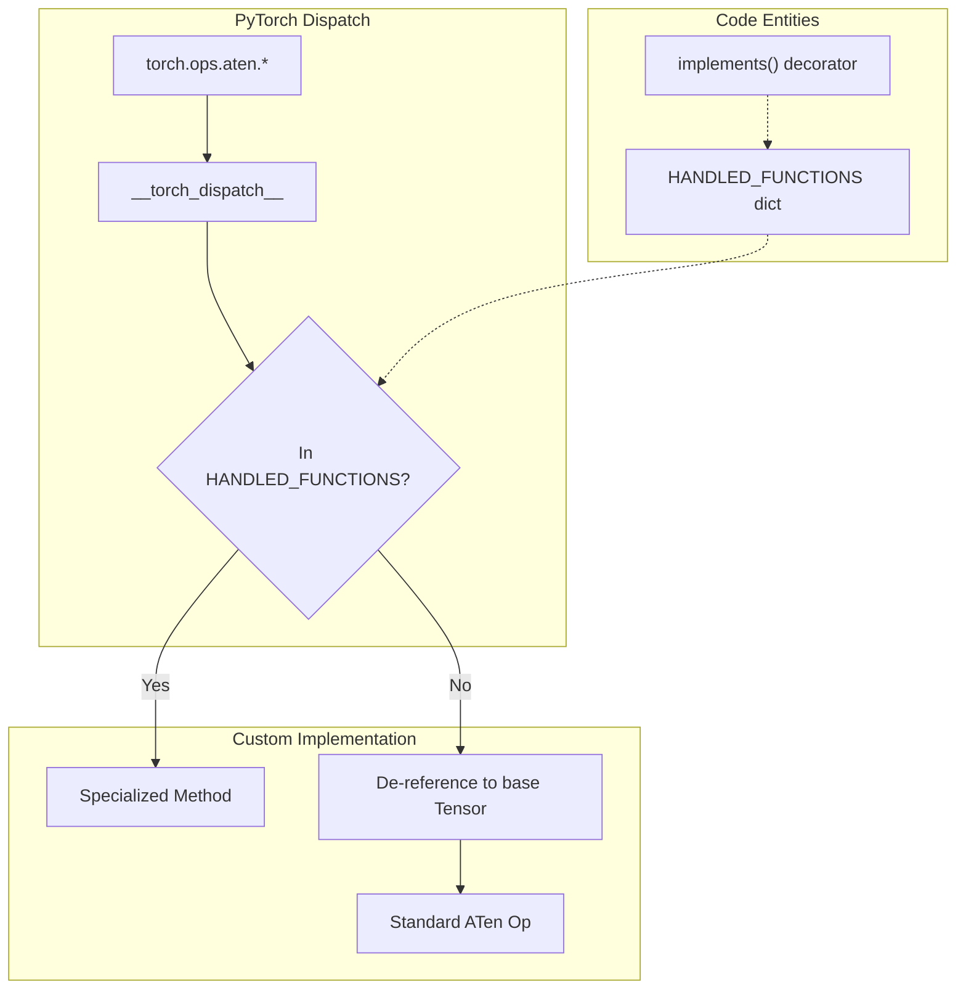
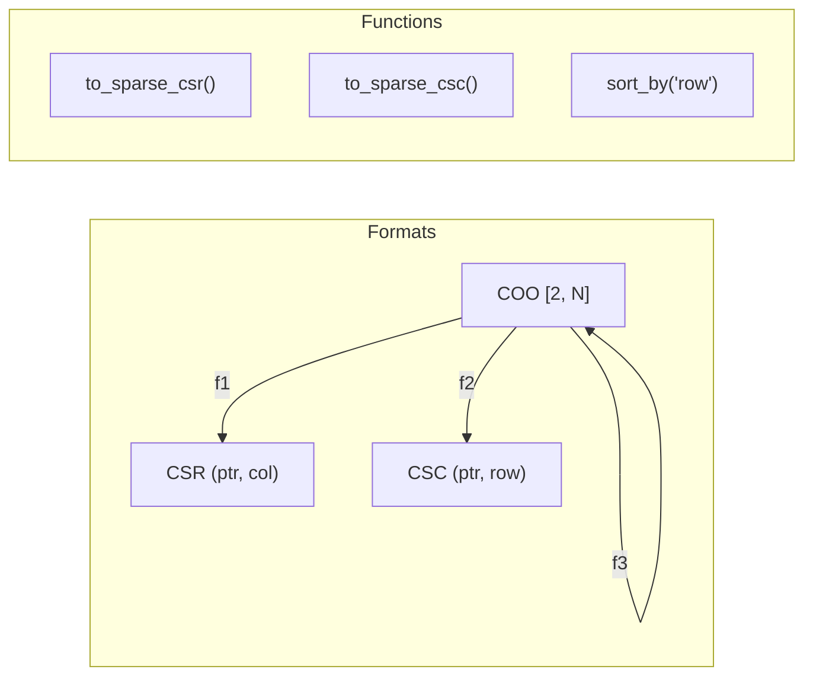

<!-- source: DeepWiki mcp.deepwiki.com · repo pyg-team/pytorch_geometric · page 2.2 Custom Tensor Types · fetched 2026-10-21 -->

# Custom Tensor Types

<details>
<summary>Relevant source files</summary>

The following files were used as context for generating this wiki page:

- [test/test_edge_index.py](test/test_edge_index.py)
- [test/test_hash_tensor.py](test/test_hash_tensor.py)
- [test/test_index.py](test/test_index.py)
- [torch_geometric/edge_index.py](torch_geometric/edge_index.py)
- [torch_geometric/hash_tensor.py](torch_geometric/hash_tensor.py)
- [torch_geometric/index.py](torch_geometric/index.py)
- [torch_geometric/testing/__init__.py](torch_geometric/testing/__init__.py)
- [torch_geometric/testing/decorators.py](torch_geometric/testing/decorators.py)

</details>


PyTorch Geometric (PyG) implements several custom tensor types that extend PyTorch's native tensor functionality for efficient graph operations. These specialized tensor implementations maintain the same interface as PyTorch tensors while providing additional graph-specific optimizations, metadata tracking, and specialized operations.

This page details the three custom tensor types available in PyG:
- `Index` - One-dimensional tensors with enhanced indexing capabilities.
- `EdgeIndex` - Two-dimensional tensors specifically designed for representing graph connectivity.
- `HashTensor` - Tensors that can be referenced by arbitrary keys rather than numeric indices.

## Custom Tensor Types Architecture

PyG's custom tensor types inherit from PyTorch's `Tensor` class while providing specialized functionality for graph operations. They utilize `_make_wrapper_subclass` to create tensor subclasses that carry extra metadata.

### Class Relationship Diagram
Title: Custom Tensor Class Hierarchy
```mermaid
classDiagram
    class "torch.Tensor" {
        <<PyTorch Base>>
    }
    
    class "Index" {
        _data: Tensor
        _dim_size: Optional[int]
        _is_sorted: bool
        _indptr: Optional[Tensor]
        validate()
        fill_cache_()
        get_indptr()
    }
    
    class "EdgeIndex" {
        _data: Tensor
        _sparse_size: Tuple
        _sort_order: SortOrder
        _is_undirected: bool
        _indptr: Optional[Tensor]
        validate()
        sort_by()
        to_sparse_csr()
    }
    
    class "HashTensor" {
        _map: Union[Tensor, HashMap]
        _value: Optional[Tensor]
        _min_key: Tensor
        _max_key: Tensor
        index_select()
    }
    
    "torch.Tensor" <|-- "Index"
    "torch.Tensor" <|-- "EdgeIndex"
    "torch.Tensor" <|-- "HashTensor"
```
Sources: 
- [torch_geometric/index.py:88-152]()
- [torch_geometric/edge_index.py:153-220]()
- [torch_geometric/hash_tensor.py:89-150]()

## Common Implementation Patterns

All of PyG's custom tensor types share several implementation techniques to extend PyTorch's functionality, primarily through the `__torch_dispatch__` mechanism and a registry of handled functions.

### Dispatch Logic Diagram
Title: PyTorch Dispatch and Extension Mechanism

Sources:
- [torch_geometric/index.py:24-54]()
- [torch_geometric/edge_index.py:32-66]()
- [torch_geometric/hash_tensor.py:26-36]()

## Index Tensor

The `Index` class represents a one-dimensional tensor of indices (e.g., node indices) with additional metadata and caching for compressed representations.

### Key Features
- **Metadata**: Tracks `dim_size` (the size of the dimension being indexed) and `is_sorted`. [torch_geometric/index.py:141-144]()
- **Caching**: Stores `_indptr` (index pointers) to allow O(1) conversion to CSR-like formats. [torch_geometric/index.py:147-148]()
- **Validation**: The `validate()` method ensures indices are non-negative and within `dim_size` bounds. [torch_geometric/index.py:213-240]()

### Implementation Details
When an `Index` is sorted, it can generate an `indptr` via `index2ptr`, which is cached to speed up future operations like `repeat_interleave`. [torch_geometric/index.py:27-37]()

Sources:
- [torch_geometric/index.py:88-133]()
- [test/test_index.py:20-45]()

## EdgeIndex Tensor

The `EdgeIndex` class is a specialized `[2, num_edges]` tensor for COO graph representation. It is the primary structure for connectivity in PyG.

### Key Features
- **Sparse Metadata**: Maintains `sparse_size` (rows, cols) and `sort_order` (row-major or col-major). [torch_geometric/edge_index.py:164-165]()
- **Directionality**: Tracks `is_undirected` to optimize symmetric operations. [torch_geometric/edge_index.py:166]()
- **Caching Mechanism**:
    - **CSR/CSC**: Caches `rowptr` (for row-sorted) or `colptr` (for col-sorted). [torch_geometric/edge_index.py:168-171]()
    - **Transposition**: Caches permutation vectors (`_T_perm`) for fast conversion between CSR and CSC. [torch_geometric/edge_index.py:170-171]()

### Edge Index Operations
Title: EdgeIndex Format Conversions

Sources:
- [torch_geometric/edge_index.py:153-216]()
- [test/test_edge_index.py:104-126]()

## HashTensor

The `HashTensor` class enables tensor indexing via arbitrary keys (strings, large non-contiguous IDs, etc.) by wrapping accelerated hash map implementations.

### Key Features
- **Arbitrary Keys**: Supports `int64`, `string`, and other types by hashing them into a contiguous space. [torch_geometric/hash_tensor.py:108-109]()
- **Mapping Strategies**:
    - **Direct Mapping**: Used if the key range is small (`range <= 1,000,000`). [torch_geometric/hash_tensor.py:192-204]()
    - **HashMap**: Uses `CPUHashMap` or `CUDAHashMap` (from `pyg-lib`) for large or sparse key sets. [torch_geometric/hash_tensor.py:67-86]()

### Implementation Details
`HashTensor` overrides `__getitem__` and `index_select`. If a query key does not exist, it can return a fill value (like `NaN` or `-1`). [torch_geometric/hash_tensor.py:122-138]()

Sources:
- [torch_geometric/hash_tensor.py:89-145]()
- [test/test_hash_tensor.py:93-97]()

## PyTorch Integration & Dispatch

PyG custom tensors use `__torch_dispatch__` to handle operations. If an operation (like `torch.cat`) is performed on these types, PyG intercepts it to preserve or update metadata.

### CatMetadata Structure
When concatenating multiple `EdgeIndex` or `Index` objects, PyG stores the original metadata in a `CatMetadata` named tuple to allow for consistent slicing or reconstruction.
- **EdgeIndex CatMetadata**: `nnz`, `sparse_size`, `sort_order`, `is_undirected`. [torch_geometric/edge_index.py:52-56]()
- **Index CatMetadata**: `nnz`, `dim_size`, `is_sorted`. [torch_geometric/index.py:40-43]()

Sources:
- [torch_geometric/index.py:362-391]()
- [torch_geometric/edge_index.py:332-365]()

## Performance Considerations

1. **Lazy Property Inference**: Properties like `num_rows` are inferred from `edge_index.max()` only when `sparse_size` is not explicitly provided. [torch_geometric/edge_index.py:420-435]()
2. **Contiguity Requirements**: Most specialized kernels (CSR/CSC) require the underlying tensor to be contiguous. [torch_geometric/edge_index.py:127-131]()
3. **Hardware Acceleration**: `HashTensor` automatically falls back to a pandas-based or CPU-based implementation if `pyg-lib` (which provides `CUDAHashMap`) is not installed. [torch_geometric/hash_tensor.py:67-86]()

Sources:
- [torch_geometric/edge_index.py:489-510]()
- [torch_geometric/hash_tensor.py:71-77]()
- [torch_geometric/testing/decorators.py:169-186]()

---

