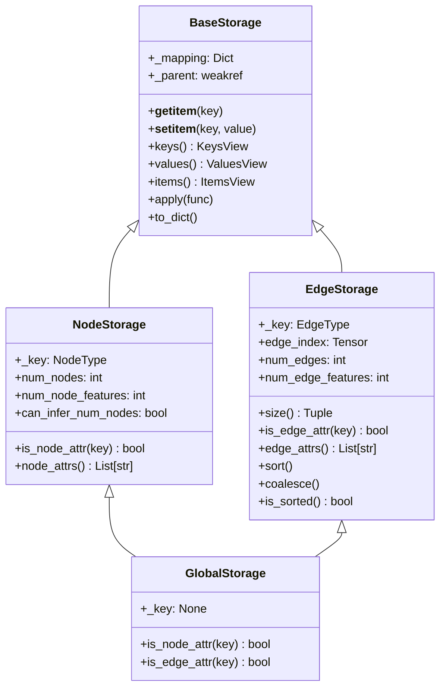
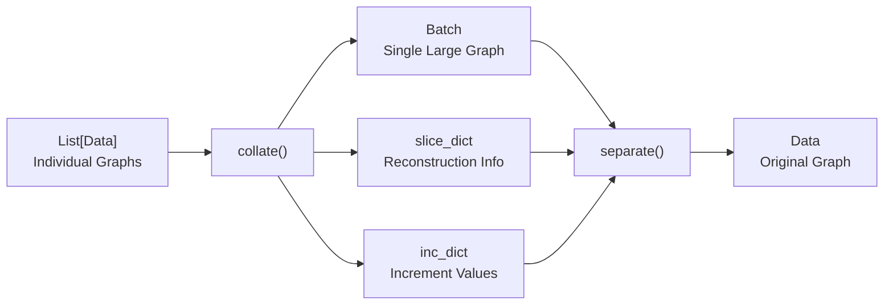
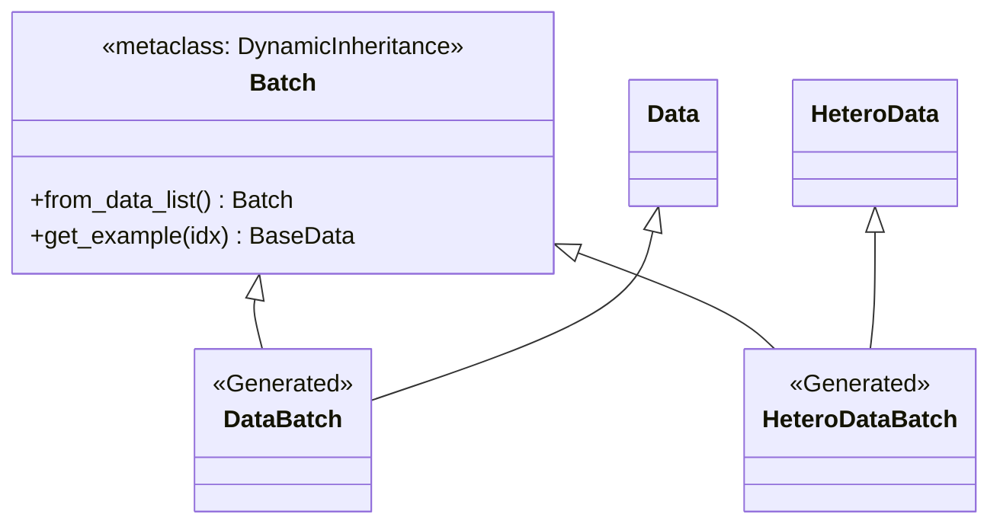

<!-- source: DeepWiki mcp.deepwiki.com · repo pyg-team/pytorch_geometric · page 2.3 Storage and Batching · fetched 2026-10-21 -->

# Storage and Batching

Relevant source files

The following files were used as context for generating this wiki page:

- [docs/source/_templates/autosummary/class.rst](docs/source/_templates/autosummary/class.rst)
- [docs/source/_templates/autosummary/inherited_class.rst](docs/source/_templates/autosummary/inherited_class.rst)
- [docs/source/modules/data.rst](docs/source/modules/data.rst)
- [test/conftest.py](test/conftest.py)
- [test/data/test_batch.py](test/data/test_batch.py)
- [test/data/test_data.py](test/data/test_data.py)
- [test/data/test_dataset.py](test/data/test_dataset.py)
- [test/data/test_feature_store.py](test/data/test_feature_store.py)
- [test/data/test_graph_store.py](test/data/test_graph_store.py)
- [test/data/test_hetero_data.py](test/data/test_hetero_data.py)
- [test/data/test_storage.py](test/data/test_storage.py)
- [test/io/test_fs.py](test/io/test_fs.py)
- [test/loader/test_dataloader.py](test/loader/test_dataloader.py)
- [test/utils/test_laplacian.py](test/utils/test_laplacian.py)
- [test/utils/test_mesh_laplacian.py](test/utils/test_mesh_laplacian.py)
- [torch_geometric/data/__init__.py](torch_geometric/data/__init__.py)
- [torch_geometric/data/batch.py](torch_geometric/data/batch.py)
- [torch_geometric/data/collate.py](torch_geometric/data/collate.py)
- [torch_geometric/data/data.py](torch_geometric/data/data.py)
- [torch_geometric/data/dataset.py](torch_geometric/data/dataset.py)
- [torch_geometric/data/download.py](torch_geometric/data/download.py)
- [torch_geometric/data/extract.py](torch_geometric/data/extract.py)
- [torch_geometric/data/feature_store.py](torch_geometric/data/feature_store.py)
- [torch_geometric/data/graph_store.py](torch_geometric/data/graph_store.py)
- [torch_geometric/data/hetero_data.py](torch_geometric/data/hetero_data.py)
- [torch_geometric/data/in_memory_dataset.py](torch_geometric/data/in_memory_dataset.py)
- [torch_geometric/data/makedirs.py](torch_geometric/data/makedirs.py)
- [torch_geometric/data/separate.py](torch_geometric/data/separate.py)
- [torch_geometric/data/storage.py](torch_geometric/data/storage.py)
- [torch_geometric/io/fs.py](torch_geometric/io/fs.py)
- [torch_geometric/loader/mixin.py](torch_geometric/loader/mixin.py)
- [torch_geometric/utils/laplacian.py](torch_geometric/utils/laplacian.py)

This page describes PyTorch Geometric's internal storage architecture and the collate/separate pipeline for creating and deconstructing mini-batches. The storage system defines how graph data is organized in memory through `BaseStorage`, `NodeStorage`, `EdgeStorage`, and `GlobalStorage` classes. The batching system defines how individual graphs are combined into a single disconnected graph for efficient mini-batch training.

For information about the high-level `Data` and `HeteroData` classes that use these storage mechanisms, see section 2.1. For information about custom tensor types like `EdgeIndex` and `Index`, see section 2.2.

## Storage Architecture

PyTorch Geometric uses a storage-based architecture to organize graph attributes. Each `Data` or `HeteroData` object contains one or more storage objects that hold node-level, edge-level, or global attributes [torch_geometric/data/data.py:79-90]().

### Storage Class Hierarchy

PyG employs a hierarchy of storage classes to manage different types of graph data.

Title: Storage Class Hierarchy

Sources: [torch_geometric/data/storage.py:54-54](), [torch_geometric/data/storage.py:397-397](), [torch_geometric/data/storage.py:533-533](), [torch_geometric/data/storage.py:759-759]()

### BaseStorage: Core Storage Functionality

`BaseStorage` is a `MutableMapping` that wraps a Python dictionary and provides standard dictionary access along with PyTorch-specific enhancements [torch_geometric/data/storage.py:54-65]().

1.  **Attribute access syntax**: Supports `storage.x = ...` in addition to `storage['x'] = ...` [torch_geometric/data/storage.py:89-109]().
2.  **Private attributes**: Attributes starting with `_` are stored in `__dict__` and not exposed to users via the mapping interface [torch_geometric/data/storage.py:106-107]().
3.  **Weak parent reference**: `storage._parent` holds a `weakref` to the containing `Data` or `HeteroData` object [torch_geometric/data/storage.py:104-105]().
4.  **Subset iteration**: `storage.values('x', 'y')` allows iterating over a specific subset of keys [torch_geometric/data/storage.py:182-183]().
5.  **PyTorch Tensor operations**: Provides `apply()` and `apply_()` to recursively apply functions (like `.to(device)`) to all stored tensors [torch_geometric/data/storage.py:188-202]().

Sources: [torch_geometric/data/storage.py:54-209]()

### NodeStorage: Node-Level Attributes

`NodeStorage` stores node-level information like node features (`x`), positions (`pos`), or node types [torch_geometric/data/storage.py:397-400]().

*   **Automatic `num_nodes` inference**: Infers the number of nodes from attributes like `x`, `pos`, or `batch` [torch_geometric/data/storage.py:441-470]().
*   **Node attribute detection**: `is_node_attr(key)` checks if an attribute is node-level by comparing its first dimension to the number of nodes [torch_geometric/data/storage.py:487-512]().
*   **Caching**: Uses `_cached_attr` to cache attribute type detection results (NODE, EDGE, or OTHER) [torch_geometric/data/storage.py:82-85](), [torch_geometric/data/storage.py:488-490]().

Sources: [torch_geometric/data/storage.py:397-531](), [torch_geometric/data/storage.py:44-45]()

### EdgeStorage: Edge-Level Attributes

`EdgeStorage` stores edge-level information including connectivity (`edge_index`) and edge features (`edge_attr`) [torch_geometric/data/storage.py:533-536]().

| Format | Attribute | Description |
| :--- | :--- | :--- |
| COO | `edge_index` | `[2, num_edges]` tensor in coordinate format [torch_geometric/data/storage.py:45]() |
| CSR/COO | `adj` | `SparseTensor` for source-to-target traversal [torch_geometric/data/storage.py:557-564]() |
| CSR/COO | `adj_t` | Transposed `SparseTensor` for target-to-source [torch_geometric/data/storage.py:566-573]() |

Key functionality includes graph property checks like `is_undirected()` and `is_bipartite()` [torch_geometric/data/storage.py:657-686]().

Sources: [torch_geometric/data/storage.py:533-757]()

### GlobalStorage: Combined Node and Edge Storage

`GlobalStorage` is used by homogeneous `Data` objects to store both node and edge attributes in a single object [torch_geometric/data/storage.py:759-760](). It disambiguates between node and edge attributes by checking the size of the tensor's first dimension against `num_nodes` and `num_edges` [torch_geometric/data/storage.py:809-844]().

Sources: [torch_geometric/data/storage.py:759-882]()

## The Collate/Separate Pipeline

The collate/separate pipeline enables mini-batch training by combining multiple graphs into a single large disconnected graph and later extracting individual graphs.

Title: Data Flow in Collate and Separate

Sources: [torch_geometric/data/collate.py:37-44](), [torch_geometric/data/separate.py:15-22]()

### The collate() Function

The `collate()` function combines a list of `Data` or `HeteroData` objects into a single batched object [torch_geometric/data/collate.py:37-53]().

**Function signature:**
`def collate(cls, data_list, increment=True, add_batch=True, follow_batch=None, exclude_keys=None)` [torch_geometric/data/collate.py:37-44]()

**Algorithm:**
1.  **Create empty output**: Instantiate `cls` and create empty stores matching the first item in `data_list` [torch_geometric/data/collate.py:55-61]().
2.  **Group stores by key**: Organize all storage objects by their `_key` [torch_geometric/data/collate.py:68-71]().
3.  **Collate each attribute**: For each attribute in the stores, call the internal `_collate()` function to combine values [torch_geometric/data/collate.py:87-110]().
4.  **Record metadata**: Slicing information is recorded in `slice_dict` and increment values in `inc_dict` [torch_geometric/data/collate.py:119-132]().
5.  **Add batch vectors**: If `add_batch=True`, create `batch` and `ptr` vectors for node storages [torch_geometric/data/collate.py:140-144]().

Sources: [torch_geometric/data/collate.py:37-146]()

### Collating Different Types

The internal `_collate()` function handles various attribute types [torch_geometric/data/collate.py:149-155]():

*   **Tensors**: Concatenated along the dimension specified by `__cat_dim__` [torch_geometric/data/collate.py:159-165](). If `increment=True`, values are increased by the amount returned by `__inc__` [torch_geometric/data/collate.py:168-174]().
*   **Index/EdgeIndex**: Concatenated while preserving specialized metadata like `sparse_size` or `is_sorted` [torch_geometric/data/collate.py:187-191]().
*   **SparseTensor**: Diagonally stacked using `torch_sparse.cat` [torch_geometric/data/collate.py:227-240]().

Sources: [torch_geometric/data/collate.py:149-311]()

### __cat_dim__ and __inc__ Methods

These methods in `BaseData` (and overridden in `Data`/`HeteroData`) control the batching behavior [torch_geometric/data/data.py:114-138]().

*   **`__cat_dim__(key, value, ...)`**: Returns the dimension along which to concatenate. By default, it returns `-1` for `edge_index` and `0` for others [torch_geometric/data/data.py:649-655]().
*   **`__inc__(key, value, ...)`**: Returns the incremental count to increase values. For `edge_index`, this is usually `num_nodes` [torch_geometric/data/data.py:663-672]().

Sources: [torch_geometric/data/data.py:649-672](), [torch_geometric/data/hetero_data.py:352-372]()

### The separate() Function

The `separate()` function extracts an individual graph from a batched object [torch_geometric/data/separate.py:15-30](). It uses the `slice_dict` to find the correct indices and `inc_dict` to decrement values (reversing the `__inc__` operation) [torch_geometric/data/separate.py:37-51]().

Sources: [torch_geometric/data/separate.py:15-56]()

## Batch Class

The `Batch` class represents a mini-batch of graphs as a single large disconnected graph [torch_geometric/data/batch.py:58-64]().

### Dynamic Inheritance

`Batch` uses a metaclass `DynamicInheritance` to ensure it inherits from the correct base class (either `Data` or `HeteroData`) at runtime [torch_geometric/data/batch.py:16-26]().

Title: Dynamic Inheritance Mechanism

Sources: [torch_geometric/data/batch.py:16-50](), [torch_geometric/data/batch.py:57-57]()

### Key Batch Methods

*   **`from_data_list(data_list, ...)`**: Constructs a `Batch` object by calling `collate()` on the provided list of graphs [torch_geometric/data/batch.py:83-104]().
*   **`get_example(idx)`**: Reconstructs a single `Data` or `HeteroData` object from the batch using `separate()` [torch_geometric/data/batch.py:112-133]().
*   **`index_select(idx)`**: Returns a list of individual graph objects for the specified indices [torch_geometric/data/batch.py:135-171]().

Sources: [torch_geometric/data/batch.py:82-171]()

### slice_dict and inc_dict Structure

These dictionaries are critical for reconstructing graphs from a `Batch` [torch_geometric/data/batch.py:107-108]().

| Dict | Purpose |
| :--- | :--- |
| `slice_dict` | Stores cumulative sizes of attributes to allow slicing (e.g., `x` might have slices `[0, 10, 25]` for two graphs) [torch_geometric/data/collate.py:167](). |
| `inc_dict` | Stores the offsets added to attributes during collation so they can be subtracted during separation [torch_geometric/data/collate.py:169-174](). |

Sources: [torch_geometric/data/collate.py:76-86](), [torch_geometric/data/batch.py:107-108]()

---

