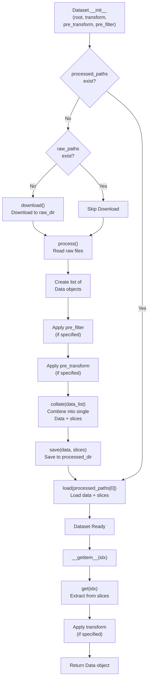
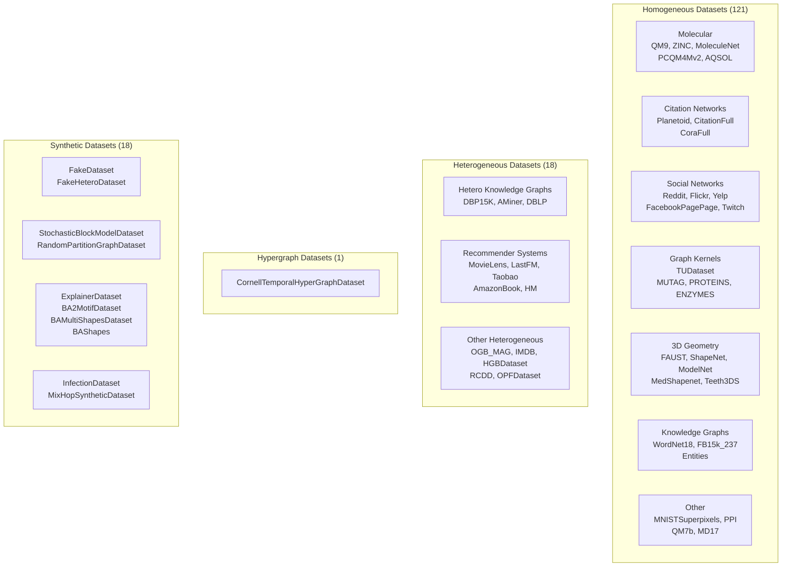

<!-- source: DeepWiki mcp.deepwiki.com · repo pyg-team/pytorch_geometric · page 3 Datasets · fetched 2026-10-21 -->

# Datasets

<details>
<summary>Relevant source files</summary>

The following files were used as context for generating this wiki page:

- [.github/CONTRIBUTING.md](.github/CONTRIBUTING.md)
- [.github/actions/setup/action.yml](.github/actions/setup/action.yml)
- [CHANGELOG.md](CHANGELOG.md)
- [CITATION.cff](CITATION.cff)
- [README.md](README.md)
- [docker/Dockerfile.xpu](docker/Dockerfile.xpu)
- [docs/source/install/installation.rst](docs/source/install/installation.rst)
- [docs/source/install/quick-start.html](docs/source/install/quick-start.html)
- [docs/source/notes/installation.rst](docs/source/notes/installation.rst)
- [pyproject.toml](pyproject.toml)
- [torch_geometric/__init__.py](torch_geometric/__init__.py)
- [torch_geometric/datasets/__init__.py](torch_geometric/datasets/__init__.py)
- [torch_geometric/datasets/faust.py](torch_geometric/datasets/faust.py)
- [torch_geometric/datasets/mnist_superpixels.py](torch_geometric/datasets/mnist_superpixels.py)
- [torch_geometric/datasets/modelnet.py](torch_geometric/datasets/modelnet.py)
- [torch_geometric/datasets/planetoid.py](torch_geometric/datasets/planetoid.py)
- [torch_geometric/datasets/shapenet.py](torch_geometric/datasets/shapenet.py)
- [torch_geometric/datasets/tu_dataset.py](torch_geometric/datasets/tu_dataset.py)
- [torch_geometric/typing.py](torch_geometric/typing.py)

</details>


PyTorch Geometric provides 158 built-in datasets spanning diverse domains including molecular chemistry, social networks, citation networks, 3D geometry, knowledge graphs, and more. These datasets are organized into four categories: **homogeneous** (121 datasets), **heterogeneous** (18 datasets), **hypergraph** (1 dataset), and **synthetic** (18 datasets). The dataset system provides a unified framework for downloading, processing, and accessing graph-structured data.

For information about the `Data` and `HeteroData` classes used to represent graphs, see [Dataset Classes and Processing](#3.2). For information about data loading and sampling during training, see [Data Loading and Sampling](#3.3).

## Dataset Architecture

PyG implements a hierarchical dataset system built around the `InMemoryDataset` class, which extends PyTorch's standard `Dataset` class. This architecture separates raw data handling from processed graph objects.

Title: Dataset Class Hierarchy

```mermaid
classDiagram
    class "torch.utils.data.Dataset" {
        <<PyTorch>>
        __getitem__(idx)
        __len__()
    }
    
    class "Dataset" {
        root: str
        transform: callable
        pre_transform: callable
        pre_filter: callable
        __getitem__(idx)
        __len__()
        download()
        process()
    }
    
    class "InMemoryDataset" {
        data: Data/HeteroData
        slices: dict
        download()
        process()
        save(data_list, path)
        load(path)
        get(idx)
        collate(data_list)
    }
    
    class "TUDataset" {
        name: str
        download()
        process()
        num_node_labels
        num_node_attributes
    }
    
    class "Planetoid" {
        name: str
        split: str
        download()
        process()
    }
    
    class "FAUST" {
        download()
        process()
    }
    
    "torch.utils.data.Dataset" <|-- "Dataset"
    "Dataset" <|-- "InMemoryDataset"
    "InMemoryDataset" <|-- "TUDataset"
    "InMemoryDataset" <|-- "Planetoid"
    "InMemoryDataset" <|-- "FAUST"
```

Sources: [torch_geometric/datasets/tu_dataset.py:4-8](), [torch_geometric/datasets/planetoid.py:7-11](), [torch_geometric/datasets/faust.py:6-10]()

## Dataset Processing Lifecycle

Title: Dataset Lifecycle: Raw to Processed Data



When a dataset is initialized, PyG follows this lifecycle:

1. **Check Processed Files**: If files in `processed_dir` exist, load them directly using `self.load(path)` [torch_geometric/datasets/faust.py:78-78]().
2. **Download Raw Data**: If not processed, download raw files to `raw_dir` using `download()` [torch_geometric/datasets/tu_dataset.py:195-201]().
3. **Process Data**: Convert raw files to PyG `Data` objects using `process()` [torch_geometric/datasets/planetoid.py:160-176]().
4. **Apply Pre-Processing**: Apply `pre_filter` to filter graphs and `pre_transform` to modify graphs before saving [torch_geometric/datasets/faust.py:102-106]().
5. **Collate and Save**: Combine all `Data` objects into a single structure with `collate()` and save to `processed_dir` [torch_geometric/datasets/tu_dataset.py:132-150]().
6. **Runtime Access**: When accessing graphs via `__getitem__`, extract from the collated structure and apply `transform`.

Sources: [torch_geometric/datasets/tu_dataset.py:115-159](), [torch_geometric/datasets/planetoid.py:85-130](), [torch_geometric/datasets/faust.py:66-112]()

## Dataset Categories

Title: PyTorch Geometric Built-in Dataset Catalog



Sources: [torch_geometric/datasets/__init__.py:122-247]()

### Built-in Datasets
PyG contains 158 built-in datasets. Notable examples include:
* **Molecular**: `QM9`, `ZINC`, and `MoleculeNet` for property prediction [torch_geometric/datasets/__init__.py:139-143]().
* **Citation**: `Planetoid` (Cora, CiteSeer, PubMed) for node classification [torch_geometric/datasets/planetoid.py:11-80]().
* **Social**: `Reddit`, `Flickr`, and `Yelp` for large-scale inductive learning [torch_geometric/datasets/__init__.py:133-136]().
* **3D Geometry**: `FAUST`, `ShapeNet`, and `ModelNet` for mesh and point cloud processing [torch_geometric/datasets/faust.py:10-62]().
* **Relational**: `RelBench` integration for tabular-to-graph conversion [CHANGELOG.md:28-28]().

For a full catalog, see [Built-in Datasets](#3.1).

### Dataset Classes and Processing
PyG provides base classes for custom data handling:
* `Dataset`: The base class for large datasets that do not fit into memory.
* `InMemoryDataset`: For datasets that can be fully loaded into CPU memory [torch_geometric/datasets/tu_dataset.py:8-8]().
* `io`: Module containing parsers for formats like PLY (`read_ply`), Planetoid (`read_planetoid_data`), and TU (`read_tu_data`) [torch_geometric/datasets/faust.py:7-7](), [torch_geometric/datasets/planetoid.py:8-8]().

For details on implementation, see [Dataset Classes and Processing](#3.2).

### Data Loading and Sampling
For training on large graphs, PyG provides specialized loaders:
* `DataLoader`: Standard mini-batching for multiple small graphs [README.md:26-26]().
* `NeighborLoader`: Sampling-based loader for single large graphs [CHANGELOG.md:742-742]().
* `LinkNeighborLoader`: Specialized sampler for link prediction tasks [CHANGELOG.md:742-742]().

For details on sampling strategies, see [Data Loading and Sampling](#3.3).

## Directory Structure

PyG datasets follow a standardized directory layout for caching and raw storage:

```
root/
├── raw/                  # Raw downloaded files (e.g., .zip, .txt)
│   └── ind.cora.x
└── processed/            # Processed PyG Data objects (.pt files)
    └── data.pt          # Collated Data + slices dictionary
```

Sources: [torch_geometric/datasets/tu_dataset.py:161-169](), [torch_geometric/datasets/planetoid.py:132-141]()

## Integration and Extensions
PyG's dataset system integrates with external libraries like `pyg-lib` for accelerated sampling and `RelBench` for relational database modeling [CHANGELOG.md:28-28](), [torch_geometric/typing.py:46-47](). It also supports `torch.compile` for optimized data processing pipelines [README.md:26-26]().

Sources: [CHANGELOG.md:28-28](), [torch_geometric/typing.py:46-88](), [README.md:23-26]()

---

