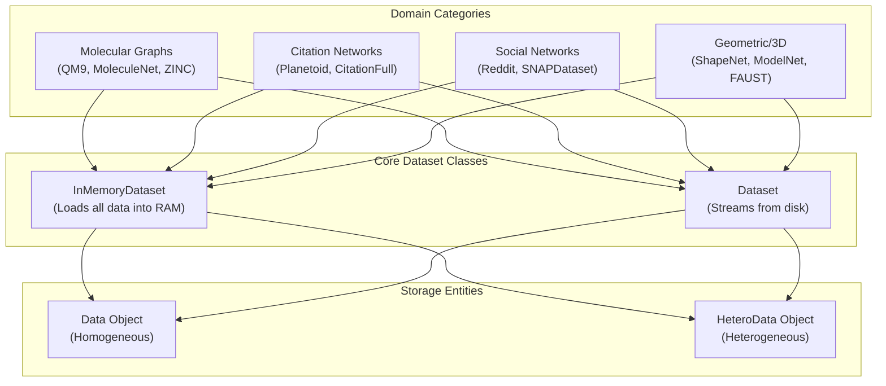
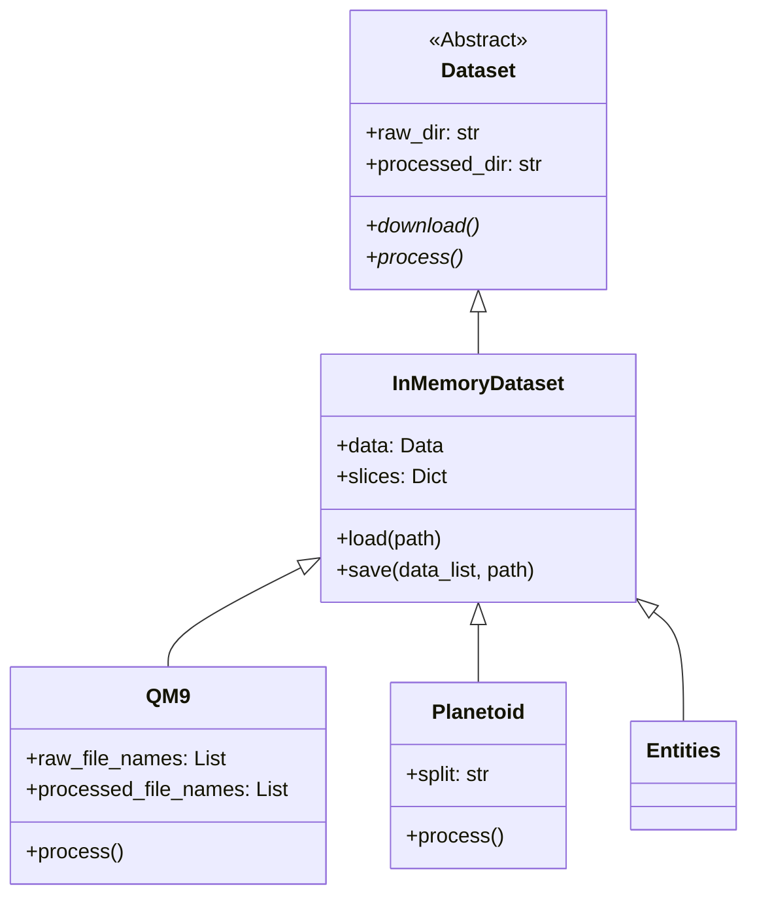

<!-- source: DeepWiki mcp.deepwiki.com · repo pyg-team/pytorch_geometric · page 3.1 Built-in Datasets · fetched 2026-10-21 -->

# Built-in Datasets

Relevant source files

The following files were used as context for generating this wiki page:

- [docs/source/notes/batching.rst](docs/source/notes/batching.rst)
- [examples/datapipe.py](examples/datapipe.py)
- [examples/llm/molecule_gpt.py](examples/llm/molecule_gpt.py)
- [examples/llm/protein_mpnn.py](examples/llm/protein_mpnn.py)
- [examples/qm9_pretrained_dimenet.py](examples/qm9_pretrained_dimenet.py)
- [examples/qm9_pretrained_schnet.py](examples/qm9_pretrained_schnet.py)
- [test/datasets/test_ba_shapes.py](test/datasets/test_ba_shapes.py)
- [test/datasets/test_fake.py](test/datasets/test_fake.py)
- [test/datasets/test_molecule_gpt_dataset.py](test/datasets/test_molecule_gpt_dataset.py)
- [test/datasets/test_protein_mpnn_dataset.py](test/datasets/test_protein_mpnn_dataset.py)
- [test/llm/models/test_git_mol.py](test/llm/models/test_git_mol.py)
- [test/llm/models/test_molecule_gpt.py](test/llm/models/test_molecule_gpt.py)
- [test/llm/utils/test_rag_backend_utils.py](test/llm/utils/test_rag_backend_utils.py)
- [test/nn/aggr/test_set2set.py](test/nn/aggr/test_set2set.py)
- [test/nn/models/test_schnet.py](test/nn/models/test_schnet.py)
- [test/nn/models/test_visnet.py](test/nn/models/test_visnet.py)
- [test/utils/test_ppr.py](test/utils/test_ppr.py)
- [test/utils/test_random.py](test/utils/test_random.py)
- [test/utils/test_smiles.py](test/utils/test_smiles.py)
- [torch_geometric/data/datapipes.py](torch_geometric/data/datapipes.py)
- [torch_geometric/datasets/actor.py](torch_geometric/datasets/actor.py)
- [torch_geometric/datasets/airfrans.py](torch_geometric/datasets/airfrans.py)
- [torch_geometric/datasets/airports.py](torch_geometric/datasets/airports.py)
- [torch_geometric/datasets/amazon.py](torch_geometric/datasets/amazon.py)
- [torch_geometric/datasets/amazon_book.py](torch_geometric/datasets/amazon_book.py)
- [torch_geometric/datasets/amazon_products.py](torch_geometric/datasets/amazon_products.py)
- [torch_geometric/datasets/aminer.py](torch_geometric/datasets/aminer.py)
- [torch_geometric/datasets/aqsol.py](torch_geometric/datasets/aqsol.py)
- [torch_geometric/datasets/attributed_graph_dataset.py](torch_geometric/datasets/attributed_graph_dataset.py)
- [torch_geometric/datasets/ba2motif_dataset.py](torch_geometric/datasets/ba2motif_dataset.py)
- [torch_geometric/datasets/ba_shapes.py](torch_geometric/datasets/ba_shapes.py)
- [torch_geometric/datasets/bitcoin_otc.py](torch_geometric/datasets/bitcoin_otc.py)
- [torch_geometric/datasets/citation_full.py](torch_geometric/datasets/citation_full.py)
- [torch_geometric/datasets/coauthor.py](torch_geometric/datasets/coauthor.py)
- [torch_geometric/datasets/coma.py](torch_geometric/datasets/coma.py)
- [torch_geometric/datasets/dblp.py](torch_geometric/datasets/dblp.py)
- [torch_geometric/datasets/dbp15k.py](torch_geometric/datasets/dbp15k.py)
- [torch_geometric/datasets/dynamic_faust.py](torch_geometric/datasets/dynamic_faust.py)
- [torch_geometric/datasets/email_eu_core.py](torch_geometric/datasets/email_eu_core.py)
- [torch_geometric/datasets/entities.py](torch_geometric/datasets/entities.py)
- [torch_geometric/datasets/fake.py](torch_geometric/datasets/fake.py)
- [torch_geometric/datasets/faust.py](torch_geometric/datasets/faust.py)
- [torch_geometric/datasets/flickr.py](torch_geometric/datasets/flickr.py)
- [torch_geometric/datasets/ged_dataset.py](torch_geometric/datasets/ged_dataset.py)
- [torch_geometric/datasets/git_mol_dataset.py](torch_geometric/datasets/git_mol_dataset.py)
- [torch_geometric/datasets/gnn_benchmark_dataset.py](torch_geometric/datasets/gnn_benchmark_dataset.py)
- [torch_geometric/datasets/hgb_dataset.py](torch_geometric/datasets/hgb_dataset.py)
- [torch_geometric/datasets/hm.py](torch_geometric/datasets/hm.py)
- [torch_geometric/datasets/hydro_net.py](torch_geometric/datasets/hydro_net.py)
- [torch_geometric/datasets/imdb.py](torch_geometric/datasets/imdb.py)
- [torch_geometric/datasets/karate.py](torch_geometric/datasets/karate.py)
- [torch_geometric/datasets/last_fm.py](torch_geometric/datasets/last_fm.py)
- [torch_geometric/datasets/linkx_dataset.py](torch_geometric/datasets/linkx_dataset.py)
- [torch_geometric/datasets/malnet_tiny.py](torch_geometric/datasets/malnet_tiny.py)
- [torch_geometric/datasets/md17.py](torch_geometric/datasets/md17.py)
- [torch_geometric/datasets/mnist_superpixels.py](torch_geometric/datasets/mnist_superpixels.py)
- [torch_geometric/datasets/modelnet.py](torch_geometric/datasets/modelnet.py)
- [torch_geometric/datasets/molecule_gpt_dataset.py](torch_geometric/datasets/molecule_gpt_dataset.py)
- [torch_geometric/datasets/molecule_net.py](torch_geometric/datasets/molecule_net.py)
- [torch_geometric/datasets/movie_lens.py](torch_geometric/datasets/movie_lens.py)
- [torch_geometric/datasets/movie_lens_100k.py](torch_geometric/datasets/movie_lens_100k.py)
- [torch_geometric/datasets/movie_lens_1m.py](torch_geometric/datasets/movie_lens_1m.py)
- [torch_geometric/datasets/nell.py](torch_geometric/datasets/nell.py)
- [torch_geometric/datasets/neurograph.py](torch_geometric/datasets/neurograph.py)
- [torch_geometric/datasets/ogb_mag.py](torch_geometric/datasets/ogb_mag.py)
- [torch_geometric/datasets/particle.py](torch_geometric/datasets/particle.py)
- [torch_geometric/datasets/pascal.py](torch_geometric/datasets/pascal.py)
- [torch_geometric/datasets/pascal_pf.py](torch_geometric/datasets/pascal_pf.py)
- [torch_geometric/datasets/planetoid.py](torch_geometric/datasets/planetoid.py)
- [torch_geometric/datasets/polblogs.py](torch_geometric/datasets/polblogs.py)
- [torch_geometric/datasets/ppi.py](torch_geometric/datasets/ppi.py)
- [torch_geometric/datasets/protein_mpnn_dataset.py](torch_geometric/datasets/protein_mpnn_dataset.py)
- [torch_geometric/datasets/qm7.py](torch_geometric/datasets/qm7.py)
- [torch_geometric/datasets/qm9.py](torch_geometric/datasets/qm9.py)
- [torch_geometric/datasets/rcdd.py](torch_geometric/datasets/rcdd.py)
- [torch_geometric/datasets/reddit.py](torch_geometric/datasets/reddit.py)
- [torch_geometric/datasets/reddit2.py](torch_geometric/datasets/reddit2.py)
- [torch_geometric/datasets/rel_link_pred_dataset.py](torch_geometric/datasets/rel_link_pred_dataset.py)
- [torch_geometric/datasets/s3dis.py](torch_geometric/datasets/s3dis.py)
- [torch_geometric/datasets/sbm_dataset.py](torch_geometric/datasets/sbm_dataset.py)
- [torch_geometric/datasets/shapenet.py](torch_geometric/datasets/shapenet.py)
- [torch_geometric/datasets/snap_dataset.py](torch_geometric/datasets/snap_dataset.py)
- [torch_geometric/datasets/suite_sparse.py](torch_geometric/datasets/suite_sparse.py)
- [torch_geometric/datasets/taobao.py](torch_geometric/datasets/taobao.py)
- [torch_geometric/datasets/tu_dataset.py](torch_geometric/datasets/tu_dataset.py)
- [torch_geometric/datasets/twitch.py](torch_geometric/datasets/twitch.py)
- [torch_geometric/datasets/upfd.py](torch_geometric/datasets/upfd.py)
- [torch_geometric/datasets/webkb.py](torch_geometric/datasets/webkb.py)
- [torch_geometric/datasets/wikics.py](torch_geometric/datasets/wikics.py)
- [torch_geometric/datasets/wikidata.py](torch_geometric/datasets/wikidata.py)
- [torch_geometric/datasets/wikipedia_network.py](torch_geometric/datasets/wikipedia_network.py)
- [torch_geometric/datasets/willow_object_class.py](torch_geometric/datasets/willow_object_class.py)
- [torch_geometric/datasets/word_net.py](torch_geometric/datasets/word_net.py)
- [torch_geometric/datasets/yelp.py](torch_geometric/datasets/yelp.py)
- [torch_geometric/datasets/zinc.py](torch_geometric/datasets/zinc.py)
- [torch_geometric/graphgym/utils/agg_runs.py](torch_geometric/graphgym/utils/agg_runs.py)
- [torch_geometric/logging.py](torch_geometric/logging.py)
- [torch_geometric/nn/models/schnet.py](torch_geometric/nn/models/schnet.py)
- [torch_geometric/nn/models/visnet.py](torch_geometric/nn/models/visnet.py)
- [torch_geometric/utils/ppr.py](torch_geometric/utils/ppr.py)
- [torch_geometric/utils/random.py](torch_geometric/utils/random.py)
- [torch_geometric/utils/smiles.py](torch_geometric/utils/smiles.py)

PyTorch Geometric (PyG) provides a vast collection of 158+ built-in datasets across multiple domains including molecular chemistry, social networks, citation networks, and 3D geometry. Each dataset is implemented as a specialized class that automates the download, raw file parsing, and processing lifecycle.

## Dataset Taxonomy

PyG datasets are categorized by their graph structure and application domain. The library supports homogeneous graphs, heterogeneous graphs, hypergraphs, and synthetic generators.

### Data Flow and Organization

**Sources:** [torch_geometric/datasets/__init__.py:1-245](), [torch_geometric/data/dataset.py:18-50](), [torch_geometric/data/in_memory_dataset.py:11-30]()

---

## Homogeneous Datasets

Homogeneous datasets contain a single node type and a single edge type. These are the most common benchmarks for GNNs.

### Molecular and Quantum Chemistry
These datasets represent atoms as nodes and chemical bonds as edges. 
*   **QM9**: Consists of ~130,000 molecules with 19 regression targets. It includes complete spatial information (3D coordinates) for each atom [torch_geometric/datasets/qm9.py:49-57]().
*   **ZINC**: A collection of drug-like molecules for graph regression [torch_geometric/datasets/zinc.py:10-25]().
*   **MoleculeNet**: A benchmark for molecular machine learning covering classification and regression [torch_geometric/datasets/molecule_net.py:15-30]().

### Citation Networks
Standard benchmarks for semi-supervised node classification where nodes are documents and edges are citation links.
*   **Planetoid**: Includes `Cora`, `CiteSeer`, and `PubMed`. These use binary masks for training, validation, and test splits [torch_geometric/datasets/planetoid.py:11-17]().
*   **CitationFull**: Extended versions of citation networks including `Cora_Full` [torch_geometric/datasets/citation_full.py:10-20]().

### Social and Web Networks
*   **Reddit**: A large-scale graph representing Reddit posts and their community affiliations [torch_geometric/datasets/reddit.py:10-25]().
*   **SNAPDataset**: A variety of datasets from the Stanford Network Analysis Platform, including `ego-facebook`, `soc-livejournal1`, and `wiki-talk` [torch_geometric/datasets/snap_dataset.py:160-195]().
*   **KarateClub**: Zachary's karate club network, a small social network of 34 nodes often used for community detection [torch_geometric/datasets/karate.py:8-16]().

### Geometric and 3D Datasets
These datasets focus on 3D structures, meshes, and point clouds.
*   **FAUST**: 100 watertight meshes representing human subjects in different poses [torch_geometric/datasets/faust.py:10-15]().
*   **ShapeNet**: ~17,000 3D shape point clouds from 16 categories, used for part-level segmentation [torch_geometric/datasets/shapenet.py:17-23]().
*   **MNISTSuperpixels**: MNIST images converted to graphs of 75 superpixels each [torch_geometric/datasets/mnist_superpixels.py:13-18]().

---

## Heterogeneous Datasets

Heterogeneous datasets contain multiple node and edge types, represented by the `HeteroData` class.

*   **Entities**: Relational entity networks like `AIFB`, `MUTAG`, `BGS`, and `AM`. These can be loaded as either `Data` or `HeteroData` objects [torch_geometric/datasets/entities.py:19-31]().
*   **OGB_MAG**: A heterogeneous academic graph from the Open Graph Benchmark containing papers, authors, institutions, and fields of study [torch_geometric/datasets/ogb_mag.py:10-25]().
*   **MovieLens**: Recommender system datasets consisting of users, movies, and their interactions [torch_geometric/datasets/movie_lens.py:10-20]().

---

## Synthetic Datasets

Synthetic datasets allow for controlled experiments by programmatically generating graph structures.

*   **FakeDataset**: Generates random homogeneous graphs with configurable parameters like `avg_num_nodes` and `avg_degree` [torch_geometric/datasets/fake.py:10-30]().
*   **SBMDataset**: Generates graphs based on the Stochastic Block Model to study community detection [torch_geometric/datasets/sbm_dataset.py:10-20]().

---

## Technical Implementation: The `InMemoryDataset` Lifecycle

Most built-in datasets inherit from `InMemoryDataset`. This class manages a two-step process: downloading raw files and processing them into a unified `.pt` file for fast loading.

### Code Entity Relationship Diagram

**Sources:** [torch_geometric/data/in_memory_dataset.py:11-30](), [torch_geometric/datasets/qm9.py:49-100](), [torch_geometric/datasets/planetoid.py:11-100]()

### Key Functions and Data Flow
1.  **`download()`**: Downloads raw data from a URL to the `raw_dir`. For example, `Planetoid` downloads files like `ind.cora.x` [torch_geometric/datasets/planetoid.py:152-159]().
2.  **`process()`**: Converts raw files into a list of `Data` objects. 
    *   `QM9` parses `.xyz` files and converts them into atom features and 3D positions [torch_geometric/datasets/qm9.py:194-250]().
    *   `TUDataset` uses `read_tu_data` to parse kernel benchmark formats [torch_geometric/datasets/tu_dataset.py:202-210]().
3.  **`collate()`**: Merges a list of `Data` objects into one large `Data` object and a `slices` dictionary for efficient indexing [torch_geometric/data/in_memory_dataset.py:83-84]().

---

## Domain-Specific Features

### Molecular Statistics in QM9
The `QM9` class provides specialized utilities for quantum chemistry, such as conversion factors (e.g., `HAR2EV` for Hartree to eV) and `atomrefs` for single-atom reference properties [torch_geometric/datasets/qm9.py:19-46](). It also provides a `mean()` and `std()` method to normalize regression targets [torch_geometric/datasets/qm9.py:158-171]().

### Pretrained Models
Some datasets are tightly coupled with specific models. `SchNet` includes a `from_qm9_pretrained` method that automatically downloads weights trained on specific QM9 targets [torch_geometric/nn/models/schnet.py:171-180]().

### Splitting Logic in Planetoid
The `Planetoid` dataset supports multiple split types:
*   `public`: The original fixed split from the paper [torch_geometric/datasets/planetoid.py:24-26]().
*   `full`: Uses all nodes except validation/test for training [torch_geometric/datasets/planetoid.py:27-30]().
*   `random`: Generates splits on-the-fly based on `num_train_per_class` [torch_geometric/datasets/planetoid.py:34-36, 112-129]().

**Sources:** [torch_geometric/datasets/qm9.py:19-171](), [torch_geometric/datasets/planetoid.py:24-129](), [torch_geometric/nn/models/schnet.py:171-180]()

---

