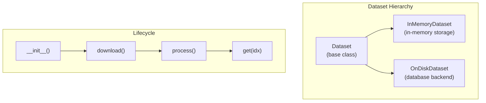
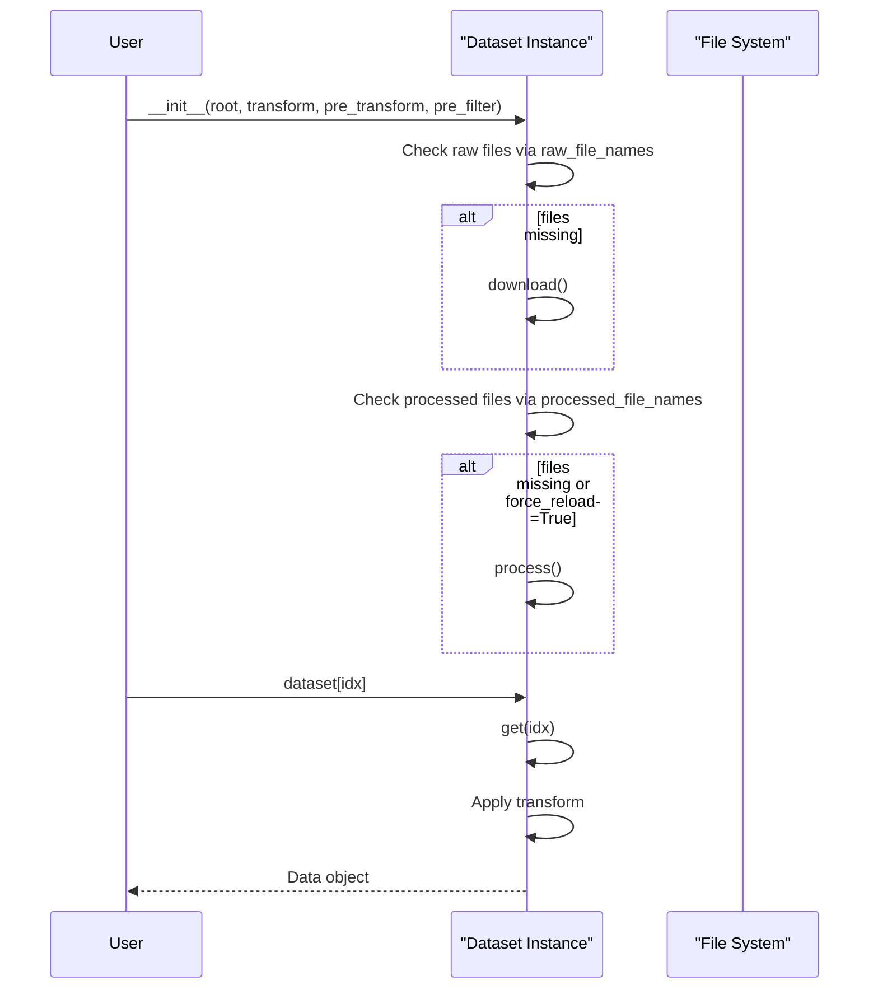
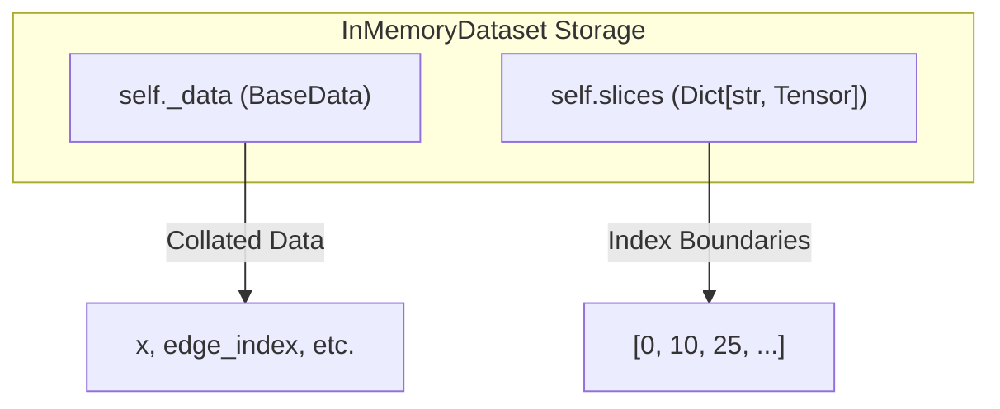

<!-- source: DeepWiki mcp.deepwiki.com · repo pyg-team/pytorch_geometric · page 3.2 Dataset Classes and Processing · fetched 2026-10-21 -->

# Dataset Classes and Processing

<details>
<summary>Relevant source files</summary>

The following files were used as context for generating this wiki page:

- [docs/source/_templates/autosummary/class.rst](docs/source/_templates/autosummary/class.rst)
- [docs/source/_templates/autosummary/inherited_class.rst](docs/source/_templates/autosummary/inherited_class.rst)
- [docs/source/modules/data.rst](docs/source/modules/data.rst)
- [test/conftest.py](test/conftest.py)
- [test/data/test_batch.py](test/data/test_batch.py)
- [test/data/test_data.py](test/data/test_data.py)
- [test/data/test_dataset.py](test/data/test_dataset.py)
- [test/data/test_feature_store.py](test/data/test_feature_store.py)
- [test/data/test_graph_store.py](test/data/test_graph_store.py)
- [test/data/test_hetero_data.py](test/data/test_hetero_data.py)
- [test/data/test_storage.py](test/data/test_storage.py)
- [test/datasets/test_bzr.py](test/datasets/test_bzr.py)
- [test/datasets/test_enzymes.py](test/datasets/test_enzymes.py)
- [test/datasets/test_imdb_binary.py](test/datasets/test_imdb_binary.py)
- [test/datasets/test_mutag.py](test/datasets/test_mutag.py)
- [test/datasets/test_planetoid.py](test/datasets/test_planetoid.py)
- [test/datasets/test_snap_dataset.py](test/datasets/test_snap_dataset.py)
- [test/datasets/test_suite_sparse.py](test/datasets/test_suite_sparse.py)
- [test/io/test_fs.py](test/io/test_fs.py)
- [test/loader/test_dataloader.py](test/loader/test_dataloader.py)
- [test/transforms/test_to_superpixels.py](test/transforms/test_to_superpixels.py)
- [test/utils/test_laplacian.py](test/utils/test_laplacian.py)
- [test/utils/test_mesh_laplacian.py](test/utils/test_mesh_laplacian.py)
- [torch_geometric/data/__init__.py](torch_geometric/data/__init__.py)
- [torch_geometric/data/batch.py](torch_geometric/data/batch.py)
- [torch_geometric/data/collate.py](torch_geometric/data/collate.py)
- [torch_geometric/data/data.py](torch_geometric/data/data.py)
- [torch_geometric/data/dataset.py](torch_geometric/data/dataset.py)
- [torch_geometric/data/download.py](torch_geometric/data/download.py)
- [torch_geometric/data/extract.py](torch_geometric/data/extract.py)
- [torch_geometric/data/feature_store.py](torch_geometric/data/feature_store.py)
- [torch_geometric/data/graph_store.py](torch_geometric/data/graph_store.py)
- [torch_geometric/data/hetero_data.py](torch_geometric/data/hetero_data.py)
- [torch_geometric/data/in_memory_dataset.py](torch_geometric/data/in_memory_dataset.py)
- [torch_geometric/data/makedirs.py](torch_geometric/data/makedirs.py)
- [torch_geometric/data/separate.py](torch_geometric/data/separate.py)
- [torch_geometric/data/storage.py](torch_geometric/data/storage.py)
- [torch_geometric/io/fs.py](torch_geometric/io/fs.py)
- [torch_geometric/io/obj.py](torch_geometric/io/obj.py)
- [torch_geometric/io/off.py](torch_geometric/io/off.py)
- [torch_geometric/io/planetoid.py](torch_geometric/io/planetoid.py)
- [torch_geometric/io/ply.py](torch_geometric/io/ply.py)
- [torch_geometric/io/sdf.py](torch_geometric/io/sdf.py)
- [torch_geometric/io/tu.py](torch_geometric/io/tu.py)
- [torch_geometric/io/txt_array.py](torch_geometric/io/txt_array.py)
- [torch_geometric/loader/mixin.py](torch_geometric/loader/mixin.py)
- [torch_geometric/utils/laplacian.py](torch_geometric/utils/laplacian.py)

</details>


**Purpose and Scope**: This page explains the `Dataset` and `InMemoryDataset` base classes in PyTorch Geometric, the download/process lifecycle, and how to create custom datasets. For information about specific built-in datasets (QM9, Planetoid, etc.), see [Built-in Datasets](#3.1). For information about loading data for training with DataLoader and neighbor sampling, see [Data Loading and Sampling](#3.3).

## Overview

PyG provides an extensible dataset framework built on top of `torch.utils.data.Dataset`. The core architecture consists of:

- **`Dataset`**: Abstract base class defining the interface for all datasets.
- **`InMemoryDataset`**: For datasets that fit entirely in CPU memory (most common).
- **`OnDiskDataset`**: For large datasets that cannot fit in memory, using database backends like SQLite.

All datasets follow a consistent lifecycle: download raw files → process into graph objects → provide indexed access.



**Dataset Hierarchy and Lifecycle**

Sources: [torch_geometric/data/dataset.py:30-88](), [torch_geometric/data/in_memory_dataset.py:32-63](), [torch_geometric/data/on_disk_dataset.py:15-15]()

## Dataset Base Class

The `Dataset` class [torch_geometric/data/dataset.py:30-408]() provides the abstract interface that all PyG datasets must implement. It extends `torch.utils.data.Dataset` and adds graph-specific functionality.

### Required Methods and Properties

Every custom dataset must implement these abstract methods:

| Method/Property | Type | Description |
|----------------|------|-------------|
| `raw_file_names` | property | Names of files in `raw_dir` required to skip downloading [torch_geometric/data/dataset.py:61-65]() |
| `processed_file_names` | property | Names of files in `processed_dir` required to skip processing [torch_geometric/data/dataset.py:68-72]() |
| `download()` | method | Downloads raw data to `raw_dir` [torch_geometric/data/dataset.py:74-76]() |
| `process()` | method | Processes raw data into graph objects [torch_geometric/data/dataset.py:78-80]() |
| `len()` | method | Returns number of data objects in the dataset [torch_geometric/data/dataset.py:82-84]() |
| `get(idx)` | method | Returns the graph object at index `idx` [torch_geometric/data/dataset.py:86-88]() |

### Directory Structure

The `Dataset` class manages two main directories:
- **`raw_dir`**: Located at `root/raw`, it contains the downloaded raw files [torch_geometric/data/dataset.py:122-124]().
- **`processed_dir`**: Located at `root/processed`, it contains the processed data objects (usually `.pt` files) [torch_geometric/data/dataset.py:126-128]().

### Dataset Lifecycle

The dataset initialization follows a well-defined sequence in `__init__`:



Sources: [torch_geometric/data/dataset.py:90-117](), [torch_geometric/data/dataset.py:225-273]()

### Transform Pipeline

PyG provides three stages of data transformation [torch_geometric/data/dataset.py:93-97]():

| Transform | When Applied | Saved to Disk | Use Case |
|-----------|--------------|---------------|----------|
| `pre_filter` | During `process()`, before saving | No (only filtered graphs saved) | Remove unwanted graphs from dataset |
| `pre_transform` | During `process()`, before saving | Yes | Expensive computations done once (e.g., computing graph features) |
| `transform` | Every time `get()` is called | No | Data augmentation, on-the-fly transformations |

## InMemoryDataset

The `InMemoryDataset` class [torch_geometric/data/in_memory_dataset.py:32-355]() is designed for datasets that fit entirely in CPU memory. It stores all graphs in a single, collated representation for efficient memory usage.

### Internal Storage Mechanism

`InMemoryDataset` uses a collation strategy to store multiple graphs as one large object:



The `collate()` static method [torch_geometric/data/in_memory_dataset.py:144-162]() concatenates all graphs into a single large graph, and `slices` stores the boundaries. The `get()` method [torch_geometric/data/in_memory_dataset.py:101-121]() uses `separate()` to extract individual graphs on demand.

Sources: [torch_geometric/data/in_memory_dataset.py:84-86](), [torch_geometric/data/in_memory_dataset.py:144-162](), [torch_geometric/data/separate.py:15-15]()

### Creating a Custom InMemoryDataset

A custom implementation typically follows this structure:

```python
class MyDataset(InMemoryDataset):
    def __init__(self, root, transform=None, pre_transform=None, pre_filter=None):
        super().__init__(root, transform, pre_transform, pre_filter)
        # Load the processed data into memory
        self.load(self.processed_paths[0])

    def process(self):
        data_list = [...] # Generate list of Data objects
        # Save using the built-in save method which calls collate()
        self.save(data_list, self.processed_paths[0])
```

Sources: [torch_geometric/data/in_memory_dataset.py:124-143]()

## Data Collation and Separation

The collation mechanism is central to how PyG batches graphs for training.

### Collation Process

The `collate()` function [torch_geometric/data/collate.py:37-146]() combines multiple `Data` objects:

1. **Concatenate tensors**: Attributes are concatenated along their `__cat_dim__` [torch_geometric/data/collate.py:163-165]().
2. **Increment indices**: Attributes containing "index" are incremented by `__inc__` values to maintain connectivity in the large graph [torch_geometric/data/collate.py:168-174]().
3. **Add batch vector**: A `batch` vector is created to map each node to its respective graph identifier [torch_geometric/data/collate.py:140-144]().

### Key Methods: `__cat_dim__` and `__inc__`

These methods in the `Data` class control collation behavior:
- **`__cat_dim__`**: Defines the dimension along which to concatenate tensors (e.g., 0 for node features, -1 for edge indices) [torch_geometric/data/data.py:649-657]().
- **`__inc__`**: Defines the incremental count to increase values (e.g., increment `edge_index` by the number of nodes in previous graphs) [torch_geometric/data/data.py:660-671]().

## IO Module and File Parsers

PyG includes specialized parsers for various graph and geometric file formats in the `torch_geometric.io` module:

| Parser | Format | Description |
|--------|--------|-------------|
| `planetoid` | Planetoid | Loads citation network datasets (Cora, CiteSeer, PubMed) [torch_geometric/io/planetoid.py:1-1]() |
| `tu` | TU Datasets | Loads standard graph kernel benchmarks [torch_geometric/io/tu.py:1-1]() |
| `obj` | Wavefront .OBJ | Parses 3D mesh data [torch_geometric/io/obj.py:1-1]() |
| `ply` | Polygon .PLY | Parses 3D mesh data [torch_geometric/io/ply.py:1-1]() |
| `sdf` | .SDF | Parses molecular structure data [torch_geometric/io/sdf.py:1-1]() |

These parsers are often utilized within the `process()` method of specific dataset implementations.

Sources: [torch_geometric/io/planetoid.py:1-1](), [torch_geometric/io/tu.py:1-1](), [torch_geometric/io/obj.py:1-1](), [torch_geometric/io/ply.py:1-1](), [torch_geometric/io/sdf.py:1-1]()

## Dataset Summary Statistics

The `Dataset` class provides a `get_summary()` method [torch_geometric/data/dataset.py:370-383]() that returns a `Summary` object containing statistical information about the dataset, such as:
- Number of nodes (min, max, mean, std)
- Number of edges (min, max, mean, std)
- Feature dimensionality

This is useful for verifying dataset integrity and understanding the data distribution.

Sources: [torch_geometric/data/dataset.py:370-383]()

---

