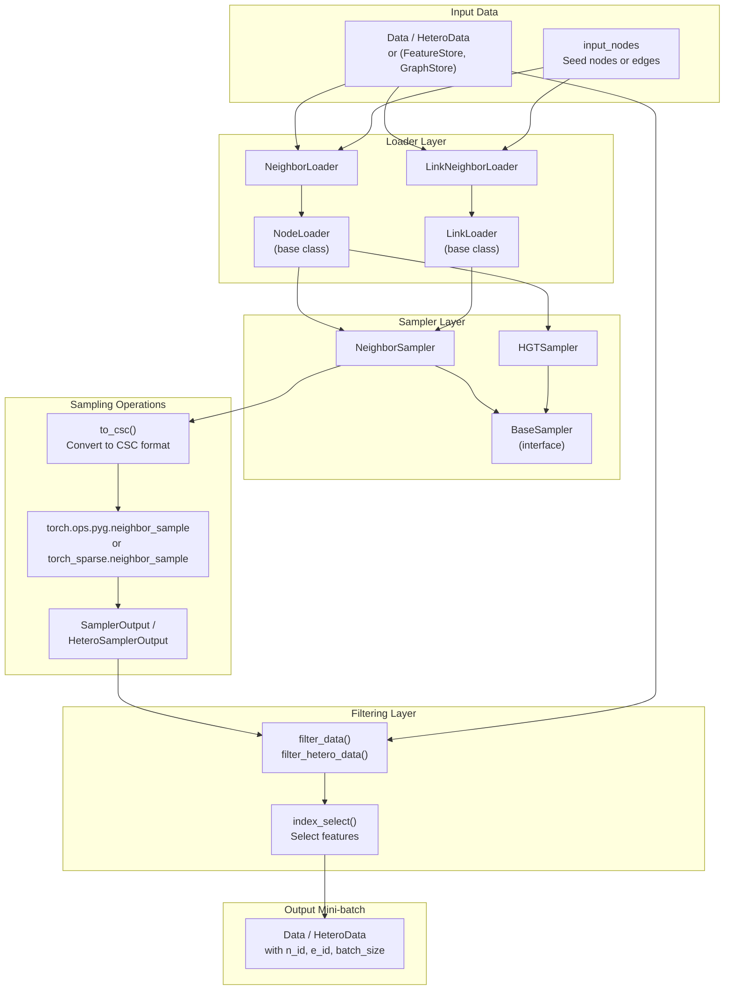
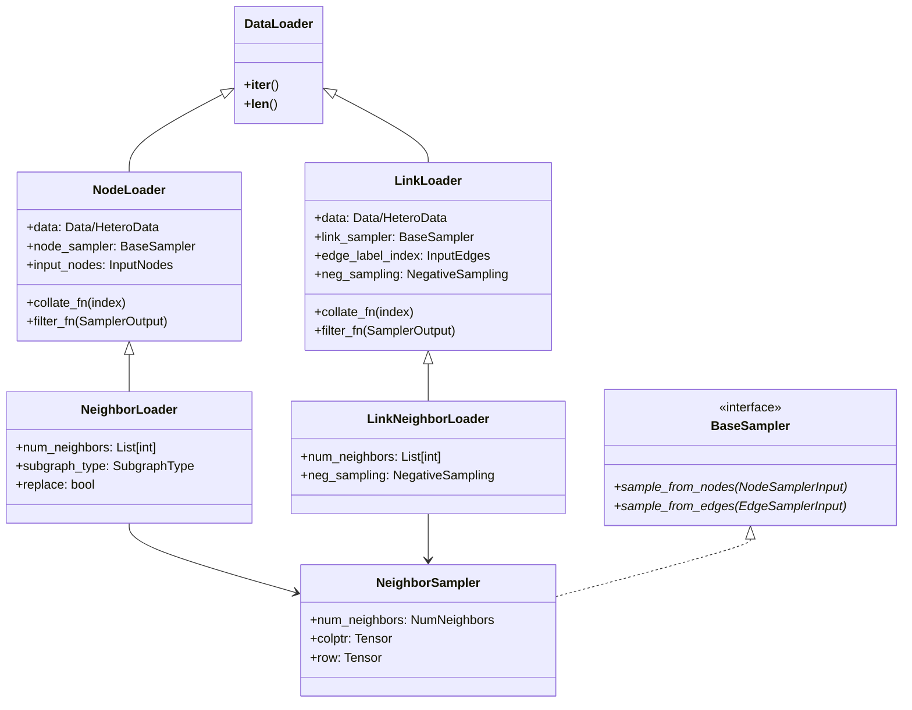

<!-- source: DeepWiki mcp.deepwiki.com · repo pyg-team/pytorch_geometric · page 3.3 Data Loading and Sampling · fetched 2026-10-21 -->

# Data Loading and Sampling

<details>
<summary>Relevant source files</summary>

The following files were used as context for generating this wiki page:

- [test/data/test_datapipes.py](test/data/test_datapipes.py)
- [test/loader/test_cluster.py](test/loader/test_cluster.py)
- [test/loader/test_hgt_loader.py](test/loader/test_hgt_loader.py)
- [test/loader/test_link_neighbor_loader.py](test/loader/test_link_neighbor_loader.py)
- [test/loader/test_neighbor_loader.py](test/loader/test_neighbor_loader.py)
- [test/loader/test_neighbor_sampler.py](test/loader/test_neighbor_sampler.py)
- [test/nn/conv/test_general_conv.py](test/nn/conv/test_general_conv.py)
- [test/nn/conv/test_pdn_conv.py](test/nn/conv/test_pdn_conv.py)
- [test/sampler/test_sampler_base.py](test/sampler/test_sampler_base.py)
- [test/sampler/test_sampler_neighbor_sampler.py](test/sampler/test_sampler_neighbor_sampler.py)
- [torch_geometric/data/on_disk_dataset.py](torch_geometric/data/on_disk_dataset.py)
- [torch_geometric/loader/base.py](torch_geometric/loader/base.py)
- [torch_geometric/loader/cluster.py](torch_geometric/loader/cluster.py)
- [torch_geometric/loader/data_list_loader.py](torch_geometric/loader/data_list_loader.py)
- [torch_geometric/loader/dataloader.py](torch_geometric/loader/dataloader.py)
- [torch_geometric/loader/graph_saint.py](torch_geometric/loader/graph_saint.py)
- [torch_geometric/loader/hgt_loader.py](torch_geometric/loader/hgt_loader.py)
- [torch_geometric/loader/link_loader.py](torch_geometric/loader/link_loader.py)
- [torch_geometric/loader/link_neighbor_loader.py](torch_geometric/loader/link_neighbor_loader.py)
- [torch_geometric/loader/neighbor_loader.py](torch_geometric/loader/neighbor_loader.py)
- [torch_geometric/loader/neighbor_sampler.py](torch_geometric/loader/neighbor_sampler.py)
- [torch_geometric/loader/node_loader.py](torch_geometric/loader/node_loader.py)
- [torch_geometric/loader/utils.py](torch_geometric/loader/utils.py)
- [torch_geometric/nn/conv/general_conv.py](torch_geometric/nn/conv/general_conv.py)
- [torch_geometric/sampler/__init__.py](torch_geometric/sampler/__init__.py)
- [torch_geometric/sampler/base.py](torch_geometric/sampler/base.py)
- [torch_geometric/sampler/hgt_sampler.py](torch_geometric/sampler/hgt_sampler.py)
- [torch_geometric/sampler/neighbor_sampler.py](torch_geometric/sampler/neighbor_sampler.py)
- [torch_geometric/sampler/utils.py](torch_geometric/sampler/utils.py)

</details>


This page explains the data loading and sampling mechanisms in PyTorch Geometric (PyG), which enable mini-batch training of GNNs on large-scale graphs. PyG's loader and sampler architecture allows efficient neighbor sampling for graphs that cannot be processed in full-batch mode.

## Overview

Data loading and sampling in PyG addresses the fundamental challenge of training on large graphs by extracting local subgraphs around seed nodes or edges. The system consists of three main components:

1.  **Loaders** (`NeighborLoader`, `LinkNeighborLoader`) - High-level interfaces for creating mini-batches.
2.  **Samplers** (`NeighborSampler`, `HGTSampler`) - Core sampling algorithms that extract subgraphs.
3.  **Filtering utilities** - Functions that convert sampled indices into usable `Data`/`HeteroData` objects.

The sampling pipeline enables training on graphs with millions of nodes by sampling k-hop neighborhoods around seed nodes, rather than loading the entire graph into memory.

**Diagram: Data Loading and Sampling Pipeline**



Sources:
- [torch_geometric/loader/neighbor_loader.py:10-150]()
- [torch_geometric/loader/link_neighbor_loader.py:10-140]()
- [torch_geometric/sampler/neighbor_sampler.py:40-100]()
- [torch_geometric/loader/utils.py:32-165]()

## Loader Architecture

PyG's loader architecture separates concerns between high-level data loading (`NodeLoader`, `LinkLoader`) and low-level sampling algorithms (`BaseSampler` implementations). This design enables flexibility in sampling strategies while maintaining a consistent interface.

**Diagram: Loader and Sampler Class Hierarchy**



The loader workflow consists of three phases:

1.  **Collation phase** (`collate_fn`): Selects seed nodes/edges from `NodeSamplerInput` or `EdgeSamplerInput` and invokes the sampler. [torch_geometric/loader/node_loader.py:143-152]()
2.  **Sampling phase**: Sampler extracts k-hop neighborhoods and returns `SamplerOutput` or `HeteroSamplerOutput`. [torch_geometric/sampler/base.py:167-250]()
3.  **Filtering phase** (`filter_fn`): Converts sampled indices to full `Data`/`HeteroData` objects with features using utilities like `filter_data`. [torch_geometric/loader/utils.py:159-165]()

Sources:
- [torch_geometric/loader/node_loader.py:30-131]()
- [torch_geometric/loader/link_loader.py:31-145]()
- [torch_geometric/loader/neighbor_loader.py:10-150]()
- [torch_geometric/sampler/base.py:54-165]()

## NeighborLoader

The `NeighborLoader` is the primary loader for node-level tasks on large graphs. It implements neighbor sampling by sampling a fixed number of neighbors at each hop for each seed node.

### Basic Usage

The `NeighborLoader` constructor accepts parameters for graph structure, sampling depth, and mini-batching.

| Parameter | Type | Description |
| :--- | :--- | :--- |
| `data` | `Data`, `HeteroData`, or `(FeatureStore, GraphStore)` | The graph to sample from. [torch_geometric/loader/neighbor_loader.py:115-118]() |
| `num_neighbors` | `List[int]` or `Dict[EdgeType, List[int]]` | Number of neighbors per hop. Use `-1` for all neighbors. [torch_geometric/loader/neighbor_loader.py:119-123]() |
| `input_nodes` | `Tensor`, `str`, or `Tuple[str, Tensor]` | Seed nodes to sample from. [torch_geometric/loader/neighbor_loader.py:124-131]() |
| `subgraph_type` | `SubgraphType` | `'directional'`, `'bidirectional'`, or `'induced'`. [torch_geometric/loader/neighbor_loader.py:139-148]() |
| `disjoint` | `bool` | Whether to create disjoint subgraphs per seed node. [torch_geometric/loader/neighbor_loader.py:149-152]() |

The loader returns `Data` or `HeteroData` objects with additional attributes:
*   **`n_id`**: Global node index for every sampled node. [torch_geometric/loader/neighbor_loader.py:108]()
*   **`e_id`**: Global edge index for every sampled edge. [torch_geometric/loader/neighbor_loader.py:109]()
*   **`batch_size`**: Number of seed nodes in this batch. [torch_geometric/loader/neighbor_loader.py:107]()
*   **`num_sampled_nodes`**: Number of sampled nodes in each hop. [torch_geometric/loader/neighbor_loader.py:111]()

### Subgraph Types

The `subgraph_type` parameter (from `SubgraphType` enum) controls which edges are included in the sampled subgraph:
*   **`directional`**: Only includes edges along the sampling path.
*   **`bidirectional`**: Converts all sampled edges to bidirectional.
*   **`induced`**: Includes the induced subgraph of all sampled nodes.

Sources:
- [torch_geometric/loader/neighbor_loader.py:10-150]()
- [torch_geometric/sampler/base.py:46-51]()
- [test/loader/test_neighbor_loader.py:42-46]()

## LinkNeighborLoader

The `LinkNeighborLoader` extends neighbor sampling to link prediction tasks. It first selects a sample of edges from `edge_label_index` and then constructs a subgraph from the nodes present in this list. [torch_geometric/loader/link_neighbor_loader.py:10-21]()

### Negative Sampling

The `neg_sampling` parameter (configured via `NegativeSampling` class) controls how negative edges are generated for training.
*   **Binary mode**: Returns `edge_label_index` and a binary `edge_label` (0 = negative, 1 = positive). [torch_geometric/loader/link_loader.py:77-82]()
*   **Triplet mode**: Provides `src_index`, `dst_pos_index`, and `dst_neg_index`. [torch_geometric/loader/link_loader.py:93-96]()

Sources:
- [torch_geometric/loader/link_neighbor_loader.py:10-146]()
- [torch_geometric/loader/link_loader.py:75-100]()
- [test/loader/test_link_neighbor_loader.py:25-54]()

## NeighborSampler Implementation

The `NeighborSampler` class implements the core neighbor sampling algorithm. It is responsible for converting the graph to a format suitable for sampling and performing the actual sampling operations.

### CSC Conversion

The sampler converts graph data into Compressed Sparse Column (CSC) format to allow fast access to neighbors of a given node. This is handled by `to_csc` for homogeneous graphs and `to_hetero_csc` for heterogeneous graphs. [torch_geometric/sampler/utils.py:46-140]()

```python
# Conversion returns colptr and row indices
colptr, row, perm = to_csc(data, device='cpu', share_memory=share_memory)
```

### Sampling Logic

The sampler supports:
*   **Temporal Sampling**: Using `time_attr` to ensure neighbors fulfill temporal constraints. [torch_geometric/sampler/neighbor_sampler.py:51-53]()
*   **Weighted Sampling**: Using `weight_attr` for biased neighbor selection. [torch_geometric/sampler/neighbor_sampler.py:53]()
*   **Directional Sampling**: Supporting both `'forward'` and `'backward'` sampling directions. [torch_geometric/sampler/neighbor_sampler.py:57]()

Sources:
- [torch_geometric/sampler/neighbor_sampler.py:40-180]()
- [torch_geometric/sampler/utils.py:46-140]()

## Filtering and Feature Retrieval

After the sampler returns indices, the loader retrieves the actual node and edge features. This is handled by the `filter_fn` method, which uses utilities in `torch_geometric.loader.utils`.

### The Filtering Pipeline

1.  **`filter_node_store_`**: Filters a node storage object to only hold nodes in the sampled index. [torch_geometric/loader/utils.py:85-99]()
2.  **`filter_edge_store_`**: Filters an edge storage object to only hold the sampled edges. [torch_geometric/loader/utils.py:101-157]()
3.  **`index_select`**: Efficiently indexes features along the specified dimension, using shared memory in background processes to avoid extra copies. [torch_geometric/loader/utils.py:32-83]()

Sources:
- [torch_geometric/loader/utils.py:32-165]()
- [torch_geometric/loader/node_loader.py:154-175]()

## DataLoader and Collation

The standard PyG `DataLoader` merges `Data` or `HeteroData` objects into mini-batches.

### The Collater Class

The `Collater` class handles the transformation of a list of data objects into a single `Batch` object. [torch_geometric/loader/dataloader.py:13-49]()

```python
# Internal logic of Collater.__call__
if isinstance(elem, BaseData):
    return Batch.from_data_list(batch, follow_batch=self.follow_batch, ...)
```

It supports various element types, including `BaseData`, `torch.Tensor`, and `TensorFrame`. [torch_geometric/loader/dataloader.py:26-35]()

Sources:
- [torch_geometric/loader/dataloader.py:13-93]()
- [torch_geometric/data/batch.py:7]() (referenced via Batch.from_data_list)

## HGTLoader

The `HGTLoader` implements the Heterogeneous Graph Sampler from the "Heterogeneous Graph Transformer" paper. It maintains a node budget for each node type to determine sampling probabilities and keep the sampled sub-graph dense. [torch_geometric/loader/hgt_loader.py:11-28]()

It utilizes the `HGTSampler` backend. [torch_geometric/loader/hgt_loader.py:115-120]()

Sources:
- [torch_geometric/loader/hgt_loader.py:11-131]()
- [torch_geometric/sampler/hgt_sampler.py:23-92]()

---

