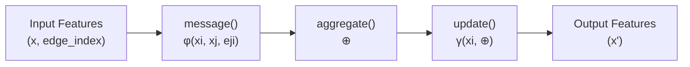
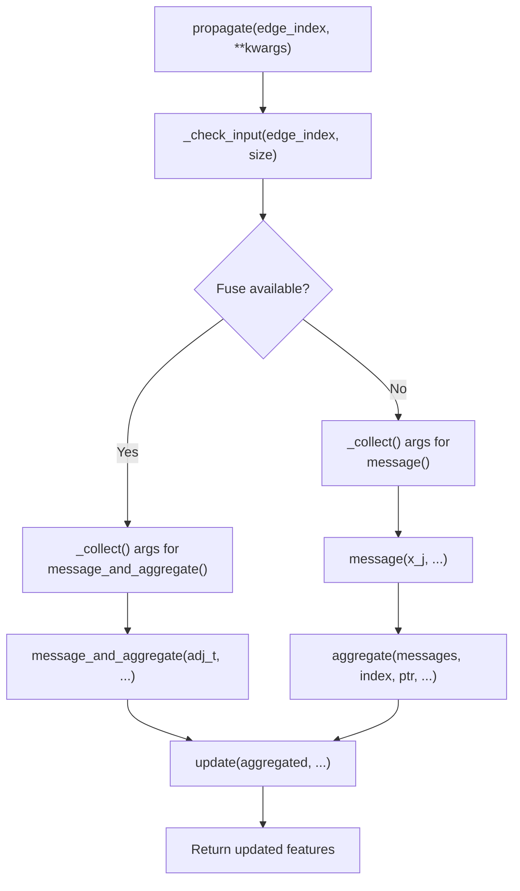
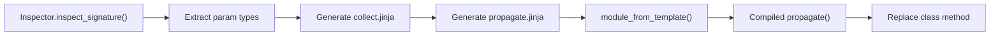
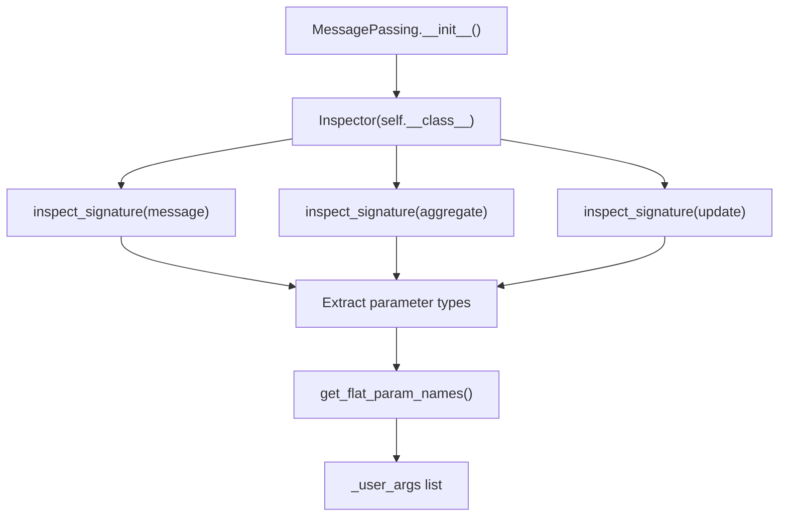
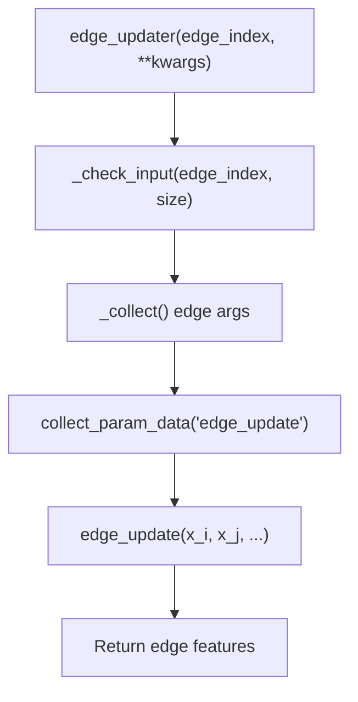

<!-- source: DeepWiki mcp.deepwiki.com · repo pyg-team/pytorch_geometric · page 4 Message Passing Framework · fetched 2026-10-21 -->

# Message Passing Framework

<details>
<summary>Relevant source files</summary>

The following files were used as context for generating this wiki page:

- [test/nn/aggr/test_attention.py](test/nn/aggr/test_attention.py)
- [test/nn/aggr/test_basic.py](test/nn/aggr/test_basic.py)
- [test/nn/aggr/test_fused.py](test/nn/aggr/test_fused.py)
- [test/nn/aggr/test_multi.py](test/nn/aggr/test_multi.py)
- [test/nn/conv/test_message_passing.py](test/nn/conv/test_message_passing.py)
- [test/nn/test_sequential.py](test/nn/test_sequential.py)
- [test/test_inspector.py](test/test_inspector.py)
- [torch_geometric/inspector.py](torch_geometric/inspector.py)
- [torch_geometric/nn/aggr/__init__.py](torch_geometric/nn/aggr/__init__.py)
- [torch_geometric/nn/aggr/attention.py](torch_geometric/nn/aggr/attention.py)
- [torch_geometric/nn/aggr/base.py](torch_geometric/nn/aggr/base.py)
- [torch_geometric/nn/aggr/basic.py](torch_geometric/nn/aggr/basic.py)
- [torch_geometric/nn/aggr/fused.py](torch_geometric/nn/aggr/fused.py)
- [torch_geometric/nn/aggr/gmt.py](torch_geometric/nn/aggr/gmt.py)
- [torch_geometric/nn/aggr/gru.py](torch_geometric/nn/aggr/gru.py)
- [torch_geometric/nn/aggr/lstm.py](torch_geometric/nn/aggr/lstm.py)
- [torch_geometric/nn/aggr/mlp.py](torch_geometric/nn/aggr/mlp.py)
- [torch_geometric/nn/aggr/multi.py](torch_geometric/nn/aggr/multi.py)
- [torch_geometric/nn/aggr/set2set.py](torch_geometric/nn/aggr/set2set.py)
- [torch_geometric/nn/aggr/set_transformer.py](torch_geometric/nn/aggr/set_transformer.py)
- [torch_geometric/nn/aggr/sort.py](torch_geometric/nn/aggr/sort.py)
- [torch_geometric/nn/conv/collect.jinja](torch_geometric/nn/conv/collect.jinja)
- [torch_geometric/nn/conv/edge_updater.jinja](torch_geometric/nn/conv/edge_updater.jinja)
- [torch_geometric/nn/conv/message_passing.py](torch_geometric/nn/conv/message_passing.py)
- [torch_geometric/nn/conv/propagate.jinja](torch_geometric/nn/conv/propagate.jinja)
- [torch_geometric/nn/sequential.jinja](torch_geometric/nn/sequential.jinja)
- [torch_geometric/nn/sequential.py](torch_geometric/nn/sequential.py)
- [torch_geometric/utils/_softmax.py](torch_geometric/utils/_softmax.py)

</details>


## Purpose and Scope

The Message Passing Framework is the foundational abstraction in PyTorch Geometric that enables the implementation of Graph Neural Networks (GNNs). This page documents the [`MessagePassing`](torch_geometric/nn/conv/message_passing.py:39-1042)() base class, which provides a unified interface for defining message passing operations through the **message**, **aggregate**, and **update** paradigm. All 50+ convolutional layers in PyG (e.g., `GCNConv`, `GATConv`, `SAGEConv`) inherit from this class.

For information about specific GNN layer implementations, see [Convolutional Layers](#5.1). For composition of multiple layers into models, see [Sequential and Model Composition](#4.4). For the aggregation operators that can be used, see [Aggregation System](#4.3).

---

## Message Passing Paradigm

Message passing layers implement the following computation for each node $i$ in a graph:

$$\mathbf{x}_i^{\prime} = \gamma_{\mathbf{\Theta}} \left( \mathbf{x}_i, \bigoplus_{j \in \mathcal{N}(i)} \phi_{\mathbf{\Theta}} \left(\mathbf{x}_i, \mathbf{x}_j,\mathbf{e}_{j,i}\right) \right)$$

Where:
- $\phi_{\mathbf{\Theta}}$ is the **message function** that computes messages from neighbor $j$ to node $i$
- $\bigoplus$ is a **differentiable, permutation-invariant aggregation** (e.g., sum, mean, max)
- $\gamma_{\mathbf{\Theta}}$ is the **update function** that combines aggregated messages with node features

This three-stage process is implemented through three core methods:

Title: Message Passing Three-Stage Pipeline


Sources: [torch_geometric/nn/conv/message_passing.py:40-54]()

---

## The MessagePassing Base Class

### Class Definition and Initialization

The [`MessagePassing`](torch_geometric/nn/conv/message_passing.py:39-1042)() class is the abstract base class for all message passing layers. It handles the mechanics of message propagation, allowing subclasses to focus on defining the message, aggregation, and update logic.

**Initialization Parameters:**

| Parameter | Type | Default | Description |
|-----------|------|---------|-------------|
| `aggr` | `str`, `List[str]`, or `Aggregation` | `"sum"` | Aggregation scheme (e.g., "add", "mean", "max") or custom `Aggregation` module |
| `aggr_kwargs` | `Dict[str, Any]` | `None` | Arguments passed to aggregation function |
| `flow` | `str` | `"source_to_target"` | Message flow direction |
| `node_dim` | `int` | `-2` | Axis along which to propagate |
| `decomposed_layers` | `int` | `1` | Number of feature decomposition layers for memory efficiency |

Sources: [torch_geometric/nn/conv/message_passing.py:110-182]()

### Special Arguments

The `MessagePassing` class automatically provides special arguments to the `message()`, `aggregate()`, and `update()` methods based on the graph structure:

| Argument | Description | Available In |
|----------|-------------|--------------|
| `edge_index` | Graph connectivity `[2, num_edges]` | `message_and_aggregate()` |
| `edge_index_i` | Target node indices | `message()`, `edge_update()` |
| `edge_index_j` | Source node indices | `message()`, `edge_update()` |
| `adj_t` | `SparseTensor` or `torch.sparse.Tensor` | `message_and_aggregate()` |
| `index` | Same as `edge_index_i` | `aggregate()` |
| `ptr` | CSR/CSC row/column pointers | `aggregate()` |
| `size` | `(N, M)` assignment matrix size | All methods |
| `size_i` | Target node dimension size | All methods |
| `size_j` | Source node dimension size | All methods |
| `dim_size` | Same as `size_i` | `aggregate()` |

Sources: [torch_geometric/nn/conv/message_passing.py:101-104]()

### Bipartite Graphs

The framework supports bipartite graphs where source and target nodes have different feature dimensions. User-defined tensors can be passed as tuples `(x_source, x_target)`:

```python
# Bipartite message passing
conv = MyConv((in_channels_src, in_channels_tgt), out_channels)
out = conv((x_src, x_tgt), edge_index, size=(N_src, N_tgt))
```

The `_i` and `_j` suffix notation automatically indexes into the appropriate tensor.

Sources: [test/nn/conv/test_message_passing.py:101-123]()

---

## The Propagate Pipeline

### Lifecycle Overview

The [`propagate()`](torch_geometric/nn/conv/message_passing.py:421-563)() method orchestrates the entire message passing computation.

Title: Propagate Method Execution Flow


Sources: [torch_geometric/nn/conv/message_passing.py:421-563]()

### The _collect() Method

The [`_collect()`](torch_geometric/nn/conv/message_passing.py:335-414)() method is responsible for gathering and preparing arguments for the message/aggregate/update functions. It:

1. **Extracts edge indices** from various formats (`Tensor`, `SparseTensor`, `EdgeIndex`).
2. **Lifts node features** to edge features using `_lift()` with `_i`/`_j` suffixes.
3. **Handles bipartite graphs** by indexing into tuples.
4. **Infers sizes** from tensor dimensions.

The collected arguments are then passed to the Inspector system to dispatch only the required parameters to each method.

Sources: [torch_geometric/nn/conv/message_passing.py:335-414](), [torch_geometric/nn/conv/collect.jinja:22-163]()

### Code Generation via Jinja2 Templates

For performance, the `propagate()` method is JIT-compiled using Jinja2 templates. The [`_set_jittable_templates()`](torch_geometric/nn/conv/message_passing.py:171)() method generates optimized Python code based on the specific method signatures.

Title: Jinja2 Template-Based Code Generation Pipeline


Sources: [torch_geometric/nn/conv/message_passing.py:1008-1091](), [torch_geometric/nn/conv/propagate.jinja:1-214]()

---

## Implementing Custom GNN Layers

### Basic Example: EdgeConv

Implementing a custom layer involves inheriting from `MessagePassing` and overriding the lifecycle methods:

```python
class EdgeConv(MessagePassing):
    def __init__(self, in_channels, out_channels):
        super().__init__(aggr="max")
        self.mlp = torch.nn.Sequential(...)

    def forward(self, x, edge_index):
        return self.propagate(edge_index, x=x)

    def message(self, x_j, x_i):
        return self.mlp(torch.cat([x_i, x_j - x_i], dim=-1))
```

### Method Signatures

**1. `message(x_j: Tensor, ...) -> Tensor`**
- Computes messages from source nodes to target nodes.
- Receives `x_j` (source) and `x_i` (target) automatically via suffixes.

**2. `aggregate(inputs: Tensor, index: Tensor, ...) -> Tensor`**
- Aggregates messages from neighbors.
- Default implementation delegates to `self.aggr_module`.

**3. `update(inputs: Tensor, ...) -> Tensor`**
- Updates node embeddings after aggregation.

**4. `message_and_aggregate(adj_t: SparseTensor, ...) -> Tensor`**
- Fused message computation and aggregation for efficiency.

Sources: [torch_geometric/nn/conv/message_passing.py:565-616]()

---

## Inspector and Dynamic Introspection

### Inspector System

The [`Inspector`](torch_geometric/inspector.py:24-427)() class provides dynamic introspection of method signatures, enabling automatic argument collection and dispatch.

Title: Inspector Initialization and Signature Inspection


Sources: [torch_geometric/nn/conv/message_passing.py:138-151](), [torch_geometric/inspector.py:24-133]()

### Collect Parameter Data

During execution, [`collect_param_data()`](torch_geometric/inspector.py:299-319)() extracts only the required arguments from the available kwargs dictionary. This ensures each method receives exactly the parameters it declares.

Sources: [torch_geometric/nn/conv/message_passing.py:517-523](), [torch_geometric/inspector.py:299-319]()

---

## Aggregation System

### Built-in Aggregation Operators

The `aggr` parameter can be specified as strings which resolve to modules:
- `"add"` / `"sum"`: [`SumAggregation`](torch_geometric/nn/aggr/basic.py:12)()
- `"mean"`: [`MeanAggregation`](torch_geometric/nn/aggr/basic.py:25)()
- `"max"`: [`MaxAggregation`](torch_geometric/nn/aggr/basic.py:39)()
- `"softmax"`: [`SoftmaxAggregation`](torch_geometric/nn/aggr/basic.py:142)()
- `"lstm"`: [`LSTMAggregation`](torch_geometric/nn/aggr/lstm.py:11)()

### Multi-Aggregation

Multiple aggregations can be combined using [`MultiAggregation`](torch_geometric/nn/aggr/multi.py:14)():

```python
super().__init__(aggr=['mean', 'max', 'std'])
```

This concatenates results by default. For details, see [Aggregation System](#4.3).

Sources: [torch_geometric/nn/conv/message_passing.py:56-68](), [torch_geometric/nn/aggr/multi.py:14-50]()

---

## Edge Updates

The [`edge_updater()`](torch_geometric/nn/conv/message_passing.py:620-665)() method enables computation of edge features:

Title: Edge Updater Execution Flow


Sources: [torch_geometric/nn/conv/message_passing.py:620-665](), [torch_geometric/nn/conv/edge_updater.jinja:1-75]()

---

## Hook System

`MessagePassing` provides a comprehensive hook system:

| Method | Trigger Point |
|--------|---------------|
| `register_propagate_forward_pre_hook()` | Before `propagate()` |
| `register_message_forward_hook()` | After `message()` |
| `register_aggregate_forward_pre_hook()` | Before `aggregate()` |

Sources: [torch_geometric/nn/conv/message_passing.py:158-168](), [test/nn/conv/test_message_passing.py:428-515]()

---

## Advanced Features

- **Fused Aggregation**: [`FusedAggregation`](torch_geometric/nn/aggr/fused.py:20)() shares intermediate values (like counts) between aggregators (e.g., `sum` and `mean`) for speedups.
- **Feature Decomposition**: [`decomposed_layers`](torch_geometric/nn/conv/message_passing.py:76-98) reduces peak memory by processing feature chunks sequentially.
- **Explainability**: Integration with `torch_geometric.explain` via the `explain` property and `explain_message()` logic.

Sources: [torch_geometric/nn/aggr/fused.py:20-57](), [torch_geometric/nn/conv/message_passing.py:76-98](), [torch_geometric/nn/conv/message_passing.py:707-767]()

---

## Child Pages

- [MessagePassing Base Class](#4.1) — Detailed interface and lifecycle methods.
- [Inspector and Code Generation](#4.2) — Dynamic introspection and Jinja2 templates.
- [Aggregation System](#4.3) — Comprehensive catalog of aggregation operators.
- [Sequential and Model Composition](#4.4) — Chaining layers and heterogeneous transforms.

---

