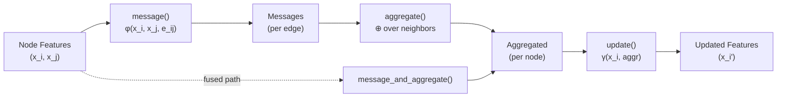
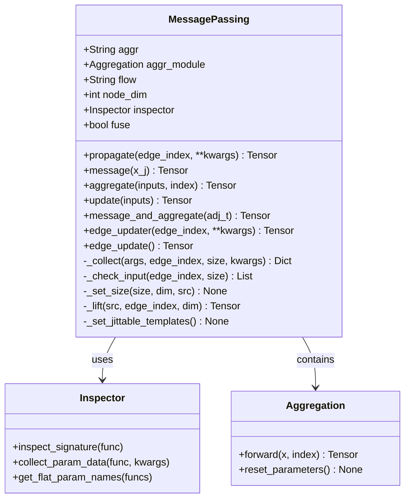
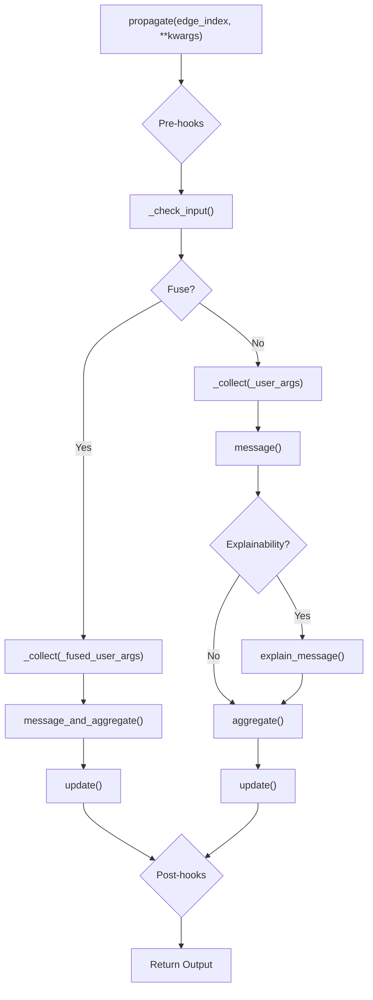
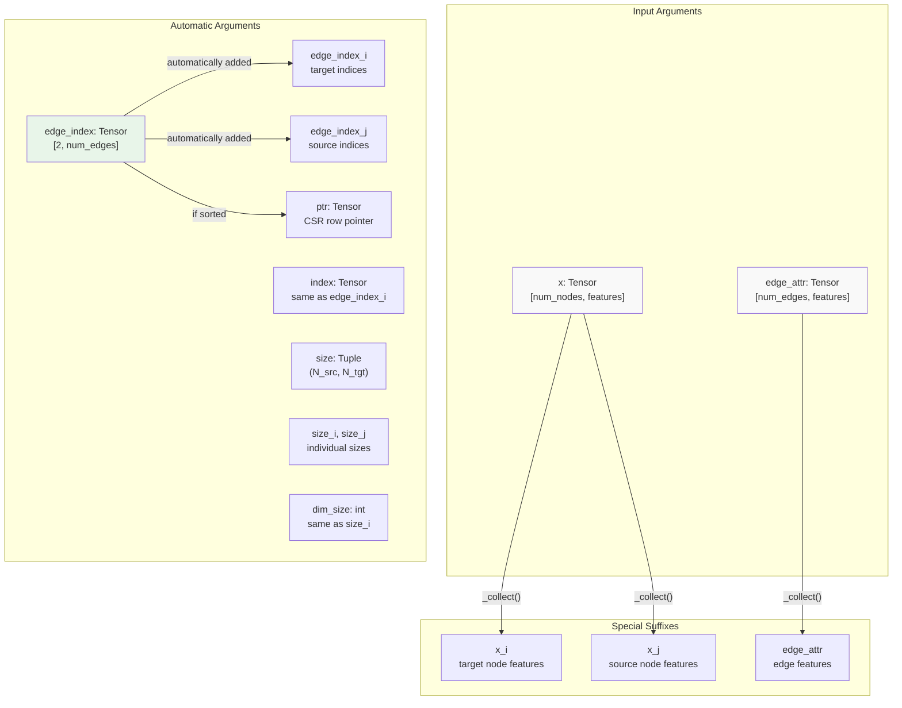
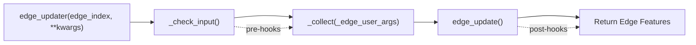
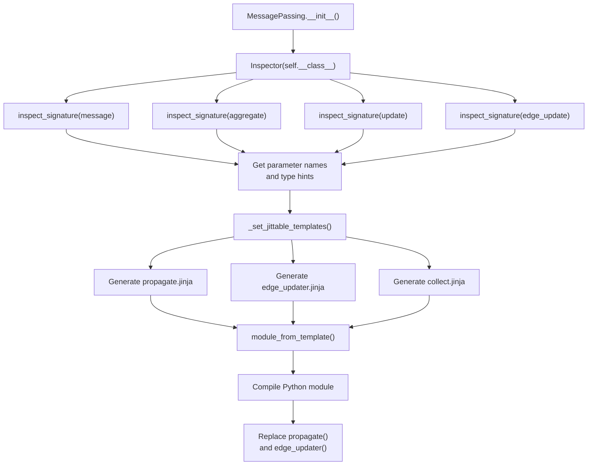
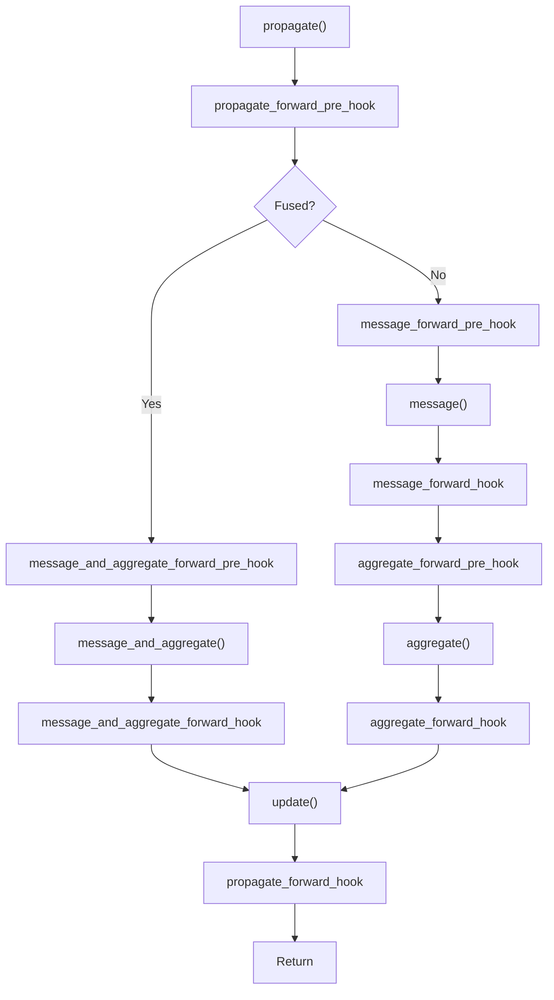
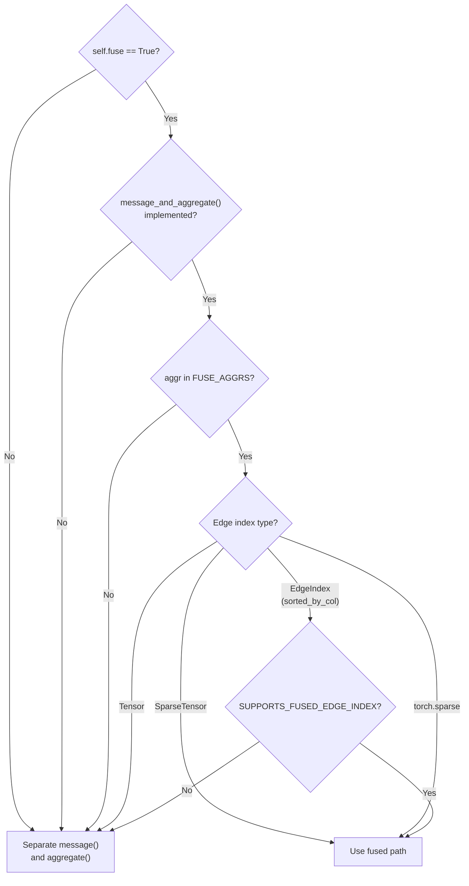
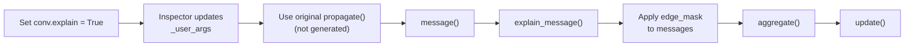
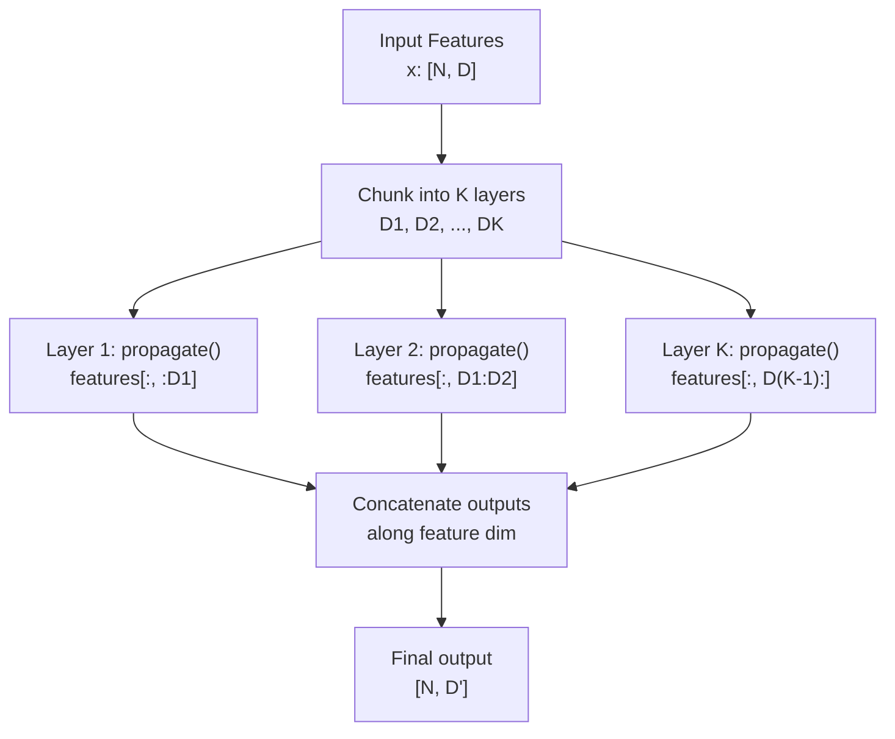

<!-- source: DeepWiki mcp.deepwiki.com · repo pyg-team/pytorch_geometric · page 4.1 MessagePassing Base Class · fetched 2026-10-21 -->

# MessagePassing Base Class

<details>
<summary>Relevant source files</summary>

The following files were used as context for generating this wiki page:

- [docs/source/notes/create_dataset.rst](docs/source/notes/create_dataset.rst)
- [docs/source/notes/create_gnn.rst](docs/source/notes/create_gnn.rst)
- [docs/source/notes/graphgym.rst](docs/source/notes/graphgym.rst)
- [docs/source/notes/introduction.rst](docs/source/notes/introduction.rst)
- [docs/source/notes/jit.rst](docs/source/notes/jit.rst)
- [docs/source/notes/load_csv.rst](docs/source/notes/load_csv.rst)
- [docs/source/notes/sparse_tensor.rst](docs/source/notes/sparse_tensor.rst)
- [examples/ogbn_proteins_deepgcn.py](examples/ogbn_proteins_deepgcn.py)
- [test/nn/conv/test_create_gnn.py](test/nn/conv/test_create_gnn.py)
- [test/nn/conv/test_message_passing.py](test/nn/conv/test_message_passing.py)
- [test/nn/test_sequential.py](test/nn/test_sequential.py)
- [test/test_inspector.py](test/test_inspector.py)
- [torch_geometric/inspector.py](torch_geometric/inspector.py)
- [torch_geometric/nn/conv/collect.jinja](torch_geometric/nn/conv/collect.jinja)
- [torch_geometric/nn/conv/edge_updater.jinja](torch_geometric/nn/conv/edge_updater.jinja)
- [torch_geometric/nn/conv/message_passing.py](torch_geometric/nn/conv/message_passing.py)
- [torch_geometric/nn/conv/propagate.jinja](torch_geometric/nn/conv/propagate.jinja)
- [torch_geometric/nn/sequential.jinja](torch_geometric/nn/sequential.jinja)
- [torch_geometric/nn/sequential.py](torch_geometric/nn/sequential.py)

</details>


## Purpose and Scope

The `MessagePassing` class is the foundational base class for implementing Graph Neural Network (GNN) layers in PyTorch Geometric. It provides a standardized framework for defining message passing operations following the form:

$$\mathbf{x}_i^{\prime} = \gamma_{\mathbf{\Theta}} \left( \mathbf{x}_i, \bigoplus_{j \in \mathcal{N}(i)} \phi_{\mathbf{\Theta}} \left(\mathbf{x}_i, \mathbf{x}_j,\mathbf{e}_{j,i}\right) \right)$$

This page documents the `MessagePassing` base class interface, lifecycle methods, and internal mechanisms. For implementations of specific GNN layers built on this foundation, see [Convolutional Layers](#5.1), [Attention-based Layers](#5.2), and [Specialized Layers](#5.3). For the Inspector system used for introspection, see [Inspector and Code Generation](#4.2). For aggregation strategies, see [Aggregation System](#4.3).

**Sources:** [torch_geometric/nn/conv/message_passing.py:39-99]()

## Core Message Passing Paradigm

The `MessagePassing` framework breaks down graph convolutions into three fundamental operations:



**Diagram: Message Passing Lifecycle**

### Lifecycle Methods

| Method | Input | Output | Purpose |
|--------|-------|--------|---------|
| `message(x_j, ...)` | Features from source nodes | Messages per edge | Constructs messages from neighbors |
| `aggregate(inputs, index, ...)` | Messages and target indices | Aggregated features per node | Reduces messages using ⊕ operation |
| `update(inputs, ...)` | Aggregated features | Final node features | Post-processes aggregated messages |
| `message_and_aggregate(adj_t, ...)` | Sparse adjacency and features | Aggregated features per node | Fused operation for sparse tensors |

**Sources:** [torch_geometric/nn/conv/message_passing.py:565-616]()

## Class Architecture



**Diagram: MessagePassing Class Structure**

**Sources:** [torch_geometric/nn/conv/message_passing.py:39-192]()

## Constructor Parameters

The `MessagePassing` constructor accepts several configuration parameters:

```python
def __init__(
    self,
    aggr: Optional[Union[str, List[str], Aggregation]] = 'sum',
    *,
    aggr_kwargs: Optional[Dict[str, Any]] = None,
    flow: str = "source_to_target",
    node_dim: int = -2,
    decomposed_layers: int = 1,
) -> None:
```

### Key Parameters

- **`aggr`**: Aggregation scheme - supports strings (`'sum'`, `'mean'`, `'max'`, `'min'`, `'mul'`), list of strings for multi-aggregation, or custom `Aggregation` modules [torch_geometric/nn/conv/message_passing.py:112-134]().
- **`aggr_kwargs`**: Additional arguments passed to the aggregation resolver [torch_geometric/nn/conv/message_passing.py:114]().
- **`flow`**: Message passing direction - `'source_to_target'` (default) or `'target_to_source'` [torch_geometric/nn/conv/message_passing.py:121-123]().
- **`node_dim`**: Dimension along which to propagate (default: `-2`) [torch_geometric/nn/conv/message_passing.py:136]().
- **`decomposed_layers`**: Number of feature decomposition layers for memory-efficient inference [torch_geometric/nn/conv/message_passing.py:76-98]().

**Sources:** [torch_geometric/nn/conv/message_passing.py:110-181]()

## The propagate() Entry Point

The `propagate()` method is the main entry point that orchestrates the message passing process:



**Diagram: propagate() Execution Flow**

### Edge Index Formats

The `propagate()` method accepts multiple edge index representations:

| Format | Type | Layout | Usage |
|--------|------|--------|-------|
| COO Tensor | `torch.Tensor` | `[2, num_edges]` | Standard PyTorch format [torch_geometric/nn/conv/message_passing.py:421]() |
| EdgeIndex | `torch_geometric.EdgeIndex` | `[2, num_edges]` + metadata | Enhanced with CSR/CSC caching [torch_geometric/nn/conv/message_passing.py:421]() |
| SparseTensor | `torch_geometric.typing.SparseTensor` | Sparse matrix | torch-sparse library [torch_geometric/nn/conv/message_passing.py:421]() |
| torch.sparse | `torch.Tensor` (sparse) | COO/CSR/CSC | Native PyTorch sparse [torch_geometric/nn/conv/message_passing.py:421]() |

**Sources:** [torch_geometric/nn/conv/message_passing.py:421-563]()

## Special Arguments System

The `MessagePassing` framework provides automatic argument mapping through special naming conventions:



**Diagram: Argument Collection and Mapping**

### The _collect() Method

The `_collect()` method performs the following transformations:

1. **Index-based lifting**: Maps node features to edges using `_lift()` and `index_select()` [torch_geometric/nn/conv/message_passing.py:307-333]().
2. **Suffix resolution**: Automatically creates `_i` and `_j` variants [torch_geometric/nn/conv/message_passing.py:335-414]().
3. **Sparse tensor handling**: Extracts indices, pointers, and values from sparse formats [torch_geometric/nn/conv/message_passing.py:343-363]().
4. **Bipartite graphs**: Supports separate source/target feature tensors [torch_geometric/nn/conv/message_passing.py:335-341]().

**Sources:** [torch_geometric/nn/conv/message_passing.py:335-414]()

## Implementing Custom Layers

To create a custom GNN layer, inherit from `MessagePassing` and override the relevant methods:

### Basic Example

```python
class MyConv(MessagePassing):
    def __init__(self, in_channels, out_channels):
        super().__init__(aggr='add')  # Specify aggregation
        self.lin = Linear(in_channels, out_channels)
    
    def forward(self, x, edge_index):
        # x: [N, in_channels]
        # edge_index: [2, E]
        return self.propagate(edge_index, x=x)
    
    def message(self, x_j):
        # x_j: [E, in_channels] (source node features)
        return self.lin(x_j)
    
    def update(self, inputs):
        # inputs: [N, out_channels]
        return inputs
```

### Advanced Example with Edge Features

```python
class MyEdgeConv(MessagePassing):
    def __init__(self, in_channels, out_channels):
        super().__init__(aggr='max')
        self.mlp = Sequential(
            Linear(2 * in_channels, out_channels),
            ReLU(),
            Linear(out_channels, out_channels)
        )
    
    def forward(self, x, edge_index):
        # propagate_type: (x: Tensor)
        return self.propagate(edge_index, x=x)
    
    def message(self, x_i, x_j):
        # x_i: [E, in_channels] (target features)
        # x_j: [E, in_channels] (source features)
        return self.mlp(torch.cat([x_i, x_j], dim=-1))
```

**Sources:** [test/nn/conv/test_message_passing.py:28-66](), [test/nn/conv/test_create_gnn.py:7-30]()

## Edge Updates

In addition to node updates, `MessagePassing` supports edge feature updates through a parallel interface:



**Diagram: Edge Update Flow**

### Usage Example

```python
class MyEdgeConv(MessagePassing):
    def forward(self, x, edge_index):
        # edge_updater_type: (x: Tensor)
        edge_attr = self.edge_updater(edge_index, x=x)
        
        # propagate_type: (edge_attr: Tensor)
        return self.propagate(edge_index, edge_attr=edge_attr)
    
    def edge_update(self, x_i, x_j):
        # Compute edge features from adjacent nodes
        return x_j - x_i
    
    def message(self, edge_attr):
        return edge_attr
```

**Sources:** [torch_geometric/nn/conv/message_passing.py:620-676](), [torch_geometric/nn/conv/edge_updater.jinja:1-75]()

## Inspector and Code Generation

The `MessagePassing` class uses the `Inspector` utility to dynamically introspect method signatures and generate optimized code:



**Diagram: Code Generation Pipeline**

### What Gets Inspected

The Inspector collects:

1. **Method signatures**: Parameter names, types, and defaults [torch_geometric/inspector.py:83-132]().
2. **User arguments**: Parameters not in `special_args` set [torch_geometric/nn/conv/message_passing.py:146-151]().
3. **Return types**: For type-safe code generation [torch_geometric/inspector.py:122-130]().
4. **Method implementations**: To detect if `message_and_aggregate()` is overridden [torch_geometric/nn/conv/message_passing.py:154]().

**Sources:** [torch_geometric/nn/conv/message_passing.py:138-172](), [torch_geometric/inspector.py:24-133]()

## Jinja2 Template System

The generated code is based on three main Jinja2 templates:

### Template Files

| Template | Purpose | Generated Method |
|----------|---------|------------------|
| `propagate.jinja` | Main message passing flow | `propagate()` |
| `collect.jinja` | Argument collection logic | `_collect_xxx()` |
| `edge_updater.jinja` | Edge update flow | `edge_updater()` |

### Benefits of Code Generation

1. **Performance**: Eliminates runtime overhead of dynamic dispatch.
2. **TorchScript compatibility**: Generated code can be JIT compiled [torch_geometric/nn/conv/message_passing.py:686-704]().
3. **Type safety**: Explicit types in generated code enable static analysis.
4. **Optimization**: Fuses operations where possible [torch_geometric/nn/conv/propagate.jinja:47-55]().

**Sources:** [torch_geometric/nn/conv/propagate.jinja:1-214](), [torch_geometric/nn/conv/collect.jinja:1-164](), [torch_geometric/nn/conv/edge_updater.jinja:1-75]()

## Hook System

`MessagePassing` provides a comprehensive hook system for extending functionality without subclassing:



**Diagram: Hook Execution Order**

### Available Hooks

| Hook Registration Method | Execution Point | Use Cases |
|-------------------------|-----------------|-----------|
| `register_propagate_forward_pre_hook()` | Before propagate starts | Modify inputs globally [torch_geometric/nn/conv/message_passing.py:776]() |
| `register_propagate_forward_hook()` | After propagate completes | Post-process outputs [torch_geometric/nn/conv/message_passing.py:791]() |
| `register_message_forward_pre_hook()` | Before message computation | Modify message inputs [torch_geometric/nn/conv/message_passing.py:806]() |
| `register_message_forward_hook()` | After message computation | Transform messages [torch_geometric/nn/conv/message_passing.py:821]() |
| `register_aggregate_forward_pre_hook()` | Before aggregation | Modify aggregation inputs [torch_geometric/nn/conv/message_passing.py:836]() |
| `register_aggregate_forward_hook()` | After aggregation | Transform aggregated values [torch_geometric/nn/conv/message_passing.py:851]() |
| `register_message_and_aggregate_forward_pre_hook()` | Before fused operation | Modify fused inputs [torch_geometric/nn/conv/message_passing.py:866]() |
| `register_message_and_aggregate_forward_hook()` | After fused operation | Transform fused outputs [torch_geometric/nn/conv/message_passing.py:883]() |

**Sources:** [torch_geometric/nn/conv/message_passing.py:776-898](), [torch_geometric/nn/conv/propagate.jinja:28-214]()

## Fused Message Passing

For sparse tensor formats, `MessagePassing` can fuse message computation and aggregation into a single kernel operation:

### Conditions for Fusion



**Diagram: Fusion Decision Logic**

### FUSE_AGGRS

The set of aggregations that support fusion:
```python
FUSE_AGGRS = {'add', 'sum', 'mean', 'min', 'max'}
```
**Sources:** [torch_geometric/nn/conv/message_passing.py:35]()

### Implementation Example

```python
class MyConv(MessagePassing):
    def message(self, x_j):
        return x_j
    
    def message_and_aggregate(self, adj_t, x):
        # Fused implementation using sparse matrix multiplication
        return spmm(adj_t, x[0], reduce=self.aggr)
```

**Sources:** [torch_geometric/nn/conv/message_passing.py:153-156](), [torch_geometric/nn/conv/propagate.jinja:47-101](), [test/nn/conv/test_message_passing.py:64-65]()

## Explainability Support

The `MessagePassing` class includes built-in support for explainability techniques:



**Diagram: Explainability Flow**

### Usage

1. Setting `explain = True` switches to the original (non-generated) `propagate()` method [torch_geometric/nn/conv/message_passing.py:716]().
2. The `explain_message()` method multiplies messages by `_edge_mask` [torch_geometric/nn/conv/message_passing.py:756-772]().
3. Edge masks can represent attention weights or learned importance scores.

**Sources:** [torch_geometric/nn/conv/message_passing.py:707-772]()

## Inference Decomposition

For memory-efficient inference, `MessagePassing` supports feature decomposition:



**Diagram: Feature Decomposition Process**

### Configuration

```python
conv = GCNConv(128, 64)
conv.decomposed_layers = 2  # Split features into 2 chunks
```

### Benefits

- Reduces peak memory usage during aggregation [torch_geometric/nn/conv/message_passing.py:80-82]().
- Particularly effective on CPU-based platforms [torch_geometric/nn/conv/message_passing.py:83-85]().
- Works with basic GNN operations (GCN, GraphSAGE, GIN) [torch_geometric/nn/conv/message_passing.py:85-88]().
- Not applicable to attention-based layers [torch_geometric/nn/conv/message_passing.py:89-91]().

**Sources:** [torch_geometric/nn/conv/message_passing.py:76-98](), [torch_geometric/nn/conv/message_passing.py:500-556]()

## TorchScript Support

The generated code from Jinja2 templates is fully compatible with TorchScript:

### Compilation Example

```python
conv = MyConv(16, 32)
scripted_conv = torch.jit.script(conv)

# Save compiled module
torch.jit.save(scripted_conv, 'model.pt')
```

### Limitations

- Explainability (`explain = True`) is not supported in TorchScript [torch_geometric/nn/conv/message_passing.py:686-688]().
- Inference decomposition (`decomposed_layers > 1`) is not supported in TorchScript [torch_geometric/nn/conv/message_passing.py:690-692]().

**Sources:** [torch_geometric/nn/conv/message_passing.py:686-704](), [test/nn/conv/test_message_passing.py:216-254]()

## Flow Direction

Message passing can flow in two directions:

| Flow | Direction | Use Case |
|------|-----------|----------|
| `source_to_target` | Messages from j → i | Standard GNN layers [torch_geometric/nn/conv/message_passing.py:71-73]() |
| `target_to_source` | Messages from i → j | Specialized applications [torch_geometric/nn/conv/message_passing.py:71-73]() |

**Sources:** [torch_geometric/nn/conv/message_passing.py:115-123](), [torch_geometric/nn/conv/message_passing.py:343]()

## Special Arguments Reference

Complete list of special arguments automatically provided:

| Argument | Description |
|----------|-------------|
| `edge_index` | COO format edge indices [torch_geometric/nn/conv/message_passing.py:102]() |
| `adj_t` | Sparse adjacency matrix [torch_geometric/nn/conv/message_passing.py:102]() |
| `edge_index_i` | Target node indices [torch_geometric/nn/conv/message_passing.py:102]() |
| `edge_index_j` | Source node indices [torch_geometric/nn/conv/message_passing.py:102]() |
| `size` | Graph size (N_src, N_tgt) [torch_geometric/nn/conv/message_passing.py:102]() |
| `ptr` | CSR row pointer [torch_geometric/nn/conv/message_passing.py:103]() |
| `index` | Same as `edge_index_i` [torch_geometric/nn/conv/message_passing.py:103]() |

**Sources:** [torch_geometric/nn/conv/message_passing.py:101-104]()

## Integration with Sequential

The `MessagePassing` interface works seamlessly with `Sequential` for building multi-layer models:

```python
from torch_geometric.nn import Sequential, GCNConv
from torch.nn import ReLU, Linear

model = Sequential('x, edge_index', [
    (GCNConv(16, 64), 'x, edge_index -> x'),
    ReLU(inplace=True),
    (GCNConv(64, 64), 'x, edge_index -> x'),
    ReLU(inplace=True),
    Linear(64, 7),
])
```

**Sources:** [torch_geometric/nn/sequential.py:30-84](), [test/nn/test_sequential.py:20-68]()

---

