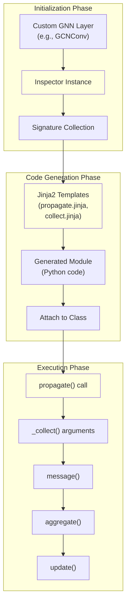
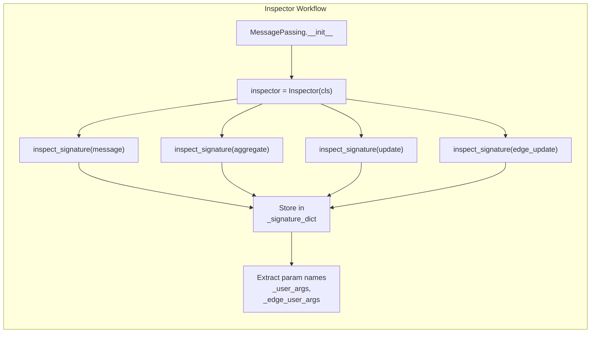
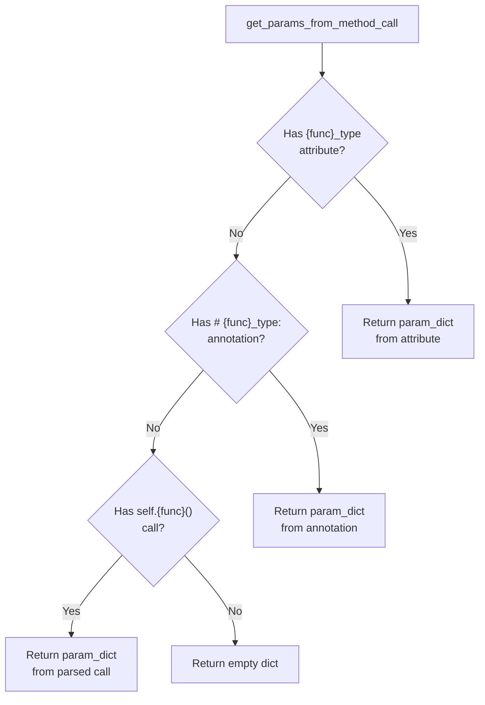
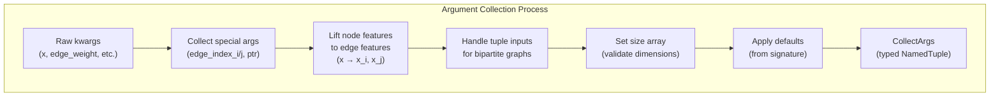
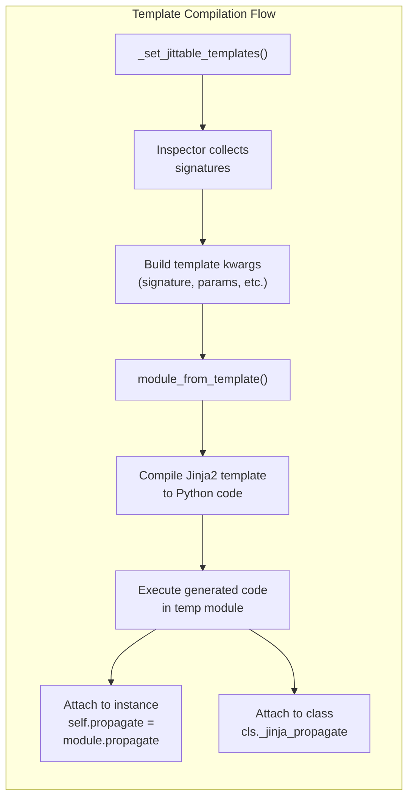
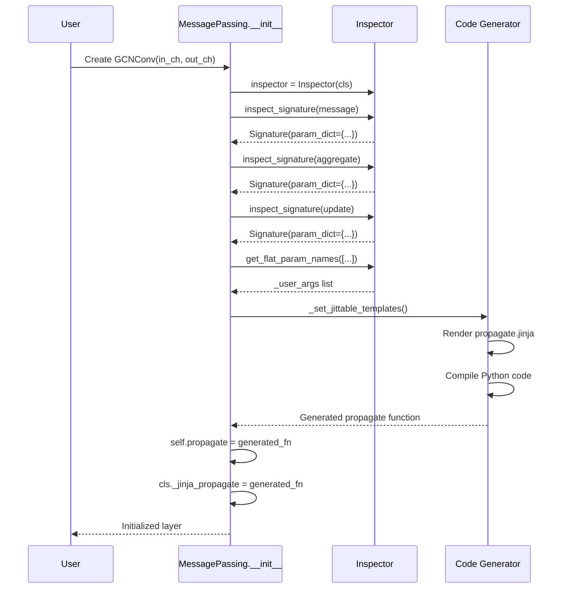

<!-- source: DeepWiki mcp.deepwiki.com · repo pyg-team/pytorch_geometric · page 4.2 Inspector and Code Generation · fetched 2026-10-21 -->

# Inspector and Code Generation

<details>
<summary>Relevant source files</summary>

The following files were used as context for generating this wiki page:

- [test/nn/conv/test_message_passing.py](test/nn/conv/test_message_passing.py)
- [test/nn/test_sequential.py](test/nn/test_sequential.py)
- [test/test_inspector.py](test/test_inspector.py)
- [torch_geometric/inspector.py](torch_geometric/inspector.py)
- [torch_geometric/nn/conv/collect.jinja](torch_geometric/nn/conv/collect.jinja)
- [torch_geometric/nn/conv/edge_updater.jinja](torch_geometric/nn/conv/edge_updater.jinja)
- [torch_geometric/nn/conv/message_passing.py](torch_geometric/nn/conv/message_passing.py)
- [torch_geometric/nn/conv/propagate.jinja](torch_geometric/nn/conv/propagate.jinja)
- [torch_geometric/nn/sequential.jinja](torch_geometric/nn/sequential.jinja)
- [torch_geometric/nn/sequential.py](torch_geometric/nn/sequential.py)

</details>


## Purpose and Scope

This page describes PyTorch Geometric's introspection and code generation infrastructure, which enables the MessagePassing framework to automatically determine which arguments are needed by custom GNN layers and generate optimized, JIT-compilable code paths. The **Inspector** class provides runtime introspection of method signatures, while **Jinja2 templates** generate specialized method implementations based on the inspected signatures.

For information about the MessagePassing base class that uses this infrastructure, see [4.1](). For details on implementing custom GNN layers, see [5.1]().

## System Overview

The Inspector and code generation system solves a fundamental challenge in PyG's MessagePassing framework: allowing users to define custom `message()`, `aggregate()`, and `update()` methods with arbitrary signatures while automatically routing the correct arguments to each method during message passing. This is achieved through two complementary mechanisms:

1. **Runtime Introspection**: The `Inspector` class analyzes method signatures at initialization time to determine which arguments each method requires.
2. **Static Code Generation**: Jinja2 templates generate optimized method implementations that are compatible with TorchScript compilation.



**Diagram: Inspector and Code Generation Pipeline**

Sources: [torch_geometric/nn/conv/message_passing.py:139-171](), [torch_geometric/inspector.py:24-34]()

## Inspector Class

### Core Functionality

The `Inspector` class, defined in [torch_geometric/inspector.py:24-211](), provides methods to analyze Python function signatures and extract parameter information. It is instantiated once per MessagePassing subclass and caches signature information.

| Method | Purpose | Return Type |
|--------|---------|-------------|
| `inspect_signature()` | Analyzes a method signature, extracting parameter types and defaults | `Signature` |
| `get_param_names()` | Returns list of parameter names for a method | `List[str]` |
| `get_flat_param_names()` | Returns union of parameter names across multiple methods | `List[str]` |
| `collect_param_data()` | Extracts required arguments from a kwargs dictionary | `Dict[str, Any]` |
| `implements()` | Checks if the class implements a particular method | `bool` |
| `get_params_from_method_call()` | Parses method calls in source code to infer parameter types | `Dict[str, Parameter]` |

### Signature Inspection Process

When a MessagePassing layer is initialized, the Inspector analyzes the signatures of key methods:



**Diagram: Inspector Signature Analysis Flow**

Sources: [torch_geometric/nn/conv/message_passing.py:139-151](), [torch_geometric/inspector.py:83-132]()

### Parameter and Signature Types

The Inspector uses two core data structures defined as `NamedTuple` instances:

**Parameter** [torch_geometric/inspector.py:11-16]():
- `name`: Parameter name (e.g., `"x_j"`, `"edge_weight"`)
- `type`: Resolved Python type object
- `type_repr`: String representation of the type (e.g., `"Tensor"`, `"Optional[Tensor]"`)
- `default`: Default value from function signature

**Signature** [torch_geometric/inspector.py:18-22]():
- `param_dict`: Dictionary mapping parameter names to `Parameter` objects
- `return_type`: Resolved return type object
- `return_type_repr`: String representation of return type

### Special Parameter Inference

For the `propagate()` method, the Inspector must infer parameters without explicit type annotations. It uses three fallback strategies:

1. **Class Attribute**: Check for `{func_name}_type` class attribute containing a type dictionary [test/test_inspector.py:103-105]().
2. **Type Annotation Comment**: Parse `# propagate_type: (x: Tensor, ...)` comments in source code [test/test_inspector.py:111-113]().
3. **Method Call Parsing**: Analyze the actual `self.propagate(...)` call to extract keyword arguments [test/test_inspector.py:120-126]().



**Diagram: Parameter Inference Strategy**

Sources: [test/test_inspector.py:102-138]()

### Type Evaluation and Representation

The Inspector includes utilities for working with type hints:

- `eval_type()`: Converts string type representations to actual type objects [torch_geometric/inspector.py:61-63]().
- `type_repr()`: Converts type objects back to string representations [torch_geometric/inspector.py:65-67]().

These functions ensure consistency between Python's runtime type system and the string representations needed for code generation.

Sources: [torch_geometric/inspector.py:61-67]()

## Code Generation System

### Template-Based Generation

PyG uses Jinja2 templates to generate specialized implementations of `propagate()` and `edge_updater()` methods. This approach provides several benefits:

- **Performance**: Generated code avoids runtime introspection overhead.
- **JIT Compatibility**: Generated methods are TorchScript-compatible.
- **Specialization**: Each layer class gets a custom implementation based on its specific method signatures.

### Template Files

PyG includes four main template files in the `torch_geometric/nn/conv/` directory:

| Template | Purpose | Generates |
|----------|---------|-----------|
| `propagate.jinja` | Main message passing loop | Specialized `propagate()` method |
| `collect.jinja` | Argument collection logic | Specialized `_collect()` helper and `CollectArgs` NamedTuple |
| `edge_updater.jinja` | Edge feature updates | Specialized `edge_updater()` method |
| `sequential.jinja` | Sequential Model forward | Specialized `forward()` for Sequential models |

### Template Structure: propagate.jinja

The `propagate.jinja` template [torch_geometric/nn/conv/propagate.jinja:1-214]() generates a complete `propagate()` method with the following structure:

```mermaid
graph TB
    subgraph "Generated propagate() Method"
        FUNC["def propagate(self, edge_index, ...)"]
        
        PREHOOK["Propagate forward pre-hooks"]
        CHECK["_check_input(edge_index, size)"]
        
        FUSE{"fuse = True?"}
        
        FUSED["message_and_aggregate path"]
        FUSED_HOOK1["Pre-hook"]
        FUSED_CALL["message_and_aggregate()"]
        FUSED_HOOK2["Post-hook"]
        FUSED_UPD["update()"]
        
        UNFUSED["Separate message/aggregate path"]
        COLLECT["_collect() arguments"]
        MSG_HOOK1["Message pre-hook"]
        MSG["message()"]
        MSG_HOOK2["Message post-hook"]
        AGG_HOOK1["Aggregate pre-hook"]
        AGG["aggregate()"]
        AGG_HOOK2["Aggregate post-hook"]
        UPD["update()"]
        
        POSTHOOK["Propagate forward post-hook"]
        RETURN["return out"]
        
        FUNC --> PREHOOK
        PREHOOK --> CHECK
        CHECK --> FUSE
        
        FUSE -->|Yes| FUSED
        FUSED --> FUSED_HOOK1
        FUSED_HOOK1 --> FUSED_CALL
        FUSED_CALL --> FUSED_HOOK2
        FUSED_HOOK2 --> FUSED_UPD
        
        FUSE -->|No| UNFUSED
        UNFUSED --> COLLECT
        COLLECT --> MSG_HOOK1
        MSG_HOOK1 --> MSG
        MSG --> MSG_HOOK2
        MSG_HOOK2 --> AGG_HOOK1
        AGG_HOOK1 --> AGG
        AGG --> AGG_HOOK2
        AGG_HOOK2 --> UPD
        
        FUSED_UPD --> POSTHOOK
        UPD --> POSTHOOK
        POSTHOOK --> RETURN
    end
```



**Diagram: Generated propagate() Method Structure**

Sources: [torch_geometric/nn/conv/propagate.jinja:19-214]()

### Template Structure: collect.jinja

The `collect.jinja` template [torch_geometric/nn/conv/collect.jinja:1-164]() generates two artifacts:

1. **CollectArgs NamedTuple**: A typed container for collected arguments specific to this layer [torch_geometric/nn/conv/collect.jinja:12-19]().
2. **_collect() method**: Logic to gather and transform arguments for message passing [torch_geometric/nn/conv/collect.jinja:22-164]().

The generated `_collect()` method performs several transformations:



**Diagram: Argument Collection Pipeline**

The lifting operation is particularly important: it transforms node-level features into edge-level features by indexing. For example, if `x` is a node feature tensor and we need `x_j` (features of source nodes), the generated code calls `self._index_select(x, edge_index_j)` [torch_geometric/nn/conv/collect.jinja:124]().

Sources: [torch_geometric/nn/conv/collect.jinja:22-164]()

### Code Generation Invocation

The code generation process is triggered in `MessagePassing.__init__()` via the `_set_jittable_templates()` method [torch_geometric/nn/conv/message_passing.py:171-191]():



**Diagram: Template Compilation and Attachment**

The generated methods are attached both to the instance (for immediate use) and to the class (as `_jinja_propagate` and `_jinja_edge_updater` for serialization support) [torch_geometric/nn/conv/message_passing.py:188-191]().

Sources: [torch_geometric/nn/conv/message_passing.py:171-191](), [torch_geometric/template.py:module_from_template]()

## Integration with MessagePassing

### Initialization Workflow

When a MessagePassing subclass is instantiated, the following sequence occurs:



**Diagram: MessagePassing Initialization Sequence**

Sources: [torch_geometric/nn/conv/message_passing.py:110-191]()

### Dynamic vs Static Modes

The MessagePassing class maintains both the original (dynamic) and generated (static) versions of `propagate()`:

- **`_orig_propagate`**: The original runtime-introspection-based implementation.
- **`_jinja_propagate`**: The generated JIT-compatible implementation [torch_geometric/nn/conv/message_passing.py:188]().

The class switches between modes based on context, particularly for explainability where `explain_message()` hooks are required [torch_geometric/nn/conv/message_passing.py:707-741]().

### Hook Integration

Both the original and generated implementations support PyTorch-style hooks. The generated code includes conditionally-executed hook sections that are skipped during TorchScript compilation:

```python
# From generated code (propagate.jinja)
if not torch.jit.is_scripting() and not is_compiling():
    for hook in self._message_forward_pre_hooks.values():
        # Execute pre-hook...
```

This pattern appears throughout the generated templates [torch_geometric/nn/conv/propagate.jinja:29-30](), [torch_geometric/nn/conv/propagate.jinja:114-115](), ensuring hooks work in Python mode but don't interfere with JIT compilation.

Sources: [torch_geometric/nn/conv/propagate.jinja:29-211]()

## Sequential Model Code Generation

The `Sequential` class [torch_geometric/nn/sequential.py:30-274]() also uses Jinja2 templates to generate optimized `forward()` methods. This enables TorchScript compilation of sequential GNN models [test/test_sequential.py:70-81]().

### Sequential Template

The `sequential.jinja` template [torch_geometric/nn/sequential.jinja:1-23]() generates a forward method that chains module calls:

```python
def forward(
    self,
    x: Tensor,
    edge_index: Tensor,
) -> Tensor:
    x = self.module_0(x, edge_index)
    x = self.module_1(x)
    x = self.module_2(x, edge_index)
    return x
```

The template receives:
- `signature`: Input argument types and return type [torch_geometric/nn/sequential.jinja:14-17]().
- `children`: List of `Child` objects describing each module's inputs/outputs [torch_geometric/nn/sequential.jinja:19-21]().

Sources: [torch_geometric/nn/sequential.jinja:1-23](), [torch_geometric/nn/sequential.py:183]()

## Serialization Support

### State Management

When MessagePassing layers are serialized, the generated methods must be regenerated on deserialization to ensure they point to the correct instance. Class-level attributes `_jinja_propagate` and `_orig_propagate` help manage this lifecycle [test/nn/conv/test_message_passing.py:132-146]().

Sources: [torch_geometric/nn/conv/message_passing.py:188-192](), [test/nn/conv/test_message_passing.py:132-146]()

## Testing and Validation

### Inspector Tests

The test suite includes comprehensive tests for the Inspector class [test/test_inspector.py:1-139]():

- Type evaluation and representation [test/test_inspector.py:12-42]().
- Signature inspection for `SAGEConv` and `GATConv` [test/test_inspector.py:44-99]().
- Parameter collection from method calls [test/test_inspector.py:102-138]().

### MessagePassing Tests

The MessagePassing test suite [test/nn/conv/test_message_passing.py:1-131]() validates:

- Generated code correctness vs original implementation.
- TorchScript compilation of generated methods.
- Serialization and deserialization [test/nn/conv/test_message_passing.py:132-146]().
- Support for `EdgeIndex` and sparse tensors [test/nn/conv/test_message_passing.py:148-157]().

Sources: [test/nn/conv/test_message_passing.py:1-146](), [test/test_inspector.py:1-139]()

---

