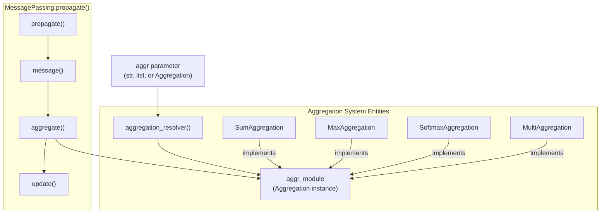
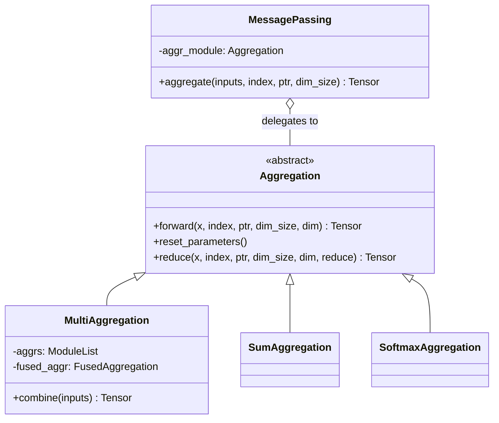
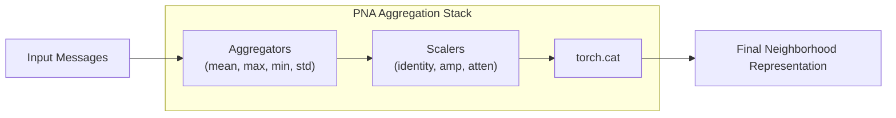

<!-- source: DeepWiki mcp.deepwiki.com · repo pyg-team/pytorch_geometric · page 4.3 Aggregation System · fetched 2026-10-21 -->

# Aggregation System

Relevant source files

The following files were used as context for generating this wiki page:

- [examples/graph_sage_unsup.py](examples/graph_sage_unsup.py)
- [examples/graph_sage_unsup_ppi.py](examples/graph_sage_unsup_ppi.py)
- [examples/pna.py](examples/pna.py)
- [test/nn/aggr/test_attention.py](test/nn/aggr/test_attention.py)
- [test/nn/aggr/test_basic.py](test/nn/aggr/test_basic.py)
- [test/nn/aggr/test_fused.py](test/nn/aggr/test_fused.py)
- [test/nn/aggr/test_multi.py](test/nn/aggr/test_multi.py)
- [test/nn/aggr/test_scaler.py](test/nn/aggr/test_scaler.py)
- [torch_geometric/device.py](torch_geometric/device.py)
- [torch_geometric/nn/aggr/__init__.py](torch_geometric/nn/aggr/__init__.py)
- [torch_geometric/nn/aggr/attention.py](torch_geometric/nn/aggr/attention.py)
- [torch_geometric/nn/aggr/base.py](torch_geometric/nn/aggr/base.py)
- [torch_geometric/nn/aggr/basic.py](torch_geometric/nn/aggr/basic.py)
- [torch_geometric/nn/aggr/fused.py](torch_geometric/nn/aggr/fused.py)
- [torch_geometric/nn/aggr/gmt.py](torch_geometric/nn/aggr/gmt.py)
- [torch_geometric/nn/aggr/gru.py](torch_geometric/nn/aggr/gru.py)
- [torch_geometric/nn/aggr/lstm.py](torch_geometric/nn/aggr/lstm.py)
- [torch_geometric/nn/aggr/mlp.py](torch_geometric/nn/aggr/mlp.py)
- [torch_geometric/nn/aggr/multi.py](torch_geometric/nn/aggr/multi.py)
- [torch_geometric/nn/aggr/scaler.py](torch_geometric/nn/aggr/scaler.py)
- [torch_geometric/nn/aggr/set2set.py](torch_geometric/nn/aggr/set2set.py)
- [torch_geometric/nn/aggr/set_transformer.py](torch_geometric/nn/aggr/set_transformer.py)
- [torch_geometric/nn/aggr/sort.py](torch_geometric/nn/aggr/sort.py)
- [torch_geometric/nn/conv/pna_conv.py](torch_geometric/nn/conv/pna_conv.py)
- [torch_geometric/utils/_softmax.py](torch_geometric/utils/_softmax.py)

## Purpose and Scope

This document details PyG's aggregation system, a modular framework for neighborhood aggregation in Graph Neural Networks. It provides a unified interface for combining messages from neighboring nodes during message passing and for global graph pooling operations. The system supports a wide range of operators, from basic reductions to complex neural-network-based strategies and learnable combinations.

The aggregation system is integrated into the `MessagePassing` base class [torch_geometric/nn/conv/message_passing.py:110-134](), allowing users to swap aggregation strategies by passing strings, lists, or `Aggregation` instances.

---

## System Architecture

The aggregation system centers around the `Aggregation` base class. In the message passing pipeline, the `MessagePassing` class delegates the reduction step to an internal `aggr_module`.

### Aggregation in Message Passing Pipeline

**Sources:** [torch_geometric/nn/conv/message_passing.py:110-134](), [torch_geometric/nn/aggr/base.py:10-61]()

---

## Aggregation Base Class

The `torch_geometric.nn.aggr.Aggregation` class is the abstract base for all operators [torch_geometric/nn/aggr/base.py:10](). It supports two primary mapping mechanisms:
1.  **Index-based:** An `index` vector maps input elements to output locations [torch_geometric/nn/aggr/base.py:13-15]().
2.  **Ptr-based:** A compressed index vector `ptr` defines boundaries for grouped inputs (CSR format) [torch_geometric/nn/aggr/base.py:38-41]().

### Core Interface

The `forward` method is the entry point for computation [torch_geometric/nn/aggr/base.py:69-96](). Most basic aggregators utilize the `reduce` helper, which abstracts the underlying `scatter` or `segment` operations [torch_geometric/nn/aggr/base.py:173-180]().

**Sources:** [torch_geometric/nn/aggr/base.py:10-180](), [torch_geometric/nn/aggr/basic.py:12-22]()

---

## Built-in Aggregation Operators

PyG provides a comprehensive suite of aggregators [torch_geometric/nn/aggr/__init__.py:30-58]().

### Operator Categories

| Category | Operators | Key Classes |
| :--- | :--- | :--- |
| **Basic** | sum, mean, max, min, mul | `SumAggregation`, `MeanAggregation`, `MaxAggregation`, `MinAggregation`, `MulAggregation` |
| **Statistical** | var, std, median, quantile | `VarAggregation`, `StdAggregation`, `MedianAggregation`, `QuantileAggregation` |
| **Learnable** | softmax, power-mean | `SoftmaxAggregation`, `PowerMeanAggregation` |
| **Sequential** | LSTM, GRU | `LSTMAggregation`, `GRUAggregation` |
| **Set-based** | Set2Set, DeepSets, SetTransformer | `Set2Set`, `DeepSetsAggregation`, `SetTransformerAggregation` |
| **Attention** | Soft attention, GMT | `AttentionalAggregation`, `GraphMultisetTransformer` |
| **Advanced** | PNA Scalers, Equilibrium | `DegreeScalerAggregation`, `EquilibriumAggregation` |

### Learnable Aggregations
`SoftmaxAggregation` and `PowerMeanAggregation` allow for learnable parameters (e.g., temperature `t` or power `p`) [torch_geometric/nn/aggr/basic.py:142-170](). These can be learned per-channel if `channels > 1` is specified [torch_geometric/nn/aggr/basic.py:166-170]().

**Sources:** [torch_geometric/nn/aggr/basic.py:12-170](), [torch_geometric/nn/aggr/__init__.py:1-29]()

---

## MultiAggregation and Fusion

`MultiAggregation` enables the combination of multiple aggregation strategies [torch_geometric/nn/aggr/multi.py:14-19](). It is a core component of architectures like PNA [torch_geometric/nn/conv/pna_conv.py:109]().

### Combination Modes
Results from multiple aggregators can be merged using the `mode` parameter [torch_geometric/nn/aggr/multi.py:48]:
*   `cat`: Concatenate results (increases feature dimension) [torch_geometric/nn/aggr/multi.py:149]().
*   `proj`: Linear projection of concatenated results [torch_geometric/nn/aggr/multi.py:113-117]().
*   `attn`: Multi-head attention-based combination [torch_geometric/nn/aggr/multi.py:119-127]().
*   **Dense Reductions:** `sum`, `mean`, `max`, `min`, `logsumexp`, `std`, `var` [torch_geometric/nn/aggr/multi.py:129-133]().

### FusedAggregation
To optimize performance, `MultiAggregation` internally uses `FusedAggregation` to group "fusable" operators (those relying on `scatter` directives) [torch_geometric/nn/aggr/fused.py:20-39](). 

**Optimization Highlights:**
*   `MeanAggregation` shares computation with `SumAggregation` [torch_geometric/nn/aggr/fused.py:27-28]().
*   `VarAggregation` and `StdAggregation` share intermediate outputs with `Mean` or `Sum` [torch_geometric/nn/aggr/fused.py:30-36]().
*   Reduces overhead by sharing the "count" (degree) per group index [torch_geometric/nn/aggr/fused.py:38-39]().

**Sources:** [torch_geometric/nn/aggr/multi.py:14-171](), [torch_geometric/nn/aggr/fused.py:20-187]()

---

## Principal Neighbourhood Aggregation (PNA)

The `PNAConv` layer demonstrates the full power of the aggregation system by combining `MultiAggregation` with `DegreeScalerAggregation` [torch_geometric/nn/conv/pna_conv.py:109-110]().

### Scaling Mechanism
`DegreeScalerAggregation` applies scalers based on the in-degree of nodes [torch_geometric/nn/aggr/scaler.py:11-17](). Supported scalers include:
*   `identity`, `amplification`, `attenuation`, `linear`, `inverse_linear` [torch_geometric/nn/aggr/scaler.py:91-106]().
*   These scalers are normalized by the average degree calculated from the training set histogram `deg` [torch_geometric/nn/aggr/scaler.py:55-61]().

**Sources:** [torch_geometric/nn/conv/pna_conv.py:18-44](), [torch_geometric/nn/aggr/scaler.py:11-109]()

---

## String-Based Resolver

The `aggregation_resolver` (aliased as `aggr_resolver`) allows for flexible instantiation of aggregators from string identifiers or lists [torch_geometric/nn/resolver.py]().

| Input Type | Resolution Behavior |
| :--- | :--- |
| `str` | Maps to a single `Aggregation` subclass (e.g., "mean" -> `MeanAggregation`) |
| `List[str]` | Instantiates a `MultiAggregation` with default "cat" mode |
| `Aggregation` | Returns the instance directly |

This resolver is used in `MessagePassing.__init__` to convert the `aggr` argument into the `aggr_module` [torch_geometric/nn/conv/message_passing.py:110-134]().

**Sources:** [torch_geometric/nn/aggr/multi.py:71-74](), [torch_geometric/nn/aggr/scaler.py:44-51](), [torch_geometric/nn/conv/message_passing.py:577-595]()

---

## Performance Considerations

### Determinism
The `Aggregation` base class tracks whether deterministic algorithms are enabled via `torch.are_deterministic_algorithms_enabled()` [torch_geometric/nn/aggr/base.py:65-67](). This flag influences the internal `reduce` helper, potentially choosing slower but deterministic implementations [torch_geometric/nn/aggr/base.py:178-180]().

### Input Requirements
*   **Sorted Indices:** Certain advanced aggregators like `SetTransformerAggregation` and `LSTMAggregation` require the `index` to be sorted by destination node [torch_geometric/nn/aggr/set_transformer.py:20-28](), [torch_geometric/nn/aggr/base.py:153-160]().
*   **Dimensionality:** Most basic aggregators support N-dimensional inputs, but `FusedAggregation` is currently limited to 2D tensors [torch_geometric/nn/aggr/multi.py:156-157]().

**Sources:** [torch_geometric/nn/aggr/base.py:65-160](), [torch_geometric/nn/aggr/set_transformer.py:20-28](), [torch_geometric/nn/aggr/multi.py:152-171]()

---

