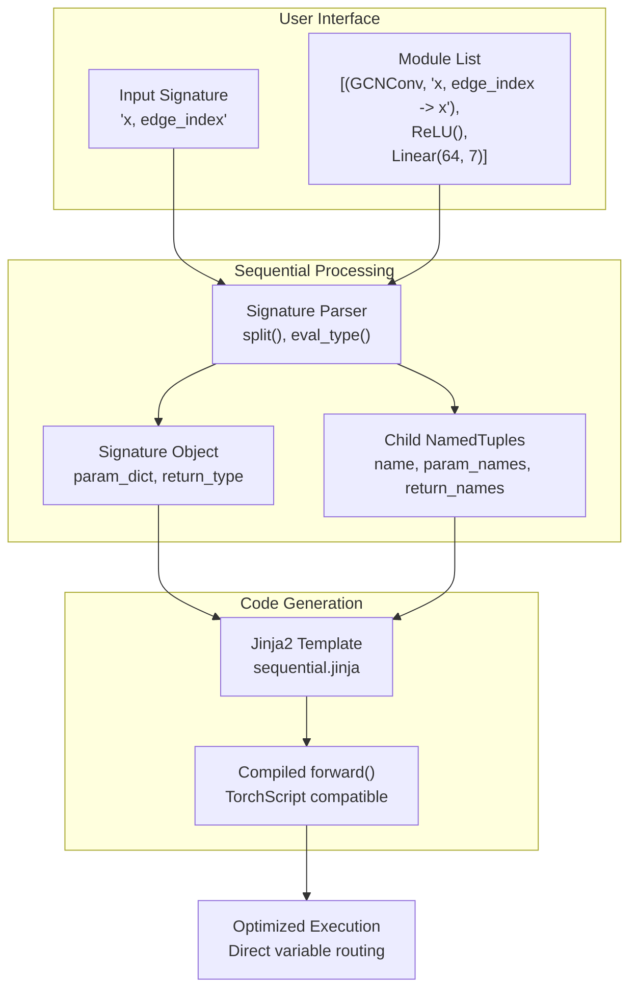
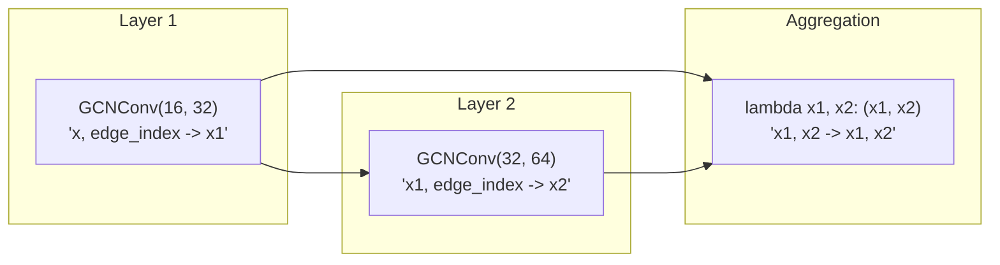
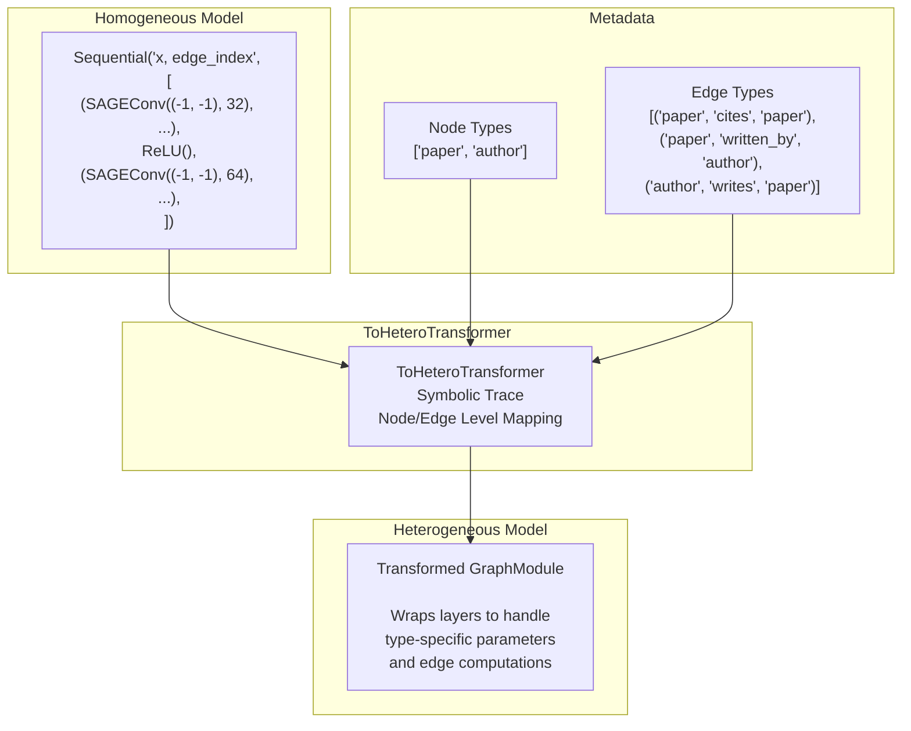
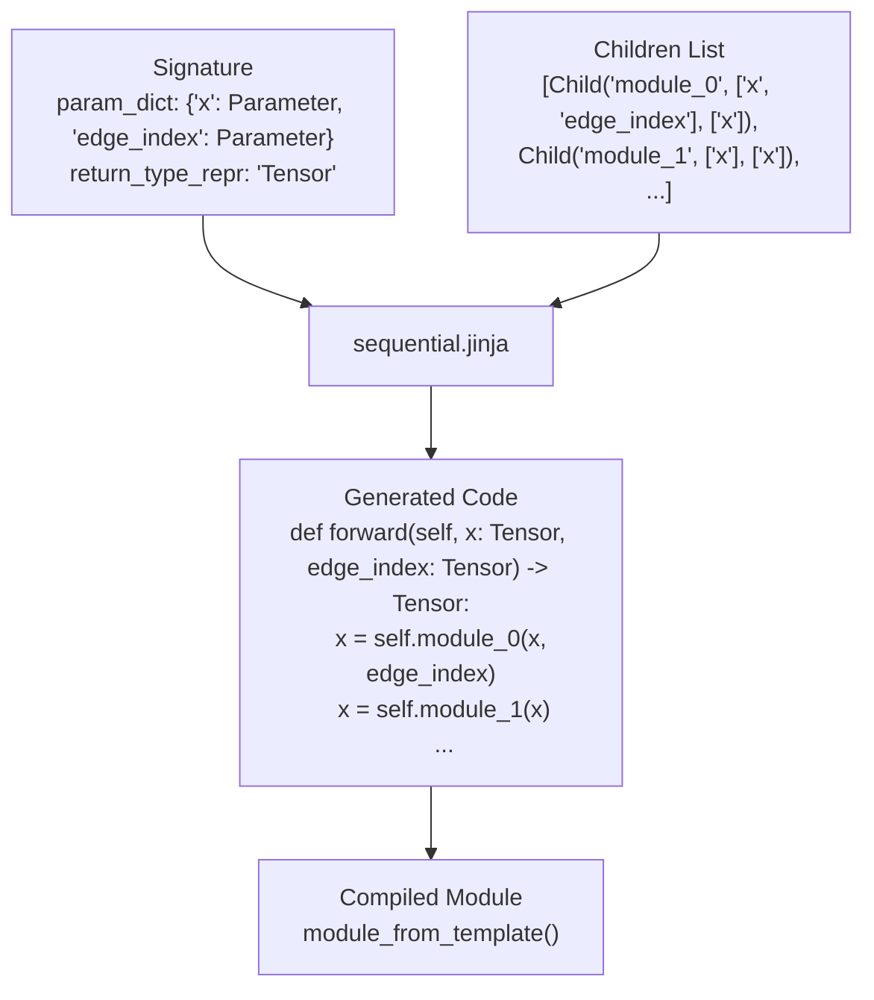

<!-- source: DeepWiki mcp.deepwiki.com · repo pyg-team/pytorch_geometric · page 4.4 Sequential and Model Composition · fetched 2026-10-21 -->

# Sequential and Model Composition

<details>
<summary>Relevant source files</summary>

The following files were used as context for generating this wiki page:

- [test/nn/conv/test_han_conv.py](test/nn/conv/test_han_conv.py)
- [test/nn/conv/test_heat_conv.py](test/nn/conv/test_heat_conv.py)
- [test/nn/conv/test_hetero_conv.py](test/nn/conv/test_hetero_conv.py)
- [test/nn/conv/test_hgt_conv.py](test/nn/conv/test_hgt_conv.py)
- [test/nn/conv/test_message_passing.py](test/nn/conv/test_message_passing.py)
- [test/nn/test_sequential.py](test/nn/test_sequential.py)
- [test/nn/test_to_hetero_transformer.py](test/nn/test_to_hetero_transformer.py)
- [test/nn/test_to_hetero_with_bases_transformer.py](test/nn/test_to_hetero_with_bases_transformer.py)
- [test/test_inspector.py](test/test_inspector.py)
- [test/utils/test_hetero.py](test/utils/test_hetero.py)
- [test/utils/test_trim_to_layer.py](test/utils/test_trim_to_layer.py)
- [torch_geometric/inspector.py](torch_geometric/inspector.py)
- [torch_geometric/nn/conv/collect.jinja](torch_geometric/nn/conv/collect.jinja)
- [torch_geometric/nn/conv/edge_updater.jinja](torch_geometric/nn/conv/edge_updater.jinja)
- [torch_geometric/nn/conv/han_conv.py](torch_geometric/nn/conv/han_conv.py)
- [torch_geometric/nn/conv/heat_conv.py](torch_geometric/nn/conv/heat_conv.py)
- [torch_geometric/nn/conv/hetero_conv.py](torch_geometric/nn/conv/hetero_conv.py)
- [torch_geometric/nn/conv/hgt_conv.py](torch_geometric/nn/conv/hgt_conv.py)
- [torch_geometric/nn/conv/message_passing.py](torch_geometric/nn/conv/message_passing.py)
- [torch_geometric/nn/conv/propagate.jinja](torch_geometric/nn/conv/propagate.jinja)
- [torch_geometric/nn/fx.py](torch_geometric/nn/fx.py)
- [torch_geometric/nn/sequential.jinja](torch_geometric/nn/sequential.jinja)
- [torch_geometric/nn/sequential.py](torch_geometric/nn/sequential.py)
- [torch_geometric/nn/to_hetero_transformer.py](torch_geometric/nn/to_hetero_transformer.py)
- [torch_geometric/nn/to_hetero_with_bases_transformer.py](torch_geometric/nn/to_hetero_with_bases_transformer.py)
- [torch_geometric/utils/_trim_to_layer.py](torch_geometric/utils/_trim_to_layer.py)
- [torch_geometric/utils/hetero.py](torch_geometric/utils/hetero.py)

</details>


This page describes PyTorch Geometric's model composition mechanisms, focusing on the `Sequential` class for chaining GNN layers and the `to_hetero` / `to_hetero_with_bases` transforms for converting homogeneous models to operate on heterogeneous graphs.

---

## Overview

PyTorch Geometric provides two primary mechanisms for composing complex GNN architectures:

1.  **Sequential**: A specialized container that extends `torch.nn.Sequential` to handle multiple input/output arguments common in GNN operations. [torch_geometric/nn/sequential.py:30-84]()
2.  **Heterogeneous Transforms**: Tools like `to_hetero` and `to_hetero_with_bases` that automatically convert homogeneous GNN models to operate on heterogeneous graphs with multiple node and edge types. [torch_geometric/nn/to_hetero_transformer.py:27-118](), [torch_geometric/nn/to_hetero_with_bases_transformer.py:21-131]()

The `Sequential` class addresses a key limitation of standard PyTorch containers: GNN layers typically require multiple arguments (e.g., `x, edge_index`) and may produce multiple outputs. `Sequential` provides explicit routing of data between layers through string-based signatures. [torch_geometric/nn/sequential.py:45-51]()

---

## Sequential Class Architecture

The `Sequential` class parses input signatures and module definitions to create an optimized execution pipeline. The architecture consists of three main components:



**Diagram: Sequential Class Architecture**

The `Child` NamedTuple stores routing information for each module:
*   `name`: Attribute name for the module. [torch_geometric/nn/sequential.py:25-25]()
*   `param_names`: List of input variable names. [torch_geometric/nn/sequential.py:26-26]()
*   `return_names`: List of output variable names. [torch_geometric/nn/sequential.py:27-27]()

Sources: [torch_geometric/nn/sequential.py:24-28](), [torch_geometric/nn/sequential.py:87-183]()

---

## Basic Usage Patterns

### Simple Layer Chaining

The most straightforward usage chains GNN layers with activation functions:

```python
model = Sequential('x, edge_index', [
    (GCNConv(16, 64), 'x, edge_index -> x'),
    ReLU(inplace=True),
    (GCNConv(64, 64), 'x, edge_index -> x'),
    ReLU(inplace=True),
    Linear(64, 7),
])
```

**Key syntax elements**:
*   **First argument**: Global input signature defining all variables available to the model. [torch_geometric/nn/sequential.py:53-53]()
*   **Tuple format**: `(module, 'inputs -> outputs')` explicitly specifies argument routing. [torch_geometric/nn/sequential.py:54-55]()
*   **Omitted signatures**: Modules without signatures automatically use the previous module's output names. [torch_geometric/nn/sequential.py:176-178]()

Sources: [test/nn/test_sequential.py:20-51](), [torch_geometric/nn/sequential.py:30-84]()

### Signature Parsing

The signature parser handles type annotations and multiple arguments:

| Signature Format | Parsed Result |
| :--- | :--- |
| `'x, edge_index'` | Two parameters, both type `Tensor` by default. [torch_geometric/nn/sequential.py:118-124]() |
| `'x: Tensor, edge_index: Tensor'` | Explicit type annotations. [torch_geometric/nn/sequential.py:125-132]() |
| `'x, edge_index -> x'` | Return type inferred as `Tensor`. [torch_geometric/nn/sequential.py:104-106]() |
| `'x, edge_index -> Tuple[Tensor, Tensor]'` | Multiple return values with explicit type. [torch_geometric/nn/sequential.py:107-110]() |

The parser uses the `Inspector` class's `eval_type()` and `split()` utilities to handle complex type hints. [torch_geometric/nn/sequential.py:20-20](), [torch_geometric/inspector.py:61-63]()

Sources: [torch_geometric/nn/sequential.py:102-136]()

---

## Advanced Composition Patterns

### Multiple Return Values

Modules can produce multiple outputs that are individually routed to downstream layers:



**Diagram: Multi-Output Data Flow**

The `forward()` method stores all intermediate outputs in a `value_dict` and routes them according to `Child.param_names` and `Child.return_names`. [torch_geometric/nn/sequential.py:227-234]()

Sources: [test/nn/test_sequential.py:117-129](), [torch_geometric/nn/sequential.py:215-236]()

---

## Heterogeneous Model Conversion

PyTorch Geometric provides automated transforms to convert homogeneous models into heterogeneous ones using `torch.fx` symbolic tracing. [torch_geometric/nn/fx.py:15-78]()

### to_hetero Transform

The `to_hetero` function duplicates each `MessagePassing` layer for every edge type in the graph metadata. [torch_geometric/nn/to_hetero_transformer.py:79-81]()



**Diagram: to_hetero Transformation Flow**

**Implementation Details**:
*   **Aggregation**: If multiple relations point to the same destination node type, results are grouped via `aggr` (sum, mean, max, min, or mul). [torch_geometric/nn/to_hetero_transformer.py:87-95](), [torch_geometric/nn/to_hetero_transformer.py:125-133]()
*   **Logic**: Each homogeneous layer $f_{\theta}$ is replaced by a set of layers $\{ f_{\theta}^{(r)} \}$ for each relation $r$. [torch_geometric/nn/to_hetero_transformer.py:81-84]()

Sources: [torch_geometric/nn/to_hetero_transformer.py:27-120](), [test/nn/test_to_hetero_transformer.py:179-221]()

### to_hetero_with_bases Transform

For graphs with many relations, `to_hetero_with_bases` uses basis-decomposition to keep the number of parameters independent of the number of relations. [torch_geometric/nn/to_hetero_with_bases_transformer.py:35-37]()

*   **Mechanism**: Message passing is performed via $\mathbf{h}_v = \sum_{r \in \mathcal{R}} \sum_{b=1}^B f_{\theta}^{(b)} (\mathbf{h}_v, \{ a_{r,b} \cdot \mathbf{h}_w \})$. [torch_geometric/nn/to_hetero_with_bases_transformer.py:93-99]()
*   **Parameters**: Only the basis coefficients $a_{r,b}$ depend on the specific relation $r$. [torch_geometric/nn/to_hetero_with_bases_transformer.py:102-103]()

Sources: [torch_geometric/nn/to_hetero_with_bases_transformer.py:21-134]()

---

## Specialized Heterogeneous Layers

While `to_hetero` is automated, PyG also provides manual composition layers:

### HeteroConv
A generic wrapper for computing graph convolution on heterogeneous graphs by passing a dictionary of bipartite GNN layers. [torch_geometric/nn/conv/hetero_conv.py:29-62]()

```python
hetero_conv = HeteroConv({
    ('paper', 'cites', 'paper'): GCNConv(-1, 64),
    ('author', 'writes', 'paper'): SAGEConv((-1, -1), 64),
}, aggr='sum')
```
Sources: [torch_geometric/nn/conv/hetero_conv.py:42-46]()

### HGTConv (Heterogeneous Graph Transformer)
A specialized operator that handles heterogeneous attention, mapping node types to keys, queries, and values. [torch_geometric/nn/conv/hgt_conv.py:17-42]()

*   Uses `HeteroDictLinear` for type-specific linear projections. [torch_geometric/nn/conv/hgt_conv.py:72-76]()
*   Implements relation-specific message passing with multi-head attention. [torch_geometric/nn/conv/hgt_conv.py:181-187]()

Sources: [torch_geometric/nn/conv/hgt_conv.py:156-187]()

---

## Code Generation and JIT Compilation

### Jinja2 Template System
`Sequential` generates optimized `forward()` methods using `sequential.jinja`. [torch_geometric/nn/sequential.py:183-183](), [torch_geometric/nn/sequential.py:240-268]()



**Diagram: Sequential Code Generation Pipeline**

The generated code is TorchScript-compatible, allowing for efficient serialization and deployment. [torch_geometric/nn/sequential.py:269-273](), [test/nn/test_sequential.py:70-81]()

Sources: [torch_geometric/nn/sequential.py:240-273](), [torch_geometric/nn/sequential.jinja:1-23]()

---

