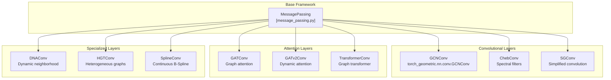
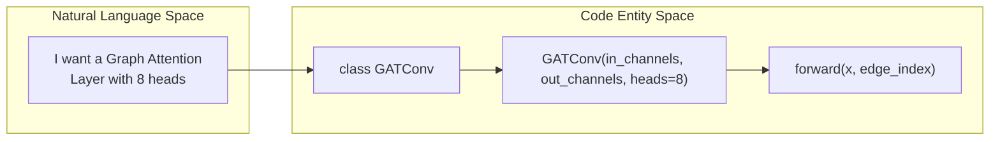

<!-- source: DeepWiki mcp.deepwiki.com · repo pyg-team/pytorch_geometric · page 5 GNN Layers · fetched 2026-10-21 -->

# GNN Layers

<details>
<summary>Relevant source files</summary>

The following files were used as context for generating this wiki page:

- [.pre-commit-config.yaml](.pre-commit-config.yaml)
- [test/nn/conv/test_cheb_conv.py](test/nn/conv/test_cheb_conv.py)
- [test/nn/conv/test_gat_conv.py](test/nn/conv/test_gat_conv.py)
- [test/nn/conv/test_gatv2_conv.py](test/nn/conv/test_gatv2_conv.py)
- [test/nn/conv/test_gcn_conv.py](test/nn/conv/test_gcn_conv.py)
- [test/nn/conv/test_gin_conv.py](test/nn/conv/test_gin_conv.py)
- [test/nn/conv/test_graph_conv.py](test/nn/conv/test_graph_conv.py)
- [test/nn/conv/test_spline_conv.py](test/nn/conv/test_spline_conv.py)
- [test/nn/conv/test_transformer_conv.py](test/nn/conv/test_transformer_conv.py)
- [torch_geometric/nn/conv/__init__.py](torch_geometric/nn/conv/__init__.py)
- [torch_geometric/nn/conv/cheb_conv.py](torch_geometric/nn/conv/cheb_conv.py)
- [torch_geometric/nn/conv/fa_conv.py](torch_geometric/nn/conv/fa_conv.py)
- [torch_geometric/nn/conv/gat_conv.py](torch_geometric/nn/conv/gat_conv.py)
- [torch_geometric/nn/conv/gatv2_conv.py](torch_geometric/nn/conv/gatv2_conv.py)
- [torch_geometric/nn/conv/gin_conv.py](torch_geometric/nn/conv/gin_conv.py)
- [torch_geometric/nn/conv/graph_conv.py](torch_geometric/nn/conv/graph_conv.py)
- [torch_geometric/nn/conv/nn_conv.py](torch_geometric/nn/conv/nn_conv.py)
- [torch_geometric/nn/conv/rgat_conv.py](torch_geometric/nn/conv/rgat_conv.py)
- [torch_geometric/nn/conv/spline_conv.py](torch_geometric/nn/conv/spline_conv.py)
- [torch_geometric/nn/conv/transformer_conv.py](torch_geometric/nn/conv/transformer_conv.py)

</details>


This page documents PyTorch Geometric's collection of 50+ graph neural network (GNN) layer implementations. GNN layers are the core building blocks for constructing graph neural networks, specifying how message passing, aggregation, and node feature updates occur. All layers inherit from the `MessagePassing` base class (see [Message Passing Framework](#4)) and implement specific computational patterns from published research papers.

For information about composing layers into complete models, see [Pre-built Models](#6). For details on the underlying message passing abstraction, see [MessagePassing Base Class](#4.1). For aggregation strategies used within layers, see [Aggregation System](#4.3).

## Overview

GNN layers implement the fundamental operation in graph neural networks: transforming node features by aggregating information from neighboring nodes. Each layer defines:

1.  **Message function**: How to compute messages from neighbor features.
2.  **Aggregation function**: How to combine messages (sum, mean, max, etc.).
3.  **Update function**: How to transform aggregated messages into new node features.

PyG organizes its layers into several main categories:

| Category | Description | Example Layers |
| :--- | :--- | :--- |
| **Convolutional** | Spectral and spatial graph convolutions | `GCNConv`, `ChebConv`, `SGConv`, `APPNP` |
| **Attention-based** | Layers with attention mechanisms | `GATConv`, `GATv2Conv`, `TransformerConv` |
| **Specialized** | Domain-specific and advanced architectures | `DNAConv`, `HGTConv`, `PointNetConv` |
| **Pooling** | Graph coarsening and global readout | `TopKPooling`, `SAGPooling`, `GlobalPool` |
| **Normalization** | Graph-specific normalization techniques | `BatchNorm`, `GraphNorm`, `PairNorm` |

**Sources:** [torch_geometric/nn/conv/__init__.py:1-142]()

## Layer Architecture



**Figure 1: GNN Layer Hierarchy**

All GNN layers inherit from `MessagePassing` and override specific methods (`message`, `aggregate`, `update`) to implement their computational patterns.

**Sources:** [torch_geometric/nn/conv/__init__.py:1-136](), [torch_geometric/nn/conv/gat_conv.py:35-35](), [torch_geometric/nn/conv/cheb_conv.py:14-14]()

## Convolutional Layers

Convolutional layers implement spatial and spectral convolutions on graphs. For deep technical details on these layers, see [Convolutional Layers](#5.1).

### GCNConv - Graph Convolutional Network
The foundational graph convolution operator from Kipf & Welling (2017). It uses symmetric normalization $\mathbf{\hat{D}}^{-1/2} \mathbf{\hat{A}} \mathbf{\hat{D}}^{-1/2}$ and supports caching for transductive learning [test/nn/conv/test_gcn_conv.py:12-55]().

### ChebConv - Chebyshev Spectral Convolution
Spectral convolution using Chebyshev polynomials. It recursively computes polynomials using the normalized Laplacian [torch_geometric/nn/conv/cheb_conv.py:19-34]().

### GINConv - Graph Isomorphism Network
A powerful spatial convolution that uses a neural network (MLP) for updates, allowing for injective aggregation [torch_geometric/nn/conv/gin_conv.py:19-55]().

**Sources:** [torch_geometric/nn/conv/gcn_conv.py:6-6](), [torch_geometric/nn/conv/cheb_conv.py:14-14](), [torch_geometric/nn/conv/gin_conv.py:19-19]()

## Attention-based Layers

Attention mechanisms allow nodes to weight neighbor contributions differently based on learned relevance scores. For details, see [Attention-based Layers](#5.2).

### GATConv - Graph Attention Networks
Uses multi-head attention where coefficients are computed via a learnable vector $\mathbf{a}$ [torch_geometric/nn/conv/gat_conv.py:35-56](). It supports bipartite graphs and edge features [torch_geometric/nn/conv/gat_conv.py:159-170]().

### GATv2Conv - Dynamic Attention
An improved version of GAT that fixes the "static attention" problem by changing the order of operations, allowing every node to attend to any other node [torch_geometric/nn/conv/gatv2_conv.py:34-58]().

### TransformerConv - Graph Transformer
Applies transformer-style multi-head dot product attention to graphs, with support for edge features [torch_geometric/nn/conv/transformer_conv.py:26-42]().

**Sources:** [torch_geometric/nn/conv/gat_conv.py:35-35](), [torch_geometric/nn/conv/gatv2_conv.py:34-34](), [torch_geometric/nn/conv/transformer_conv.py:26-26]()

## Specialized Layers

Advanced layers designed for specific tasks or graph types. For details, see [Specialized Layers](#5.3).

### DNAConv - Dynamic Neighborhood Aggregation
Addresses over-smoothing by utilizing multi-layer history and dynamic neighborhood aggregation [torch_geometric/nn/conv/dna_conv.py:1-10]().

### SplineConv - Spline-based Convolution
A geometric convolution operator that uses continuous B-spline kernels for graphs with pseudo-coordinates [torch_geometric/nn/conv/spline_conv.py:21-38]().

### NNConv - Continuous Kernel Convolution
Also known as Edge-Conditioned Convolution (ECConv), it uses a neural network to map edge features to transformation matrices [torch_geometric/nn/conv/nn_conv.py:13-30]().

**Sources:** [torch_geometric/nn/conv/dna_conv.py:1-10](), [torch_geometric/nn/conv/spline_conv.py:21-21](), [torch_geometric/nn/conv/nn_conv.py:13-13]()

## Layer Usage Pattern



**Figure 2: Mapping requirements to Code Entities**

### Example: Multi-Layer Model
```python
from torch_geometric.nn import GCNConv
import torch.nn.functional as F

class GCN(torch.nn.Module):
    def __init__(self, in_channels, out_channels):
        super().__init__()
        self.conv1 = GCNConv(in_channels, 16)
        self.conv2 = GCNConv(16, out_channels)

    def forward(self, x, edge_index):
        x = self.conv1(x, edge_index).relu()
        x = self.conv2(x, edge_index)
        return x
```

**Sources:** [test/nn/conv/test_gcn_conv.py:19-22]()

## Performance Considerations

### Caching
Layers like `GCNConv` and `ChebConv` support a `cached` argument. When set to `True`, the layer will store the normalized adjacency matrix or Laplacian after the first execution to speed up subsequent passes on the same graph [test/nn/conv/test_gcn_conv.py:45-49]().

### Sparse Operations
PyG layers are optimized for sparse operations. Many layers implement `message_and_aggregate` to leverage fused sparse-matrix multiplication (`spmm`) when the input is a `SparseTensor` or a native PyTorch sparse tensor [torch_geometric/nn/conv/gin_conv.py:95-98](), [torch_geometric/nn/conv/graph_conv.py:97-112]().

**Sources:** [torch_geometric/nn/conv/gcn_conv.py:45-55](), [torch_geometric/nn/conv/gin_conv.py:95-98](), [torch_geometric/nn/conv/graph_conv.py:97-112]()

## Child Pages
- [Convolutional Layers](#5.1) — Detailed view of `GCNConv`, `ChebConv`, `SAGEConv`, and spectral vs spatial approaches.
- [Attention-based Layers](#5.2) — Deep dive into `GATConv`, `GATv2Conv`, and transformer mechanisms.
- [Specialized Layers](#5.3) — Advanced layers like `HGTConv`, `HeteroConv`, and point cloud operators.
- [Pooling Layers](#5.4) — Graph coarsening and global pooling operators.
- [Normalization and Linear Layers](#5.5) — Graph-specific normalization and the `Linear` utility.

---

