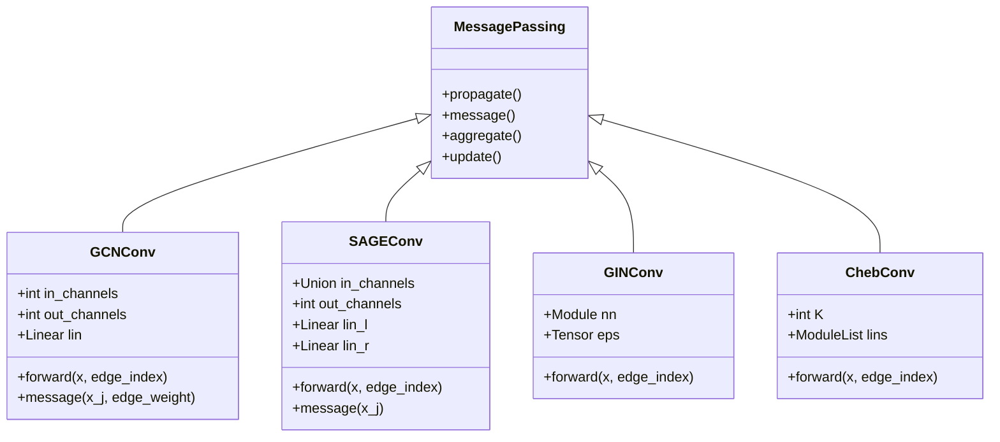
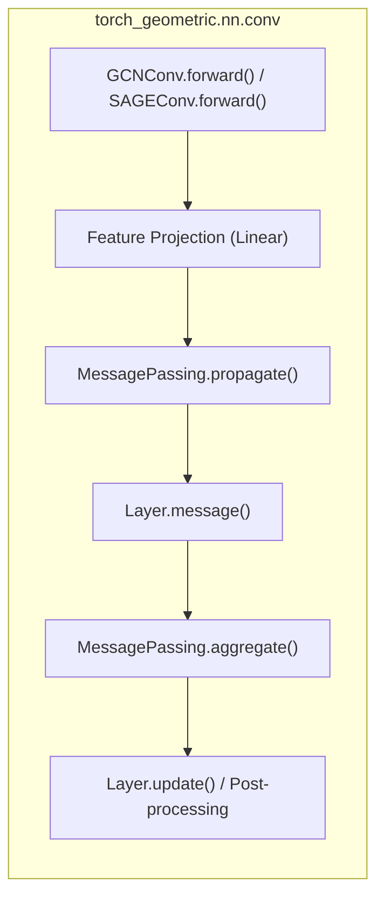

<!-- source: DeepWiki mcp.deepwiki.com · repo pyg-team/pytorch_geometric · page 5.1 Convolutional Layers · fetched 2026-10-21 -->

# Convolutional Layers

Relevant source files

The following files were used as context for generating this wiki page:

- [examples/hetero/to_hetero_mag.py](examples/hetero/to_hetero_mag.py)
- [examples/reddit.py](examples/reddit.py)
- [test/nn/conv/test_agnn_conv.py](test/nn/conv/test_agnn_conv.py)
- [test/nn/conv/test_antisymmetric_conv.py](test/nn/conv/test_antisymmetric_conv.py)
- [test/nn/conv/test_appnp.py](test/nn/conv/test_appnp.py)
- [test/nn/conv/test_cg_conv.py](test/nn/conv/test_cg_conv.py)
- [test/nn/conv/test_cheb_conv.py](test/nn/conv/test_cheb_conv.py)
- [test/nn/conv/test_cluster_gcn_conv.py](test/nn/conv/test_cluster_gcn_conv.py)
- [test/nn/conv/test_dna_conv.py](test/nn/conv/test_dna_conv.py)
- [test/nn/conv/test_edge_conv.py](test/nn/conv/test_edge_conv.py)
- [test/nn/conv/test_fa_conv.py](test/nn/conv/test_fa_conv.py)
- [test/nn/conv/test_feast_conv.py](test/nn/conv/test_feast_conv.py)
- [test/nn/conv/test_film_conv.py](test/nn/conv/test_film_conv.py)
- [test/nn/conv/test_gated_graph_conv.py](test/nn/conv/test_gated_graph_conv.py)
- [test/nn/conv/test_gcn2_conv.py](test/nn/conv/test_gcn2_conv.py)
- [test/nn/conv/test_gin_conv.py](test/nn/conv/test_gin_conv.py)
- [test/nn/conv/test_graph_conv.py](test/nn/conv/test_graph_conv.py)
- [test/nn/conv/test_gravnet_conv.py](test/nn/conv/test_gravnet_conv.py)
- [test/nn/conv/test_sage_conv.py](test/nn/conv/test_sage_conv.py)
- [test/nn/conv/test_spline_conv.py](test/nn/conv/test_spline_conv.py)
- [torch_geometric/nn/conv/__init__.py](torch_geometric/nn/conv/__init__.py)
- [torch_geometric/nn/conv/agnn_conv.py](torch_geometric/nn/conv/agnn_conv.py)
- [torch_geometric/nn/conv/antisymmetric_conv.py](torch_geometric/nn/conv/antisymmetric_conv.py)
- [torch_geometric/nn/conv/appnp.py](torch_geometric/nn/conv/appnp.py)
- [torch_geometric/nn/conv/cg_conv.py](torch_geometric/nn/conv/cg_conv.py)
- [torch_geometric/nn/conv/cheb_conv.py](torch_geometric/nn/conv/cheb_conv.py)
- [torch_geometric/nn/conv/dna_conv.py](torch_geometric/nn/conv/dna_conv.py)
- [torch_geometric/nn/conv/edge_conv.py](torch_geometric/nn/conv/edge_conv.py)
- [torch_geometric/nn/conv/feast_conv.py](torch_geometric/nn/conv/feast_conv.py)
- [torch_geometric/nn/conv/gated_graph_conv.py](torch_geometric/nn/conv/gated_graph_conv.py)
- [torch_geometric/nn/conv/gcn2_conv.py](torch_geometric/nn/conv/gcn2_conv.py)
- [torch_geometric/nn/conv/gcn_conv.py](torch_geometric/nn/conv/gcn_conv.py)
- [torch_geometric/nn/conv/gin_conv.py](torch_geometric/nn/conv/gin_conv.py)
- [torch_geometric/nn/conv/graph_conv.py](torch_geometric/nn/conv/graph_conv.py)
- [torch_geometric/nn/conv/gravnet_conv.py](torch_geometric/nn/conv/gravnet_conv.py)
- [torch_geometric/nn/conv/lg_conv.py](torch_geometric/nn/conv/lg_conv.py)
- [torch_geometric/nn/conv/nn_conv.py](torch_geometric/nn/conv/nn_conv.py)
- [torch_geometric/nn/conv/pdn_conv.py](torch_geometric/nn/conv/pdn_conv.py)
- [torch_geometric/nn/conv/sage_conv.py](torch_geometric/nn/conv/sage_conv.py)
- [torch_geometric/nn/conv/sg_conv.py](torch_geometric/nn/conv/sg_conv.py)
- [torch_geometric/nn/conv/spline_conv.py](torch_geometric/nn/conv/spline_conv.py)

This page documents the fundamental convolutional Graph Neural Network (GNN) layers implemented in PyTorch Geometric (PyG). These layers form the building blocks for constructing graph neural networks and are all based on the message passing paradigm. For details about the core message passing framework itself, see page 4.

The convolutional layers covered here implement various forms of neighborhood aggregation through graph convolutions, including spectral-based methods (`ChebConv`) and spatial-based methods (`GCNConv`, `SAGEConv`, `GINConv`, `GraphConv`, `EdgeConv`).

## Overview of GNN Layers

GNN layers in PyTorch Geometric implement various graph convolutional operations that update node features through neighborhood aggregation. All these layers inherit from the `MessagePassing` base class, which provides a framework for implementing message passing neural networks.

**Diagram: Inheritance Hierarchy of Convolutional GNN Layers**

Sources: [torch_geometric/nn/conv/gcn_conv.py:116-187](), [torch_geometric/nn/conv/sage_conv.py:13-76](), [torch_geometric/nn/conv/gin_conv.py:19-59](), [torch_geometric/nn/conv/cheb_conv.py:14-83]()

## Message Passing Flow

All GNN layers follow a similar execution flow based on the message passing paradigm. The `forward` method typically prepares features and calls `propagate`, which internally triggers `message`, `aggregate`, and `update`.

**Diagram: Common Data Flow from forward() to aggregate()**

Sources: [torch_geometric/nn/conv/gcn_conv.py:227-268](), [torch_geometric/nn/conv/sage_conv.py:120-144](), [torch_geometric/nn/conv/gin_conv.py:73-90]()

## GCNConv (Graph Convolutional Network)

The `GCNConv` layer implements the graph convolutional operator from the paper ["Semi-supervised Classification with Graph Convolutional Networks"](https://arxiv.org/abs/1609.02907).

### Mathematical Formulation

The GCN operation is defined as:

$$\mathbf{X}^{\prime} = \mathbf{\hat{D}}^{-1/2} \mathbf{\hat{A}} \mathbf{\hat{D}}^{-1/2} \mathbf{X} \mathbf{\Theta}$$

### Implementation Details

- **Normalization:** Uses `gcn_norm` to compute symmetric normalization [torch_geometric/nn/conv/gcn_conv.py:45-113]().
- **Caching:** Supports `cached=True` for transductive settings to avoid recomputing normalization [torch_geometric/nn/conv/gcn_conv.py:149-154]().
- **Improved:** If `improved=True`, uses $\mathbf{\hat{A}} = \mathbf{A} + 2\mathbf{I}$ [torch_geometric/nn/conv/gcn_conv.py:146-148]().

Sources: [torch_geometric/nn/conv/gcn_conv.py:116-275]()

## SAGEConv (GraphSAGE)

The `SAGEConv` layer implements the operator from ["Inductive Representation Learning on Large Graphs"](https://arxiv.org/abs/1706.02216).

### Mathematical Formulation

$$\mathbf{x}^{\prime}_i = \mathbf{W}_1 \mathbf{x}_i + \mathbf{W}_2 \cdot \mathrm{mean}_{j \in \mathcal{N(i)}} \mathbf{x}_j$$

### Key Features

- **Aggregation:** Supports multiple schemes via `aggr` parameter (e.g., `"mean"`, `"max"`, `"lstm"`, `"sum"`) [torch_geometric/nn/conv/sage_conv.py:36-39]().
- **Bipartite Graphs:** Supports different input dimensions for source and target nodes by passing a tuple to `in_channels` [torch_geometric/nn/conv/sage_conv.py:68-74]().
- **Root Weight:** Can toggle the inclusion of root node features via `root_weight` [torch_geometric/nn/conv/sage_conv.py:107-109]().

Sources: [torch_geometric/nn/conv/sage_conv.py:13-157]()

## GINConv (Graph Isomorphism Network)

The `GINConv` layer implements the operator from ["How Powerful are Graph Neural Networks?"](https://arxiv.org/abs/1810.00826).

### Mathematical Formulation

$$\mathbf{x}^{\prime}_i = h_{\mathbf{\Theta}} \left( (1 + \epsilon) \cdot \mathbf{x}_i + \sum_{j \in \mathcal{N}(i)} \mathbf{x}_j \right)$$

### Implementation Details

- **MLP Integration:** Takes a `torch.nn.Module` (usually an MLP) as the first argument [torch_geometric/nn/conv/gin_conv.py:36-39]().
- **Trainable Epsilon:** The $\epsilon$ parameter can be fixed or learned via `train_eps=True` [torch_geometric/nn/conv/gin_conv.py:62-65]().
- **GINEConv:** A variant `GINEConv` is available to incorporate edge features [torch_geometric/nn/conv/gin_conv.py:104-142]().

Sources: [torch_geometric/nn/conv/gin_conv.py:19-101]()

## Spectral Approaches

Spectral GNNs define convolutions in the Fourier domain.

### ChebConv

Implements Chebyshev spectral graph convolution using $K$-order polynomials of the Laplacian [torch_geometric/nn/conv/cheb_conv.py:15-34]().
- **Recursive Computation:** Uses the Chebyshev recurrence relation to avoid explicit eigenvalue decomposition [torch_geometric/nn/conv/cheb_conv.py:166-175]().
- **Normalization:** Supports symmetric (`"sym"`) and random-walk (`"rw"`) normalization [torch_geometric/nn/conv/cheb_conv.py:41-53]().

### SGConv (Simple Graph Convolution)

Simplifies GCN by collapsing multiple layers into a single linear transformation after $K$ propagation steps [torch_geometric/nn/conv/sg_conv.py:13-18]().
- **Efficiency:** Significantly reduces the number of parameters by removing non-linearities between hops [torch_geometric/nn/conv/sg_conv.py:93-97]().

Sources: [torch_geometric/nn/conv/cheb_conv.py:14-187](), [torch_geometric/nn/conv/sg_conv.py:12-112]()

## Spatial and Specialized Layers

| Layer | Purpose | Key File |
| :--- | :--- | :--- |
| `GraphConv` | Implements higher-order GNNs (WL-test inspired) | [torch_geometric/nn/conv/graph_conv.py:13]() |
| `EdgeConv` | Used in Dynamic Graph CNN (DGCNN) for point clouds | [torch_geometric/nn/conv/edge_conv.py:13]() |
| `SplineConv` | Continuous B-spline kernels for geometric data | [torch_geometric/nn/conv/spline_conv.py:21]() |
| `APPNP` | Decoupled propagation via Personalized PageRank | [torch_geometric/nn/conv/appnp.py:13]() |
| `NNConv` | Edge-conditioned convolution (continuous kernels) | [torch_geometric/nn/conv/nn_conv.py:13]() |

Sources: [torch_geometric/nn/conv/graph_conv.py:13-48](), [torch_geometric/nn/conv/edge_conv.py:13-43](), [torch_geometric/nn/conv/spline_conv.py:21-61](), [torch_geometric/nn/conv/appnp.py:13-79](), [torch_geometric/nn/conv/nn_conv.py:13-62]()

## gcn_norm Utility Function

The `gcn_norm` function is a core utility for calculating $\mathbf{\hat{D}}^{-1/2} \mathbf{\hat{A}} \mathbf{\hat{D}}^{-1/2}$.

- **Input Types:** Handles `Tensor`, `SparseTensor`, and `torch.sparse` formats [torch_geometric/nn/conv/gcn_conv.py:56-74]().
- **Self-loops:** Automatically adds self-loops unless `add_self_loops=False` [torch_geometric/nn/conv/gcn_conv.py:98-100]().
- **Scatter Sum:** Computes node degrees using the `scatter` utility [torch_geometric/nn/conv/gcn_conv.py:108]().

Sources: [torch_geometric/nn/conv/gcn_conv.py:45-113]()

## Comparison of Convolutional GNN Layers

| Layer | Aggregation | Weights | Use Case |
| :--- | :--- | :--- | :--- |
| `GCNConv` | Sum/Mean (Normalized) | Per-layer | Standard node classification |
| `SAGEConv` | Configurable (Mean/Max/LSTM) | Root + Neighbor | Inductive/Large-scale graphs |
| `GINConv` | Sum | External MLP | Graph classification / WL-isomorphism |
| `EdgeConv` | Max/Mean | Shared MLP on pairs | Point clouds / Dynamic graphs |
| `GraphConv` | Sum | Root + Neighbor | General structural learning |

Sources: [torch_geometric/nn/conv/gcn_conv.py:116](), [torch_geometric/nn/conv/sage_conv.py:13](), [torch_geometric/nn/conv/gin_conv.py:19](), [torch_geometric/nn/conv/edge_conv.py:13](), [torch_geometric/nn/conv/graph_conv.py:13]()

---

