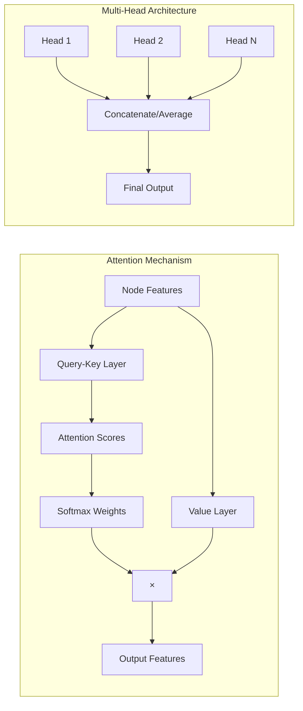
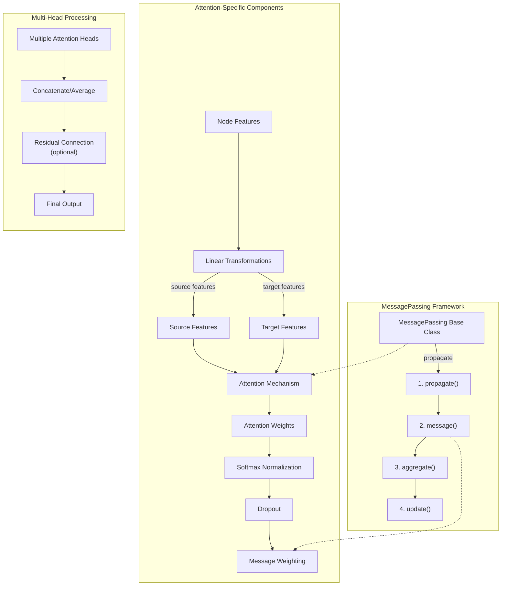
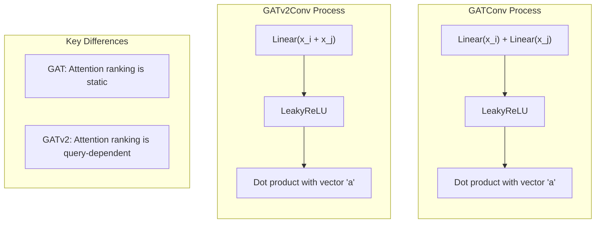

<!-- source: DeepWiki mcp.deepwiki.com · repo pyg-team/pytorch_geometric · page 5.2 Attention-based Layers · fetched 2026-10-21 -->

# Attention-based Layers

<details>
<summary>Relevant source files</summary>

The following files were used as context for generating this wiki page:

- [.pre-commit-config.yaml](.pre-commit-config.yaml)
- [examples/graph_gps.py](examples/graph_gps.py)
- [test/nn/conv/test_gat_conv.py](test/nn/conv/test_gat_conv.py)
- [test/nn/conv/test_gatv2_conv.py](test/nn/conv/test_gatv2_conv.py)
- [test/nn/conv/test_gcn_conv.py](test/nn/conv/test_gcn_conv.py)
- [test/nn/conv/test_gmm_conv.py](test/nn/conv/test_gmm_conv.py)
- [test/nn/conv/test_gps_conv.py](test/nn/conv/test_gps_conv.py)
- [test/nn/conv/test_transformer_conv.py](test/nn/conv/test_transformer_conv.py)
- [torch_geometric/nn/attention/performer.py](torch_geometric/nn/attention/performer.py)
- [torch_geometric/nn/conv/fa_conv.py](torch_geometric/nn/conv/fa_conv.py)
- [torch_geometric/nn/conv/gat_conv.py](torch_geometric/nn/conv/gat_conv.py)
- [torch_geometric/nn/conv/gatv2_conv.py](torch_geometric/nn/conv/gatv2_conv.py)
- [torch_geometric/nn/conv/gmm_conv.py](torch_geometric/nn/conv/gmm_conv.py)
- [torch_geometric/nn/conv/gps_conv.py](torch_geometric/nn/conv/gps_conv.py)
- [torch_geometric/nn/conv/rgat_conv.py](torch_geometric/nn/conv/rgat_conv.py)
- [torch_geometric/nn/conv/transformer_conv.py](torch_geometric/nn/conv/transformer_conv.py)

</details>


This page documents the attention-based graph neural network layers in PyTorch Geometric. Attention mechanisms enable adaptive weighting of node features during message passing, allowing the model to focus on the most relevant neighbors. For basic graph neural network layers like GCN and GraphSAGE, see [Basic GNN Layers](5.1).

## Overview of Attention Mechanisms in GNNs

Attention-based Graph Neural Networks apply the attention mechanism to weight the importance of neighbors' messages differently for each node. This allows the network to focus on the most relevant parts of the graph when updating a node's representation.



Sources: [torch_geometric/nn/conv/gat_conv.py:35-129](), [torch_geometric/nn/conv/gatv2_conv.py:34-132](), [torch_geometric/nn/conv/transformer_conv.py:26-97]().

PyTorch Geometric implements several specialized attention-based convolution layers:

| Layer | Description | Key Features |
|-------|-------------|--------------|
| `GATConv` | Original Graph Attention Network | Additive attention, Multi-head support |
| `GATv2Conv` | Improved GAT with dynamic attention | Fixes "static attention" problem |
| `TransformerConv` | Graph transformer operator | Multi-head dot-product attention, Beta-gating |
| `RGATConv` | Relational Graph Attention Network | Relational-specific attention mechanisms |
| `FAConv` | Frequency Adaptive Graph Convolution | High/Low frequency filtering via attention |
| `GMMConv` | Gaussian Mixture Model Convolution | Attention-like weighting via GMM kernels |

## Common Architecture of Attention Layers



Sources: [torch_geometric/nn/conv/gat_conv.py:35-390](), [torch_geometric/nn/conv/gatv2_conv.py:34-379](), [torch_geometric/nn/conv/transformer_conv.py:26-280]().

## GAT and GATv2 (Graph Attention Networks)

`GATConv` implements the additive attention mechanism from the [Graph Attention Networks](https://arxiv.org/abs/1710.10903) paper. `GATv2Conv` improves this by fixing the "static attention" problem, where the ranking of attended nodes is unconditioned on the query node [torch_geometric/nn/conv/gatv2_conv.py:35-42]().

### Implementation Comparison



Sources: [torch_geometric/nn/conv/gat_conv.py:35-77](), [torch_geometric/nn/conv/gatv2_conv.py:34-77]().

### Key Parameters
- `heads`: Number of multi-head attentions [torch_geometric/nn/conv/gat_conv.py:85]().
- `concat`: If `False`, multi-head attentions are averaged instead of concatenated [torch_geometric/nn/conv/gat_conv.py:87-89]().
- `share_weights`: (GATv2 only) If `True`, same matrix applies to source and target [torch_geometric/nn/conv/gatv2_conv.py:109-112]().

## TransformerConv

`TransformerConv` implements multi-head dot-product attention as used in standard Transformer architectures, adapted for graphs [torch_geometric/nn/conv/transformer_conv.py:26-42]().

### Beta Gating
A unique feature is the `beta` parameter, which adaptively combines aggregated neighborhood messages $\mathbf{m}_i$ with skip-connection information via a sigmoid gate [torch_geometric/nn/conv/transformer_conv.py:54-64]():
$$\mathbf{x}^{\prime}_i = \beta_i \mathbf{W}_1 \mathbf{x}_i + (1 - \beta_i) \mathbf{m}_i$$

Sources: [torch_geometric/nn/conv/transformer_conv.py:100-152]().

## Relational and Specialized Attention

### RGATConv (Relational GAT)
`RGATConv` extends attention to multi-relational graphs. It supports two attention modes [torch_geometric/nn/conv/rgat_conv.py:33-43]():
1.  **Additive Attention**: $\mathrm{LeakyReLU}(\mathbf{q}_i + \mathbf{k}_j)$
2.  **Multiplicative Attention**: $\mathbf{q}_i \cdot \mathbf{k}_j$

It also implements **within-relation** vs **across-relation** attention mechanisms [torch_geometric/nn/conv/rgat_conv.py:61-77]().

### FAConv (Frequency Adaptive)
`FAConv` uses attention to adaptively filter different frequency components of the graph signal [torch_geometric/nn/conv/fa_conv.py:28-45](). It computes coefficients as $\textrm{tanh}(\mathbf{a}^{\top}[\mathbf{x}_i, \mathbf{x}_j])$.

### GMMConv (Mixture Model)
While technically a mixture model, `GMMConv` operates similarly to attention by weighting neighbors using Gaussian kernels based on pseudo-coordinates (edge features) [torch_geometric/nn/conv/gmm_conv.py:13-32]().

## Comparison Table

| Feature | GATConv | GATv2Conv | TransformerConv | RGATConv |
| :--- | :--- | :--- | :--- | :--- |
| **Attention Type** | Additive | Additive (Dynamic) | Dot-Product | Additive/Multiplicative |
| **Multi-Head** | Yes | Yes | Yes | Yes |
| **Edge Features** | Additive [torch_geometric/nn/conv/gat_conv.py:62-74]() | Additive [torch_geometric/nn/conv/gatv2_conv.py:64-76]() | Added to Key/Value [torch_geometric/nn/conv/transformer_conv.py:83-88]() | Supported [torch_geometric/nn/conv/rgat_conv.py:44-59]() |
| **Relational** | No | No | No | Yes |

Sources: [torch_geometric/nn/conv/gat_conv.py:1-129](), [torch_geometric/nn/conv/gatv2_conv.py:1-132](), [torch_geometric/nn/conv/transformer_conv.py:1-97](), [torch_geometric/nn/conv/rgat_conv.py:16-168]().

## Usage and Implementation

### Multi-head Implementation logic
In PyTorch Geometric attention layers, multi-head processing is typically handled by reshaping transformed features into `(num_nodes, heads, out_channels)` before computing attention scores [torch_geometric/nn/conv/gat_conv.py:163-169]().

### Attention Weight Retrieval
Most layers support `return_attention_weights=True` in their `forward` call, returning a tuple containing the output and the attention weights [test/nn/conv/test_gat_conv.py:54-59](), [test/nn/conv/test_transformer_conv.py:59-65]().

```python
# Example for GATConv
out, (edge_index, att_weights) = conv(x, edge_index, return_attention_weights=True)
```

Sources: [test/nn/conv/test_gat_conv.py:54-60](), [test/nn/conv/test_gatv2_conv.py:52-58](), [test/nn/conv/test_transformer_conv.py:59-65]().

---

