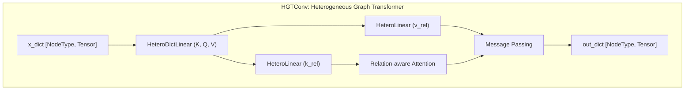
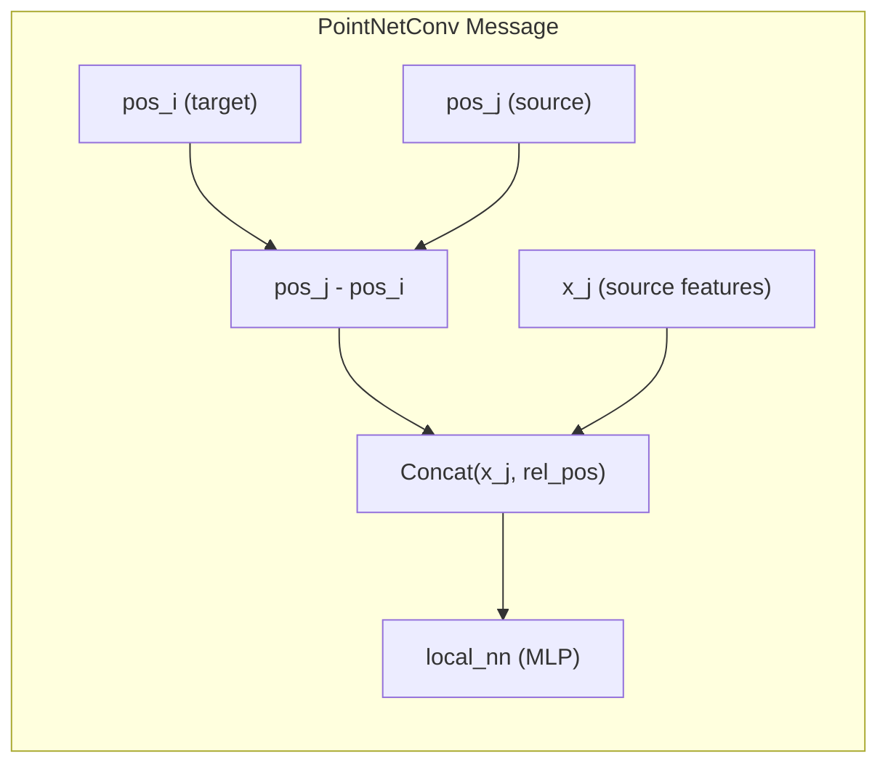
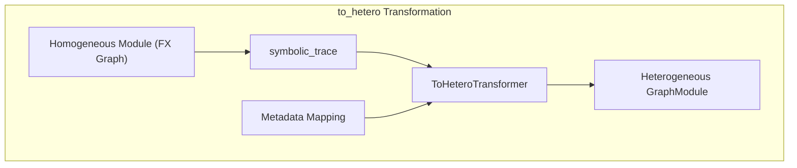

<!-- source: DeepWiki mcp.deepwiki.com · repo pyg-team/pytorch_geometric · page 5.3 Specialized Layers · fetched 2026-10-21 -->

# Specialized Layers

Relevant source files

The following files were used as context for generating this wiki page:

- [examples/cluster_gcn_reddit.py](examples/cluster_gcn_reddit.py)
- [examples/egc.py](examples/egc.py)
- [examples/gcn2_cora.py](examples/gcn2_cora.py)
- [examples/gcn2_ppi.py](examples/gcn2_ppi.py)
- [examples/graph_saint.py](examples/graph_saint.py)
- [test/nn/conv/cugraph/test_cugraph_gat_conv.py](test/nn/conv/cugraph/test_cugraph_gat_conv.py)
- [test/nn/conv/cugraph/test_cugraph_rgcn_conv.py](test/nn/conv/cugraph/test_cugraph_rgcn_conv.py)
- [test/nn/conv/cugraph/test_cugraph_sage_conv.py](test/nn/conv/cugraph/test_cugraph_sage_conv.py)
- [test/nn/conv/test_eg_conv.py](test/nn/conv/test_eg_conv.py)
- [test/nn/conv/test_gen_conv.py](test/nn/conv/test_gen_conv.py)
- [test/nn/conv/test_han_conv.py](test/nn/conv/test_han_conv.py)
- [test/nn/conv/test_heat_conv.py](test/nn/conv/test_heat_conv.py)
- [test/nn/conv/test_hetero_conv.py](test/nn/conv/test_hetero_conv.py)
- [test/nn/conv/test_hgt_conv.py](test/nn/conv/test_hgt_conv.py)
- [test/nn/conv/test_hypergraph_conv.py](test/nn/conv/test_hypergraph_conv.py)
- [test/nn/conv/test_pna_conv.py](test/nn/conv/test_pna_conv.py)
- [test/nn/conv/test_point_conv.py](test/nn/conv/test_point_conv.py)
- [test/nn/conv/test_point_gnn_conv.py](test/nn/conv/test_point_gnn_conv.py)
- [test/nn/conv/test_point_transformer_conv.py](test/nn/conv/test_point_transformer_conv.py)
- [test/nn/conv/test_ppf_conv.py](test/nn/conv/test_ppf_conv.py)
- [test/nn/conv/test_res_gated_graph_conv.py](test/nn/conv/test_res_gated_graph_conv.py)
- [test/nn/conv/test_rgat_conv.py](test/nn/conv/test_rgat_conv.py)
- [test/nn/conv/test_signed_conv.py](test/nn/conv/test_signed_conv.py)
- [test/nn/conv/test_wl_conv.py](test/nn/conv/test_wl_conv.py)
- [test/nn/test_to_hetero_transformer.py](test/nn/test_to_hetero_transformer.py)
- [test/nn/test_to_hetero_with_bases_transformer.py](test/nn/test_to_hetero_with_bases_transformer.py)
- [test/utils/test_hetero.py](test/utils/test_hetero.py)
- [test/utils/test_trim_to_layer.py](test/utils/test_trim_to_layer.py)
- [torch_geometric/nn/conv/cluster_gcn_conv.py](torch_geometric/nn/conv/cluster_gcn_conv.py)
- [torch_geometric/nn/conv/cugraph/__init__.py](torch_geometric/nn/conv/cugraph/__init__.py)
- [torch_geometric/nn/conv/cugraph/base.py](torch_geometric/nn/conv/cugraph/base.py)
- [torch_geometric/nn/conv/cugraph/gat_conv.py](torch_geometric/nn/conv/cugraph/gat_conv.py)
- [torch_geometric/nn/conv/cugraph/rgcn_conv.py](torch_geometric/nn/conv/cugraph/rgcn_conv.py)
- [torch_geometric/nn/conv/cugraph/sage_conv.py](torch_geometric/nn/conv/cugraph/sage_conv.py)
- [torch_geometric/nn/conv/eg_conv.py](torch_geometric/nn/conv/eg_conv.py)
- [torch_geometric/nn/conv/film_conv.py](torch_geometric/nn/conv/film_conv.py)
- [torch_geometric/nn/conv/gen_conv.py](torch_geometric/nn/conv/gen_conv.py)
- [torch_geometric/nn/conv/han_conv.py](torch_geometric/nn/conv/han_conv.py)
- [torch_geometric/nn/conv/heat_conv.py](torch_geometric/nn/conv/heat_conv.py)
- [torch_geometric/nn/conv/hetero_conv.py](torch_geometric/nn/conv/hetero_conv.py)
- [torch_geometric/nn/conv/hgt_conv.py](torch_geometric/nn/conv/hgt_conv.py)
- [torch_geometric/nn/conv/hypergraph_conv.py](torch_geometric/nn/conv/hypergraph_conv.py)
- [torch_geometric/nn/conv/mf_conv.py](torch_geometric/nn/conv/mf_conv.py)
- [torch_geometric/nn/conv/pan_conv.py](torch_geometric/nn/conv/pan_conv.py)
- [torch_geometric/nn/conv/point_conv.py](torch_geometric/nn/conv/point_conv.py)
- [torch_geometric/nn/conv/point_gnn_conv.py](torch_geometric/nn/conv/point_gnn_conv.py)
- [torch_geometric/nn/conv/point_transformer_conv.py](torch_geometric/nn/conv/point_transformer_conv.py)
- [torch_geometric/nn/conv/ppf_conv.py](torch_geometric/nn/conv/ppf_conv.py)
- [torch_geometric/nn/conv/res_gated_graph_conv.py](torch_geometric/nn/conv/res_gated_graph_conv.py)
- [torch_geometric/nn/conv/signed_conv.py](torch_geometric/nn/conv/signed_conv.py)
- [torch_geometric/nn/fx.py](torch_geometric/nn/fx.py)
- [torch_geometric/nn/models/deepgcn.py](torch_geometric/nn/models/deepgcn.py)
- [torch_geometric/nn/to_hetero_transformer.py](torch_geometric/nn/to_hetero_transformer.py)
- [torch_geometric/nn/to_hetero_with_bases_transformer.py](torch_geometric/nn/to_hetero_with_bases_transformer.py)
- [torch_geometric/utils/_trim_to_layer.py](torch_geometric/utils/_trim_to_layer.py)
- [torch_geometric/utils/hetero.py](torch_geometric/utils/hetero.py)

## Purpose and Scope

This page documents specialized GNN layers that implement advanced aggregation mechanisms, domain-specific architectures, or support for specialized graph types. Unlike basic convolutional layers (see [Convolutional Layers](#5.1)) and attention-based layers (see [Attention-based Layers](#5.2)), these layers are designed for specific tasks or incorporate sophisticated architectural patterns such as heterogeneous graph processing, point cloud convolutions, and hypergraph message passing.

The layers covered here include:
- **Heterogeneous layers** (`HGTConv`, `HeteroConv`, `HANConv`) for multi-type graphs.
- **Hypergraph layers** (`HypergraphConv`) for non-pairwise relations.
- **Point Cloud layers** (`PointNetConv`, `PPFConv`) for 3D geometric data.
- **Advanced convolutional layers** (`GENConv`, `EGConv`, `MFConv`) for deep or efficient architectures.

---

## Heterogeneous Graph Layers

### HGTConv (Heterogeneous Graph Transformer)

`HGTConv` implements the Heterogeneous Graph Transformer operator [torch_geometric/nn/conv/hgt_conv.py:17-42](). It handles heterogeneity by using type-specific projection matrices for queries, keys, and values, and relation-specific parameters for attention.

**Data Flow and Logic:**
1.  **Linear Projections**: Uses `HeteroDictLinear` to project node features into $K, Q, V$ spaces [torch_geometric/nn/conv/hgt_conv.py:72-76]().
2.  **Relation-Specific Attention**: Applies `k_rel` and `v_rel` (using `HeteroLinear`) to source node representations based on the edge type [torch_geometric/nn/conv/hgt_conv.py:78-85]().
3.  **Message Passing**: Computes attention scores using a dot product of $Q$ (target) and $K$ (source, relation-aware), then aggregates values $V$ [torch_geometric/nn/conv/hgt_conv.py:181-220]().

**Sources:**
- [torch_geometric/nn/conv/hgt_conv.py:17-154]()
- [torch_geometric/nn/dense/hetero_linear.py:1-50]() (referenced via HeteroLinear)

### HeteroConv

`HeteroConv` is a wrapper layer that allows applying different GNN operators to different edge types in a heterogeneous graph [torch_geometric/nn/conv/hetero_conv.py:12-30](). It aggregates the outputs of these operators for each node type using a specified aggregation (e.g., `sum`, `mean`, `max`).

**Sources:**
- [torch_geometric/nn/conv/hetero_conv.py:12-100]()

---

## Point Cloud Layers

### PointNetConv

`PointNetConv` implements the set abstraction layer from PointNet++ [torch_geometric/nn/conv/point_conv.py:19-63](). It is designed for 3D point sets where node features are combined with relative spatial coordinates.

**Mathematical Formulation:**
$$\mathbf{x}^{\prime}_i = \gamma_{\mathbf{\Theta}} \left( \max_{j \in \mathcal{N}(i) \cup \{ i \}} h_{\mathbf{\Theta}} ( \mathbf{x}_j, \mathbf{p}_j - \mathbf{p}_i) \right)$$
where $h_{\mathbf{\Theta}}$ is a `local_nn` and $\gamma_{\mathbf{\Theta}}$ is a `global_nn` [torch_geometric/nn/conv/point_conv.py:26-34]().

**Sources:**
- [torch_geometric/nn/conv/point_conv.py:19-118]()

### PPFConv (Point Pair Features)

`PPFConv` uses Point Pair Features (distances and angles between normals) for 3D point matching [torch_geometric/nn/conv/ppf_conv.py:35-81]().
It calculates four geometric features between points $i$ and $j$:
1.  Euclidean distance $\|\mathbf{d}_{j,i}\|$.
2.  Angle between normal $\mathbf{n}_i$ and $\mathbf{d}_{j,i}$.
3.  Angle between normal $\mathbf{n}_j$ and $\mathbf{d}_{j,i}$.
4.  Angle between normals $\mathbf{n}_i$ and $\mathbf{n}_j$.

[torch_geometric/nn/conv/ppf_conv.py:24-32]()

**Sources:**
- [torch_geometric/nn/conv/ppf_conv.py:19-145]()

---

## Hypergraph and Deep Convolutional Layers

### HypergraphConv

`HypergraphConv` handles data where edges can connect more than two nodes [torch_geometric/nn/conv/hypergraph_conv.py:15-76](). It supports an optional attention mechanism that can operate in `"node"` or `"edge"` mode [torch_geometric/nn/conv/hypergraph_conv.py:81-83]().

**Implementation Details:**
- **Input**: Node features and a `hyperedge_index` (mapping nodes to hyperedges) [torch_geometric/nn/conv/hypergraph_conv.py:131-134]().
- **Two-stage propagation**: Messages flow from nodes to hyperedges, then back to nodes [torch_geometric/nn/conv/hypergraph_conv.py:91]().

**Sources:**
- [torch_geometric/nn/conv/hypergraph_conv.py:15-175]()

### GENConv (Generalized GCN)

`GENConv` is designed for training deeper GCNs by using generalized aggregations like `softmax` and `powermean` [torch_geometric/nn/conv/gen_conv.py:44-108]().

**Core Features:**
- **Message Normalization**: Optional `MessageNorm` layer to stabilize deep training [torch_geometric/nn/conv/gen_conv.py:129-130]().
- **Learnable Aggregation**: Supports learning the temperature $t$ for softmax or power $p$ for powermean [torch_geometric/nn/conv/gen_conv.py:146-152]().

**Sources:**
- [torch_geometric/nn/conv/gen_conv.py:44-170]()

### MFConv (Molecular Fingerprint Conv)

`MFConv` trains a distinct weight matrix for each possible node degree [torch_geometric/nn/conv/mf_conv.py:13-45](). This is particularly useful in chemistry where the valency of an atom (its degree) strongly dictates its chemical properties.

**Implementation Logic:**
- Nodes are grouped by their degree [torch_geometric/nn/conv/mf_conv.py:104-105]().
- Different `Linear` layers from a `ModuleList` are applied to each group [torch_geometric/nn/conv/mf_conv.py:58-66]().

**Sources:**
- [torch_geometric/nn/conv/mf_conv.py:13-113]()

---

## Model Transformation Utilities

PyG provides automated transformers to convert homogeneous models into specialized heterogeneous versions.

### to_hetero

`to_hetero` uses `torch.fx` to trace a homogeneous `torch.nn.Module` and duplicate its layers for every edge type in the graph metadata [torch_geometric/nn/to_hetero_transformer.py:27-118]().

**Transformation Logic:**
- **Node-level vs Edge-level**: The `ToHeteroTransformer` identifies whether nodes return node-level or edge-level information [torch_geometric/nn/fx.py:124-157]().
- **Aggregation**: It inserts an aggregation step (e.g., `sum`) when multiple edge types target the same node type [torch_geometric/nn/to_hetero_transformer.py:87-95]().

**Sources:**
- [torch_geometric/nn/to_hetero_transformer.py:27-143]()
- [torch_geometric/nn/fx.py:15-169]()
- [test/nn/test_to_hetero_transformer.py:179-221]()

### to_hetero_with_bases

`to_hetero_with_bases` applies basis-decomposition regularization to the heterogeneous conversion [torch_geometric/nn/to_hetero_with_bases_transformer.py:21-131](). This ensures that the number of parameters does not grow linearly with the number of relations, using a set of shared basis weights instead [torch_geometric/nn/to_hetero_with_bases_transformer.py:86-91]().

**Sources:**
- [torch_geometric/nn/to_hetero_with_bases_transformer.py:21-160]()

---

