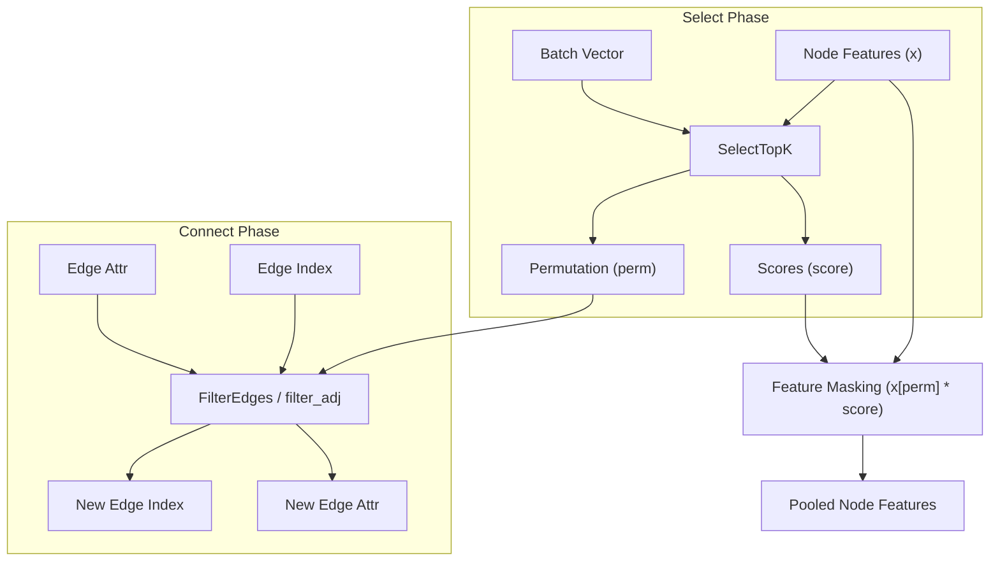
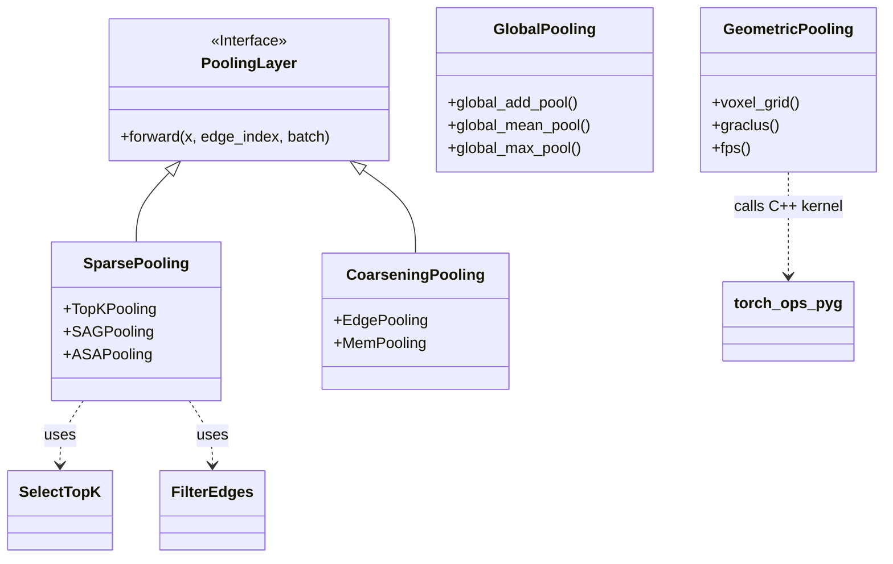

<!-- source: DeepWiki mcp.deepwiki.com · repo pyg-team/pytorch_geometric · page 5.4 Pooling Layers · fetched 2026-10-21 -->

# Pooling Layers

Relevant source files

The following files were used as context for generating this wiki page:

- [examples/colors_topk_pool.py](examples/colors_topk_pool.py)
- [examples/triangles_sag_pool.py](examples/triangles_sag_pool.py)
- [test/nn/conv/test_pan_conv.py](test/nn/conv/test_pan_conv.py)
- [test/nn/dense/test_diff_pool.py](test/nn/dense/test_diff_pool.py)
- [test/nn/pool/connect/test_filter_edges.py](test/nn/pool/connect/test_filter_edges.py)
- [test/nn/pool/select/test_select_topk.py](test/nn/pool/select/test_select_topk.py)
- [test/nn/pool/test_asap.py](test/nn/pool/test_asap.py)
- [test/nn/pool/test_avg_pool.py](test/nn/pool/test_avg_pool.py)
- [test/nn/pool/test_consecutive.py](test/nn/pool/test_consecutive.py)
- [test/nn/pool/test_edge_pool.py](test/nn/pool/test_edge_pool.py)
- [test/nn/pool/test_max_pool.py](test/nn/pool/test_max_pool.py)
- [test/nn/pool/test_pan_pool.py](test/nn/pool/test_pan_pool.py)
- [test/nn/pool/test_sag_pool.py](test/nn/pool/test_sag_pool.py)
- [test/nn/pool/test_topk_pool.py](test/nn/pool/test_topk_pool.py)
- [torch_geometric/contrib/nn/models/rbcd_attack.py](torch_geometric/contrib/nn/models/rbcd_attack.py)
- [torch_geometric/nn/conv/x_conv.py](torch_geometric/nn/conv/x_conv.py)
- [torch_geometric/nn/pool/__init__.py](torch_geometric/nn/pool/__init__.py)
- [torch_geometric/nn/pool/asap.py](torch_geometric/nn/pool/asap.py)
- [torch_geometric/nn/pool/avg_pool.py](torch_geometric/nn/pool/avg_pool.py)
- [torch_geometric/nn/pool/connect/__init__.py](torch_geometric/nn/pool/connect/__init__.py)
- [torch_geometric/nn/pool/connect/base.py](torch_geometric/nn/pool/connect/base.py)
- [torch_geometric/nn/pool/connect/filter_edges.py](torch_geometric/nn/pool/connect/filter_edges.py)
- [torch_geometric/nn/pool/consecutive.py](torch_geometric/nn/pool/consecutive.py)
- [torch_geometric/nn/pool/edge_pool.py](torch_geometric/nn/pool/edge_pool.py)
- [torch_geometric/nn/pool/graclus.py](torch_geometric/nn/pool/graclus.py)
- [torch_geometric/nn/pool/max_pool.py](torch_geometric/nn/pool/max_pool.py)
- [torch_geometric/nn/pool/pan_pool.py](torch_geometric/nn/pool/pan_pool.py)
- [torch_geometric/nn/pool/pool.py](torch_geometric/nn/pool/pool.py)
- [torch_geometric/nn/pool/sag_pool.py](torch_geometric/nn/pool/sag_pool.py)
- [torch_geometric/nn/pool/select/__init__.py](torch_geometric/nn/pool/select/__init__.py)
- [torch_geometric/nn/pool/select/base.py](torch_geometric/nn/pool/select/base.py)
- [torch_geometric/nn/pool/select/topk.py](torch_geometric/nn/pool/select/topk.py)
- [torch_geometric/nn/pool/topk_pool.py](torch_geometric/nn/pool/topk_pool.py)
- [torch_geometric/nn/pool/voxel_grid.py](torch_geometric/nn/pool/voxel_grid.py)
- [torch_geometric/profile/benchmark.py](torch_geometric/profile/benchmark.py)

Pooling layers in PyTorch Geometric (PyG) are designed to reduce the size of graph representations by downsampling nodes or contracting edges. These operators are essential for hierarchical graph representation learning, allowing models to capture multiscale structural information.

PyG implements a wide variety of pooling strategies, ranging from simple global aggregations to complex learnable hierarchical clustering methods.

## The Select/Connect/Reduce Abstraction

Modern pooling layers in PyG, such as `TopKPooling` and `SAGPooling`, are built using a modular **Select**, **Connect**, and **Reduce** abstraction. This design separates the logic of which nodes to keep from how the new graph topology is formed.

*   **Select**: Determines which nodes or clusters are preserved. For example, `SelectTopK` [torch_geometric/nn/pool/topk_pool.py:80]() picks nodes based on a projection score.
*   **Connect**: Defines the new connectivity (edges) between the preserved nodes. `FilterEdges` [torch_geometric/nn/pool/topk_pool.py:81]() is commonly used to induce subgraphs from the selected nodes.
*   **Reduce**: Aggregates features within clusters (used in coarsening-based pooling like `avg_pool` or `max_pool`).

### Data Flow for Top-K Style Pooling

The following diagram illustrates the data flow through the Select/Connect abstraction used in `TopKPooling` and `SAGPooling`.

**Pooling Abstraction Data Flow**

Sources: [torch_geometric/nn/pool/topk_pool.py:111-127](), [torch_geometric/nn/pool/select/topk.py:7-9]()

---

## Global Pooling Operators

Global pooling operators reduce an entire graph (or each graph in a batch) into a single fixed-size vector. These are typically used at the end of a GNN pipeline for graph-level classification or regression.

| Operator | Function | Description |
| :--- | :--- | :--- |
| **Global Add** | `global_add_pool` | Sums node features across the node dimension [torch_geometric/nn/pool/__init__.py:14](). |
| **Global Mean** | `global_mean_pool` | Computes the average of node features [torch_geometric/nn/pool/__init__.py:14](). |
| **Global Max** | `global_max_pool` | Takes the maximum value across the node dimension [torch_geometric/nn/pool/__init__.py:14](). |

Sources: [torch_geometric/nn/pool/__init__.py:14]()

---

## Hierarchical Pooling Layers

Hierarchical pooling reduces the number of nodes while maintaining a graph structure for further convolutions.

### 1. TopKPooling
Computes a learnable projection score for each node and retains the top $k$ nodes [torch_geometric/nn/pool/topk_pool.py:11-44](). The graph connectivity is preserved via an induced subgraph [torch_geometric/nn/pool/topk_pool.py:124]().
*   **Key Params**: `ratio` (pooling percentage) or `min_score` (threshold) [torch_geometric/nn/pool/topk_pool.py:48-58]().

### 2. SAGPooling (Self-Attention Graph Pooling)
An evolution of TopKPooling that uses a GNN (e.g., `GraphConv`, `GCNConv`) to compute projection scores [torch_geometric/nn/pool/sag_pool.py:12-42](). This allows the selection process to be "structure-aware" [torch_geometric/nn/pool/sag_pool.py:127]().
*   **Implementation**: It wraps a GNN layer and a `SelectTopK` module [torch_geometric/nn/pool/sag_pool.py:89-91]().

### 3. ASAPooling (Adaptive Structure Aware Pooling)
Utilizes a `LEConv` to compute node fitness scores and a master-node attention mechanism to aggregate clusters [torch_geometric/nn/pool/asap.py:21-48](). It performs graph coarsening by computing a new adjacency matrix $A' = S^T A S$ using sparse matrix multiplication [torch_geometric/nn/pool/asap.py:147-150]().

### 4. EdgePooling
Contracts edges iteratively based on a score computed for each edge [torch_geometric/nn/pool/edge_pool.py:17-25]().
*   **Process**: It computes raw scores for edges using a linear layer on concatenated node features [torch_geometric/nn/pool/edge_pool.py:129-130](), merges the highest-scoring edges that don't share nodes [torch_geometric/nn/pool/edge_pool.py:158-176](), and aggregates features of contracted nodes [torch_geometric/nn/pool/edge_pool.py:184]().

Sources: [torch_geometric/nn/pool/topk_pool.py:11-96](), [torch_geometric/nn/pool/sag_pool.py:12-107](), [torch_geometric/nn/pool/asap.py:21-164](), [torch_geometric/nn/pool/edge_pool.py:17-138]()

---

## Point Cloud & Spatial Pooling

PyG provides specialized operators for data with geometric coordinates (Point Clouds).

*   **Voxel Grid Pooling**: Overlays a regular grid over a point cloud and clusters all points within the same voxel [torch_geometric/nn/pool/voxel_grid.py:10-21](). It uses `torch.ops.pyg.grid_cluster` for efficient implementation [torch_geometric/nn/pool/voxel_grid.py:66]().
*   **FPS (Farthest Point Sampling)**: Iteratively samples the most distant point to ensure uniform coverage of the point set [torch_geometric/nn/pool/__init__.py:41-51]().
*   **Graclus**: A greedy clustering algorithm for fast graph coarsening [torch_geometric/nn/pool/__init__.py:17]().
*   **KNN / KNN Graph**: Utilities to find nearest neighbors or construct graphs based on spatial proximity [torch_geometric/nn/pool/__init__.py:88-152]().

Sources: [torch_geometric/nn/pool/voxel_grid.py:10-66](), [torch_geometric/nn/pool/__init__.py:41-152]()

---

## Technical Mapping: Class to Component

The following diagram maps the logical pooling components to the specific PyG classes that implement them.

**Pooling Component Mapping**

Sources: [torch_geometric/nn/pool/__init__.py:1-28](), [torch_geometric/nn/pool/topk_pool.py:80-81](), [torch_geometric/nn/pool/voxel_grid.py:66]()

---

## Local Neighborhood Pooling

In addition to hierarchical pooling, PyG supports local neighborhood aggregation that replaces node features with a summary of their immediate neighbors without changing the graph size.

*   **`avg_pool_neighbor_x`**: Replaces node features with the mean of their neighbors (including self-loops) [torch_geometric/nn/pool/avg_pool.py:96-113]().
*   **`max_pool_neighbor_x`**: Replaces node features with the maximum value found in their neighborhood [torch_geometric/nn/pool/max_pool.py:100-116]().

Sources: [torch_geometric/nn/pool/avg_pool.py:96-113](), [torch_geometric/nn/pool/max_pool.py:100-116]()

---

