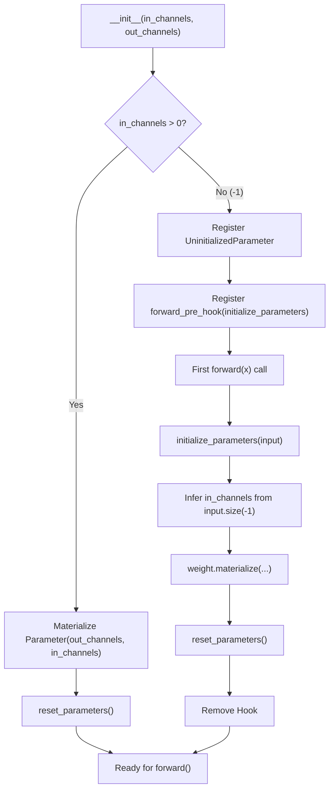
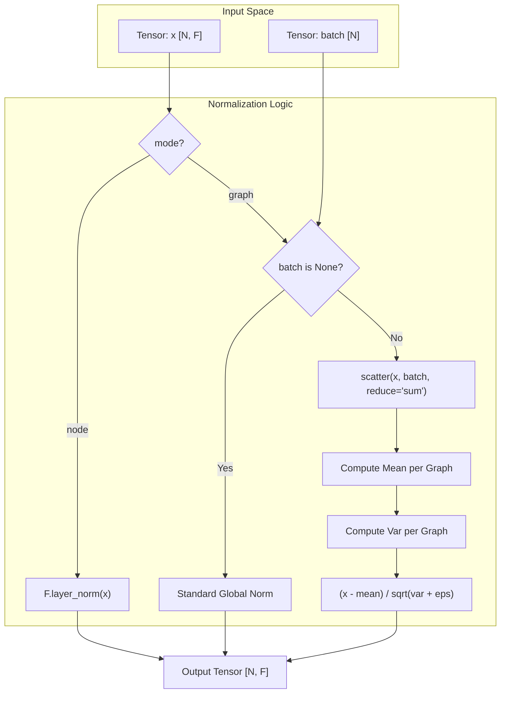

<!-- source: DeepWiki mcp.deepwiki.com · repo pyg-team/pytorch_geometric · page 5.5 Normalization and Linear Layers · fetched 2026-10-21 -->

# Normalization and Linear Layers

Relevant source files

The following files were used as context for generating this wiki page:

- [test/nn/conv/test_rgcn_conv.py](test/nn/conv/test_rgcn_conv.py)
- [test/nn/dense/test_linear.py](test/nn/dense/test_linear.py)
- [test/nn/norm/test_batch_norm.py](test/nn/norm/test_batch_norm.py)
- [test/nn/norm/test_diff_group_norm.py](test/nn/norm/test_diff_group_norm.py)
- [test/nn/norm/test_graph_norm.py](test/nn/norm/test_graph_norm.py)
- [test/nn/norm/test_graph_size_norm.py](test/nn/norm/test_graph_size_norm.py)
- [test/nn/norm/test_instance_norm.py](test/nn/norm/test_instance_norm.py)
- [test/nn/norm/test_layer_norm.py](test/nn/norm/test_layer_norm.py)
- [test/nn/norm/test_msg_norm.py](test/nn/norm/test_msg_norm.py)
- [test/nn/norm/test_pair_norm.py](test/nn/norm/test_pair_norm.py)
- [torch_geometric/nn/conv/rgcn_conv.py](torch_geometric/nn/conv/rgcn_conv.py)
- [torch_geometric/nn/dense/__init__.py](torch_geometric/nn/dense/__init__.py)
- [torch_geometric/nn/dense/diff_pool.py](torch_geometric/nn/dense/diff_pool.py)
- [torch_geometric/nn/dense/linear.py](torch_geometric/nn/dense/linear.py)
- [torch_geometric/nn/norm/__init__.py](torch_geometric/nn/norm/__init__.py)
- [torch_geometric/nn/norm/batch_norm.py](torch_geometric/nn/norm/batch_norm.py)
- [torch_geometric/nn/norm/diff_group_norm.py](torch_geometric/nn/norm/diff_group_norm.py)
- [torch_geometric/nn/norm/graph_norm.py](torch_geometric/nn/norm/graph_norm.py)
- [torch_geometric/nn/norm/graph_size_norm.py](torch_geometric/nn/norm/graph_size_norm.py)
- [torch_geometric/nn/norm/instance_norm.py](torch_geometric/nn/norm/instance_norm.py)
- [torch_geometric/nn/norm/layer_norm.py](torch_geometric/nn/norm/layer_norm.py)
- [torch_geometric/nn/norm/mean_subtraction_norm.py](torch_geometric/nn/norm/mean_subtraction_norm.py)
- [torch_geometric/nn/norm/msg_norm.py](torch_geometric/nn/norm/msg_norm.py)
- [torch_geometric/nn/norm/pair_norm.py](torch_geometric/nn/norm/pair_norm.py)

This section covers the specialized layers in PyTorch Geometric (PyG) designed for feature transformation and data normalization within graph neural networks. PyG provides a drop-in replacement for the standard `torch.nn.Linear` layer that supports graph-specific features like lazy initialization and decomposition, alongside a comprehensive suite of normalization layers tailored for node-level and graph-level processing.

## Linear Layers

PyG extends standard linear transformations to support the dynamic and heterogeneous nature of graph data. The core implementation is found in `torch_geometric.nn.dense.linear`.

### PyG Linear Layer
The `torch_geometric.nn.dense.Linear` class is a more flexible version of `torch.nn.Linear` [torch_geometric/nn/dense/linear.py:59-87](). It features:
*   **Lazy Initialization:** By passing `in_channels=-1`, the layer defers weight materialization until the first forward pass, at which point it infers the input dimension [torch_geometric/nn/dense/linear.py:102-107]().
*   **Custom Initializers:** Supports string-based initialization for weights (`"glorot"`, `"uniform"`, `"kaiming_uniform"`) and biases (`"zeros"`) [torch_geometric/nn/dense/linear.py:26-56]().

### Heterogeneous Linear Layers
For graphs with multiple node or edge types, PyG provides specialized modules:
*   **`HeteroLinear`**: Applies separate weight matrices to different types within a single tensor, guided by a `type_vec` [torch_geometric/nn/dense/linear.py:174-192]().
*   **`HeteroDictLinear`**: Designed for `dict` inputs where keys represent types and values are feature tensors [torch_geometric/nn/dense/linear.py:7-7]().

### Linear Layer Initialization Flow
The following diagram illustrates how the `Linear` layer handles parameter initialization, especially in the lazy case.

**Linear Layer Parameter Lifecycle**

Sources: [torch_geometric/nn/dense/linear.py:88-137]()

---

## Normalization Layers

Normalization is critical for stabilizing GNN training. PyG implements several layers that account for the batching structure of graphs (where a single batch contains multiple disjoint graphs).

### Standard Normalization Wrappers
PyG provides wrappers around standard techniques, modified to handle the `batch` vector used in PyG mini-batching.

| Class | Description | Implementation Detail |
| :--- | :--- | :--- |
| `BatchNorm` | Normalizes per-dimension over all nodes in a mini-batch [torch_geometric/nn/norm/batch_norm.py:10-44](). | Wraps `torch.nn.BatchNorm1d` [torch_geometric/nn/norm/batch_norm.py:61-62](). |
| `LayerNorm` | Normalizes across channels. Supports `"graph"` mode (per graph object) or `"node"` mode (per node) [torch_geometric/nn/norm/layer_norm.py:13-40](). | Uses `scatter` to compute per-graph mean/var if `mode="graph"` [torch_geometric/nn/norm/layer_norm.py:82-108](). |
| `InstanceNorm` | Normalizes per-dimension separately for each graph in the mini-batch [torch_geometric/nn/norm/instance_norm.py:12-42](). | Inherits from `_InstanceNorm` [torch_geometric/nn/norm/instance_norm.py:12-12](). |

### Graph-Specific Normalization
These layers implement research-specific strategies for graph data:
*   **`GraphNorm`**: Learns a separate mean and scale for each graph, allowing the model to distinguish between different graph scales [torch_geometric/nn/norm/__init__.py:19-19]().
*   **`PairNorm`**: Prevents "over-smoothing" by keeping the total variance of node features constant across the graph [torch_geometric/nn/norm/__init__.py:21-21]().
*   **`DiffGroupNorm`**: Group-based normalization that learns to cluster nodes and normalize within those clusters [torch_geometric/nn/norm/__init__.py:24-24]().
*   **`MsgNorm`**: Normalizes the message features during the aggregation step of message passing [torch_geometric/nn/norm/__init__.py:23-23]().
*   **`GraphSizeNorm`**: Scales features based on the number of nodes in each graph to handle varying graph sizes [torch_geometric/nn/norm/__init__.py:20-20]().

### Normalization Data Flow
This diagram shows how `LayerNorm` switches between global node-level normalization and graph-aware normalization using the PyG `batch` index.

**LayerNorm Logic Flow**

Sources: [torch_geometric/nn/norm/layer_norm.py:70-114](), [torch_geometric/nn/norm/instance_norm.py:59-119]()

---

## Weight Decomposition in Linear Layers

Advanced GNN layers like `RGCNConv` use specialized weight decomposition techniques implemented via internal weight matrices. These techniques reduce the number of parameters when dealing with many relations.

### Regularization Schemes
1.  **Basis Decomposition**: Weights are represented as a linear combination of a small set of basis matrices [torch_geometric/nn/conv/rgcn_conv.py:126-130]().
    *   `weight` shape: `(num_bases, in_channels, out_channels)`
    *   `comp` (coefficients) shape: `(num_relations, num_bases)`
2.  **Block-Diagonal Decomposition**: Weights are defined as block-diagonal matrices to encourage sparsity [torch_geometric/nn/conv/rgcn_conv.py:131-138]().
    *   `weight` shape: `(num_relations, num_blocks, block_in, block_out)`

### Entity Association Table

| Code Entity | File Path | Role |
| :--- | :--- | :--- |
| `Linear` | `torch_geometric/nn/dense/linear.py` | Base class for linear transformations with lazy init support. |
| `HeteroLinear` | `torch_geometric/nn/dense/linear.py` | Linear layer for multi-type data in a single tensor. |
| `BatchNorm` | `torch_geometric/nn/norm/batch_norm.py` | Node-level batch normalization. |
| `LayerNorm` | `torch_geometric/nn/norm/layer_norm.py` | Graph-aware layer normalization using `scatter`. |
| `RGCNConv` | `torch_geometric/nn/conv/rgcn_conv.py` | Uses basis/block decomposition for relational weights. |
| `reset_weight_` | `torch_geometric/nn/dense/linear.py` | Internal utility for weight initialization. |

Sources: [torch_geometric/nn/dense/linear.py:59-174](), [torch_geometric/nn/norm/batch_norm.py:10-10](), [torch_geometric/nn/conv/rgcn_conv.py:29-155]()

---

