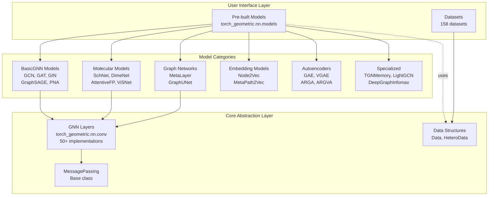
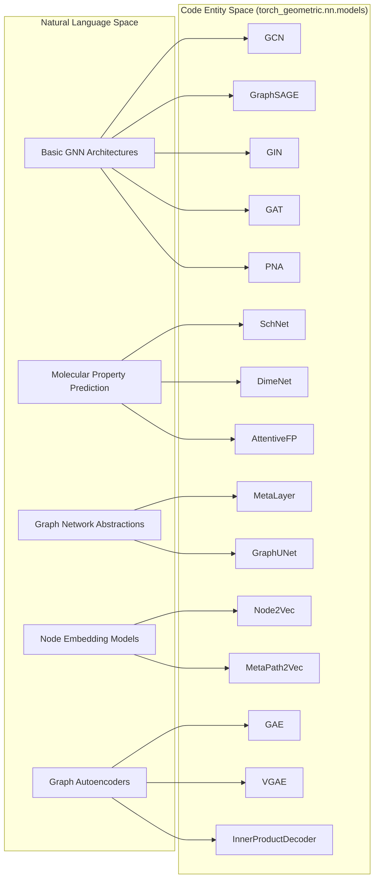
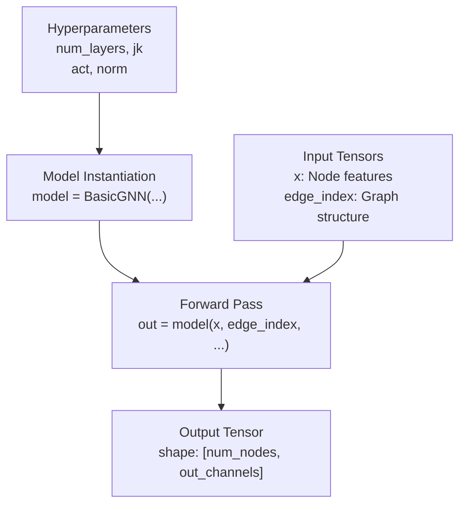

<!-- source: DeepWiki mcp.deepwiki.com · repo pyg-team/pytorch_geometric · page 6 Pre-built Models · fetched 2026-10-21 -->

# Pre-built Models

<details>
<summary>Relevant source files</summary>

The following files were used as context for generating this wiki page:

- [test/nn/models/test_basic_gnn.py](test/nn/models/test_basic_gnn.py)
- [test/nn/test_compile_basic.py](test/nn/test_compile_basic.py)
- [test/nn/test_compile_conv.py](test/nn/test_compile_conv.py)
- [test/nn/test_compile_dynamic.py](test/nn/test_compile_dynamic.py)
- [torch_geometric/nn/models/__init__.py](torch_geometric/nn/models/__init__.py)
- [torch_geometric/nn/models/basic_gnn.py](torch_geometric/nn/models/basic_gnn.py)

</details>


## Purpose and Scope

This page documents PyTorch Geometric's collection of ready-to-use GNN architectures and specialized neural network models that can be instantiated and trained without requiring custom layer implementations. These models provide high-level interfaces for common graph learning tasks and specific application domains.

This page provides an overview of all available pre-built models, their categorization, and common usage patterns. For detailed coverage of specific model categories, see:
- **Molecular Property Prediction models (SchNet, DimeNet)**: [Molecular Property Prediction](#6.1)
- **Graph Network abstractions (MetaLayer, BasicGNN)**: [Graph Network Models](#6.2)  
- **Specialized models (Node2Vec, GAE/VGAE, etc.)**: [Other Specialized Models](#6.3)

For individual GNN layer implementations that can be composed into custom models, see [GNN Layers](#5). For information on the MessagePassing framework that underpins many models, see [Message Passing Framework](#4).

**Sources**: [torch_geometric/nn/models/__init__.py:1-90]()

## Architecture Context

Pre-built models occupy the User Interface Layer of PyG's architecture, providing high-level entry points that abstract away the complexity of layer composition and parameter management. They build upon the Core Abstraction Layer components.



**Diagram: Pre-built Models Architecture**

**Sources**: [torch_geometric/nn/models/__init__.py:1-90]()

## Model Inventory by Category

PyG provides over 30 pre-built models across major categories. Each model is accessible via `torch_geometric.nn.models`.

### Complete Model Catalog

| Category | Models | Primary Use Case |
|----------|--------|------------------|
| **Basic GNNs** | `GCN`, `GraphSAGE`, `GIN`, `GAT`, `PNA`, `EdgeCNN` | General-purpose node/graph classification |
| **Molecular Models** | `SchNet`, `DimeNet`, `DimeNetPlusPlus`, `AttentiveFP`, `ViSNet`, `NeuralFingerprint`, `GNNFF` | 3D molecular property prediction |
| **Graph Networks** | `MetaLayer`, `GraphUNet`, `DeepGCNLayer` | Graph-level reasoning, hierarchical models |
| **Embedding Models** | `Node2Vec`, `MetaPath2Vec` | Unsupervised node embeddings |
| **Autoencoders** | `GAE`, `VGAE`, `ARGA`, `ARGVA`, `InnerProductDecoder` | Link prediction, graph generation |
| **Specialized** | `SignedGCN`, `RENet`, `TGNMemory`, `LabelPropagation`, `CorrectAndSmooth`, `RECT_L`, `LINKX`, `LightGCN`, `MaskLabel`, `GroupAddRev`, `PMLP`, `DeepGraphInfomax`, `LPFormer`, `SGFormer`, `Polynormer`, `ARLinkPredictor`, `GPSE` | Domain-specific tasks (Temporal, Knowledge Graphs, etc.) |

**Sources**: [torch_geometric/nn/models/__init__.py:41-89]()

### Model-to-Code Entity Mapping

The following diagram maps high-level conceptual categories to the specific class implementations found in the `torch_geometric.nn.models` package.



**Diagram: Model Categories to Code Classes**

**Sources**: [torch_geometric/nn/models/__init__.py:3-39]()

## Basic Usage Patterns

All pre-built models follow standard PyTorch `nn.Module` conventions. The `BasicGNN` models share a common interface for depth, dropout, and normalization.

### BasicGNN Configuration

Models like `GCN`, `GraphSAGE`, and `GAT` inherit from the `BasicGNN` base class, providing a consistent API for multi-layer GNNs.

```python
from torch_geometric.nn import GCN

# Initialize a 3-layer GCN with jumping knowledge and batch normalization
model = GCN(
    in_channels=16, 
    hidden_channels=64, 
    num_layers=3, 
    out_channels=7,
    dropout=0.5,
    norm='batch_norm',
    jk='cat'
)

# Forward pass
out = model(x, edge_index)
```

**Sources**: [torch_geometric/nn/models/basic_gnn.py:32-84](), [test/nn/models/test_basic_gnn.py:35-44]()

### Optimization and Compilation

Many pre-built models and their underlying convolutions are compatible with `torch.compile` for performance optimization on Linux systems.

```python
import torch
from torch_geometric.nn import GCN

model = GCN(16, 64, num_layers=2)
compiled_model = torch.compile(model)  # JIT compilation for faster execution

# Execution on device
out = compiled_model(x, edge_index)
```

**Sources**: [test/nn/test_compile_conv.py:34-49](), [test/nn/test_compile_basic.py:49-58]()

### Model Usage Flow



**Diagram: BasicGNN Usage Flow**

**Sources**: [torch_geometric/nn/models/basic_gnn.py:178-204](), [test/nn/models/test_basic_gnn.py:188-193]()

## Model-Specific Documentation

For detailed documentation, initialization parameters, and examples for specific model categories:

- **Molecular Property Prediction**: See [Molecular Property Prediction](#6.1) for `SchNet`, `DimeNet`, and chemistry-focused architectures.
- **Graph Network Models**: See [Graph Network Models](#6.2) for the `MetaLayer` abstraction and the `BasicGNN` hierarchy (`GCN`, `GraphSAGE`, `GIN`, `GAT`, `PNA`).
- **Other Specialized Models**: See [Other Specialized Models](#6.3) for embedding models (`Node2Vec`), autoencoders (`GAE`), and temporal models (`TGN`).

For understanding how to build custom models from individual layers, see [GNN Layers](#5). For the underlying message passing abstraction, see [Message Passing Framework](#4).

---

