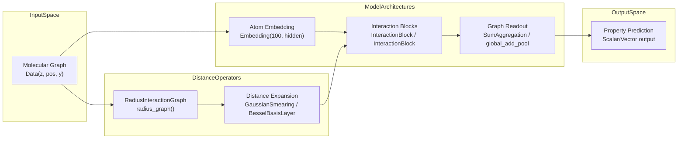
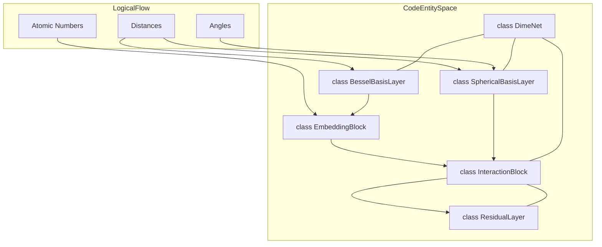

<!-- source: DeepWiki mcp.deepwiki.com · repo pyg-team/pytorch_geometric · page 6.1 Molecular Property Prediction · fetched 2026-10-21 -->

# Molecular Property Prediction

Relevant source files

The following files were used as context for generating this wiki page:

- [benchmark/kernel/datasets.py](benchmark/kernel/datasets.py)
- [benchmark/runtime/dgl/hidden.py](benchmark/runtime/dgl/hidden.py)
- [examples/attentive_fp.py](examples/attentive_fp.py)
- [examples/hetero/load_csv.py](examples/hetero/load_csv.py)
- [examples/node2vec.py](examples/node2vec.py)
- [examples/qm9_pretrained_dimenet.py](examples/qm9_pretrained_dimenet.py)
- [examples/qm9_pretrained_schnet.py](examples/qm9_pretrained_schnet.py)
- [test/explain/algorithm/test_attention_explainer.py](test/explain/algorithm/test_attention_explainer.py)
- [test/loader/test_shadow.py](test/loader/test_shadow.py)
- [test/nn/models/test_deep_graph_infomax.py](test/nn/models/test_deep_graph_infomax.py)
- [test/nn/models/test_dimenet.py](test/nn/models/test_dimenet.py)
- [test/nn/models/test_gnnff.py](test/nn/models/test_gnnff.py)
- [test/nn/models/test_metapath2vec.py](test/nn/models/test_metapath2vec.py)
- [test/nn/models/test_node2vec.py](test/nn/models/test_node2vec.py)
- [test/nn/models/test_schnet.py](test/nn/models/test_schnet.py)
- [test/nn/pool/test_mem_pool.py](test/nn/pool/test_mem_pool.py)
- [torch_geometric/datasets/qm9.py](torch_geometric/datasets/qm9.py)
- [torch_geometric/explain/algorithm/attention_explainer.py](torch_geometric/explain/algorithm/attention_explainer.py)
- [torch_geometric/logging.py](torch_geometric/logging.py)
- [torch_geometric/nn/inits.py](torch_geometric/nn/inits.py)
- [torch_geometric/nn/models/attentive_fp.py](torch_geometric/nn/models/attentive_fp.py)
- [torch_geometric/nn/models/deep_graph_infomax.py](torch_geometric/nn/models/deep_graph_infomax.py)
- [torch_geometric/nn/models/dimenet.py](torch_geometric/nn/models/dimenet.py)
- [torch_geometric/nn/models/metapath2vec.py](torch_geometric/nn/models/metapath2vec.py)
- [torch_geometric/nn/models/node2vec.py](torch_geometric/nn/models/node2vec.py)
- [torch_geometric/nn/models/schnet.py](torch_geometric/nn/models/schnet.py)
- [torch_geometric/nn/pool/mem_pool.py](torch_geometric/nn/pool/mem_pool.py)

## Purpose and Scope

This page documents PyTorch Geometric's pre-built models for molecular property prediction tasks. It covers the `SchNet` and `DimeNet` architectures designed for learning on molecular graphs with 3D coordinates, the `QM9` dataset for quantum chemistry properties, and usage of pre-trained model weights. Additionally, it covers attention-based and pooling architectures like `AttentiveFP` and `MemPooling` often used in chemistry.

---

## Overview

Molecular property prediction involves predicting quantum mechanical properties (e.g., energy, dipole moment, HOMO/LUMO energies) from molecular structure. Unlike traditional graph neural networks that operate on discrete graph topology, molecular property prediction models leverage continuous 3D atomic coordinates and distances to capture physical interactions between atoms.

PyG provides specialized architectures that:
- Use continuous-filter convolutions based on interatomic distances.
- Incorporate Gaussian or Bessel distance expansions for smooth distance representations.
- Apply physical constraints like rotational/translational invariance.
- Support pre-trained weights for transfer learning.

**Molecular Property Prediction Pipeline**

Sources: [torch_geometric/nn/models/schnet.py:35-156](), [torch_geometric/nn/models/dimenet.py:381-450]()

---

## Datasets

### QM9 Dataset

The `QM9` dataset consists of about 130,000 molecules with 19 regression targets. Each molecule includes spatial information for the single low-energy conformation.

**Properties Overview**

| Target Index | Property | Description | Unit |
|--------------|----------|-------------|------|
| 0 | μ | Dipole moment | D |
| 1 | α | Isotropic polarizability | a₀³ |
| 2 | εHOMO | Highest occupied molecular orbital energy | eV |
| 3 | εLUMO | Lowest unoccupied molecular orbital energy | eV |
| 4 | Δε | Gap between εHOMO and εLUMO | eV |
| 5 | ⟨R²⟩ | Electronic spatial extent | a₀² |
| 6 | ZPVE | Zero point vibrational energy | eV |
| 7-10 | U₀, U, H, G | Internal energy, enthalpy, free energy at 0K/298K | eV |
| 11 | cv | Heat capacity | cal/mol·K |

Sources: [torch_geometric/datasets/qm9.py:49-83]()

**Data Object Structure**

The `QM9` class inherits from `InMemoryDataset`. Each `Data` object typically contains:
- `z`: Atomic numbers `[num_atoms]`.
- `pos`: 3D coordinates `[num_atoms, 3]`.
- `y`: Target properties `[1, 19]`.
- `name`: Molecule name.

Sources: [torch_geometric/datasets/qm9.py:49-139]()

---

## SchNet Architecture

`SchNet` implements continuous-filter convolutional neural networks for modeling quantum interactions.

**Key Components**

1.  **GaussianSmearing**: Expands scalar distances into Gaussian basis functions. [torch_geometric/nn/models/schnet.py:431-445]()
2.  **InteractionBlock**: Core building block that applies continuous-filter convolution (`CFConv`). [torch_geometric/nn/models/schnet.py:362-393]()
3.  **CFConv**: Message passing layer that uses filters derived from interatomic distances. [torch_geometric/nn/models/schnet.py:395-429]()

**Pre-trained Models**
PyG provides pre-trained weights for all 12 QM9 regression targets. The `from_qm9_pretrained` method downloads and initializes these models. [torch_geometric/nn/models/schnet.py:171-179]()

---

## DimeNet Architecture

`DimeNet` (Directional Message Passing Neural Network) incorporates angular information between atom triplets using spherical harmonics and Bessel functions.

**Core Components**

- **BesselBasisLayer**: Expands distances into a basis of spherical Bessel functions. [torch_geometric/nn/models/dimenet.py:52-70]()
- **SphericalBasisLayer**: Captures angular information using spherical harmonics. [torch_geometric/nn/models/dimenet.py:73-126]()
- **InteractionBlock**: Implements directional message passing. [torch_geometric/nn/models/dimenet.py:170-227]()

**Code Entity Mapping**

Sources: [torch_geometric/nn/models/dimenet.py:52-227](), [torch_geometric/nn/models/dimenet.py:381-450]()

---

## AttentiveFP and Specialized Architectures

### AttentiveFP
`AttentiveFP` is a graph attention-based model for molecular representation learning. It uses a gated attention mechanism (`GATEConv`) and iterative refinement steps for global readout.

- **GATEConv**: A specialized message passing layer that computes attention coefficients using node features and edge attributes. [torch_geometric/nn/models/attentive_fp.py:14-66]()
- **Iterative Readout**: Uses `GRUCell` and `GATConv` to refine the molecular representation over several timesteps. [torch_geometric/nn/models/attentive_fp.py:158-167]()

Sources: [torch_geometric/nn/models/attentive_fp.py:68-170]()

### MemPooling
`MemPooling` is a memory-based pooling layer that learns coarsened graph representations through soft cluster assignments, useful for identifying functional groups in molecules.

- **kl_loss**: A KL divergence-based loss to encourage distinct cluster assignments. [torch_geometric/nn/models/mem_pool.py:62-80]()
- **forward**: Computes distances between node features and cluster centroids (`self.k`) to determine assignments. [torch_geometric/nn/models/mem_pool.py:81-132]()

Sources: [torch_geometric/nn/models/mem_pool.py:12-51]()

---

## Training and Evaluation Utilities

### Unit Conversions
QM9 properties are often calculated in Hartrees or kcal/mol. PyG provides conversion factors to standard eV.
- `HAR2EV`: 27.211386246 [torch_geometric/datasets/qm9.py:19]()
- `KCALMOL2EV`: 0.04336414 [torch_geometric/datasets/qm9.py:20]()

### Parameter Initialization
Molecular models use specialized initialization schemes like `glorot_orthogonal` to ensure stable training of deep interaction blocks.
- **glorot_orthogonal**: Implemented in `torch_geometric/nn/inits.py`. [torch_geometric/nn/inits.py:41-45]()

### Node2Vec and MetaPath2Vec
While primarily for social/citation graphs, these models are occasionally used for unsupervised molecular embedding.
- `Node2Vec`: Learned via random walks and negative sampling. [torch_geometric/nn/models/node2vec.py:14-83]()
- `MetaPath2Vec`: Heterogeneous version for complex molecular systems. [torch_geometric/nn/models/metapath2vec.py:15-127]()

Sources: [torch_geometric/nn/models/node2vec.py:14-159](), [torch_geometric/nn/models/metapath2vec.py:15-171]()

---

