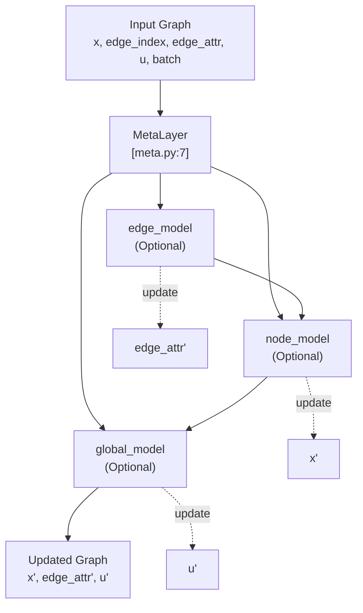
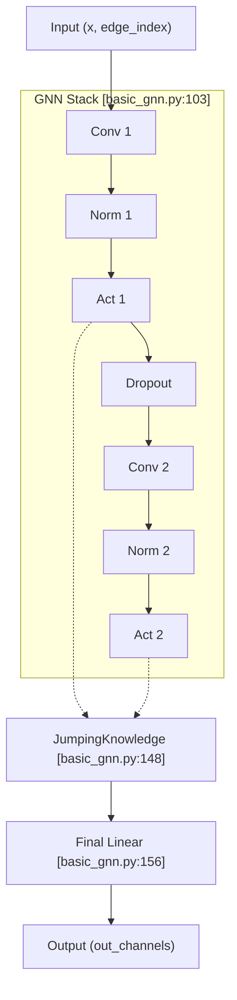
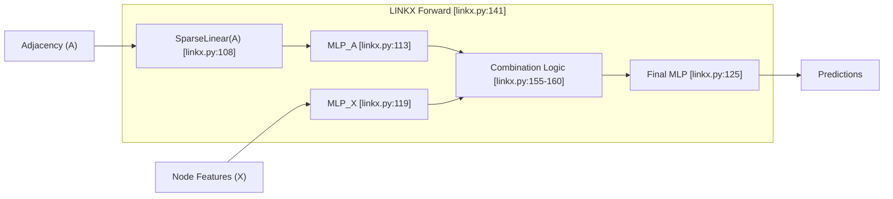

<!-- source: DeepWiki mcp.deepwiki.com · repo pyg-team/pytorch_geometric · page 6.2 Graph Network Models · fetched 2026-10-21 -->

# Graph Network Models

Relevant source files

The following files were used as context for generating this wiki page:

- [examples/correct_and_smooth.py](examples/correct_and_smooth.py)
- [examples/rect.py](examples/rect.py)
- [test/nn/models/test_basic_gnn.py](test/nn/models/test_basic_gnn.py)
- [test/nn/models/test_linkx.py](test/nn/models/test_linkx.py)
- [test/nn/models/test_meta.py](test/nn/models/test_meta.py)
- [test/nn/models/test_mlp.py](test/nn/models/test_mlp.py)
- [test/nn/models/test_rect.py](test/nn/models/test_rect.py)
- [test/nn/test_compile_basic.py](test/nn/test_compile_basic.py)
- [test/nn/test_compile_conv.py](test/nn/test_compile_conv.py)
- [test/nn/test_compile_dynamic.py](test/nn/test_compile_dynamic.py)
- [test/test_home.py](test/test_home.py)
- [test/transforms/test_remove_training_classes.py](test/transforms/test_remove_training_classes.py)
- [test/utils/test_convert.py](test/utils/test_convert.py)
- [test/utils/test_geodesic.py](test/utils/test_geodesic.py)
- [torch_geometric/nn/models/__init__.py](torch_geometric/nn/models/__init__.py)
- [torch_geometric/nn/models/basic_gnn.py](torch_geometric/nn/models/basic_gnn.py)
- [torch_geometric/nn/models/linkx.py](torch_geometric/nn/models/linkx.py)
- [torch_geometric/nn/models/meta.py](torch_geometric/nn/models/meta.py)
- [torch_geometric/nn/models/mlp.py](torch_geometric/nn/models/mlp.py)
- [torch_geometric/nn/models/rect.py](torch_geometric/nn/models/rect.py)
- [torch_geometric/transforms/remove_training_classes.py](torch_geometric/transforms/remove_training_classes.py)
- [torch_geometric/transforms/svd_feature_reduction.py](torch_geometric/transforms/svd_feature_reduction.py)
- [torch_geometric/utils/convert.py](torch_geometric/utils/convert.py)
- [torch_geometric/utils/geodesic.py](torch_geometric/utils/geodesic.py)

## Purpose and Scope

This page documents PyG's pre-built models and high-level abstractions for graph neural networks. It covers the `MetaLayer` abstraction for building complex graph networks with explicit edge, node, and global update functions, as well as the `BasicGNN` base class which powers standard architectures like GCN, GAT, and GraphSAGE. Additionally, it covers specialized models like `MLP` and `LINKX`.

For molecular property prediction models like SchNet and DimeNet, see [Molecular Property Prediction](#6.1). For other specialized architectures like Node2Vec and graph autoencoders, see [Other Specialized Models](#6.3).

## MetaLayer Abstraction

The `MetaLayer` implements the Graph Network (GN) framework, providing a flexible meta-architecture for constructing graph-to-graph transformations. It enables simultaneous updates to edge features, node features, and global features [torch_geometric/nn/models/meta.py:7-160]().

### MetaLayer Class Structure

**Diagram: MetaLayer Architecture and Component Relationships**

The `MetaLayer` class [torch_geometric/nn/models/meta.py:99-109]() accepts three optional `torch.nn.Module` components: `edge_model`, `node_model`, and `global_model`. If a component is `None`, the corresponding features pass through unchanged [torch_geometric/nn/models/meta.py:26-38]().

### Forward Pass Flow

The forward pass [torch_geometric/nn/models/meta.py:118-152]() applies updates sequentially:
1. **Edge Update**: Updates `edge_attr` based on source nodes, target nodes, current edges, and global features [torch_geometric/nn/models/meta.py:139-144]().
2. **Node Update**: Updates node features `x` using the (potentially updated) `edge_attr` [torch_geometric/nn/models/meta.py:146-147]().
3. **Global Update**: Updates global features `u` using updated node and edge features [torch_geometric/nn/models/meta.py:149-150]().

**Sources:** [torch_geometric/nn/models/meta.py:7-160]()

---

## BasicGNN and Standard Architectures

PyG provides a unified `BasicGNN` base class [torch_geometric/nn/models/basic_gnn.py:32-303]() to implement common GNN architectures. This class handles boilerplate code for stacking layers, normalization, activation, dropout, and Jumping Knowledge (JK) connections.

### BasicGNN Architecture

**Diagram: BasicGNN Internal Data Flow**

### Supported Models
The following models inherit from `BasicGNN` and override the `init_conv` method [torch_geometric/nn/models/basic_gnn.py:162-164]():

| Model | Underlying Layer | Description |
| :--- | :--- | :--- |
| `GCN` | `GCNConv` | Graph Convolutional Network [torch_geometric/nn/models/basic_gnn.py:306-348]() |
| `GraphSAGE` | `SAGEConv` | SAGE (Sample and Aggregate) [torch_geometric/nn/models/basic_gnn.py:351-393]() |
| `GIN` | `GINConv` | Graph Isomorphism Network [torch_geometric/nn/models/basic_gnn.py:396-444]() |
| `GAT` | `GATConv` / `GATv2Conv` | Graph Attention Network [torch_geometric/nn/models/basic_gnn.py:447-518]() |
| `PNA` | `PNAConv` | Principal Neighbourhood Aggregation [torch_geometric/nn/models/basic_gnn.py:521-583]() |
| `EdgeCNN` | `EdgeConv` | Dynamic Graph CNN for point clouds [torch_geometric/nn/models/basic_gnn.py:586-628]() |

### Key Features
- **Normalization**: Supports various normalization layers (BatchNorm, LayerNorm, etc.) via the `normalization_resolver` [torch_geometric/nn/models/basic_gnn.py:127-131]().
- **Jumping Knowledge**: Supports `last`, `cat`, `max`, and `lstm` modes to combine representations from different layers [torch_geometric/nn/models/basic_gnn.py:58-62]().
- **Inference**: Provides a `BasicGNN.inference` method for efficient layer-by-layer evaluation on large graphs using `NeighborLoader` [torch_geometric/nn/models/basic_gnn.py:230-303]().

**Sources:** [torch_geometric/nn/models/basic_gnn.py:32-628](), [test/nn/models/test_basic_gnn.py:35-136]()

---

## MLP (Multi-Layer Perceptron)

The `MLP` class [torch_geometric/nn/models/mlp.py:18-241]() is a flexible implementation of a standard multi-layer perceptron, often used as a baseline or as a component within GNNs (e.g., in `GIN` or `LINKX`).

### Instantiation Methods
1. **Explicit Channel List**: `MLP([16, 32, 64])` [torch_geometric/nn/models/mlp.py:23-29]().
2. **Fixed Hidden Channels**: `MLP(in_channels=16, hidden_channels=32, out_channels=64, num_layers=3)` [torch_geometric/nn/models/mlp.py:31-39]().

### Configuration
- **plain_last**: If `True`, the last layer will not have activation, normalization, or dropout [torch_geometric/nn/models/mlp.py:68-70]().
- **act_first**: If `True`, applies activation before normalization [torch_geometric/nn/models/mlp.py:58-59]().

**Sources:** [torch_geometric/nn/models/mlp.py:18-241](), [test/nn/models/test_mlp.py:10-38]()

---

## LINKX Model

The `LINKX` model [torch_geometric/nn/models/linkx.py:57-167]() is designed for large-scale learning on non-homophilous graphs. It processes node features and graph structure separately using MLPs before combining them.

### Data Flow in LINKX

**Diagram: LINKX Model Architecture**

- **SparseLinear**: A specialized layer that performs `spmm` (sparse-dense matrix multiplication) on the adjacency matrix [torch_geometric/nn/models/linkx.py:14-55]().
- **Independent Streams**: It computes embeddings for the adjacency matrix $\mathbf{H}_{\mathbf{A}}$ and node features $\mathbf{H}_{\mathbf{X}}$ independently before fusing them [torch_geometric/nn/models/linkx.py:62-69]().

**Sources:** [torch_geometric/nn/models/linkx.py:14-167]()

---

## Specialized Utilities

### Geodesic Distance
For mesh-based graph networks, PyG provides `geodesic_distance` [torch_geometric/utils/geodesic.py:10-138]() to compute distances on a mesh given positions and face indices. It requires the `gdist` package [torch_geometric/utils/geodesic.py:28-29]().

### RECT_L
The `RECT_L` model [torch_geometric/nn/models/rect.py:8-125]() is a semi-supervised GNN designed for class-imbalanced graphs. It includes a `get_semantic_labels` utility to generate labels for unlabeled nodes based on class-representative features [torch_geometric/nn/models/rect.py:73-100]().

**Sources:** [torch_geometric/utils/geodesic.py:10-138](), [torch_geometric/nn/models/rect.py:8-125](), [test/nn/models/test_rect.py:9-45]()

---

