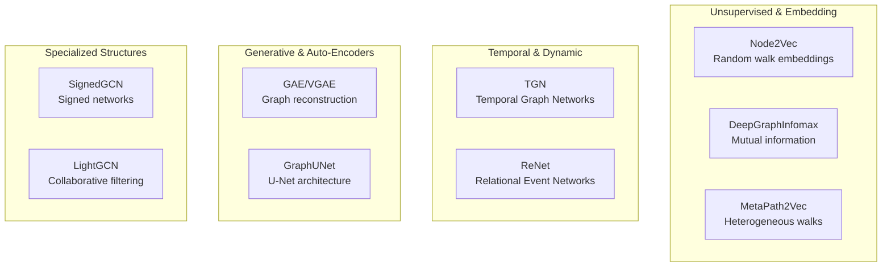
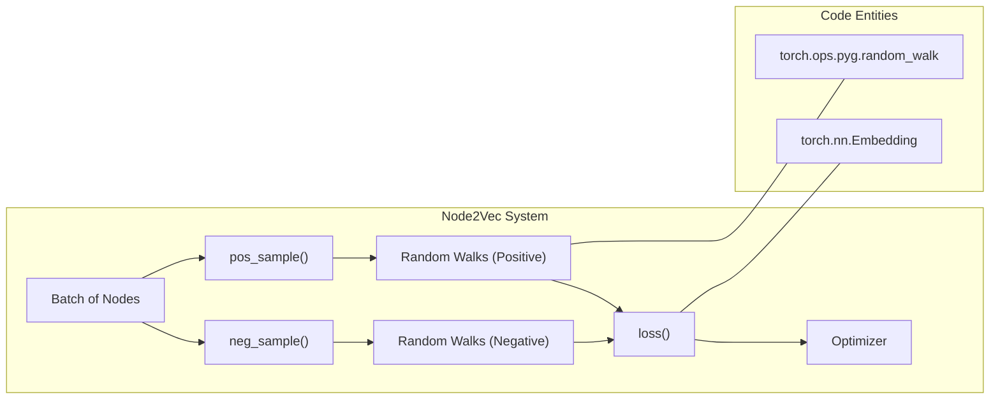
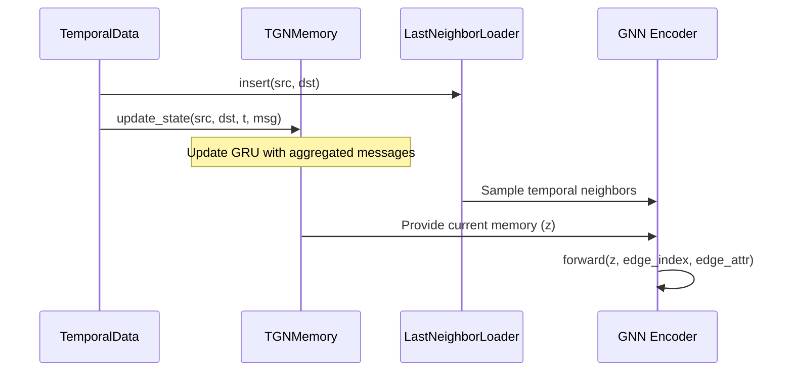

<!-- source: DeepWiki mcp.deepwiki.com · repo pyg-team/pytorch_geometric · page 6.3 Other Specialized Models · fetched 2026-10-21 -->

# Other Specialized Models

Relevant source files

The following files were used as context for generating this wiki page:

- [examples/arma.py](examples/arma.py)
- [examples/autoencoder.py](examples/autoencoder.py)
- [examples/cluster_gcn_ppi.py](examples/cluster_gcn_ppi.py)
- [examples/dna.py](examples/dna.py)
- [examples/film.py](examples/film.py)
- [examples/glnn.py](examples/glnn.py)
- [examples/graph_unet.py](examples/graph_unet.py)
- [examples/infomax_inductive.py](examples/infomax_inductive.py)
- [examples/infomax_transductive.py](examples/infomax_transductive.py)
- [examples/link_pred.py](examples/link_pred.py)
- [examples/mutag_gin.py](examples/mutag_gin.py)
- [examples/node2vec.py](examples/node2vec.py)
- [examples/ppi.py](examples/ppi.py)
- [examples/sgc.py](examples/sgc.py)
- [examples/signed_gcn.py](examples/signed_gcn.py)
- [examples/tagcn.py](examples/tagcn.py)
- [examples/tensorboard_logging.py](examples/tensorboard_logging.py)
- [examples/tgn.py](examples/tgn.py)
- [test/loader/test_shadow.py](test/loader/test_shadow.py)
- [test/nn/conv/test_arma_conv.py](test/nn/conv/test_arma_conv.py)
- [test/nn/conv/test_tag_conv.py](test/nn/conv/test_tag_conv.py)
- [test/nn/models/test_correct_and_smooth.py](test/nn/models/test_correct_and_smooth.py)
- [test/nn/models/test_deep_graph_infomax.py](test/nn/models/test_deep_graph_infomax.py)
- [test/nn/models/test_dimenet.py](test/nn/models/test_dimenet.py)
- [test/nn/models/test_gnnff.py](test/nn/models/test_gnnff.py)
- [test/nn/models/test_graph_unet.py](test/nn/models/test_graph_unet.py)
- [test/nn/models/test_label_prop.py](test/nn/models/test_label_prop.py)
- [test/nn/models/test_metapath2vec.py](test/nn/models/test_metapath2vec.py)
- [test/nn/models/test_node2vec.py](test/nn/models/test_node2vec.py)
- [test/nn/models/test_re_net.py](test/nn/models/test_re_net.py)
- [test/nn/models/test_signed_gcn.py](test/nn/models/test_signed_gcn.py)
- [test/nn/models/test_tgn.py](test/nn/models/test_tgn.py)
- [test/nn/pool/test_mem_pool.py](test/nn/pool/test_mem_pool.py)
- [test/utils/test_coalesce.py](test/utils/test_coalesce.py)
- [test/utils/test_scatter.py](test/utils/test_scatter.py)
- [test/utils/test_softmax.py](test/utils/test_softmax.py)
- [torch_geometric/data/temporal.py](torch_geometric/data/temporal.py)
- [torch_geometric/datasets/gdelt.py](torch_geometric/datasets/gdelt.py)
- [torch_geometric/datasets/geometry.py](torch_geometric/datasets/geometry.py)
- [torch_geometric/datasets/icews.py](torch_geometric/datasets/icews.py)
- [torch_geometric/datasets/jodie.py](torch_geometric/datasets/jodie.py)
- [torch_geometric/loader/temporal_dataloader.py](torch_geometric/loader/temporal_dataloader.py)
- [torch_geometric/nn/conv/arma_conv.py](torch_geometric/nn/conv/arma_conv.py)
- [torch_geometric/nn/conv/tag_conv.py](torch_geometric/nn/conv/tag_conv.py)
- [torch_geometric/nn/conv/wl_conv.py](torch_geometric/nn/conv/wl_conv.py)
- [torch_geometric/nn/inits.py](torch_geometric/nn/inits.py)
- [torch_geometric/nn/models/autoencoder.py](torch_geometric/nn/models/autoencoder.py)
- [torch_geometric/nn/models/correct_and_smooth.py](torch_geometric/nn/models/correct_and_smooth.py)
- [torch_geometric/nn/models/deep_graph_infomax.py](torch_geometric/nn/models/deep_graph_infomax.py)
- [torch_geometric/nn/models/dimenet.py](torch_geometric/nn/models/dimenet.py)
- [torch_geometric/nn/models/graph_unet.py](torch_geometric/nn/models/graph_unet.py)
- [torch_geometric/nn/models/label_prop.py](torch_geometric/nn/models/label_prop.py)
- [torch_geometric/nn/models/metapath2vec.py](torch_geometric/nn/models/metapath2vec.py)
- [torch_geometric/nn/models/node2vec.py](torch_geometric/nn/models/node2vec.py)
- [torch_geometric/nn/models/re_net.py](torch_geometric/nn/models/re_net.py)
- [torch_geometric/nn/models/signed_gcn.py](torch_geometric/nn/models/signed_gcn.py)
- [torch_geometric/nn/models/tgn.py](torch_geometric/nn/models/tgn.py)
- [torch_geometric/nn/pool/mem_pool.py](torch_geometric/nn/pool/mem_pool.py)

This page documents specialized models in PyTorch Geometric that serve specific purposes beyond standard message passing GNNs. These include unsupervised learning methods, recommendation system models, temporal graph networks, and graph auto-encoders.

Sources: [torch_geometric/nn/models/__init__.py:1-90]()

## Node2Vec

`Node2Vec` learns node embeddings by optimizing a Skip-gram objective over biased random walks [torch_geometric/nn/models/node2vec.py:14-45](). It uses parameters `p` (return parameter) and `q` (in-out parameter) to control the walk behavior [torch_geometric/nn/models/node2vec.py:36-39]().

### Architecture and Data Flow

Sources: [torch_geometric/nn/models/node2vec.py:101-160](), [examples/node2vec.py:16-42]()

- **Sampling**: The model implements `pos_sample` and `neg_sample` to generate context pairs [torch_geometric/nn/models/node2vec.py:101-126]().
- **Training**: It typically uses `torch.optim.SparseAdam` for efficient updates to the embedding matrix [examples/node2vec.py:30-30]().

## Temporal Graph Networks (TGN)

The `TGNMemory` module implements the memory-based approach for dynamic graphs where interactions occur over time [torch_geometric/nn/models/tgn.py:15-37]().

### TGN Components

| Component | Class/Function | Role |
| :--- | :--- | :--- |
| **Memory** | `TGNMemory` | Stores and updates node states over time [torch_geometric/nn/models/tgn.py:15]() |
| **Message** | `IdentityMessage` | Combines interaction data into messages [examples/tgn.py:24]() |
| **Aggregator** | `LastAggregator` | Aggregates multiple messages for a node [examples/tgn.py:25]() |
| **Loader** | `LastNeighborLoader` | Samples temporal neighbors [examples/tgn.py:26]() |

Sources: [torch_geometric/nn/models/tgn.py:15-103](), [examples/tgn.py:88-111]()

### Dynamic Update Flow

Sources: [torch_geometric/nn/models/tgn.py:102-146](), [examples/tgn.py:117-152]()

## Graph Auto-Encoders (GAE/VGAE)

Graph Auto-Encoders learn latent representations `Z` by reconstructing the adjacency matrix `A` [torch_geometric/nn/models/autoencoder.py:57-68]().

### Core Classes
- **`GAE`**: Standard auto-encoder taking a user-defined `encoder` [torch_geometric/nn/models/autoencoder.py:57]().
- **`VGAE`**: Variational variant that uses a reparameterization trick [torch_geometric/nn/models/autoencoder.py:145-173]().
- **`InnerProductDecoder`**: The default decoder calculating $\sigma(ZZ^\top)$ [torch_geometric/nn/models/autoencoder.py:14-41]().

Sources: [torch_geometric/nn/models/autoencoder.py:14-173](), [examples/autoencoder.py:81-88]()

## MetaPath2Vec

`MetaPath2Vec` extends random walk embeddings to heterogeneous graphs using a predefined `metapath` (a sequence of node/edge types) [torch_geometric/nn/models/metapath2vec.py:15-50]().

### Implementation Details
- **Metapath Definition**: Defined as a `List[EdgeType]` [torch_geometric/nn/models/metapath2vec.py:55]().
- **Random Walk**: Walks are constrained to follow the schema of the metapath [torch_geometric/nn/models/metapath2vec.py:153-172]().
- **Embeddings**: Maintains separate embedding ranges for different node types within a single `torch.nn.Embedding` [torch_geometric/nn/models/metapath2vec.py:109-124]().

Sources: [torch_geometric/nn/models/metapath2vec.py:51-125]()

## SignedGCN

`SignedGCN` handles graphs with both positive and negative edge weights (e.g., trust/distrust social networks) [torch_geometric/nn/models/signed_gcn.py:15-29]().

- **Layers**: Uses `SignedConv` which aggregates positive and negative neighborhoods separately [torch_geometric/nn/models/signed_gcn.py:45-51]().
- **Loss**: Combines a reconstruction loss with a discriminator loss to classify links as positive, negative, or non-existent [torch_geometric/nn/models/signed_gcn.py:160-188]().
- **Spectral Features**: Includes a utility `create_spectral_features` to initialize node features based on the signed adjacency matrix [torch_geometric/nn/models/signed_gcn.py:84-126]().

Sources: [torch_geometric/nn/models/signed_gcn.py:15-188]()

## Other Models Summary

| Model | Class | Purpose |
| :--- | :--- | :--- |
| **DeepGraphInfomax** | `DeepGraphInfomax` | Unsupervised learning via mutual information maximization [torch_geometric/nn/models/deep_graph_infomax.py]() |
| **GraphUNet** | `GraphUNet` | U-Net architecture with gPool and gUnpool layers [torch_geometric/nn/models/graph_unet.py]() |
| **ReNet** | `ReNet` | Relational Event Network for modeling temporal interaction sequences [torch_geometric/nn/models/re_net.py]() |
| **LightGCN** | `LightGCN` | Simplified GCN for collaborative filtering (no non-linearities) [torch_geometric/nn/models/__init__.py:25]() |
| **Label Propagation** | `LabelPropagation` | Semi-supervised learning via iterative label spreading [torch_geometric/nn/models/label_prop.py]() |

Sources: [torch_geometric/nn/models/__init__.py:1-90]()

---

