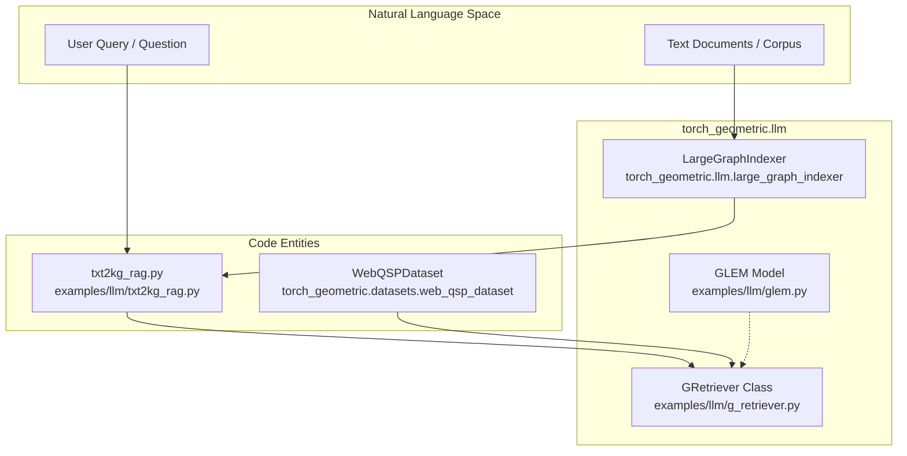
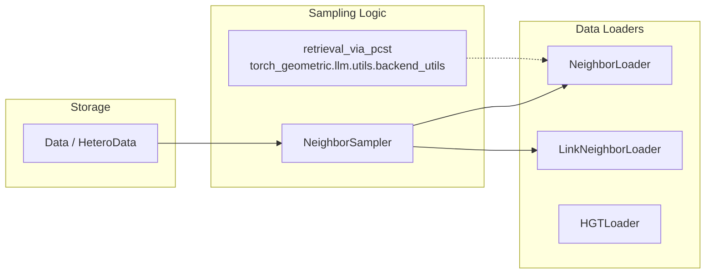
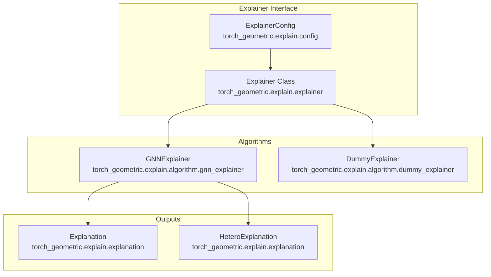

<!-- source: DeepWiki mcp.deepwiki.com · repo pyg-team/pytorch_geometric · page 7 Advanced Features · fetched 2026-10-21 -->

# Advanced Features

Relevant source files

The following files were used as context for generating this wiki page:

- [docs/source/modules/explain.rst](docs/source/modules/explain.rst)
- [docs/source/notes/explain.rst](docs/source/notes/explain.rst)
- [examples/llm/README.md](examples/llm/README.md)
- [examples/llm/g_retriever.py](examples/llm/g_retriever.py)
- [examples/llm/txt2kg_rag.py](examples/llm/txt2kg_rag.py)
- [test/explain/algorithm/test_gnn_explainer.py](test/explain/algorithm/test_gnn_explainer.py)
- [test/explain/test_explainer.py](test/explain/test_explainer.py)
- [test/explain/test_explanation.py](test/explain/test_explanation.py)
- [test/explain/test_hetero_explainer.py](test/explain/test_hetero_explainer.py)
- [test/explain/test_hetero_explanation.py](test/explain/test_hetero_explanation.py)
- [test/llm/test_large_graph_indexer.py](test/llm/test_large_graph_indexer.py)
- [torch_geometric/datasets/web_qsp_dataset.py](torch_geometric/datasets/web_qsp_dataset.py)
- [torch_geometric/explain/__init__.py](torch_geometric/explain/__init__.py)
- [torch_geometric/explain/algorithm/__init__.py](torch_geometric/explain/algorithm/__init__.py)
- [torch_geometric/explain/algorithm/base.py](torch_geometric/explain/algorithm/base.py)
- [torch_geometric/explain/algorithm/dummy_explainer.py](torch_geometric/explain/algorithm/dummy_explainer.py)
- [torch_geometric/explain/algorithm/gnn_explainer.py](torch_geometric/explain/algorithm/gnn_explainer.py)
- [torch_geometric/explain/config.py](torch_geometric/explain/config.py)
- [torch_geometric/explain/explainer.py](torch_geometric/explain/explainer.py)
- [torch_geometric/explain/explanation.py](torch_geometric/explain/explanation.py)
- [torch_geometric/llm/utils/backend_utils.py](torch_geometric/llm/utils/backend_utils.py)
- [torch_geometric/llm/utils/vectorrag.py](torch_geometric/llm/utils/vectorrag.py)

This document explores cutting-edge capabilities in PyTorch Geometric that extend beyond basic GNN training workflows. These features enable applications in emerging areas such as Large Language Model (LLM) integration, explainability, large-scale training, and high-performance computing.

The material is organized into high-level overviews with links to detailed child pages:

- **LLM Integration and RAG**: Graph-based retrieval augmented generation pipelines.
- **Neighbor Sampling for Large Graphs**: Scalable training on massive graphs.
- **Type System and Extension Management**: Feature detection and optional dependencies.
- **Explainability**: Understanding GNN predictions through various explanation methods.
- **Distributed Training**: Multi-GPU and multi-node infrastructure.

For detailed coverage of these topics, please see the respective child pages linked in each section.

---

## LLM Integration and RAG

PyTorch Geometric introduces comprehensive support for integrating Graph Neural Networks with Large Language Models. This enables graph-based Retrieval Augmented Generation (RAG) pipelines that combine the reasoning capabilities of LLMs with the relational structure of knowledge graphs.

**LLM Integration System Architecture**

Sources: [examples/llm/README.md:1-12](), [examples/llm/g_retriever.py:1-21](), [torch_geometric/datasets/web_qsp_dataset.py:11-21]()

Key components include:
- **G-Retriever**: A GNN+LLM architecture that retrieves relevant subgraphs and uses GNNs to encode them before feeding to LLMs [examples/llm/g_retriever.py:1-21]().
- **GLEM**: Graph-Language model Expectation-Maximization framework for co-training GNNs and LLMs [examples/llm/README.md:7]().
- **LargeGraphIndexer**: Indexes large knowledge graphs for fast retrieval using text embeddings [torch_geometric/datasets/web_qsp_dataset.py:11-16]().

For details, see [LLM Integration and RAG](#7.1).

---

## Neighbor Sampling for Large Graphs

PyTorch Geometric provides scalable training capabilities for graphs with millions of nodes through efficient neighbor sampling strategies. This allows for mini-batch training where only a local subgraph is loaded into memory at once.

**Sampling and Loading Pipeline**

Sources: [torch_geometric/datasets/web_qsp_dataset.py:18-21](), [examples/llm/g_retriever.py:109-119]()

Key features include:
- **NeighborLoader**: Samples multi-hop neighborhoods for node-level tasks.
- **LinkNeighborLoader**: Samples neighborhoods around pairs of nodes for link prediction.
- **Temporal/Weighted Sampling**: Biased sampling based on edge weights or timestamps.

For details, see [Neighbor Sampling for Large Graphs](#7.2).

---

## Type System and Extension Management

PyTorch Geometric uses a runtime feature detection system to enable optional high-performance extensions (like `pyg-lib`, `torch-scatter`, `torch-sparse`) while maintaining compatibility with minimal dependencies.

Key components include:
- **Feature Flags**: Boolean flags (e.g., `WITH_PT21`) that gate optimized code paths.
- **LazyLoader**: Mechanism to defer loading of heavy dependencies until they are actually used.
- **Extension Integration**: Seamless use of `pyg-lib` for accelerated sampling and hash maps.

For details, see [Type System and Extension Management](#7.3).

---

## Explainability

The `torch_geometric.explain` module provides tools to understand GNN predictions by identifying compact subgraph structures and node features that play a crucial role in the model's output [torch_geometric/explain/algorithm/gnn_explainer.py:24-29]().

**Explainability Framework**

Sources: [torch_geometric/explain/explainer.py:29-68](), [torch_geometric/explain/algorithm/gnn_explainer.py:24-62](), [torch_geometric/explain/explanation.py:139-153]()

The framework supports:
- **Multiple Algorithms**: `GNNExplainer`, `CaptumExplainer`, `AttentionExplainer`, and more [docs/source/modules/explain.rst:21-27]().
- **Flexible Masks**: Node, edge, and feature-level masks to isolate important components [torch_geometric/explain/explanation.py:146-151]().
- **Heterogeneous Support**: `HeteroExplanation` objects for graphs with multiple node and edge types [torch_geometric/explain/algorithm/gnn_explainer.py:127-154]().

For details, see [Explainability](#7.4).

---

## Distributed Training

For massive datasets that exceed the memory of a single machine, PyTorch Geometric provides distributed training infrastructure. This system partitions graphs across multiple nodes and uses Remote Procedure Calls (RPC) to handle cross-partition communication.

Key components include:
- **DistNeighborLoader**: A distributed version of the neighbor loader for multi-node setups.
- **Graph Partitioning**: Tools to split a large graph into balanced parts.
- **LocalGraphStore / LocalFeatureStore**: Specialized storage for local partitions on each worker.

For details, see [Distributed Training](#7.5).

---

## Specialized Utilities and Metrics

Beyond the core modules, PyTorch Geometric includes advanced utilities for performance analysis and evaluation:
- **NVTX Profiling**: Integration with NVIDIA Nsight Systems for CUDA profiling [examples/llm/README.md:11]().
- **Explanation Metrics**: Built-in metrics to judge the quality of model explanations [docs/source/modules/explain.rst:71-85]().
- **PCST Retrieval**: Prize-collecting Steiner Tree algorithms for subgraph retrieval in RAG pipelines [torch_geometric/llm/utils/backend_utils.py:20]().

Sources: [examples/llm/README.md:1-12](), [docs/source/modules/explain.rst:71-85](), [torch_geometric/explain/algorithm/gnn_explainer.py:64-72]()

---

