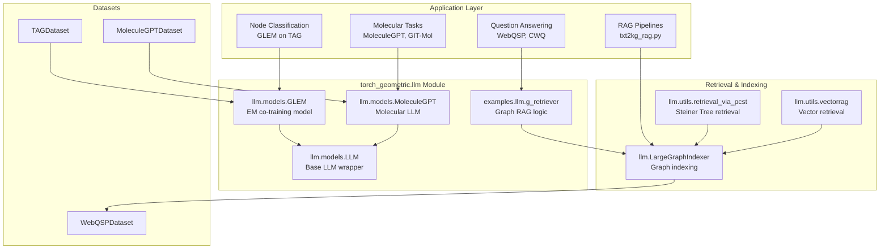
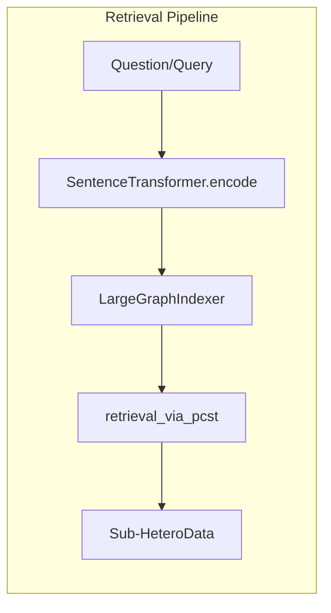

<!-- source: DeepWiki mcp.deepwiki.com · repo pyg-team/pytorch_geometric · page 7.1 LLM Integration and RAG · fetched 2026-10-21 -->

# LLM Integration and RAG

Relevant source files

The following files were used as context for generating this wiki page:

- [examples/datapipe.py](examples/datapipe.py)
- [examples/llm/README.md](examples/llm/README.md)
- [examples/llm/g_retriever.py](examples/llm/g_retriever.py)
- [examples/llm/glem.py](examples/llm/glem.py)
- [examples/llm/molecule_gpt.py](examples/llm/molecule_gpt.py)
- [examples/llm/protein_mpnn.py](examples/llm/protein_mpnn.py)
- [examples/llm/txt2kg_rag.py](examples/llm/txt2kg_rag.py)
- [test/datasets/test_molecule_gpt_dataset.py](test/datasets/test_molecule_gpt_dataset.py)
- [test/datasets/test_protein_mpnn_dataset.py](test/datasets/test_protein_mpnn_dataset.py)
- [test/datasets/test_tag_dataset.py](test/datasets/test_tag_dataset.py)
- [test/llm/models/test_git_mol.py](test/llm/models/test_git_mol.py)
- [test/llm/models/test_glem.py](test/llm/models/test_glem.py)
- [test/llm/models/test_molecule_gpt.py](test/llm/models/test_molecule_gpt.py)
- [test/llm/test_large_graph_indexer.py](test/llm/test_large_graph_indexer.py)
- [test/llm/utils/test_rag_backend_utils.py](test/llm/utils/test_rag_backend_utils.py)
- [test/nn/test_model_hub.py](test/nn/test_model_hub.py)
- [test/utils/test_smiles.py](test/utils/test_smiles.py)
- [torch_geometric/data/datapipes.py](torch_geometric/data/datapipes.py)
- [torch_geometric/datasets/git_mol_dataset.py](torch_geometric/datasets/git_mol_dataset.py)
- [torch_geometric/datasets/molecule_gpt_dataset.py](torch_geometric/datasets/molecule_gpt_dataset.py)
- [torch_geometric/datasets/protein_mpnn_dataset.py](torch_geometric/datasets/protein_mpnn_dataset.py)
- [torch_geometric/datasets/tag_dataset.py](torch_geometric/datasets/tag_dataset.py)
- [torch_geometric/datasets/web_qsp_dataset.py](torch_geometric/datasets/web_qsp_dataset.py)
- [torch_geometric/llm/models/glem.py](torch_geometric/llm/models/glem.py)
- [torch_geometric/llm/utils/backend_utils.py](torch_geometric/llm/utils/backend_utils.py)
- [torch_geometric/llm/utils/vectorrag.py](torch_geometric/llm/utils/vectorrag.py)
- [torch_geometric/nn/model_hub.py](torch_geometric/nn/model_hub.py)
- [torch_geometric/utils/smiles.py](torch_geometric/utils/smiles.py)

## Purpose and Scope

This document covers PyTorch Geometric's facilities for integrating Large Language Models (LLMs) with Graph Neural Networks (GNNs) and implementing Retrieval-Augmented Generation (RAG) pipelines. This includes the `torch_geometric.llm` module, specialized models like G-Retriever and GLEM, datasets for LLM+GNN tasks, and infrastructure for graph-based retrieval.

**Key capabilities covered:**
- **GNN+LLM co-training**: Models like GLEM that jointly optimize graph encoders and language models.
- **Graph-based RAG**: Using graph structures and the `LargeGraphIndexer` to enhance retrieval for LLM prompts.
- **Molecular LLMs**: Specialized models like `MoleculeGPT` and `GIT-Mol` for chemistry and drug discovery.
- **Knowledge graph question answering**: Models for reasoning over structured knowledge like `WebQSP`.

Sources: [examples/llm/README.md:1-12](), [torch_geometric/datasets/tag_dataset.py:48-59](), [torch_geometric/datasets/molecule_gpt_dataset.py:174-178]()

---

## Architecture Overview

**System Overview**: PyG's LLM integration bridges the "Natural Language Space" and "Graph Space". The `torch_geometric.llm` module provides core abstractions: `LLM` wraps HuggingFace models [torch_geometric/llm/models/llm.py](), while `LargeGraphIndexer` [torch_geometric/llm/large_graph_indexer.py:11-13]() handles the mapping of textual entities to graph nodes and edges. Specialized datasets like `TAGDataset` [torch_geometric/datasets/tag_dataset.py:48]() and `MoleculeGPTDataset` [torch_geometric/datasets/molecule_gpt_dataset.py:174]() provide the raw text and graph structure required for co-training.

Sources: [torch_geometric/llm/models/llm.py](), [torch_geometric/llm/large_graph_indexer.py:11-13](), [torch_geometric/datasets/tag_dataset.py:48-82](), [examples/llm/README.md:1-12]()

---

## Core Components

### LLM Base Class and Model Hub

The `LLM` class [torch_geometric/llm/models/llm.py]() serves as a standardized wrapper for HuggingFace `transformers`. It is often paired with `PyGModelHubMixin` [torch_geometric/nn/model_hub.py:21]() to allow GNN+LLM hybrid models to be saved to and loaded from the HuggingFace Model Hub.

**Key functionality:**
- Wraps `transformers.AutoModelForCausalLM` or `AutoModelForSeq2SeqLM`.
- Supports LoRA via `peft` for parameter-efficient fine-tuning [examples/llm/glem.py:6-8]().
- Integrated with `SentenceTransformer` [torch_geometric/llm/models/sentence_transformer.py]() for node feature encoding.

Sources: [torch_geometric/llm/models/llm.py](), [torch_geometric/nn/model_hub.py:21-72](), [examples/llm/glem.py:6-8]()

---

### G-Retriever and Graph RAG

`G-Retriever` implements retrieval-augmented generation for textual graph understanding. It uses a retrieval-focused pipeline to extract relevant subgraphs before passing them to a GNN and LLM.

**Data Flow in G-Retriever Pipeline:**
1. **Indexing**: `LargeGraphIndexer.from_triplets` [torch_geometric/llm/large_graph_indexer.py:135]() creates a searchable graph from raw text triplets.
2. **Retrieval**: `retrieval_via_pcst` [torch_geometric/llm/utils/backend_utils.py:20]() (Prize-Collecting Steiner Tree) finds the most relevant connected subgraph for a given query.
3. **Inference**: `inference_step` [examples/llm/g_retriever.py:122]() takes the question, graph features (`batch.x`), and edge indices to generate a response.

**Neo4j Integration**: G-Retriever can be integrated with external graph databases like Neo4j to achieve significant accuracy gains on medical and technical data [examples/llm/README.md:5]().

Sources: [examples/llm/g_retriever.py:122-145](), [torch_geometric/llm/large_graph_indexer.py:135-136](), [examples/llm/README.md:5]()

---

### GLEM: EM Co-training

`GLEM` [torch_geometric/llm/models/glem.py]() (Graph Language Model via Expectation-Maximization) is a framework for co-training a GNN and an LLM on node classification tasks.

**EM Order Logic:**
- **E-Step**: The LLM acts as a teacher, providing pseudo-labels for the GNN.
- **M-Step**: The GNN acts as a teacher, providing structural context for the LLM.

In the implementation [examples/llm/glem.py:51-61](), the EM iterations alternate between updating the GNN and the LLM (often using LoRA) to reach a consensus on node labels in text-attributed graphs (TAGs).

Sources: [examples/llm/glem.py:6-8](), [examples/llm/glem.py:51-61](), [torch_geometric/datasets/tag_dataset.py:48-59]()

---

### MoleculeGPT and Molecular Science

`MoleculeGPT` [examples/llm/molecule_gpt.py:117]() is an instruction-following model for molecular property prediction. It combines three distinct encoders:

| Component | Class/Function | Purpose |
| :--- | :--- | :--- |
| **Graph Encoder** | `GINEConv` | Processes molecular graph structure [examples/llm/molecule_gpt.py:102]() |
| **SMILES Encoder** | `SentenceTransformer` | Processes chemical SMILES strings [examples/llm/molecule_gpt.py:112]() |
| **LLM Decoder** | `LLM` | Generates the natural language prediction [examples/llm/molecule_gpt.py:94]() |

The `MoleculeGPTDataset` [torch_geometric/datasets/molecule_gpt_dataset.py:174]() handles the complex task of cleaning chemical descriptions and extracting molecule names from raw text [torch_geometric/datasets/molecule_gpt_dataset.py:21-122]().

Sources: [examples/llm/molecule_gpt.py:94-121](), [torch_geometric/datasets/molecule_gpt_dataset.py:174-184](), [torch_geometric/datasets/molecule_gpt_dataset.py:21-122]()

---

## Retrieval Infrastructure

### LargeGraphIndexer

The `LargeGraphIndexer` [torch_geometric/llm/large_graph_indexer.py:11]() is the central class for managing large-scale graph data in RAG pipelines. It provides methods to encode nodes and edges into a vector space for retrieval.

**Key Methods:**
- `from_triplets`: Class method to initialize the indexer from `(head, relation, tail)` data [torch_geometric/llm/large_graph_indexer.py:135]().
- `add_node_feature`: Appends embeddings (e.g., from `SentenceTransformer`) to the index [torch_geometric/llm/large_graph_indexer.py:142]().
- `get_unique_node_features`: Retrieves the raw text features for encoding [torch_geometric/llm/large_graph_indexer.py:140]().

Sources: [torch_geometric/llm/large_graph_indexer.py:11-157](), [torch_geometric/datasets/web_qsp_dataset.py:132-157]()

---

### Retrieval and Subgraph Sampling

For datasets like `WebQSPDataset` [torch_geometric/datasets/web_qsp_dataset.py:24](), retrieval is performed via `retrieval_via_pcst` [torch_geometric/llm/utils/backend_utils.py:20](). This algorithm identifies a Steiner Tree that connects the entities mentioned in the question while maximizing the "prize" (relevance score) of the included nodes and edges.

Sources: [torch_geometric/datasets/web_qsp_dataset.py:159-183](), [torch_geometric/llm/utils/backend_utils.py:20]()

---

## Data Loading and Pipelines

PyG supports modern `IterDataPipe` workflows for LLM tasks, particularly for molecular data.

- **SMILES Parsing**: `SMILESParser` [torch_geometric/data/datapipes.py:36]() converts SMILES strings into `Data` objects on-the-fly.
- **Graph Batching**: `Batcher` [torch_geometric/data/datapipes.py:19]() uses `Batch.from_data_list` to collate multiple graph objects for LLM input.
- **Molecule DataPipe**: `molecule_datapipe` [examples/datapipe.py:29]() demonstrates downloading HIV datasets and piping them through `parse_smiles` and `batch_graphs`.

Sources: [torch_geometric/data/datapipes.py:19-64](), [examples/datapipe.py:29-44]()

---

## Summary of LLM-Specific Datasets

| Dataset Class | Purpose | Source |
| :--- | :--- | :--- |
| `TAGDataset` | Text-Attributed Graphs (Arxiv, Products) with LLM explanations | [torch_geometric/datasets/tag_dataset.py:48]() |
| `MoleculeGPTDataset` | Instruction-following molecular property prediction | [torch_geometric/datasets/molecule_gpt_dataset.py:174]() |
| `WebQSPDataset` | Knowledge Graph QA reasoning over Freebase | [torch_geometric/datasets/web_qsp_dataset.py:24]() |
| `InstructMolDataset` | Multi-task instruction tuning for molecules | [examples/llm/molecule_gpt.py:77]() |
| `ProteinMPNN` | Protein sequence design | [examples/llm/protein_mpnn.py:9]() |

Sources: [torch_geometric/datasets/tag_dataset.py:48-82](), [torch_geometric/datasets/molecule_gpt_dataset.py:174-178](), [torch_geometric/datasets/web_qsp_dataset.py:24-47]()

---

