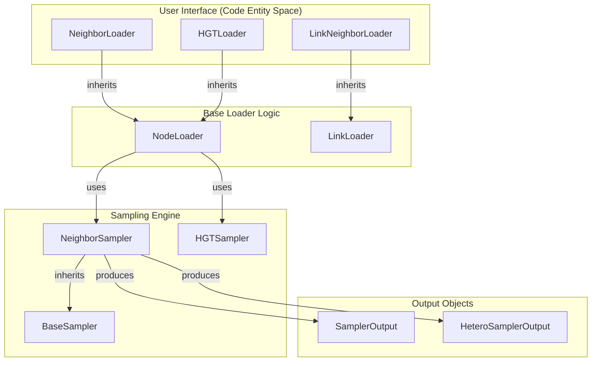
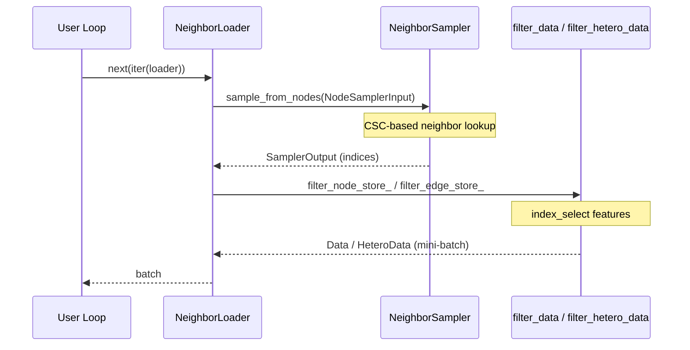

<!-- source: DeepWiki mcp.deepwiki.com · repo pyg-team/pytorch_geometric · page 7.2 Neighbor Sampling for Large Graphs · fetched 2026-10-21 -->

# Neighbor Sampling for Large Graphs

Relevant source files

The following files were used as context for generating this wiki page:

- [test/loader/test_cluster.py](test/loader/test_cluster.py)
- [test/loader/test_hgt_loader.py](test/loader/test_hgt_loader.py)
- [test/loader/test_link_neighbor_loader.py](test/loader/test_link_neighbor_loader.py)
- [test/loader/test_neighbor_loader.py](test/loader/test_neighbor_loader.py)
- [test/loader/test_neighbor_sampler.py](test/loader/test_neighbor_sampler.py)
- [test/nn/conv/test_general_conv.py](test/nn/conv/test_general_conv.py)
- [test/nn/conv/test_pdn_conv.py](test/nn/conv/test_pdn_conv.py)
- [test/sampler/test_sampler_base.py](test/sampler/test_sampler_base.py)
- [test/sampler/test_sampler_neighbor_sampler.py](test/sampler/test_sampler_neighbor_sampler.py)
- [torch_geometric/loader/base.py](torch_geometric/loader/base.py)
- [torch_geometric/loader/cluster.py](torch_geometric/loader/cluster.py)
- [torch_geometric/loader/hgt_loader.py](torch_geometric/loader/hgt_loader.py)
- [torch_geometric/loader/link_loader.py](torch_geometric/loader/link_loader.py)
- [torch_geometric/loader/link_neighbor_loader.py](torch_geometric/loader/link_neighbor_loader.py)
- [torch_geometric/loader/neighbor_loader.py](torch_geometric/loader/neighbor_loader.py)
- [torch_geometric/loader/node_loader.py](torch_geometric/loader/node_loader.py)
- [torch_geometric/loader/utils.py](torch_geometric/loader/utils.py)
- [torch_geometric/nn/conv/general_conv.py](torch_geometric/nn/conv/general_conv.py)
- [torch_geometric/sampler/__init__.py](torch_geometric/sampler/__init__.py)
- [torch_geometric/sampler/base.py](torch_geometric/sampler/base.py)
- [torch_geometric/sampler/hgt_sampler.py](torch_geometric/sampler/hgt_sampler.py)
- [torch_geometric/sampler/neighbor_sampler.py](torch_geometric/sampler/neighbor_sampler.py)
- [torch_geometric/sampler/utils.py](torch_geometric/sampler/utils.py)

This page explains the architecture, usage, and technical details of PyTorch Geometric's neighbor sampling system for training Graph Neural Networks (GNNs) on large graphs. Neighbor sampling enables mini-batch training when graphs are too large to fit in memory by efficiently sampling local subgraphs around seed nodes.

## Overview

Large-scale graph datasets often exceed available memory resources, making full-batch GNN training infeasible. The **neighbor sampling** approach, introduced in the ["Inductive Representation Learning on Large Graphs"](https://arxiv.org/abs/1706.02216) paper, addresses this challenge by:

1. Selecting a batch of target nodes (seed nodes).
2. Sampling a fixed number of neighbors for each node in multiple hops.
3. Creating mini-batch subgraphs containing only the sampled nodes and edges.
4. Training GNN models on these smaller subgraphs.

PyG implements this functionality through the `NeighborLoader` class, which works for both homogeneous and heterogeneous graphs [torch_geometric/loader/neighbor_loader.py:10-60]().

Sources: [torch_geometric/loader/neighbor_loader.py:10-253](), [torch_geometric/sampler/neighbor_sampler.py:40-58]()

## Architecture

The neighbor sampling system consists of several interacting components that bridge the gap between high-level data loading and low-level sampling kernels.

### System Components Diagram
The following diagram maps the high-level API to the underlying code entities.

Sources: [torch_geometric/loader/neighbor_loader.py:10-10](), [torch_geometric/loader/link_neighbor_loader.py:10-10](), [torch_geometric/loader/hgt_loader.py:11-11](), [torch_geometric/sampler/neighbor_sampler.py:40-40](), [torch_geometric/sampler/base.py:168-200]()

### Key Classes
1.  **NeighborLoader**: A data loader for node-level tasks that performs neighbor sampling [torch_geometric/loader/neighbor_loader.py:10-113]().
2.  **LinkNeighborLoader**: An extension of `NeighborLoader` specifically for link prediction, sampling around seed edges [torch_geometric/loader/link_neighbor_loader.py:10-74]().
3.  **NeighborSampler**: The core implementation of in-memory neighbor sampling, supporting both homogeneous and heterogeneous data [torch_geometric/sampler/neighbor_sampler.py:40-43]().
4.  **HGTLoader**: A specialized loader for the Heterogeneous Graph Transformer, maintaining node budgets per type [torch_geometric/loader/hgt_loader.py:11-33]().

## Sampling Process

The sampling process expands layer-wise from seed nodes. For each iteration $i$, it samples `num_neighbors[i]` neighbors for each node discovered in iteration $i-1$ [torch_geometric/loader/neighbor_loader.py:17-21]().

### Subgraph Types
PyG supports different strategies for constructing the resulting mini-batch subgraph, defined in `SubgraphType` [torch_geometric/sampler/base.py:46-50]():

| Type | Description |
| :--- | :--- |
| `directional` | Includes only sampled edges from neighbors to seed nodes [torch_geometric/loader/neighbor_loader.py:141-143](). |
| `bidirectional` | Converts sampled edges to bidirectional edges [torch_geometric/loader/neighbor_loader.py:144-145](). |
| `induced` | Returns the fully induced subgraph of all sampled nodes [torch_geometric/loader/neighbor_loader.py:146-147](). |

Sources: [torch_geometric/loader/neighbor_loader.py:139-148](), [torch_geometric/sampler/base.py:46-50]()

## Performance Optimizations

### CSC Conversion
For efficient sampling, PyG converts graph data into **Compressed Sparse Column (CSC)** format. This allows $O(1)$ access to the neighbors of any given node.
*   **Homogeneous**: Uses `to_csc` to generate `colptr` and `row` tensors [torch_geometric/sampler/utils.py:46-111]().
*   **Heterogeneous**: Uses `to_hetero_csc` to generate CSC structures for every edge type [torch_geometric/sampler/utils.py:114-140]().

### filter_per_worker Optimization
The `filter_per_worker` flag determines where the sampled indices are joined with their features [torch_geometric/loader/node_loader.py:71-82]():
*   **`True`**: Filtering (feature collection) happens in the DataLoader worker process. This is efficient for CPU-only training as it uses shared memory to avoid copies [torch_geometric/loader/utils.py:59-72]().
*   **`False`**: Filtering happens in the main process.
*   **`None` (Auto)**: PyG automatically infers this based on whether data lives on the GPU [torch_geometric/loader/node_loader.py:103-104]().

Sources: [torch_geometric/loader/node_loader.py:71-82](), [torch_geometric/loader/utils.py:53-72](), [torch_geometric/sampler/utils.py:46-140]()

## Advanced Sampling Strategies

### Temporal and Weighted Sampling
`NeighborSampler` supports advanced constraints during the sampling walk:
*   **Temporal Sampling**: If `time_attr` is provided, the sampler ensures that neighbors have a timestamp earlier than or equal to the seed node [torch_geometric/loader/neighbor_loader.py:132-136]().
*   **Weighted Sampling**: If `weight_attr` is provided, edges are sampled according to their weights [torch_geometric/sampler/neighbor_sampler.py:53-54]().

Sources: [torch_geometric/loader/neighbor_loader.py:132-136](), [torch_geometric/sampler/neighbor_sampler.py:53-54](), [torch_geometric/sampler/neighbor_sampler.py:90-98]()

### Disjoint Sampling
By setting `disjoint=True`, the loader creates separate subgraphs for every seed node in the mini-batch, rather than merging them. This is often required for temporal GNNs where the same node might have different representations at different times [torch_geometric/loader/neighbor_loader.py:149-154]().

Sources: [torch_geometric/loader/neighbor_loader.py:149-154](), [torch_geometric/sampler/neighbor_sampler.py:50-50]()

## Data Flow and Implementation

The sampling logic flows from the `DataLoader` through the `BaseSampler` to the low-level utilities that filter the `Data` or `HeteroData` objects.

### Code Flow Diagram

Sources: [torch_geometric/loader/node_loader.py:143-152](), [torch_geometric/loader/utils.py:159-175](), [torch_geometric/sampler/neighbor_sampler.py:315-325]()

### Implementation Details
*   **`NodeSamplerInput`**: Encapsulates seed nodes, their IDs, and optional timestamps [torch_geometric/sampler/base.py:54-70]().
*   **`SamplerOutput`**: Holds the sampled nodes, the local `edge_index` (as `row` and `col`), and global `edge_id` [torch_geometric/sampler/base.py:168-190]().
*   **`filter_data`**: The function responsible for creating a new `Data` object by indexing into the original attributes using the sampled indices [torch_geometric/loader/utils.py:159-165]().

Sources: [torch_geometric/sampler/base.py:54-190](), [torch_geometric/loader/utils.py:159-175](), [torch_geometric/loader/node_loader.py:154-170]()

---

