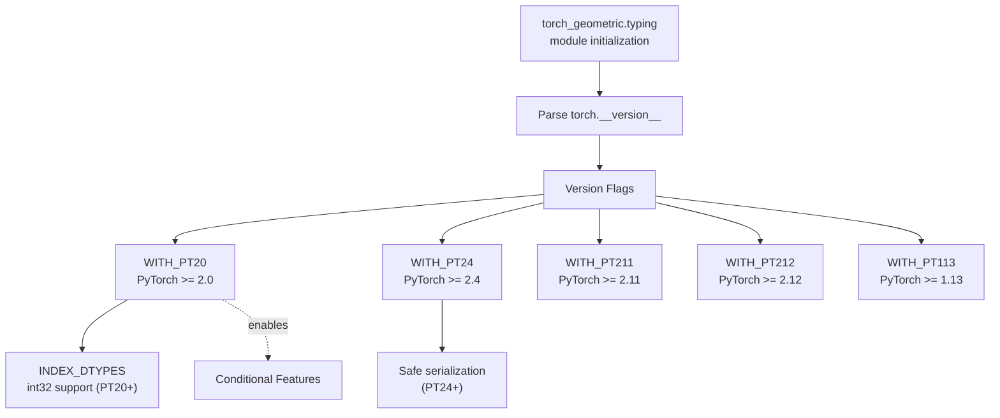
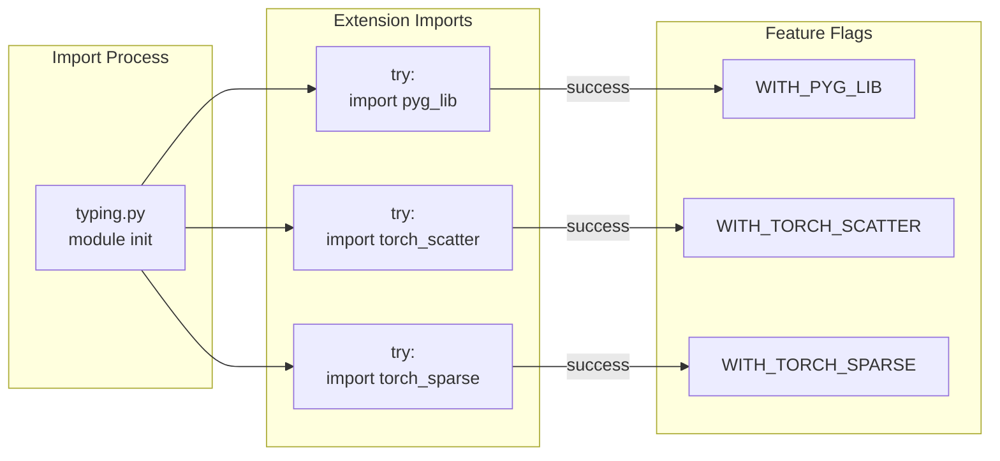
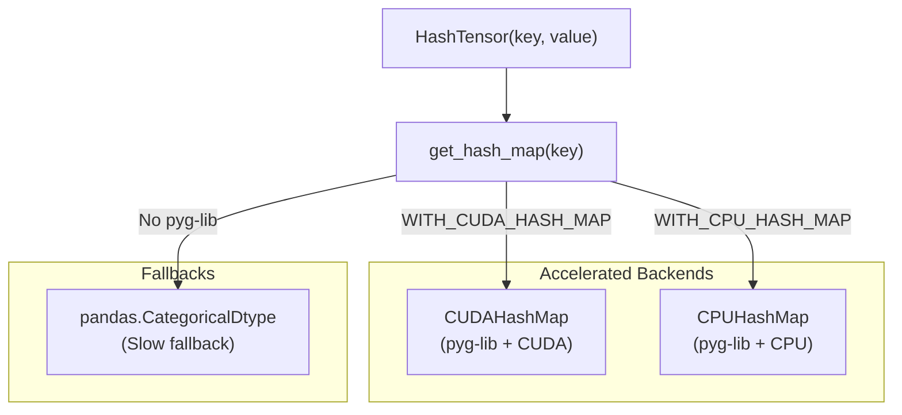

<!-- source: DeepWiki mcp.deepwiki.com · repo pyg-team/pytorch_geometric · page 7.3 Type System and Extension Management · fetched 2026-10-21 -->

# Type System and Extension Management

<details>
<summary>Relevant source files</summary>

The following files were used as context for generating this wiki page:

- [.github/CONTRIBUTING.md](.github/CONTRIBUTING.md)
- [.github/actions/setup/action.yml](.github/actions/setup/action.yml)
- [CHANGELOG.md](CHANGELOG.md)
- [CITATION.cff](CITATION.cff)
- [README.md](README.md)
- [docker/Dockerfile.xpu](docker/Dockerfile.xpu)
- [docs/source/install/installation.rst](docs/source/install/installation.rst)
- [docs/source/install/quick-start.html](docs/source/install/quick-start.html)
- [docs/source/notes/installation.rst](docs/source/notes/installation.rst)
- [pyproject.toml](pyproject.toml)
- [test/test_edge_index.py](test/test_edge_index.py)
- [test/test_hash_tensor.py](test/test_hash_tensor.py)
- [test/test_index.py](test/test_index.py)
- [torch_geometric/__init__.py](torch_geometric/__init__.py)
- [torch_geometric/datasets/__init__.py](torch_geometric/datasets/__init__.py)
- [torch_geometric/edge_index.py](torch_geometric/edge_index.py)
- [torch_geometric/hash_tensor.py](torch_geometric/hash_tensor.py)
- [torch_geometric/index.py](torch_geometric/index.py)
- [torch_geometric/testing/__init__.py](torch_geometric/testing/__init__.py)
- [torch_geometric/testing/decorators.py](torch_geometric/testing/decorators.py)
- [torch_geometric/typing.py](torch_geometric/typing.py)

</details>


This document describes PyTorch Geometric's type system and extension management infrastructure, located primarily in the `torch_geometric.typing` module. This system provides runtime feature detection for optional dependencies, type aliases for common graph structures, and graceful degradation when high-performance extension packages are unavailable.

For information about custom tensor types like `EdgeIndex` and `HashTensor`, see [Custom Tensor Types](#2.2). For installation instructions, see [Installation and Setup](#1.1).

## Overview

PyG's type system serves three primary purposes:

1.  **Feature Detection**: Detects available PyTorch versions and optional extension packages at import time, setting boolean flags that control conditional functionality throughout the codebase.
2.  **Type Definitions**: Provides type aliases and type hints for graph structures, making code more readable and enabling static type checking.
3.  **Graceful Degradation**: Implements stub classes and fallback behavior when optional dependencies are missing, allowing core PyG functionality to work with minimal dependencies.
4.  **Lazy Loading**: Utilizes `LazyLoader` to defer the import of heavy sub-modules until they are actually accessed.

The system allows PyG to function with only PyTorch as a dependency while leveraging high-performance C++/CUDA operations when extension packages are installed.

**Sources**: [torch_geometric/typing.py:1-331](), [torch_geometric/__init__.py:29-33]()

## Feature Detection System

### PyTorch Version Detection

The typing module detects the installed PyTorch version and sets boolean flags for version-specific features. This enables PyG to adapt to API changes across PyTorch releases, supporting up to PyTorch 2.12 [CHANGELOG.md:30]().



**Version Detection Logic**

| Flag | Condition | Usage Example |
| :--- | :--- | :--- |
| `WITH_PT20` | PyTorch >= 2.0 | Enables `int32` index dtypes [torch_geometric/typing.py:32-36]() |
| `WITH_PT24` | PyTorch >= 2.4 | Enables safe global registration for serialization [torch_geometric/__init__.py:71-82]() |
| `WITH_PT212` | PyTorch >= 2.12 | Latest supported PyTorch version [torch_geometric/typing.py:24]() |
| `WITH_PT113` | PyTorch >= 1.13 | Minimum supported version for PyG 2.7+ [torch_geometric/__init__.py:61-67]() |

**Sources**: [torch_geometric/typing.py:12-25](), [torch_geometric/typing.py:32-40](), [torch_geometric/__init__.py:61-82]()

### Extension Package Detection

PyG detects optional extension packages at import time. Each provides performance-critical operations implemented in C++/CUDA.



**Deprecation Notice**: Functionality from `torch-cluster` and `torch-spline-conv` has been migrated to `pyg-lib>=0.6.0`. Use of these legacy packages now triggers a warning [torch_geometric/typing.py:149-163]().

**Sources**: [torch_geometric/typing.py:45-47](), [torch_geometric/typing.py:138-140](), [torch_geometric/typing.py:165-168](), [docs/source/install/installation.rst:35-37]()

### Graceful Degradation

When extension packages are unavailable, PyG provides stub implementations that raise informative errors.

**Example Stub Implementation**
The `SparseTensor` stub class [torch_geometric/typing.py:176-210]() provides method signatures matching the real implementation, but methods raise `ImportError`:

```python
class SparseTensor:
    def __init__(self, row=None, rowptr=None, ...):
        raise ImportError("'SparseTensor' requires 'torch-sparse'")
```

**Sources**: [torch_geometric/typing.py:118-124](), [torch_geometric/typing.py:176-210]()

## pyg-lib Extension Package

`pyg-lib` is the primary extension package, providing heterogeneous GNN operators and sampling routines.

### Sub-Feature Detection
The typing module detects specific ops within `pyg_lib` to ensure compatibility:

| Flag | Detection Method | Functionality |
| :--- | :--- | :--- |
| `WITH_GMM` | `hasattr(pyg_lib.ops, 'grouped_matmul')` | Grouped Matrix Multiplication [torch_geometric/typing.py:48]() |
| `WITH_SEGMM` | `hasattr(pyg_lib.ops, 'segment_matmul')` | Segment Matrix Multiplication [torch_geometric/typing.py:49]() |
| `WITH_METIS` | `hasattr(pyg_lib, 'partition')` | Graph Partitioning [torch_geometric/typing.py:74]() |
| `WITH_CPU_HASH_MAP` | `torch.classes.pyg.CPUHashMap` | Fast CPU lookup [torch_geometric/typing.py:80-81]() |

**Bug Workaround**: PyG performs a runtime check for `segment_matmul` on older NVIDIA cards during testing and disables the flag if a `RuntimeError` occurs [torch_geometric/typing.py:50-63]().

**Sources**: [torch_geometric/typing.py:48-88]()

## Hash Map Support

PyG provides accelerated hash map implementations via `HashTensor`.



- **CPUHashMap**: A `TypeAlias` to `torch.classes.pyg.CPUHashMap` [torch_geometric/typing.py:114-115]().
- **CUDAHashMap**: A `TypeAlias` to `torch.classes.pyg.CUDAHashMap` [torch_geometric/typing.py:126-127]().

**Sources**: [torch_geometric/hash_tensor.py:67-86](), [torch_geometric/typing.py:114-136]()

## Serialization and Safe Globals

To support secure serialization in modern PyTorch (2.4+), PyG registers its custom types as "safe globals". This prevents `unpickle` errors when loading saved models or data objects.

| Class Registered | File Reference |
| :--- | :--- |
| `Index` | [torch_geometric/__init__.py:76]() |
| `EdgeIndex` | [torch_geometric/__init__.py:78]() |
| `HashTensor` | [torch_geometric/__init__.py:81]() |
| `SortOrder` | [torch_geometric/__init__.py:79]() |

**Sources**: [torch_geometric/__init__.py:71-82]()

## Lazy Loading

PyG uses a `LazyLoader` class to minimize import overhead for large sub-packages like `contrib` and `graphgym`.

```python
contrib = LazyLoader('contrib', globals(), 'torch_geometric.contrib')
graphgym = LazyLoader('graphgym', globals(), 'torch_geometric.graphgym')
```

This ensures that the `torch_geometric.contrib` module is only loaded when a user actually calls `torch_geometric.contrib.nn...`.

**Sources**: [torch_geometric/__init__.py:29-32]()

## Adjacency and Type Aliases

The typing module defines standard aliases used for type hinting throughout the library:

- `Adj`: `Union[Tensor, SparseTensor]` [torch_geometric/typing.py:214]()
- `OptTensor`: `Optional[Tensor]` [torch_geometric/typing.py:215]()
- `SparseStorage`: Stub or real storage for `SparseTensor` [torch_geometric/typing.py:176-191]()

**Sources**: [torch_geometric/typing.py:176-215]()

## Platform and Hardware Detection

The system detects the operating system and hardware capabilities to optimize tensor operations:

- `WITH_WINDOWS`: Detected via `os.name == 'nt'` [torch_geometric/typing.py:27]().
- `NO_MKL`: Detects if MKL is missing or disabled, forcing fallbacks for certain linear algebra ops [torch_geometric/typing.py:28]().
- `MAX_INT64`: Cached constant for boundary checks [torch_geometric/typing.py:30]().

**Sources**: [torch_geometric/typing.py:27-30]()

---

