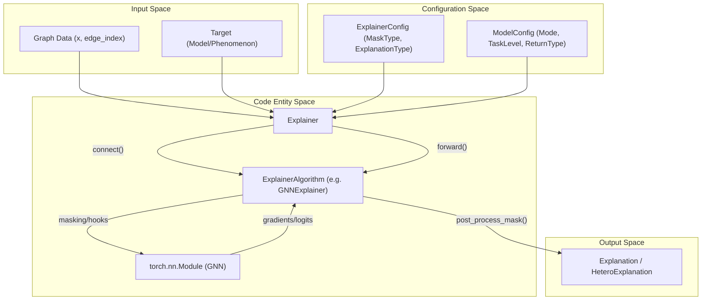
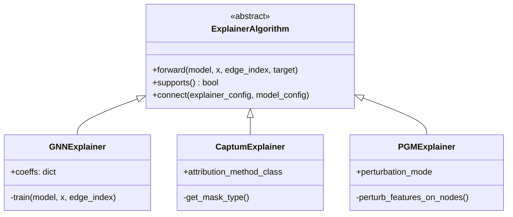
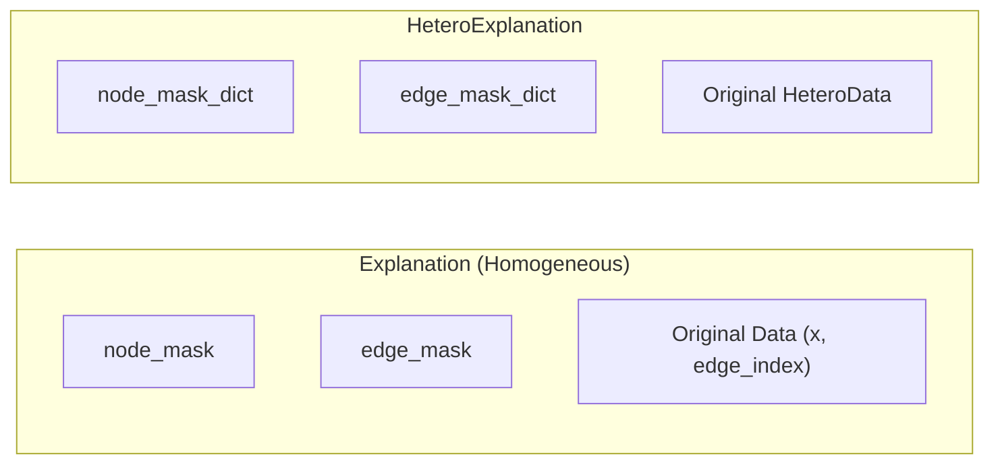

<!-- source: DeepWiki mcp.deepwiki.com · repo pyg-team/pytorch_geometric · page 7.4 Explainability · fetched 2026-10-21 -->

# Explainability

Relevant source files

The following files were used as context for generating this wiki page:

- [.github/ISSUE_TEMPLATE/installation.yml](.github/ISSUE_TEMPLATE/installation.yml)
- [docs/source/modules/explain.rst](docs/source/modules/explain.rst)
- [docs/source/notes/explain.rst](docs/source/notes/explain.rst)
- [examples/contrib/pgm_explainer_graph_classification.py](examples/contrib/pgm_explainer_graph_classification.py)
- [examples/contrib/pgm_explainer_node_classification.py](examples/contrib/pgm_explainer_node_classification.py)
- [examples/distributed/graphlearn_for_pytorch/dist_train_sage_supervised.py](examples/distributed/graphlearn_for_pytorch/dist_train_sage_supervised.py)
- [test/contrib/explain/test_pgm_explainer.py](test/contrib/explain/test_pgm_explainer.py)
- [test/explain/algorithm/test_captum.py](test/explain/algorithm/test_captum.py)
- [test/explain/algorithm/test_captum_explainer.py](test/explain/algorithm/test_captum_explainer.py)
- [test/explain/algorithm/test_captum_hetero.py](test/explain/algorithm/test_captum_hetero.py)
- [test/explain/algorithm/test_gnn_explainer.py](test/explain/algorithm/test_gnn_explainer.py)
- [test/explain/test_explainer.py](test/explain/test_explainer.py)
- [test/explain/test_explanation.py](test/explain/test_explanation.py)
- [test/explain/test_hetero_explainer.py](test/explain/test_hetero_explainer.py)
- [test/explain/test_hetero_explanation.py](test/explain/test_hetero_explanation.py)
- [torch_geometric/contrib/explain/pgm_explainer.py](torch_geometric/contrib/explain/pgm_explainer.py)
- [torch_geometric/explain/__init__.py](torch_geometric/explain/__init__.py)
- [torch_geometric/explain/algorithm/__init__.py](torch_geometric/explain/algorithm/__init__.py)
- [torch_geometric/explain/algorithm/base.py](torch_geometric/explain/algorithm/base.py)
- [torch_geometric/explain/algorithm/captum.py](torch_geometric/explain/algorithm/captum.py)
- [torch_geometric/explain/algorithm/captum_explainer.py](torch_geometric/explain/algorithm/captum_explainer.py)
- [torch_geometric/explain/algorithm/dummy_explainer.py](torch_geometric/explain/algorithm/dummy_explainer.py)
- [torch_geometric/explain/algorithm/gnn_explainer.py](torch_geometric/explain/algorithm/gnn_explainer.py)
- [torch_geometric/explain/config.py](torch_geometric/explain/config.py)
- [torch_geometric/explain/explainer.py](torch_geometric/explain/explainer.py)
- [torch_geometric/explain/explanation.py](torch_geometric/explain/explanation.py)
- [torch_geometric/graphgym/init.py](torch_geometric/graphgym/init.py)
- [torch_geometric/graphgym/loss.py](torch_geometric/graphgym/loss.py)
- [torch_geometric/nn/models/captum.py](torch_geometric/nn/models/captum.py)

The `torch_geometric.explain` module provides a unified framework for generating instance-level explanations for Graph Neural Network (GNN) predictions. It supports both homogeneous and heterogeneous graphs, multiple explanation algorithms (e.g., `GNNExplainer`, `CaptumExplainer`), and a flexible configuration system for defining explanation targets and mask types.

### System Architecture

The explainability framework is built around three core components: the `Explainer` class, the `ExplainerAlgorithm` base class, and the `Explanation` result objects.

#### Data Flow and Entity Mapping
The following diagram illustrates how natural language concepts map to code entities and how data flows through the system during an explanation task.

**Explainability Data Flow**

Sources: [torch_geometric/explain/explainer.py:29-95](), [torch_geometric/explain/algorithm/base.py:19-88]()

---

### Core Components

#### 1. The Explainer Class
The `Explainer` class is the primary entry point for users. It manages the lifecycle of an explanation, including model evaluation, algorithm execution, and thresholding of the resulting masks.

- **Initialization**: It takes a GNN `model`, an `algorithm`, and configurations for the explanation and model type [torch_geometric/explain/explainer.py:69-94]().
- **Target Inference**: If `explanation_type` is set to `"model"`, the `Explainer` automatically infers the target by running a forward pass on the model [torch_geometric/explain/explainer.py:183-200]().
- **Prediction Utilities**: It provides `get_prediction()` and `get_masked_prediction()` to compare model behavior with and without the generated masks [torch_geometric/explain/explainer.py:97-145]().

#### 2. Explainer Algorithms
Algorithms inherit from `ExplainerAlgorithm` and implement the logic for generating node and edge attributions.

| Algorithm | Description | Key Features |
| :--- | :--- | :--- |
| `GNNExplainer` | Optimization-based approach that learns masks to maximize mutual information. | Learns compact subgraphs; supports hetero graphs [torch_geometric/explain/algorithm/gnn_explainer.py:24-62](). |
| `CaptumExplainer` | Wrapper for the Captum library. | Supports `IntegratedGradients`, `Saliency`, `InputXGradient`, etc [torch_geometric/explain/algorithm/captum_explainer.py:22-51](). |
| `PGMExplainer` | Probabilistic Graphical Model based explainer. | Uses Chi-squared tests for feature significance [torch_geometric/contrib/explain/pgm_explainer.py:15-46](). |

**Algorithm Inheritance and Interaction**

Sources: [torch_geometric/explain/algorithm/base.py:19-53](), [torch_geometric/explain/algorithm/gnn_explainer.py:24-84](), [torch_geometric/explain/algorithm/captum_explainer.py:22-83](), [torch_geometric/contrib/explain/pgm_explainer.py:15-67]()

---

### Configuration System

The behavior of the explainer is governed by three configuration classes defined in `torch_geometric.explain.config`:

1.  **`ExplainerConfig`**: Defines what to explain.
    - `explanation_type`: `"model"` (explains predictions) or `"phenomenon"` (explains ground truth) [torch_geometric/explain/config.py:36-46]().
    - `node_mask_type` / `edge_mask_type`: Supports `object` (mask entire node/edge), `attributes` (mask individual features), or `common_attributes` [torch_geometric/explain/config.py:50-63]().
2.  **`ModelConfig`**: Describes the GNN's task.
    - `mode`: `binary_classification`, `multiclass_classification`, or `regression` [torch_geometric/explain/config.py:20-22]().
    - `task_level`: `node`, `edge`, or `graph` [torch_geometric/explain/config.py:27-29]().
    - `return_type`: `raw`, `probs`, or `log_probs` [torch_geometric/explain/config.py:23-26]().
3.  **`ThresholdConfig`**: Defines how to post-process masks.
    - `type`: `hard`, `topk`, or `topk_hard` [torch_geometric/explain/explanation.py:81-106]().

---

### Explanation Objects

The output of an explainer is an `Explanation` (for homogeneous graphs) or `HeteroExplanation` (for heterogeneous graphs). These objects inherit from `Data` and `HeteroData` respectively, but include specialized methods for explainability.

- **`node_mask`**: Tensor of shape `[num_nodes, 1]` or `[num_nodes, num_features]` [torch_geometric/explain/explanation.py:147-150]().
- **`edge_mask`**: Tensor of shape `[num_edges]` [torch_geometric/explain/explanation.py:151]().
- **Subgraphs**:
    - `get_explanation_subgraph()`: Returns a subgraph containing only nodes/edges with non-zero attribution [torch_geometric/explain/explanation.py:160-170]().
    - `get_complement_subgraph()`: Returns the rest of the graph [torch_geometric/explain/explanation.py:172-182]().
- **Visualization**: Integrated methods like `visualize_graph()` and `visualize_feature_importance()` allow for quick qualitative assessment [torch_geometric/explain/explanation.py:11-14]().

**Explanation Structure**

Sources: [torch_geometric/explain/explanation.py:139-153](), [torch_geometric/explain/explanation.py:21-70]()

---

### Implementation Details: GNNExplainer

`GNNExplainer` identifies a compact subgraph and a small subset of node features that are most influential for a prediction. It optimizes the masks via gradient descent.

1.  **Mask Initialization**: Randomly initializes `node_mask` and `edge_mask` as `Parameter` objects [torch_geometric/explain/algorithm/gnn_explainer.py:213]().
2.  **Mask Injection**: Uses `set_masks` or `set_hetero_masks` to inject masks into `MessagePassing` layers [torch_geometric/explain/algorithm/utils.py:12-18]().
3.  **Loss Computation**: Combines model prediction loss with regularization terms:
    - `edge_size`: Penalizes large edge masks [torch_geometric/explain/algorithm/gnn_explainer.py:65]().
    - `edge_ent`: Encourages edge masks to be binary (entropy regularization) [torch_geometric/explain/algorithm/gnn_explainer.py:69]().
4.  **Cleaning**: After training, `_clean_model` removes the masks from the GNN layers to restore original state [torch_geometric/explain/algorithm/gnn_explainer.py:124]().

Sources: [torch_geometric/explain/algorithm/gnn_explainer.py:64-84](), [torch_geometric/explain/algorithm/gnn_explainer.py:111-126](), [torch_geometric/explain/algorithm/base.py:163-193]()

---

