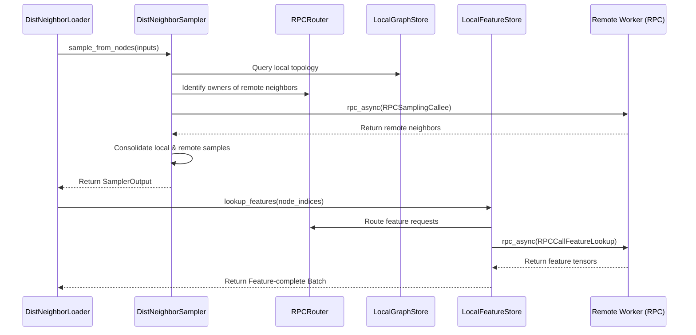
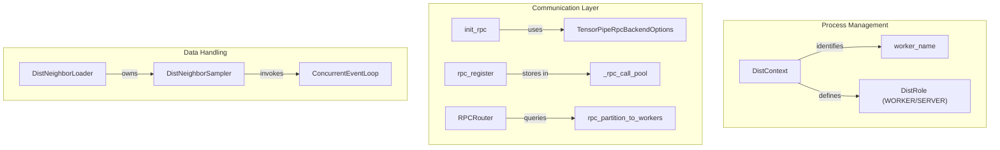

<!-- source: DeepWiki mcp.deepwiki.com · repo pyg-team/pytorch_geometric · page 7.5 Distributed Training · fetched 2026-10-21 -->

# Distributed Training

<details>
<summary>Relevant source files</summary>

The following files were used as context for generating this wiki page:

- [docs/source/modules/distributed.rst](docs/source/modules/distributed.rst)
- [docs/source/tutorial/distributed.rst](docs/source/tutorial/distributed.rst)
- [docs/source/tutorial/distributed_pyg.rst](docs/source/tutorial/distributed_pyg.rst)
- [docs/source/tutorial/multi_gpu_vanilla.rst](docs/source/tutorial/multi_gpu_vanilla.rst)
- [docs/source/tutorial/multi_node_multi_gpu_vanilla.rst](docs/source/tutorial/multi_node_multi_gpu_vanilla.rst)
- [examples/multi_gpu/README.md](examples/multi_gpu/README.md)
- [examples/multi_gpu/distributed_batching.py](examples/multi_gpu/distributed_batching.py)
- [examples/multi_gpu/distributed_sampling.py](examples/multi_gpu/distributed_sampling.py)
- [examples/multi_gpu/distributed_sampling_multinode.py](examples/multi_gpu/distributed_sampling_multinode.py)
- [examples/multi_gpu/distributed_sampling_multinode.sbatch](examples/multi_gpu/distributed_sampling_multinode.sbatch)
- [examples/multi_gpu/papers100m_gcn.py](examples/multi_gpu/papers100m_gcn.py)
- [examples/multi_gpu/papers100m_gcn_multinode.py](examples/multi_gpu/papers100m_gcn_multinode.py)
- [examples/multi_gpu/pcqm4m_ogb.py](examples/multi_gpu/pcqm4m_ogb.py)
- [examples/multi_gpu/taobao.py](examples/multi_gpu/taobao.py)
- [examples/quiver/multi_gpu_quiver.py](examples/quiver/multi_gpu_quiver.py)
- [examples/quiver/single_gpu_quiver.py](examples/quiver/single_gpu_quiver.py)
- [test/distributed/test_dist_link_neighbor_loader.py](test/distributed/test_dist_link_neighbor_loader.py)
- [test/distributed/test_dist_link_neighbor_sampler.py](test/distributed/test_dist_link_neighbor_sampler.py)
- [test/distributed/test_dist_neighbor_loader.py](test/distributed/test_dist_neighbor_loader.py)
- [test/distributed/test_dist_neighbor_sampler.py](test/distributed/test_dist_neighbor_sampler.py)
- [test/distributed/test_partition.py](test/distributed/test_partition.py)
- [test/distributed/test_rpc.py](test/distributed/test_rpc.py)
- [torch_geometric/distributed/dist_context.py](torch_geometric/distributed/dist_context.py)
- [torch_geometric/distributed/dist_link_neighbor_loader.py](torch_geometric/distributed/dist_link_neighbor_loader.py)
- [torch_geometric/distributed/dist_loader.py](torch_geometric/distributed/dist_loader.py)
- [torch_geometric/distributed/dist_neighbor_loader.py](torch_geometric/distributed/dist_neighbor_loader.py)
- [torch_geometric/distributed/dist_neighbor_sampler.py](torch_geometric/distributed/dist_neighbor_sampler.py)
- [torch_geometric/distributed/local_feature_store.py](torch_geometric/distributed/local_feature_store.py)
- [torch_geometric/distributed/local_graph_store.py](torch_geometric/distributed/local_graph_store.py)
- [torch_geometric/distributed/partition.py](torch_geometric/distributed/partition.py)
- [torch_geometric/distributed/rpc.py](torch_geometric/distributed/rpc.py)
- [torch_geometric/distributed/utils.py](torch_geometric/distributed/utils.py)

</details>


PyTorch Geometric (PyG) provides a comprehensive infrastructure for scaling Graph Neural Networks to massive datasets that cannot fit on a single machine. The distributed training system is built upon a partitioned storage strategy, where the graph structure and its features are distributed across multiple nodes, and a distributed sampling engine that utilizes Remote Procedure Calls (RPC) to fetch data across the network.

> [!WARNING]
> The `torch_geometric.distributed` module has been deprecated since version 2.7.0. For the highest performance on NVIDIA GPUs, it is recommended to use the **cuGraph-PyG** integration [examples/multi_gpu/README.md:5-8]().

## System Architecture

The distributed training pipeline consists of four main stages: graph partitioning, data loading into local stores, RPC initialization, and distributed sampling/training.

### Data Flow and Component Interaction

The following diagram illustrates the interaction between the primary classes in the `torch_geometric.distributed` module during a training iteration.

**Distributed Sampling and Training Flow**

Sources: [torch_geometric/distributed/dist_neighbor_sampler.py:151-170](), [torch_geometric/distributed/local_feature_store.py:163-194](), [torch_geometric/distributed/rpc.py:92-108]()

## Graph Partitioning

Before training, a large graph must be split into $K$ partitions (where $K$ is the number of training nodes). PyG uses the `Partitioner` class to perform this split, typically leveraging METIS via `ClusterData` [torch_geometric/distributed/partition.py:18-71]().

- **Homogeneous Partitioning**: Splits a `Data` object into `part_{i}/graph.pt`, `node_feats.pt`, and `edge_feats.pt` [torch_geometric/distributed/partition.py:25-41]().
- **Heterogeneous Partitioning**: Maintains type-specific maps for nodes and edges while distributing the underlying structure [torch_geometric/distributed/partition.py:42-61]().
- **Temporal Support**: The partitioner can account for node-level and edge-level time attributes to ensure temporal consistency during distributed sampling [torch_geometric/distributed/partition.py:91-111]().

## Local Storage Classes

Instead of a centralized database, each worker maintains its own local view of the graph and features using specialized storage classes.

### LocalGraphStore
The `LocalGraphStore` implements the `GraphStore` interface. It stores the adjacency information (in COO, CSR, or CSC formats) for the partition owned by the current process [torch_geometric/distributed/local_graph_store.py](). It also maintains a `node_pb` (node partition book) to track which global node IDs belong to which worker [test/distributed/test_dist_neighbor_sampler.py:46-49]().

### LocalFeatureStore
The `LocalFeatureStore` implements the `FeatureStore` interface. It manages feature tensors and provides the `lookup_features` method, which transparently handles both local memory access and remote RPC calls to fetch features from other nodes [torch_geometric/distributed/local_feature_store.py:47-71]().

Sources: [torch_geometric/distributed/local_feature_store.py:47-152](), [test/distributed/test_dist_neighbor_sampler.py:38-44]()

## Distributed Data Loading and Sampling

PyG provides distributed versions of its standard loaders to handle the complexities of multi-node data retrieval.

| Class | Purpose |
| :--- | :--- |
| `DistNeighborSampler` | The core engine that coordinates sampling across RPC workers [torch_geometric/distributed/dist_neighbor_sampler.py:65-69](). |
| `DistNeighborLoader` | Distributed version of `NeighborLoader` for node-level tasks [torch_geometric/distributed/dist_neighbor_loader.py:12](). |
| `DistLinkNeighborLoader` | Distributed version of `LinkNeighborLoader` for link prediction [torch_geometric/distributed/dist_link_neighbor_loader.py:12](). |

### RPC Communication Layer
Distributed sampling relies on `torch.distributed.rpc`. The system registers specific "callee" objects that workers use to invoke logic on remote nodes:
- `RPCSamplingCallee`: Handles remote neighbor sampling requests [torch_geometric/distributed/dist_neighbor_sampler.py:50-64]().
- `RPCCallFeatureLookup`: Handles remote feature retrieval [torch_geometric/distributed/local_feature_store.py:22-33]().
- `RPCRouter`: Determines which worker to contact based on the partition index of a node or edge [torch_geometric/distributed/rpc.py:92-108]().

Sources: [torch_geometric/distributed/rpc.py:145-156](), [torch_geometric/distributed/dist_neighbor_sampler.py:131-142]()

## Setup and Implementation

### Multi-GPU (Single Node)
For single-node setups with multiple GPUs, PyG utilizes standard `DistributedDataParallel` (DDP). Data is typically split using a `DistributedSampler` for graph-level tasks or by manually splitting indices for node-level tasks [examples/multi_gpu/distributed_batching.py:80-92](), [examples/multi_gpu/distributed_sampling.py:69-75]().

### Multi-Node Setup
Multi-node training requires initializing the process group and RPC. The `DistContext` class manages the role and rank of each worker in the cluster [torch_geometric/distributed/dist_context.py]().

**Entity Mapping: Distributed Training Configuration**

Sources: [torch_geometric/distributed/rpc.py:48-79](), [torch_geometric/distributed/dist_context.py:10-25](), [torch_geometric/distributed/dist_neighbor_sampler.py:114-148]()

### Example: Initializing Distributed Sampling
```python
# 1. Initialize Context
current_ctx = DistContext(rank=rank, global_rank=rank, world_size=world_size)

# 2. Initialize RPC
init_rpc(current_ctx, master_addr='localhost', master_port=port)

# 3. Create Distributed Loader
loader = DistNeighborLoader(
    data=(feature_store, graph_store),
    num_neighbors=[10, 10],
    batch_size=128,
    input_nodes=train_idx,
    current_ctx=current_ctx
)
```
Sources: [test/distributed/test_dist_neighbor_loader.py:40-60](), [torch_geometric/distributed/rpc.py:48-55]()

## Training Examples

PyG provides several reference implementations for distributed workloads:

1.  **Graph-level Prediction**: Using `DistributedSampler` with `DataLoader` for small graphs like `ogbg-molhiv` [examples/multi_gpu/distributed_batching.py:80-88]().
2.  **Large-scale Node Classification**: Using `NeighborLoader` on `Reddit` or `ogbn-papers100M` [examples/multi_gpu/distributed_sampling.py:85-89](), [examples/multi_gpu/papers100m_gcn.py]().
3.  **Multi-Node SLURM**: A skeleton for submitting jobs to HPC clusters using `sbatch` and `srun` [docs/source/tutorial/multi_node_multi_gpu_vanilla.rst:27-38]().

Sources: [examples/multi_gpu/README.md:12-23]()

---

