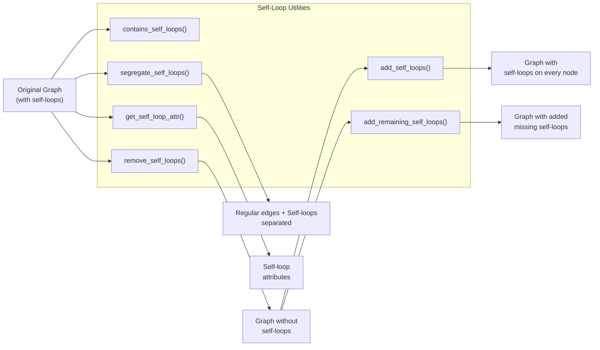

<!-- source: DeepWiki mcp.deepwiki.com · repo pyg-team/pytorch_geometric · page 8 Utilities · fetched 2026-10-21 -->

# Utilities

Relevant source files

The following files were used as context for generating this wiki page:

- [test/nn/models/test_rev_gnn.py](test/nn/models/test_rev_gnn.py)
- [test/utils/test_loop.py](test/utils/test_loop.py)
- [test/utils/test_sparse.py](test/utils/test_sparse.py)
- [test/utils/test_spmm.py](test/utils/test_spmm.py)
- [torch_geometric/nn/models/rev_gnn.py](torch_geometric/nn/models/rev_gnn.py)
- [torch_geometric/utils/__init__.py](torch_geometric/utils/__init__.py)
- [torch_geometric/utils/loop.py](torch_geometric/utils/loop.py)
- [torch_geometric/utils/num_nodes.py](torch_geometric/utils/num_nodes.py)
- [torch_geometric/utils/sparse.py](torch_geometric/utils/sparse.py)

The Utilities module in PyTorch Geometric (PyG) provides a comprehensive collection of functions for manipulating, transforming, and analyzing graph data structures. These utilities form the backbone of many higher-level operations in PyG, enabling efficient graph processing and serving as building blocks for graph neural network implementations.

For information about specific graph manipulation operations, see [Graph Manipulation](#8.1). For details about sparse tensor operations, see [Sparse Tensor Operations](#8.2).

## Overview of PyG Utilities

PyG's utility functions are organized into several functional categories, each addressing different aspects of graph processing:

```mermaid
flowchart TD
    subgraph "PyG Utilities"
        GraphStruct["Graph Structure Operations"]
        FormatConv["Format Conversions"]
        MathOps["Mathematical Operations"]
        SamplingOps["Sampling and Subgraphs"]
        GeoOps["Geometric and Special Utilities"]
        SparseOps["Sparse Tensor Ops"]
    end

    GraphStruct --> SelfLoops["Self-loops\ncontains_self_loops\nremove_self_loops\nadd_self_loops"]
    GraphStruct --> Isolated["Isolated Nodes\ncontains_isolated_nodes\nremove_isolated_nodes"]
    GraphStruct --> Directed["Directionality\nis_undirected\nto_undirected"]
    GraphStruct --> EdgeOps["Edge Operations\ncoalesce\nsort_edge_index"]

    FormatConv --> NetworkX["NetworkX\nto_networkx\nfrom_networkx"]
    FormatConv --> SciPy["SciPy Sparse\nto_scipy_sparse_matrix\nfrom_scipy_sparse_matrix"]
    FormatConv --> OtherFrameworks["Other Frameworks\nDGL, CuGraph,\nNetworKit, etc."]
    
    MathOps --> Scatter["scatter\ngroup_argsort\ngroup_cat"]
    MathOps --> Degree["degree"]
    MathOps --> Softmax["softmax"]
    MathOps --> Normalize["normalize_edge_index\nget_laplacian"]
    
    SamplingOps --> Subgraph["subgraph\nk_hop_subgraph"]
    SamplingOps --> NegSampling["negative_sampling"]
    SamplingOps --> Dropout["dropout_adj\ndropout_node\ndropout_edge"]
    
    GeoOps --> Geodesic["geodesic_distance"]
    GeoOps --> SMILES["SMILES Parsing\nfrom_smiles\nto_smiles"]
    GeoOps --> RandomGraphs["erdos_renyi_graph\nbarabasi_albert_graph"]

    SparseOps --> SpMM["spmm"]
    SparseOps --> Conv["Format Conversion\nto_torch_csr_tensor\nto_torch_csc_tensor"]
```

Sources: [torch_geometric/utils/__init__.py:1-155]()

## Graph Structure Operations

### Self-Loop Handling

PyG provides several functions for detecting and manipulating self-loops (edges that connect a node to itself) in graphs:

- **`contains_self_loops(edge_index)`**: Returns `True` if the graph contains self-loops [torch_geometric/utils/loop.py:23-44]().
- **`remove_self_loops(edge_index, edge_attr=None)`**: Removes every self-loop from the graph [torch_geometric/utils/loop.py:71-132]().
- **`segregate_self_loops(edge_index, edge_attr=None)`**: Segregates self-loops from the graph into separate tensors [torch_geometric/utils/loop.py:158-199]().
- **`add_self_loops(edge_index, edge_attr=None, fill_value=None, num_nodes=None)`**: Adds a self-loop to every node in the graph [torch_geometric/utils/loop.py:203-245]().

For a detailed reference on node and edge management, see [Graph Manipulation](#8.1).

Sources: [torch_geometric/utils/loop.py:23-245](), [test/utils/test_loop.py:15-107]()

### Isolated Node Handling

Isolated nodes (nodes with no edges) can be detected and removed using these utilities:

- **`contains_isolated_nodes(edge_index, num_nodes=None)`**: Checks if the graph contains isolated nodes.
- **`remove_isolated_nodes(edge_index, edge_attr=None, num_nodes=None)`**: Removes all isolated nodes from the graph.

Sources: [torch_geometric/utils/__init__.py:18-18](), [torch_geometric/utils/num_nodes.py:12-40]()

## Sparse Tensor Operations

PyG supports modern PyTorch sparse layouts (COO, CSR, CSC) and provides utilities to interface with the `torch_sparse` package.

- **`dense_to_sparse(adj, mask=None)`**: Converts a dense adjacency matrix to a sparse format [torch_geometric/utils/sparse.py:13-112]().
- **`spmm(src, other, reduce="sum")`**: Performs sparse-dense matrix multiplication with support for various reductions like `sum`, `mean`, `min`, and `max` [test/utils/test_spmm.py:18-127]().
- **Format Conversions**: Functions like `to_torch_csr_tensor`, `to_torch_csc_tensor`, and `to_torch_coo_tensor` facilitate switching between sparse layouts for performance optimization [torch_geometric/utils/sparse.py:143-215]().

For details on working with sparse tensors and `SparseTensor` objects, see [Sparse Tensor Operations](#8.2).

Sources: [torch_geometric/utils/sparse.py:13-215](), [test/utils/test_sparse.py:24-215](), [test/utils/test_spmm.py:1-127]()

## Format Conversion Utilities

PyG provides extensive support for converting between different graph representations and frameworks:

- **NetworkX**: `to_networkx()` and `from_networkx()` facilitate interoperability with the NetworkX library [torch_geometric/utils/__init__.py:43-43]().
- **SciPy**: `to_scipy_sparse_matrix()` and `from_scipy_sparse_matrix()` [torch_geometric/utils/__init__.py:42-42]().
- **Molecular Data**: `from_smiles()` and `from_rdmol()` convert chemical identifiers into graph structures [torch_geometric/utils/__init__.py:48-48]().
- **Other Frameworks**: Support for DGL (`to_dgl`), cuGraph (`to_cugraph`), and NetworKit (`to_networkit`) [torch_geometric/utils/__init__.py:44-47]().

Sources: [torch_geometric/utils/__init__.py:42-48]()

## Mathematical and Geometric Utilities

### Degree and Normalization
- **`degree(index, num_nodes=None, dtype=None)`**: Computes the degree of nodes based on an edge index [torch_geometric/utils/__init__.py:9-9]().
- **`softmax(src, index, ptr=None, num_nodes=None)`**: Computes a sparse softmax, often used in GAT-like attention layers [torch_geometric/utils/__init__.py:10-10]().

### Geometric Ops
- **`geodesic_distance(pos, face, ...)`**: Computes geodesic distances on meshes [torch_geometric/utils/__init__.py:41-41]().
- **`get_ppr(edge_index, ...)`**: Computes Personalized PageRank [torch_geometric/utils/__init__.py:58-58]().

For geometry-specific operations and mesh utilities, see [Geometric Utilities](#8.3).

Sources: [torch_geometric/utils/__init__.py:5-60]()

## Reversible GNN Utilities

PyG includes specialized utilities for memory-efficient training of deep GNNs through reversible layers.

- **`InvertibleFunction`**: An autograd function that reconstructs inputs on-the-fly during the backward pass to save memory [torch_geometric/nn/models/rev_gnn.py:12-144]().
- **`InvertibleModule`**: An abstract base class for implementing reversible modules [torch_geometric/nn/models/rev_gnn.py:147-188]().

Sources: [torch_geometric/nn/models/rev_gnn.py:12-188](), [test/nn/models/test_rev_gnn.py:10-103]()

## Transforms

PyG offers a large suite of `BaseTransform` implementations for data augmentation and preprocessing. These include:
- **Structural Transforms**: `ToUndirected`, `AddSelfLoops`, `GDC`.
- **Geometric Transforms**: `Cartesian`, `RadiusGraph`, `KNNGraph`.
- **Feature Transforms**: `NormalizeFeatures`, `SVDFeatureReduction`.

For the complete catalog of 60+ transforms, see [Transforms](#8.4).

Sources: [torch_geometric/utils/__init__.py:14-54]()

---

