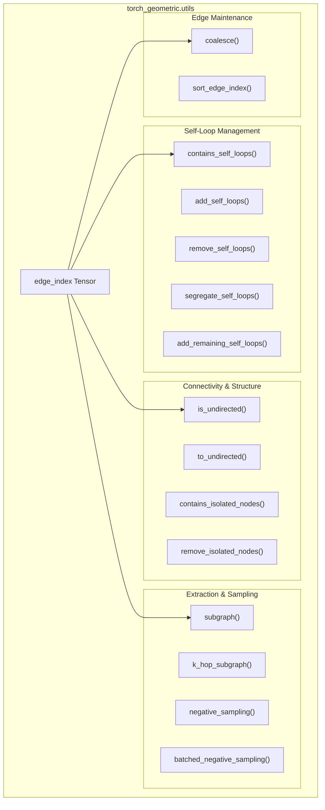
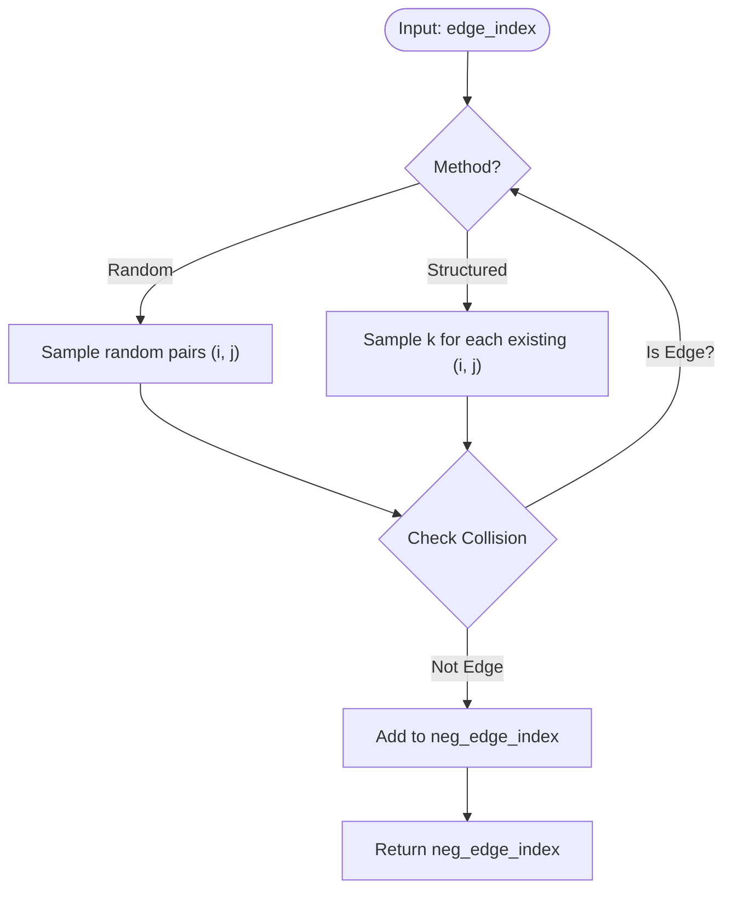

<!-- source: DeepWiki mcp.deepwiki.com · repo pyg-team/pytorch_geometric · page 8.1 Graph Manipulation · fetched 2026-10-21 -->

# Graph Manipulation

Relevant source files

The following files were used as context for generating this wiki page:

- [test/data/test_database.py](test/data/test_database.py)
- [test/data/test_inherit.py](test/data/test_inherit.py)
- [test/nn/models/test_rev_gnn.py](test/nn/models/test_rev_gnn.py)
- [test/nn/pool/test_knn.py](test/nn/pool/test_knn.py)
- [test/test_onnx.py](test/test_onnx.py)
- [test/utils/test_degree.py](test/utils/test_degree.py)
- [test/utils/test_isolated.py](test/utils/test_isolated.py)
- [test/utils/test_loop.py](test/utils/test_loop.py)
- [test/utils/test_negative_sampling.py](test/utils/test_negative_sampling.py)
- [test/utils/test_nested.py](test/utils/test_nested.py)
- [test/utils/test_normalized_cut.py](test/utils/test_normalized_cut.py)
- [test/utils/test_sort_edge_index.py](test/utils/test_sort_edge_index.py)
- [test/utils/test_sparse.py](test/utils/test_sparse.py)
- [test/utils/test_spmm.py](test/utils/test_spmm.py)
- [test/utils/test_subgraph.py](test/utils/test_subgraph.py)
- [test/utils/test_tree_decomposition.py](test/utils/test_tree_decomposition.py)
- [test/utils/test_undirected.py](test/utils/test_undirected.py)
- [torch_geometric/_onnx.py](torch_geometric/_onnx.py)
- [torch_geometric/data/database.py](torch_geometric/data/database.py)
- [torch_geometric/data/hypergraph_data.py](torch_geometric/data/hypergraph_data.py)
- [torch_geometric/datasets/pcqm4m.py](torch_geometric/datasets/pcqm4m.py)
- [torch_geometric/nn/models/dimenet_utils.py](torch_geometric/nn/models/dimenet_utils.py)
- [torch_geometric/nn/models/rev_gnn.py](torch_geometric/nn/models/rev_gnn.py)
- [torch_geometric/nn/pool/knn.py](torch_geometric/nn/pool/knn.py)
- [torch_geometric/utils/__init__.py](torch_geometric/utils/__init__.py)
- [torch_geometric/utils/_coalesce.py](torch_geometric/utils/_coalesce.py)
- [torch_geometric/utils/_grid.py](torch_geometric/utils/_grid.py)
- [torch_geometric/utils/_homophily.py](torch_geometric/utils/_homophily.py)
- [torch_geometric/utils/_lexsort.py](torch_geometric/utils/_lexsort.py)
- [torch_geometric/utils/_negative_sampling.py](torch_geometric/utils/_negative_sampling.py)
- [torch_geometric/utils/_scatter.py](torch_geometric/utils/_scatter.py)
- [torch_geometric/utils/_select.py](torch_geometric/utils/_select.py)
- [torch_geometric/utils/_sort_edge_index.py](torch_geometric/utils/_sort_edge_index.py)
- [torch_geometric/utils/_spmm.py](torch_geometric/utils/_spmm.py)
- [torch_geometric/utils/_subgraph.py](torch_geometric/utils/_subgraph.py)
- [torch_geometric/utils/_to_dense_adj.py](torch_geometric/utils/_to_dense_adj.py)
- [torch_geometric/utils/_train_test_split_edges.py](torch_geometric/utils/_train_test_split_edges.py)
- [torch_geometric/utils/_tree_decomposition.py](torch_geometric/utils/_tree_decomposition.py)
- [torch_geometric/utils/isolated.py](torch_geometric/utils/isolated.py)
- [torch_geometric/utils/loop.py](torch_geometric/utils/loop.py)
- [torch_geometric/utils/nested.py](torch_geometric/utils/nested.py)
- [torch_geometric/utils/num_nodes.py](torch_geometric/utils/num_nodes.py)
- [torch_geometric/utils/sparse.py](torch_geometric/utils/sparse.py)
- [torch_geometric/utils/undirected.py](torch_geometric/utils/undirected.py)

Graph manipulation functions in PyTorch Geometric (PyG) provide essential utilities for modifying graph structures. This page documents the key functions for manipulating graph topologies such as handling self-loops, converting between directed and undirected graphs, managing isolated nodes, extraction of subgraphs, and negative sampling.

## Overview of Graph Manipulation Functions

PyG provides a comprehensive set of functions for manipulating graph structure, primarily working with the `edge_index` tensor. These utilities help with common operations needed before, during, or after graph neural network operations.

### Entity Relationship Diagram
The following diagram maps high-level manipulation categories to the specific functional entities defined in the `torch_geometric.utils` module.

Title: Graph Manipulation Code Entities

Sources: [torch_geometric/utils/__init__.py:1-61]()

## Self-Loop Operations

Self-loops are edges $(i, i)$ that connect a node to itself. Many GNN layers (like `GCNConv`) require adding self-loops to ensure that a node's own features are included during neighborhood aggregation.

### Key Functions
*   **`contains_self_loops(edge_index)`**: Returns `True` if any $edge\_index[0, k] == edge\_index[1, k]$. [torch_geometric/utils/loop.py:23-44]()
*   **`remove_self_loops(edge_index, edge_attr=None)`**: Filters out edges where source equals destination. It returns a tuple of the new `edge_index` and filtered `edge_attr`. [torch_geometric/utils/loop.py:71-131]()
*   **`add_self_loops(edge_index, edge_attr=None, fill_value=None, num_nodes=None)`**: Appends self-loops for every node up to `num_nodes`. If `fill_value` is provided, it populates the new `edge_attr` entries. [torch_geometric/utils/loop.py:246-492]()
*   **`segregate_self_loops(edge_index, edge_attr=None)`**: Splits the graph into two parts: one containing only self-loops and one containing only non-self-loop edges. [torch_geometric/utils/loop.py:158-199]()

Sources: [torch_geometric/utils/loop.py:1-706](), [test/utils/test_loop.py:15-201]()

## Connectivity and Node Handling

### Undirected Conversion
PyG represents undirected graphs as directed graphs where for every edge $(i, j)$, an edge $(j, i)$ also exists.
*   **`is_undirected(edge_index, edge_attr=None)`**: Checks for symmetry in both connectivity and optional attributes. [torch_geometric/utils/undirected.py:37-100]()
*   **`to_undirected(edge_index, edge_attr=None, num_nodes=None, reduce='add')`**: Duplicates edges in the opposite direction. If `edge_attr` is present, it uses the `reduce` operation (e.g., `'add'`, `'mean'`) to merge duplicate entries during the `coalesce` step. [torch_geometric/utils/undirected.py:143-209]()

### Isolated Nodes
*   **`contains_isolated_nodes(edge_index, num_nodes=None)`**: Checks if any node index in $[0, num\_nodes-1]$ is absent from the `edge_index`. [torch_geometric/utils/isolated.py:10-35]()
*   **`remove_isolated_nodes(edge_index, edge_attr=None, num_nodes=None)`**: Removes nodes with no incident edges (excluding self-loops). It returns the new `edge_index`, the filtered `edge_attr`, and a boolean `mask` of nodes that were kept. [torch_geometric/utils/isolated.py:38-98]()

Sources: [torch_geometric/utils/undirected.py:1-210](), [torch_geometric/utils/isolated.py:1-99]()

## Subgraph Extraction

PyG provides utilities to extract induced subgraphs or localized neighborhoods.

### Subgraph Types
| Function | Description | Key Arguments |
| :--- | :--- | :--- |
| `subgraph` | Extracts the induced subgraph for a given subset of nodes. | `subset`, `relabel_nodes` |
| `k_hop_subgraph` | Extracts the $k$-hop neighborhood around specific seed nodes. | `node_idx`, `num_hops`, `directed` |
| `bipartite_subgraph` | Extracts an induced subgraph from a bipartite structure. | `subset` (tuple of source/target) |

Sources: [torch_geometric/utils/__init__.py:19-20](), [test/utils/test_subgraph.py:30-145]()

## Negative Sampling

Negative sampling is critical for link prediction tasks, where "negative" edges (pairs of nodes not connected in the original graph) are sampled.

### Implementation Logic
PyG supports both random sampling and structured sampling (where for every positive edge $(i, j)$, a negative edge $(i, k)$ is sampled).

Title: Negative Sampling Logic Flow

*   **`negative_sampling`**: Samples a specified number of negative edges. It avoids existing edges and self-loops. [torch_geometric/utils/_negative_sampling.py]()
*   **`batched_negative_sampling`**: Performs negative sampling across a batch of graphs, ensuring negative edges do not cross graph boundaries in the batch. [torch_geometric/utils/_negative_sampling.py]()

Sources: [torch_geometric/utils/_negative_sampling.py:1-155](), [test/utils/test_negative_sampling.py:65-180]()

## Maintenance Utilities

### Coalescing and Sorting
*   **`coalesce(edge_index, edge_attr=None, num_nodes=None, reduce='add')`**: Removes duplicate edges and sorts the `edge_index`. Attributes of duplicate edges are merged using the `reduce` operation. [torch_geometric/utils/_coalesce.py]()
*   **`sort_edge_index(edge_index, edge_attr=None, sort_by_row=True)`**: Sorts the edge index in either row-major (CSR-like) or column-major (CSC-like) order. [torch_geometric/utils/_sort_edge_index.py]()

### Property Checks
*   **`degree(index, num_nodes=None)`**: Computes the degree of nodes based on an index tensor (usually `edge_index[0]` or `edge_index[1]`). [torch_geometric/utils/_degree.py]()
*   **`homophily(edge_index, y, method='edge')`**: Computes the homophily ratio of the graph given node labels `y`. [torch_geometric/utils/_homophily.py]()

Sources: [torch_geometric/utils/__init__.py:1-40](), [torch_geometric/utils/num_nodes.py:12-40]()

## Format Conversions
PyG utilities allow seamless transition between dense and sparse representations.
*   **`dense_to_sparse(adj)`**: Converts a dense adjacency matrix to `(edge_index, edge_attr)`. [torch_geometric/utils/sparse.py:13-112]()
*   **`to_torch_coo_tensor` / `to_torch_csr_tensor`**: Converts `edge_index` to native PyTorch sparse formats. [torch_geometric/utils/sparse.py:143-180]()

Sources: [torch_geometric/utils/sparse.py:1-213](), [test/utils/test_sparse.py:24-110]()

---

