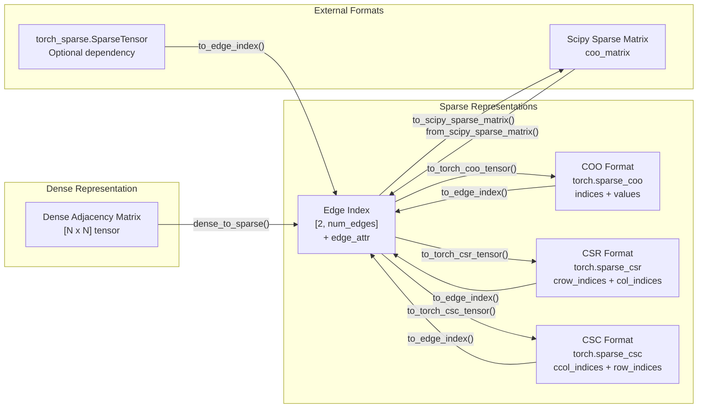
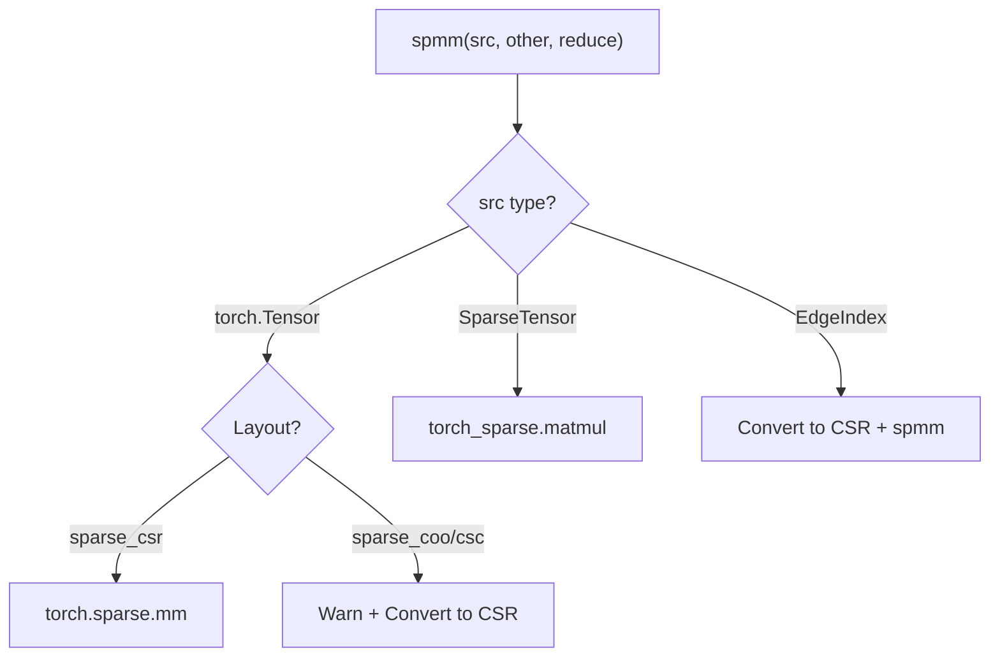

<!-- source: DeepWiki mcp.deepwiki.com · repo pyg-team/pytorch_geometric · page 8.2 Sparse Tensor Operations · fetched 2026-10-21 -->

# Sparse Tensor Operations

<details>
<summary>Relevant source files</summary>

The following files were used as context for generating this wiki page:

- [test/nn/models/test_meta.py](test/nn/models/test_meta.py)
- [test/nn/models/test_rev_gnn.py](test/nn/models/test_rev_gnn.py)
- [test/utils/test_convert.py](test/utils/test_convert.py)
- [test/utils/test_geodesic.py](test/utils/test_geodesic.py)
- [test/utils/test_loop.py](test/utils/test_loop.py)
- [test/utils/test_sparse.py](test/utils/test_sparse.py)
- [test/utils/test_spmm.py](test/utils/test_spmm.py)
- [torch_geometric/nn/models/meta.py](torch_geometric/nn/models/meta.py)
- [torch_geometric/nn/models/rev_gnn.py](torch_geometric/nn/models/rev_gnn.py)
- [torch_geometric/utils/__init__.py](torch_geometric/utils/__init__.py)
- [torch_geometric/utils/convert.py](torch_geometric/utils/convert.py)
- [torch_geometric/utils/geodesic.py](torch_geometric/utils/geodesic.py)
- [torch_geometric/utils/loop.py](torch_geometric/utils/loop.py)
- [torch_geometric/utils/num_nodes.py](torch_geometric/utils/num_nodes.py)
- [torch_geometric/utils/sparse.py](torch_geometric/utils/sparse.py)

</details>


## Purpose and Scope

This page documents utilities for converting between different sparse tensor representations in PyTorch Geometric. These functions handle conversions between dense adjacency matrices, sparse COO/CSR/CSC tensors, edge indices, and the optional `torch_sparse.SparseTensor` format. The utilities support efficient graph representation and enable interoperability with PyTorch's native sparse tensor implementations and external libraries like Scipy.

For graph manipulation operations like self-loop management and undirected conversion, see [Graph Manipulation](8.1). For custom tensor types like `EdgeIndex`, see [Custom Tensor Types](2.2).

Sources: [torch_geometric/utils/sparse.py:1-432](), [torch_geometric/utils/__init__.py:32-36](), [torch_geometric/utils/convert.py:12-75]()

---

## Sparse Tensor Format Overview

PyTorch Geometric supports multiple sparse tensor formats for representing graph adjacency matrices. Each format has different performance characteristics for various operations.

**Data Flow and Conversion Utilities:**



**Format Characteristics:**

| Format | Storage | Best For | Implementation |
|--------|---------|----------|----------------|
| **COO** | Coordinate list (row, col, value) | Flexible construction, element access | `torch.sparse_coo` |
| **CSR** | Compressed by row | Row-wise operations, `spmm` | `torch.sparse_csr` |
| **CSC** | Compressed by column | Column-wise operations | `torch.sparse_csc` |
| **Edge Index** | `[2, E]` tensor + attributes | PyG operations, message passing | `torch.Tensor` / `EdgeIndex` |
| **Scipy COO** | `(data, (row, col))` | CPU-based linear algebra, interoperability | `scipy.sparse.coo_matrix` |

Sources: [torch_geometric/utils/sparse.py:115-433](), [torch_geometric/utils/convert.py:12-75](), [test/utils/test_sparse.py:90-215]()

---

## Dense to Sparse Conversion

### dense_to_sparse()

Converts dense adjacency matrices to sparse edge indices with attributes. Supports both 2D (single graph) and 3D (batched graphs) inputs with optional node masking.

**Function Signature:**
```python
def dense_to_sparse(adj: Tensor, mask: Optional[Tensor] = None) -> Tuple[Tensor, Tensor]
```

**Implementation Logic:**
- **2D Input:** Uses `adj.nonzero().t()` to extract indices and `adj[edge_index[0], edge_index[1]]` for attributes [torch_geometric/utils/sparse.py:86-89]().
- **3D Input:** Flattens the batch and calculates offsets using `cumsum` to ensure unique node indices across the batch [torch_geometric/utils/sparse.py:90-112]().

**Examples:**
```python
adj = torch.tensor([[3.0, 1.0], [2.0, 0.0]])
edge_index, edge_attr = dense_to_sparse(adj)
# edge_index: [[0, 0, 1], [0, 1, 0]]
# edge_attr: [3, 1, 2]
```

Sources: [torch_geometric/utils/sparse.py:13-112](), [test/utils/test_sparse.py:24-88]()

---

## Format Conversion Utilities

### Coordinate (COO) Format
`to_torch_coo_tensor()` converts edge indices to PyTorch's COO layout. It automatically calls `coalesce()` unless `is_coalesced=True` is passed to avoid expensive sorting and duplicate summation [torch_geometric/utils/sparse.py:143-216]().

### Compressed Sparse Row (CSR) Format
`to_torch_csr_tensor()` generates row pointers using `index2ptr` (from `torch_geometric.index`) to map row indices to a compressed offset format [torch_geometric/utils/sparse.py:219-284]().

### Compressed Sparse Column (CSC) Format
`to_torch_csc_tensor()` is similar to CSR but compresses column indices. In PyTorch versions prior to 2.0, it may flip indices to maintain compatibility [torch_geometric/utils/sparse.py:287-353]().

### Scipy Interoperability
- `to_scipy_sparse_matrix()`: Moves data to CPU and converts to `scipy.sparse.coo_matrix` [torch_geometric/utils/convert.py:12-49]().
- `from_scipy_sparse_matrix()`: Converts back to `edge_index` and `edge_weight` tensors [torch_geometric/utils/convert.py:52-75]().

Sources: [torch_geometric/utils/sparse.py:143-353](), [torch_geometric/utils/convert.py:12-75](), [test/utils/test_convert.py:24-54]()

---

## Sparse Matrix Multiplication (spmm)

The `spmm` utility provides a unified interface for sparse-dense matrix multiplication across different sparse layouts and libraries.

**Implementation Dispatch:**


**Key Features:**
- **Reductions:** Supports `sum`, `mean`, `min`, and `max` [test/utils/test_spmm.py:17-44]().
- **EdgeIndex Support:** Can take an `EdgeIndex` object directly, utilizing its internal sort order (if 'row') for efficient conversion [test/utils/test_spmm.py:112-126]().
- **JIT Support:** Fully compatible with `torch.jit.script` [test/utils/test_spmm.py:86-107]().

Sources: [torch_geometric/utils/_spmm.py:1-100](), [test/utils/test_spmm.py:1-127]()

---

## Helper and Inspection Utilities

### Format Detection
- `is_torch_sparse_tensor(src)`: Checks for native `sparse_coo`, `sparse_csr`, or `sparse_csc` layouts [torch_geometric/utils/sparse.py:115-129]().
- `is_sparse(src)`: Checks for native sparse tensors OR `torch_sparse.SparseTensor` [torch_geometric/utils/sparse.py:132-140]().

### Structural Operations
- `to_edge_index(adj)`: The universal reverse operation. It extracts indices from COO, uses `ptr2index` to expand CSR/CSC pointers, or calls `.coo()` on `SparseTensor` [torch_geometric/utils/sparse.py:394-432]().
- `coalesce(edge_index, edge_attr, ...)`: Sorts edge indices and removes duplicates by summing their attributes [torch_geometric/utils/__init__.py:13]().

### Sparse Manipulation
- `set_sparse_value(adj, value)`: Preserves the sparse structure (indices/pointers) but replaces the data values [torch_geometric/utils/sparse.py:453-485]().
- `cat(tensors, dim)`: Concatenates sparse tensors. Supports vertical (`dim=0`), horizontal (`dim=1`), and block-diagonal (`dim=(0,1)`) stacking [torch_geometric/utils/sparse.py:488-698]().

Sources: [torch_geometric/utils/sparse.py:115-698](), [test/utils/test_sparse.py:90-290]()

---

## Performance Considerations

### Layout Selection
- **CSR** is the most efficient format for `spmm` and message passing because it provides contiguous memory access for row-wise neighbors [test/utils/test_spmm.py:148-162]().
- **COO** is preferred for graph construction or adding/removing edges, as it does not require re-calculating pointers for every change.

### Batching and Offsets
When using `dense_to_sparse` on batched data, PyG computes offsets using `cumsum`. This translates a batch of adjacency matrices `[B, N, N]` into a single large disjoint graph `[2, E_total]`, which is the standard input for GNN layers.

Sources: [torch_geometric/utils/sparse.py:90-112](), [torch_geometric/utils/num_nodes.py:12-40]()

---

