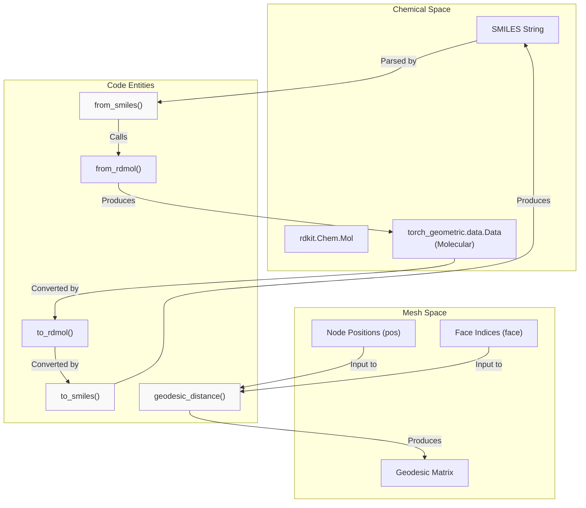
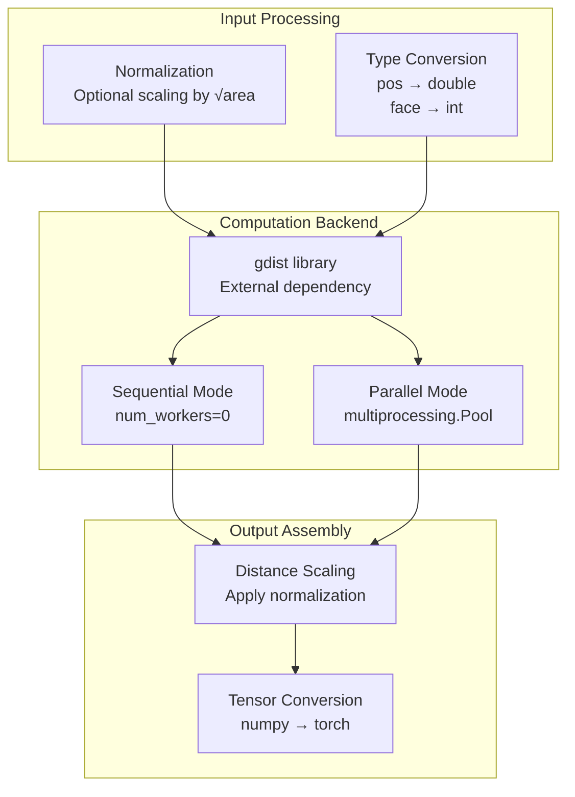
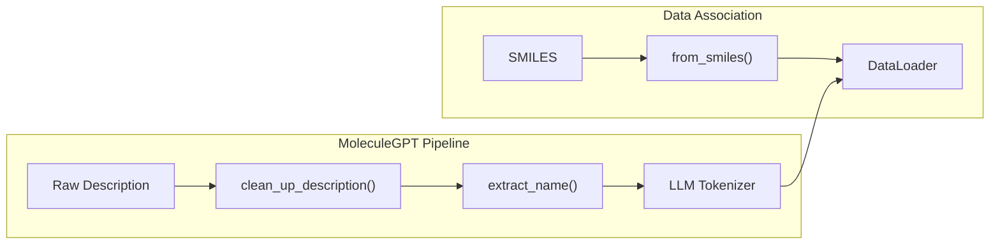

<!-- source: DeepWiki mcp.deepwiki.com · repo pyg-team/pytorch_geometric · page 8.3 Geometric Utilities · fetched 2026-10-21 -->

# Geometric Utilities

<details>
<summary>Relevant source files</summary>

The following files were used as context for generating this wiki page:

- [examples/datapipe.py](examples/datapipe.py)
- [examples/llm/molecule_gpt.py](examples/llm/molecule_gpt.py)
- [examples/llm/protein_mpnn.py](examples/llm/protein_mpnn.py)
- [test/datasets/test_molecule_gpt_dataset.py](test/datasets/test_molecule_gpt_dataset.py)
- [test/datasets/test_protein_mpnn_dataset.py](test/datasets/test_protein_mpnn_dataset.py)
- [test/llm/models/test_git_mol.py](test/llm/models/test_git_mol.py)
- [test/llm/models/test_molecule_gpt.py](test/llm/models/test_molecule_gpt.py)
- [test/llm/utils/test_rag_backend_utils.py](test/llm/utils/test_rag_backend_utils.py)
- [test/nn/models/test_meta.py](test/nn/models/test_meta.py)
- [test/utils/test_convert.py](test/utils/test_convert.py)
- [test/utils/test_geodesic.py](test/utils/test_geodesic.py)
- [test/utils/test_smiles.py](test/utils/test_smiles.py)
- [torch_geometric/data/datapipes.py](torch_geometric/data/datapipes.py)
- [torch_geometric/datasets/git_mol_dataset.py](torch_geometric/datasets/git_mol_dataset.py)
- [torch_geometric/datasets/molecule_gpt_dataset.py](torch_geometric/datasets/molecule_gpt_dataset.py)
- [torch_geometric/datasets/protein_mpnn_dataset.py](torch_geometric/datasets/protein_mpnn_dataset.py)
- [torch_geometric/nn/models/meta.py](torch_geometric/nn/models/meta.py)
- [torch_geometric/utils/convert.py](torch_geometric/utils/convert.py)
- [torch_geometric/utils/geodesic.py](torch_geometric/utils/geodesic.py)
- [torch_geometric/utils/smiles.py](torch_geometric/utils/smiles.py)

</details>


This document covers PyTorch Geometric's utilities for geometry-specific operations on graphs, including mesh-based structures, molecular SMILES parsing, and multi-modal data processing. The module provides specialized tools for geodesic distance computation, chemical representation conversion, and integration with Large Language Models (LLMs).

**Sources:** [torch_geometric/utils/geodesic.py:1-139](), [torch_geometric/utils/smiles.py:1-240]()

## Purpose and Scope

The geometric utilities module provides specialized functions for working with geometric and chemical representations of graphs. These utilities enable:
*   **Mesh Operations**: Shortest-path (geodesic) distance computations on 3D surface manifolds.
*   **Chemical Informatics**: Conversion between SMILES strings, RDKit molecules, and PyG `Data` objects.
*   **LLM Integration**: Utilities for processing molecular descriptions and instructions for models like MoleculeGPT.

**Sources:** [torch_geometric/utils/geodesic.py:1-139](), [torch_geometric/utils/smiles.py:1-131](), [torch_geometric/datasets/molecule_gpt_dataset.py:174-200]()

## System Entity Mapping

The following diagram maps high-level geometric/chemical concepts to their corresponding implementation entities in the PyG codebase.



**Sources:** [torch_geometric/utils/smiles.py:80-164](), [torch_geometric/utils/geodesic.py:10-20]()

## Chemical Utilities (SMILES)

PyG provides robust conversion utilities for chemical graphs, mapping atomic and bond properties to tensor representations.

### Feature Mapping
The conversion process uses static maps to translate chemical properties into integer indices for node (`x`) and edge (`edge_attr`) features.

| Feature Type | Attributes Mapped |
|:---|:---|
| **Node (`x`)** | `atomic_num`, `chirality`, `degree`, `formal_charge`, `num_hs`, `num_radical_electrons`, `hybridization`, `is_aromatic`, `is_in_ring` |
| **Edge (`edge_attr`)** | `bond_type`, `stereo`, `is_conjugated` |

**Sources:** [torch_geometric/utils/smiles.py:7-77]()

### Key Functions
*   `from_smiles(smiles, with_hydrogen, kekulize)`: High-level entry point to convert a SMILES string to a `Data` object [torch_geometric/utils/smiles.py:134-164]().
*   `from_rdmol(mol)`: Internal logic that iterates through RDKit atoms and bonds to build feature tensors [torch_geometric/utils/smiles.py:80-131]().
*   `to_smiles(data, kekulize)`: Reverses the process, converting a PyG `Data` object back to a SMILES string via RDKit [torch_geometric/utils/smiles.py:234-240]().

## Geodesic Distance Computation

The `geodesic_distance()` function computes shortest paths along a triangular mesh surface. It acts as a wrapper around the `gdist` library.

### Computation Flow



**Sources:** [torch_geometric/utils/geodesic.py:10-138]()

### Function Interface

```python
def geodesic_distance(
    pos: Tensor,              # [N, 3] Node positions
    face: Tensor,             # [3, F] Face indices
    src: Optional[Tensor] = None,
    dst: Optional[Tensor] = None,
    norm: bool = True,        # Normalize by √area
    max_distance: Optional[float] = None,
    num_workers: int = 0,     # 0: sequential, -1: all cores
) -> Tensor
```

**Sources:** [torch_geometric/utils/geodesic.py:10-48]()

### Normalization and Scaling
When `norm=True`, distances are divided by `scale = sqrt(total_area)`. The area is calculated using the cross product of edge vectors for every face:
`area = (pos[face[1]] - pos[face[0]]).cross(pos[face[2]] - pos[face[0]]) / 2` [torch_geometric/utils/geodesic.py:76-81]().

## Multi-Modal and LLM Utilities

PyG includes utilities for bridging geometric data with Large Language Models, specifically for molecular property prediction and instruction following.

### Data Processing for LLMs
The `MoleculeGPTDataset` and `GitMolDataset` implement complex parsing logic to prepare molecular graphs and text descriptions for LLM training.



**Sources:** [torch_geometric/datasets/molecule_gpt_dataset.py:21-171](), [examples/llm/molecule_gpt.py:72-91]()

### Key LLM Utility Functions
*   `clean_up_description(description)`: Sanitizes chemical descriptions by fixing typos and standardizing sentence structure [torch_geometric/datasets/molecule_gpt_dataset.py:21-122]().
*   `extract_name(name_raw, description)`: Separates the molecule name from its functional description to create cleaner instruction prompts [torch_geometric/datasets/molecule_gpt_dataset.py:125-171]().
*   `SMILESParser`: A `torch.utils.data.IterDataPipe` that dynamically converts SMILES strings or dictionaries into PyG `Data` objects during data loading [torch_geometric/data/datapipes.py:35-64]().

## Implementation Details

### External Dependencies
These utilities often rely on specialized external libraries:
*   **gdist**: Required for `geodesic_distance`. Must be installed via `pip install gdist` [torch_geometric/utils/geodesic.py:28-29]().
*   **rdkit**: Required for all SMILES and RDKit molecule conversions [torch_geometric/utils/smiles.py:87]().
*   **transformers**: Required for LLM-based datasets like `MoleculeGPTDataset` [test/datasets/test_molecule_gpt_dataset.py:8]().

### Parallelism in Geodesics
For large meshes, `geodesic_distance` uses a `multiprocessing.Pool` to compute distances for multiple source nodes in parallel. The `_parallel_loop` helper handles the per-source call to `gdist.compute_gdist` [torch_geometric/utils/geodesic.py:105-131]().

**Sources:** [torch_geometric/utils/geodesic.py:121-131]()

---

