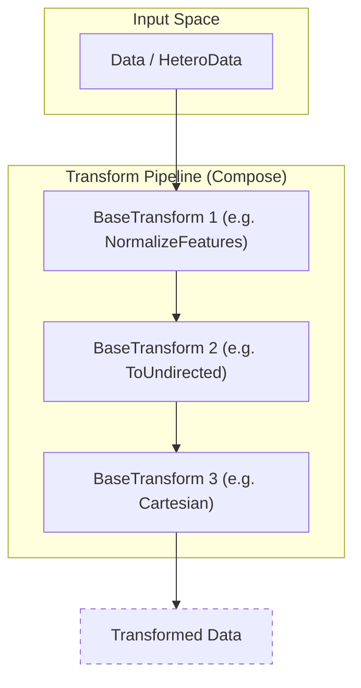
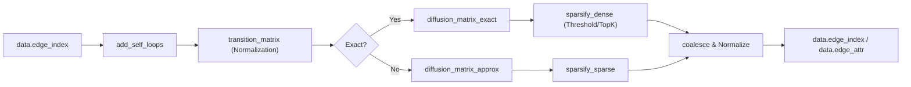
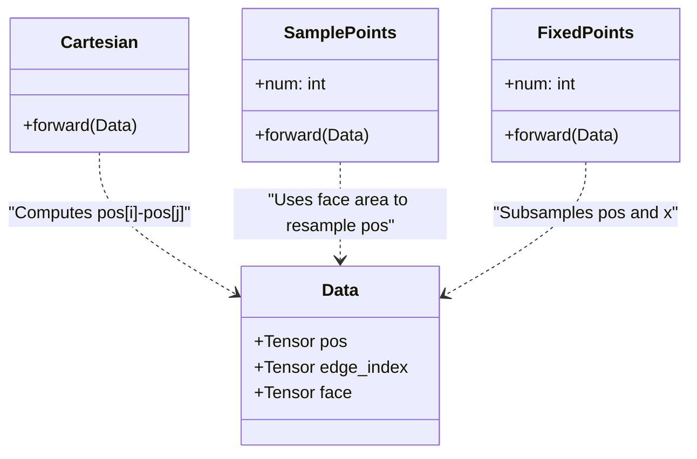

<!-- source: DeepWiki mcp.deepwiki.com · repo pyg-team/pytorch_geometric · page 8.4 Transforms · fetched 2026-10-21 -->

# Transforms

Relevant source files

The following files were used as context for generating this wiki page:

- [examples/agnn.py](examples/agnn.py)
- [examples/gat.py](examples/gat.py)
- [examples/gcn.py](examples/gcn.py)
- [examples/proteins_diff_pool.py](examples/proteins_diff_pool.py)
- [examples/proteins_topk_pool.py](examples/proteins_topk_pool.py)
- [examples/sign.py](examples/sign.py)
- [test/nn/test_resolver.py](test/nn/test_resolver.py)
- [test/transforms/test_add_metapaths.py](test/transforms/test_add_metapaths.py)
- [test/transforms/test_cartesian.py](test/transforms/test_cartesian.py)
- [test/transforms/test_delaunay.py](test/transforms/test_delaunay.py)
- [test/transforms/test_distance.py](test/transforms/test_distance.py)
- [test/transforms/test_fixed_points.py](test/transforms/test_fixed_points.py)
- [test/transforms/test_gcn_norm.py](test/transforms/test_gcn_norm.py)
- [test/transforms/test_gdc.py](test/transforms/test_gdc.py)
- [test/transforms/test_generate_mesh_normals.py](test/transforms/test_generate_mesh_normals.py)
- [test/transforms/test_line_graph.py](test/transforms/test_line_graph.py)
- [test/transforms/test_local_cartesian.py](test/transforms/test_local_cartesian.py)
- [test/transforms/test_local_degree_profile.py](test/transforms/test_local_degree_profile.py)
- [test/transforms/test_normalize_rotation.py](test/transforms/test_normalize_rotation.py)
- [test/transforms/test_polar.py](test/transforms/test_polar.py)
- [test/transforms/test_random_link_split.py](test/transforms/test_random_link_split.py)
- [test/transforms/test_remove_isolated_nodes.py](test/transforms/test_remove_isolated_nodes.py)
- [test/transforms/test_rooted_subgraph.py](test/transforms/test_rooted_subgraph.py)
- [test/transforms/test_sample_points.py](test/transforms/test_sample_points.py)
- [test/transforms/test_spherical.py](test/transforms/test_spherical.py)
- [test/transforms/test_to_sparse_tensor.py](test/transforms/test_to_sparse_tensor.py)
- [test/transforms/test_to_undirected.py](test/transforms/test_to_undirected.py)
- [torch_geometric/nn/lr_scheduler.py](torch_geometric/nn/lr_scheduler.py)
- [torch_geometric/nn/resolver.py](torch_geometric/nn/resolver.py)
- [torch_geometric/resolver.py](torch_geometric/resolver.py)
- [torch_geometric/transforms/__init__.py](torch_geometric/transforms/__init__.py)
- [torch_geometric/transforms/add_metapaths.py](torch_geometric/transforms/add_metapaths.py)
- [torch_geometric/transforms/add_positional_encoding.py](torch_geometric/transforms/add_positional_encoding.py)
- [torch_geometric/transforms/base_transform.py](torch_geometric/transforms/base_transform.py)
- [torch_geometric/transforms/cartesian.py](torch_geometric/transforms/cartesian.py)
- [torch_geometric/transforms/center.py](torch_geometric/transforms/center.py)
- [torch_geometric/transforms/compose.py](torch_geometric/transforms/compose.py)
- [torch_geometric/transforms/delaunay.py](torch_geometric/transforms/delaunay.py)
- [torch_geometric/transforms/distance.py](torch_geometric/transforms/distance.py)
- [torch_geometric/transforms/face_to_edge.py](torch_geometric/transforms/face_to_edge.py)
- [torch_geometric/transforms/feature_propagation.py](torch_geometric/transforms/feature_propagation.py)
- [torch_geometric/transforms/fixed_points.py](torch_geometric/transforms/fixed_points.py)
- [torch_geometric/transforms/gcn_norm.py](torch_geometric/transforms/gcn_norm.py)
- [torch_geometric/transforms/gdc.py](torch_geometric/transforms/gdc.py)
- [torch_geometric/transforms/generate_mesh_normals.py](torch_geometric/transforms/generate_mesh_normals.py)
- [torch_geometric/transforms/grid_sampling.py](torch_geometric/transforms/grid_sampling.py)
- [torch_geometric/transforms/knn_graph.py](torch_geometric/transforms/knn_graph.py)
- [torch_geometric/transforms/line_graph.py](torch_geometric/transforms/line_graph.py)
- [torch_geometric/transforms/linear_transformation.py](torch_geometric/transforms/linear_transformation.py)
- [torch_geometric/transforms/local_cartesian.py](torch_geometric/transforms/local_cartesian.py)
- [torch_geometric/transforms/local_degree_profile.py](torch_geometric/transforms/local_degree_profile.py)
- [torch_geometric/transforms/normalize_rotation.py](torch_geometric/transforms/normalize_rotation.py)
- [torch_geometric/transforms/normalize_scale.py](torch_geometric/transforms/normalize_scale.py)
- [torch_geometric/transforms/one_hot_degree.py](torch_geometric/transforms/one_hot_degree.py)
- [torch_geometric/transforms/point_pair_features.py](torch_geometric/transforms/point_pair_features.py)
- [torch_geometric/transforms/polar.py](torch_geometric/transforms/polar.py)
- [torch_geometric/transforms/radius_graph.py](torch_geometric/transforms/radius_graph.py)
- [torch_geometric/transforms/random_link_split.py](torch_geometric/transforms/random_link_split.py)
- [torch_geometric/transforms/remove_isolated_nodes.py](torch_geometric/transforms/remove_isolated_nodes.py)
- [torch_geometric/transforms/rooted_subgraph.py](torch_geometric/transforms/rooted_subgraph.py)
- [torch_geometric/transforms/sample_points.py](torch_geometric/transforms/sample_points.py)
- [torch_geometric/transforms/sign.py](torch_geometric/transforms/sign.py)
- [torch_geometric/transforms/spherical.py](torch_geometric/transforms/spherical.py)
- [torch_geometric/transforms/target_indegree.py](torch_geometric/transforms/target_indegree.py)
- [torch_geometric/transforms/to_dense.py](torch_geometric/transforms/to_dense.py)
- [torch_geometric/transforms/to_sparse_tensor.py](torch_geometric/transforms/to_sparse_tensor.py)
- [torch_geometric/transforms/to_superpixels.py](torch_geometric/transforms/to_superpixels.py)
- [torch_geometric/transforms/to_undirected.py](torch_geometric/transforms/to_undirected.py)
- [torch_geometric/transforms/two_hop.py](torch_geometric/transforms/two_hop.py)

PyTorch Geometric (PyG) provides a comprehensive suite of over 60 transforms designed to modify graph data objects. These transforms can be applied during data loading (via the `transform` argument in datasets) or dynamically during training. They cover a wide spectrum of operations, including feature engineering, structural modification, geometric processing, and data splitting.

### The BaseTransform Interface

All transforms in PyG inherit from the `BaseTransform` class [torch_geometric/transforms/base_transform.py:3](). This interface requires the implementation of a `forward` method that takes a `Data` or `HeteroData` object and returns a modified version of it.

To simplify usage, PyG uses the `@functional_transform` decorator [torch_geometric/transforms/gdc.py:21](). This decorator registers the class and allows it to be invoked using a functional name (e.g., `'gdc'`) within PyG's data processing pipelines.

### Data Flow and Composition

Transforms are typically applied in a pipeline. The `Compose` class [torch_geometric/transforms/compose.py:4]() allows users to chain multiple transforms together, executing them sequentially on the input data.

**Transform Execution Logic**

Sources: [torch_geometric/transforms/__init__.py:4-142](), [torch_geometric/transforms/compose.py:4]()

---

## Feature Transforms

Feature transforms focus on modifying node or edge attributes without altering the graph's topology.

| Transform | Role | Implementation Detail |
| :--- | :--- | :--- |
| `NormalizeFeatures` | Row-normalizes node features | Sum of features for each node becomes 1 [torch_geometric/transforms/__init__.py:8]() |
| `SVDFeatureReduction` | Reduces feature dimensionality | Uses Singular Value Decomposition [torch_geometric/transforms/__init__.py:9]() |
| `Constant` | Adds a constant value to node features | Useful for graphs without initial features [torch_geometric/transforms/__init__.py:7]() |
| `SIGN` | Precomputes inception-like representations | Computes $\mathbf{X}^{(i)} = (\mathbf{D}^{-1/2} \mathbf{A} \mathbf{D}^{-1/2})^i \mathbf{X}$ [torch_geometric/transforms/sign.py:18-19]() |

**Example: SIGN Implementation**
The `SIGN` transform [torch_geometric/transforms/sign.py:11]() precomputes fixed node representations for $K$ hops and stores them as `data.x1`, `data.x2`, etc. [torch_geometric/transforms/sign.py:61](). This allows for scalable training via mini-batching since the expensive graph convolutions are moved to a preprocessing step.

Sources: [torch_geometric/transforms/sign.py:11-63](), [torch_geometric/transforms/__init__.py:7-9]()

---

## Structural Transforms

Structural transforms modify the connectivity of the graph, such as adding metapaths, converting to undirected, or performing diffusion.

### Graph Diffusion Convolution (GDC)
`GDC` [torch_geometric/transforms/gdc.py:22]() implements the "Diffusion Improves Graph Learning" method. It replaces the adjacency matrix with a diffusion matrix (e.g., Personalized PageRank or Heat Kernel) to capture higher-order neighborhoods.

**GDC Data Flow**

Sources: [torch_geometric/transforms/gdc.py:98-140]()

### Heterogeneous Transforms
*   **AddMetaPaths**: Adds new edge types to a `HeteroData` object based on sequences of existing edge types [torch_geometric/transforms/add_metapaths.py:16](). It uses matrix multiplication of adjacency indices to find metapath-based neighbors [torch_geometric/transforms/add_metapaths.py:152]().
*   **ToUndirected**: Converts directed edges to undirected ones by adding reverse edges [torch_geometric/transforms/__init__.py:17]().

### Splitting Utilities
*   **RandomLinkSplit**: Essential for link prediction tasks. It splits edges into training, validation, and test sets [torch_geometric/transforms/random_link_split.py:17](). It ensures that edges used for supervision in the test set are not present in the message-passing graph during training [torch_geometric/transforms/random_link_split.py:22-24]().

Sources: [torch_geometric/transforms/add_metapaths.py:16-163](), [torch_geometric/transforms/random_link_split.py:17-156](), [torch_geometric/transforms/gdc.py:22-92]()

---

## Geometric and Vision Transforms

These transforms are specifically designed for 3D point clouds and meshes, where nodes have spatial positions (`data.pos`).

### Spatial Relation Transforms
*   **Cartesian**: Computes relative Cartesian coordinates between linked nodes: $pos_i - pos_j$ [torch_geometric/transforms/cartesian.py:44](). These are stored in `edge_attr` [torch_geometric/transforms/cartesian.py:58]().
*   **Distance**: Adds the Euclidean distance between linked nodes as an edge attribute [torch_geometric/transforms/__init__.py:44]().
*   **Spherical**: Computes spherical coordinates (radius, theta, phi) for edges [torch_geometric/transforms/__init__.py:48]().

### Point Cloud Sampling
*   **SamplePoints**: Uniformly samples a fixed number of points from mesh faces based on their area [torch_geometric/transforms/sample_points.py:9-11]().
*   **FixedPoints**: Samples a fixed number of points from a point cloud, ensuring consistent batch sizes [torch_geometric/transforms/fixed_points.py:14]().

**Geometric Entity Mapping**

Sources: [torch_geometric/transforms/cartesian.py:11-60](), [torch_geometric/transforms/sample_points.py:9-71](), [torch_geometric/transforms/fixed_points.py:14-65]()

---

## Positional Encodings

PyG provides transforms to inject structural and positional information into node features, which is critical for Transformers and GNNs that lack inherent awareness of graph topology.

*   **AddLaplacianEigenvectorPE**: Computes the eigenvectors of the Laplacian matrix [torch_geometric/transforms/add_positional_encoding.py:42](). It uses `scipy.sparse.linalg.eigs` or `eigsh` for large graphs [torch_geometric/transforms/add_positional_encoding.py:98]().
*   **AddRandomWalkPE**: Computes the landing probabilities of a random walk of length $k$ returning to the starting node [torch_geometric/transforms/add_positional_encoding.py:118](). It uses power iteration of the transition matrix: $\mathbf{P}^k = \mathbf{A} \mathbf{D}^{-1}$ [torch_geometric/transforms/add_positional_encoding.py:169]().

Sources: [torch_geometric/transforms/add_positional_encoding.py:41-175]()

---

## Summary Table of Key Transforms

| Category | Class | Key Functionality |
| :--- | :--- | :--- |
| **General** | `ToDevice` | Moves data to a specific CPU/GPU device [torch_geometric/transforms/__init__.py:5]() |
| **General** | `ToSparseTensor` | Converts `edge_index` to a `SparseTensor` [torch_geometric/transforms/__init__.py:6]() |
| **Graph** | `KNNGraph` | Creates a graph where nodes are connected to their k-nearest neighbors [torch_geometric/transforms/__init__.py:26]() |
| **Graph** | `AddSelfLoops` | Adds self-loops to the graph connectivity [torch_geometric/transforms/__init__.py:21]() |
| **Graph** | `VirtualNode` | Adds a node connected to all other nodes to improve global information flow [torch_geometric/transforms/__init__.py:38]() |
| **Vision** | `RandomJitter` | Randomly perturbs node positions (data augmentation) [torch_geometric/transforms/__init__.py:53]() |
| **Vision** | `FaceToEdge` | Converts mesh faces to an edge index representation [torch_geometric/transforms/__init__.py:59]() |

Sources: [torch_geometric/transforms/__init__.py:1-142]()

---

