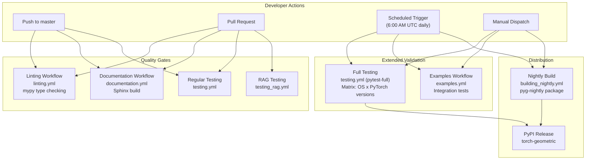
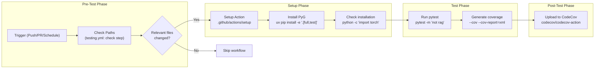
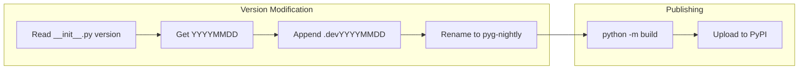

<!-- source: DeepWiki mcp.deepwiki.com · repo pyg-team/pytorch_geometric · page 9 Development · fetched 2026-10-21 -->

# Development

Relevant source files

The following files were used as context for generating this wiki page:

- [.github/workflows/_testing.yml](.github/workflows/_testing.yml)
- [.github/workflows/auto-merge.yml](.github/workflows/auto-merge.yml)
- [.github/workflows/building_nightly.yml](.github/workflows/building_nightly.yml)
- [.github/workflows/documentation.yml](.github/workflows/documentation.yml)
- [.github/workflows/examples.yml](.github/workflows/examples.yml)
- [.github/workflows/linting.yml](.github/workflows/linting.yml)
- [.github/workflows/testing.yml](.github/workflows/testing.yml)
- [.github/workflows/testing_rag.yml](.github/workflows/testing_rag.yml)

This page provides an overview of PyTorch Geometric's development infrastructure, including testing strategies, CI/CD pipelines, and package distribution mechanisms. It serves as a guide for contributors and maintainers who want to understand how code quality is maintained, how changes are validated, and how releases are produced.

For detailed information about specific subsystems, see:
- [Testing Infrastructure](#9.1) — Test suite organization, `pytest` usage, and device/package parametrization.
- [CI/CD Workflows](#9.2) — GitHub Actions for linting, testing, and documentation building.
- [Build and Distribution](#9.3) — Package build process, PyPI/Conda distribution, and `uv`-based management.
- [GraphGym Experiment Platform](#9.4) — Modular experiment platform for GNN research.
- [Benchmarks and Examples](#9.5) — Performance tracking and reference implementations.

## Development Infrastructure Overview

PyTorch Geometric employs a comprehensive development infrastructure centered around GitHub Actions workflows, automated testing across multiple platforms and PyTorch versions, type checking, documentation generation, and multi-channel distribution.

### Development Workflow Architecture

**Sources:** [.github/workflows/linting.yml](), [.github/workflows/documentation.yml](), [.github/workflows/testing.yml](), [.github/workflows/testing_rag.yml](), [.github/workflows/examples.yml](), [.github/workflows/building_nightly.yml]()

## Testing Strategy

PyG uses a multi-layered testing strategy to ensure compatibility across platforms and PyTorch versions while optimizing CI resource usage. The primary test suite is managed via `testing.yml`, which utilizes a reusable `_testing.yml` workflow.

### Testing Matrix

| Workflow | Trigger | OS Coverage | PyTorch Versions | Purpose |
|----------|---------|-------------|------------------|---------|
| `pytest` | Push/PR | Ubuntu, macOS, Windows | 2.9.0 - 2.12.0, Nightly | PR validation |
| `pytest-full` | Daily / `ci: full` label | Ubuntu, macOS, Windows | Comprehensive Matrix | Full compatibility check |
| `rag_pytest` | Push/PR (LLM paths) | Ubuntu | Latest | LLM/RAG specific tests |
| `examples.yml` | Daily schedule | Ubuntu | Latest | Integration testing |

**Sources:** [.github/workflows/testing.yml:66-75](), [.github/workflows/testing.yml:82-89](), [.github/workflows/testing_rag.yml:23-24]()

### Test Execution Flow

**Sources:** [.github/workflows/testing.yml:39-55](), [.github/workflows/_testing.yml:27-68]()

## CI/CD Pipeline Components

### Workflow Concurrency and Triggers
Workflows implement concurrency control to cancel intermediate builds on PRs [.github/workflows/testing.yml:12-15](). The `trigger` job in `testing.yml` uses `git diff` to determine if code-relevant paths (like `torch_geometric/` or `test/`) have changed before launching the heavy test matrix [.github/workflows/testing.yml:39-55]().

### Linting and Type Checking
The `linting.yml` workflow performs static type checking using `mypy`. It installs the package with `[full,test]` extras and runs `mypy` with a disabled cache to ensure a clean state [.github/workflows/linting.yml:42-48]().

### Documentation
The `documentation.yml` workflow builds Sphinx documentation. It treats warnings as errors using the `-W` flag to maintain high documentation quality [.github/workflows/documentation.yml:47](). It utilizes a custom theme `pyg_sphinx_theme` [.github/workflows/documentation.yml:42]().

### LLM and RAG Testing
Specific tests for Graph-based Retrieval Augmented Generation (RAG) and LLM integrations are isolated in `testing_rag.yml`. These tests run when changes occur in `torch_geometric/llm/` or related datasets [.github/workflows/testing_rag.yml:7-15]().

## Nightly Build Process

PyG publishes a nightly version (`pyg-nightly`) to PyPI every day at 6:00 AM UTC.

The process uses `sed` to dynamically update `__init__.py` and `pyproject.toml` before running the build module [.github/workflows/building_nightly.yml:23-38]().

**Sources:** [.github/workflows/building_nightly.yml:1-45]()

## Automation Bots
PyG uses an auto-merge bot to handle PRs from `dependabot` and `pre-commit-ci`. It automatically labels, approves, and enables squash-merging for these automated PRs once CI passes [.github/workflows/auto-merge.yml:12-32]().

## Summary of Infrastructure

| Component | Tools | Configuration |
| :--- | :--- | :--- |
| **Package Manager** | `uv` | `uv pip install` used across all workflows |
| **Test Runner** | `pytest` | Parametrized by OS and PyTorch versions |
| **Linting** | `mypy`, `ruff`, `yapf` | Configured in `linting.yml` and `pyproject.toml` |
| **Coverage** | `Codecov` | Uploaded from Linux test runs |
| **Distribution** | `PyPI`, `Conda` | `building_nightly.yml` handles dev releases |

For more details, proceed to the sub-pages:
- [Testing Infrastructure](#9.1)
- [CI/CD Workflows](#9.2)
- [Build and Distribution](#9.3)
- [GraphGym Experiment Platform](#9.4)
- [Benchmarks and Examples](#9.5)

---

