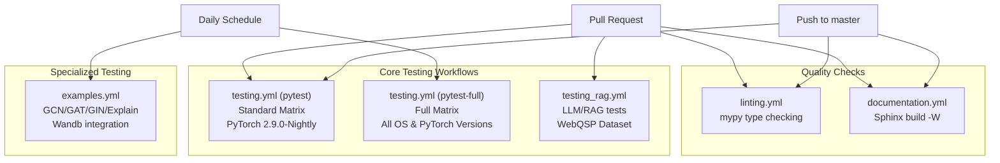
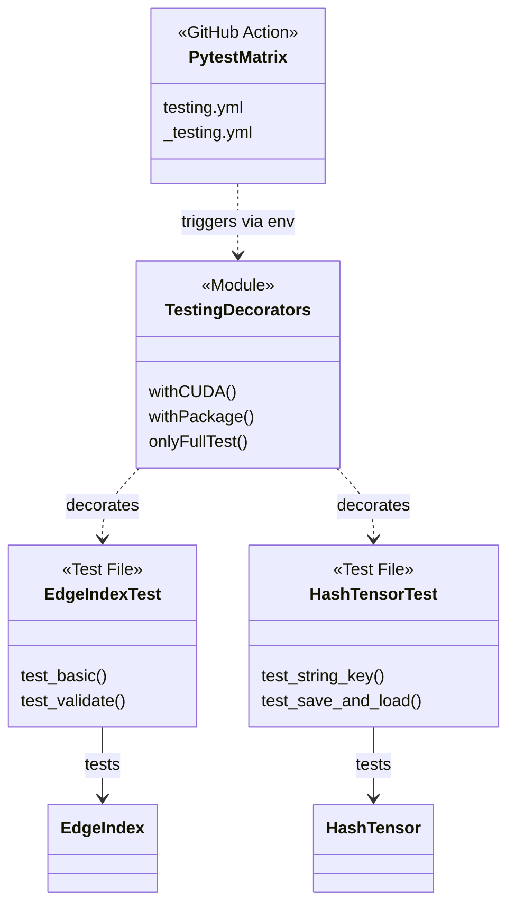
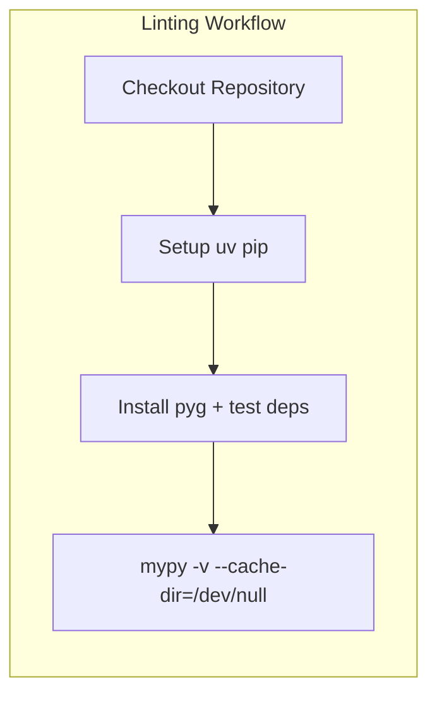

<!-- source: DeepWiki mcp.deepwiki.com · repo pyg-team/pytorch_geometric · page 9.1 Testing Infrastructure · fetched 2026-10-21 -->

# Testing Infrastructure

<details>
<summary>Relevant source files</summary>

The following files were used as context for generating this wiki page:

- [.github/workflows/_testing.yml](.github/workflows/_testing.yml)
- [.github/workflows/auto-merge.yml](.github/workflows/auto-merge.yml)
- [.github/workflows/building_nightly.yml](.github/workflows/building_nightly.yml)
- [.github/workflows/documentation.yml](.github/workflows/documentation.yml)
- [.github/workflows/examples.yml](.github/workflows/examples.yml)
- [.github/workflows/linting.yml](.github/workflows/linting.yml)
- [.github/workflows/testing.yml](.github/workflows/testing.yml)
- [.github/workflows/testing_rag.yml](.github/workflows/testing_rag.yml)
- [test/test_edge_index.py](test/test_edge_index.py)
- [test/test_hash_tensor.py](test/test_hash_tensor.py)
- [test/test_index.py](test/test_index.py)
- [torch_geometric/edge_index.py](torch_geometric/edge_index.py)
- [torch_geometric/hash_tensor.py](torch_geometric/hash_tensor.py)
- [torch_geometric/index.py](torch_geometric/index.py)
- [torch_geometric/testing/__init__.py](torch_geometric/testing/__init__.py)
- [torch_geometric/testing/decorators.py](torch_geometric/testing/decorators.py)

</details>


This document describes PyTorch Geometric's testing infrastructure, including the CI/CD pipeline, test utilities, and testing patterns. The testing system ensures code quality across multiple PyTorch versions, operating systems, and hardware configurations.

For information about extending PyG with custom implementations, see [Architecture and Key Concepts](#1.2). For build and distribution processes, see [Build and Distribution](#9.3).

## Overview

PyG's testing infrastructure consists of three main components:

1.  **CI/CD Workflows**: GitHub Actions workflows that run tests on every push and pull request.
2.  **Test Decorators**: Python decorators for conditional test execution based on hardware, packages, and configurations [torch_geometric/testing/decorators.py:1-320]().
3.  **Test Suite**: Comprehensive pytest-based tests with extensive parametrization [test/test_edge_index.py:1-195]().

The infrastructure supports testing across PyTorch versions from 2.9.0 through nightly builds, on Linux, Windows, and macOS, with optional GPU acceleration [.github/workflows/testing.yml:66-75]().

**Sources**: [.github/workflows/testing.yml](), [torch_geometric/testing/decorators.py:1-320](), [torch_geometric/testing/__init__.py:1-67]()

## CI/CD Workflow Architecture

The CI/CD pipeline is designed to trigger based on changes to core library files, tests, or configuration files [.github/workflows/testing.yml:39-47]().



**Workflow Descriptions**:

| Workflow | PyTorch Version(s) | Platforms | Trigger | Scope |
| :--- | :--- | :--- | :--- | :--- |
| `testing.yml` (pytest) | 2.9.0, 2.10.0, 2.11.0, 2.12.0, Nightly | Ubuntu, macOS, Windows | PR/Push | Standard CI matrix [.github/workflows/testing.yml:66-75]() |
| `testing.yml` (pytest-full) | 2.9.0 - Nightly | All Platforms | Daily / `ci: full` label | Full matrix with `FULL_TEST=1` [.github/workflows/testing.yml:77-89]() |
| `testing_rag.yml` | Latest | Ubuntu | PR/Push (LLM paths) | `torch_geometric.llm` and RAG datasets [.github/workflows/testing_rag.yml:1-15]() |
| `linting.yml` | N/A | Ubuntu | PR/Push | `mypy` type hints and `ruff` linting [.github/workflows/linting.yml:32-49]() |
| `documentation.yml` | Latest | Ubuntu | PR/Push | Sphinx build (fails on any warning) [.github/workflows/documentation.yml:44-47]() |
| `examples.yml` | Latest | Ubuntu | Daily Schedule | Runs core examples (GCN, GAT, GIN) [.github/workflows/examples.yml:25-46]() |

**Sources**: [.github/workflows/testing.yml:1-105](), [.github/workflows/linting.yml:1-49](), [.github/workflows/documentation.yml:1-48](), [.github/workflows/testing_rag.yml:1-54]()

## Test Decorator System

PyG provides a comprehensive decorator system in `torch_geometric.testing.decorators` to handle environment-specific test logic.

### Device and Hardware Decorators

These decorators ensure tests run on appropriate hardware:

*   **`@withCUDA`**: Parametrizes the test to run on both `cpu` and `cuda:0` (if available) [torch_geometric/testing/decorators.py:207-215]().
*   **`@onlyCUDA`**: Skips the test if CUDA is not available [torch_geometric/testing/decorators.py:106-112]().
*   **`@withDevice`**: Tests on all available devices, including CPU, CUDA, MPS (macOS), and XPU [torch_geometric/testing/decorators.py:218-245]().
*   **`@onlyXPU`**: Skips if Intel XPU is not available [torch_geometric/testing/decorators.py:115-122]().

### Package and Extension Decorators

These manage tests for optional dependencies:

*   **`@withPackage(*args)`**: Skips tests if specific packages (e.g., `pandas`, `h5py`) are missing [torch_geometric/testing/decorators.py:189-204]().
*   **`@onlyNeighborSampler`**: Requires `pyg-lib` or `torch-sparse` [torch_geometric/testing/decorators.py:158-166]().
*   **`@withHashTensor`**: Specifically for testing the `HashTensor` implementation, checking for `pyg-lib` or falling back to `pandas` [torch_geometric/testing/decorators.py:25]().
*   **`@withoutExtensions`**: Runs tests both with and without PyG extension packages (`torch-scatter`, `torch-sparse`, `pyg-lib`) [torch_geometric/testing/decorators.py:27]().

### Platform and Execution Mode Decorators

*   **`@onlyFullTest`**: Only runs when `FULL_TEST=1` is set in the environment [torch_geometric/testing/decorators.py:23-31]().
*   **`@onlyLinux` / `@noWindows` / `@noMac`**: Platform-specific execution control [torch_geometric/testing/decorators.py:51-81]().
*   **`@onlyOnline`**: Skips tests if no internet connection is detected (useful for dataset downloads) [torch_geometric/testing/decorators.py:124-144]().

**Sources**: [torch_geometric/testing/decorators.py:18-320]()

## Code Entity Mapping

The following diagram maps the logical testing concepts to their implementation classes and files.



**Sources**: [torch_geometric/testing/decorators.py:1-205](), [test/test_edge_index.py:1-195](), [test/test_hash_tensor.py:1-180]()

## Test Parametrization Patterns

PyG uses `pytest.mark.parametrize` extensively to ensure coverage across data types and configurations.

### Dtype Parametrization
Most tensor-like structures (e.g., `EdgeIndex`, `Index`) are tested against all supported index dtypes (`int32`, `int64`) [test/test_edge_index.py:32]().

```python
# From test/test_edge_index.py
DTYPES = [pytest.param(dtype, id=str(dtype)[6:]) for dtype in INDEX_DTYPES]

@withCUDA
@pytest.mark.parametrize('dtype', DTYPES)
def test_basic(dtype, device):
    ...
```

### Configuration Parametrization
Tests often combine multiple parameters to cover the state space of classes like `EdgeIndex` [test/test_edge_index.py:81-84]().

| Parameter | Values |
| :--- | :--- |
| `dtype` | `torch.int32`, `torch.int64` |
| `device` | `cpu`, `cuda:0` |
| `is_undirected` | `True`, `False` |

**Sources**: [test/test_edge_index.py:32-45](), [test/test_hash_tensor.py:20-37]()

## Testing Module Utilities

The `torch_geometric.testing` module provides internal helpers for test construction:

*   **`get_random_edge_index`**: Generates valid COO tensors for structural testing [torch_geometric/testing/__init__.py:33]().
*   **`FakeHeteroDataset`**: Generates mock heterogeneous graphs for testing loaders and models [torch_geometric/testing/__init__.py:35]().
*   **`MyFeatureStore` / `MyGraphStore`**: Reference implementations for testing distributed and custom storage interfaces [torch_geometric/testing/__init__.py:30-31]().
*   **`assert_module`**: Utility to verify module output consistency and parameter properties [torch_geometric/testing/__init__.py:29]().

**Sources**: [torch_geometric/testing/__init__.py:1-67]()

## Implementation Detail: EdgeIndex and Index Validation

Testing for `EdgeIndex` and `Index` includes strict validation of metadata and structural integrity.

| Function | File:Line | Description |
| :--- | :--- | :--- |
| `EdgeIndex.validate()` | [torch_geometric/edge_index.py:213]() | Checks for negative indices, out-of-bounds, and sort order consistency. |
| `Index.validate()` | [torch_geometric/index.py:213]() | Validates one-dimensional indices and compressed (ptr) representations. |
| `assert_valid_dtype` | [torch_geometric/edge_index.py:111]() | Ensures tensors use `INDEX_DTYPES`. |
| `assert_contiguous` | [torch_geometric/index.py:69]() | Ensures indices are contiguous for performance. |

**Sources**: [torch_geometric/edge_index.py:111-150](), [torch_geometric/index.py:56-85]()

## Linting and Type Checking Pipeline

PyG uses `mypy` for static type checking as part of the CI process [.github/workflows/linting.yml:32-49]().



**Sources**: [.github/workflows/linting.yml:1-49]()

---

