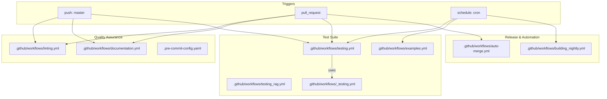
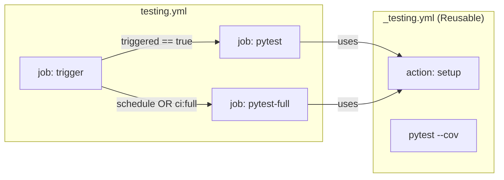

<!-- source: DeepWiki mcp.deepwiki.com · repo pyg-team/pytorch_geometric · page 9.2 CI/CD Workflows · fetched 2026-10-21 -->

# CI/CD Workflows

Relevant source files

The following files were used as context for generating this wiki page:

- [.github/workflows/_testing.yml](.github/workflows/_testing.yml)
- [.github/workflows/auto-merge.yml](.github/workflows/auto-merge.yml)
- [.github/workflows/building_nightly.yml](.github/workflows/building_nightly.yml)
- [.github/workflows/documentation.yml](.github/workflows/documentation.yml)
- [.github/workflows/examples.yml](.github/workflows/examples.yml)
- [.github/workflows/linting.yml](.github/workflows/linting.yml)
- [.github/workflows/testing.yml](.github/workflows/testing.yml)
- [.github/workflows/testing_rag.yml](.github/workflows/testing_rag.yml)
- [.pre-commit-config.yaml](.pre-commit-config.yaml)
- [test/nn/conv/test_gat_conv.py](test/nn/conv/test_gat_conv.py)
- [test/nn/conv/test_gatv2_conv.py](test/nn/conv/test_gatv2_conv.py)
- [test/nn/conv/test_gcn_conv.py](test/nn/conv/test_gcn_conv.py)
- [test/nn/conv/test_transformer_conv.py](test/nn/conv/test_transformer_conv.py)
- [torch_geometric/nn/conv/fa_conv.py](torch_geometric/nn/conv/fa_conv.py)
- [torch_geometric/nn/conv/gat_conv.py](torch_geometric/nn/conv/gat_conv.py)
- [torch_geometric/nn/conv/gatv2_conv.py](torch_geometric/nn/conv/gatv2_conv.py)
- [torch_geometric/nn/conv/rgat_conv.py](torch_geometric/nn/conv/rgat_conv.py)
- [torch_geometric/nn/conv/transformer_conv.py](torch_geometric/nn/conv/transformer_conv.py)

## Purpose and Scope

This page documents PyTorch Geometric's continuous integration and continuous deployment (CI/CD) infrastructure implemented via GitHub Actions. The CI/CD system ensures code quality through automated linting, validates compatibility across a multi-platform matrix (Linux, macOS, Windows), and automates documentation builds and nightly package releases.

---

## Workflow Architecture

PyG's CI/CD is composed of specialized workflows that handle quality assurance, platform testing, and deployment. These are orchestrated to trigger based on code changes or periodic schedules.

### Workflow Execution Flow

The following diagram illustrates how different GitHub Action workflows are triggered and the code entities they interact with.

**CI/CD Pipeline Overview**

**Sources:** [.github/workflows/testing.yml:3-9](), [.github/workflows/linting.yml:3-24](), [.github/workflows/documentation.yml:3-19](), [.github/workflows/examples.yml:3-6](), [.github/workflows/building_nightly.yml:3-7]()

---

## Quality Assurance and Linting

PyG enforces strict code standards through a combination of local pre-commit hooks and CI-side linting.

### Pre-commit Configuration
The `.pre-commit-config.yaml` file defines the standard for code style. Key tools include:
*   **ruff**: Used for high-speed linting and formatting [.pre-commit-config.yaml:72-77]().
*   **yapf**: Google's Python formatter for consistent indentation and spacing [.pre-commit-config.yaml:52-58]().
*   **mypy**: Static type checking [.github/workflows/linting.yml:32-49]().
*   **autoflake**: Removal of unused imports and variables [.pre-commit-config.yaml:39-50]().

### Type Hinting (mypy)
The `linting.yml` workflow specifically runs `mypy` to ensure type safety across the library. It installs the package with `[full,test]` extras to ensure all optional dependencies' type stubs are available [.github/workflows/linting.yml:42-44]().

**Sources:** [.pre-commit-config.yaml:1-94](), [.github/workflows/linting.yml:32-49]()

---

## Testing Infrastructure

Testing is divided into a fast path for PRs and a comprehensive path for nightly schedules.

### Trigger Logic
The `testing.yml` workflow uses a `trigger` job to determine if a full test suite is required based on changed files. It monitors core directories like `torch_geometric/` and `test/` [.github/workflows/testing.yml:18-58]().

### Multi-Platform Matrix
PyG uses a reusable workflow `_testing.yml` to execute tests across a matrix of OS and PyTorch versions.

| Configuration | OS Options | PyTorch Versions |
| :--- | :--- | :--- |
| **Standard (PR)** | Ubuntu, macOS, Windows | 2.9.0, 2.10.0, 2.11.0, 2.12.0, Nightly |
| **Full (Scheduled)** | Ubuntu, macOS, Windows | Comprehensive version sweep |

**Test Matrix Implementation**

**Sources:** [.github/workflows/testing.yml:59-90](), [.github/workflows/_testing.yml:1-100]()

### RAG Testing
Specialized testing for Retrieval-Augmented Generation (RAG) features is isolated in `testing_rag.yml`. It triggers specifically when changes occur in `torch_geometric/llm/` or `web_qsp_dataset.py` [.github/workflows/testing_rag.yml:1-15](). It executes tests marked with `-m rag` [.github/workflows/testing_rag.yml:43]().

---

## Documentation and Examples

### Sphinx Build
The `documentation.yml` workflow ensures that the documentation can be built without warnings. It uses the `-W` flag with `sphinx-build`, which treats warnings as errors to prevent documentation rot [.github/workflows/documentation.yml:44-47]().

### Example Validation
The `examples.yml` workflow runs a subset of PyG examples (e.g., `gcn.py`, `gat.py`, `mutag_gin.py`) on a schedule to ensure that example code remains functional as the API evolves [.github/workflows/examples.yml:25-46]().

**Sources:** [.github/workflows/documentation.yml:44-47](), [.github/workflows/examples.yml:25-46]()

---

## Release and Automation

### Nightly Package Releases
The `building_nightly.yml` workflow automates the publication of the `pyg-nightly` package to PyPI. It dynamically updates the version string in `torch_geometric/__init__.py` and `pyproject.toml` by appending the current date (e.g., `2.5.0.dev20231027`) [.github/workflows/building_nightly.yml:23-33]().

### Auto-Merge Bot
To streamline maintenance, `auto-merge.yml` automatically merges PRs from `pre-commit-ci` or those labeled with `auto-merge` once all status checks pass [.github/workflows/auto-merge.yml:1-30]().

**Sources:** [.github/workflows/building_nightly.yml:23-44](), [.github/workflows/auto-merge.yml:1-30]()

---

