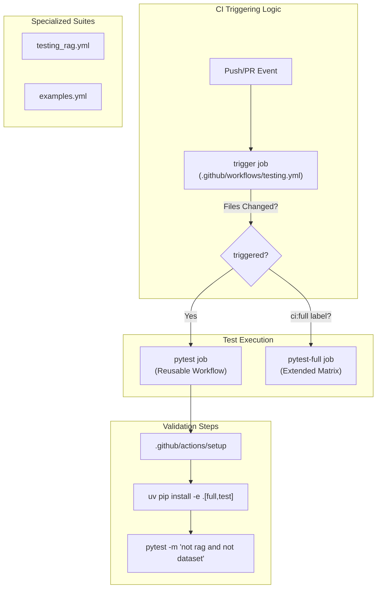
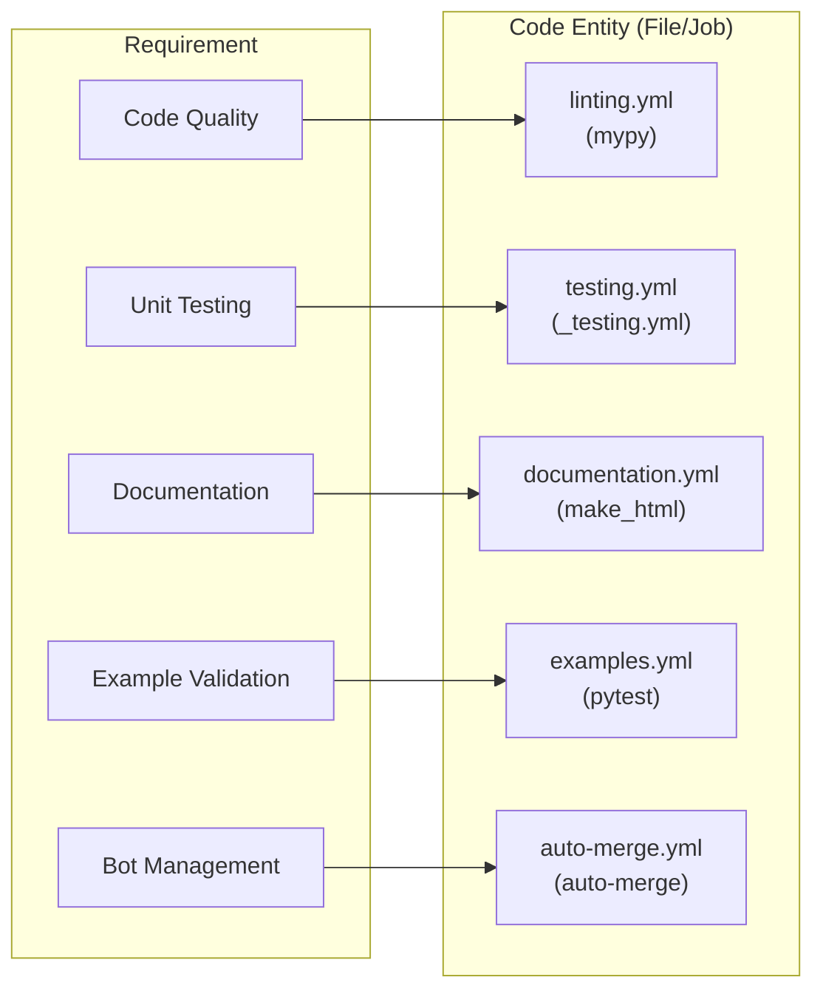

<!-- source: DeepWiki mcp.deepwiki.com · repo pyg-team/pytorch_geometric · page 9.3 Build and Distribution · fetched 2026-10-21 -->

# Build and Distribution

Relevant source files

The following files were used as context for generating this wiki page:

- [.github/workflows/_testing.yml](.github/workflows/_testing.yml)
- [.github/workflows/auto-merge.yml](.github/workflows/auto-merge.yml)
- [.github/workflows/building_nightly.yml](.github/workflows/building_nightly.yml)
- [.github/workflows/documentation.yml](.github/workflows/documentation.yml)
- [.github/workflows/examples.yml](.github/workflows/examples.yml)
- [.github/workflows/linting.yml](.github/workflows/linting.yml)
- [.github/workflows/testing.yml](.github/workflows/testing.yml)
- [.github/workflows/testing_rag.yml](.github/workflows/testing_rag.yml)
- [benchmark/citation/README.md](benchmark/citation/README.md)
- [benchmark/inference/README.md](benchmark/inference/README.md)
- [benchmark/kernel/README.md](benchmark/kernel/README.md)
- [benchmark/multi_gpu/training/README.md](benchmark/multi_gpu/training/README.md)
- [benchmark/points/README.md](benchmark/points/README.md)
- [benchmark/training/README.md](benchmark/training/README.md)
- [docker/Dockerfile](docker/Dockerfile)
- [docker/README.md](docker/README.md)
- [docker/singularity](docker/singularity)
- [docs/README.md](docs/README.md)
- [torch_geometric/template.py](torch_geometric/template.py)

This document describes the build system, distribution channels, and CI/CD infrastructure for PyTorch Geometric. It covers the package build configuration, how PyG is distributed through PyPI and Docker, the optional extension package ecosystem, and the automated workflows that ensure quality and availability across multiple PyTorch versions and platforms.

## Build System and Dependency Management

PyTorch Geometric uses `pyproject.toml` as the central configuration for its build system and development tools. The project utilizes the `uv` package manager for fast, reliable dependency resolution and installation in CI environments [[.github/workflows/linting.yml:44-44](), [.github/workflows/documentation.yml:42-42]()].

### Package Metadata and Dependencies

The core package configuration defines PyG's identity and dependencies. The library supports a wide range of optional features through dependency groups:

| Group | Purpose | Key Dependencies |
|-------|---------|------------------|
| `test` | Unit testing infrastructure | `pytest`, `pytest-cov`, `onnx`, `onnxruntime` |
| `full` | Complete feature set | `scipy`, `scikit-learn`, `rdkit`, `captum` |
| `benchmark` | Performance evaluation | `matplotlib`, `networkx`, `pandas`, `wandb` |
| `rag` | Retrieval Augmented Generation | `transformers`, `datasets`, `torchmetrics` |

Sources: [[.github/workflows/linting.yml:44-44](), [.github/workflows/testing_rag.yml:37-37](), [.github/workflows/examples.yml:23-23]()]

### Development Tool Configuration

The build configuration includes settings for several static analysis and formatting tools to maintain code quality:

*   **Mypy**: Used for static type checking. The CI runs `mypy` with a clean cache to ensure type safety across the library [[.github/workflows/linting.yml:46-48]()].
*   **Ruff/Yapf**: Used for linting and code formatting.
*   **Sphinx**: Used for documentation generation. The CI builds the HTML documentation with the `-W` flag to treat warnings as errors, ensuring docstring integrity [[.github/workflows/documentation.yml:47-47]()].

## Distribution Channels

PyG is distributed through multiple channels to support stable releases, development snapshots, and containerized environments.

### PyPI and Nightly Releases

PyTorch Geometric is available on PyPI as `torch-geometric`. Additionally, a `pyg-nightly` package is released daily to provide users with the latest features and bug fixes.

**Nightly Release Workflow (`.github/workflows/building_nightly.yml`):**
1.  **Trigger**: Runs every day at 6:00 AM UTC [[.github/workflows/building_nightly.yml:6-6]()].
2.  **Version Management**: 
    *   Extracts the base version from `torch_geometric/__init__.py` [[.github/workflows/building_nightly.yml:24-24]()].
    *   Appends the current date (e.g., `2.6.0.dev20240520`) [[.github/workflows/building_nightly.yml:27-33]()].
    *   Renames the package to `pyg-nightly` within `pyproject.toml` for the build [[.github/workflows/building_nightly.yml:32-32]()].
3.  **Build**: Uses the `build` module to generate source distributions and wheels [[.github/workflows/building_nightly.yml:37-38]()].
4.  **Publish**: Uploads the artifacts to PyPI using `pypa/gh-action-pypi-publish` [[.github/workflows/building_nightly.yml:41-45]()].

### Docker Distribution

PyG provides Docker images to simplify deployment on NVIDIA and Intel hardware.

*   **NVIDIA CUDA**: The Dockerfile is based on the `nvidia/cuda-dl-base` image. It installs PyTorch, Graphviz, and PyG along with NVIDIA-specific extensions like `cugraph-pyg` [[docker/Dockerfile:1-21]()].
*   **Intel GPU (XPU)**: A specialized Dockerfile (`docker/Dockerfile.xpu`) supports Intel® Extension for PyTorch [[docker/README.md:18-22]()].
*   **Singularity**: Support is provided for high-performance computing (HPC) environments via Singularity recipes [[docker/README.md:24-26]()].

Sources: [[.github/workflows/building_nightly.yml:1-45](), [docker/Dockerfile:1-22](), [docker/README.md:1-65]()]

## CI/CD Infrastructure

PyG employs a robust CI/CD pipeline using GitHub Actions to validate code across a matrix of operating systems, Python versions, and PyTorch versions.

### Automated Testing Matrix

The testing suite is split into standard and "full" matrices. Standard tests run on every PR, while the full matrix runs on a schedule or when specifically labeled.

**Testing Matrix Components:**
*   **OS**: Ubuntu 22.04, macOS 14, Windows 2022 [[.github/workflows/testing.yml:68-74]()].
*   **PyTorch Versions**: 2.9.0 through 2.12.0, and `nightly` [[.github/workflows/testing.yml:86-86]()].
*   **Hardware**: Primarily CPU-based in CI, with specialized GPU testing where available.

Sources: [[.github/workflows/testing.yml:17-90](), [.github/workflows/_testing.yml:1-68]()]

### CI/CD Workflow Association

The following diagram maps the natural language requirements of the CI system to the specific files and jobs that implement them.

Sources: [[.github/workflows/linting.yml:32-32](), [.github/workflows/testing.yml:59-59](), [.github/workflows/documentation.yml:28-28](), [.github/workflows/examples.yml:10-10](), [.github/workflows/auto-merge.yml:12-12]()]

## Specialized Testing and Benchmarking

Beyond standard unit tests, PyG maintains several specialized validation pipelines:

### RAG and LLM Testing
The `Testing RAG` workflow validates the `torch_geometric.llm` module and the `WebQSPDataset`. It installs the `[rag]` dependency group and runs tests marked with `@pytest.mark.rag` [[.github/workflows/testing_rag.yml:1-54]()].

### Example Validation
The `Examples` workflow runs daily to ensure that core examples (GCN, GAT, GIN, GNNExplainer) remain functional. These tests log results to Weights & Biases (`wandb`) for performance tracking [[.github/workflows/examples.yml:1-46]()].

### Benchmarking
The `benchmark/` directory contains comprehensive scripts for evaluating GNN performance across various tasks:
*   **Kernel Benchmarks**: Evaluation of methods like `GCN`, `GraphSAGE`, and `DiffPool` on common datasets via 10-fold cross-validation [[benchmark/kernel/README.md:1-17]()].
*   **Performance Metrics**: `main_performance.py` provides detailed time-measurement and memory usage information [[benchmark/kernel/README.md:25-29]()].

Sources: [[.github/workflows/testing_rag.yml:37-43](), [.github/workflows/examples.yml:25-46](), [benchmark/kernel/README.md:1-30]()]

---

