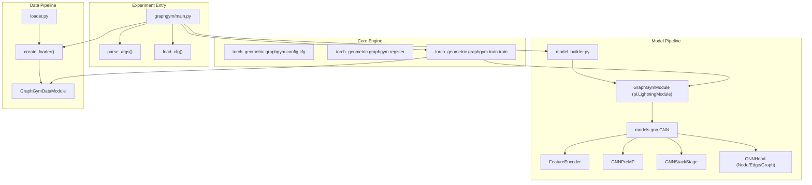
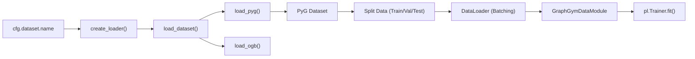

<!-- source: DeepWiki mcp.deepwiki.com · repo pyg-team/pytorch_geometric · page 9.4 GraphGym Experiment Platform · fetched 2026-10-21 -->

# GraphGym Experiment Platform

Relevant source files

The following files were used as context for generating this wiki page:

- [graphgym/custom_graphgym/head/example.py](graphgym/custom_graphgym/head/example.py)
- [graphgym/custom_graphgym/network/example.py](graphgym/custom_graphgym/network/example.py)
- [graphgym/main.py](graphgym/main.py)
- [test/explain/metric/test_basic_metric.py](test/explain/metric/test_basic_metric.py)
- [test/graphgym/example_node.yml](test/graphgym/example_node.yml)
- [test/graphgym/test_graphgym.py](test/graphgym/test_graphgym.py)
- [test/my_config.yaml](test/my_config.yaml)
- [torch_geometric/graphgym/__init__.py](torch_geometric/graphgym/__init__.py)
- [torch_geometric/graphgym/config.py](torch_geometric/graphgym/config.py)
- [torch_geometric/graphgym/contrib/layer/generalconv.py](torch_geometric/graphgym/contrib/layer/generalconv.py)
- [torch_geometric/graphgym/loader.py](torch_geometric/graphgym/loader.py)
- [torch_geometric/graphgym/logger.py](torch_geometric/graphgym/logger.py)
- [torch_geometric/graphgym/model_builder.py](torch_geometric/graphgym/model_builder.py)
- [torch_geometric/graphgym/models/act.py](torch_geometric/graphgym/models/act.py)
- [torch_geometric/graphgym/models/encoder.py](torch_geometric/graphgym/models/encoder.py)
- [torch_geometric/graphgym/models/gnn.py](torch_geometric/graphgym/models/gnn.py)
- [torch_geometric/graphgym/models/head.py](torch_geometric/graphgym/models/head.py)
- [torch_geometric/graphgym/models/layer.py](torch_geometric/graphgym/models/layer.py)
- [torch_geometric/graphgym/models/pooling.py](torch_geometric/graphgym/models/pooling.py)
- [torch_geometric/graphgym/register.py](torch_geometric/graphgym/register.py)
- [torch_geometric/graphgym/train.py](torch_geometric/graphgym/train.py)
- [torch_geometric/graphgym/utils/device.py](torch_geometric/graphgym/utils/device.py)

GraphGym is a modular platform for designing and evaluating Graph Neural Networks (GNNs). It abstracts the complexities of the training pipeline into a configuration-driven system, allowing researchers to swap models, datasets, and training strategies without modifying the underlying engine.

## System Architecture

GraphGym is built on a hierarchical modular design where components are registered in a central repository and instantiated based on a global configuration object.

### Code Entity Space to System Components
The following diagram maps the logical components of the experiment platform to their specific implementation classes and files.

**GraphGym System Mapping**

Sources: [graphgym/main.py:23-51](), [torch_geometric/graphgym/model_builder.py:16-21](), [torch_geometric/graphgym/models/gnn.py:146-182](), [torch_geometric/graphgym/train.py:40-77]()

---

## Configuration System

GraphGym uses a nested configuration system powered by `yacs`. The global configuration object `cfg` is defined in `torch_geometric/graphgym/config.py` [torch_geometric/graphgym/config.py:14-18]().

### Configuration Lifecycle
1.  **Initialization**: Default values are set in `set_cfg(cfg)` [torch_geometric/graphgym/config.py:24-350]().
2.  **Loading**: YAML files are merged into the `cfg` object via `load_cfg(cfg, args)` [torch_geometric/graphgym/config.py:438-446]().
3.  **Dynamic Sharing**: Dataset-specific attributes (like `dim_in` and `dim_out`) are automatically updated after the dataset is loaded in `set_dataset_info(dataset)` [torch_geometric/graphgym/loader.py:196-224]().

### Key Config Sections
| Section | Purpose | Example Parameters |
| :--- | :--- | :--- |
| `dataset` | Data source and task type | `name`, `task`, `split_mode` |
| `gnn` | Model architecture details | `layer_type`, `layers_mp`, `dim_inner` |
| `optim` | Optimization strategy | `optimizer`, `base_lr`, `max_epoch` |
| `train` | Training loop control | `batch_size`, `enable_ckpt`, `auto_resume` |

Sources: [torch_geometric/graphgym/config.py:113-225](), [torch_geometric/graphgym/config.py:229-280]()

---

## Model Builder and GNN Abstraction

The `create_model` function in `model_builder.py` serves as the factory for generating models [torch_geometric/graphgym/model_builder.py:70-88]().

### GraphGymModule
Models are wrapped in `GraphGymModule`, which inherits from `pytorch_lightning.LightningModule` [torch_geometric/graphgym/model_builder.py:16-19](). This wrapper handles:
*   **Forward Pass**: Delegates to the underlying GNN [torch_geometric/graphgym/model_builder.py:23-24]().
*   **Step Logic**: Implements `training_step`, `validation_step`, and `test_step` using a shared `_shared_step` method [torch_geometric/graphgym/model_builder.py:31-46]().
*   **Optimizers**: Configures optimizers and schedulers via `create_optimizer` and `create_scheduler` [torch_geometric/graphgym/model_builder.py:26-29]().

### The GNN Architecture
The standard `GNN` class follows a strict three-stage pipeline [torch_geometric/graphgym/models/gnn.py:146-182]():
1.  **FeatureEncoder**: Encodes raw node/edge features (e.g., using `torch.nn.Embedding` for categorical data) [torch_geometric/graphgym/models/gnn.py:97-143]().
2.  **Message Passing (MP)**:
    *   `GNNPreMP`: Initial linear layers [torch_geometric/graphgym/models/gnn.py:39-58]().
    *   `GNNStackStage`: Stacks multiple GNN layers (e.g., `GCNConv`, `SAGEConv`) with optional skip connections (`skipsum`, `skipconcat`) [torch_geometric/graphgym/models/gnn.py:61-94]().
3.  **GNNHead**: Task-specific output layers for `node`, `edge`, or `graph` prediction [torch_geometric/graphgym/models/head.py:9-131]().

Sources: [torch_geometric/graphgym/model_builder.py:16-68](), [torch_geometric/graphgym/models/gnn.py:146-187]()

---

## Data Loading and Training Loop

### Data Flow Diagram
This diagram illustrates the flow from raw data to the training loop.

**GraphGym Data Pipeline**

Sources: [torch_geometric/graphgym/loader.py:171-193](), [torch_geometric/graphgym/train.py:16-38]()

### Training Execution
The `train` function in `train.py` initializes the `pytorch_lightning.Trainer` [torch_geometric/graphgym/train.py:40-77](). It automatically attaches:
*   **LoggerCallback**: For tracking metrics [torch_geometric/graphgym/train.py:59]().
*   **ModelCheckpoint**: If `cfg.train.enable_ckpt` is True [torch_geometric/graphgym/train.py:61]().

---

## Registration Mechanism

GraphGym uses a registration pattern to allow users to inject custom code without modifying the library core. Registration functions are defined in `torch_geometric/graphgym/register.py`.

### Registration Entities
Users can register custom components using decorators or explicit function calls:
*   `register_layer`: Custom GNN layers [torch_geometric/graphgym/register.py:56-59]().
*   `register_stage`: Custom GNN stages (e.g., skip connection logic) [torch_geometric/graphgym/register.py:44-47]().
*   `register_head`: Custom prediction heads [torch_geometric/graphgym/register.py:50-53]().
*   `register_dataset`: Custom dataset loading logic [torch_geometric/graphgym/register.py:80-83]().

### Logger and Metrics
The `Logger` class in `logger.py` manages experiment tracking [torch_geometric/graphgym/logger.py:35-49]().
*   **Metrics**: Supports standard metrics for `regression`, `classification_binary`, and `classification_multi` [torch_geometric/graphgym/logger.py:97-138]().
*   **Custom Metrics**: Users can register custom metric functions via `register_metric` [torch_geometric/graphgym/logger.py:174-180]().

Sources: [torch_geometric/graphgym/register.py:1-100](), [torch_geometric/graphgym/logger.py:17-32](), [torch_geometric/graphgym/logger.py:169-203]()

---

## Main Entry Point

The `graphgym/main.py` script is the standard way to run experiments. It orchestrates the entire lifecycle [graphgym/main.py:23-55]():

1.  **Parse Arguments**: Uses `parse_args()` to handle command line inputs like `--cfg` and `--repeat` [graphgym/main.py:25]().
2.  **Environment Setup**: Sets the random seed via `seed_everything` and selects the compute device via `auto_select_device` [graphgym/main.py:38-39]().
3.  **Iteration**: Executes the experiment `args.repeat` times, incrementing the seed for each run to ensure statistical robustness [graphgym/main.py:33-48]().
4.  **Aggregation**: After all repeats, `agg_runs` collects results from the output directory to compute mean and standard deviation of performance metrics [graphgym/main.py:51]().

Sources: [graphgym/main.py:1-55](), [test/graphgym/test_graphgym.py:49-110]()

---

