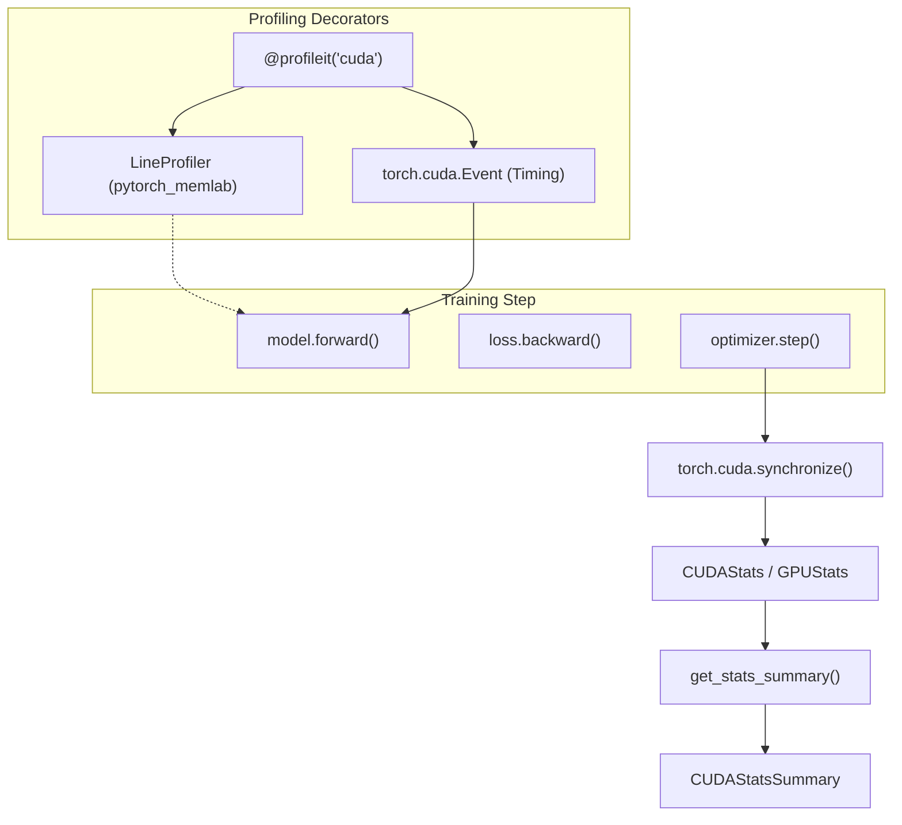
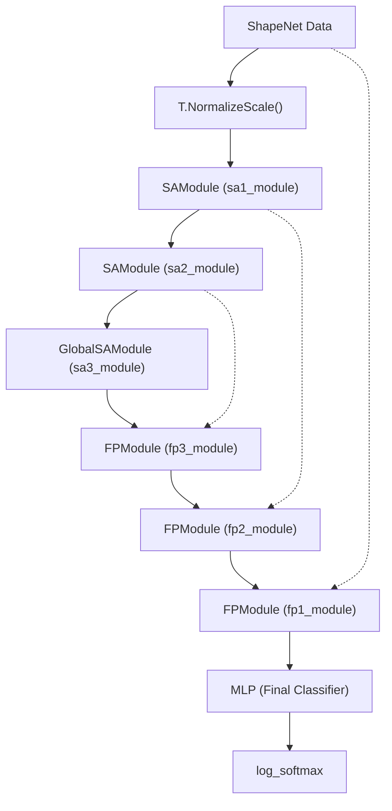

<!-- source: DeepWiki mcp.deepwiki.com · repo pyg-team/pytorch_geometric · page 9.5 Benchmarks and Examples · fetched 2026-10-21 -->

# Benchmarks and Examples

Relevant source files

The following files were used as context for generating this wiki page:

- [benchmark/inference/inference_benchmark.py](benchmark/inference/inference_benchmark.py)
- [benchmark/kernel/asap.py](benchmark/kernel/asap.py)
- [benchmark/kernel/diff_pool.py](benchmark/kernel/diff_pool.py)
- [benchmark/kernel/edge_pool.py](benchmark/kernel/edge_pool.py)
- [benchmark/kernel/gcn.py](benchmark/kernel/gcn.py)
- [benchmark/kernel/gin.py](benchmark/kernel/gin.py)
- [benchmark/kernel/global_attention.py](benchmark/kernel/global_attention.py)
- [benchmark/kernel/graclus.py](benchmark/kernel/graclus.py)
- [benchmark/kernel/graph_sage.py](benchmark/kernel/graph_sage.py)
- [benchmark/kernel/main.py](benchmark/kernel/main.py)
- [benchmark/kernel/sag_pool.py](benchmark/kernel/sag_pool.py)
- [benchmark/kernel/set2set.py](benchmark/kernel/set2set.py)
- [benchmark/kernel/top_k.py](benchmark/kernel/top_k.py)
- [benchmark/loader/neighbor_loader.py](benchmark/loader/neighbor_loader.py)
- [benchmark/training/training_benchmark.py](benchmark/training/training_benchmark.py)
- [benchmark/utils/__init__.py](benchmark/utils/__init__.py)
- [benchmark/utils/hetero_gat.py](benchmark/utils/hetero_gat.py)
- [benchmark/utils/hetero_sage.py](benchmark/utils/hetero_sage.py)
- [benchmark/utils/utils.py](benchmark/utils/utils.py)
- [examples/cora.py](examples/cora.py)
- [examples/dgcnn_classification.py](examples/dgcnn_classification.py)
- [examples/dgcnn_segmentation.py](examples/dgcnn_segmentation.py)
- [examples/faust.py](examples/faust.py)
- [examples/mnist_graclus.py](examples/mnist_graclus.py)
- [examples/mnist_nn_conv.py](examples/mnist_nn_conv.py)
- [examples/mnist_voxel_grid.py](examples/mnist_voxel_grid.py)
- [examples/multi_gpu/distributed_sampling_xpu.py](examples/multi_gpu/distributed_sampling_xpu.py)
- [examples/point_transformer_classification.py](examples/point_transformer_classification.py)
- [examples/point_transformer_segmentation.py](examples/point_transformer_segmentation.py)
- [examples/pointnet2_classification.py](examples/pointnet2_classification.py)
- [examples/pointnet2_segmentation.py](examples/pointnet2_segmentation.py)
- [examples/qm9_nn_conv.py](examples/qm9_nn_conv.py)
- [examples/randlanet_classification.py](examples/randlanet_classification.py)
- [examples/randlanet_segmentation.py](examples/randlanet_segmentation.py)
- [graphgym/custom_graphgym/encoder/example.py](graphgym/custom_graphgym/encoder/example.py)
- [test/datasets/test_medshapenet.py](test/datasets/test_medshapenet.py)
- [test/profile/test_profile.py](test/profile/test_profile.py)
- [torch_geometric/datasets/medshapenet.py](torch_geometric/datasets/medshapenet.py)
- [torch_geometric/profile/__init__.py](torch_geometric/profile/__init__.py)
- [torch_geometric/profile/profile.py](torch_geometric/profile/profile.py)
- [torch_geometric/profile/utils.py](torch_geometric/profile/utils.py)

PyTorch Geometric (PyG) provides a robust suite of benchmarking tools and extensive examples to evaluate performance and demonstrate GNN applications. These resources cover various domains including node classification, link prediction, point cloud processing, and heterogeneous graph learning.

## Benchmark Suite

The PyG benchmark suite is designed to measure the efficiency of GNN models, loaders, and kernels across different hardware backends (CPU, CUDA, XPU).

### Training and Inference Benchmarks
The library includes dedicated scripts for end-to-end training and inference performance measurement. These benchmarks support popular datasets like `ogbn-products`, `ogbn-mag`, and `Reddit` [benchmark/training/training_benchmark.py:30-34]().

*   **Training Benchmark**: Measures throughput and latency during the training loop, supporting both homogeneous and heterogeneous graphs [benchmark/training/training_benchmark.py:46-96](). It allows for testing mixed-precision (BF16) and various neighbor sampling strategies via `NeighborLoader` [benchmark/training/training_benchmark.py:184-189]().
*   **Inference Benchmark**: Focuses on evaluation performance, supporting full-batch inference [benchmark/inference/inference_benchmark.py:35-41]() and layer-wise/batch-wise sampling [benchmark/inference/inference_benchmark.py:128-154]().

### Kernel Benchmarks
Located in `benchmark/kernel/`, these scripts isolate specific GNN layers and pooling operators to measure their raw performance.
*   **Convolutional Kernels**: Includes benchmarks for `GCN` [benchmark/kernel/gcn.py](), `GraphSAGE` [benchmark/kernel/graph_sage.py](), and `GIN` [benchmark/kernel/gin.py]().
*   **Pooling Kernels**: Evaluates advanced pooling mechanisms such as `DiffPool` [benchmark/kernel/diff_pool.py:33](), `TopKPooling` [benchmark/kernel/top_k.py](), `SAGPooling` [benchmark/kernel/sag_pool.py](), and `EdgePooling` [benchmark/kernel/edge_pool.py]().

### Data Loading Benchmarks
Benchmarks for data loading efficiency, specifically targeting `NeighborLoader` and its performance in large-scale scenarios [benchmark/loader/neighbor_loader.py]().

**Sources:** [benchmark/training/training_benchmark.py](), [benchmark/inference/inference_benchmark.py](), [benchmark/kernel/diff_pool.py]().

---

## Profiling Utilities

PyG provides high-level wrappers around PyTorch's profiling tools to simplify the measurement of execution time and memory consumption.

### Time and Memory Profiling
*   **`timeit`**: A context manager and decorator for measuring execution time. It handles CUDA synchronization automatically to ensure accurate measurements [torch_geometric/profile/profile.py:144-184]().
*   **`profileit`**: A decorator for detailed GPU profiling. It collects runtime and memory statistics (allocated, reserved, and active memory) for CUDA and XPU devices [torch_geometric/profile/profile.py:48-141](). On CUDA, it optionally integrates with `pytorch_memlab` for line-by-line memory analysis [torch_geometric/profile/profile.py:104-109]().

### Hardware-Specific Profiling
*   **`torch_profile`**: A context manager that wraps `torch.profiler.profile` to generate CPU and CUDA traces [torch_geometric/profile/profile.py:228-243]().
*   **`xpu_profile`**: Specifically designed for Intel XPU hardware, facilitating the export of Chrome traces for performance analysis [torch_geometric/profile/profile.py:246-271]().
*   **`rename_profile_file`**: Utility to manage and name the resulting trace files [torch_geometric/profile/profile.py:274-282]().

### Profiling Data Flow
The following diagram illustrates how profiling utilities interact with a GNN training step:

**Profiling System Interaction**

**Sources:** [torch_geometric/profile/profile.py:48-225](), [test/profile/test_profile.py:57-79]().

---

## Examples Directory

The `examples/` directory serves as a comprehensive reference for implementing various GNN architectures.

### Node Classification
*   **Cora**: Demonstrates standard node classification on the Cora dataset using `SplineConv` and `RandomNodeSplit` [examples/cora.py:14-36]().
*   **MNIST Superpixels**: Shows how to treat images as graphs. Examples include using `graclus` pooling [examples/mnist_graclus.py:48-55]() and `voxel_grid` pooling [examples/mnist_voxel_grid.py:35-49]().

### Point Cloud Processing
PyG includes several implementations for 3D point cloud tasks:
*   **PointNet++**: Demonstrates hierarchical feature learning for classification [examples/pointnet2_classification.py:47-65]() and segmentation [examples/pointnet2_segmentation.py:51-80](). It utilizes `SAModule` (Set Abstraction) and `FPModule` (Feature Propagation) [examples/pointnet2_segmentation.py:37-49]().
*   **Dynamic Graph CNN (DGCNN)**: Implements `DynamicEdgeConv`, which dynamically constructs a k-NN graph in the feature space [examples/dgcnn_segmentation.py:32-50]().

### Specialized Examples
*   **FAUST**: 3D shape matching on the FAUST dataset using `SplineConv` and `Cartesian` transforms [examples/faust.py:15-47]().
*   **Multi-GPU Training**: Demonstrates distributed training using `DistributedSampler` and XPU acceleration [examples/multi_gpu/distributed_sampling_xpu.py]().

### Example Architecture: PointNet++ Segmentation
The following diagram maps the PointNet++ segmentation code entities to the data flow:

**PointNet++ Segmentation Flow**

**Sources:** [examples/pointnet2_segmentation.py:51-80](), [examples/pointnet2_classification.py:16-44]().

### Summary Table of Key Examples

| File | Task | Key Components |
| :--- | :--- | :--- |
| `cora.py` | Node Classification | `SplineConv`, `RandomNodeSplit` |
| `faust.py` | Shape Correspondence | `SplineConv`, `T.Cartesian` |
| `mnist_graclus.py` | Image Classification | `graclus`, `max_pool` |
| `pointnet2_segmentation.py`| 3D Segmentation | `SAModule`, `FPModule`, `knn_interpolate` |
| `dgcnn_segmentation.py` | 3D Segmentation | `DynamicEdgeConv`, `MLP` |

**Sources:** [examples/cora.py](), [examples/faust.py](), [examples/mnist_graclus.py](), [examples/pointnet2_segmentation.py](), [examples/dgcnn_segmentation.py]().

---

