# Page: Overview

# Overview

<details>
<summary>Relevant source files</summary>

The following files were used as context for generating this wiki page:

- [.github/CONTRIBUTING.md](.github/CONTRIBUTING.md)
- [.github/actions/setup/action.yml](.github/actions/setup/action.yml)
- [CHANGELOG.md](CHANGELOG.md)
- [CITATION.cff](CITATION.cff)
- [README.md](README.md)
- [docker/Dockerfile.xpu](docker/Dockerfile.xpu)
- [docs/requirements.txt](docs/requirements.txt)
- [docs/source/conf.py](docs/source/conf.py)
- [docs/source/index.rst](docs/source/index.rst)
- [docs/source/install/installation.rst](docs/source/install/installation.rst)
- [docs/source/install/quick-start.html](docs/source/install/quick-start.html)
- [docs/source/modules/datasets.rst](docs/source/modules/datasets.rst)
- [docs/source/modules/nn.rst](docs/source/modules/nn.rst)
- [docs/source/notes/colabs.rst](docs/source/notes/colabs.rst)
- [docs/source/notes/installation.rst](docs/source/notes/installation.rst)
- [docs/source/notes/resources.rst](docs/source/notes/resources.rst)
- [pyproject.toml](pyproject.toml)
- [readthedocs.yml](readthedocs.yml)
- [torch_geometric/__init__.py](torch_geometric/__init__.py)
- [torch_geometric/datasets/__init__.py](torch_geometric/datasets/__init__.py)
- [torch_geometric/nn/__init__.py](torch_geometric/nn/__init__.py)
- [torch_geometric/typing.py](torch_geometric/typing.py)

</details>


PyTorch Geometric (PyG) is a geometric deep learning library built on PyTorch for creating, training, and deploying Graph Neural Networks (GNNs) and related models for structured data. This page provides a high-level introduction to PyG's architecture, design philosophy, and core components. For installation instructions, see [Installation and Setup](#1.1). For detailed architectural concepts, see [Architecture and Key Concepts](#1.2).

## Purpose and Scope

PyG addresses the challenge of applying deep learning to non-Euclidean data structures including graphs, point clouds, and meshes. The library provides:

- **158+ built-in datasets** spanning molecular, social, citation, and geometric domains.
- **50+ GNN layer implementations** via the `MessagePassing` abstraction.
- **Pre-built models** for molecular property prediction, node/edge/graph classification, and link prediction.
- **Scalable data loaders** for full-batch and mini-batch training on graphs with millions of nodes.
- **Flexible type system** supporting optional high-performance extensions.

The library targets researchers implementing new GNN architectures, practitioners applying GNNs to real-world problems, and anyone working with graph-structured data in PyTorch.

**Sources**: [README.md:23-57](), [pyproject.toml:5-32](), [torch_geometric/datasets/__init__.py:1-212]()

## Library Architecture

PyG follows a four-layer architecture that separates concerns between low-level computation, data management, neural network operations, and high-level models:

### Four-Layer System Architecture

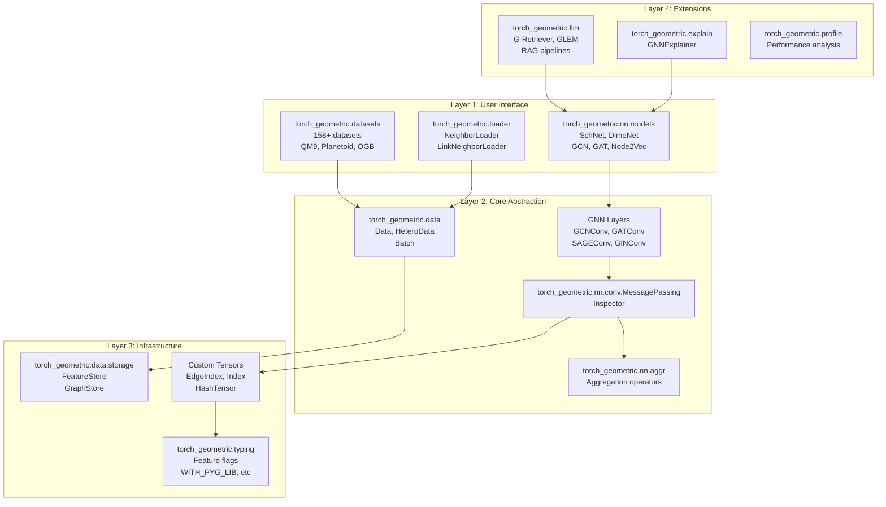

**Layer 1 (User Interface)**: High-level entry points including dataset classes in [torch_geometric/datasets/\_\_init\_\_.py:1-248](), data loaders, and ready-to-use model implementations. Users typically interact with PyG at this layer.

**Layer 2 (Core Abstraction)**: The `Data` and `HeteroData` classes for representing graphs, the `MessagePassing` base class that implements the message passing paradigm, and 50+ convolutional layers in [docs/source/modules/nn.rst:16-29]().

**Layer 3 (Infrastructure)**: Custom tensor types (`EdgeIndex`, `Index`, `HashTensor`) that extend PyTorch tensors with graph-specific metadata, the type system in [torch_geometric/typing.py:12-26]() for managing optional dependencies, and pluggable storage backends.

**Layer 4 (Extensions)**: Cutting-edge features including LLM integration in [CHANGELOG.md:64-64](), explainability methods, and profiling tools.

**Sources**: [README.md:148-161](), [torch_geometric/nn/__init__.py:1-33](), [torch_geometric/datasets/__init__.py:121-248](), [torch_geometric/typing.py:1-113]()

## Data Processing Pipeline

The following diagram illustrates how data flows from raw sources through PyG's processing pipeline to trained models:

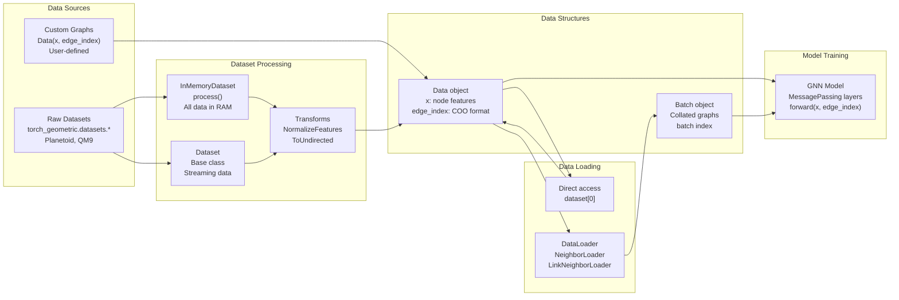

**Data Sources**: PyG provides 158+ datasets organized by domain: homogeneous graphs (social networks, citations), heterogeneous graphs (recommendation systems), hypergraphs, and synthetic datasets. See [torch_geometric/datasets/\_\_init\_\_.py:121-245]() for the complete list.

**Dataset Processing**: The `InMemoryDataset` class loads all data into memory, while the base `Dataset` class allows for streaming from disk. Both support `pre_transform` and `pre_filter` functions applied during the processing lifecycle.

**Data Loading**: Small graphs use direct indexing. Large graphs use `NeighborLoader` for neighbor sampling or `LinkNeighborLoader` for link prediction tasks, both producing mini-batches via the `Batch` collation mechanism.

**Data Structures**: `Data` objects store node features in `x`, graph connectivity in `edge_index` (COO format), and optional attributes. `Batch` objects combine multiple graphs by concatenating features and adjusting indices with a `batch` vector.

**Sources**: [README.md:58-113](), [torch_geometric/datasets/__init__.py:1-249](), [docs/source/index.rst:35-47]()

## MessagePassing Framework

The `MessagePassing` class is PyG's core abstraction for implementing GNN layers. All 50+ convolutional layers inherit from this base class:

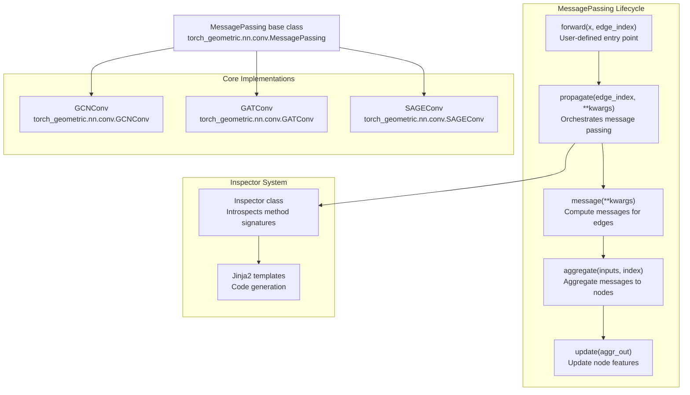

**Core Methods**: 
- `propagate()`: Main entry point that orchestrates the message passing flow.
- `message()`: Computes messages for each edge, accessing source (`_j`) and target (`_i`) node features.
- `aggregate()`: Combines messages arriving at each node (sum, mean, max, etc.) via [Aggregation System](#4.3) operators.
- `update()`: Final transformation of aggregated messages.

**Inspector and Code Generation**: The `Inspector` class uses Python introspection to automatically collect method arguments and generate optimized code via Jinja2 templates. This enables JIT compilation while maintaining a flexible Python interface.

**Concrete Implementations**: `GCNConv` implements graph convolutional networks, `GATConv` adds attention mechanisms, and `SAGEConv` provides GraphSAGE sampling-based aggregation.

**Sources**: [README.md:114-147](), [docs/source/modules/nn.rst:30-44](), [pyproject.toml:36-36]()

## Domain Applications and Models

PyG serves diverse research domains through specialized datasets and models:

| Domain | Datasets | Pre-built Models | Key Features |
|--------|----------|------------------|--------------|
| **Molecular ML** | `QM9`, `ZINC`, `MoleculeNet` | `SchNet`, `DimeNet`, `ProteinMPNN` | 3D coordinates, atomic numbers |
| **Social Networks** | `Reddit`, `Flickr`, `Facebook` | `Node2Vec`, `GraphSAGE` | Large-scale graphs, scalable loaders |
| **Citations** | `Planetoid` (Cora/Citeseer), `CoraFull` | `GCN`, `GAT`, `GATv2` | Node classification, homophily |
| **Knowledge Graphs** | `FB15k_237`, `WordNet18` | `RGCNConv`, `HGTConv` | Heterogeneous graphs, link prediction |
| **Point Clouds** | `ModelNet`, `ShapeNet`, `FAUST` | `PointNetConv`, `EdgeConv` | 3D geometric data, k-NN graphs |
| **Recommendations** | `MovieLens`, `AmazonBook` | `LightGCN`, `ARLinkPredictor` | Bipartite graphs, user-item interactions |

**Molecular Property Prediction**: Models like `SchNet` and `DimeNet` are designed for quantum chemistry, while `ProteinMPNN` targets structural biology.

**LLM Integration**: The `torch_geometric.llm` module provides tools for combining GNNs with Large Language Models, including RAG pipelines and models like `GRetriever`.

**Sources**: [torch_geometric/datasets/__init__.py:1-212](), [CHANGELOG.md:28-92](), [pyproject.toml:61-75]()

## Core Components Summary

### Data Structures
- **`Data`**: Homogeneous graphs with `x` (node features), `edge_index` (connectivity), and `y` (labels).
- **`HeteroData`**: Heterogeneous graphs with multiple node and edge types.
- **`Batch`**: Collated mini-batches with a `batch` index vector.
- **`EdgeIndex`**: Specialized tensor for graph connectivity with caching for CSR/CSC formats.

For details, see [Data Structures](#2).

### Neural Network Modules
- **`MessagePassing`**: Base class for all GNN layers implementing the message passing paradigm.
- **50+ Convolutional Layers**: `GCNConv`, `GATConv`, `SAGEConv`, `GINConv`, etc.
- **Aggregation Operators**: [Aggregation System](#4.3) base class for sum, mean, max, softmax, etc.
- **Pre-built Models**: `SchNet`, `Node2Vec`, `DeepGraphInfomax`, `TGN`.

For details, see [Message Passing Framework](#4) and [GNN Layers](#5).

### Data Loading
- **`Dataset`**: Abstract base class for datasets with `download()` and `process()` methods.
- **`DataLoader`**: PyTorch-compatible loader with graph-specific collation.
- **`NeighborLoader`**: Mini-batch sampling for large-scale graphs.

For details, see [Datasets](#3) and [Data Loading and Sampling](#3.3).

### Utilities and Extensions
- **Type System**: `torch_geometric.typing` with feature flags for `pyg-lib`, `torch-scatter`, etc.
- **Explainability**: `torch_geometric.explain` for interpreting GNN predictions.
- **Distributed**: Support for multi-GPU and multi-node training.

For details, see [Utilities](#8) and [Advanced Features](#7).

**Sources**: [torch_geometric/__init__.py:1-59](), [torch_geometric/typing.py:1-113](), [README.md:162-251]()

## Version and Compatibility

PyG 2.9.0 (latest) supports:
- **PyTorch**: 1.13 through 2.12+ (including support for `torch.compile`).
- **Python**: 3.10 through 3.14.
- **Optional Extensions**: `pyg-lib` (replaces `torch-cluster` and `torch-spline-conv`), `torch-scatter`, `torch-sparse`.
- **Device Support**: CPU, CUDA, MPS (Apple), XPU (Intel).

**Sources**: [CHANGELOG.md:30-48](), [torch_geometric/typing.py:12-26](), [torch_geometric/__init__.py:34-68]()

---

# Page: Installation and Setup

# Installation and Setup

<details>
<summary>Relevant source files</summary>

The following files were used as context for generating this wiki page:

- [.github/CONTRIBUTING.md](.github/CONTRIBUTING.md)
- [.github/actions/setup/action.yml](.github/actions/setup/action.yml)
- [CHANGELOG.md](CHANGELOG.md)
- [CITATION.cff](CITATION.cff)
- [README.md](README.md)
- [benchmark/citation/README.md](benchmark/citation/README.md)
- [benchmark/inference/README.md](benchmark/inference/README.md)
- [benchmark/kernel/README.md](benchmark/kernel/README.md)
- [benchmark/multi_gpu/training/README.md](benchmark/multi_gpu/training/README.md)
- [benchmark/points/README.md](benchmark/points/README.md)
- [benchmark/training/README.md](benchmark/training/README.md)
- [docker/Dockerfile](docker/Dockerfile)
- [docker/Dockerfile.xpu](docker/Dockerfile.xpu)
- [docker/README.md](docker/README.md)
- [docker/singularity](docker/singularity)
- [docs/README.md](docs/README.md)
- [docs/source/install/installation.rst](docs/source/install/installation.rst)
- [docs/source/install/quick-start.html](docs/source/install/quick-start.html)
- [docs/source/notes/installation.rst](docs/source/notes/installation.rst)
- [pyproject.toml](pyproject.toml)
- [torch_geometric/__init__.py](torch_geometric/__init__.py)
- [torch_geometric/datasets/__init__.py](torch_geometric/datasets/__init__.py)
- [torch_geometric/template.py](torch_geometric/template.py)
- [torch_geometric/typing.py](torch_geometric/typing.py)

</details>


This document covers the installation and configuration of PyTorch Geometric (PyG), including system requirements, dependency management, and setup of optional extension packages. PyG has evolved to offer a modular installation experience, where core functionality is decoupled from specialized hardware-accelerated kernels.

## Overview

PyG consists of a core library and several optional extension packages. Since **PyG 2.3**, the library can be used with only PyTorch as a dependency [docs/source/install/installation.rst:19-20](). However, for production-scale workloads and advanced features like heterogeneous GNN operators or specialized sampling, external libraries like `pyg-lib` are highly recommended.

## System Requirements

### Python and PyTorch Versions

PyG targets modern Python environments and aligns closely with the PyTorch release cycle.

| Component | Supported Versions |
|:---|:---|
| **Python** | 3.10 to 3.14 [docs/source/install/installation.rst:4](), [pyproject.toml:13]() |
| **PyTorch** | 1.13.0+ [torch_geometric/__init__.py:61-67](), [docs/source/install/installation.rst:48-53]() |
| **OS** | Linux, macOS, Windows [docs/source/install/quick-start.html:84-88]() |

**Sources**: [docs/source/install/installation.rst:4](), [pyproject.toml:13](), [torch_geometric/__init__.py:61-67]()

### Version Detection Architecture

The library uses `torch_geometric.typing` to dynamically detect the environment capabilities at import time. It sets several internal flags based on the installed PyTorch version.

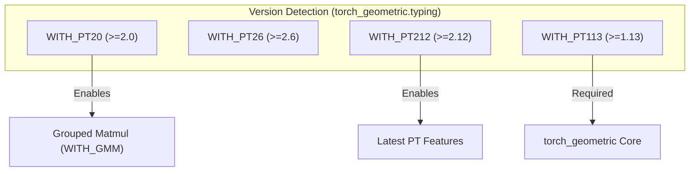

**Sources**: [torch_geometric/typing.py:12-25]()

## Installation Methods

### 1. Minimal Installation (CPU/GPU)
For users who do not require specialized sparse kernels or advanced sampling:
```bash
pip install torch_geometric
```
**Sources**: [docs/source/install/installation.rst:24]()

### 2. Full Installation with Extension Packages
To unlock the full performance of PyG, especially for large-scale or heterogeneous graphs, install the following extension packages from the official PyG wheels.

```bash
# Example for PyTorch 2.12.0 and CUDA 13.2
pip install pyg_lib torch_scatter torch_sparse -f https://data.pyg.org/whl/torch-2.12.0+cu132.html
```

**Sources**: [docs/source/install/installation.rst:85-89](), [.github/actions/setup/action.yml:103-110]()

### Extension Package Roles

| Package | Role | Key Functionality |
|:---|:---|:---|
| `pyg-lib` | High-performance Kernels | Heterogeneous operators, graph sampling, clustering, `SplineConv` [docs/source/install/installation.rst:31]() |
| `torch-scatter` | Sparse Reductions | Accelerated and efficient scatter operations [docs/source/install/installation.rst:32]() |
| `torch-sparse` | Sparse Tensors | `SparseTensor` support and sparse-sparse/sparse-dense matrix multiplication [docs/source/install/installation.rst:33]() |

> **Note**: `torch-cluster` and `torch-spline-conv` are deprecated and their functionality has been migrated to `pyg-lib>=0.6.0` [CHANGELOG.md:41-42](), [torch_geometric/typing.py:149-163]().

## Dependency Management

PyG categorizes its dependencies to allow for lean installations while supporting advanced use cases via optional extras.

### Core Dependencies
These are automatically installed with `torch-geometric`:
- `aiohttp`, `fsspec`, `requests`: For remote data loading [pyproject.toml:34-40]()
- `jinja2`: For the `MessagePassing` code generation engine [pyproject.toml:36]()
- `numpy`, `psutil`, `tqdm`, `xxhash`: General utilities [pyproject.toml:37-42]()

### Optional Extras
Install these using `pip install torch_geometric[<extra>]`:
- `full`: Includes `scipy`, `scikit-learn`, `ase`, `captum`, `networkx`, `pandas`, `rdkit`, etc. [pyproject.toml:89-114]()
- `rag`: Dependencies for Graph-based Retrieval Augmented Generation (`faiss-cpu`, `transformers`, `openai`) [pyproject.toml:61-75]()
- `graphgym`: For the GraphGym experiment platform [pyproject.toml:46-50]()

**Sources**: [pyproject.toml:33-114]()

## Environment Setup and Hardware Support

### Docker Support
For containerized environments, PyG provides a Dockerfile based on NVIDIA's CUDA images. It includes pre-installed `cugraph` for RAPIDS integration.
```dockerfile
# Snippet from Dockerfile
RUN pip install torch_geometric==2.6.0
RUN pip install cugraph-cu12 cugraph-pyg-cu12 --extra-index-url=https://pypi.nvidia.com
```
**Sources**: [docker/Dockerfile:17-21]()

### Feature Detection and Fallbacks
The `torch_geometric.typing` module acts as the system's "Feature Manager". It checks for the presence of extension packages and provides fallback implementations (stubs) that raise informative errors if a missing feature is accessed.

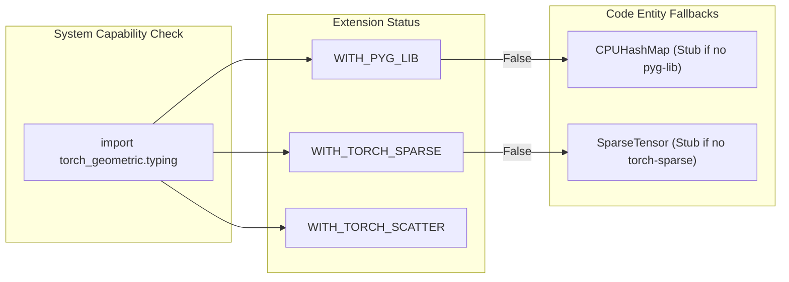

**Sources**: [torch_geometric/typing.py:46-112](), [torch_geometric/typing.py:165-189]()

### Extension Specific Flags
- `WITH_GMM`: Set if `pyg_lib.ops.grouped_matmul` is available [torch_geometric/typing.py:48]().
- `WITH_METIS`: Set if `pyg_lib.partition` is available for graph clustering [torch_geometric/typing.py:74]().
- `WITH_CUDA_HASH_MAP`: Set if `torch.classes.pyg.CUDAHashMap` is registered [torch_geometric/typing.py:86]().

## Summary of Installation Steps

```mermaid
sequenceDiagram
    participant User
    participant System
    participant PyPI
    participant PyG_WHL as data.pyg.org
    
    User->>System: pip install torch
    System->>User: Verify PT version >= 1.13.0
    User->>PyPI: pip install torch_geometric
    Note over User, PyPI: Core Library Installed
    
    opt Advanced Features
        User->>System: python -c "import torch; print(torch.version.cuda)"
        System->>User: Returns CUDA version (e.g., 12.8)
        User->>PyG_WHL: pip install pyg_lib -f https://data.pyg.org/whl/torch-2.10.0+cu128.html
    end
```

**Sources**: [docs/source/install/installation.rst:43-96](), [torch_geometric/typing.py:1-25]()

---

# Page: Architecture and Key Concepts

# Architecture and Key Concepts

<details>
<summary>Relevant source files</summary>

The following files were used as context for generating this wiki page:

- [.github/CONTRIBUTING.md](.github/CONTRIBUTING.md)
- [.github/actions/setup/action.yml](.github/actions/setup/action.yml)
- [CHANGELOG.md](CHANGELOG.md)
- [CITATION.cff](CITATION.cff)
- [README.md](README.md)
- [docker/Dockerfile.xpu](docker/Dockerfile.xpu)
- [docs/source/advanced/batching.rst](docs/source/advanced/batching.rst)
- [docs/source/advanced/graphgym.rst](docs/source/advanced/graphgym.rst)
- [docs/source/advanced/remote.rst](docs/source/advanced/remote.rst)
- [docs/source/advanced/sparse_tensor.rst](docs/source/advanced/sparse_tensor.rst)
- [docs/source/external/resources.rst](docs/source/external/resources.rst)
- [docs/source/get_started/colabs.rst](docs/source/get_started/colabs.rst)
- [docs/source/get_started/introduction.rst](docs/source/get_started/introduction.rst)
- [docs/source/install/installation.rst](docs/source/install/installation.rst)
- [docs/source/install/quick-start.html](docs/source/install/quick-start.html)
- [docs/source/notes/create_dataset.rst](docs/source/notes/create_dataset.rst)
- [docs/source/notes/create_gnn.rst](docs/source/notes/create_gnn.rst)
- [docs/source/notes/graphgym.rst](docs/source/notes/graphgym.rst)
- [docs/source/notes/installation.rst](docs/source/notes/installation.rst)
- [docs/source/notes/introduction.rst](docs/source/notes/introduction.rst)
- [docs/source/notes/jit.rst](docs/source/notes/jit.rst)
- [docs/source/notes/load_csv.rst](docs/source/notes/load_csv.rst)
- [docs/source/notes/sparse_tensor.rst](docs/source/notes/sparse_tensor.rst)
- [docs/source/tutorial/create_dataset.rst](docs/source/tutorial/create_dataset.rst)
- [docs/source/tutorial/explain.rst](docs/source/tutorial/explain.rst)
- [docs/source/tutorial/heterogeneous.rst](docs/source/tutorial/heterogeneous.rst)
- [docs/source/tutorial/load_csv.rst](docs/source/tutorial/load_csv.rst)
- [examples/ogbn_proteins_deepgcn.py](examples/ogbn_proteins_deepgcn.py)
- [pyproject.toml](pyproject.toml)
- [test/nn/conv/test_create_gnn.py](test/nn/conv/test_create_gnn.py)
- [torch_geometric/__init__.py](torch_geometric/__init__.py)
- [torch_geometric/datasets/__init__.py](torch_geometric/datasets/__init__.py)
- [torch_geometric/typing.py](torch_geometric/typing.py)

</details>


## Purpose and Scope

This page explains PyTorch Geometric's architectural design, the message passing paradigm that underlies all GNN operations, and core concepts like graph representation, data structures, and tensor operations. Reference is made to the four-layer Engine/Storage/Operators/Models stack which balances ease of use with extensibility and performance.

## Four-Layer Architecture

PyG follows a modular architectural design that separates high-level user interfaces from low-level infrastructure and extensions.

### Architecture Overview

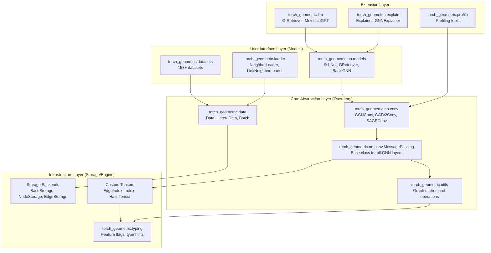
**Sources:** [README.md:14-19](), [README.md:38-39](), [torch_geometric/__init__.py:17-26]()

### Layer Responsibilities

| Layer | Primary Modules | Purpose |
|-------|----------------|---------|
| **Models (UI)** | `torch_geometric.datasets`, `torch_geometric.loader`, `torch_geometric.nn.models` | High-level entry points for 158+ datasets, data loading, and pre-built models like `SchNet` or `DimeNet`. [torch_geometric/datasets/__init__.py:1-119](), [README.md:16-19]() |
| **Operators** | `torch_geometric.data`, `torch_geometric.nn.conv.MessagePassing`, `torch_geometric.nn.conv.*` | Fundamental abstractions: data structures, the `MessagePassing` framework, and 50+ GNN layer implementations. [torch_geometric/nn/conv/test_create_gnn.py:1-20](), [README.md:125-146]() |
| **Storage** | `torch_geometric.data.storage`, `EdgeIndex`, `Index`, `HashTensor` | Specialized tensor types with metadata and caching mechanisms (CSR/CSC). [torch_geometric/__init__.py:8-10](), [torch_geometric/typing.py:166-189]() |
| **Engine (Infrastructure)** | `torch_geometric.typing`, `torch_geometric._compile` | Type system, feature detection for optional packages (`pyg-lib`, `torch-scatter`), and `torch.compile` integration. [torch_geometric/typing.py:1-113](), [torch_geometric/__init__.py:6-7]() |

**Sources:** [README.md:148-160](), [torch_geometric/__init__.py:1-34]()

## Graph Representation

### Edge Index in COO Format

PyG represents graph connectivity using the **Coordinate (COO) format**, where edges are stored as a 2D tensor of shape `[2, num_edges]`. 

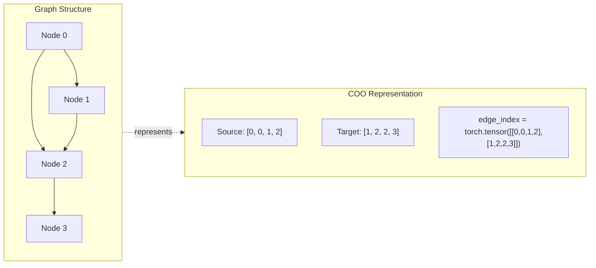
**Sources:** [README.md:81-86](), [README.md:136-145]()

### Specialized Tensor Types

PyG introduces custom tensor types to optimize graph operations and provide metadata tracking.

*   **`EdgeIndex`**: Extends `torch.Tensor` to store graph connectivity. It supports metadata like `num_rows`, `num_cols`, and `sort_order`. It automatically caches **CSR** (Compressed Sparse Row) and **CSC** (Compressed Sparse Column) representations to accelerate message passing. [torch_geometric/__init__.py:9](), [torch_geometric/__init__.py:78-80]()
*   **`Index`**: A 1D tensor subclass for indexing that tracks metadata like `is_sorted` and `max_value`. [torch_geometric/__init__.py:8](), [torch_geometric/__init__.py:76-77]()
*   **`HashTensor`**: Enables arbitrary-key indexing, utilizing GPU-accelerated hash maps if `pyg-lib` is available. [torch_geometric/__init__.py:10](), [torch_geometric/typing.py:80-88](), [torch_geometric/typing.py:114-137]()

## The MessagePassing Paradigm

The `MessagePassing` base class is the foundation of all GNN layers in PyG. It implements the paradigm through a sequence of `propagate`, `message`, `aggregate`, and `update` operations.

### MessagePassing Lifecycle

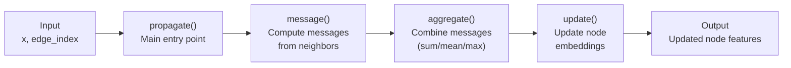
**Sources:** [README.md:125-146](), [docs/source/notes/create_gnn.rst:1-4]()

### Implementing Custom GNN Layers

To create a custom layer, users inherit from `MessagePassing` and define the message-level logic. The library uses an internal `Inspector` to introspect method signatures and determine which arguments to pass during the `propagate` call. [README.md:114-146](), [torch_geometric/nn/conv/test_create_gnn.py:1-20]()

## Data Structures

### Data and HeteroData

PyG provides unified containers for graph data:
*   **`Data`**: For homogeneous graphs. Contains attributes like `x` (node features), `edge_index` (connectivity), and `y` (labels). [README.md:65-89](), [torch_geometric/__init__.py:18]()
*   **`HeteroData`**: For heterogeneous graphs with multiple node and edge types. It stores data in a dictionary-like structure, e.g., `data['paper'].x` or `data['author', 'writes', 'paper'].edge_index`. [CHANGELOG.md:28](), [torch_geometric/__init__.py:18]()

### Batching

The `Batch` class facilitates mini-batching by combining multiple small graphs into a single large disjoint graph. This is achieved by concatenating node features and shifting edge indices appropriately. [torch_geometric/__init__.py:18](), [README.md:26]()

## Type System and Feature Detection

The `torch_geometric.typing` module provides runtime detection of optional dependencies and PyTorch version compatibility.

| Feature Flag | Dependency | Description |
|--------------|------------|-------------|
| `WITH_PYG_LIB` | `pyg-lib` | Enables optimized sampling, clustering, and heterogeneous operators. [torch_geometric/typing.py:46-47]() |
| `WITH_TORCH_SCATTER` | `torch-scatter` | Enables accelerated sparse reductions. [torch_geometric/typing.py:139-140]() |
| `WITH_TORCH_SPARSE` | `torch-sparse` | Provides `SparseTensor` support. [torch_geometric/typing.py:166-168]() |
| `WITH_PT212` | PyTorch >= 2.12 | Tracks PyTorch version for feature enablement. [torch_geometric/typing.py:24]() |

**Sources:** [torch_geometric/typing.py:1-113](), [torch_geometric/__init__.py:61-67]()

## Architecture Flow: Code Entity Mapping

The following diagram bridges high-level concepts to specific code entities within the repository.

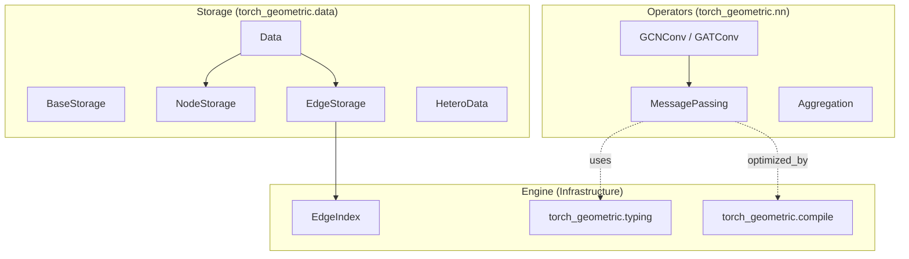
**Sources:** [torch_geometric/__init__.py:6-26](), [torch_geometric/typing.py:166-189](), [README.md:148-160]()

## Component Interaction Flow

### Training Pipeline

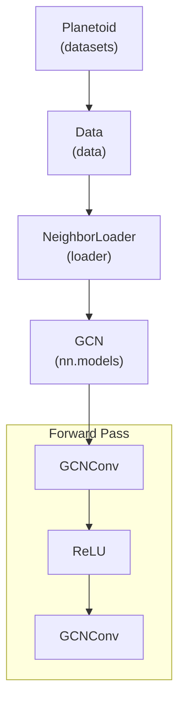
**Sources:** [README.md:65-108](), [torch_geometric/datasets/__init__.py:6]()

---

# Page: Data Structures

# Data Structures

<details>
<summary>Relevant source files</summary>

The following files were used as context for generating this wiki page:

- [test/data/test_batch.py](test/data/test_batch.py)
- [test/data/test_data.py](test/data/test_data.py)
- [test/data/test_dataset.py](test/data/test_dataset.py)
- [test/data/test_feature_store.py](test/data/test_feature_store.py)
- [test/data/test_graph_store.py](test/data/test_graph_store.py)
- [test/data/test_hetero_data.py](test/data/test_hetero_data.py)
- [test/data/test_storage.py](test/data/test_storage.py)
- [test/loader/test_dataloader.py](test/loader/test_dataloader.py)
- [test/test_edge_index.py](test/test_edge_index.py)
- [test/test_hash_tensor.py](test/test_hash_tensor.py)
- [test/test_index.py](test/test_index.py)
- [torch_geometric/data/batch.py](torch_geometric/data/batch.py)
- [torch_geometric/data/collate.py](torch_geometric/data/collate.py)
- [torch_geometric/data/data.py](torch_geometric/data/data.py)
- [torch_geometric/data/dataset.py](torch_geometric/data/dataset.py)
- [torch_geometric/data/feature_store.py](torch_geometric/data/feature_store.py)
- [torch_geometric/data/graph_store.py](torch_geometric/data/graph_store.py)
- [torch_geometric/data/hetero_data.py](torch_geometric/data/hetero_data.py)
- [torch_geometric/data/in_memory_dataset.py](torch_geometric/data/in_memory_dataset.py)
- [torch_geometric/data/separate.py](torch_geometric/data/separate.py)
- [torch_geometric/data/storage.py](torch_geometric/data/storage.py)
- [torch_geometric/edge_index.py](torch_geometric/edge_index.py)
- [torch_geometric/hash_tensor.py](torch_geometric/hash_tensor.py)
- [torch_geometric/index.py](torch_geometric/index.py)
- [torch_geometric/testing/__init__.py](torch_geometric/testing/__init__.py)
- [torch_geometric/testing/decorators.py](torch_geometric/testing/decorators.py)

</details>


## Purpose and Scope

This document describes PyTorch Geometric's core data structures for representing graphs and their attributes. These structures form the foundation of the library's data handling capabilities, providing flexible containers for homogeneous graphs (`Data`), heterogeneous graphs (`HeteroData`), and mini-batches (`Batch`). The document covers the storage architecture, attribute classification system, batching mechanisms, and serialization formats.

For information about custom tensor types (`EdgeIndex`, `Index`, `HashTensor`), see [Custom Tensor Types](#2.2). For dataset classes and loading pipelines, see [Dataset Classes and Processing](#3.2). For data loading and sampling, see [Data Loading and Sampling](#3.3).

## Overview of Data Structure Hierarchy

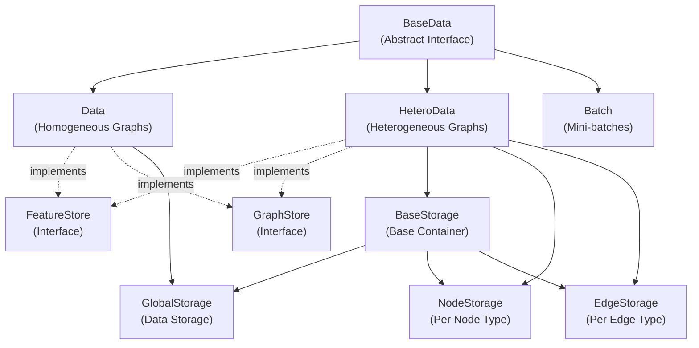

**Class Hierarchy:** PyTorch Geometric's data structures follow a two-level design. At the top level, `BaseData` defines the common interface for all graph containers. Concrete implementations (`Data`, `HeteroData`) implement the `FeatureStore` and `GraphStore` interfaces for tensor attribute management. At the storage level, `BaseStorage` provides dictionary-like containers specialized for node, edge, and global attributes.

Sources: [torch_geometric/data/data.py:48-442](), [torch_geometric/data/hetero_data.py:43-118](), [torch_geometric/data/storage.py:54-396]()

## Data Class (Homogeneous Graphs)

The `Data` class represents homogeneous graphs where all nodes and edges share the same types. It uses a single `GlobalStorage` instance to store all attributes.

### Architecture

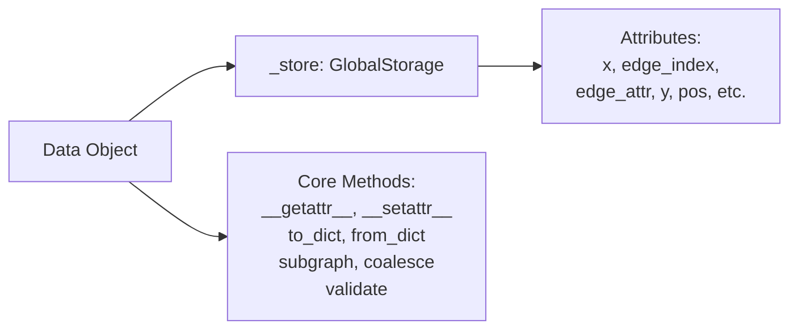

**Key Components:**
- **`_store: GlobalStorage`** - Single storage backend at [torch_geometric/data/data.py:537]()
- **Attribute Access** - Transparent property-style access via `__getattr__` at [torch_geometric/data/data.py:555-562]()
- **Dictionary Protocol** - Implements `__getitem__`, `__setitem__`, `__delitem__` at [torch_geometric/data/data.py:577-585]()

### Standard Attributes

| Attribute | Type | Shape | Description |
|-----------|------|-------|-------------|
| `x` | `Tensor` | `[num_nodes, num_features]` | Node feature matrix |
| `edge_index` | `Tensor` or `EdgeIndex` | `[2, num_edges]` | Graph connectivity in COO format |
| `edge_attr` | `Tensor` | `[num_edges, num_edge_features]` | Edge feature matrix |
| `y` | `Tensor` or scalar | Varies | Ground-truth labels (node/graph level) |
| `pos` | `Tensor` | `[num_nodes, num_dimensions]` | Node position matrix |
| `time` | `Tensor` | `[num_edges]` or `[num_nodes]` | Timestamps for temporal graphs |

Sources: [torch_geometric/data/data.py:472-518]()

### Example Usage

```python
from torch_geometric.data import Data
import torch

# Create a simple graph
data = Data(
    x=torch.randn(3, 16),                    # 3 nodes, 16 features each
    edge_index=torch.tensor([[0, 1, 1, 2],   # Source nodes
                             [1, 0, 2, 1]]),  # Target nodes
    y=torch.tensor([0]),                      # Graph label
)

# Access attributes
print(data.num_nodes)      # 3
print(data.num_edges)      # 4
print(data.is_directed())  # False (has reciprocal edges)
```

Sources: [test/data/test_data.py:13-148]()

### Attribute Classification

The `Data` class automatically classifies attributes as node-level, edge-level, or other:

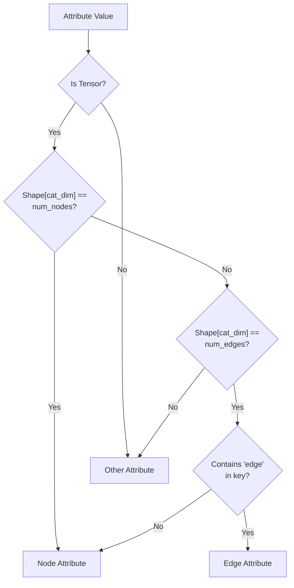

**Classification Logic:** Implemented in `GlobalStorage.is_node_attr()` at [torch_geometric/data/storage.py:783-831]() and `GlobalStorage.is_edge_attr()` at [torch_geometric/data/storage.py:833-881](). Results are cached in `_cached_attr` dictionary using `AttrType` enum.

Sources: [torch_geometric/data/storage.py:48-51](), [torch_geometric/data/storage.py:783-881]()

### Operations

**Subgraph Extraction:** The `subgraph()` method at [torch_geometric/data/data.py:724-764]() extracts induced subgraphs:

```python
# Extract nodes [1, 2, 3]
subset = torch.tensor([1, 2, 3])
subdata = data.subgraph(subset)
# Relabels nodes 1->0, 2->1, 3->2 and filters edges
```

**Coalescing:** The `coalesce()` method at [torch_geometric/data/data.py:271-278]() removes duplicate edges and sorts `edge_index`.

**Validation:** The `validate()` method at [torch_geometric/data/data.py:673-707]() checks:
- `edge_index` has shape `[2, num_edges]`
- All indices are non-negative
- All indices are within `[0, num_nodes)`

Sources: [torch_geometric/data/data.py:724-764](), [torch_geometric/data/data.py:271-278](), [torch_geometric/data/data.py:673-707]()

## HeteroData Class (Heterogeneous Graphs)

The `HeteroData` class represents heterogeneous graphs with multiple node and edge types. It maintains separate `NodeStorage` and `EdgeStorage` instances for each type.

### Architecture

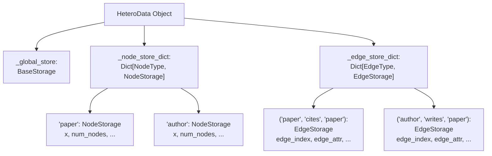

**Storage Organization:** Each node type gets a `NodeStorage` instance (key is `str`), and each edge type gets an `EdgeStorage` instance (key is `(src, rel, dst)` tuple). Global attributes are stored in `_global_store`.

Sources: [torch_geometric/data/hetero_data.py:119-134]()

### Accessing Types

```python
from torch_geometric.data import HeteroData

data = HeteroData()

# Node-level data
data['paper'].x = torch.randn(100, 128)
data['author'].x = torch.randn(50, 64)

# Edge-level data
data['author', 'writes', 'paper'].edge_index = torch.randint(0, 50, (2, 200))
data['paper', 'cites', 'paper'].edge_index = torch.randint(0, 100, (2, 500))

# Access metadata
print(data.node_types)    # ['paper', 'author']
print(data.edge_types)    # [('author', 'writes', 'paper'), ('paper', 'cites', 'paper')]
```

**Indexing Syntax:** The `__getitem__` method at [torch_geometric/data/hetero_data.py:176-190]() handles three access patterns:
1. Single string: returns `NodeStorage` for that node type
2. Tuple of 3 strings: returns `EdgeStorage` for that edge type  
3. Any other key: returns global attribute

Sources: [torch_geometric/data/hetero_data.py:176-190](), [torch_geometric/data/hetero_data.py:258-283]()

### Edge Type Canonicalization

Edge types can be specified in multiple ways and are canonicalized to `(src, rel, dst)` tuples:

```python
# All equivalent:
data['author', 'writes', 'paper']
data[('author', 'writes', 'paper')]
data['author', 'paper']  # Uses default relation 'to'
```

The `_to_canonical()` method at [torch_geometric/data/hetero_data.py:656-695]() handles this conversion using `DEFAULT_REL = 'to'`.

Sources: [torch_geometric/data/hetero_data.py:656-695](), [torch_geometric/typing:18-19]()

### Heterogeneous Operations

**Subgraph Extraction:** The `subgraph()` method at [torch_geometric/data/hetero_data.py:698-793]() accepts a dictionary mapping node types to subsets:

```python
subset = {
    'paper': torch.tensor([0, 5, 10]),
    'author': torch.tensor([2, 8])
}
subdata = data.subgraph(subset)
```

**Node/Edge Type Filtering:**
- `node_type_subgraph()` at [torch_geometric/data/hetero_data.py:795-812]() - Keep specific node types
- `edge_type_subgraph()` at [torch_geometric/data/hetero_data.py:814-865]() - Keep specific edge types

Sources: [torch_geometric/data/hetero_data.py:698-865]()

## Storage Architecture

### BaseStorage Class

`BaseStorage` at [torch_geometric/data/storage.py:54-396]() provides a dictionary-like container with additional PyTorch tensor operations.

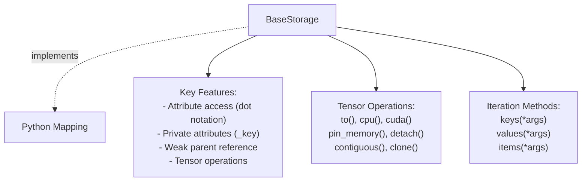

**Key Features:**

1. **Attribute Access:** At [torch_geometric/data/storage.py:89-109](), allows `storage.x` in addition to `storage['x']`
2. **Private Attributes:** Keys starting with `_` are stored in `__dict__` instead of `_mapping`
3. **Parent Reference:** Weak reference to parent `Data`/`HeteroData` object at [torch_geometric/data/storage.py:104-105]()
4. **Filtered Iteration:** Can iterate over subset of keys: `storage.values('x', 'edge_index')`

Sources: [torch_geometric/data/storage.py:54-203]()

### NodeStorage and EdgeStorage

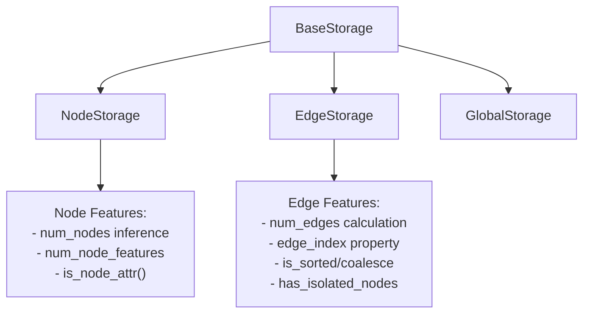

**NodeStorage** at [torch_geometric/data/storage.py:397-531]():
- **`num_nodes` Property:** Infers from `x`, `pos`, `batch`, or `edge_index` at [torch_geometric/data/storage.py:421-466]()
- **`can_infer_num_nodes`:** Checks if inference is possible at [torch_geometric/data/storage.py:407-418]()
- **Attribute Classification:** Uses heuristics based on tensor shape and key names

**EdgeStorage** at [torch_geometric/data/storage.py:533-757]():
- **`edge_index` Property:** Extracts from `edge_index`, `adj`, or `adj_t` at [torch_geometric/data/storage.py:558-567]()
- **Graph Operations:** `is_sorted()`, `sort()`, `is_coalesced()`, `coalesce()` at [torch_geometric/data/storage.py:677-724]()
- **Bipartite Support:** Handles edges between different node types via `is_bipartite()` at [torch_geometric/data/storage.py:755-756]()

Sources: [torch_geometric/data/storage.py:397-757]()

### GlobalStorage

`GlobalStorage` at [torch_geometric/data/storage.py:759-882]() combines both `NodeStorage` and `EdgeStorage` capabilities for homogeneous graphs:

```python
# Disambiguation when num_nodes == num_edges
# - Prefers node classification if 'edge' not in key
# - Uses cached results to avoid re-computation
```

The classification logic at [torch_geometric/data/storage.py:783-881]() handles ambiguous cases by checking key names and caching decisions.

Sources: [torch_geometric/data/storage.py:759-882]()

## Batching System

### Batch Class

The `Batch` class at [torch_geometric/data/batch.py:57-218]() dynamically inherits from either `Data` or `HeteroData` via metaclass magic.

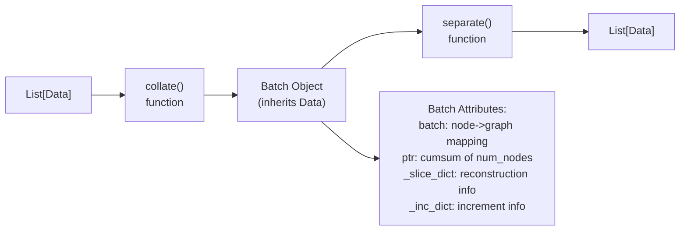

**Dynamic Inheritance:** The `DynamicInheritance` metaclass at [torch_geometric/data/batch.py:16-49]() creates new classes like `DataBatch` or `HeteroDataBatch` on-the-fly based on the base class of input data.

Sources: [torch_geometric/data/batch.py:16-49](), [torch_geometric/data/batch.py:57-81]()

### Collate Pipeline

The `collate()` function at [torch_geometric/data/collate.py:37-146]() merges multiple graphs into a single disconnected graph:

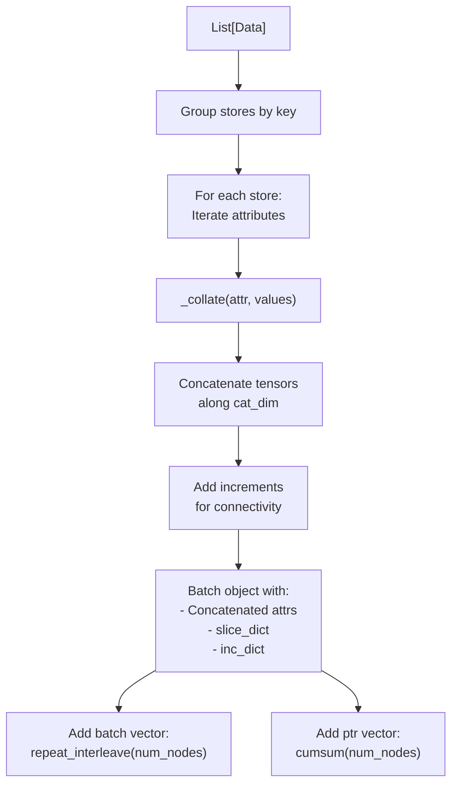

**Key Steps:**

1. **Grouping:** Organize stores by `_key` (node type or edge type) at [torch_geometric/data/collate.py:68-71]()
2. **Concatenation:** Call `_collate()` at [torch_geometric/data/collate.py:149-247]() for each attribute
3. **Incrementation:** Add cumulative sums to connectivity attributes at [torch_geometric/data/collate.py:168-174]()
4. **Batch Vector:** Create `batch` mapping nodes to graph IDs at [torch_geometric/data/collate.py:140-144]()
5. **Slice Dictionary:** Store reconstruction information at [torch_geometric/data/collate.py:85-131]()

Sources: [torch_geometric/data/collate.py:37-146]()

### Increment Calculation

The `get_incs()` function at [torch_geometric/data/collate.py:250-281]() calculates how much to increment each attribute:

```python
# For edge_index, increment by cumulative number of nodes
incs = cumsum(torch.tensor([0, num_nodes[0], num_nodes[1], ...]))

# For edge attributes with 'index' in name
incs = cumsum(num_nodes)
```

The `__inc__()` method is called on each data object to determine increments at [torch_geometric/data/data.py:657-671]() and [torch_geometric/data/hetero_data.py:361-371]().

Sources: [torch_geometric/data/collate.py:250-281](), [torch_geometric/data/data.py:657-671]()

### Separate Pipeline

The `separate()` function at [torch_geometric/data/separate.py:15-56]() extracts individual graphs from batches:

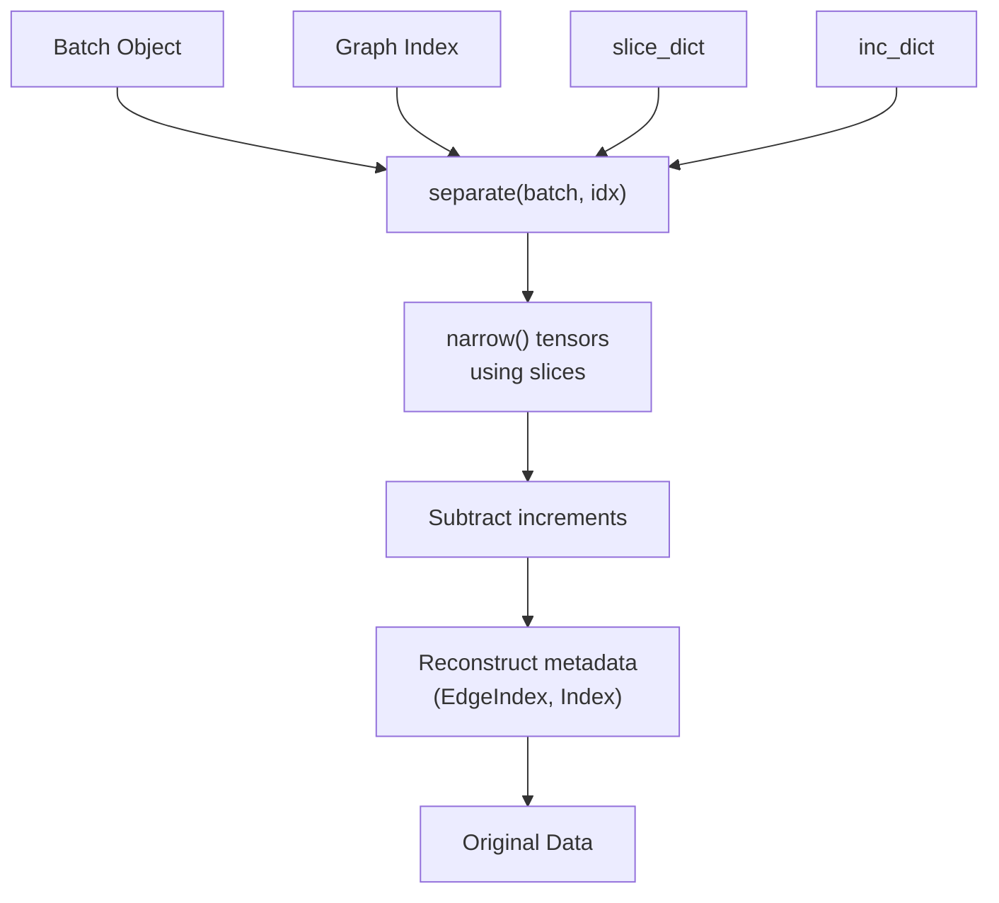

**Reconstruction Steps:**

1. **Narrowing:** Use `narrow()` to extract tensor slices at [torch_geometric/data/separate.py:70-77]()
2. **Decrementing:** Subtract increments to restore original indices at [torch_geometric/data/separate.py:90-93]()
3. **Metadata Restoration:** Restore `EdgeIndex` and `Index` metadata at [torch_geometric/data/separate.py:79-88]()

Sources: [torch_geometric/data/separate.py:15-156]()

### Example Batching

```python
from torch_geometric.data import Data, Batch

data1 = Data(x=torch.ones(3, 8), edge_index=torch.tensor([[0, 1], [1, 2]]))
data2 = Data(x=torch.ones(2, 8), edge_index=torch.tensor([[0, 1], [1, 0]]))

batch = Batch.from_data_list([data1, data2])

# batch.x: [5, 8] tensor (concatenated)
# batch.edge_index: [2, 4] tensor with incremented indices
#   [[0, 1, 3, 4], [1, 2, 4, 3]]
# batch.batch: [0, 0, 0, 1, 1] (node->graph mapping)
# batch.ptr: [0, 3, 5] (cumulative node counts)

# Extract original graphs
data1_reconstructed = batch[0]
data2_reconstructed = batch[1]
```

Sources: [test/data/test_batch.py:15-109]()

## Concatenation and Incrementation Rules

### `__cat_dim__()` Method

The `__cat_dim__()` method determines the dimension along which attributes are concatenated:

| Attribute Pattern | `cat_dim` | Explanation |
|-------------------|-----------|-------------|
| `edge_index`, `adj` | `(0, 1)` | Sparse tensors concatenated diagonally |
| Contains `'index'` or `'face'` | `-1` | Increment along last dimension |
| Other tensors | `0` | Concatenate along first dimension |

Implementation at [torch_geometric/data/data.py:649-655]() for `Data` and [torch_geometric/data/hetero_data.py:352-359]() for `HeteroData`.

Sources: [torch_geometric/data/data.py:649-655](), [torch_geometric/data/hetero_data.py:352-359]()

### `__inc__()` Method

The `__inc__()` method determines how much to increment attributes:

| Attribute Pattern | Increment | Explanation |
|-------------------|-----------|-------------|
| Contains `'batch'` | `max(value) + 1` or `dim_size` | Increment batch IDs |
| Contains `'index'` or `'face'` | `num_nodes` | Increment node indices |
| Other | `0` | No increment |

Implementation at [torch_geometric/data/data.py:657-671]() for `Data` and [torch_geometric/data/hetero_data.py:361-371]() for `HeteroData`.

Sources: [torch_geometric/data/data.py:657-671](), [torch_geometric/data/hetero_data.py:361-371]()

## Serialization and Persistence

### Dictionary Conversion

```mermaid
graph LR
    Data["Data/HeteroData"]
    Dict["Python Dictionary"]
    
    Data -->|"to_dict()"| Dict
    Dict -->|"from_dict()"| Data
    
    NamedTuple["NamedTuple"]
    Data -->|"to_namedtuple()"| NamedTuple
```

**`to_dict()` Method:**
- For `Data`: Returns `_store.to_dict()` at [torch_geometric/data/data.py:638-639]()
- For `HeteroData`: Returns nested dictionary with `_global_store` and per-type stores at [torch_geometric/data/hetero_data.py:300-306]()

**`from_dict()` Class Method:**
- Reconstructs object from dictionary at [torch_geometric/data/data.py:965-969]() and [torch_geometric/data/hetero_data.py:136-151]()

Sources: [torch_geometric/data/data.py:638-639](), [torch_geometric/data/data.py:965-969](), [torch_geometric/data/hetero_data.py:136-151](), [torch_geometric/data/hetero_data.py:300-306]()

### InMemoryDataset Storage

The `InMemoryDataset` class at [torch_geometric/data/in_memory_dataset.py:32-344]() provides efficient storage for datasets that fit in memory:

```mermaid
graph TD
    DataList["List[Data]"]
    Collate["InMemoryDataset.collate()"]
    Storage["data: single Data object<br/>slices: Dict[str, Tensor]"]
    Save["torch.save()<br/>(data.to_dict(), slices, data_cls)"]
    
    DataList --> Collate
    Collate --> Storage
    Storage --> Save
    
    Load["torch.load()"]
    Get["dataset.get(idx)<br/>uses separate()"]
    SingleData["Individual Data"]
    
    Save --> Load
    Load --> Get
    Get --> SingleData
```

**Storage Format:**
1. **Collation:** All graphs merged into single `Data` object via `collate()` at [torch_geometric/data/in_memory_dataset.py:145-162]()
2. **Slices:** Dictionary storing slice indices for each attribute at [torch_geometric/data/in_memory_dataset.py:85]()
3. **Reconstruction:** Use `separate()` to extract individual graphs at [torch_geometric/data/in_memory_dataset.py:101-121]()

**File Format:** Tuple of `(data.to_dict(), slices, data_cls)` saved via `torch.save()` at [torch_geometric/data/in_memory_dataset.py:127]().

Sources: [torch_geometric/data/in_memory_dataset.py:32-344](), [torch_geometric/data/in_memory_dataset.py:124-162]()

## Device Management and Memory Operations

### Device Conversion

All data structures support standard PyTorch device operations:

```python
data = Data(x=torch.randn(10, 16), edge_index=torch.randint(0, 10, (2, 20)))

# Move to GPU
data = data.to('cuda:0')
data = data.cuda()

# Move to CPU
data = data.cpu()

# Pin memory for faster GPU transfer
data = data.pin_memory()
```

Implementation via `apply()` method at [torch_geometric/data/storage.py:196-202]() which recursively applies functions to all tensor attributes.

Sources: [torch_geometric/data/data.py:358-386](), [torch_geometric/data/storage.py:236-303]()

### Copy Semantics

```mermaid
graph LR
    Original["Original Data"]
    Shallow["Shallow Copy<br/>(copy.copy)"]
    Deep["Deep Copy<br/>(copy.deepcopy)"]
    Clone["Clone<br/>(data.clone)"]
    
    Original --> Shallow
    Original --> Deep
    Original --> Clone
    
    ShallowNote["Shares tensor storage<br/>Copies structure"]
    DeepNote["New tensor storage<br/>Copies all data"]
    CloneNote["Calls .clone() on tensors<br/>Detaches from graph"]
    
    Shallow -.-> ShallowNote
    Deep -.-> DeepNote
    Clone -.-> CloneNote
```

**Copy Operations:**

1. **Shallow Copy:** `copy.copy(data)` at [torch_geometric/data/data.py:587-593]() - Copies structure but shares tensor storage
2. **Deep Copy:** `copy.deepcopy(data)` at [torch_geometric/data/data.py:595-600]() - Creates new tensor storage
3. **Clone:** `data.clone()` at [torch_geometric/data/data.py:346-350]() - Calls `.clone()` on all tensors

Sources: [torch_geometric/data/data.py:587-600](), [torch_geometric/data/data.py:346-350](), [torch_geometric/data/storage.py:135-148]()

### Shared Memory

For multi-process data loading, data structures support shared memory:

```python
data = Data(x=torch.randn(100, 64))
data.share_memory_()  # Move to shared memory

# Now accessible from multiple processes
```

Implementation at [torch_geometric/data/storage.py:272-276]() applies `.share_memory_()` to all tensor attributes.

Sources: [torch_geometric/data/storage.py:272-276](), [test/data/test_data.py:364-382]()

## Graph Utilities and Transformations

### Graph Property Checks

Both `Data` and `HeteroData` provide methods to check graph properties:

```python
data = Data(edge_index=torch.tensor([[0, 1, 1, 2], [1, 0, 2, 1]]))

# Check properties
data.is_directed()         # False (has reverse edges)
data.is_undirected()       # True
data.has_self_loops()      # False
data.has_isolated_nodes()  # False
data.is_sorted()           # True if edge_index is sorted
data.is_coalesced()        # True if no duplicate edges
```

Implementation:
- **`is_undirected()`:** Checks if reverse edges exist at [torch_geometric/data/storage.py:741-750]()
- **`has_self_loops()`:** Checks if any `edge_index[0] == edge_index[1]` at [torch_geometric/data/storage.py:735-739]()
- **`has_isolated_nodes()`:** Uses `contains_isolated_nodes()` utility at [torch_geometric/data/storage.py:726-733]()

Sources: [torch_geometric/data/data.py:240-328](), [torch_geometric/data/storage.py:677-750]()

### Temporal Graph Operations

For dynamic/temporal graphs with `time` attributes:

```python
data = Data(
    x=torch.randn(100, 64),
    edge_index=torch.randint(0, 100, (2, 500)),
    time=torch.rand(500)  # Edge timestamps
)

# Sort by time
data = data.sort_by_time()

# Filter to time window
data = data.snapshot(start_time=0.2, end_time=0.8)

# Get events up to time
data = data.up_to(end_time=0.5)
```

Implementation at [torch_geometric/data/storage.py:348-394]() in `BaseStorage`.

Sources: [torch_geometric/data/storage.py:305-394](), [torch_geometric/data/data.py:280-312]()

### Connected Components

The `connected_components()` method extracts disconnected subgraphs using union-find:

```python
data = Data(
    x=torch.randn(5, 16),
    edge_index=torch.tensor([[0, 1, 2, 3], [1, 0, 3, 2]])  # Two components
)

components = data.connected_components()
# Returns List[Data] with separate graphs
```

Implementation:
- **Union-Find Algorithm:** At [torch_geometric/data/data.py:933-960]() for `Data`
- **Heterogeneous Version:** At [torch_geometric/data/hetero_data.py:490-588]() for `HeteroData`

Sources: [torch_geometric/data/data.py:908-960](), [torch_geometric/data/hetero_data.py:490-588]()

## Special Considerations

### Attribute Name Conventions

PyTorch Geometric uses naming conventions to automatically handle attributes:

| Pattern | Treatment | Example |
|---------|-----------|---------|
| Contains `'index'` | Incremented by `num_nodes` | `edge_index`, `face_index` |
| Contains `'batch'` | Incremented by batch ID | `batch`, `node_batch` |
| Contains `'edge'` | Classified as edge attribute | `edge_attr`, `edge_weight` |
| Contains `'node'` | Classified as node attribute | `node_id`, `node_label` |
| Starts with `_` | Private, not serialized | `_parent`, `_cached_attr` |

**Warning:** These heuristics can cause issues if attribute names contain these substrings unintentionally. Always verify batching behavior with `__cat_dim__()` and `__inc__()`.

Sources: [torch_geometric/data/storage.py:44-45](), [torch_geometric/data/data.py:649-671]()

### Weak References and Parent Tracking

Storage objects maintain weak references to their parent `Data`/`HeteroData` objects:

```python
# In BaseStorage.__setattr__
if key == '_parent':
    self.__dict__[key] = weakref.ref(value)
```

This allows stores to access parent methods like `__cat_dim__()` without creating reference cycles. Access via `self._parent()` at [torch_geometric/data/storage.py:104-105]().

Sources: [torch_geometric/data/storage.py:104-105](), [torch_geometric/data/storage.py:308-311]()

### Cached Attribute Classification

To avoid repeated type checking, attribute classifications are cached:

```python
# In GlobalStorage
self._cached_attr: Dict[AttrType, Set[str]] = defaultdict(set)

# Check cache before classification
if key in self._cached_attr[AttrType.NODE]:
    return True
```

Cache is invalidated when attributes are modified at [torch_geometric/data/storage.py:82-84]().

Sources: [torch_geometric/data/storage.py:82-84](), [torch_geometric/data/storage.py:495-524]()

---

# Page: Data and HeteroData Classes

# Data and HeteroData Classes

<details>
<summary>Relevant source files</summary>

The following files were used as context for generating this wiki page:

- [docs/source/_templates/autosummary/class.rst](docs/source/_templates/autosummary/class.rst)
- [docs/source/_templates/autosummary/inherited_class.rst](docs/source/_templates/autosummary/inherited_class.rst)
- [docs/source/modules/data.rst](docs/source/modules/data.rst)
- [test/conftest.py](test/conftest.py)
- [test/data/test_batch.py](test/data/test_batch.py)
- [test/data/test_data.py](test/data/test_data.py)
- [test/data/test_dataset.py](test/data/test_dataset.py)
- [test/data/test_feature_store.py](test/data/test_feature_store.py)
- [test/data/test_graph_store.py](test/data/test_graph_store.py)
- [test/data/test_hetero_data.py](test/data/test_hetero_data.py)
- [test/data/test_storage.py](test/data/test_storage.py)
- [test/io/test_fs.py](test/io/test_fs.py)
- [test/loader/test_dataloader.py](test/loader/test_dataloader.py)
- [test/utils/test_laplacian.py](test/utils/test_laplacian.py)
- [test/utils/test_mesh_laplacian.py](test/utils/test_mesh_laplacian.py)
- [torch_geometric/data/__init__.py](torch_geometric/data/__init__.py)
- [torch_geometric/data/batch.py](torch_geometric/data/batch.py)
- [torch_geometric/data/collate.py](torch_geometric/data/collate.py)
- [torch_geometric/data/data.py](torch_geometric/data/data.py)
- [torch_geometric/data/dataset.py](torch_geometric/data/dataset.py)
- [torch_geometric/data/download.py](torch_geometric/data/download.py)
- [torch_geometric/data/extract.py](torch_geometric/data/extract.py)
- [torch_geometric/data/feature_store.py](torch_geometric/data/feature_store.py)
- [torch_geometric/data/graph_store.py](torch_geometric/data/graph_store.py)
- [torch_geometric/data/hetero_data.py](torch_geometric/data/hetero_data.py)
- [torch_geometric/data/in_memory_dataset.py](torch_geometric/data/in_memory_dataset.py)
- [torch_geometric/data/makedirs.py](torch_geometric/data/makedirs.py)
- [torch_geometric/data/separate.py](torch_geometric/data/separate.py)
- [torch_geometric/data/storage.py](torch_geometric/data/storage.py)
- [torch_geometric/io/fs.py](torch_geometric/io/fs.py)
- [torch_geometric/loader/mixin.py](torch_geometric/loader/mixin.py)
- [torch_geometric/utils/laplacian.py](torch_geometric/utils/laplacian.py)

</details>


This page details the core data structures used in PyTorch Geometric (PyG) for representing graphs: the `Data` class for homogeneous graphs and the `HeteroData` class for heterogeneous graphs. These classes provide the foundation for all graph operations, from simple data manipulation to complex neural network training.

## Data Structure Overview

PyG represents graphs as objects that encapsulate connectivity, features, and metadata. Both `Data` and `HeteroData` inherit from `BaseData`, which defines the basic interface for data access and manipulation.

Title: Data Class Hierarchy
```mermaid
classDiagram
    BaseData <|-- Data
    BaseData <|-- HeteroData
    BaseData <|-- Batch
    
    class BaseData {
        <<abstract>>
        +stores: List[BaseStorage]
        +node_stores: List[NodeStorage]
        +edge_stores: List[EdgeStorage]
        +keys() List[str]
        +to_dict() Dict
        +validate()
    }
    
    class Data {
        +_store: GlobalStorage
        +x: Tensor
        +edge_index: Tensor
        +num_nodes: int
        +is_directed() bool
    }
    
    class HeteroData {
        +_global_store: BaseStorage
        +_node_store_dict: Dict
        +_edge_store_dict: Dict
        +node_types: List
        +edge_types: List
        +collect(key) Dict
    }
```

Sources: [torch_geometric/data/data.py:48-91](), [torch_geometric/data/data.py:471-488](), [torch_geometric/data/hetero_data.py:43-118]()

## Storage System Architecture

PyG utilizes a specialized storage hierarchy to manage tensors efficiently. Attributes are not stored directly on the `Data` object but within `Storage` objects that wrap Python dictionaries and provide tensor-aware functionality.

Title: Storage Entity Relationship
```mermaid
classDiagram
    class BaseStorage {
        +_mapping: Dict
        +_parent: weakref
        +apply_(func)
        +to(device)
    }
    
    class NodeStorage {
        +_key: NodeType
        +num_nodes: int
    }
    
    class EdgeStorage {
        +_key: EdgeType
        +edge_index: Tensor
    }
    
    class GlobalStorage {
        <<Internal for Data>>
    }

    BaseStorage <|-- NodeStorage
    BaseStorage <|-- EdgeStorage
    NodeStorage <|-- GlobalStorage
    EdgeStorage <|-- GlobalStorage
```

- **BaseStorage**: The root class providing dictionary-like access (`__getitem__`, `__setitem__`) and tensor transfers (`cuda()`, `cpu()`, `to()`) [torch_geometric/data/storage.py:54-106]().
- **NodeStorage**: Specifically tracks node counts via `num_nodes` and manages node-level attributes like `x` and `pos` [torch_geometric/data/storage.py:397-430]().
- **EdgeStorage**: Manages graph connectivity via `edge_index` and attributes like `edge_attr` [torch_geometric/data/storage.py:533-560]().
- **GlobalStorage**: A unified storage used by the `Data` class to handle both node and edge attributes in a single container [torch_geometric/data/storage.py:759-780]().

Sources: [torch_geometric/data/storage.py:54-106](), [torch_geometric/data/storage.py:397-532](), [torch_geometric/data/storage.py:533-756](), [torch_geometric/data/storage.py:759-881]()

## The Data Class

The `Data` class represents homogeneous graphs. It uses a single `_store` (of type `GlobalStorage`) to hold all attributes.

### Key Implementation Details
- **Attribute Inference**: PyG automatically guesses `num_nodes` based on `x.size(0)` or `edge_index.max() + 1` if not explicitly set [torch_geometric/data/data.py:170-185]().
- **Batching Behavior**: The methods `__cat_dim__` and `__inc__` control how attributes are concatenated during mini-batching. By default, attributes containing "index" are incremented by the number of nodes [torch_geometric/data/data.py:554-557]().

### Common Methods
| Method | Description | Source |
| :--- | :--- | :--- |
| `validate()` | Checks for consistent tensor shapes and valid indices | [torch_geometric/data/data.py:304-335]() |
| `is_undirected()` | Verifies if the graph is undirected via `is_undirected` util | [torch_geometric/data/data.py:421-423]() |
| `coalesce()` | Removes duplicate edges and sorts the adjacency matrix | [torch_geometric/data/data.py:270-282]() |
| `subgraph()` | Returns a new `Data` object containing only specified nodes | [torch_geometric/data/data.py:365-385]() |

Sources: [torch_geometric/data/data.py:170-185](), [torch_geometric/data/data.py:270-440](), [torch_geometric/data/data.py:471-1019]()

## The HeteroData Class

`HeteroData` represents heterogeneous graphs by maintaining multiple storage objects—one for each node type and edge type.

### Internal Mapping
- `_node_store_dict`: Maps `NodeType` (string) to `NodeStorage`.
- `_edge_store_dict`: Maps `EdgeType` (triplet tuple) to `EdgeStorage`.
- `_global_store`: Stores graph-level metadata.

Title: HeteroData Data Flow
```mermaid
flowchart LR
    subgraph HD [HeteroData Object]
        GS["_global_store (BaseStorage)"]
        NSD["_node_store_dict (Dict)"]
        ESD["_edge_store_dict (Dict)"]
    end

    NSD -- "'paper'" --> PS["NodeStorage"]
    NSD -- "'author'" --> AS["NodeStorage"]
    ESD -- "('author', 'writes', 'paper')" --> WS["EdgeStorage"]

    PS -- "x" --> PX["Paper Features"]
    AS -- "x" --> AX["Author Features"]
    WS -- "edge_index" --> WEI["Connectivity Tensor"]
```

### Type Resolution
`HeteroData` provides "canonical" type resolution. Accessing `data['paper']` retrieves a `NodeStorage`, while `data['author', 'writes', 'paper']` retrieves an `EdgeStorage`. If a partial edge type is provided (e.g., `data['writes']`), PyG attempts to resolve the unique triplet [torch_geometric/data/hetero_data.py:176-191]().

Sources: [torch_geometric/data/hetero_data.py:43-151](), [torch_geometric/data/hetero_data.py:176-191]()

## Batch Processing

The `Batch` class enables processing multiple graphs as a single large disjoint graph. It is created using `Batch.from_data_list`.

### Dynamic Inheritance
PyG uses a metaclass `DynamicInheritance` to ensure that a `Batch` of `Data` objects inherits from `Data`, while a `Batch` of `HeteroData` inherits from `HeteroData` [torch_geometric/data/batch.py:16-49]().

### Collation Logic
The `collate` function performs the heavy lifting:
1. It iterates through all `stores` in the input data list [torch_geometric/data/collate.py:69-71]().
2. It concatenates tensors along the dimension returned by `__cat_dim__` [torch_geometric/data/collate.py:163-165]().
3. It generates the `batch` assignment vector and the `ptr` boundary vector [torch_geometric/data/collate.py:140-144]().

Title: Collation Pipeline
```mermaid
flowchart TD
    DL["data_list: List[BaseData]"] --> Collate["collate() Function"]
    Collate --> StoreGroup["Group Stores by Key"]
    StoreGroup --> AttrCollate["Recursive _collate() for each attribute"]
    AttrCollate --> IncCalc["Calculate Increments (__inc__)"]
    IncCalc --> Cat["torch.cat() along cat_dim"]
    Cat --> BatchObj["Batch Object"]
    
    BatchObj -- "batch" --> NodeMap["Node -> Graph ID"]
    BatchObj -- "ptr" --> GraphBounds["Graph Index Boundaries"]
```

Sources: [torch_geometric/data/batch.py:57-110](), [torch_geometric/data/collate.py:37-147]()

## In-Memory Datasets

The `InMemoryDataset` class is the standard container for datasets that fit in CPU memory. It uses the collation system to store all graph data in one large `Data` or `HeteroData` object for efficient access.

- **`collate()`**: Merges a list of graph objects into a single internal representation [torch_geometric/data/in_memory_dataset.py:145-162]().
- **`separate()`**: Reconstructs individual graph objects from the collated storage using the `slices` dictionary [torch_geometric/data/in_memory_dataset.py:111-117]().

Sources: [torch_geometric/data/in_memory_dataset.py:32-121](), [torch_geometric/data/in_memory_dataset.py:145-162]()

---

# Page: Custom Tensor Types

# Custom Tensor Types

<details>
<summary>Relevant source files</summary>

The following files were used as context for generating this wiki page:

- [test/test_edge_index.py](test/test_edge_index.py)
- [test/test_hash_tensor.py](test/test_hash_tensor.py)
- [test/test_index.py](test/test_index.py)
- [torch_geometric/edge_index.py](torch_geometric/edge_index.py)
- [torch_geometric/hash_tensor.py](torch_geometric/hash_tensor.py)
- [torch_geometric/index.py](torch_geometric/index.py)
- [torch_geometric/testing/__init__.py](torch_geometric/testing/__init__.py)
- [torch_geometric/testing/decorators.py](torch_geometric/testing/decorators.py)

</details>


PyTorch Geometric (PyG) implements several custom tensor types that extend PyTorch's native tensor functionality for efficient graph operations. These specialized tensor implementations maintain the same interface as PyTorch tensors while providing additional graph-specific optimizations, metadata tracking, and specialized operations.

This page details the three custom tensor types available in PyG:
- `Index` - One-dimensional tensors with enhanced indexing capabilities.
- `EdgeIndex` - Two-dimensional tensors specifically designed for representing graph connectivity.
- `HashTensor` - Tensors that can be referenced by arbitrary keys rather than numeric indices.

## Custom Tensor Types Architecture

PyG's custom tensor types inherit from PyTorch's `Tensor` class while providing specialized functionality for graph operations. They utilize `_make_wrapper_subclass` to create tensor subclasses that carry extra metadata.

### Class Relationship Diagram
Title: Custom Tensor Class Hierarchy
```mermaid
classDiagram
    class "torch.Tensor" {
        <<PyTorch Base>>
    }
    
    class "Index" {
        _data: Tensor
        _dim_size: Optional[int]
        _is_sorted: bool
        _indptr: Optional[Tensor]
        validate()
        fill_cache_()
        get_indptr()
    }
    
    class "EdgeIndex" {
        _data: Tensor
        _sparse_size: Tuple
        _sort_order: SortOrder
        _is_undirected: bool
        _indptr: Optional[Tensor]
        validate()
        sort_by()
        to_sparse_csr()
    }
    
    class "HashTensor" {
        _map: Union[Tensor, HashMap]
        _value: Optional[Tensor]
        _min_key: Tensor
        _max_key: Tensor
        index_select()
    }
    
    "torch.Tensor" <|-- "Index"
    "torch.Tensor" <|-- "EdgeIndex"
    "torch.Tensor" <|-- "HashTensor"
```
Sources: 
- [torch_geometric/index.py:88-152]()
- [torch_geometric/edge_index.py:153-220]()
- [torch_geometric/hash_tensor.py:89-150]()

## Common Implementation Patterns

All of PyG's custom tensor types share several implementation techniques to extend PyTorch's functionality, primarily through the `__torch_dispatch__` mechanism and a registry of handled functions.

### Dispatch Logic Diagram
Title: PyTorch Dispatch and Extension Mechanism
```mermaid
flowchart TD
    subgraph "PyTorch Dispatch"
        A["torch.ops.aten.*"] --> B["__torch_dispatch__"]
        B --> C{"In HANDLED_FUNCTIONS?"}
    end
    
    subgraph "Custom Implementation"
        C -- "Yes" --> D["Specialized Method"]
        C -- "No" --> E["De-reference to base Tensor"]
        E --> F["Standard ATen Op"]
    end
    
    subgraph "Code Entities"
        G["implements() decorator"] -.-> H["HANDLED_FUNCTIONS dict"]
        H -.-> C
    end
```
Sources:
- [torch_geometric/index.py:24-54]()
- [torch_geometric/edge_index.py:32-66]()
- [torch_geometric/hash_tensor.py:26-36]()

## Index Tensor

The `Index` class represents a one-dimensional tensor of indices (e.g., node indices) with additional metadata and caching for compressed representations.

### Key Features
- **Metadata**: Tracks `dim_size` (the size of the dimension being indexed) and `is_sorted`. [torch_geometric/index.py:141-144]()
- **Caching**: Stores `_indptr` (index pointers) to allow O(1) conversion to CSR-like formats. [torch_geometric/index.py:147-148]()
- **Validation**: The `validate()` method ensures indices are non-negative and within `dim_size` bounds. [torch_geometric/index.py:213-240]()

### Implementation Details
When an `Index` is sorted, it can generate an `indptr` via `index2ptr`, which is cached to speed up future operations like `repeat_interleave`. [torch_geometric/index.py:27-37]()

Sources:
- [torch_geometric/index.py:88-133]()
- [test/test_index.py:20-45]()

## EdgeIndex Tensor

The `EdgeIndex` class is a specialized `[2, num_edges]` tensor for COO graph representation. It is the primary structure for connectivity in PyG.

### Key Features
- **Sparse Metadata**: Maintains `sparse_size` (rows, cols) and `sort_order` (row-major or col-major). [torch_geometric/edge_index.py:164-165]()
- **Directionality**: Tracks `is_undirected` to optimize symmetric operations. [torch_geometric/edge_index.py:166]()
- **Caching Mechanism**:
    - **CSR/CSC**: Caches `rowptr` (for row-sorted) or `colptr` (for col-sorted). [torch_geometric/edge_index.py:168-171]()
    - **Transposition**: Caches permutation vectors (`_T_perm`) for fast conversion between CSR and CSC. [torch_geometric/edge_index.py:170-171]()

### Edge Index Operations
Title: EdgeIndex Format Conversions
```mermaid
flowchart LR
    subgraph "Formats"
        COO["COO [2, N]"]
        CSR["CSR (ptr, col)"]
        CSC["CSC (ptr, row)"]
    end
    
    subgraph "Functions"
        f1["to_sparse_csr()"]
        f2["to_sparse_csc()"]
        f3["sort_by('row')"]
    end
    
    COO -- f1 --> CSR
    COO -- f2 --> CSC
    COO -- f3 --> COO
```
Sources:
- [torch_geometric/edge_index.py:153-216]()
- [test/test_edge_index.py:104-126]()

## HashTensor

The `HashTensor` class enables tensor indexing via arbitrary keys (strings, large non-contiguous IDs, etc.) by wrapping accelerated hash map implementations.

### Key Features
- **Arbitrary Keys**: Supports `int64`, `string`, and other types by hashing them into a contiguous space. [torch_geometric/hash_tensor.py:108-109]()
- **Mapping Strategies**:
    - **Direct Mapping**: Used if the key range is small (`range <= 1,000,000`). [torch_geometric/hash_tensor.py:192-204]()
    - **HashMap**: Uses `CPUHashMap` or `CUDAHashMap` (from `pyg-lib`) for large or sparse key sets. [torch_geometric/hash_tensor.py:67-86]()

### Implementation Details
`HashTensor` overrides `__getitem__` and `index_select`. If a query key does not exist, it can return a fill value (like `NaN` or `-1`). [torch_geometric/hash_tensor.py:122-138]()

Sources:
- [torch_geometric/hash_tensor.py:89-145]()
- [test/test_hash_tensor.py:93-97]()

## PyTorch Integration & Dispatch

PyG custom tensors use `__torch_dispatch__` to handle operations. If an operation (like `torch.cat`) is performed on these types, PyG intercepts it to preserve or update metadata.

### CatMetadata Structure
When concatenating multiple `EdgeIndex` or `Index` objects, PyG stores the original metadata in a `CatMetadata` named tuple to allow for consistent slicing or reconstruction.
- **EdgeIndex CatMetadata**: `nnz`, `sparse_size`, `sort_order`, `is_undirected`. [torch_geometric/edge_index.py:52-56]()
- **Index CatMetadata**: `nnz`, `dim_size`, `is_sorted`. [torch_geometric/index.py:40-43]()

Sources:
- [torch_geometric/index.py:362-391]()
- [torch_geometric/edge_index.py:332-365]()

## Performance Considerations

1. **Lazy Property Inference**: Properties like `num_rows` are inferred from `edge_index.max()` only when `sparse_size` is not explicitly provided. [torch_geometric/edge_index.py:420-435]()
2. **Contiguity Requirements**: Most specialized kernels (CSR/CSC) require the underlying tensor to be contiguous. [torch_geometric/edge_index.py:127-131]()
3. **Hardware Acceleration**: `HashTensor` automatically falls back to a pandas-based or CPU-based implementation if `pyg-lib` (which provides `CUDAHashMap`) is not installed. [torch_geometric/hash_tensor.py:67-86]()

Sources:
- [torch_geometric/edge_index.py:489-510]()
- [torch_geometric/hash_tensor.py:71-77]()
- [torch_geometric/testing/decorators.py:169-186]()

---

# Page: Storage and Batching

# Storage and Batching

<details>
<summary>Relevant source files</summary>

The following files were used as context for generating this wiki page:

- [docs/source/_templates/autosummary/class.rst](docs/source/_templates/autosummary/class.rst)
- [docs/source/_templates/autosummary/inherited_class.rst](docs/source/_templates/autosummary/inherited_class.rst)
- [docs/source/modules/data.rst](docs/source/modules/data.rst)
- [test/conftest.py](test/conftest.py)
- [test/data/test_batch.py](test/data/test_batch.py)
- [test/data/test_data.py](test/data/test_data.py)
- [test/data/test_dataset.py](test/data/test_dataset.py)
- [test/data/test_feature_store.py](test/data/test_feature_store.py)
- [test/data/test_graph_store.py](test/data/test_graph_store.py)
- [test/data/test_hetero_data.py](test/data/test_hetero_data.py)
- [test/data/test_storage.py](test/data/test_storage.py)
- [test/io/test_fs.py](test/io/test_fs.py)
- [test/loader/test_dataloader.py](test/loader/test_dataloader.py)
- [test/utils/test_laplacian.py](test/utils/test_laplacian.py)
- [test/utils/test_mesh_laplacian.py](test/utils/test_mesh_laplacian.py)
- [torch_geometric/data/__init__.py](torch_geometric/data/__init__.py)
- [torch_geometric/data/batch.py](torch_geometric/data/batch.py)
- [torch_geometric/data/collate.py](torch_geometric/data/collate.py)
- [torch_geometric/data/data.py](torch_geometric/data/data.py)
- [torch_geometric/data/dataset.py](torch_geometric/data/dataset.py)
- [torch_geometric/data/download.py](torch_geometric/data/download.py)
- [torch_geometric/data/extract.py](torch_geometric/data/extract.py)
- [torch_geometric/data/feature_store.py](torch_geometric/data/feature_store.py)
- [torch_geometric/data/graph_store.py](torch_geometric/data/graph_store.py)
- [torch_geometric/data/hetero_data.py](torch_geometric/data/hetero_data.py)
- [torch_geometric/data/in_memory_dataset.py](torch_geometric/data/in_memory_dataset.py)
- [torch_geometric/data/makedirs.py](torch_geometric/data/makedirs.py)
- [torch_geometric/data/separate.py](torch_geometric/data/separate.py)
- [torch_geometric/data/storage.py](torch_geometric/data/storage.py)
- [torch_geometric/io/fs.py](torch_geometric/io/fs.py)
- [torch_geometric/loader/mixin.py](torch_geometric/loader/mixin.py)
- [torch_geometric/utils/laplacian.py](torch_geometric/utils/laplacian.py)

</details>


This page describes PyTorch Geometric's internal storage architecture and the collate/separate pipeline for creating and deconstructing mini-batches. The storage system defines how graph data is organized in memory through `BaseStorage`, `NodeStorage`, `EdgeStorage`, and `GlobalStorage` classes. The batching system defines how individual graphs are combined into a single disconnected graph for efficient mini-batch training.

For information about the high-level `Data` and `HeteroData` classes that use these storage mechanisms, see section 2.1. For information about custom tensor types like `EdgeIndex` and `Index`, see section 2.2.

## Storage Architecture

PyTorch Geometric uses a storage-based architecture to organize graph attributes. Each `Data` or `HeteroData` object contains one or more storage objects that hold node-level, edge-level, or global attributes [torch_geometric/data/data.py:79-90]().

### Storage Class Hierarchy

PyG employs a hierarchy of storage classes to manage different types of graph data.

Title: Storage Class Hierarchy
```mermaid
classDiagram
    class BaseStorage {
        +_mapping: Dict
        +_parent: weakref
        +__getitem__(key)
        +__setitem__(key, value)
        +keys() KeysView
        +values() ValuesView
        +items() ItemsView
        +apply(func)
        +to_dict()
    }
    
    class NodeStorage {
        +_key: NodeType
        +num_nodes: int
        +num_node_features: int
        +can_infer_num_nodes: bool
        +is_node_attr(key) bool
        +node_attrs() List[str]
    }
    
    class EdgeStorage {
        +_key: EdgeType
        +edge_index: Tensor
        +num_edges: int
        +num_edge_features: int
        +size() Tuple
        +is_edge_attr(key) bool
        +edge_attrs() List[str]
        +sort()
        +coalesce()
        +is_sorted() bool
    }
    
    class GlobalStorage {
        +_key: None
        +is_node_attr(key) bool
        +is_edge_attr(key) bool
    }
    
    BaseStorage <|-- NodeStorage
    BaseStorage <|-- EdgeStorage
    NodeStorage <|-- GlobalStorage
    EdgeStorage <|-- GlobalStorage
```
Sources: [torch_geometric/data/storage.py:54-54](), [torch_geometric/data/storage.py:397-397](), [torch_geometric/data/storage.py:533-533](), [torch_geometric/data/storage.py:759-759]()

### BaseStorage: Core Storage Functionality

`BaseStorage` is a `MutableMapping` that wraps a Python dictionary and provides standard dictionary access along with PyTorch-specific enhancements [torch_geometric/data/storage.py:54-65]().

1.  **Attribute access syntax**: Supports `storage.x = ...` in addition to `storage['x'] = ...` [torch_geometric/data/storage.py:89-109]().
2.  **Private attributes**: Attributes starting with `_` are stored in `__dict__` and not exposed to users via the mapping interface [torch_geometric/data/storage.py:106-107]().
3.  **Weak parent reference**: `storage._parent` holds a `weakref` to the containing `Data` or `HeteroData` object [torch_geometric/data/storage.py:104-105]().
4.  **Subset iteration**: `storage.values('x', 'y')` allows iterating over a specific subset of keys [torch_geometric/data/storage.py:182-183]().
5.  **PyTorch Tensor operations**: Provides `apply()` and `apply_()` to recursively apply functions (like `.to(device)`) to all stored tensors [torch_geometric/data/storage.py:188-202]().

Sources: [torch_geometric/data/storage.py:54-209]()

### NodeStorage: Node-Level Attributes

`NodeStorage` stores node-level information like node features (`x`), positions (`pos`), or node types [torch_geometric/data/storage.py:397-400]().

*   **Automatic `num_nodes` inference**: Infers the number of nodes from attributes like `x`, `pos`, or `batch` [torch_geometric/data/storage.py:441-470]().
*   **Node attribute detection**: `is_node_attr(key)` checks if an attribute is node-level by comparing its first dimension to the number of nodes [torch_geometric/data/storage.py:487-512]().
*   **Caching**: Uses `_cached_attr` to cache attribute type detection results (NODE, EDGE, or OTHER) [torch_geometric/data/storage.py:82-85](), [torch_geometric/data/storage.py:488-490]().

Sources: [torch_geometric/data/storage.py:397-531](), [torch_geometric/data/storage.py:44-45]()

### EdgeStorage: Edge-Level Attributes

`EdgeStorage` stores edge-level information including connectivity (`edge_index`) and edge features (`edge_attr`) [torch_geometric/data/storage.py:533-536]().

| Format | Attribute | Description |
| :--- | :--- | :--- |
| COO | `edge_index` | `[2, num_edges]` tensor in coordinate format [torch_geometric/data/storage.py:45]() |
| CSR/COO | `adj` | `SparseTensor` for source-to-target traversal [torch_geometric/data/storage.py:557-564]() |
| CSR/COO | `adj_t` | Transposed `SparseTensor` for target-to-source [torch_geometric/data/storage.py:566-573]() |

Key functionality includes graph property checks like `is_undirected()` and `is_bipartite()` [torch_geometric/data/storage.py:657-686]().

Sources: [torch_geometric/data/storage.py:533-757]()

### GlobalStorage: Combined Node and Edge Storage

`GlobalStorage` is used by homogeneous `Data` objects to store both node and edge attributes in a single object [torch_geometric/data/storage.py:759-760](). It disambiguates between node and edge attributes by checking the size of the tensor's first dimension against `num_nodes` and `num_edges` [torch_geometric/data/storage.py:809-844]().

Sources: [torch_geometric/data/storage.py:759-882]()

## The Collate/Separate Pipeline

The collate/separate pipeline enables mini-batch training by combining multiple graphs into a single large disconnected graph and later extracting individual graphs.

Title: Data Flow in Collate and Separate
```mermaid
flowchart LR
    DataList["List[Data]<br/>Individual Graphs"] --> Collate["collate()"]
    Collate --> Batch["Batch<br/>Single Large Graph"]
    Collate --> SliceDict["slice_dict<br/>Reconstruction Info"]
    Collate --> IncDict["inc_dict<br/>Increment Values"]
    
    Batch --> Separate["separate()"]
    SliceDict --> Separate
    IncDict --> Separate
    Separate --> SingleData["Data<br/>Original Graph"]
```
Sources: [torch_geometric/data/collate.py:37-44](), [torch_geometric/data/separate.py:15-22]()

### The collate() Function

The `collate()` function combines a list of `Data` or `HeteroData` objects into a single batched object [torch_geometric/data/collate.py:37-53]().

**Function signature:**
`def collate(cls, data_list, increment=True, add_batch=True, follow_batch=None, exclude_keys=None)` [torch_geometric/data/collate.py:37-44]()

**Algorithm:**
1.  **Create empty output**: Instantiate `cls` and create empty stores matching the first item in `data_list` [torch_geometric/data/collate.py:55-61]().
2.  **Group stores by key**: Organize all storage objects by their `_key` [torch_geometric/data/collate.py:68-71]().
3.  **Collate each attribute**: For each attribute in the stores, call the internal `_collate()` function to combine values [torch_geometric/data/collate.py:87-110]().
4.  **Record metadata**: Slicing information is recorded in `slice_dict` and increment values in `inc_dict` [torch_geometric/data/collate.py:119-132]().
5.  **Add batch vectors**: If `add_batch=True`, create `batch` and `ptr` vectors for node storages [torch_geometric/data/collate.py:140-144]().

Sources: [torch_geometric/data/collate.py:37-146]()

### Collating Different Types

The internal `_collate()` function handles various attribute types [torch_geometric/data/collate.py:149-155]():

*   **Tensors**: Concatenated along the dimension specified by `__cat_dim__` [torch_geometric/data/collate.py:159-165](). If `increment=True`, values are increased by the amount returned by `__inc__` [torch_geometric/data/collate.py:168-174]().
*   **Index/EdgeIndex**: Concatenated while preserving specialized metadata like `sparse_size` or `is_sorted` [torch_geometric/data/collate.py:187-191]().
*   **SparseTensor**: Diagonally stacked using `torch_sparse.cat` [torch_geometric/data/collate.py:227-240]().

Sources: [torch_geometric/data/collate.py:149-311]()

### __cat_dim__ and __inc__ Methods

These methods in `BaseData` (and overridden in `Data`/`HeteroData`) control the batching behavior [torch_geometric/data/data.py:114-138]().

*   **`__cat_dim__(key, value, ...)`**: Returns the dimension along which to concatenate. By default, it returns `-1` for `edge_index` and `0` for others [torch_geometric/data/data.py:649-655]().
*   **`__inc__(key, value, ...)`**: Returns the incremental count to increase values. For `edge_index`, this is usually `num_nodes` [torch_geometric/data/data.py:663-672]().

Sources: [torch_geometric/data/data.py:649-672](), [torch_geometric/data/hetero_data.py:352-372]()

### The separate() Function

The `separate()` function extracts an individual graph from a batched object [torch_geometric/data/separate.py:15-30](). It uses the `slice_dict` to find the correct indices and `inc_dict` to decrement values (reversing the `__inc__` operation) [torch_geometric/data/separate.py:37-51]().

Sources: [torch_geometric/data/separate.py:15-56]()

## Batch Class

The `Batch` class represents a mini-batch of graphs as a single large disconnected graph [torch_geometric/data/batch.py:58-64]().

### Dynamic Inheritance

`Batch` uses a metaclass `DynamicInheritance` to ensure it inherits from the correct base class (either `Data` or `HeteroData`) at runtime [torch_geometric/data/batch.py:16-26]().

Title: Dynamic Inheritance Mechanism
```mermaid
classDiagram
    class Batch {
        <<metaclass: DynamicInheritance>>
        +from_data_list() Batch
        +get_example(idx) BaseData
    }
    class DataBatch {
        <<Generated>>
    }
    class HeteroDataBatch {
        <<Generated>>
    }
    Batch <|-- DataBatch
    Data <|-- DataBatch
    Batch <|-- HeteroDataBatch
    HeteroData <|-- HeteroDataBatch
```
Sources: [torch_geometric/data/batch.py:16-50](), [torch_geometric/data/batch.py:57-57]()

### Key Batch Methods

*   **`from_data_list(data_list, ...)`**: Constructs a `Batch` object by calling `collate()` on the provided list of graphs [torch_geometric/data/batch.py:83-104]().
*   **`get_example(idx)`**: Reconstructs a single `Data` or `HeteroData` object from the batch using `separate()` [torch_geometric/data/batch.py:112-133]().
*   **`index_select(idx)`**: Returns a list of individual graph objects for the specified indices [torch_geometric/data/batch.py:135-171]().

Sources: [torch_geometric/data/batch.py:82-171]()

### slice_dict and inc_dict Structure

These dictionaries are critical for reconstructing graphs from a `Batch` [torch_geometric/data/batch.py:107-108]().

| Dict | Purpose |
| :--- | :--- |
| `slice_dict` | Stores cumulative sizes of attributes to allow slicing (e.g., `x` might have slices `[0, 10, 25]` for two graphs) [torch_geometric/data/collate.py:167](). |
| `inc_dict` | Stores the offsets added to attributes during collation so they can be subtracted during separation [torch_geometric/data/collate.py:169-174](). |

Sources: [torch_geometric/data/collate.py:76-86](), [torch_geometric/data/batch.py:107-108]()

---

# Page: Datasets

# Datasets

<details>
<summary>Relevant source files</summary>

The following files were used as context for generating this wiki page:

- [.github/CONTRIBUTING.md](.github/CONTRIBUTING.md)
- [.github/actions/setup/action.yml](.github/actions/setup/action.yml)
- [CHANGELOG.md](CHANGELOG.md)
- [CITATION.cff](CITATION.cff)
- [README.md](README.md)
- [docker/Dockerfile.xpu](docker/Dockerfile.xpu)
- [docs/source/install/installation.rst](docs/source/install/installation.rst)
- [docs/source/install/quick-start.html](docs/source/install/quick-start.html)
- [docs/source/notes/installation.rst](docs/source/notes/installation.rst)
- [pyproject.toml](pyproject.toml)
- [torch_geometric/__init__.py](torch_geometric/__init__.py)
- [torch_geometric/datasets/__init__.py](torch_geometric/datasets/__init__.py)
- [torch_geometric/datasets/faust.py](torch_geometric/datasets/faust.py)
- [torch_geometric/datasets/mnist_superpixels.py](torch_geometric/datasets/mnist_superpixels.py)
- [torch_geometric/datasets/modelnet.py](torch_geometric/datasets/modelnet.py)
- [torch_geometric/datasets/planetoid.py](torch_geometric/datasets/planetoid.py)
- [torch_geometric/datasets/shapenet.py](torch_geometric/datasets/shapenet.py)
- [torch_geometric/datasets/tu_dataset.py](torch_geometric/datasets/tu_dataset.py)
- [torch_geometric/typing.py](torch_geometric/typing.py)

</details>


PyTorch Geometric provides 158 built-in datasets spanning diverse domains including molecular chemistry, social networks, citation networks, 3D geometry, knowledge graphs, and more. These datasets are organized into four categories: **homogeneous** (121 datasets), **heterogeneous** (18 datasets), **hypergraph** (1 dataset), and **synthetic** (18 datasets). The dataset system provides a unified framework for downloading, processing, and accessing graph-structured data.

For information about the `Data` and `HeteroData` classes used to represent graphs, see [Dataset Classes and Processing](#3.2). For information about data loading and sampling during training, see [Data Loading and Sampling](#3.3).

## Dataset Architecture

PyG implements a hierarchical dataset system built around the `InMemoryDataset` class, which extends PyTorch's standard `Dataset` class. This architecture separates raw data handling from processed graph objects.

Title: Dataset Class Hierarchy

```mermaid
classDiagram
    class "torch.utils.data.Dataset" {
        <<PyTorch>>
        __getitem__(idx)
        __len__()
    }
    
    class "Dataset" {
        root: str
        transform: callable
        pre_transform: callable
        pre_filter: callable
        __getitem__(idx)
        __len__()
        download()
        process()
    }
    
    class "InMemoryDataset" {
        data: Data/HeteroData
        slices: dict
        download()
        process()
        save(data_list, path)
        load(path)
        get(idx)
        collate(data_list)
    }
    
    class "TUDataset" {
        name: str
        download()
        process()
        num_node_labels
        num_node_attributes
    }
    
    class "Planetoid" {
        name: str
        split: str
        download()
        process()
    }
    
    class "FAUST" {
        download()
        process()
    }
    
    "torch.utils.data.Dataset" <|-- "Dataset"
    "Dataset" <|-- "InMemoryDataset"
    "InMemoryDataset" <|-- "TUDataset"
    "InMemoryDataset" <|-- "Planetoid"
    "InMemoryDataset" <|-- "FAUST"
```

Sources: [torch_geometric/datasets/tu_dataset.py:4-8](), [torch_geometric/datasets/planetoid.py:7-11](), [torch_geometric/datasets/faust.py:6-10]()

## Dataset Processing Lifecycle

Title: Dataset Lifecycle: Raw to Processed Data

```mermaid
flowchart TD
    Init["Dataset.__init__<br>(root, transform,<br>pre_transform, pre_filter)"] --> CheckProcessed{"processed_paths<br>exist?"}
    
    CheckProcessed -->|"No"| CheckRaw{"raw_paths<br>exist?"}
    CheckRaw -->|"No"| Download["download()<br>Download to raw_dir"]
    CheckRaw -->|"Yes"| SkipDownload["Skip Download"]
    
    Download --> Process["process()<br>Read raw files"]
    SkipDownload --> Process
    
    Process --> CreateDataList["Create list of<br>Data objects"]
    CreateDataList --> ApplyPreFilter["Apply pre_filter<br>(if specified)"]
    ApplyPreFilter --> ApplyPreTransform["Apply pre_transform<br>(if specified)"]
    ApplyPreTransform --> Collate["collate(data_list)<br>Combine into single<br>Data + slices"]
    Collate --> Save["save(data, slices)<br>Save to processed_dir"]
    
    Save --> Load["load(processed_paths[0])<br>Load data + slices"]
    CheckProcessed -->|"Yes"| Load
    
    Load --> Ready["Dataset Ready"]
    
    Ready --> GetItem["__getitem__(idx)"]
    GetItem --> GetMethod["get(idx)<br>Extract from slices"]
    GetMethod --> ApplyTransform["Apply transform<br>(if specified)"]
    ApplyTransform --> ReturnData["Return Data object"]
```

When a dataset is initialized, PyG follows this lifecycle:

1. **Check Processed Files**: If files in `processed_dir` exist, load them directly using `self.load(path)` [torch_geometric/datasets/faust.py:78-78]().
2. **Download Raw Data**: If not processed, download raw files to `raw_dir` using `download()` [torch_geometric/datasets/tu_dataset.py:195-201]().
3. **Process Data**: Convert raw files to PyG `Data` objects using `process()` [torch_geometric/datasets/planetoid.py:160-176]().
4. **Apply Pre-Processing**: Apply `pre_filter` to filter graphs and `pre_transform` to modify graphs before saving [torch_geometric/datasets/faust.py:102-106]().
5. **Collate and Save**: Combine all `Data` objects into a single structure with `collate()` and save to `processed_dir` [torch_geometric/datasets/tu_dataset.py:132-150]().
6. **Runtime Access**: When accessing graphs via `__getitem__`, extract from the collated structure and apply `transform`.

Sources: [torch_geometric/datasets/tu_dataset.py:115-159](), [torch_geometric/datasets/planetoid.py:85-130](), [torch_geometric/datasets/faust.py:66-112]()

## Dataset Categories

Title: PyTorch Geometric Built-in Dataset Catalog

```mermaid
graph TB
    subgraph "Homogeneous Datasets (121)"
        MOL["Molecular<br/>QM9, ZINC, MoleculeNet<br/>PCQM4Mv2, AQSOL"]
        CITE["Citation Networks<br/>Planetoid, CitationFull<br/>CoraFull"]
        SOCIAL["Social Networks<br/>Reddit, Flickr, Yelp<br/>FacebookPagePage, Twitch"]
        TU["Graph Kernels<br/>TUDataset<br/>MUTAG, PROTEINS, ENZYMES"]
        GEO["3D Geometry<br/>FAUST, ShapeNet, ModelNet<br/>MedShapenet, Teeth3DS"]
        KG["Knowledge Graphs<br/>WordNet18, FB15k_237<br/>Entities"]
        OTHER["Other<br/>MNISTSuperpixels, PPI<br/>QM7b, MD17"]
    end
    
    subgraph "Heterogeneous Datasets (18)"
        HET_KG["Hetero Knowledge Graphs<br/>DBP15K, AMiner, DBLP"]
        HET_REC["Recommender Systems<br/>MovieLens, LastFM, Taobao<br/>AmazonBook, HM"]
        HET_OTHER["Other Heterogeneous<br/>OGB_MAG, IMDB, HGBDataset<br/>RCDD, OPFDataset"]
    end
    
    subgraph "Hypergraph Datasets (1)"
        HYPER["CornellTemporalHyperGraphDataset"]
    end
    
    subgraph "Synthetic Datasets (18)"
        FAKE["FakeDataset<br/>FakeHeteroDataset"]
        SBM["StochasticBlockModelDataset<br/>RandomPartitionGraphDataset"]
        EXPLAIN["ExplainerDataset<br/>BA2MotifDataset<br/>BAMultiShapesDataset<br/>BAShapes"]
        INFECT["InfectionDataset<br/>MixHopSyntheticDataset"]
    end
```

Sources: [torch_geometric/datasets/__init__.py:122-247]()

### Built-in Datasets
PyG contains 158 built-in datasets. Notable examples include:
* **Molecular**: `QM9`, `ZINC`, and `MoleculeNet` for property prediction [torch_geometric/datasets/__init__.py:139-143]().
* **Citation**: `Planetoid` (Cora, CiteSeer, PubMed) for node classification [torch_geometric/datasets/planetoid.py:11-80]().
* **Social**: `Reddit`, `Flickr`, and `Yelp` for large-scale inductive learning [torch_geometric/datasets/__init__.py:133-136]().
* **3D Geometry**: `FAUST`, `ShapeNet`, and `ModelNet` for mesh and point cloud processing [torch_geometric/datasets/faust.py:10-62]().
* **Relational**: `RelBench` integration for tabular-to-graph conversion [CHANGELOG.md:28-28]().

For a full catalog, see [Built-in Datasets](#3.1).

### Dataset Classes and Processing
PyG provides base classes for custom data handling:
* `Dataset`: The base class for large datasets that do not fit into memory.
* `InMemoryDataset`: For datasets that can be fully loaded into CPU memory [torch_geometric/datasets/tu_dataset.py:8-8]().
* `io`: Module containing parsers for formats like PLY (`read_ply`), Planetoid (`read_planetoid_data`), and TU (`read_tu_data`) [torch_geometric/datasets/faust.py:7-7](), [torch_geometric/datasets/planetoid.py:8-8]().

For details on implementation, see [Dataset Classes and Processing](#3.2).

### Data Loading and Sampling
For training on large graphs, PyG provides specialized loaders:
* `DataLoader`: Standard mini-batching for multiple small graphs [README.md:26-26]().
* `NeighborLoader`: Sampling-based loader for single large graphs [CHANGELOG.md:742-742]().
* `LinkNeighborLoader`: Specialized sampler for link prediction tasks [CHANGELOG.md:742-742]().

For details on sampling strategies, see [Data Loading and Sampling](#3.3).

## Directory Structure

PyG datasets follow a standardized directory layout for caching and raw storage:

```
root/
├── raw/                  # Raw downloaded files (e.g., .zip, .txt)
│   └── ind.cora.x
└── processed/            # Processed PyG Data objects (.pt files)
    └── data.pt          # Collated Data + slices dictionary
```

Sources: [torch_geometric/datasets/tu_dataset.py:161-169](), [torch_geometric/datasets/planetoid.py:132-141]()

## Integration and Extensions
PyG's dataset system integrates with external libraries like `pyg-lib` for accelerated sampling and `RelBench` for relational database modeling [CHANGELOG.md:28-28](), [torch_geometric/typing.py:46-47](). It also supports `torch.compile` for optimized data processing pipelines [README.md:26-26]().

Sources: [CHANGELOG.md:28-28](), [torch_geometric/typing.py:46-88](), [README.md:23-26]()

---

# Page: Built-in Datasets

# Built-in Datasets

<details>
<summary>Relevant source files</summary>

The following files were used as context for generating this wiki page:

- [docs/source/notes/batching.rst](docs/source/notes/batching.rst)
- [examples/datapipe.py](examples/datapipe.py)
- [examples/llm/molecule_gpt.py](examples/llm/molecule_gpt.py)
- [examples/llm/protein_mpnn.py](examples/llm/protein_mpnn.py)
- [examples/qm9_pretrained_dimenet.py](examples/qm9_pretrained_dimenet.py)
- [examples/qm9_pretrained_schnet.py](examples/qm9_pretrained_schnet.py)
- [test/datasets/test_ba_shapes.py](test/datasets/test_ba_shapes.py)
- [test/datasets/test_fake.py](test/datasets/test_fake.py)
- [test/datasets/test_molecule_gpt_dataset.py](test/datasets/test_molecule_gpt_dataset.py)
- [test/datasets/test_protein_mpnn_dataset.py](test/datasets/test_protein_mpnn_dataset.py)
- [test/llm/models/test_git_mol.py](test/llm/models/test_git_mol.py)
- [test/llm/models/test_molecule_gpt.py](test/llm/models/test_molecule_gpt.py)
- [test/llm/utils/test_rag_backend_utils.py](test/llm/utils/test_rag_backend_utils.py)
- [test/nn/aggr/test_set2set.py](test/nn/aggr/test_set2set.py)
- [test/nn/models/test_schnet.py](test/nn/models/test_schnet.py)
- [test/nn/models/test_visnet.py](test/nn/models/test_visnet.py)
- [test/utils/test_ppr.py](test/utils/test_ppr.py)
- [test/utils/test_random.py](test/utils/test_random.py)
- [test/utils/test_smiles.py](test/utils/test_smiles.py)
- [torch_geometric/data/datapipes.py](torch_geometric/data/datapipes.py)
- [torch_geometric/datasets/actor.py](torch_geometric/datasets/actor.py)
- [torch_geometric/datasets/airfrans.py](torch_geometric/datasets/airfrans.py)
- [torch_geometric/datasets/airports.py](torch_geometric/datasets/airports.py)
- [torch_geometric/datasets/amazon.py](torch_geometric/datasets/amazon.py)
- [torch_geometric/datasets/amazon_book.py](torch_geometric/datasets/amazon_book.py)
- [torch_geometric/datasets/amazon_products.py](torch_geometric/datasets/amazon_products.py)
- [torch_geometric/datasets/aminer.py](torch_geometric/datasets/aminer.py)
- [torch_geometric/datasets/aqsol.py](torch_geometric/datasets/aqsol.py)
- [torch_geometric/datasets/attributed_graph_dataset.py](torch_geometric/datasets/attributed_graph_dataset.py)
- [torch_geometric/datasets/ba2motif_dataset.py](torch_geometric/datasets/ba2motif_dataset.py)
- [torch_geometric/datasets/ba_shapes.py](torch_geometric/datasets/ba_shapes.py)
- [torch_geometric/datasets/bitcoin_otc.py](torch_geometric/datasets/bitcoin_otc.py)
- [torch_geometric/datasets/citation_full.py](torch_geometric/datasets/citation_full.py)
- [torch_geometric/datasets/coauthor.py](torch_geometric/datasets/coauthor.py)
- [torch_geometric/datasets/coma.py](torch_geometric/datasets/coma.py)
- [torch_geometric/datasets/dblp.py](torch_geometric/datasets/dblp.py)
- [torch_geometric/datasets/dbp15k.py](torch_geometric/datasets/dbp15k.py)
- [torch_geometric/datasets/dynamic_faust.py](torch_geometric/datasets/dynamic_faust.py)
- [torch_geometric/datasets/email_eu_core.py](torch_geometric/datasets/email_eu_core.py)
- [torch_geometric/datasets/entities.py](torch_geometric/datasets/entities.py)
- [torch_geometric/datasets/fake.py](torch_geometric/datasets/fake.py)
- [torch_geometric/datasets/faust.py](torch_geometric/datasets/faust.py)
- [torch_geometric/datasets/flickr.py](torch_geometric/datasets/flickr.py)
- [torch_geometric/datasets/ged_dataset.py](torch_geometric/datasets/ged_dataset.py)
- [torch_geometric/datasets/git_mol_dataset.py](torch_geometric/datasets/git_mol_dataset.py)
- [torch_geometric/datasets/gnn_benchmark_dataset.py](torch_geometric/datasets/gnn_benchmark_dataset.py)
- [torch_geometric/datasets/hgb_dataset.py](torch_geometric/datasets/hgb_dataset.py)
- [torch_geometric/datasets/hm.py](torch_geometric/datasets/hm.py)
- [torch_geometric/datasets/hydro_net.py](torch_geometric/datasets/hydro_net.py)
- [torch_geometric/datasets/imdb.py](torch_geometric/datasets/imdb.py)
- [torch_geometric/datasets/karate.py](torch_geometric/datasets/karate.py)
- [torch_geometric/datasets/last_fm.py](torch_geometric/datasets/last_fm.py)
- [torch_geometric/datasets/linkx_dataset.py](torch_geometric/datasets/linkx_dataset.py)
- [torch_geometric/datasets/malnet_tiny.py](torch_geometric/datasets/malnet_tiny.py)
- [torch_geometric/datasets/md17.py](torch_geometric/datasets/md17.py)
- [torch_geometric/datasets/mnist_superpixels.py](torch_geometric/datasets/mnist_superpixels.py)
- [torch_geometric/datasets/modelnet.py](torch_geometric/datasets/modelnet.py)
- [torch_geometric/datasets/molecule_gpt_dataset.py](torch_geometric/datasets/molecule_gpt_dataset.py)
- [torch_geometric/datasets/molecule_net.py](torch_geometric/datasets/molecule_net.py)
- [torch_geometric/datasets/movie_lens.py](torch_geometric/datasets/movie_lens.py)
- [torch_geometric/datasets/movie_lens_100k.py](torch_geometric/datasets/movie_lens_100k.py)
- [torch_geometric/datasets/movie_lens_1m.py](torch_geometric/datasets/movie_lens_1m.py)
- [torch_geometric/datasets/nell.py](torch_geometric/datasets/nell.py)
- [torch_geometric/datasets/neurograph.py](torch_geometric/datasets/neurograph.py)
- [torch_geometric/datasets/ogb_mag.py](torch_geometric/datasets/ogb_mag.py)
- [torch_geometric/datasets/particle.py](torch_geometric/datasets/particle.py)
- [torch_geometric/datasets/pascal.py](torch_geometric/datasets/pascal.py)
- [torch_geometric/datasets/pascal_pf.py](torch_geometric/datasets/pascal_pf.py)
- [torch_geometric/datasets/planetoid.py](torch_geometric/datasets/planetoid.py)
- [torch_geometric/datasets/polblogs.py](torch_geometric/datasets/polblogs.py)
- [torch_geometric/datasets/ppi.py](torch_geometric/datasets/ppi.py)
- [torch_geometric/datasets/protein_mpnn_dataset.py](torch_geometric/datasets/protein_mpnn_dataset.py)
- [torch_geometric/datasets/qm7.py](torch_geometric/datasets/qm7.py)
- [torch_geometric/datasets/qm9.py](torch_geometric/datasets/qm9.py)
- [torch_geometric/datasets/rcdd.py](torch_geometric/datasets/rcdd.py)
- [torch_geometric/datasets/reddit.py](torch_geometric/datasets/reddit.py)
- [torch_geometric/datasets/reddit2.py](torch_geometric/datasets/reddit2.py)
- [torch_geometric/datasets/rel_link_pred_dataset.py](torch_geometric/datasets/rel_link_pred_dataset.py)
- [torch_geometric/datasets/s3dis.py](torch_geometric/datasets/s3dis.py)
- [torch_geometric/datasets/sbm_dataset.py](torch_geometric/datasets/sbm_dataset.py)
- [torch_geometric/datasets/shapenet.py](torch_geometric/datasets/shapenet.py)
- [torch_geometric/datasets/snap_dataset.py](torch_geometric/datasets/snap_dataset.py)
- [torch_geometric/datasets/suite_sparse.py](torch_geometric/datasets/suite_sparse.py)
- [torch_geometric/datasets/taobao.py](torch_geometric/datasets/taobao.py)
- [torch_geometric/datasets/tu_dataset.py](torch_geometric/datasets/tu_dataset.py)
- [torch_geometric/datasets/twitch.py](torch_geometric/datasets/twitch.py)
- [torch_geometric/datasets/upfd.py](torch_geometric/datasets/upfd.py)
- [torch_geometric/datasets/webkb.py](torch_geometric/datasets/webkb.py)
- [torch_geometric/datasets/wikics.py](torch_geometric/datasets/wikics.py)
- [torch_geometric/datasets/wikidata.py](torch_geometric/datasets/wikidata.py)
- [torch_geometric/datasets/wikipedia_network.py](torch_geometric/datasets/wikipedia_network.py)
- [torch_geometric/datasets/willow_object_class.py](torch_geometric/datasets/willow_object_class.py)
- [torch_geometric/datasets/word_net.py](torch_geometric/datasets/word_net.py)
- [torch_geometric/datasets/yelp.py](torch_geometric/datasets/yelp.py)
- [torch_geometric/datasets/zinc.py](torch_geometric/datasets/zinc.py)
- [torch_geometric/graphgym/utils/agg_runs.py](torch_geometric/graphgym/utils/agg_runs.py)
- [torch_geometric/logging.py](torch_geometric/logging.py)
- [torch_geometric/nn/models/schnet.py](torch_geometric/nn/models/schnet.py)
- [torch_geometric/nn/models/visnet.py](torch_geometric/nn/models/visnet.py)
- [torch_geometric/utils/ppr.py](torch_geometric/utils/ppr.py)
- [torch_geometric/utils/random.py](torch_geometric/utils/random.py)
- [torch_geometric/utils/smiles.py](torch_geometric/utils/smiles.py)

</details>


PyTorch Geometric (PyG) provides a vast collection of 158+ built-in datasets across multiple domains including molecular chemistry, social networks, citation networks, and 3D geometry. Each dataset is implemented as a specialized class that automates the download, raw file parsing, and processing lifecycle.

## Dataset Taxonomy

PyG datasets are categorized by their graph structure and application domain. The library supports homogeneous graphs, heterogeneous graphs, hypergraphs, and synthetic generators.

### Data Flow and Organization

```mermaid
graph TD
    subgraph "Domain Categories"
        MOL["Molecular Graphs<br/>(QM9, MoleculeNet, ZINC)"]
        CITE["Citation Networks<br/>(Planetoid, CitationFull)"]
        SOCIAL["Social Networks<br/>(Reddit, SNAPDataset)"]
        GEO["Geometric/3D<br/>(ShapeNet, ModelNet, FAUST)"]
    end

    subgraph "Core Dataset Classes"
        IMD["InMemoryDataset<br/>(Loads all data into RAM)"]
        DS["Dataset<br/>(Streams from disk)"]
    end

    subgraph "Storage Entities"
        DATA["Data Object<br/>(Homogeneous)"]
        HDATA["HeteroData Object<br/>(Heterogeneous)"]
    end

    MOL & CITE & SOCIAL & GEO --> IMD & DS
    IMD & DS --> DATA & HDATA
```
**Sources:** [torch_geometric/datasets/__init__.py:1-245](), [torch_geometric/data/dataset.py:18-50](), [torch_geometric/data/in_memory_dataset.py:11-30]()

---

## Homogeneous Datasets

Homogeneous datasets contain a single node type and a single edge type. These are the most common benchmarks for GNNs.

### Molecular and Quantum Chemistry
These datasets represent atoms as nodes and chemical bonds as edges. 
*   **QM9**: Consists of ~130,000 molecules with 19 regression targets. It includes complete spatial information (3D coordinates) for each atom [torch_geometric/datasets/qm9.py:49-57]().
*   **ZINC**: A collection of drug-like molecules for graph regression [torch_geometric/datasets/zinc.py:10-25]().
*   **MoleculeNet**: A benchmark for molecular machine learning covering classification and regression [torch_geometric/datasets/molecule_net.py:15-30]().

### Citation Networks
Standard benchmarks for semi-supervised node classification where nodes are documents and edges are citation links.
*   **Planetoid**: Includes `Cora`, `CiteSeer`, and `PubMed`. These use binary masks for training, validation, and test splits [torch_geometric/datasets/planetoid.py:11-17]().
*   **CitationFull**: Extended versions of citation networks including `Cora_Full` [torch_geometric/datasets/citation_full.py:10-20]().

### Social and Web Networks
*   **Reddit**: A large-scale graph representing Reddit posts and their community affiliations [torch_geometric/datasets/reddit.py:10-25]().
*   **SNAPDataset**: A variety of datasets from the Stanford Network Analysis Platform, including `ego-facebook`, `soc-livejournal1`, and `wiki-talk` [torch_geometric/datasets/snap_dataset.py:160-195]().
*   **KarateClub**: Zachary's karate club network, a small social network of 34 nodes often used for community detection [torch_geometric/datasets/karate.py:8-16]().

### Geometric and 3D Datasets
These datasets focus on 3D structures, meshes, and point clouds.
*   **FAUST**: 100 watertight meshes representing human subjects in different poses [torch_geometric/datasets/faust.py:10-15]().
*   **ShapeNet**: ~17,000 3D shape point clouds from 16 categories, used for part-level segmentation [torch_geometric/datasets/shapenet.py:17-23]().
*   **MNISTSuperpixels**: MNIST images converted to graphs of 75 superpixels each [torch_geometric/datasets/mnist_superpixels.py:13-18]().

---

## Heterogeneous Datasets

Heterogeneous datasets contain multiple node and edge types, represented by the `HeteroData` class.

*   **Entities**: Relational entity networks like `AIFB`, `MUTAG`, `BGS`, and `AM`. These can be loaded as either `Data` or `HeteroData` objects [torch_geometric/datasets/entities.py:19-31]().
*   **OGB_MAG**: A heterogeneous academic graph from the Open Graph Benchmark containing papers, authors, institutions, and fields of study [torch_geometric/datasets/ogb_mag.py:10-25]().
*   **MovieLens**: Recommender system datasets consisting of users, movies, and their interactions [torch_geometric/datasets/movie_lens.py:10-20]().

---

## Synthetic Datasets

Synthetic datasets allow for controlled experiments by programmatically generating graph structures.

*   **FakeDataset**: Generates random homogeneous graphs with configurable parameters like `avg_num_nodes` and `avg_degree` [torch_geometric/datasets/fake.py:10-30]().
*   **SBMDataset**: Generates graphs based on the Stochastic Block Model to study community detection [torch_geometric/datasets/sbm_dataset.py:10-20]().

---

## Technical Implementation: The `InMemoryDataset` Lifecycle

Most built-in datasets inherit from `InMemoryDataset`. This class manages a two-step process: downloading raw files and processing them into a unified `.pt` file for fast loading.

### Code Entity Relationship Diagram

```mermaid
classDiagram
    class Dataset {
        <<Abstract>>
        +raw_dir: str
        +processed_dir: str
        +download()*
        +process()*
    }
    class InMemoryDataset {
        +data: Data
        +slices: Dict
        +load(path)
        +save(data_list, path)
    }
    class QM9 {
        +raw_file_names: List
        +processed_file_names: List
        +process()
    }
    class Planetoid {
        +split: str
        +process()
    }

    Dataset <|-- InMemoryDataset
    InMemoryDataset <|-- QM9
    InMemoryDataset <|-- Planetoid
    InMemoryDataset <|-- Entities
```
**Sources:** [torch_geometric/data/in_memory_dataset.py:11-30](), [torch_geometric/datasets/qm9.py:49-100](), [torch_geometric/datasets/planetoid.py:11-100]()

### Key Functions and Data Flow
1.  **`download()`**: Downloads raw data from a URL to the `raw_dir`. For example, `Planetoid` downloads files like `ind.cora.x` [torch_geometric/datasets/planetoid.py:152-159]().
2.  **`process()`**: Converts raw files into a list of `Data` objects. 
    *   `QM9` parses `.xyz` files and converts them into atom features and 3D positions [torch_geometric/datasets/qm9.py:194-250]().
    *   `TUDataset` uses `read_tu_data` to parse kernel benchmark formats [torch_geometric/datasets/tu_dataset.py:202-210]().
3.  **`collate()`**: Merges a list of `Data` objects into one large `Data` object and a `slices` dictionary for efficient indexing [torch_geometric/data/in_memory_dataset.py:83-84]().

---

## Domain-Specific Features

### Molecular Statistics in QM9
The `QM9` class provides specialized utilities for quantum chemistry, such as conversion factors (e.g., `HAR2EV` for Hartree to eV) and `atomrefs` for single-atom reference properties [torch_geometric/datasets/qm9.py:19-46](). It also provides a `mean()` and `std()` method to normalize regression targets [torch_geometric/datasets/qm9.py:158-171]().

### Pretrained Models
Some datasets are tightly coupled with specific models. `SchNet` includes a `from_qm9_pretrained` method that automatically downloads weights trained on specific QM9 targets [torch_geometric/nn/models/schnet.py:171-180]().

### Splitting Logic in Planetoid
The `Planetoid` dataset supports multiple split types:
*   `public`: The original fixed split from the paper [torch_geometric/datasets/planetoid.py:24-26]().
*   `full`: Uses all nodes except validation/test for training [torch_geometric/datasets/planetoid.py:27-30]().
*   `random`: Generates splits on-the-fly based on `num_train_per_class` [torch_geometric/datasets/planetoid.py:34-36, 112-129]().

**Sources:** [torch_geometric/datasets/qm9.py:19-171](), [torch_geometric/datasets/planetoid.py:24-129](), [torch_geometric/nn/models/schnet.py:171-180]()

---

# Page: Dataset Classes and Processing

# Dataset Classes and Processing

<details>
<summary>Relevant source files</summary>

The following files were used as context for generating this wiki page:

- [docs/source/_templates/autosummary/class.rst](docs/source/_templates/autosummary/class.rst)
- [docs/source/_templates/autosummary/inherited_class.rst](docs/source/_templates/autosummary/inherited_class.rst)
- [docs/source/modules/data.rst](docs/source/modules/data.rst)
- [test/conftest.py](test/conftest.py)
- [test/data/test_batch.py](test/data/test_batch.py)
- [test/data/test_data.py](test/data/test_data.py)
- [test/data/test_dataset.py](test/data/test_dataset.py)
- [test/data/test_feature_store.py](test/data/test_feature_store.py)
- [test/data/test_graph_store.py](test/data/test_graph_store.py)
- [test/data/test_hetero_data.py](test/data/test_hetero_data.py)
- [test/data/test_storage.py](test/data/test_storage.py)
- [test/datasets/test_bzr.py](test/datasets/test_bzr.py)
- [test/datasets/test_enzymes.py](test/datasets/test_enzymes.py)
- [test/datasets/test_imdb_binary.py](test/datasets/test_imdb_binary.py)
- [test/datasets/test_mutag.py](test/datasets/test_mutag.py)
- [test/datasets/test_planetoid.py](test/datasets/test_planetoid.py)
- [test/datasets/test_snap_dataset.py](test/datasets/test_snap_dataset.py)
- [test/datasets/test_suite_sparse.py](test/datasets/test_suite_sparse.py)
- [test/io/test_fs.py](test/io/test_fs.py)
- [test/loader/test_dataloader.py](test/loader/test_dataloader.py)
- [test/transforms/test_to_superpixels.py](test/transforms/test_to_superpixels.py)
- [test/utils/test_laplacian.py](test/utils/test_laplacian.py)
- [test/utils/test_mesh_laplacian.py](test/utils/test_mesh_laplacian.py)
- [torch_geometric/data/__init__.py](torch_geometric/data/__init__.py)
- [torch_geometric/data/batch.py](torch_geometric/data/batch.py)
- [torch_geometric/data/collate.py](torch_geometric/data/collate.py)
- [torch_geometric/data/data.py](torch_geometric/data/data.py)
- [torch_geometric/data/dataset.py](torch_geometric/data/dataset.py)
- [torch_geometric/data/download.py](torch_geometric/data/download.py)
- [torch_geometric/data/extract.py](torch_geometric/data/extract.py)
- [torch_geometric/data/feature_store.py](torch_geometric/data/feature_store.py)
- [torch_geometric/data/graph_store.py](torch_geometric/data/graph_store.py)
- [torch_geometric/data/hetero_data.py](torch_geometric/data/hetero_data.py)
- [torch_geometric/data/in_memory_dataset.py](torch_geometric/data/in_memory_dataset.py)
- [torch_geometric/data/makedirs.py](torch_geometric/data/makedirs.py)
- [torch_geometric/data/separate.py](torch_geometric/data/separate.py)
- [torch_geometric/data/storage.py](torch_geometric/data/storage.py)
- [torch_geometric/io/fs.py](torch_geometric/io/fs.py)
- [torch_geometric/io/obj.py](torch_geometric/io/obj.py)
- [torch_geometric/io/off.py](torch_geometric/io/off.py)
- [torch_geometric/io/planetoid.py](torch_geometric/io/planetoid.py)
- [torch_geometric/io/ply.py](torch_geometric/io/ply.py)
- [torch_geometric/io/sdf.py](torch_geometric/io/sdf.py)
- [torch_geometric/io/tu.py](torch_geometric/io/tu.py)
- [torch_geometric/io/txt_array.py](torch_geometric/io/txt_array.py)
- [torch_geometric/loader/mixin.py](torch_geometric/loader/mixin.py)
- [torch_geometric/utils/laplacian.py](torch_geometric/utils/laplacian.py)

</details>


**Purpose and Scope**: This page explains the `Dataset` and `InMemoryDataset` base classes in PyTorch Geometric, the download/process lifecycle, and how to create custom datasets. For information about specific built-in datasets (QM9, Planetoid, etc.), see [Built-in Datasets](#3.1). For information about loading data for training with DataLoader and neighbor sampling, see [Data Loading and Sampling](#3.3).

## Overview

PyG provides an extensible dataset framework built on top of `torch.utils.data.Dataset`. The core architecture consists of:

- **`Dataset`**: Abstract base class defining the interface for all datasets.
- **`InMemoryDataset`**: For datasets that fit entirely in CPU memory (most common).
- **`OnDiskDataset`**: For large datasets that cannot fit in memory, using database backends like SQLite.

All datasets follow a consistent lifecycle: download raw files → process into graph objects → provide indexed access.

```mermaid
graph TB
    subgraph "Dataset Hierarchy"
        Dataset["Dataset<br/>(base class)"]
        InMemory["InMemoryDataset<br/>(in-memory storage)"]
        OnDisk["OnDiskDataset<br/>(database backend)"]
        
        Dataset --> InMemory
        Dataset --> OnDisk
    end
    
    subgraph "Lifecycle"
        Init["__init__()"]
        Download["download()"]
        Process["process()"]
        Get["get(idx)"]
        
        Init --> Download
        Download --> Process
        Process --> Get
    end
```

**Dataset Hierarchy and Lifecycle**

Sources: [torch_geometric/data/dataset.py:30-88](), [torch_geometric/data/in_memory_dataset.py:32-63](), [torch_geometric/data/on_disk_dataset.py:15-15]()

## Dataset Base Class

The `Dataset` class [torch_geometric/data/dataset.py:30-408]() provides the abstract interface that all PyG datasets must implement. It extends `torch.utils.data.Dataset` and adds graph-specific functionality.

### Required Methods and Properties

Every custom dataset must implement these abstract methods:

| Method/Property | Type | Description |
|----------------|------|-------------|
| `raw_file_names` | property | Names of files in `raw_dir` required to skip downloading [torch_geometric/data/dataset.py:61-65]() |
| `processed_file_names` | property | Names of files in `processed_dir` required to skip processing [torch_geometric/data/dataset.py:68-72]() |
| `download()` | method | Downloads raw data to `raw_dir` [torch_geometric/data/dataset.py:74-76]() |
| `process()` | method | Processes raw data into graph objects [torch_geometric/data/dataset.py:78-80]() |
| `len()` | method | Returns number of data objects in the dataset [torch_geometric/data/dataset.py:82-84]() |
| `get(idx)` | method | Returns the graph object at index `idx` [torch_geometric/data/dataset.py:86-88]() |

### Directory Structure

The `Dataset` class manages two main directories:
- **`raw_dir`**: Located at `root/raw`, it contains the downloaded raw files [torch_geometric/data/dataset.py:122-124]().
- **`processed_dir`**: Located at `root/processed`, it contains the processed data objects (usually `.pt` files) [torch_geometric/data/dataset.py:126-128]().

### Dataset Lifecycle

The dataset initialization follows a well-defined sequence in `__init__`:

```mermaid
sequenceDiagram
    participant User
    participant Dataset as "Dataset Instance"
    participant FS as "File System"
    
    User->>Dataset: __init__(root, transform, pre_transform, pre_filter)
    
    Dataset->>Dataset: Check raw files via raw_file_names
    alt files missing
        Dataset->>Dataset: download()
    end
    
    Dataset->>Dataset: Check processed files via processed_file_names
    alt files missing or force_reload=True
        Dataset->>Dataset: process()
    end
    
    User->>Dataset: dataset[idx]
    Dataset->>Dataset: get(idx)
    Dataset->>Dataset: Apply transform
    Dataset-->>User: Data object
```

Sources: [torch_geometric/data/dataset.py:90-117](), [torch_geometric/data/dataset.py:225-273]()

### Transform Pipeline

PyG provides three stages of data transformation [torch_geometric/data/dataset.py:93-97]():

| Transform | When Applied | Saved to Disk | Use Case |
|-----------|--------------|---------------|----------|
| `pre_filter` | During `process()`, before saving | No (only filtered graphs saved) | Remove unwanted graphs from dataset |
| `pre_transform` | During `process()`, before saving | Yes | Expensive computations done once (e.g., computing graph features) |
| `transform` | Every time `get()` is called | No | Data augmentation, on-the-fly transformations |

## InMemoryDataset

The `InMemoryDataset` class [torch_geometric/data/in_memory_dataset.py:32-355]() is designed for datasets that fit entirely in CPU memory. It stores all graphs in a single, collated representation for efficient memory usage.

### Internal Storage Mechanism

`InMemoryDataset` uses a collation strategy to store multiple graphs as one large object:

```mermaid
graph TB
    subgraph "InMemoryDataset Storage"
        Data["self._data (BaseData)"]
        Slices["self.slices (Dict[str, Tensor])"]
    end
    
    Data -- "Collated Data" --> BatchedTensor["x, edge_index, etc."]
    Slices -- "Index Boundaries" --> RangeTensor["[0, 10, 25, ...]"]
```

The `collate()` static method [torch_geometric/data/in_memory_dataset.py:144-162]() concatenates all graphs into a single large graph, and `slices` stores the boundaries. The `get()` method [torch_geometric/data/in_memory_dataset.py:101-121]() uses `separate()` to extract individual graphs on demand.

Sources: [torch_geometric/data/in_memory_dataset.py:84-86](), [torch_geometric/data/in_memory_dataset.py:144-162](), [torch_geometric/data/separate.py:15-15]()

### Creating a Custom InMemoryDataset

A custom implementation typically follows this structure:

```python
class MyDataset(InMemoryDataset):
    def __init__(self, root, transform=None, pre_transform=None, pre_filter=None):
        super().__init__(root, transform, pre_transform, pre_filter)
        # Load the processed data into memory
        self.load(self.processed_paths[0])

    def process(self):
        data_list = [...] # Generate list of Data objects
        # Save using the built-in save method which calls collate()
        self.save(data_list, self.processed_paths[0])
```

Sources: [torch_geometric/data/in_memory_dataset.py:124-143]()

## Data Collation and Separation

The collation mechanism is central to how PyG batches graphs for training.

### Collation Process

The `collate()` function [torch_geometric/data/collate.py:37-146]() combines multiple `Data` objects:

1. **Concatenate tensors**: Attributes are concatenated along their `__cat_dim__` [torch_geometric/data/collate.py:163-165]().
2. **Increment indices**: Attributes containing "index" are incremented by `__inc__` values to maintain connectivity in the large graph [torch_geometric/data/collate.py:168-174]().
3. **Add batch vector**: A `batch` vector is created to map each node to its respective graph identifier [torch_geometric/data/collate.py:140-144]().

### Key Methods: `__cat_dim__` and `__inc__`

These methods in the `Data` class control collation behavior:
- **`__cat_dim__`**: Defines the dimension along which to concatenate tensors (e.g., 0 for node features, -1 for edge indices) [torch_geometric/data/data.py:649-657]().
- **`__inc__`**: Defines the incremental count to increase values (e.g., increment `edge_index` by the number of nodes in previous graphs) [torch_geometric/data/data.py:660-671]().

## IO Module and File Parsers

PyG includes specialized parsers for various graph and geometric file formats in the `torch_geometric.io` module:

| Parser | Format | Description |
|--------|--------|-------------|
| `planetoid` | Planetoid | Loads citation network datasets (Cora, CiteSeer, PubMed) [torch_geometric/io/planetoid.py:1-1]() |
| `tu` | TU Datasets | Loads standard graph kernel benchmarks [torch_geometric/io/tu.py:1-1]() |
| `obj` | Wavefront .OBJ | Parses 3D mesh data [torch_geometric/io/obj.py:1-1]() |
| `ply` | Polygon .PLY | Parses 3D mesh data [torch_geometric/io/ply.py:1-1]() |
| `sdf` | .SDF | Parses molecular structure data [torch_geometric/io/sdf.py:1-1]() |

These parsers are often utilized within the `process()` method of specific dataset implementations.

Sources: [torch_geometric/io/planetoid.py:1-1](), [torch_geometric/io/tu.py:1-1](), [torch_geometric/io/obj.py:1-1](), [torch_geometric/io/ply.py:1-1](), [torch_geometric/io/sdf.py:1-1]()

## Dataset Summary Statistics

The `Dataset` class provides a `get_summary()` method [torch_geometric/data/dataset.py:370-383]() that returns a `Summary` object containing statistical information about the dataset, such as:
- Number of nodes (min, max, mean, std)
- Number of edges (min, max, mean, std)
- Feature dimensionality

This is useful for verifying dataset integrity and understanding the data distribution.

Sources: [torch_geometric/data/dataset.py:370-383]()

---

# Page: Data Loading and Sampling

# Data Loading and Sampling

<details>
<summary>Relevant source files</summary>

The following files were used as context for generating this wiki page:

- [test/data/test_datapipes.py](test/data/test_datapipes.py)
- [test/loader/test_cluster.py](test/loader/test_cluster.py)
- [test/loader/test_hgt_loader.py](test/loader/test_hgt_loader.py)
- [test/loader/test_link_neighbor_loader.py](test/loader/test_link_neighbor_loader.py)
- [test/loader/test_neighbor_loader.py](test/loader/test_neighbor_loader.py)
- [test/loader/test_neighbor_sampler.py](test/loader/test_neighbor_sampler.py)
- [test/nn/conv/test_general_conv.py](test/nn/conv/test_general_conv.py)
- [test/nn/conv/test_pdn_conv.py](test/nn/conv/test_pdn_conv.py)
- [test/sampler/test_sampler_base.py](test/sampler/test_sampler_base.py)
- [test/sampler/test_sampler_neighbor_sampler.py](test/sampler/test_sampler_neighbor_sampler.py)
- [torch_geometric/data/on_disk_dataset.py](torch_geometric/data/on_disk_dataset.py)
- [torch_geometric/loader/base.py](torch_geometric/loader/base.py)
- [torch_geometric/loader/cluster.py](torch_geometric/loader/cluster.py)
- [torch_geometric/loader/data_list_loader.py](torch_geometric/loader/data_list_loader.py)
- [torch_geometric/loader/dataloader.py](torch_geometric/loader/dataloader.py)
- [torch_geometric/loader/graph_saint.py](torch_geometric/loader/graph_saint.py)
- [torch_geometric/loader/hgt_loader.py](torch_geometric/loader/hgt_loader.py)
- [torch_geometric/loader/link_loader.py](torch_geometric/loader/link_loader.py)
- [torch_geometric/loader/link_neighbor_loader.py](torch_geometric/loader/link_neighbor_loader.py)
- [torch_geometric/loader/neighbor_loader.py](torch_geometric/loader/neighbor_loader.py)
- [torch_geometric/loader/neighbor_sampler.py](torch_geometric/loader/neighbor_sampler.py)
- [torch_geometric/loader/node_loader.py](torch_geometric/loader/node_loader.py)
- [torch_geometric/loader/utils.py](torch_geometric/loader/utils.py)
- [torch_geometric/nn/conv/general_conv.py](torch_geometric/nn/conv/general_conv.py)
- [torch_geometric/sampler/__init__.py](torch_geometric/sampler/__init__.py)
- [torch_geometric/sampler/base.py](torch_geometric/sampler/base.py)
- [torch_geometric/sampler/hgt_sampler.py](torch_geometric/sampler/hgt_sampler.py)
- [torch_geometric/sampler/neighbor_sampler.py](torch_geometric/sampler/neighbor_sampler.py)
- [torch_geometric/sampler/utils.py](torch_geometric/sampler/utils.py)

</details>


This page explains the data loading and sampling mechanisms in PyTorch Geometric (PyG), which enable mini-batch training of GNNs on large-scale graphs. PyG's loader and sampler architecture allows efficient neighbor sampling for graphs that cannot be processed in full-batch mode.

## Overview

Data loading and sampling in PyG addresses the fundamental challenge of training on large graphs by extracting local subgraphs around seed nodes or edges. The system consists of three main components:

1.  **Loaders** (`NeighborLoader`, `LinkNeighborLoader`) - High-level interfaces for creating mini-batches.
2.  **Samplers** (`NeighborSampler`, `HGTSampler`) - Core sampling algorithms that extract subgraphs.
3.  **Filtering utilities** - Functions that convert sampled indices into usable `Data`/`HeteroData` objects.

The sampling pipeline enables training on graphs with millions of nodes by sampling k-hop neighborhoods around seed nodes, rather than loading the entire graph into memory.

**Diagram: Data Loading and Sampling Pipeline**

```mermaid
flowchart TB
    subgraph "Input Data"
        DataIn["Data / HeteroData<br/>or (FeatureStore, GraphStore)"]
        InputNodes["input_nodes<br/>Seed nodes or edges"]
    end
    
    subgraph "Loader Layer"
        NeighborLoader["NeighborLoader"]
        LinkNeighborLoader["LinkNeighborLoader"]
        NodeLoader["NodeLoader<br/>(base class)"]
        LinkLoader["LinkLoader<br/>(base class)"]
    end
    
    subgraph "Sampler Layer"
        NeighborSampler["NeighborSampler"]
        HGTSampler["HGTSampler"]
        BaseSampler["BaseSampler<br/>(interface)"]
    end
    
    subgraph "Sampling Operations"
        ToCSC["to_csc()<br/>Convert to CSC format"]
        SampleOp["torch.ops.pyg.neighbor_sample<br/>or torch_sparse.neighbor_sample"]
        SamplerOutput["SamplerOutput /<br/>HeteroSamplerOutput"]
    end
    
    subgraph "Filtering Layer"
        FilterData["filter_data()<br/>filter_hetero_data()"]
        IndexSelect["index_select()<br/>Select features"]
    end
    
    subgraph "Output Mini-batch"
        MiniBatch["Data / HeteroData<br/>with n_id, e_id, batch_size"]
    end
    
    DataIn --> NeighborLoader
    DataIn --> LinkNeighborLoader
    InputNodes --> NeighborLoader
    InputNodes --> LinkNeighborLoader
    
    NeighborLoader --> NodeLoader
    LinkNeighborLoader --> LinkLoader
    
    NodeLoader --> NeighborSampler
    LinkLoader --> NeighborSampler
    NodeLoader --> HGTSampler
    
    NeighborSampler --> BaseSampler
    HGTSampler --> BaseSampler
    
    NeighborSampler --> ToCSC
    ToCSC --> SampleOp
    SampleOp --> SamplerOutput
    
    SamplerOutput --> FilterData
    DataIn --> FilterData
    FilterData --> IndexSelect
    IndexSelect --> MiniBatch
```

Sources:
- [torch_geometric/loader/neighbor_loader.py:10-150]()
- [torch_geometric/loader/link_neighbor_loader.py:10-140]()
- [torch_geometric/sampler/neighbor_sampler.py:40-100]()
- [torch_geometric/loader/utils.py:32-165]()

## Loader Architecture

PyG's loader architecture separates concerns between high-level data loading (`NodeLoader`, `LinkLoader`) and low-level sampling algorithms (`BaseSampler` implementations). This design enables flexibility in sampling strategies while maintaining a consistent interface.

**Diagram: Loader and Sampler Class Hierarchy**

```mermaid
classDiagram
    class DataLoader {
        +__iter__()
        +__len__()
    }
    
    class NodeLoader {
        +data: Data/HeteroData
        +node_sampler: BaseSampler
        +input_nodes: InputNodes
        +collate_fn(index)
        +filter_fn(SamplerOutput)
    }
    
    class LinkLoader {
        +data: Data/HeteroData
        +link_sampler: BaseSampler
        +edge_label_index: InputEdges
        +neg_sampling: NegativeSampling
        +collate_fn(index)
        +filter_fn(SamplerOutput)
    }
    
    class NeighborLoader {
        +num_neighbors: List[int]
        +subgraph_type: SubgraphType
        +replace: bool
    }
    
    class LinkNeighborLoader {
        +num_neighbors: List[int]
        +neg_sampling: NegativeSampling
    }
    
    class BaseSampler {
        <<interface>>
        +sample_from_nodes(NodeSamplerInput)*
        +sample_from_edges(EdgeSamplerInput)*
    }
    
    class NeighborSampler {
        +num_neighbors: NumNeighbors
        +colptr: Tensor
        +row: Tensor
    }
    
    DataLoader <|-- NodeLoader
    DataLoader <|-- LinkLoader
    NodeLoader <|-- NeighborLoader
    LinkLoader <|-- LinkNeighborLoader
    
    NeighborLoader --> NeighborSampler
    LinkNeighborLoader --> NeighborSampler
    
    BaseSampler <|.. NeighborSampler
```

The loader workflow consists of three phases:

1.  **Collation phase** (`collate_fn`): Selects seed nodes/edges from `NodeSamplerInput` or `EdgeSamplerInput` and invokes the sampler. [torch_geometric/loader/node_loader.py:143-152]()
2.  **Sampling phase**: Sampler extracts k-hop neighborhoods and returns `SamplerOutput` or `HeteroSamplerOutput`. [torch_geometric/sampler/base.py:167-250]()
3.  **Filtering phase** (`filter_fn`): Converts sampled indices to full `Data`/`HeteroData` objects with features using utilities like `filter_data`. [torch_geometric/loader/utils.py:159-165]()

Sources:
- [torch_geometric/loader/node_loader.py:30-131]()
- [torch_geometric/loader/link_loader.py:31-145]()
- [torch_geometric/loader/neighbor_loader.py:10-150]()
- [torch_geometric/sampler/base.py:54-165]()

## NeighborLoader

The `NeighborLoader` is the primary loader for node-level tasks on large graphs. It implements neighbor sampling by sampling a fixed number of neighbors at each hop for each seed node.

### Basic Usage

The `NeighborLoader` constructor accepts parameters for graph structure, sampling depth, and mini-batching.

| Parameter | Type | Description |
| :--- | :--- | :--- |
| `data` | `Data`, `HeteroData`, or `(FeatureStore, GraphStore)` | The graph to sample from. [torch_geometric/loader/neighbor_loader.py:115-118]() |
| `num_neighbors` | `List[int]` or `Dict[EdgeType, List[int]]` | Number of neighbors per hop. Use `-1` for all neighbors. [torch_geometric/loader/neighbor_loader.py:119-123]() |
| `input_nodes` | `Tensor`, `str`, or `Tuple[str, Tensor]` | Seed nodes to sample from. [torch_geometric/loader/neighbor_loader.py:124-131]() |
| `subgraph_type` | `SubgraphType` | `'directional'`, `'bidirectional'`, or `'induced'`. [torch_geometric/loader/neighbor_loader.py:139-148]() |
| `disjoint` | `bool` | Whether to create disjoint subgraphs per seed node. [torch_geometric/loader/neighbor_loader.py:149-152]() |

The loader returns `Data` or `HeteroData` objects with additional attributes:
*   **`n_id`**: Global node index for every sampled node. [torch_geometric/loader/neighbor_loader.py:108]()
*   **`e_id`**: Global edge index for every sampled edge. [torch_geometric/loader/neighbor_loader.py:109]()
*   **`batch_size`**: Number of seed nodes in this batch. [torch_geometric/loader/neighbor_loader.py:107]()
*   **`num_sampled_nodes`**: Number of sampled nodes in each hop. [torch_geometric/loader/neighbor_loader.py:111]()

### Subgraph Types

The `subgraph_type` parameter (from `SubgraphType` enum) controls which edges are included in the sampled subgraph:
*   **`directional`**: Only includes edges along the sampling path.
*   **`bidirectional`**: Converts all sampled edges to bidirectional.
*   **`induced`**: Includes the induced subgraph of all sampled nodes.

Sources:
- [torch_geometric/loader/neighbor_loader.py:10-150]()
- [torch_geometric/sampler/base.py:46-51]()
- [test/loader/test_neighbor_loader.py:42-46]()

## LinkNeighborLoader

The `LinkNeighborLoader` extends neighbor sampling to link prediction tasks. It first selects a sample of edges from `edge_label_index` and then constructs a subgraph from the nodes present in this list. [torch_geometric/loader/link_neighbor_loader.py:10-21]()

### Negative Sampling

The `neg_sampling` parameter (configured via `NegativeSampling` class) controls how negative edges are generated for training.
*   **Binary mode**: Returns `edge_label_index` and a binary `edge_label` (0 = negative, 1 = positive). [torch_geometric/loader/link_loader.py:77-82]()
*   **Triplet mode**: Provides `src_index`, `dst_pos_index`, and `dst_neg_index`. [torch_geometric/loader/link_loader.py:93-96]()

Sources:
- [torch_geometric/loader/link_neighbor_loader.py:10-146]()
- [torch_geometric/loader/link_loader.py:75-100]()
- [test/loader/test_link_neighbor_loader.py:25-54]()

## NeighborSampler Implementation

The `NeighborSampler` class implements the core neighbor sampling algorithm. It is responsible for converting the graph to a format suitable for sampling and performing the actual sampling operations.

### CSC Conversion

The sampler converts graph data into Compressed Sparse Column (CSC) format to allow fast access to neighbors of a given node. This is handled by `to_csc` for homogeneous graphs and `to_hetero_csc` for heterogeneous graphs. [torch_geometric/sampler/utils.py:46-140]()

```python
# Conversion returns colptr and row indices
colptr, row, perm = to_csc(data, device='cpu', share_memory=share_memory)
```

### Sampling Logic

The sampler supports:
*   **Temporal Sampling**: Using `time_attr` to ensure neighbors fulfill temporal constraints. [torch_geometric/sampler/neighbor_sampler.py:51-53]()
*   **Weighted Sampling**: Using `weight_attr` for biased neighbor selection. [torch_geometric/sampler/neighbor_sampler.py:53]()
*   **Directional Sampling**: Supporting both `'forward'` and `'backward'` sampling directions. [torch_geometric/sampler/neighbor_sampler.py:57]()

Sources:
- [torch_geometric/sampler/neighbor_sampler.py:40-180]()
- [torch_geometric/sampler/utils.py:46-140]()

## Filtering and Feature Retrieval

After the sampler returns indices, the loader retrieves the actual node and edge features. This is handled by the `filter_fn` method, which uses utilities in `torch_geometric.loader.utils`.

### The Filtering Pipeline

1.  **`filter_node_store_`**: Filters a node storage object to only hold nodes in the sampled index. [torch_geometric/loader/utils.py:85-99]()
2.  **`filter_edge_store_`**: Filters an edge storage object to only hold the sampled edges. [torch_geometric/loader/utils.py:101-157]()
3.  **`index_select`**: Efficiently indexes features along the specified dimension, using shared memory in background processes to avoid extra copies. [torch_geometric/loader/utils.py:32-83]()

Sources:
- [torch_geometric/loader/utils.py:32-165]()
- [torch_geometric/loader/node_loader.py:154-175]()

## DataLoader and Collation

The standard PyG `DataLoader` merges `Data` or `HeteroData` objects into mini-batches.

### The Collater Class

The `Collater` class handles the transformation of a list of data objects into a single `Batch` object. [torch_geometric/loader/dataloader.py:13-49]()

```python
# Internal logic of Collater.__call__
if isinstance(elem, BaseData):
    return Batch.from_data_list(batch, follow_batch=self.follow_batch, ...)
```

It supports various element types, including `BaseData`, `torch.Tensor`, and `TensorFrame`. [torch_geometric/loader/dataloader.py:26-35]()

Sources:
- [torch_geometric/loader/dataloader.py:13-93]()
- [torch_geometric/data/batch.py:7]() (referenced via Batch.from_data_list)

## HGTLoader

The `HGTLoader` implements the Heterogeneous Graph Sampler from the "Heterogeneous Graph Transformer" paper. It maintains a node budget for each node type to determine sampling probabilities and keep the sampled sub-graph dense. [torch_geometric/loader/hgt_loader.py:11-28]()

It utilizes the `HGTSampler` backend. [torch_geometric/loader/hgt_loader.py:115-120]()

Sources:
- [torch_geometric/loader/hgt_loader.py:11-131]()
- [torch_geometric/sampler/hgt_sampler.py:23-92]()

---

# Page: Message Passing Framework

# Message Passing Framework

<details>
<summary>Relevant source files</summary>

The following files were used as context for generating this wiki page:

- [test/nn/aggr/test_attention.py](test/nn/aggr/test_attention.py)
- [test/nn/aggr/test_basic.py](test/nn/aggr/test_basic.py)
- [test/nn/aggr/test_fused.py](test/nn/aggr/test_fused.py)
- [test/nn/aggr/test_multi.py](test/nn/aggr/test_multi.py)
- [test/nn/conv/test_message_passing.py](test/nn/conv/test_message_passing.py)
- [test/nn/test_sequential.py](test/nn/test_sequential.py)
- [test/test_inspector.py](test/test_inspector.py)
- [torch_geometric/inspector.py](torch_geometric/inspector.py)
- [torch_geometric/nn/aggr/__init__.py](torch_geometric/nn/aggr/__init__.py)
- [torch_geometric/nn/aggr/attention.py](torch_geometric/nn/aggr/attention.py)
- [torch_geometric/nn/aggr/base.py](torch_geometric/nn/aggr/base.py)
- [torch_geometric/nn/aggr/basic.py](torch_geometric/nn/aggr/basic.py)
- [torch_geometric/nn/aggr/fused.py](torch_geometric/nn/aggr/fused.py)
- [torch_geometric/nn/aggr/gmt.py](torch_geometric/nn/aggr/gmt.py)
- [torch_geometric/nn/aggr/gru.py](torch_geometric/nn/aggr/gru.py)
- [torch_geometric/nn/aggr/lstm.py](torch_geometric/nn/aggr/lstm.py)
- [torch_geometric/nn/aggr/mlp.py](torch_geometric/nn/aggr/mlp.py)
- [torch_geometric/nn/aggr/multi.py](torch_geometric/nn/aggr/multi.py)
- [torch_geometric/nn/aggr/set2set.py](torch_geometric/nn/aggr/set2set.py)
- [torch_geometric/nn/aggr/set_transformer.py](torch_geometric/nn/aggr/set_transformer.py)
- [torch_geometric/nn/aggr/sort.py](torch_geometric/nn/aggr/sort.py)
- [torch_geometric/nn/conv/collect.jinja](torch_geometric/nn/conv/collect.jinja)
- [torch_geometric/nn/conv/edge_updater.jinja](torch_geometric/nn/conv/edge_updater.jinja)
- [torch_geometric/nn/conv/message_passing.py](torch_geometric/nn/conv/message_passing.py)
- [torch_geometric/nn/conv/propagate.jinja](torch_geometric/nn/conv/propagate.jinja)
- [torch_geometric/nn/sequential.jinja](torch_geometric/nn/sequential.jinja)
- [torch_geometric/nn/sequential.py](torch_geometric/nn/sequential.py)
- [torch_geometric/utils/_softmax.py](torch_geometric/utils/_softmax.py)

</details>


## Purpose and Scope

The Message Passing Framework is the foundational abstraction in PyTorch Geometric that enables the implementation of Graph Neural Networks (GNNs). This page documents the [`MessagePassing`](torch_geometric/nn/conv/message_passing.py:39-1042)() base class, which provides a unified interface for defining message passing operations through the **message**, **aggregate**, and **update** paradigm. All 50+ convolutional layers in PyG (e.g., `GCNConv`, `GATConv`, `SAGEConv`) inherit from this class.

For information about specific GNN layer implementations, see [Convolutional Layers](#5.1). For composition of multiple layers into models, see [Sequential and Model Composition](#4.4). For the aggregation operators that can be used, see [Aggregation System](#4.3).

---

## Message Passing Paradigm

Message passing layers implement the following computation for each node $i$ in a graph:

$$\mathbf{x}_i^{\prime} = \gamma_{\mathbf{\Theta}} \left( \mathbf{x}_i, \bigoplus_{j \in \mathcal{N}(i)} \phi_{\mathbf{\Theta}} \left(\mathbf{x}_i, \mathbf{x}_j,\mathbf{e}_{j,i}\right) \right)$$

Where:
- $\phi_{\mathbf{\Theta}}$ is the **message function** that computes messages from neighbor $j$ to node $i$
- $\bigoplus$ is a **differentiable, permutation-invariant aggregation** (e.g., sum, mean, max)
- $\gamma_{\mathbf{\Theta}}$ is the **update function** that combines aggregated messages with node features

This three-stage process is implemented through three core methods:

Title: Message Passing Three-Stage Pipeline
```mermaid
graph LR
    A["Input Features<br/>(x, edge_index)"] --> B["message()<br/>φ(xi, xj, eji)"]
    B --> C["aggregate()<br/>⊕"]
    C --> D["update()<br/>γ(xi, ⊕)"]
    D --> E["Output Features<br/>(x')"]
```

Sources: [torch_geometric/nn/conv/message_passing.py:40-54]()

---

## The MessagePassing Base Class

### Class Definition and Initialization

The [`MessagePassing`](torch_geometric/nn/conv/message_passing.py:39-1042)() class is the abstract base class for all message passing layers. It handles the mechanics of message propagation, allowing subclasses to focus on defining the message, aggregation, and update logic.

**Initialization Parameters:**

| Parameter | Type | Default | Description |
|-----------|------|---------|-------------|
| `aggr` | `str`, `List[str]`, or `Aggregation` | `"sum"` | Aggregation scheme (e.g., "add", "mean", "max") or custom `Aggregation` module |
| `aggr_kwargs` | `Dict[str, Any]` | `None` | Arguments passed to aggregation function |
| `flow` | `str` | `"source_to_target"` | Message flow direction |
| `node_dim` | `int` | `-2` | Axis along which to propagate |
| `decomposed_layers` | `int` | `1` | Number of feature decomposition layers for memory efficiency |

Sources: [torch_geometric/nn/conv/message_passing.py:110-182]()

### Special Arguments

The `MessagePassing` class automatically provides special arguments to the `message()`, `aggregate()`, and `update()` methods based on the graph structure:

| Argument | Description | Available In |
|----------|-------------|--------------|
| `edge_index` | Graph connectivity `[2, num_edges]` | `message_and_aggregate()` |
| `edge_index_i` | Target node indices | `message()`, `edge_update()` |
| `edge_index_j` | Source node indices | `message()`, `edge_update()` |
| `adj_t` | `SparseTensor` or `torch.sparse.Tensor` | `message_and_aggregate()` |
| `index` | Same as `edge_index_i` | `aggregate()` |
| `ptr` | CSR/CSC row/column pointers | `aggregate()` |
| `size` | `(N, M)` assignment matrix size | All methods |
| `size_i` | Target node dimension size | All methods |
| `size_j` | Source node dimension size | All methods |
| `dim_size` | Same as `size_i` | `aggregate()` |

Sources: [torch_geometric/nn/conv/message_passing.py:101-104]()

### Bipartite Graphs

The framework supports bipartite graphs where source and target nodes have different feature dimensions. User-defined tensors can be passed as tuples `(x_source, x_target)`:

```python
# Bipartite message passing
conv = MyConv((in_channels_src, in_channels_tgt), out_channels)
out = conv((x_src, x_tgt), edge_index, size=(N_src, N_tgt))
```

The `_i` and `_j` suffix notation automatically indexes into the appropriate tensor.

Sources: [test/nn/conv/test_message_passing.py:101-123]()

---

## The Propagate Pipeline

### Lifecycle Overview

The [`propagate()`](torch_geometric/nn/conv/message_passing.py:421-563)() method orchestrates the entire message passing computation.

Title: Propagate Method Execution Flow
```mermaid
graph TD
    A["propagate(edge_index, **kwargs)"] --> B["_check_input(edge_index, size)"]
    B --> C{"Fuse available?"}
    C -->|Yes| D["_collect() args for<br/>message_and_aggregate()"]
    C -->|No| E["_collect() args for<br/>message()"]
    D --> F["message_and_aggregate(adj_t, ...)"]
    E --> G["message(x_j, ...)"]
    G --> H["aggregate(messages, index, ptr, ...)"]
    F --> I["update(aggregated, ...)"]
    H --> I
    I --> J["Return updated features"]
```

Sources: [torch_geometric/nn/conv/message_passing.py:421-563]()

### The _collect() Method

The [`_collect()`](torch_geometric/nn/conv/message_passing.py:335-414)() method is responsible for gathering and preparing arguments for the message/aggregate/update functions. It:

1. **Extracts edge indices** from various formats (`Tensor`, `SparseTensor`, `EdgeIndex`).
2. **Lifts node features** to edge features using `_lift()` with `_i`/`_j` suffixes.
3. **Handles bipartite graphs** by indexing into tuples.
4. **Infers sizes** from tensor dimensions.

The collected arguments are then passed to the Inspector system to dispatch only the required parameters to each method.

Sources: [torch_geometric/nn/conv/message_passing.py:335-414](), [torch_geometric/nn/conv/collect.jinja:22-163]()

### Code Generation via Jinja2 Templates

For performance, the `propagate()` method is JIT-compiled using Jinja2 templates. The [`_set_jittable_templates()`](torch_geometric/nn/conv/message_passing.py:171)() method generates optimized Python code based on the specific method signatures.

Title: Jinja2 Template-Based Code Generation Pipeline
```mermaid
graph LR
    A["Inspector.inspect_signature()"] --> B["Extract param types"]
    B --> C["Generate collect.jinja"]
    C --> D["Generate propagate.jinja"]
    D --> E["module_from_template()"]
    E --> F["Compiled propagate()"]
    F --> G["Replace class method"]
```

Sources: [torch_geometric/nn/conv/message_passing.py:1008-1091](), [torch_geometric/nn/conv/propagate.jinja:1-214]()

---

## Implementing Custom GNN Layers

### Basic Example: EdgeConv

Implementing a custom layer involves inheriting from `MessagePassing` and overriding the lifecycle methods:

```python
class EdgeConv(MessagePassing):
    def __init__(self, in_channels, out_channels):
        super().__init__(aggr="max")
        self.mlp = torch.nn.Sequential(...)

    def forward(self, x, edge_index):
        return self.propagate(edge_index, x=x)

    def message(self, x_j, x_i):
        return self.mlp(torch.cat([x_i, x_j - x_i], dim=-1))
```

### Method Signatures

**1. `message(x_j: Tensor, ...) -> Tensor`**
- Computes messages from source nodes to target nodes.
- Receives `x_j` (source) and `x_i` (target) automatically via suffixes.

**2. `aggregate(inputs: Tensor, index: Tensor, ...) -> Tensor`**
- Aggregates messages from neighbors.
- Default implementation delegates to `self.aggr_module`.

**3. `update(inputs: Tensor, ...) -> Tensor`**
- Updates node embeddings after aggregation.

**4. `message_and_aggregate(adj_t: SparseTensor, ...) -> Tensor`**
- Fused message computation and aggregation for efficiency.

Sources: [torch_geometric/nn/conv/message_passing.py:565-616]()

---

## Inspector and Dynamic Introspection

### Inspector System

The [`Inspector`](torch_geometric/inspector.py:24-427)() class provides dynamic introspection of method signatures, enabling automatic argument collection and dispatch.

Title: Inspector Initialization and Signature Inspection
```mermaid
graph TD
    A["MessagePassing.__init__()"] --> B["Inspector(self.__class__)"]
    B --> C["inspect_signature(message)"]
    B --> D["inspect_signature(aggregate)"]
    B --> E["inspect_signature(update)"]
    
    C --> H["Extract parameter types"]
    D --> H
    E --> H
    
    H --> I["get_flat_param_names()"]
    I --> J["_user_args list"]
```

Sources: [torch_geometric/nn/conv/message_passing.py:138-151](), [torch_geometric/inspector.py:24-133]()

### Collect Parameter Data

During execution, [`collect_param_data()`](torch_geometric/inspector.py:299-319)() extracts only the required arguments from the available kwargs dictionary. This ensures each method receives exactly the parameters it declares.

Sources: [torch_geometric/nn/conv/message_passing.py:517-523](), [torch_geometric/inspector.py:299-319]()

---

## Aggregation System

### Built-in Aggregation Operators

The `aggr` parameter can be specified as strings which resolve to modules:
- `"add"` / `"sum"`: [`SumAggregation`](torch_geometric/nn/aggr/basic.py:12)()
- `"mean"`: [`MeanAggregation`](torch_geometric/nn/aggr/basic.py:25)()
- `"max"`: [`MaxAggregation`](torch_geometric/nn/aggr/basic.py:39)()
- `"softmax"`: [`SoftmaxAggregation`](torch_geometric/nn/aggr/basic.py:142)()
- `"lstm"`: [`LSTMAggregation`](torch_geometric/nn/aggr/lstm.py:11)()

### Multi-Aggregation

Multiple aggregations can be combined using [`MultiAggregation`](torch_geometric/nn/aggr/multi.py:14)():

```python
super().__init__(aggr=['mean', 'max', 'std'])
```

This concatenates results by default. For details, see [Aggregation System](#4.3).

Sources: [torch_geometric/nn/conv/message_passing.py:56-68](), [torch_geometric/nn/aggr/multi.py:14-50]()

---

## Edge Updates

The [`edge_updater()`](torch_geometric/nn/conv/message_passing.py:620-665)() method enables computation of edge features:

Title: Edge Updater Execution Flow
```mermaid
graph TD
    A["edge_updater(edge_index, **kwargs)"] --> B["_check_input(edge_index, size)"]
    B --> C["_collect() edge args"]
    C --> D["collect_param_data('edge_update')"]
    D --> E["edge_update(x_i, x_j, ...)"]
    E --> F["Return edge features"]
```

Sources: [torch_geometric/nn/conv/message_passing.py:620-665](), [torch_geometric/nn/conv/edge_updater.jinja:1-75]()

---

## Hook System

`MessagePassing` provides a comprehensive hook system:

| Method | Trigger Point |
|--------|---------------|
| `register_propagate_forward_pre_hook()` | Before `propagate()` |
| `register_message_forward_hook()` | After `message()` |
| `register_aggregate_forward_pre_hook()` | Before `aggregate()` |

Sources: [torch_geometric/nn/conv/message_passing.py:158-168](), [test/nn/conv/test_message_passing.py:428-515]()

---

## Advanced Features

- **Fused Aggregation**: [`FusedAggregation`](torch_geometric/nn/aggr/fused.py:20)() shares intermediate values (like counts) between aggregators (e.g., `sum` and `mean`) for speedups.
- **Feature Decomposition**: [`decomposed_layers`](torch_geometric/nn/conv/message_passing.py:76-98) reduces peak memory by processing feature chunks sequentially.
- **Explainability**: Integration with `torch_geometric.explain` via the `explain` property and `explain_message()` logic.

Sources: [torch_geometric/nn/aggr/fused.py:20-57](), [torch_geometric/nn/conv/message_passing.py:76-98](), [torch_geometric/nn/conv/message_passing.py:707-767]()

---

## Child Pages

- [MessagePassing Base Class](#4.1) — Detailed interface and lifecycle methods.
- [Inspector and Code Generation](#4.2) — Dynamic introspection and Jinja2 templates.
- [Aggregation System](#4.3) — Comprehensive catalog of aggregation operators.
- [Sequential and Model Composition](#4.4) — Chaining layers and heterogeneous transforms.

---

# Page: MessagePassing Base Class

# MessagePassing Base Class

<details>
<summary>Relevant source files</summary>

The following files were used as context for generating this wiki page:

- [docs/source/notes/create_dataset.rst](docs/source/notes/create_dataset.rst)
- [docs/source/notes/create_gnn.rst](docs/source/notes/create_gnn.rst)
- [docs/source/notes/graphgym.rst](docs/source/notes/graphgym.rst)
- [docs/source/notes/introduction.rst](docs/source/notes/introduction.rst)
- [docs/source/notes/jit.rst](docs/source/notes/jit.rst)
- [docs/source/notes/load_csv.rst](docs/source/notes/load_csv.rst)
- [docs/source/notes/sparse_tensor.rst](docs/source/notes/sparse_tensor.rst)
- [examples/ogbn_proteins_deepgcn.py](examples/ogbn_proteins_deepgcn.py)
- [test/nn/conv/test_create_gnn.py](test/nn/conv/test_create_gnn.py)
- [test/nn/conv/test_message_passing.py](test/nn/conv/test_message_passing.py)
- [test/nn/test_sequential.py](test/nn/test_sequential.py)
- [test/test_inspector.py](test/test_inspector.py)
- [torch_geometric/inspector.py](torch_geometric/inspector.py)
- [torch_geometric/nn/conv/collect.jinja](torch_geometric/nn/conv/collect.jinja)
- [torch_geometric/nn/conv/edge_updater.jinja](torch_geometric/nn/conv/edge_updater.jinja)
- [torch_geometric/nn/conv/message_passing.py](torch_geometric/nn/conv/message_passing.py)
- [torch_geometric/nn/conv/propagate.jinja](torch_geometric/nn/conv/propagate.jinja)
- [torch_geometric/nn/sequential.jinja](torch_geometric/nn/sequential.jinja)
- [torch_geometric/nn/sequential.py](torch_geometric/nn/sequential.py)

</details>


## Purpose and Scope

The `MessagePassing` class is the foundational base class for implementing Graph Neural Network (GNN) layers in PyTorch Geometric. It provides a standardized framework for defining message passing operations following the form:

$$\mathbf{x}_i^{\prime} = \gamma_{\mathbf{\Theta}} \left( \mathbf{x}_i, \bigoplus_{j \in \mathcal{N}(i)} \phi_{\mathbf{\Theta}} \left(\mathbf{x}_i, \mathbf{x}_j,\mathbf{e}_{j,i}\right) \right)$$

This page documents the `MessagePassing` base class interface, lifecycle methods, and internal mechanisms. For implementations of specific GNN layers built on this foundation, see [Convolutional Layers](#5.1), [Attention-based Layers](#5.2), and [Specialized Layers](#5.3). For the Inspector system used for introspection, see [Inspector and Code Generation](#4.2). For aggregation strategies, see [Aggregation System](#4.3).

**Sources:** [torch_geometric/nn/conv/message_passing.py:39-99]()

## Core Message Passing Paradigm

The `MessagePassing` framework breaks down graph convolutions into three fundamental operations:

```mermaid
graph LR
    A["Node Features<br/>(x_i, x_j)"] --> B["message()<br/>φ(x_i, x_j, e_ij)"]
    B --> C["Messages<br/>(per edge)"]
    C --> D["aggregate()<br/>⊕ over neighbors"]
    D --> E["Aggregated<br/>(per node)"]
    E --> F["update()<br/>γ(x_i, aggr)"]
    F --> G["Updated Features<br/>(x_i')"]
    
    A -.fused path.-> H["message_and_aggregate()"]
    H --> E
```

**Diagram: Message Passing Lifecycle**

### Lifecycle Methods

| Method | Input | Output | Purpose |
|--------|-------|--------|---------|
| `message(x_j, ...)` | Features from source nodes | Messages per edge | Constructs messages from neighbors |
| `aggregate(inputs, index, ...)` | Messages and target indices | Aggregated features per node | Reduces messages using ⊕ operation |
| `update(inputs, ...)` | Aggregated features | Final node features | Post-processes aggregated messages |
| `message_and_aggregate(adj_t, ...)` | Sparse adjacency and features | Aggregated features per node | Fused operation for sparse tensors |

**Sources:** [torch_geometric/nn/conv/message_passing.py:565-616]()

## Class Architecture

```mermaid
classDiagram
    class MessagePassing {
        +String aggr
        +Aggregation aggr_module
        +String flow
        +int node_dim
        +Inspector inspector
        +bool fuse
        
        +propagate(edge_index, **kwargs) Tensor
        +message(x_j) Tensor
        +aggregate(inputs, index) Tensor
        +update(inputs) Tensor
        +message_and_aggregate(adj_t) Tensor
        +edge_updater(edge_index, **kwargs) Tensor
        +edge_update() Tensor
        
        -_collect(args, edge_index, size, kwargs) Dict
        -_check_input(edge_index, size) List
        -_set_size(size, dim, src) None
        -_lift(src, edge_index, dim) Tensor
        -_set_jittable_templates() None
    }
    
    class Inspector {
        +inspect_signature(func)
        +collect_param_data(func, kwargs)
        +get_flat_param_names(funcs)
    }
    
    class Aggregation {
        +forward(x, index) Tensor
        +reset_parameters() None
    }
    
    MessagePassing --> Inspector : uses
    MessagePassing --> Aggregation : contains
```

**Diagram: MessagePassing Class Structure**

**Sources:** [torch_geometric/nn/conv/message_passing.py:39-192]()

## Constructor Parameters

The `MessagePassing` constructor accepts several configuration parameters:

```python
def __init__(
    self,
    aggr: Optional[Union[str, List[str], Aggregation]] = 'sum',
    *,
    aggr_kwargs: Optional[Dict[str, Any]] = None,
    flow: str = "source_to_target",
    node_dim: int = -2,
    decomposed_layers: int = 1,
) -> None:
```

### Key Parameters

- **`aggr`**: Aggregation scheme - supports strings (`'sum'`, `'mean'`, `'max'`, `'min'`, `'mul'`), list of strings for multi-aggregation, or custom `Aggregation` modules [torch_geometric/nn/conv/message_passing.py:112-134]().
- **`aggr_kwargs`**: Additional arguments passed to the aggregation resolver [torch_geometric/nn/conv/message_passing.py:114]().
- **`flow`**: Message passing direction - `'source_to_target'` (default) or `'target_to_source'` [torch_geometric/nn/conv/message_passing.py:121-123]().
- **`node_dim`**: Dimension along which to propagate (default: `-2`) [torch_geometric/nn/conv/message_passing.py:136]().
- **`decomposed_layers`**: Number of feature decomposition layers for memory-efficient inference [torch_geometric/nn/conv/message_passing.py:76-98]().

**Sources:** [torch_geometric/nn/conv/message_passing.py:110-181]()

## The propagate() Entry Point

The `propagate()` method is the main entry point that orchestrates the message passing process:

```mermaid
graph TD
    A["propagate(edge_index, **kwargs)"] --> B{"Pre-hooks"}
    B --> C["_check_input()"]
    C --> D{"Fuse?"}
    
    D -->|Yes| E["_collect(_fused_user_args)"]
    E --> F["message_and_aggregate()"]
    F --> G["update()"]
    
    D -->|No| H["_collect(_user_args)"]
    H --> I["message()"]
    I --> J{"Explainability?"}
    J -->|Yes| K["explain_message()"]
    J -->|No| L["aggregate()"]
    K --> L
    L --> M["update()"]
    
    G --> N{"Post-hooks"}
    M --> N
    N --> O["Return Output"]
```

**Diagram: propagate() Execution Flow**

### Edge Index Formats

The `propagate()` method accepts multiple edge index representations:

| Format | Type | Layout | Usage |
|--------|------|--------|-------|
| COO Tensor | `torch.Tensor` | `[2, num_edges]` | Standard PyTorch format [torch_geometric/nn/conv/message_passing.py:421]() |
| EdgeIndex | `torch_geometric.EdgeIndex` | `[2, num_edges]` + metadata | Enhanced with CSR/CSC caching [torch_geometric/nn/conv/message_passing.py:421]() |
| SparseTensor | `torch_geometric.typing.SparseTensor` | Sparse matrix | torch-sparse library [torch_geometric/nn/conv/message_passing.py:421]() |
| torch.sparse | `torch.Tensor` (sparse) | COO/CSR/CSC | Native PyTorch sparse [torch_geometric/nn/conv/message_passing.py:421]() |

**Sources:** [torch_geometric/nn/conv/message_passing.py:421-563]()

## Special Arguments System

The `MessagePassing` framework provides automatic argument mapping through special naming conventions:

```mermaid
graph TB
    subgraph "Input Arguments"
        A["x: Tensor<br/>[num_nodes, features]"]
        B["edge_attr: Tensor<br/>[num_edges, features]"]
    end
    
    subgraph "Special Suffixes"
        C["x_i<br/>target node features"]
        D["x_j<br/>source node features"]
        E["edge_attr<br/>edge features"]
    end
    
    subgraph "Automatic Arguments"
        F["edge_index: Tensor<br/>[2, num_edges]"]
        G["edge_index_i<br/>target indices"]
        H["edge_index_j<br/>source indices"]
        I["ptr: Tensor<br/>CSR row pointer"]
        J["index: Tensor<br/>same as edge_index_i"]
        K["size: Tuple<br/>(N_src, N_tgt)"]
        L["size_i, size_j<br/>individual sizes"]
        M["dim_size: int<br/>same as size_i"]
    end
    
    A -->|"_collect()"| C
    A -->|"_collect()"| D
    B -->|"_collect()"| E
    F -->|"automatically added"| G
    F -->|"automatically added"| H
    F -->|"if sorted"| I
    
    style A fill:#f9f9f9
    style B fill:#f9f9f9
    style F fill:#e8f5e9
```

**Diagram: Argument Collection and Mapping**

### The _collect() Method

The `_collect()` method performs the following transformations:

1. **Index-based lifting**: Maps node features to edges using `_lift()` and `index_select()` [torch_geometric/nn/conv/message_passing.py:307-333]().
2. **Suffix resolution**: Automatically creates `_i` and `_j` variants [torch_geometric/nn/conv/message_passing.py:335-414]().
3. **Sparse tensor handling**: Extracts indices, pointers, and values from sparse formats [torch_geometric/nn/conv/message_passing.py:343-363]().
4. **Bipartite graphs**: Supports separate source/target feature tensors [torch_geometric/nn/conv/message_passing.py:335-341]().

**Sources:** [torch_geometric/nn/conv/message_passing.py:335-414]()

## Implementing Custom Layers

To create a custom GNN layer, inherit from `MessagePassing` and override the relevant methods:

### Basic Example

```python
class MyConv(MessagePassing):
    def __init__(self, in_channels, out_channels):
        super().__init__(aggr='add')  # Specify aggregation
        self.lin = Linear(in_channels, out_channels)
    
    def forward(self, x, edge_index):
        # x: [N, in_channels]
        # edge_index: [2, E]
        return self.propagate(edge_index, x=x)
    
    def message(self, x_j):
        # x_j: [E, in_channels] (source node features)
        return self.lin(x_j)
    
    def update(self, inputs):
        # inputs: [N, out_channels]
        return inputs
```

### Advanced Example with Edge Features

```python
class MyEdgeConv(MessagePassing):
    def __init__(self, in_channels, out_channels):
        super().__init__(aggr='max')
        self.mlp = Sequential(
            Linear(2 * in_channels, out_channels),
            ReLU(),
            Linear(out_channels, out_channels)
        )
    
    def forward(self, x, edge_index):
        # propagate_type: (x: Tensor)
        return self.propagate(edge_index, x=x)
    
    def message(self, x_i, x_j):
        # x_i: [E, in_channels] (target features)
        # x_j: [E, in_channels] (source features)
        return self.mlp(torch.cat([x_i, x_j], dim=-1))
```

**Sources:** [test/nn/conv/test_message_passing.py:28-66](), [test/nn/conv/test_create_gnn.py:7-30]()

## Edge Updates

In addition to node updates, `MessagePassing` supports edge feature updates through a parallel interface:

```mermaid
graph LR
    A["edge_updater(edge_index, **kwargs)"] --> B["_check_input()"]
    B --> C["_collect(_edge_user_args)"]
    C --> D["edge_update()"]
    D --> E["Return Edge Features"]
    
    B -.pre-hooks.-> C
    D -.post-hooks.-> E
```

**Diagram: Edge Update Flow**

### Usage Example

```python
class MyEdgeConv(MessagePassing):
    def forward(self, x, edge_index):
        # edge_updater_type: (x: Tensor)
        edge_attr = self.edge_updater(edge_index, x=x)
        
        # propagate_type: (edge_attr: Tensor)
        return self.propagate(edge_index, edge_attr=edge_attr)
    
    def edge_update(self, x_i, x_j):
        # Compute edge features from adjacent nodes
        return x_j - x_i
    
    def message(self, edge_attr):
        return edge_attr
```

**Sources:** [torch_geometric/nn/conv/message_passing.py:620-676](), [torch_geometric/nn/conv/edge_updater.jinja:1-75]()

## Inspector and Code Generation

The `MessagePassing` class uses the `Inspector` utility to dynamically introspect method signatures and generate optimized code:

```mermaid
graph TB
    A["MessagePassing.__init__()"] --> B["Inspector(self.__class__)"]
    B --> C["inspect_signature(message)"]
    B --> D["inspect_signature(aggregate)"]
    B --> E["inspect_signature(update)"]
    B --> F["inspect_signature(edge_update)"]
    
    C --> G["Get parameter names<br/>and type hints"]
    D --> G
    E --> G
    F --> G
    
    G --> H["_set_jittable_templates()"]
    H --> I["Generate propagate.jinja"]
    H --> J["Generate edge_updater.jinja"]
    H --> K["Generate collect.jinja"]
    
    I --> L["module_from_template()"]
    J --> L
    K --> L
    
    L --> M["Compile Python module"]
    M --> N["Replace propagate()<br/>and edge_updater()"]
```

**Diagram: Code Generation Pipeline**

### What Gets Inspected

The Inspector collects:

1. **Method signatures**: Parameter names, types, and defaults [torch_geometric/inspector.py:83-132]().
2. **User arguments**: Parameters not in `special_args` set [torch_geometric/nn/conv/message_passing.py:146-151]().
3. **Return types**: For type-safe code generation [torch_geometric/inspector.py:122-130]().
4. **Method implementations**: To detect if `message_and_aggregate()` is overridden [torch_geometric/nn/conv/message_passing.py:154]().

**Sources:** [torch_geometric/nn/conv/message_passing.py:138-172](), [torch_geometric/inspector.py:24-133]()

## Jinja2 Template System

The generated code is based on three main Jinja2 templates:

### Template Files

| Template | Purpose | Generated Method |
|----------|---------|------------------|
| `propagate.jinja` | Main message passing flow | `propagate()` |
| `collect.jinja` | Argument collection logic | `_collect_xxx()` |
| `edge_updater.jinja` | Edge update flow | `edge_updater()` |

### Benefits of Code Generation

1. **Performance**: Eliminates runtime overhead of dynamic dispatch.
2. **TorchScript compatibility**: Generated code can be JIT compiled [torch_geometric/nn/conv/message_passing.py:686-704]().
3. **Type safety**: Explicit types in generated code enable static analysis.
4. **Optimization**: Fuses operations where possible [torch_geometric/nn/conv/propagate.jinja:47-55]().

**Sources:** [torch_geometric/nn/conv/propagate.jinja:1-214](), [torch_geometric/nn/conv/collect.jinja:1-164](), [torch_geometric/nn/conv/edge_updater.jinja:1-75]()

## Hook System

`MessagePassing` provides a comprehensive hook system for extending functionality without subclassing:

```mermaid
graph TD
    A["propagate()"] --> B["propagate_forward_pre_hook"]
    B --> C{"Fused?"}
    
    C -->|Yes| D["message_and_aggregate_forward_pre_hook"]
    D --> E["message_and_aggregate()"]
    E --> F["message_and_aggregate_forward_hook"]
    
    C -->|No| G["message_forward_pre_hook"]
    G --> H["message()"]
    H --> I["message_forward_hook"]
    I --> J["aggregate_forward_pre_hook"]
    J --> K["aggregate()"]
    K --> L["aggregate_forward_hook"]
    
    F --> M["update()"]
    L --> M
    M --> N["propagate_forward_hook"]
    N --> O["Return"]
```

**Diagram: Hook Execution Order**

### Available Hooks

| Hook Registration Method | Execution Point | Use Cases |
|-------------------------|-----------------|-----------|
| `register_propagate_forward_pre_hook()` | Before propagate starts | Modify inputs globally [torch_geometric/nn/conv/message_passing.py:776]() |
| `register_propagate_forward_hook()` | After propagate completes | Post-process outputs [torch_geometric/nn/conv/message_passing.py:791]() |
| `register_message_forward_pre_hook()` | Before message computation | Modify message inputs [torch_geometric/nn/conv/message_passing.py:806]() |
| `register_message_forward_hook()` | After message computation | Transform messages [torch_geometric/nn/conv/message_passing.py:821]() |
| `register_aggregate_forward_pre_hook()` | Before aggregation | Modify aggregation inputs [torch_geometric/nn/conv/message_passing.py:836]() |
| `register_aggregate_forward_hook()` | After aggregation | Transform aggregated values [torch_geometric/nn/conv/message_passing.py:851]() |
| `register_message_and_aggregate_forward_pre_hook()` | Before fused operation | Modify fused inputs [torch_geometric/nn/conv/message_passing.py:866]() |
| `register_message_and_aggregate_forward_hook()` | After fused operation | Transform fused outputs [torch_geometric/nn/conv/message_passing.py:883]() |

**Sources:** [torch_geometric/nn/conv/message_passing.py:776-898](), [torch_geometric/nn/conv/propagate.jinja:28-214]()

## Fused Message Passing

For sparse tensor formats, `MessagePassing` can fuse message computation and aggregation into a single kernel operation:

### Conditions for Fusion

```mermaid
graph TD
    A{"self.fuse == True?"} -->|No| B["Separate message()<br/>and aggregate()"]
    A -->|Yes| C{"message_and_aggregate()<br/>implemented?"}
    C -->|No| B
    C -->|Yes| D{"aggr in FUSE_AGGRS?"}
    D -->|No| B
    D -->|Yes| E{"Edge index type?"}
    E -->|"Tensor"| B
    E -->|"SparseTensor"| F["Use fused path"]
    E -->|"torch.sparse"| F
    E -->|"EdgeIndex<br/>(sorted_by_col)"| G{"SUPPORTS_FUSED_EDGE_INDEX?"}
    G -->|Yes| F
    G -->|No| B
```

**Diagram: Fusion Decision Logic**

### FUSE_AGGRS

The set of aggregations that support fusion:
```python
FUSE_AGGRS = {'add', 'sum', 'mean', 'min', 'max'}
```
**Sources:** [torch_geometric/nn/conv/message_passing.py:35]()

### Implementation Example

```python
class MyConv(MessagePassing):
    def message(self, x_j):
        return x_j
    
    def message_and_aggregate(self, adj_t, x):
        # Fused implementation using sparse matrix multiplication
        return spmm(adj_t, x[0], reduce=self.aggr)
```

**Sources:** [torch_geometric/nn/conv/message_passing.py:153-156](), [torch_geometric/nn/conv/propagate.jinja:47-101](), [test/nn/conv/test_message_passing.py:64-65]()

## Explainability Support

The `MessagePassing` class includes built-in support for explainability techniques:

```mermaid
graph LR
    A["Set conv.explain = True"] --> B["Inspector updates<br/>_user_args"]
    B --> C["Use original propagate()<br/>(not generated)"]
    C --> D["message()"]
    D --> E["explain_message()"]
    E --> F["Apply edge_mask<br/>to messages"]
    F --> G["aggregate()"]
    G --> H["update()"]
```

**Diagram: Explainability Flow**

### Usage

1. Setting `explain = True` switches to the original (non-generated) `propagate()` method [torch_geometric/nn/conv/message_passing.py:716]().
2. The `explain_message()` method multiplies messages by `_edge_mask` [torch_geometric/nn/conv/message_passing.py:756-772]().
3. Edge masks can represent attention weights or learned importance scores.

**Sources:** [torch_geometric/nn/conv/message_passing.py:707-772]()

## Inference Decomposition

For memory-efficient inference, `MessagePassing` supports feature decomposition:

```mermaid
graph TB
    A["Input Features<br/>x: [N, D]"] --> B["Chunk into K layers<br/>D1, D2, ..., DK"]
    
    B --> C1["Layer 1: propagate()<br/>features[:, :D1]"]
    B --> C2["Layer 2: propagate()<br/>features[:, D1:D2]"]
    B --> C3["Layer K: propagate()<br/>features[:, D(K-1):]"]
    
    C1 --> D["Concatenate outputs<br/>along feature dim"]
    C2 --> D
    C3 --> D
    
    D --> E["Final output<br/>[N, D']"]
```

**Diagram: Feature Decomposition Process**

### Configuration

```python
conv = GCNConv(128, 64)
conv.decomposed_layers = 2  # Split features into 2 chunks
```

### Benefits

- Reduces peak memory usage during aggregation [torch_geometric/nn/conv/message_passing.py:80-82]().
- Particularly effective on CPU-based platforms [torch_geometric/nn/conv/message_passing.py:83-85]().
- Works with basic GNN operations (GCN, GraphSAGE, GIN) [torch_geometric/nn/conv/message_passing.py:85-88]().
- Not applicable to attention-based layers [torch_geometric/nn/conv/message_passing.py:89-91]().

**Sources:** [torch_geometric/nn/conv/message_passing.py:76-98](), [torch_geometric/nn/conv/message_passing.py:500-556]()

## TorchScript Support

The generated code from Jinja2 templates is fully compatible with TorchScript:

### Compilation Example

```python
conv = MyConv(16, 32)
scripted_conv = torch.jit.script(conv)

# Save compiled module
torch.jit.save(scripted_conv, 'model.pt')
```

### Limitations

- Explainability (`explain = True`) is not supported in TorchScript [torch_geometric/nn/conv/message_passing.py:686-688]().
- Inference decomposition (`decomposed_layers > 1`) is not supported in TorchScript [torch_geometric/nn/conv/message_passing.py:690-692]().

**Sources:** [torch_geometric/nn/conv/message_passing.py:686-704](), [test/nn/conv/test_message_passing.py:216-254]()

## Flow Direction

Message passing can flow in two directions:

| Flow | Direction | Use Case |
|------|-----------|----------|
| `source_to_target` | Messages from j → i | Standard GNN layers [torch_geometric/nn/conv/message_passing.py:71-73]() |
| `target_to_source` | Messages from i → j | Specialized applications [torch_geometric/nn/conv/message_passing.py:71-73]() |

**Sources:** [torch_geometric/nn/conv/message_passing.py:115-123](), [torch_geometric/nn/conv/message_passing.py:343]()

## Special Arguments Reference

Complete list of special arguments automatically provided:

| Argument | Description |
|----------|-------------|
| `edge_index` | COO format edge indices [torch_geometric/nn/conv/message_passing.py:102]() |
| `adj_t` | Sparse adjacency matrix [torch_geometric/nn/conv/message_passing.py:102]() |
| `edge_index_i` | Target node indices [torch_geometric/nn/conv/message_passing.py:102]() |
| `edge_index_j` | Source node indices [torch_geometric/nn/conv/message_passing.py:102]() |
| `size` | Graph size (N_src, N_tgt) [torch_geometric/nn/conv/message_passing.py:102]() |
| `ptr` | CSR row pointer [torch_geometric/nn/conv/message_passing.py:103]() |
| `index` | Same as `edge_index_i` [torch_geometric/nn/conv/message_passing.py:103]() |

**Sources:** [torch_geometric/nn/conv/message_passing.py:101-104]()

## Integration with Sequential

The `MessagePassing` interface works seamlessly with `Sequential` for building multi-layer models:

```python
from torch_geometric.nn import Sequential, GCNConv
from torch.nn import ReLU, Linear

model = Sequential('x, edge_index', [
    (GCNConv(16, 64), 'x, edge_index -> x'),
    ReLU(inplace=True),
    (GCNConv(64, 64), 'x, edge_index -> x'),
    ReLU(inplace=True),
    Linear(64, 7),
])
```

**Sources:** [torch_geometric/nn/sequential.py:30-84](), [test/nn/test_sequential.py:20-68]()

---

# Page: Inspector and Code Generation

# Inspector and Code Generation

<details>
<summary>Relevant source files</summary>

The following files were used as context for generating this wiki page:

- [test/nn/conv/test_message_passing.py](test/nn/conv/test_message_passing.py)
- [test/nn/test_sequential.py](test/nn/test_sequential.py)
- [test/test_inspector.py](test/test_inspector.py)
- [torch_geometric/inspector.py](torch_geometric/inspector.py)
- [torch_geometric/nn/conv/collect.jinja](torch_geometric/nn/conv/collect.jinja)
- [torch_geometric/nn/conv/edge_updater.jinja](torch_geometric/nn/conv/edge_updater.jinja)
- [torch_geometric/nn/conv/message_passing.py](torch_geometric/nn/conv/message_passing.py)
- [torch_geometric/nn/conv/propagate.jinja](torch_geometric/nn/conv/propagate.jinja)
- [torch_geometric/nn/sequential.jinja](torch_geometric/nn/sequential.jinja)
- [torch_geometric/nn/sequential.py](torch_geometric/nn/sequential.py)

</details>


## Purpose and Scope

This page describes PyTorch Geometric's introspection and code generation infrastructure, which enables the MessagePassing framework to automatically determine which arguments are needed by custom GNN layers and generate optimized, JIT-compilable code paths. The **Inspector** class provides runtime introspection of method signatures, while **Jinja2 templates** generate specialized method implementations based on the inspected signatures.

For information about the MessagePassing base class that uses this infrastructure, see [4.1](). For details on implementing custom GNN layers, see [5.1]().

## System Overview

The Inspector and code generation system solves a fundamental challenge in PyG's MessagePassing framework: allowing users to define custom `message()`, `aggregate()`, and `update()` methods with arbitrary signatures while automatically routing the correct arguments to each method during message passing. This is achieved through two complementary mechanisms:

1. **Runtime Introspection**: The `Inspector` class analyzes method signatures at initialization time to determine which arguments each method requires.
2. **Static Code Generation**: Jinja2 templates generate optimized method implementations that are compatible with TorchScript compilation.

```mermaid
graph TB
    subgraph "Initialization Phase"
        CLS["Custom GNN Layer<br/>(e.g., GCNConv)"]
        INSP["Inspector Instance"]
        SIG["Signature Collection"]
        
        CLS --> INSP
        INSP --> SIG
    end
    
    subgraph "Code Generation Phase"
        TEMPLATE["Jinja2 Templates<br/>(propagate.jinja,<br/>collect.jinja)"]
        GEN["Generated Module<br/>(Python code)"]
        ATTACH["Attach to Class"]
        
        SIG --> TEMPLATE
        TEMPLATE --> GEN
        GEN --> ATTACH
    end
    
    subgraph "Execution Phase"
        CALL["propagate() call"]
        COLLECT["_collect() arguments"]
        MSG["message()"]
        AGG["aggregate()"]
        UPD["update()"]
        
        CALL --> COLLECT
        COLLECT --> MSG
        MSG --> AGG
        AGG --> UPD
    end
    
    ATTACH --> CALL
    
    style INSP fill:none
    style TEMPLATE fill:none
    style CALL fill:none
```

**Diagram: Inspector and Code Generation Pipeline**

Sources: [torch_geometric/nn/conv/message_passing.py:139-171](), [torch_geometric/inspector.py:24-34]()

## Inspector Class

### Core Functionality

The `Inspector` class, defined in [torch_geometric/inspector.py:24-211](), provides methods to analyze Python function signatures and extract parameter information. It is instantiated once per MessagePassing subclass and caches signature information.

| Method | Purpose | Return Type |
|--------|---------|-------------|
| `inspect_signature()` | Analyzes a method signature, extracting parameter types and defaults | `Signature` |
| `get_param_names()` | Returns list of parameter names for a method | `List[str]` |
| `get_flat_param_names()` | Returns union of parameter names across multiple methods | `List[str]` |
| `collect_param_data()` | Extracts required arguments from a kwargs dictionary | `Dict[str, Any]` |
| `implements()` | Checks if the class implements a particular method | `bool` |
| `get_params_from_method_call()` | Parses method calls in source code to infer parameter types | `Dict[str, Parameter]` |

### Signature Inspection Process

When a MessagePassing layer is initialized, the Inspector analyzes the signatures of key methods:

```mermaid
graph LR
    subgraph "Inspector Workflow"
        INIT["MessagePassing.__init__"]
        CREATE["inspector = Inspector(cls)"]
        
        M1["inspect_signature(message)"]
        M2["inspect_signature(aggregate)"]
        M3["inspect_signature(update)"]
        M4["inspect_signature(edge_update)"]
        
        STORE["Store in<br/>_signature_dict"]
        NAMES["Extract param names<br/>_user_args,<br/>_edge_user_args"]
        
        INIT --> CREATE
        CREATE --> M1
        CREATE --> M2
        CREATE --> M3
        CREATE --> M4
        
        M1 --> STORE
        M2 --> STORE
        M3 --> STORE
        M4 --> STORE
        
        STORE --> NAMES
    end
```

**Diagram: Inspector Signature Analysis Flow**

Sources: [torch_geometric/nn/conv/message_passing.py:139-151](), [torch_geometric/inspector.py:83-132]()

### Parameter and Signature Types

The Inspector uses two core data structures defined as `NamedTuple` instances:

**Parameter** [torch_geometric/inspector.py:11-16]():
- `name`: Parameter name (e.g., `"x_j"`, `"edge_weight"`)
- `type`: Resolved Python type object
- `type_repr`: String representation of the type (e.g., `"Tensor"`, `"Optional[Tensor]"`)
- `default`: Default value from function signature

**Signature** [torch_geometric/inspector.py:18-22]():
- `param_dict`: Dictionary mapping parameter names to `Parameter` objects
- `return_type`: Resolved return type object
- `return_type_repr`: String representation of return type

### Special Parameter Inference

For the `propagate()` method, the Inspector must infer parameters without explicit type annotations. It uses three fallback strategies:

1. **Class Attribute**: Check for `{func_name}_type` class attribute containing a type dictionary [test/test_inspector.py:103-105]().
2. **Type Annotation Comment**: Parse `# propagate_type: (x: Tensor, ...)` comments in source code [test/test_inspector.py:111-113]().
3. **Method Call Parsing**: Analyze the actual `self.propagate(...)` call to extract keyword arguments [test/test_inspector.py:120-126]().

```mermaid
graph TD
    START["get_params_from_method_call"]
    
    ATTR{"Has {func}_type<br/>attribute?"}
    COMMENT{"Has # {func}_type:<br/>annotation?"}
    CALL{"Has self.{func}()<br/>call?"}
    
    R1["Return param_dict<br/>from attribute"]
    R2["Return param_dict<br/>from annotation"]
    R3["Return param_dict<br/>from parsed call"]
    R4["Return empty dict"]
    
    START --> ATTR
    ATTR -->|Yes| R1
    ATTR -->|No| COMMENT
    COMMENT -->|Yes| R2
    COMMENT -->|No| CALL
    CALL -->|Yes| R3
    CALL -->|No| R4
```

**Diagram: Parameter Inference Strategy**

Sources: [test/test_inspector.py:102-138]()

### Type Evaluation and Representation

The Inspector includes utilities for working with type hints:

- `eval_type()`: Converts string type representations to actual type objects [torch_geometric/inspector.py:61-63]().
- `type_repr()`: Converts type objects back to string representations [torch_geometric/inspector.py:65-67]().

These functions ensure consistency between Python's runtime type system and the string representations needed for code generation.

Sources: [torch_geometric/inspector.py:61-67]()

## Code Generation System

### Template-Based Generation

PyG uses Jinja2 templates to generate specialized implementations of `propagate()` and `edge_updater()` methods. This approach provides several benefits:

- **Performance**: Generated code avoids runtime introspection overhead.
- **JIT Compatibility**: Generated methods are TorchScript-compatible.
- **Specialization**: Each layer class gets a custom implementation based on its specific method signatures.

### Template Files

PyG includes four main template files in the `torch_geometric/nn/conv/` directory:

| Template | Purpose | Generates |
|----------|---------|-----------|
| `propagate.jinja` | Main message passing loop | Specialized `propagate()` method |
| `collect.jinja` | Argument collection logic | Specialized `_collect()` helper and `CollectArgs` NamedTuple |
| `edge_updater.jinja` | Edge feature updates | Specialized `edge_updater()` method |
| `sequential.jinja` | Sequential Model forward | Specialized `forward()` for Sequential models |

### Template Structure: propagate.jinja

The `propagate.jinja` template [torch_geometric/nn/conv/propagate.jinja:1-214]() generates a complete `propagate()` method with the following structure:

```mermaid
graph TB
    subgraph "Generated propagate() Method"
        FUNC["def propagate(self, edge_index, ...)"]
        
        PREHOOK["Propagate forward pre-hooks"]
        CHECK["_check_input(edge_index, size)"]
        
        FUSE{"fuse = True?"}
        
        FUSED["message_and_aggregate path"]
        FUSED_HOOK1["Pre-hook"]
        FUSED_CALL["message_and_aggregate()"]
        FUSED_HOOK2["Post-hook"]
        FUSED_UPD["update()"]
        
        UNFUSED["Separate message/aggregate path"]
        COLLECT["_collect() arguments"]
        MSG_HOOK1["Message pre-hook"]
        MSG["message()"]
        MSG_HOOK2["Message post-hook"]
        AGG_HOOK1["Aggregate pre-hook"]
        AGG["aggregate()"]
        AGG_HOOK2["Aggregate post-hook"]
        UPD["update()"]
        
        POSTHOOK["Propagate forward post-hook"]
        RETURN["return out"]
        
        FUNC --> PREHOOK
        PREHOOK --> CHECK
        CHECK --> FUSE
        
        FUSE -->|Yes| FUSED
        FUSED --> FUSED_HOOK1
        FUSED_HOOK1 --> FUSED_CALL
        FUSED_CALL --> FUSED_HOOK2
        FUSED_HOOK2 --> FUSED_UPD
        
        FUSE -->|No| UNFUSED
        UNFUSED --> COLLECT
        COLLECT --> MSG_HOOK1
        MSG_HOOK1 --> MSG
        MSG --> MSG_HOOK2
        MSG_HOOK2 --> AGG_HOOK1
        AGG_HOOK1 --> AGG
        AGG --> AGG_HOOK2
        AGG_HOOK2 --> UPD
        
        FUSED_UPD --> POSTHOOK
        UPD --> POSTHOOK
        POSTHOOK --> RETURN
    end
```

**Diagram: Generated propagate() Method Structure**

Sources: [torch_geometric/nn/conv/propagate.jinja:19-214]()

### Template Structure: collect.jinja

The `collect.jinja` template [torch_geometric/nn/conv/collect.jinja:1-164]() generates two artifacts:

1. **CollectArgs NamedTuple**: A typed container for collected arguments specific to this layer [torch_geometric/nn/conv/collect.jinja:12-19]().
2. **_collect() method**: Logic to gather and transform arguments for message passing [torch_geometric/nn/conv/collect.jinja:22-164]().

The generated `_collect()` method performs several transformations:

```mermaid
graph TB
    subgraph "Argument Collection Process"
        INPUT["Raw kwargs<br/>(x, edge_weight, etc.)"]
        
        SPECIAL["Collect special args<br/>(edge_index_i/j, ptr)"]
        LIFT["Lift node features<br/>to edge features<br/>(x → x_i, x_j)"]
        DEFAULT["Apply defaults<br/>(from signature)"]
        
        TUPLE["Handle tuple inputs<br/>for bipartite graphs"]
        SIZE["Set size array<br/>(validate dimensions)"]
        
        OUTPUT["CollectArgs<br/>(typed NamedTuple)"]
        
        INPUT --> SPECIAL
        SPECIAL --> LIFT
        LIFT --> TUPLE
        TUPLE --> SIZE
        SIZE --> DEFAULT
        DEFAULT --> OUTPUT
    end
```

**Diagram: Argument Collection Pipeline**

The lifting operation is particularly important: it transforms node-level features into edge-level features by indexing. For example, if `x` is a node feature tensor and we need `x_j` (features of source nodes), the generated code calls `self._index_select(x, edge_index_j)` [torch_geometric/nn/conv/collect.jinja:124]().

Sources: [torch_geometric/nn/conv/collect.jinja:22-164]()

### Code Generation Invocation

The code generation process is triggered in `MessagePassing.__init__()` via the `_set_jittable_templates()` method [torch_geometric/nn/conv/message_passing.py:171-191]():

```mermaid
graph LR
    subgraph "Template Compilation Flow"
        INIT["_set_jittable_templates()"]
        
        INSP["Inspector collects<br/>signatures"]
        ARGS["Build template kwargs<br/>(signature, params, etc.)"]
        
        TEMPLATE["module_from_template()"]
        COMPILE["Compile Jinja2 template<br/>to Python code"]
        EXEC["Execute generated code<br/>in temp module"]
        
        ATTACH_INST["Attach to instance<br/>self.propagate =<br/>module.propagate"]
        ATTACH_CLS["Attach to class<br/>cls._jinja_propagate"]
        
        INIT --> INSP
        INSP --> ARGS
        ARGS --> TEMPLATE
        TEMPLATE --> COMPILE
        COMPILE --> EXEC
        EXEC --> ATTACH_INST
        EXEC --> ATTACH_CLS
    end
```

**Diagram: Template Compilation and Attachment**

The generated methods are attached both to the instance (for immediate use) and to the class (as `_jinja_propagate` and `_jinja_edge_updater` for serialization support) [torch_geometric/nn/conv/message_passing.py:188-191]().

Sources: [torch_geometric/nn/conv/message_passing.py:171-191](), [torch_geometric/template.py:module_from_template]()

## Integration with MessagePassing

### Initialization Workflow

When a MessagePassing subclass is instantiated, the following sequence occurs:

```mermaid
sequenceDiagram
    participant User
    participant MP as MessagePassing.__init__
    participant Insp as Inspector
    participant Gen as Code Generator
    
    User->>MP: Create GCNConv(in_ch, out_ch)
    MP->>Insp: inspector = Inspector(cls)
    MP->>Insp: inspect_signature(message)
    Insp-->>MP: Signature(param_dict={...})
    MP->>Insp: inspect_signature(aggregate)
    Insp-->>MP: Signature(param_dict={...})
    MP->>Insp: inspect_signature(update)
    Insp-->>MP: Signature(param_dict={...})
    
    MP->>Insp: get_flat_param_names([...])
    Insp-->>MP: _user_args list
    
    MP->>Gen: _set_jittable_templates()
    Gen->>Gen: Render propagate.jinja
    Gen->>Gen: Compile Python code
    Gen-->>MP: Generated propagate function
    
    MP->>MP: self.propagate = generated_fn
    MP->>MP: cls._jinja_propagate = generated_fn
    MP-->>User: Initialized layer
```

**Diagram: MessagePassing Initialization Sequence**

Sources: [torch_geometric/nn/conv/message_passing.py:110-191]()

### Dynamic vs Static Modes

The MessagePassing class maintains both the original (dynamic) and generated (static) versions of `propagate()`:

- **`_orig_propagate`**: The original runtime-introspection-based implementation.
- **`_jinja_propagate`**: The generated JIT-compatible implementation [torch_geometric/nn/conv/message_passing.py:188]().

The class switches between modes based on context, particularly for explainability where `explain_message()` hooks are required [torch_geometric/nn/conv/message_passing.py:707-741]().

### Hook Integration

Both the original and generated implementations support PyTorch-style hooks. The generated code includes conditionally-executed hook sections that are skipped during TorchScript compilation:

```python
# From generated code (propagate.jinja)
if not torch.jit.is_scripting() and not is_compiling():
    for hook in self._message_forward_pre_hooks.values():
        # Execute pre-hook...
```

This pattern appears throughout the generated templates [torch_geometric/nn/conv/propagate.jinja:29-30](), [torch_geometric/nn/conv/propagate.jinja:114-115](), ensuring hooks work in Python mode but don't interfere with JIT compilation.

Sources: [torch_geometric/nn/conv/propagate.jinja:29-211]()

## Sequential Model Code Generation

The `Sequential` class [torch_geometric/nn/sequential.py:30-274]() also uses Jinja2 templates to generate optimized `forward()` methods. This enables TorchScript compilation of sequential GNN models [test/test_sequential.py:70-81]().

### Sequential Template

The `sequential.jinja` template [torch_geometric/nn/sequential.jinja:1-23]() generates a forward method that chains module calls:

```python
def forward(
    self,
    x: Tensor,
    edge_index: Tensor,
) -> Tensor:
    x = self.module_0(x, edge_index)
    x = self.module_1(x)
    x = self.module_2(x, edge_index)
    return x
```

The template receives:
- `signature`: Input argument types and return type [torch_geometric/nn/sequential.jinja:14-17]().
- `children`: List of `Child` objects describing each module's inputs/outputs [torch_geometric/nn/sequential.jinja:19-21]().

Sources: [torch_geometric/nn/sequential.jinja:1-23](), [torch_geometric/nn/sequential.py:183]()

## Serialization Support

### State Management

When MessagePassing layers are serialized, the generated methods must be regenerated on deserialization to ensure they point to the correct instance. Class-level attributes `_jinja_propagate` and `_orig_propagate` help manage this lifecycle [test/nn/conv/test_message_passing.py:132-146]().

Sources: [torch_geometric/nn/conv/message_passing.py:188-192](), [test/nn/conv/test_message_passing.py:132-146]()

## Testing and Validation

### Inspector Tests

The test suite includes comprehensive tests for the Inspector class [test/test_inspector.py:1-139]():

- Type evaluation and representation [test/test_inspector.py:12-42]().
- Signature inspection for `SAGEConv` and `GATConv` [test/test_inspector.py:44-99]().
- Parameter collection from method calls [test/test_inspector.py:102-138]().

### MessagePassing Tests

The MessagePassing test suite [test/nn/conv/test_message_passing.py:1-131]() validates:

- Generated code correctness vs original implementation.
- TorchScript compilation of generated methods.
- Serialization and deserialization [test/nn/conv/test_message_passing.py:132-146]().
- Support for `EdgeIndex` and sparse tensors [test/nn/conv/test_message_passing.py:148-157]().

Sources: [test/nn/conv/test_message_passing.py:1-146](), [test/test_inspector.py:1-139]()

---

# Page: Aggregation System

# Aggregation System

<details>
<summary>Relevant source files</summary>

The following files were used as context for generating this wiki page:

- [examples/graph_sage_unsup.py](examples/graph_sage_unsup.py)
- [examples/graph_sage_unsup_ppi.py](examples/graph_sage_unsup_ppi.py)
- [examples/pna.py](examples/pna.py)
- [test/nn/aggr/test_attention.py](test/nn/aggr/test_attention.py)
- [test/nn/aggr/test_basic.py](test/nn/aggr/test_basic.py)
- [test/nn/aggr/test_fused.py](test/nn/aggr/test_fused.py)
- [test/nn/aggr/test_multi.py](test/nn/aggr/test_multi.py)
- [test/nn/aggr/test_scaler.py](test/nn/aggr/test_scaler.py)
- [torch_geometric/device.py](torch_geometric/device.py)
- [torch_geometric/nn/aggr/__init__.py](torch_geometric/nn/aggr/__init__.py)
- [torch_geometric/nn/aggr/attention.py](torch_geometric/nn/aggr/attention.py)
- [torch_geometric/nn/aggr/base.py](torch_geometric/nn/aggr/base.py)
- [torch_geometric/nn/aggr/basic.py](torch_geometric/nn/aggr/basic.py)
- [torch_geometric/nn/aggr/fused.py](torch_geometric/nn/aggr/fused.py)
- [torch_geometric/nn/aggr/gmt.py](torch_geometric/nn/aggr/gmt.py)
- [torch_geometric/nn/aggr/gru.py](torch_geometric/nn/aggr/gru.py)
- [torch_geometric/nn/aggr/lstm.py](torch_geometric/nn/aggr/lstm.py)
- [torch_geometric/nn/aggr/mlp.py](torch_geometric/nn/aggr/mlp.py)
- [torch_geometric/nn/aggr/multi.py](torch_geometric/nn/aggr/multi.py)
- [torch_geometric/nn/aggr/scaler.py](torch_geometric/nn/aggr/scaler.py)
- [torch_geometric/nn/aggr/set2set.py](torch_geometric/nn/aggr/set2set.py)
- [torch_geometric/nn/aggr/set_transformer.py](torch_geometric/nn/aggr/set_transformer.py)
- [torch_geometric/nn/aggr/sort.py](torch_geometric/nn/aggr/sort.py)
- [torch_geometric/nn/conv/pna_conv.py](torch_geometric/nn/conv/pna_conv.py)
- [torch_geometric/utils/_softmax.py](torch_geometric/utils/_softmax.py)

</details>


## Purpose and Scope

This document details PyG's aggregation system, a modular framework for neighborhood aggregation in Graph Neural Networks. It provides a unified interface for combining messages from neighboring nodes during message passing and for global graph pooling operations. The system supports a wide range of operators, from basic reductions to complex neural-network-based strategies and learnable combinations.

The aggregation system is integrated into the `MessagePassing` base class [torch_geometric/nn/conv/message_passing.py:110-134](), allowing users to swap aggregation strategies by passing strings, lists, or `Aggregation` instances.

---

## System Architecture

The aggregation system centers around the `Aggregation` base class. In the message passing pipeline, the `MessagePassing` class delegates the reduction step to an internal `aggr_module`.

### Aggregation in Message Passing Pipeline

```mermaid
graph TB
    subgraph "MessagePassing.propagate()"
        MP_P["propagate()"]
        MP_M["message()"]
        MP_A["aggregate()"]
        MP_U["update()"]
    end
    
    subgraph "Aggregation System Entities"
        AM["aggr_module<br/>(Aggregation instance)"]
        RES["aggregation_resolver()"]
        SUM["SumAggregation"]
        MAX["MaxAggregation"]
        SOFT["SoftmaxAggregation"]
        MULTI["MultiAggregation"]
    end
    
    MP_P --> MP_M
    MP_M --> MP_A
    MP_A --> AM
    MP_A --> MP_U
    
    RES --> AM
    SUM --"implements"--> AM
    MAX --"implements"--> AM
    SOFT --"implements"--> AM
    MULTI --"implements"--> AM
    
    PARAM["aggr parameter<br/>(str, list, or Aggregation)"] --> RES
```

**Sources:** [torch_geometric/nn/conv/message_passing.py:110-134](), [torch_geometric/nn/aggr/base.py:10-61]()

---

## Aggregation Base Class

The `torch_geometric.nn.aggr.Aggregation` class is the abstract base for all operators [torch_geometric/nn/aggr/base.py:10](). It supports two primary mapping mechanisms:
1.  **Index-based:** An `index` vector maps input elements to output locations [torch_geometric/nn/aggr/base.py:13-15]().
2.  **Ptr-based:** A compressed index vector `ptr` defines boundaries for grouped inputs (CSR format) [torch_geometric/nn/aggr/base.py:38-41]().

### Core Interface

```mermaid
classDiagram
    class Aggregation {
        <<abstract>>
        +forward(x, index, ptr, dim_size, dim) Tensor
        +reset_parameters()
        +reduce(x, index, ptr, dim_size, dim, reduce) Tensor
    }
    
    class MessagePassing {
        -aggr_module: Aggregation
        +aggregate(inputs, index, ptr, dim_size) Tensor
    }
    
    class MultiAggregation {
        -aggrs: ModuleList
        -fused_aggr: FusedAggregation
        +combine(inputs) Tensor
    }
    
    Aggregation <|-- MultiAggregation
    Aggregation <|-- SumAggregation
    Aggregation <|-- SoftmaxAggregation
    MessagePassing o-- Aggregation : delegates to
```

The `forward` method is the entry point for computation [torch_geometric/nn/aggr/base.py:69-96](). Most basic aggregators utilize the `reduce` helper, which abstracts the underlying `scatter` or `segment` operations [torch_geometric/nn/aggr/base.py:173-180]().

**Sources:** [torch_geometric/nn/aggr/base.py:10-180](), [torch_geometric/nn/aggr/basic.py:12-22]()

---

## Built-in Aggregation Operators

PyG provides a comprehensive suite of aggregators [torch_geometric/nn/aggr/__init__.py:30-58]().

### Operator Categories

| Category | Operators | Key Classes |
| :--- | :--- | :--- |
| **Basic** | sum, mean, max, min, mul | `SumAggregation`, `MeanAggregation`, `MaxAggregation`, `MinAggregation`, `MulAggregation` |
| **Statistical** | var, std, median, quantile | `VarAggregation`, `StdAggregation`, `MedianAggregation`, `QuantileAggregation` |
| **Learnable** | softmax, power-mean | `SoftmaxAggregation`, `PowerMeanAggregation` |
| **Sequential** | LSTM, GRU | `LSTMAggregation`, `GRUAggregation` |
| **Set-based** | Set2Set, DeepSets, SetTransformer | `Set2Set`, `DeepSetsAggregation`, `SetTransformerAggregation` |
| **Attention** | Soft attention, GMT | `AttentionalAggregation`, `GraphMultisetTransformer` |
| **Advanced** | PNA Scalers, Equilibrium | `DegreeScalerAggregation`, `EquilibriumAggregation` |

### Learnable Aggregations
`SoftmaxAggregation` and `PowerMeanAggregation` allow for learnable parameters (e.g., temperature `t` or power `p`) [torch_geometric/nn/aggr/basic.py:142-170](). These can be learned per-channel if `channels > 1` is specified [torch_geometric/nn/aggr/basic.py:166-170]().

**Sources:** [torch_geometric/nn/aggr/basic.py:12-170](), [torch_geometric/nn/aggr/__init__.py:1-29]()

---

## MultiAggregation and Fusion

`MultiAggregation` enables the combination of multiple aggregation strategies [torch_geometric/nn/aggr/multi.py:14-19](). It is a core component of architectures like PNA [torch_geometric/nn/conv/pna_conv.py:109]().

### Combination Modes
Results from multiple aggregators can be merged using the `mode` parameter [torch_geometric/nn/aggr/multi.py:48]:
*   `cat`: Concatenate results (increases feature dimension) [torch_geometric/nn/aggr/multi.py:149]().
*   `proj`: Linear projection of concatenated results [torch_geometric/nn/aggr/multi.py:113-117]().
*   `attn`: Multi-head attention-based combination [torch_geometric/nn/aggr/multi.py:119-127]().
*   **Dense Reductions:** `sum`, `mean`, `max`, `min`, `logsumexp`, `std`, `var` [torch_geometric/nn/aggr/multi.py:129-133]().

### FusedAggregation
To optimize performance, `MultiAggregation` internally uses `FusedAggregation` to group "fusable" operators (those relying on `scatter` directives) [torch_geometric/nn/aggr/fused.py:20-39](). 

**Optimization Highlights:**
*   `MeanAggregation` shares computation with `SumAggregation` [torch_geometric/nn/aggr/fused.py:27-28]().
*   `VarAggregation` and `StdAggregation` share intermediate outputs with `Mean` or `Sum` [torch_geometric/nn/aggr/fused.py:30-36]().
*   Reduces overhead by sharing the "count" (degree) per group index [torch_geometric/nn/aggr/fused.py:38-39]().

**Sources:** [torch_geometric/nn/aggr/multi.py:14-171](), [torch_geometric/nn/aggr/fused.py:20-187]()

---

## Principal Neighbourhood Aggregation (PNA)

The `PNAConv` layer demonstrates the full power of the aggregation system by combining `MultiAggregation` with `DegreeScalerAggregation` [torch_geometric/nn/conv/pna_conv.py:109-110]().

### Scaling Mechanism
`DegreeScalerAggregation` applies scalers based on the in-degree of nodes [torch_geometric/nn/aggr/scaler.py:11-17](). Supported scalers include:
*   `identity`, `amplification`, `attenuation`, `linear`, `inverse_linear` [torch_geometric/nn/aggr/scaler.py:91-106]().
*   These scalers are normalized by the average degree calculated from the training set histogram `deg` [torch_geometric/nn/aggr/scaler.py:55-61]().

```mermaid
graph LR
    subgraph "PNA Aggregation Stack"
        AGGRS["Aggregators<br/>(mean, max, min, std)"]
        SCALERS["Scalers<br/>(identity, amp, atten)"]
        COMB["torch.cat"]
    end
    
    IN["Input Messages"] --> AGGRS
    AGGRS --> SCALERS
    SCALERS --> COMB
    COMB --> OUT["Final Neighborhood Representation"]
```

**Sources:** [torch_geometric/nn/conv/pna_conv.py:18-44](), [torch_geometric/nn/aggr/scaler.py:11-109]()

---

## String-Based Resolver

The `aggregation_resolver` (aliased as `aggr_resolver`) allows for flexible instantiation of aggregators from string identifiers or lists [torch_geometric/nn/resolver.py]().

| Input Type | Resolution Behavior |
| :--- | :--- |
| `str` | Maps to a single `Aggregation` subclass (e.g., "mean" -> `MeanAggregation`) |
| `List[str]` | Instantiates a `MultiAggregation` with default "cat" mode |
| `Aggregation` | Returns the instance directly |

This resolver is used in `MessagePassing.__init__` to convert the `aggr` argument into the `aggr_module` [torch_geometric/nn/conv/message_passing.py:110-134]().

**Sources:** [torch_geometric/nn/aggr/multi.py:71-74](), [torch_geometric/nn/aggr/scaler.py:44-51](), [torch_geometric/nn/conv/message_passing.py:577-595]()

---

## Performance Considerations

### Determinism
The `Aggregation` base class tracks whether deterministic algorithms are enabled via `torch.are_deterministic_algorithms_enabled()` [torch_geometric/nn/aggr/base.py:65-67](). This flag influences the internal `reduce` helper, potentially choosing slower but deterministic implementations [torch_geometric/nn/aggr/base.py:178-180]().

### Input Requirements
*   **Sorted Indices:** Certain advanced aggregators like `SetTransformerAggregation` and `LSTMAggregation` require the `index` to be sorted by destination node [torch_geometric/nn/aggr/set_transformer.py:20-28](), [torch_geometric/nn/aggr/base.py:153-160]().
*   **Dimensionality:** Most basic aggregators support N-dimensional inputs, but `FusedAggregation` is currently limited to 2D tensors [torch_geometric/nn/aggr/multi.py:156-157]().

**Sources:** [torch_geometric/nn/aggr/base.py:65-160](), [torch_geometric/nn/aggr/set_transformer.py:20-28](), [torch_geometric/nn/aggr/multi.py:152-171]()

---

# Page: Sequential and Model Composition

# Sequential and Model Composition

<details>
<summary>Relevant source files</summary>

The following files were used as context for generating this wiki page:

- [test/nn/conv/test_han_conv.py](test/nn/conv/test_han_conv.py)
- [test/nn/conv/test_heat_conv.py](test/nn/conv/test_heat_conv.py)
- [test/nn/conv/test_hetero_conv.py](test/nn/conv/test_hetero_conv.py)
- [test/nn/conv/test_hgt_conv.py](test/nn/conv/test_hgt_conv.py)
- [test/nn/conv/test_message_passing.py](test/nn/conv/test_message_passing.py)
- [test/nn/test_sequential.py](test/nn/test_sequential.py)
- [test/nn/test_to_hetero_transformer.py](test/nn/test_to_hetero_transformer.py)
- [test/nn/test_to_hetero_with_bases_transformer.py](test/nn/test_to_hetero_with_bases_transformer.py)
- [test/test_inspector.py](test/test_inspector.py)
- [test/utils/test_hetero.py](test/utils/test_hetero.py)
- [test/utils/test_trim_to_layer.py](test/utils/test_trim_to_layer.py)
- [torch_geometric/inspector.py](torch_geometric/inspector.py)
- [torch_geometric/nn/conv/collect.jinja](torch_geometric/nn/conv/collect.jinja)
- [torch_geometric/nn/conv/edge_updater.jinja](torch_geometric/nn/conv/edge_updater.jinja)
- [torch_geometric/nn/conv/han_conv.py](torch_geometric/nn/conv/han_conv.py)
- [torch_geometric/nn/conv/heat_conv.py](torch_geometric/nn/conv/heat_conv.py)
- [torch_geometric/nn/conv/hetero_conv.py](torch_geometric/nn/conv/hetero_conv.py)
- [torch_geometric/nn/conv/hgt_conv.py](torch_geometric/nn/conv/hgt_conv.py)
- [torch_geometric/nn/conv/message_passing.py](torch_geometric/nn/conv/message_passing.py)
- [torch_geometric/nn/conv/propagate.jinja](torch_geometric/nn/conv/propagate.jinja)
- [torch_geometric/nn/fx.py](torch_geometric/nn/fx.py)
- [torch_geometric/nn/sequential.jinja](torch_geometric/nn/sequential.jinja)
- [torch_geometric/nn/sequential.py](torch_geometric/nn/sequential.py)
- [torch_geometric/nn/to_hetero_transformer.py](torch_geometric/nn/to_hetero_transformer.py)
- [torch_geometric/nn/to_hetero_with_bases_transformer.py](torch_geometric/nn/to_hetero_with_bases_transformer.py)
- [torch_geometric/utils/_trim_to_layer.py](torch_geometric/utils/_trim_to_layer.py)
- [torch_geometric/utils/hetero.py](torch_geometric/utils/hetero.py)

</details>


This page describes PyTorch Geometric's model composition mechanisms, focusing on the `Sequential` class for chaining GNN layers and the `to_hetero` / `to_hetero_with_bases` transforms for converting homogeneous models to operate on heterogeneous graphs.

---

## Overview

PyTorch Geometric provides two primary mechanisms for composing complex GNN architectures:

1.  **Sequential**: A specialized container that extends `torch.nn.Sequential` to handle multiple input/output arguments common in GNN operations. [torch_geometric/nn/sequential.py:30-84]()
2.  **Heterogeneous Transforms**: Tools like `to_hetero` and `to_hetero_with_bases` that automatically convert homogeneous GNN models to operate on heterogeneous graphs with multiple node and edge types. [torch_geometric/nn/to_hetero_transformer.py:27-118](), [torch_geometric/nn/to_hetero_with_bases_transformer.py:21-131]()

The `Sequential` class addresses a key limitation of standard PyTorch containers: GNN layers typically require multiple arguments (e.g., `x, edge_index`) and may produce multiple outputs. `Sequential` provides explicit routing of data between layers through string-based signatures. [torch_geometric/nn/sequential.py:45-51]()

---

## Sequential Class Architecture

The `Sequential` class parses input signatures and module definitions to create an optimized execution pipeline. The architecture consists of three main components:

```mermaid
graph TB
    subgraph "User Interface"
        INPUT["Input Signature<br/>'x, edge_index'"]
        MODULES["Module List<br/>[(GCNConv, 'x, edge_index -> x'),<br/>ReLU(),<br/>Linear(64, 7)]"]
    end
    
    subgraph "Sequential Processing"
        PARSE["Signature Parser<br/>split(), eval_type()"]
        CHILDREN["Child NamedTuples<br/>name, param_names, return_names"]
        SIGNATURE["Signature Object<br/>param_dict, return_type"]
    end
    
    subgraph "Code Generation"
        JINJA["Jinja2 Template<br/>sequential.jinja"]
        COMPILED["Compiled forward()<br/>TorchScript compatible"]
    end
    
    INPUT --> PARSE
    MODULES --> PARSE
    PARSE --> SIGNATURE
    PARSE --> CHILDREN
    
    SIGNATURE --> JINJA
    CHILDREN --> JINJA
    JINJA --> COMPILED
    
    COMPILED --> FORWARD["Optimized Execution<br/>Direct variable routing"]
```

**Diagram: Sequential Class Architecture**

The `Child` NamedTuple stores routing information for each module:
*   `name`: Attribute name for the module. [torch_geometric/nn/sequential.py:25-25]()
*   `param_names`: List of input variable names. [torch_geometric/nn/sequential.py:26-26]()
*   `return_names`: List of output variable names. [torch_geometric/nn/sequential.py:27-27]()

Sources: [torch_geometric/nn/sequential.py:24-28](), [torch_geometric/nn/sequential.py:87-183]()

---

## Basic Usage Patterns

### Simple Layer Chaining

The most straightforward usage chains GNN layers with activation functions:

```python
model = Sequential('x, edge_index', [
    (GCNConv(16, 64), 'x, edge_index -> x'),
    ReLU(inplace=True),
    (GCNConv(64, 64), 'x, edge_index -> x'),
    ReLU(inplace=True),
    Linear(64, 7),
])
```

**Key syntax elements**:
*   **First argument**: Global input signature defining all variables available to the model. [torch_geometric/nn/sequential.py:53-53]()
*   **Tuple format**: `(module, 'inputs -> outputs')` explicitly specifies argument routing. [torch_geometric/nn/sequential.py:54-55]()
*   **Omitted signatures**: Modules without signatures automatically use the previous module's output names. [torch_geometric/nn/sequential.py:176-178]()

Sources: [test/nn/test_sequential.py:20-51](), [torch_geometric/nn/sequential.py:30-84]()

### Signature Parsing

The signature parser handles type annotations and multiple arguments:

| Signature Format | Parsed Result |
| :--- | :--- |
| `'x, edge_index'` | Two parameters, both type `Tensor` by default. [torch_geometric/nn/sequential.py:118-124]() |
| `'x: Tensor, edge_index: Tensor'` | Explicit type annotations. [torch_geometric/nn/sequential.py:125-132]() |
| `'x, edge_index -> x'` | Return type inferred as `Tensor`. [torch_geometric/nn/sequential.py:104-106]() |
| `'x, edge_index -> Tuple[Tensor, Tensor]'` | Multiple return values with explicit type. [torch_geometric/nn/sequential.py:107-110]() |

The parser uses the `Inspector` class's `eval_type()` and `split()` utilities to handle complex type hints. [torch_geometric/nn/sequential.py:20-20](), [torch_geometric/inspector.py:61-63]()

Sources: [torch_geometric/nn/sequential.py:102-136]()

---

## Advanced Composition Patterns

### Multiple Return Values

Modules can produce multiple outputs that are individually routed to downstream layers:

```mermaid
graph LR
    subgraph "Layer 1"
        GCN1["GCNConv(16, 32)<br/>'x, edge_index -> x1'"]
    end
    
    subgraph "Layer 2"
        GCN2["GCNConv(32, 64)<br/>'x1, edge_index -> x2'"]
    end
    
    subgraph "Aggregation"
        LAMBDA["lambda x1, x2: (x1, x2)<br/>'x1, x2 -> x1, x2'"]
    end
    
    GCN1 --> GCN2
    GCN1 --> LAMBDA
    GCN2 --> LAMBDA
```

**Diagram: Multi-Output Data Flow**

The `forward()` method stores all intermediate outputs in a `value_dict` and routes them according to `Child.param_names` and `Child.return_names`. [torch_geometric/nn/sequential.py:227-234]()

Sources: [test/nn/test_sequential.py:117-129](), [torch_geometric/nn/sequential.py:215-236]()

---

## Heterogeneous Model Conversion

PyTorch Geometric provides automated transforms to convert homogeneous models into heterogeneous ones using `torch.fx` symbolic tracing. [torch_geometric/nn/fx.py:15-78]()

### to_hetero Transform

The `to_hetero` function duplicates each `MessagePassing` layer for every edge type in the graph metadata. [torch_geometric/nn/to_hetero_transformer.py:79-81]()

```mermaid
graph TB
    subgraph "Homogeneous Model"
        H_SEQ["Sequential('x, edge_index', [<br/>(SAGEConv((-1, -1), 32), ...),<br/>ReLU(),<br/>(SAGEConv((-1, -1), 64), ...),<br/>])"]
    end
    
    subgraph "Metadata"
        NODE_TYPES["Node Types<br/>['paper', 'author']"]
        EDGE_TYPES["Edge Types<br/>[('paper', 'cites', 'paper'),<br/>('paper', 'written_by', 'author'),<br/>('author', 'writes', 'paper')]"]
    end
    
    subgraph "ToHeteroTransformer"
        TRANSFORM["ToHeteroTransformer<br/>Symbolic Trace<br/>Node/Edge Level Mapping"]
    end
    
    subgraph "Heterogeneous Model"
        HETERO_SEQ["Transformed GraphModule<br/><br/>Wraps layers to handle<br/>type-specific parameters<br/>and edge computations"]
    end
    
    H_SEQ --> TRANSFORM
    NODE_TYPES --> TRANSFORM
    EDGE_TYPES --> TRANSFORM
    TRANSFORM --> HETERO_SEQ
```

**Diagram: to_hetero Transformation Flow**

**Implementation Details**:
*   **Aggregation**: If multiple relations point to the same destination node type, results are grouped via `aggr` (sum, mean, max, min, or mul). [torch_geometric/nn/to_hetero_transformer.py:87-95](), [torch_geometric/nn/to_hetero_transformer.py:125-133]()
*   **Logic**: Each homogeneous layer $f_{\theta}$ is replaced by a set of layers $\{ f_{\theta}^{(r)} \}$ for each relation $r$. [torch_geometric/nn/to_hetero_transformer.py:81-84]()

Sources: [torch_geometric/nn/to_hetero_transformer.py:27-120](), [test/nn/test_to_hetero_transformer.py:179-221]()

### to_hetero_with_bases Transform

For graphs with many relations, `to_hetero_with_bases` uses basis-decomposition to keep the number of parameters independent of the number of relations. [torch_geometric/nn/to_hetero_with_bases_transformer.py:35-37]()

*   **Mechanism**: Message passing is performed via $\mathbf{h}_v = \sum_{r \in \mathcal{R}} \sum_{b=1}^B f_{\theta}^{(b)} (\mathbf{h}_v, \{ a_{r,b} \cdot \mathbf{h}_w \})$. [torch_geometric/nn/to_hetero_with_bases_transformer.py:93-99]()
*   **Parameters**: Only the basis coefficients $a_{r,b}$ depend on the specific relation $r$. [torch_geometric/nn/to_hetero_with_bases_transformer.py:102-103]()

Sources: [torch_geometric/nn/to_hetero_with_bases_transformer.py:21-134]()

---

## Specialized Heterogeneous Layers

While `to_hetero` is automated, PyG also provides manual composition layers:

### HeteroConv
A generic wrapper for computing graph convolution on heterogeneous graphs by passing a dictionary of bipartite GNN layers. [torch_geometric/nn/conv/hetero_conv.py:29-62]()

```python
hetero_conv = HeteroConv({
    ('paper', 'cites', 'paper'): GCNConv(-1, 64),
    ('author', 'writes', 'paper'): SAGEConv((-1, -1), 64),
}, aggr='sum')
```
Sources: [torch_geometric/nn/conv/hetero_conv.py:42-46]()

### HGTConv (Heterogeneous Graph Transformer)
A specialized operator that handles heterogeneous attention, mapping node types to keys, queries, and values. [torch_geometric/nn/conv/hgt_conv.py:17-42]()

*   Uses `HeteroDictLinear` for type-specific linear projections. [torch_geometric/nn/conv/hgt_conv.py:72-76]()
*   Implements relation-specific message passing with multi-head attention. [torch_geometric/nn/conv/hgt_conv.py:181-187]()

Sources: [torch_geometric/nn/conv/hgt_conv.py:156-187]()

---

## Code Generation and JIT Compilation

### Jinja2 Template System
`Sequential` generates optimized `forward()` methods using `sequential.jinja`. [torch_geometric/nn/sequential.py:183-183](), [torch_geometric/nn/sequential.py:240-268]()

```mermaid
graph TB
    SIGNATURE["Signature<br/>param_dict: {'x': Parameter, 'edge_index': Parameter}<br/>return_type_repr: 'Tensor'"]
    CHILDREN["Children List<br/>[Child('module_0', ['x', 'edge_index'], ['x']),<br/>Child('module_1', ['x'], ['x']),<br/>...]"]
    
    TEMPLATE["sequential.jinja"]
    
    GENERATED["Generated Code<br/>def forward(self, x: Tensor, edge_index: Tensor) -> Tensor:<br/>    x = self.module_0(x, edge_index)<br/>    x = self.module_1(x)<br/>    ..."]
    
    SIGNATURE --> TEMPLATE
    CHILDREN --> TEMPLATE
    TEMPLATE --> GENERATED
    
    GENERATED --> COMPILED["Compiled Module<br/>module_from_template()"]
```

**Diagram: Sequential Code Generation Pipeline**

The generated code is TorchScript-compatible, allowing for efficient serialization and deployment. [torch_geometric/nn/sequential.py:269-273](), [test/nn/test_sequential.py:70-81]()

Sources: [torch_geometric/nn/sequential.py:240-273](), [torch_geometric/nn/sequential.jinja:1-23]()

---

# Page: GNN Layers

# GNN Layers

<details>
<summary>Relevant source files</summary>

The following files were used as context for generating this wiki page:

- [.pre-commit-config.yaml](.pre-commit-config.yaml)
- [test/nn/conv/test_cheb_conv.py](test/nn/conv/test_cheb_conv.py)
- [test/nn/conv/test_gat_conv.py](test/nn/conv/test_gat_conv.py)
- [test/nn/conv/test_gatv2_conv.py](test/nn/conv/test_gatv2_conv.py)
- [test/nn/conv/test_gcn_conv.py](test/nn/conv/test_gcn_conv.py)
- [test/nn/conv/test_gin_conv.py](test/nn/conv/test_gin_conv.py)
- [test/nn/conv/test_graph_conv.py](test/nn/conv/test_graph_conv.py)
- [test/nn/conv/test_spline_conv.py](test/nn/conv/test_spline_conv.py)
- [test/nn/conv/test_transformer_conv.py](test/nn/conv/test_transformer_conv.py)
- [torch_geometric/nn/conv/__init__.py](torch_geometric/nn/conv/__init__.py)
- [torch_geometric/nn/conv/cheb_conv.py](torch_geometric/nn/conv/cheb_conv.py)
- [torch_geometric/nn/conv/fa_conv.py](torch_geometric/nn/conv/fa_conv.py)
- [torch_geometric/nn/conv/gat_conv.py](torch_geometric/nn/conv/gat_conv.py)
- [torch_geometric/nn/conv/gatv2_conv.py](torch_geometric/nn/conv/gatv2_conv.py)
- [torch_geometric/nn/conv/gin_conv.py](torch_geometric/nn/conv/gin_conv.py)
- [torch_geometric/nn/conv/graph_conv.py](torch_geometric/nn/conv/graph_conv.py)
- [torch_geometric/nn/conv/nn_conv.py](torch_geometric/nn/conv/nn_conv.py)
- [torch_geometric/nn/conv/rgat_conv.py](torch_geometric/nn/conv/rgat_conv.py)
- [torch_geometric/nn/conv/spline_conv.py](torch_geometric/nn/conv/spline_conv.py)
- [torch_geometric/nn/conv/transformer_conv.py](torch_geometric/nn/conv/transformer_conv.py)

</details>


This page documents PyTorch Geometric's collection of 50+ graph neural network (GNN) layer implementations. GNN layers are the core building blocks for constructing graph neural networks, specifying how message passing, aggregation, and node feature updates occur. All layers inherit from the `MessagePassing` base class (see [Message Passing Framework](#4)) and implement specific computational patterns from published research papers.

For information about composing layers into complete models, see [Pre-built Models](#6). For details on the underlying message passing abstraction, see [MessagePassing Base Class](#4.1). For aggregation strategies used within layers, see [Aggregation System](#4.3).

## Overview

GNN layers implement the fundamental operation in graph neural networks: transforming node features by aggregating information from neighboring nodes. Each layer defines:

1.  **Message function**: How to compute messages from neighbor features.
2.  **Aggregation function**: How to combine messages (sum, mean, max, etc.).
3.  **Update function**: How to transform aggregated messages into new node features.

PyG organizes its layers into several main categories:

| Category | Description | Example Layers |
| :--- | :--- | :--- |
| **Convolutional** | Spectral and spatial graph convolutions | `GCNConv`, `ChebConv`, `SGConv`, `APPNP` |
| **Attention-based** | Layers with attention mechanisms | `GATConv`, `GATv2Conv`, `TransformerConv` |
| **Specialized** | Domain-specific and advanced architectures | `DNAConv`, `HGTConv`, `PointNetConv` |
| **Pooling** | Graph coarsening and global readout | `TopKPooling`, `SAGPooling`, `GlobalPool` |
| **Normalization** | Graph-specific normalization techniques | `BatchNorm`, `GraphNorm`, `PairNorm` |

**Sources:** [torch_geometric/nn/conv/__init__.py:1-142]()

## Layer Architecture

```mermaid
graph TB
    subgraph "Base Framework"
        MP["MessagePassing<br/>[message_passing.py]"]
    end
    
    subgraph "Convolutional Layers"
        GCN["GCNConv<br/>torch_geometric.nn.conv.GCNConv"]
        CHEB["ChebConv<br/>Spectral filters"]
        SG["SGConv<br/>Simplified convolution"]
    end
    
    subgraph "Attention Layers"
        GAT["GATConv<br/>Graph attention"]
        GATV2["GATv2Conv<br/>Dynamic attention"]
        TRANS["TransformerConv<br/>Graph transformer"]
    end
    
    subgraph "Specialized Layers"
        DNA["DNAConv<br/>Dynamic neighborhood"]
        HGT["HGTConv<br/>Heterogeneous graphs"]
        SPLINE["SplineConv<br/>Continuous B-Spline"]
    end
    
    MP --> GCN
    MP --> CHEB
    MP --> SG
    MP --> GAT
    MP --> GATV2
    MP --> TRANS
    MP --> DNA
    MP --> HGT
    MP --> SPLINE
```

**Figure 1: GNN Layer Hierarchy**

All GNN layers inherit from `MessagePassing` and override specific methods (`message`, `aggregate`, `update`) to implement their computational patterns.

**Sources:** [torch_geometric/nn/conv/__init__.py:1-136](), [torch_geometric/nn/conv/gat_conv.py:35-35](), [torch_geometric/nn/conv/cheb_conv.py:14-14]()

## Convolutional Layers

Convolutional layers implement spatial and spectral convolutions on graphs. For deep technical details on these layers, see [Convolutional Layers](#5.1).

### GCNConv - Graph Convolutional Network
The foundational graph convolution operator from Kipf & Welling (2017). It uses symmetric normalization $\mathbf{\hat{D}}^{-1/2} \mathbf{\hat{A}} \mathbf{\hat{D}}^{-1/2}$ and supports caching for transductive learning [test/nn/conv/test_gcn_conv.py:12-55]().

### ChebConv - Chebyshev Spectral Convolution
Spectral convolution using Chebyshev polynomials. It recursively computes polynomials using the normalized Laplacian [torch_geometric/nn/conv/cheb_conv.py:19-34]().

### GINConv - Graph Isomorphism Network
A powerful spatial convolution that uses a neural network (MLP) for updates, allowing for injective aggregation [torch_geometric/nn/conv/gin_conv.py:19-55]().

**Sources:** [torch_geometric/nn/conv/gcn_conv.py:6-6](), [torch_geometric/nn/conv/cheb_conv.py:14-14](), [torch_geometric/nn/conv/gin_conv.py:19-19]()

## Attention-based Layers

Attention mechanisms allow nodes to weight neighbor contributions differently based on learned relevance scores. For details, see [Attention-based Layers](#5.2).

### GATConv - Graph Attention Networks
Uses multi-head attention where coefficients are computed via a learnable vector $\mathbf{a}$ [torch_geometric/nn/conv/gat_conv.py:35-56](). It supports bipartite graphs and edge features [torch_geometric/nn/conv/gat_conv.py:159-170]().

### GATv2Conv - Dynamic Attention
An improved version of GAT that fixes the "static attention" problem by changing the order of operations, allowing every node to attend to any other node [torch_geometric/nn/conv/gatv2_conv.py:34-58]().

### TransformerConv - Graph Transformer
Applies transformer-style multi-head dot product attention to graphs, with support for edge features [torch_geometric/nn/conv/transformer_conv.py:26-42]().

**Sources:** [torch_geometric/nn/conv/gat_conv.py:35-35](), [torch_geometric/nn/conv/gatv2_conv.py:34-34](), [torch_geometric/nn/conv/transformer_conv.py:26-26]()

## Specialized Layers

Advanced layers designed for specific tasks or graph types. For details, see [Specialized Layers](#5.3).

### DNAConv - Dynamic Neighborhood Aggregation
Addresses over-smoothing by utilizing multi-layer history and dynamic neighborhood aggregation [torch_geometric/nn/conv/dna_conv.py:1-10]().

### SplineConv - Spline-based Convolution
A geometric convolution operator that uses continuous B-spline kernels for graphs with pseudo-coordinates [torch_geometric/nn/conv/spline_conv.py:21-38]().

### NNConv - Continuous Kernel Convolution
Also known as Edge-Conditioned Convolution (ECConv), it uses a neural network to map edge features to transformation matrices [torch_geometric/nn/conv/nn_conv.py:13-30]().

**Sources:** [torch_geometric/nn/conv/dna_conv.py:1-10](), [torch_geometric/nn/conv/spline_conv.py:21-21](), [torch_geometric/nn/conv/nn_conv.py:13-13]()

## Layer Usage Pattern

```mermaid
graph LR
    subgraph "Natural Language Space"
        REQ["I want a Graph Attention<br/>Layer with 8 heads"]
    end

    subgraph "Code Entity Space"
        CLS["class GATConv"]
        INIT["GATConv(in_channels, out_channels, heads=8)"]
        FWD["forward(x, edge_index)"]
    end

    REQ --> CLS
    CLS --> INIT
    INIT --> FWD
```

**Figure 2: Mapping requirements to Code Entities**

### Example: Multi-Layer Model
```python
from torch_geometric.nn import GCNConv
import torch.nn.functional as F

class GCN(torch.nn.Module):
    def __init__(self, in_channels, out_channels):
        super().__init__()
        self.conv1 = GCNConv(in_channels, 16)
        self.conv2 = GCNConv(16, out_channels)

    def forward(self, x, edge_index):
        x = self.conv1(x, edge_index).relu()
        x = self.conv2(x, edge_index)
        return x
```

**Sources:** [test/nn/conv/test_gcn_conv.py:19-22]()

## Performance Considerations

### Caching
Layers like `GCNConv` and `ChebConv` support a `cached` argument. When set to `True`, the layer will store the normalized adjacency matrix or Laplacian after the first execution to speed up subsequent passes on the same graph [test/nn/conv/test_gcn_conv.py:45-49]().

### Sparse Operations
PyG layers are optimized for sparse operations. Many layers implement `message_and_aggregate` to leverage fused sparse-matrix multiplication (`spmm`) when the input is a `SparseTensor` or a native PyTorch sparse tensor [torch_geometric/nn/conv/gin_conv.py:95-98](), [torch_geometric/nn/conv/graph_conv.py:97-112]().

**Sources:** [torch_geometric/nn/conv/gcn_conv.py:45-55](), [torch_geometric/nn/conv/gin_conv.py:95-98](), [torch_geometric/nn/conv/graph_conv.py:97-112]()

## Child Pages
- [Convolutional Layers](#5.1) — Detailed view of `GCNConv`, `ChebConv`, `SAGEConv`, and spectral vs spatial approaches.
- [Attention-based Layers](#5.2) — Deep dive into `GATConv`, `GATv2Conv`, and transformer mechanisms.
- [Specialized Layers](#5.3) — Advanced layers like `HGTConv`, `HeteroConv`, and point cloud operators.
- [Pooling Layers](#5.4) — Graph coarsening and global pooling operators.
- [Normalization and Linear Layers](#5.5) — Graph-specific normalization and the `Linear` utility.

---

# Page: Convolutional Layers

# Convolutional Layers

<details>
<summary>Relevant source files</summary>

The following files were used as context for generating this wiki page:

- [examples/hetero/to_hetero_mag.py](examples/hetero/to_hetero_mag.py)
- [examples/reddit.py](examples/reddit.py)
- [test/nn/conv/test_agnn_conv.py](test/nn/conv/test_agnn_conv.py)
- [test/nn/conv/test_antisymmetric_conv.py](test/nn/conv/test_antisymmetric_conv.py)
- [test/nn/conv/test_appnp.py](test/nn/conv/test_appnp.py)
- [test/nn/conv/test_cg_conv.py](test/nn/conv/test_cg_conv.py)
- [test/nn/conv/test_cheb_conv.py](test/nn/conv/test_cheb_conv.py)
- [test/nn/conv/test_cluster_gcn_conv.py](test/nn/conv/test_cluster_gcn_conv.py)
- [test/nn/conv/test_dna_conv.py](test/nn/conv/test_dna_conv.py)
- [test/nn/conv/test_edge_conv.py](test/nn/conv/test_edge_conv.py)
- [test/nn/conv/test_fa_conv.py](test/nn/conv/test_fa_conv.py)
- [test/nn/conv/test_feast_conv.py](test/nn/conv/test_feast_conv.py)
- [test/nn/conv/test_film_conv.py](test/nn/conv/test_film_conv.py)
- [test/nn/conv/test_gated_graph_conv.py](test/nn/conv/test_gated_graph_conv.py)
- [test/nn/conv/test_gcn2_conv.py](test/nn/conv/test_gcn2_conv.py)
- [test/nn/conv/test_gin_conv.py](test/nn/conv/test_gin_conv.py)
- [test/nn/conv/test_graph_conv.py](test/nn/conv/test_graph_conv.py)
- [test/nn/conv/test_gravnet_conv.py](test/nn/conv/test_gravnet_conv.py)
- [test/nn/conv/test_sage_conv.py](test/nn/conv/test_sage_conv.py)
- [test/nn/conv/test_spline_conv.py](test/nn/conv/test_spline_conv.py)
- [torch_geometric/nn/conv/__init__.py](torch_geometric/nn/conv/__init__.py)
- [torch_geometric/nn/conv/agnn_conv.py](torch_geometric/nn/conv/agnn_conv.py)
- [torch_geometric/nn/conv/antisymmetric_conv.py](torch_geometric/nn/conv/antisymmetric_conv.py)
- [torch_geometric/nn/conv/appnp.py](torch_geometric/nn/conv/appnp.py)
- [torch_geometric/nn/conv/cg_conv.py](torch_geometric/nn/conv/cg_conv.py)
- [torch_geometric/nn/conv/cheb_conv.py](torch_geometric/nn/conv/cheb_conv.py)
- [torch_geometric/nn/conv/dna_conv.py](torch_geometric/nn/conv/dna_conv.py)
- [torch_geometric/nn/conv/edge_conv.py](torch_geometric/nn/conv/edge_conv.py)
- [torch_geometric/nn/conv/feast_conv.py](torch_geometric/nn/conv/feast_conv.py)
- [torch_geometric/nn/conv/gated_graph_conv.py](torch_geometric/nn/conv/gated_graph_conv.py)
- [torch_geometric/nn/conv/gcn2_conv.py](torch_geometric/nn/conv/gcn2_conv.py)
- [torch_geometric/nn/conv/gcn_conv.py](torch_geometric/nn/conv/gcn_conv.py)
- [torch_geometric/nn/conv/gin_conv.py](torch_geometric/nn/conv/gin_conv.py)
- [torch_geometric/nn/conv/graph_conv.py](torch_geometric/nn/conv/graph_conv.py)
- [torch_geometric/nn/conv/gravnet_conv.py](torch_geometric/nn/conv/gravnet_conv.py)
- [torch_geometric/nn/conv/lg_conv.py](torch_geometric/nn/conv/lg_conv.py)
- [torch_geometric/nn/conv/nn_conv.py](torch_geometric/nn/conv/nn_conv.py)
- [torch_geometric/nn/conv/pdn_conv.py](torch_geometric/nn/conv/pdn_conv.py)
- [torch_geometric/nn/conv/sage_conv.py](torch_geometric/nn/conv/sage_conv.py)
- [torch_geometric/nn/conv/sg_conv.py](torch_geometric/nn/conv/sg_conv.py)
- [torch_geometric/nn/conv/spline_conv.py](torch_geometric/nn/conv/spline_conv.py)

</details>


This page documents the fundamental convolutional Graph Neural Network (GNN) layers implemented in PyTorch Geometric (PyG). These layers form the building blocks for constructing graph neural networks and are all based on the message passing paradigm. For details about the core message passing framework itself, see page 4.

The convolutional layers covered here implement various forms of neighborhood aggregation through graph convolutions, including spectral-based methods (`ChebConv`) and spatial-based methods (`GCNConv`, `SAGEConv`, `GINConv`, `GraphConv`, `EdgeConv`).

## Overview of GNN Layers

GNN layers in PyTorch Geometric implement various graph convolutional operations that update node features through neighborhood aggregation. All these layers inherit from the `MessagePassing` base class, which provides a framework for implementing message passing neural networks.

```mermaid
classDiagram
    class MessagePassing {
        +propagate()
        +message()
        +aggregate()
        +update()
    }
    
    class GCNConv {
        +int in_channels
        +int out_channels
        +Linear lin
        +forward(x, edge_index)
        +message(x_j, edge_weight)
    }
    
    class SAGEConv {
        +Union in_channels
        +int out_channels
        +Linear lin_l
        +Linear lin_r
        +forward(x, edge_index)
        +message(x_j)
    }
    
    class GINConv {
        +Module nn
        +Tensor eps
        +forward(x, edge_index)
    }
    
    class ChebConv {
        +int K
        +ModuleList lins
        +forward(x, edge_index)
    }
    
    MessagePassing <|-- GCNConv
    MessagePassing <|-- SAGEConv
    MessagePassing <|-- GINConv
    MessagePassing <|-- ChebConv
```

**Diagram: Inheritance Hierarchy of Convolutional GNN Layers**

Sources: [torch_geometric/nn/conv/gcn_conv.py:116-187](), [torch_geometric/nn/conv/sage_conv.py:13-76](), [torch_geometric/nn/conv/gin_conv.py:19-59](), [torch_geometric/nn/conv/cheb_conv.py:14-83]()

## Message Passing Flow

All GNN layers follow a similar execution flow based on the message passing paradigm. The `forward` method typically prepares features and calls `propagate`, which internally triggers `message`, `aggregate`, and `update`.

```mermaid
graph TD
    subgraph "torch_geometric.nn.conv"
        direction TB
        FWD["GCNConv.forward() / SAGEConv.forward()"]
        PREP["Feature Projection (Linear)"]
        PROP["MessagePassing.propagate()"]
        MSG["Layer.message()"]
        AGGR["MessagePassing.aggregate()"]
        UPD["Layer.update() / Post-processing"]
        
        FWD --> PREP
        PREP --> PROP
        PROP --> MSG
        MSG --> AGGR
        AGGR --> UPD
    end
```

**Diagram: Common Data Flow from forward() to aggregate()**

Sources: [torch_geometric/nn/conv/gcn_conv.py:227-268](), [torch_geometric/nn/conv/sage_conv.py:120-144](), [torch_geometric/nn/conv/gin_conv.py:73-90]()

## GCNConv (Graph Convolutional Network)

The `GCNConv` layer implements the graph convolutional operator from the paper ["Semi-supervised Classification with Graph Convolutional Networks"](https://arxiv.org/abs/1609.02907).

### Mathematical Formulation

The GCN operation is defined as:

$$\mathbf{X}^{\prime} = \mathbf{\hat{D}}^{-1/2} \mathbf{\hat{A}} \mathbf{\hat{D}}^{-1/2} \mathbf{X} \mathbf{\Theta}$$

### Implementation Details

- **Normalization:** Uses `gcn_norm` to compute symmetric normalization [torch_geometric/nn/conv/gcn_conv.py:45-113]().
- **Caching:** Supports `cached=True` for transductive settings to avoid recomputing normalization [torch_geometric/nn/conv/gcn_conv.py:149-154]().
- **Improved:** If `improved=True`, uses $\mathbf{\hat{A}} = \mathbf{A} + 2\mathbf{I}$ [torch_geometric/nn/conv/gcn_conv.py:146-148]().

Sources: [torch_geometric/nn/conv/gcn_conv.py:116-275]()

## SAGEConv (GraphSAGE)

The `SAGEConv` layer implements the operator from ["Inductive Representation Learning on Large Graphs"](https://arxiv.org/abs/1706.02216).

### Mathematical Formulation

$$\mathbf{x}^{\prime}_i = \mathbf{W}_1 \mathbf{x}_i + \mathbf{W}_2 \cdot \mathrm{mean}_{j \in \mathcal{N(i)}} \mathbf{x}_j$$

### Key Features

- **Aggregation:** Supports multiple schemes via `aggr` parameter (e.g., `"mean"`, `"max"`, `"lstm"`, `"sum"`) [torch_geometric/nn/conv/sage_conv.py:36-39]().
- **Bipartite Graphs:** Supports different input dimensions for source and target nodes by passing a tuple to `in_channels` [torch_geometric/nn/conv/sage_conv.py:68-74]().
- **Root Weight:** Can toggle the inclusion of root node features via `root_weight` [torch_geometric/nn/conv/sage_conv.py:107-109]().

Sources: [torch_geometric/nn/conv/sage_conv.py:13-157]()

## GINConv (Graph Isomorphism Network)

The `GINConv` layer implements the operator from ["How Powerful are Graph Neural Networks?"](https://arxiv.org/abs/1810.00826).

### Mathematical Formulation

$$\mathbf{x}^{\prime}_i = h_{\mathbf{\Theta}} \left( (1 + \epsilon) \cdot \mathbf{x}_i + \sum_{j \in \mathcal{N}(i)} \mathbf{x}_j \right)$$

### Implementation Details

- **MLP Integration:** Takes a `torch.nn.Module` (usually an MLP) as the first argument [torch_geometric/nn/conv/gin_conv.py:36-39]().
- **Trainable Epsilon:** The $\epsilon$ parameter can be fixed or learned via `train_eps=True` [torch_geometric/nn/conv/gin_conv.py:62-65]().
- **GINEConv:** A variant `GINEConv` is available to incorporate edge features [torch_geometric/nn/conv/gin_conv.py:104-142]().

Sources: [torch_geometric/nn/conv/gin_conv.py:19-101]()

## Spectral Approaches

Spectral GNNs define convolutions in the Fourier domain.

### ChebConv

Implements Chebyshev spectral graph convolution using $K$-order polynomials of the Laplacian [torch_geometric/nn/conv/cheb_conv.py:15-34]().
- **Recursive Computation:** Uses the Chebyshev recurrence relation to avoid explicit eigenvalue decomposition [torch_geometric/nn/conv/cheb_conv.py:166-175]().
- **Normalization:** Supports symmetric (`"sym"`) and random-walk (`"rw"`) normalization [torch_geometric/nn/conv/cheb_conv.py:41-53]().

### SGConv (Simple Graph Convolution)

Simplifies GCN by collapsing multiple layers into a single linear transformation after $K$ propagation steps [torch_geometric/nn/conv/sg_conv.py:13-18]().
- **Efficiency:** Significantly reduces the number of parameters by removing non-linearities between hops [torch_geometric/nn/conv/sg_conv.py:93-97]().

Sources: [torch_geometric/nn/conv/cheb_conv.py:14-187](), [torch_geometric/nn/conv/sg_conv.py:12-112]()

## Spatial and Specialized Layers

| Layer | Purpose | Key File |
| :--- | :--- | :--- |
| `GraphConv` | Implements higher-order GNNs (WL-test inspired) | [torch_geometric/nn/conv/graph_conv.py:13]() |
| `EdgeConv` | Used in Dynamic Graph CNN (DGCNN) for point clouds | [torch_geometric/nn/conv/edge_conv.py:13]() |
| `SplineConv` | Continuous B-spline kernels for geometric data | [torch_geometric/nn/conv/spline_conv.py:21]() |
| `APPNP` | Decoupled propagation via Personalized PageRank | [torch_geometric/nn/conv/appnp.py:13]() |
| `NNConv` | Edge-conditioned convolution (continuous kernels) | [torch_geometric/nn/conv/nn_conv.py:13]() |

Sources: [torch_geometric/nn/conv/graph_conv.py:13-48](), [torch_geometric/nn/conv/edge_conv.py:13-43](), [torch_geometric/nn/conv/spline_conv.py:21-61](), [torch_geometric/nn/conv/appnp.py:13-79](), [torch_geometric/nn/conv/nn_conv.py:13-62]()

## gcn_norm Utility Function

The `gcn_norm` function is a core utility for calculating $\mathbf{\hat{D}}^{-1/2} \mathbf{\hat{A}} \mathbf{\hat{D}}^{-1/2}$.

- **Input Types:** Handles `Tensor`, `SparseTensor`, and `torch.sparse` formats [torch_geometric/nn/conv/gcn_conv.py:56-74]().
- **Self-loops:** Automatically adds self-loops unless `add_self_loops=False` [torch_geometric/nn/conv/gcn_conv.py:98-100]().
- **Scatter Sum:** Computes node degrees using the `scatter` utility [torch_geometric/nn/conv/gcn_conv.py:108]().

Sources: [torch_geometric/nn/conv/gcn_conv.py:45-113]()

## Comparison of Convolutional GNN Layers

| Layer | Aggregation | Weights | Use Case |
| :--- | :--- | :--- | :--- |
| `GCNConv` | Sum/Mean (Normalized) | Per-layer | Standard node classification |
| `SAGEConv` | Configurable (Mean/Max/LSTM) | Root + Neighbor | Inductive/Large-scale graphs |
| `GINConv` | Sum | External MLP | Graph classification / WL-isomorphism |
| `EdgeConv` | Max/Mean | Shared MLP on pairs | Point clouds / Dynamic graphs |
| `GraphConv` | Sum | Root + Neighbor | General structural learning |

Sources: [torch_geometric/nn/conv/gcn_conv.py:116](), [torch_geometric/nn/conv/sage_conv.py:13](), [torch_geometric/nn/conv/gin_conv.py:19](), [torch_geometric/nn/conv/edge_conv.py:13](), [torch_geometric/nn/conv/graph_conv.py:13]()

---

# Page: Attention-based Layers

# Attention-based Layers

<details>
<summary>Relevant source files</summary>

The following files were used as context for generating this wiki page:

- [.pre-commit-config.yaml](.pre-commit-config.yaml)
- [examples/graph_gps.py](examples/graph_gps.py)
- [test/nn/conv/test_gat_conv.py](test/nn/conv/test_gat_conv.py)
- [test/nn/conv/test_gatv2_conv.py](test/nn/conv/test_gatv2_conv.py)
- [test/nn/conv/test_gcn_conv.py](test/nn/conv/test_gcn_conv.py)
- [test/nn/conv/test_gmm_conv.py](test/nn/conv/test_gmm_conv.py)
- [test/nn/conv/test_gps_conv.py](test/nn/conv/test_gps_conv.py)
- [test/nn/conv/test_transformer_conv.py](test/nn/conv/test_transformer_conv.py)
- [torch_geometric/nn/attention/performer.py](torch_geometric/nn/attention/performer.py)
- [torch_geometric/nn/conv/fa_conv.py](torch_geometric/nn/conv/fa_conv.py)
- [torch_geometric/nn/conv/gat_conv.py](torch_geometric/nn/conv/gat_conv.py)
- [torch_geometric/nn/conv/gatv2_conv.py](torch_geometric/nn/conv/gatv2_conv.py)
- [torch_geometric/nn/conv/gmm_conv.py](torch_geometric/nn/conv/gmm_conv.py)
- [torch_geometric/nn/conv/gps_conv.py](torch_geometric/nn/conv/gps_conv.py)
- [torch_geometric/nn/conv/rgat_conv.py](torch_geometric/nn/conv/rgat_conv.py)
- [torch_geometric/nn/conv/transformer_conv.py](torch_geometric/nn/conv/transformer_conv.py)

</details>


This page documents the attention-based graph neural network layers in PyTorch Geometric. Attention mechanisms enable adaptive weighting of node features during message passing, allowing the model to focus on the most relevant neighbors. For basic graph neural network layers like GCN and GraphSAGE, see [Basic GNN Layers](5.1).

## Overview of Attention Mechanisms in GNNs

Attention-based Graph Neural Networks apply the attention mechanism to weight the importance of neighbors' messages differently for each node. This allows the network to focus on the most relevant parts of the graph when updating a node's representation.

```mermaid
flowchart LR
    subgraph "Attention Mechanism"
        direction TB
        NF["Node Features"] --> QK["Query-Key Layer"]
        QK --> AS["Attention Scores"]
        AS --> SW["Softmax Weights"]
        NF --> V["Value Layer"]
        SW --> AV["×"]
        V --> AV
        AV --> OUT["Output Features"]
    end

    subgraph "Multi-Head Architecture"
        direction TB
        H1["Head 1"] 
        H2["Head 2"]
        HN["Head N"]
        H1 & H2 & HN --> AGG["Concatenate/Average"]
        AGG --> MH_OUT["Final Output"]
    end
```

Sources: [torch_geometric/nn/conv/gat_conv.py:35-129](), [torch_geometric/nn/conv/gatv2_conv.py:34-132](), [torch_geometric/nn/conv/transformer_conv.py:26-97]().

PyTorch Geometric implements several specialized attention-based convolution layers:

| Layer | Description | Key Features |
|-------|-------------|--------------|
| `GATConv` | Original Graph Attention Network | Additive attention, Multi-head support |
| `GATv2Conv` | Improved GAT with dynamic attention | Fixes "static attention" problem |
| `TransformerConv` | Graph transformer operator | Multi-head dot-product attention, Beta-gating |
| `RGATConv` | Relational Graph Attention Network | Relational-specific attention mechanisms |
| `FAConv` | Frequency Adaptive Graph Convolution | High/Low frequency filtering via attention |
| `GMMConv` | Gaussian Mixture Model Convolution | Attention-like weighting via GMM kernels |

## Common Architecture of Attention Layers

```mermaid
flowchart TD
    subgraph "MessagePassing Framework"
        direction TB
        MP["MessagePassing Base Class"] --> |propagate| PROP["1. propagate()"]
        PROP --> MSG["2. message()"]
        MSG --> AGG["3. aggregate()"]
        AGG --> UPD["4. update()"]
    end
    
    subgraph "Attention-Specific Components"
        direction TB
        NF["Node Features"] --> LT["Linear Transformations"]
        LT --> |"source features"| SF["Source Features"]
        LT --> |"target features"| TF["Target Features"]
        SF & TF --> ATT["Attention Mechanism"]
        ATT --> AW["Attention Weights"]
        AW --> SM["Softmax Normalization"]
        SM --> DRP["Dropout"]
        DRP --> MW["Message Weighting"]
    end
    
    subgraph "Multi-Head Processing"
        direction TB
        MH["Multiple Attention Heads"] --> CAT["Concatenate/Average"]
        CAT --> RS["Residual Connection\n(optional)"]
        RS --> FO["Final Output"]
    end
    
    MP -.-> ATT
    MSG -.-> MW
```

Sources: [torch_geometric/nn/conv/gat_conv.py:35-390](), [torch_geometric/nn/conv/gatv2_conv.py:34-379](), [torch_geometric/nn/conv/transformer_conv.py:26-280]().

## GAT and GATv2 (Graph Attention Networks)

`GATConv` implements the additive attention mechanism from the [Graph Attention Networks](https://arxiv.org/abs/1710.10903) paper. `GATv2Conv` improves this by fixing the "static attention" problem, where the ranking of attended nodes is unconditioned on the query node [torch_geometric/nn/conv/gatv2_conv.py:35-42]().

### Implementation Comparison

```mermaid
flowchart TD
    subgraph "GATConv Process"
        direction TB
        GAT_LIN["Linear(x_i) + Linear(x_j)"] --> GAT_LR["LeakyReLU"]
        GAT_LR --> GAT_ATT["Dot product with vector 'a'"]
    end
    
    subgraph "GATv2Conv Process"
        direction TB
        V2_LIN["Linear(x_i + x_j)"] --> V2_LR["LeakyReLU"]
        V2_LR --> V2_ATT["Dot product with vector 'a'"]
    end

    subgraph "Key Differences"
        GAT_STATIC["GAT: Attention ranking is static"]
        V2_DYNAMIC["GATv2: Attention ranking is query-dependent"]
    end
```

Sources: [torch_geometric/nn/conv/gat_conv.py:35-77](), [torch_geometric/nn/conv/gatv2_conv.py:34-77]().

### Key Parameters
- `heads`: Number of multi-head attentions [torch_geometric/nn/conv/gat_conv.py:85]().
- `concat`: If `False`, multi-head attentions are averaged instead of concatenated [torch_geometric/nn/conv/gat_conv.py:87-89]().
- `share_weights`: (GATv2 only) If `True`, same matrix applies to source and target [torch_geometric/nn/conv/gatv2_conv.py:109-112]().

## TransformerConv

`TransformerConv` implements multi-head dot-product attention as used in standard Transformer architectures, adapted for graphs [torch_geometric/nn/conv/transformer_conv.py:26-42]().

### Beta Gating
A unique feature is the `beta` parameter, which adaptively combines aggregated neighborhood messages $\mathbf{m}_i$ with skip-connection information via a sigmoid gate [torch_geometric/nn/conv/transformer_conv.py:54-64]():
$$\mathbf{x}^{\prime}_i = \beta_i \mathbf{W}_1 \mathbf{x}_i + (1 - \beta_i) \mathbf{m}_i$$

Sources: [torch_geometric/nn/conv/transformer_conv.py:100-152]().

## Relational and Specialized Attention

### RGATConv (Relational GAT)
`RGATConv` extends attention to multi-relational graphs. It supports two attention modes [torch_geometric/nn/conv/rgat_conv.py:33-43]():
1.  **Additive Attention**: $\mathrm{LeakyReLU}(\mathbf{q}_i + \mathbf{k}_j)$
2.  **Multiplicative Attention**: $\mathbf{q}_i \cdot \mathbf{k}_j$

It also implements **within-relation** vs **across-relation** attention mechanisms [torch_geometric/nn/conv/rgat_conv.py:61-77]().

### FAConv (Frequency Adaptive)
`FAConv` uses attention to adaptively filter different frequency components of the graph signal [torch_geometric/nn/conv/fa_conv.py:28-45](). It computes coefficients as $\textrm{tanh}(\mathbf{a}^{\top}[\mathbf{x}_i, \mathbf{x}_j])$.

### GMMConv (Mixture Model)
While technically a mixture model, `GMMConv` operates similarly to attention by weighting neighbors using Gaussian kernels based on pseudo-coordinates (edge features) [torch_geometric/nn/conv/gmm_conv.py:13-32]().

## Comparison Table

| Feature | GATConv | GATv2Conv | TransformerConv | RGATConv |
| :--- | :--- | :--- | :--- | :--- |
| **Attention Type** | Additive | Additive (Dynamic) | Dot-Product | Additive/Multiplicative |
| **Multi-Head** | Yes | Yes | Yes | Yes |
| **Edge Features** | Additive [torch_geometric/nn/conv/gat_conv.py:62-74]() | Additive [torch_geometric/nn/conv/gatv2_conv.py:64-76]() | Added to Key/Value [torch_geometric/nn/conv/transformer_conv.py:83-88]() | Supported [torch_geometric/nn/conv/rgat_conv.py:44-59]() |
| **Relational** | No | No | No | Yes |

Sources: [torch_geometric/nn/conv/gat_conv.py:1-129](), [torch_geometric/nn/conv/gatv2_conv.py:1-132](), [torch_geometric/nn/conv/transformer_conv.py:1-97](), [torch_geometric/nn/conv/rgat_conv.py:16-168]().

## Usage and Implementation

### Multi-head Implementation logic
In PyTorch Geometric attention layers, multi-head processing is typically handled by reshaping transformed features into `(num_nodes, heads, out_channels)` before computing attention scores [torch_geometric/nn/conv/gat_conv.py:163-169]().

### Attention Weight Retrieval
Most layers support `return_attention_weights=True` in their `forward` call, returning a tuple containing the output and the attention weights [test/nn/conv/test_gat_conv.py:54-59](), [test/nn/conv/test_transformer_conv.py:59-65]().

```python
# Example for GATConv
out, (edge_index, att_weights) = conv(x, edge_index, return_attention_weights=True)
```

Sources: [test/nn/conv/test_gat_conv.py:54-60](), [test/nn/conv/test_gatv2_conv.py:52-58](), [test/nn/conv/test_transformer_conv.py:59-65]().

---

# Page: Specialized Layers

# Specialized Layers

<details>
<summary>Relevant source files</summary>

The following files were used as context for generating this wiki page:

- [examples/cluster_gcn_reddit.py](examples/cluster_gcn_reddit.py)
- [examples/egc.py](examples/egc.py)
- [examples/gcn2_cora.py](examples/gcn2_cora.py)
- [examples/gcn2_ppi.py](examples/gcn2_ppi.py)
- [examples/graph_saint.py](examples/graph_saint.py)
- [test/nn/conv/cugraph/test_cugraph_gat_conv.py](test/nn/conv/cugraph/test_cugraph_gat_conv.py)
- [test/nn/conv/cugraph/test_cugraph_rgcn_conv.py](test/nn/conv/cugraph/test_cugraph_rgcn_conv.py)
- [test/nn/conv/cugraph/test_cugraph_sage_conv.py](test/nn/conv/cugraph/test_cugraph_sage_conv.py)
- [test/nn/conv/test_eg_conv.py](test/nn/conv/test_eg_conv.py)
- [test/nn/conv/test_gen_conv.py](test/nn/conv/test_gen_conv.py)
- [test/nn/conv/test_han_conv.py](test/nn/conv/test_han_conv.py)
- [test/nn/conv/test_heat_conv.py](test/nn/conv/test_heat_conv.py)
- [test/nn/conv/test_hetero_conv.py](test/nn/conv/test_hetero_conv.py)
- [test/nn/conv/test_hgt_conv.py](test/nn/conv/test_hgt_conv.py)
- [test/nn/conv/test_hypergraph_conv.py](test/nn/conv/test_hypergraph_conv.py)
- [test/nn/conv/test_pna_conv.py](test/nn/conv/test_pna_conv.py)
- [test/nn/conv/test_point_conv.py](test/nn/conv/test_point_conv.py)
- [test/nn/conv/test_point_gnn_conv.py](test/nn/conv/test_point_gnn_conv.py)
- [test/nn/conv/test_point_transformer_conv.py](test/nn/conv/test_point_transformer_conv.py)
- [test/nn/conv/test_ppf_conv.py](test/nn/conv/test_ppf_conv.py)
- [test/nn/conv/test_res_gated_graph_conv.py](test/nn/conv/test_res_gated_graph_conv.py)
- [test/nn/conv/test_rgat_conv.py](test/nn/conv/test_rgat_conv.py)
- [test/nn/conv/test_signed_conv.py](test/nn/conv/test_signed_conv.py)
- [test/nn/conv/test_wl_conv.py](test/nn/conv/test_wl_conv.py)
- [test/nn/test_to_hetero_transformer.py](test/nn/test_to_hetero_transformer.py)
- [test/nn/test_to_hetero_with_bases_transformer.py](test/nn/test_to_hetero_with_bases_transformer.py)
- [test/utils/test_hetero.py](test/utils/test_hetero.py)
- [test/utils/test_trim_to_layer.py](test/utils/test_trim_to_layer.py)
- [torch_geometric/nn/conv/cluster_gcn_conv.py](torch_geometric/nn/conv/cluster_gcn_conv.py)
- [torch_geometric/nn/conv/cugraph/__init__.py](torch_geometric/nn/conv/cugraph/__init__.py)
- [torch_geometric/nn/conv/cugraph/base.py](torch_geometric/nn/conv/cugraph/base.py)
- [torch_geometric/nn/conv/cugraph/gat_conv.py](torch_geometric/nn/conv/cugraph/gat_conv.py)
- [torch_geometric/nn/conv/cugraph/rgcn_conv.py](torch_geometric/nn/conv/cugraph/rgcn_conv.py)
- [torch_geometric/nn/conv/cugraph/sage_conv.py](torch_geometric/nn/conv/cugraph/sage_conv.py)
- [torch_geometric/nn/conv/eg_conv.py](torch_geometric/nn/conv/eg_conv.py)
- [torch_geometric/nn/conv/film_conv.py](torch_geometric/nn/conv/film_conv.py)
- [torch_geometric/nn/conv/gen_conv.py](torch_geometric/nn/conv/gen_conv.py)
- [torch_geometric/nn/conv/han_conv.py](torch_geometric/nn/conv/han_conv.py)
- [torch_geometric/nn/conv/heat_conv.py](torch_geometric/nn/conv/heat_conv.py)
- [torch_geometric/nn/conv/hetero_conv.py](torch_geometric/nn/conv/hetero_conv.py)
- [torch_geometric/nn/conv/hgt_conv.py](torch_geometric/nn/conv/hgt_conv.py)
- [torch_geometric/nn/conv/hypergraph_conv.py](torch_geometric/nn/conv/hypergraph_conv.py)
- [torch_geometric/nn/conv/mf_conv.py](torch_geometric/nn/conv/mf_conv.py)
- [torch_geometric/nn/conv/pan_conv.py](torch_geometric/nn/conv/pan_conv.py)
- [torch_geometric/nn/conv/point_conv.py](torch_geometric/nn/conv/point_conv.py)
- [torch_geometric/nn/conv/point_gnn_conv.py](torch_geometric/nn/conv/point_gnn_conv.py)
- [torch_geometric/nn/conv/point_transformer_conv.py](torch_geometric/nn/conv/point_transformer_conv.py)
- [torch_geometric/nn/conv/ppf_conv.py](torch_geometric/nn/conv/ppf_conv.py)
- [torch_geometric/nn/conv/res_gated_graph_conv.py](torch_geometric/nn/conv/res_gated_graph_conv.py)
- [torch_geometric/nn/conv/signed_conv.py](torch_geometric/nn/conv/signed_conv.py)
- [torch_geometric/nn/fx.py](torch_geometric/nn/fx.py)
- [torch_geometric/nn/models/deepgcn.py](torch_geometric/nn/models/deepgcn.py)
- [torch_geometric/nn/to_hetero_transformer.py](torch_geometric/nn/to_hetero_transformer.py)
- [torch_geometric/nn/to_hetero_with_bases_transformer.py](torch_geometric/nn/to_hetero_with_bases_transformer.py)
- [torch_geometric/utils/_trim_to_layer.py](torch_geometric/utils/_trim_to_layer.py)
- [torch_geometric/utils/hetero.py](torch_geometric/utils/hetero.py)

</details>


## Purpose and Scope

This page documents specialized GNN layers that implement advanced aggregation mechanisms, domain-specific architectures, or support for specialized graph types. Unlike basic convolutional layers (see [Convolutional Layers](#5.1)) and attention-based layers (see [Attention-based Layers](#5.2)), these layers are designed for specific tasks or incorporate sophisticated architectural patterns such as heterogeneous graph processing, point cloud convolutions, and hypergraph message passing.

The layers covered here include:
- **Heterogeneous layers** (`HGTConv`, `HeteroConv`, `HANConv`) for multi-type graphs.
- **Hypergraph layers** (`HypergraphConv`) for non-pairwise relations.
- **Point Cloud layers** (`PointNetConv`, `PPFConv`) for 3D geometric data.
- **Advanced convolutional layers** (`GENConv`, `EGConv`, `MFConv`) for deep or efficient architectures.

---

## Heterogeneous Graph Layers

### HGTConv (Heterogeneous Graph Transformer)

`HGTConv` implements the Heterogeneous Graph Transformer operator [torch_geometric/nn/conv/hgt_conv.py:17-42](). It handles heterogeneity by using type-specific projection matrices for queries, keys, and values, and relation-specific parameters for attention.

**Data Flow and Logic:**
1.  **Linear Projections**: Uses `HeteroDictLinear` to project node features into $K, Q, V$ spaces [torch_geometric/nn/conv/hgt_conv.py:72-76]().
2.  **Relation-Specific Attention**: Applies `k_rel` and `v_rel` (using `HeteroLinear`) to source node representations based on the edge type [torch_geometric/nn/conv/hgt_conv.py:78-85]().
3.  **Message Passing**: Computes attention scores using a dot product of $Q$ (target) and $K$ (source, relation-aware), then aggregates values $V$ [torch_geometric/nn/conv/hgt_conv.py:181-220]().

```mermaid
graph TD
    subgraph "HGTConv: Heterogeneous Graph Transformer"
        X_dict["x_dict [NodeType, Tensor]"]
        K_Q_V["HeteroDictLinear (K, Q, V)"]
        K_rel["HeteroLinear (k_rel)"]
        V_rel["HeteroLinear (v_rel)"]
        Attn["Relation-aware Attention"]
        Msg["Message Passing"]
        Out["out_dict [NodeType, Tensor]"]
    end

    X_dict --> K_Q_V
    K_Q_V --> K_rel
    K_Q_V --> V_rel
    K_rel --> Attn
    V_rel --> Msg
    Attn --> Msg
    Msg --> Out
```

**Sources:**
- [torch_geometric/nn/conv/hgt_conv.py:17-154]()
- [torch_geometric/nn/dense/hetero_linear.py:1-50]() (referenced via HeteroLinear)

### HeteroConv

`HeteroConv` is a wrapper layer that allows applying different GNN operators to different edge types in a heterogeneous graph [torch_geometric/nn/conv/hetero_conv.py:12-30](). It aggregates the outputs of these operators for each node type using a specified aggregation (e.g., `sum`, `mean`, `max`).

**Sources:**
- [torch_geometric/nn/conv/hetero_conv.py:12-100]()

---

## Point Cloud Layers

### PointNetConv

`PointNetConv` implements the set abstraction layer from PointNet++ [torch_geometric/nn/conv/point_conv.py:19-63](). It is designed for 3D point sets where node features are combined with relative spatial coordinates.

**Mathematical Formulation:**
$$\mathbf{x}^{\prime}_i = \gamma_{\mathbf{\Theta}} \left( \max_{j \in \mathcal{N}(i) \cup \{ i \}} h_{\mathbf{\Theta}} ( \mathbf{x}_j, \mathbf{p}_j - \mathbf{p}_i) \right)$$
where $h_{\mathbf{\Theta}}$ is a `local_nn` and $\gamma_{\mathbf{\Theta}}$ is a `global_nn` [torch_geometric/nn/conv/point_conv.py:26-34]().

```mermaid
graph LR
    subgraph "PointNetConv Message"
        Pos_i["pos_i (target)"]
        Pos_j["pos_j (source)"]
        X_j["x_j (source features)"]
        Rel_Pos["pos_j - pos_i"]
        Cat["Concat(x_j, rel_pos)"]
        Local_NN["local_nn (MLP)"]
    end
    
    Pos_i --> Rel_Pos
    Pos_j --> Rel_Pos
    Rel_Pos --> Cat
    X_j --> Cat
    Cat --> Local_NN
```

**Sources:**
- [torch_geometric/nn/conv/point_conv.py:19-118]()

### PPFConv (Point Pair Features)

`PPFConv` uses Point Pair Features (distances and angles between normals) for 3D point matching [torch_geometric/nn/conv/ppf_conv.py:35-81]().
It calculates four geometric features between points $i$ and $j$:
1.  Euclidean distance $\|\mathbf{d}_{j,i}\|$.
2.  Angle between normal $\mathbf{n}_i$ and $\mathbf{d}_{j,i}$.
3.  Angle between normal $\mathbf{n}_j$ and $\mathbf{d}_{j,i}$.
4.  Angle between normals $\mathbf{n}_i$ and $\mathbf{n}_j$.

[torch_geometric/nn/conv/ppf_conv.py:24-32]()

**Sources:**
- [torch_geometric/nn/conv/ppf_conv.py:19-145]()

---

## Hypergraph and Deep Convolutional Layers

### HypergraphConv

`HypergraphConv` handles data where edges can connect more than two nodes [torch_geometric/nn/conv/hypergraph_conv.py:15-76](). It supports an optional attention mechanism that can operate in `"node"` or `"edge"` mode [torch_geometric/nn/conv/hypergraph_conv.py:81-83]().

**Implementation Details:**
- **Input**: Node features and a `hyperedge_index` (mapping nodes to hyperedges) [torch_geometric/nn/conv/hypergraph_conv.py:131-134]().
- **Two-stage propagation**: Messages flow from nodes to hyperedges, then back to nodes [torch_geometric/nn/conv/hypergraph_conv.py:91]().

**Sources:**
- [torch_geometric/nn/conv/hypergraph_conv.py:15-175]()

### GENConv (Generalized GCN)

`GENConv` is designed for training deeper GCNs by using generalized aggregations like `softmax` and `powermean` [torch_geometric/nn/conv/gen_conv.py:44-108]().

**Core Features:**
- **Message Normalization**: Optional `MessageNorm` layer to stabilize deep training [torch_geometric/nn/conv/gen_conv.py:129-130]().
- **Learnable Aggregation**: Supports learning the temperature $t$ for softmax or power $p$ for powermean [torch_geometric/nn/conv/gen_conv.py:146-152]().

**Sources:**
- [torch_geometric/nn/conv/gen_conv.py:44-170]()

### MFConv (Molecular Fingerprint Conv)

`MFConv` trains a distinct weight matrix for each possible node degree [torch_geometric/nn/conv/mf_conv.py:13-45](). This is particularly useful in chemistry where the valency of an atom (its degree) strongly dictates its chemical properties.

**Implementation Logic:**
- Nodes are grouped by their degree [torch_geometric/nn/conv/mf_conv.py:104-105]().
- Different `Linear` layers from a `ModuleList` are applied to each group [torch_geometric/nn/conv/mf_conv.py:58-66]().

**Sources:**
- [torch_geometric/nn/conv/mf_conv.py:13-113]()

---

## Model Transformation Utilities

PyG provides automated transformers to convert homogeneous models into specialized heterogeneous versions.

### to_hetero

`to_hetero` uses `torch.fx` to trace a homogeneous `torch.nn.Module` and duplicate its layers for every edge type in the graph metadata [torch_geometric/nn/to_hetero_transformer.py:27-118]().

**Transformation Logic:**
- **Node-level vs Edge-level**: The `ToHeteroTransformer` identifies whether nodes return node-level or edge-level information [torch_geometric/nn/fx.py:124-157]().
- **Aggregation**: It inserts an aggregation step (e.g., `sum`) when multiple edge types target the same node type [torch_geometric/nn/to_hetero_transformer.py:87-95]().

```mermaid
graph TD
    subgraph "to_hetero Transformation"
        Homog["Homogeneous Module (FX Graph)"]
        Trace["symbolic_trace"]
        Trans["ToHeteroTransformer"]
        Map["Metadata Mapping"]
        Hetero["Heterogeneous GraphModule"]
    end

    Homog --> Trace
    Trace --> Trans
    Map --> Trans
    Trans --> Hetero
```

**Sources:**
- [torch_geometric/nn/to_hetero_transformer.py:27-143]()
- [torch_geometric/nn/fx.py:15-169]()
- [test/nn/test_to_hetero_transformer.py:179-221]()

### to_hetero_with_bases

`to_hetero_with_bases` applies basis-decomposition regularization to the heterogeneous conversion [torch_geometric/nn/to_hetero_with_bases_transformer.py:21-131](). This ensures that the number of parameters does not grow linearly with the number of relations, using a set of shared basis weights instead [torch_geometric/nn/to_hetero_with_bases_transformer.py:86-91]().

**Sources:**
- [torch_geometric/nn/to_hetero_with_bases_transformer.py:21-160]()

---

# Page: Pooling Layers

# Pooling Layers

<details>
<summary>Relevant source files</summary>

The following files were used as context for generating this wiki page:

- [examples/colors_topk_pool.py](examples/colors_topk_pool.py)
- [examples/triangles_sag_pool.py](examples/triangles_sag_pool.py)
- [test/nn/conv/test_pan_conv.py](test/nn/conv/test_pan_conv.py)
- [test/nn/dense/test_diff_pool.py](test/nn/dense/test_diff_pool.py)
- [test/nn/pool/connect/test_filter_edges.py](test/nn/pool/connect/test_filter_edges.py)
- [test/nn/pool/select/test_select_topk.py](test/nn/pool/select/test_select_topk.py)
- [test/nn/pool/test_asap.py](test/nn/pool/test_asap.py)
- [test/nn/pool/test_avg_pool.py](test/nn/pool/test_avg_pool.py)
- [test/nn/pool/test_consecutive.py](test/nn/pool/test_consecutive.py)
- [test/nn/pool/test_edge_pool.py](test/nn/pool/test_edge_pool.py)
- [test/nn/pool/test_max_pool.py](test/nn/pool/test_max_pool.py)
- [test/nn/pool/test_pan_pool.py](test/nn/pool/test_pan_pool.py)
- [test/nn/pool/test_sag_pool.py](test/nn/pool/test_sag_pool.py)
- [test/nn/pool/test_topk_pool.py](test/nn/pool/test_topk_pool.py)
- [torch_geometric/contrib/nn/models/rbcd_attack.py](torch_geometric/contrib/nn/models/rbcd_attack.py)
- [torch_geometric/nn/conv/x_conv.py](torch_geometric/nn/conv/x_conv.py)
- [torch_geometric/nn/pool/__init__.py](torch_geometric/nn/pool/__init__.py)
- [torch_geometric/nn/pool/asap.py](torch_geometric/nn/pool/asap.py)
- [torch_geometric/nn/pool/avg_pool.py](torch_geometric/nn/pool/avg_pool.py)
- [torch_geometric/nn/pool/connect/__init__.py](torch_geometric/nn/pool/connect/__init__.py)
- [torch_geometric/nn/pool/connect/base.py](torch_geometric/nn/pool/connect/base.py)
- [torch_geometric/nn/pool/connect/filter_edges.py](torch_geometric/nn/pool/connect/filter_edges.py)
- [torch_geometric/nn/pool/consecutive.py](torch_geometric/nn/pool/consecutive.py)
- [torch_geometric/nn/pool/edge_pool.py](torch_geometric/nn/pool/edge_pool.py)
- [torch_geometric/nn/pool/graclus.py](torch_geometric/nn/pool/graclus.py)
- [torch_geometric/nn/pool/max_pool.py](torch_geometric/nn/pool/max_pool.py)
- [torch_geometric/nn/pool/pan_pool.py](torch_geometric/nn/pool/pan_pool.py)
- [torch_geometric/nn/pool/pool.py](torch_geometric/nn/pool/pool.py)
- [torch_geometric/nn/pool/sag_pool.py](torch_geometric/nn/pool/sag_pool.py)
- [torch_geometric/nn/pool/select/__init__.py](torch_geometric/nn/pool/select/__init__.py)
- [torch_geometric/nn/pool/select/base.py](torch_geometric/nn/pool/select/base.py)
- [torch_geometric/nn/pool/select/topk.py](torch_geometric/nn/pool/select/topk.py)
- [torch_geometric/nn/pool/topk_pool.py](torch_geometric/nn/pool/topk_pool.py)
- [torch_geometric/nn/pool/voxel_grid.py](torch_geometric/nn/pool/voxel_grid.py)
- [torch_geometric/profile/benchmark.py](torch_geometric/profile/benchmark.py)

</details>


Pooling layers in PyTorch Geometric (PyG) are designed to reduce the size of graph representations by downsampling nodes or contracting edges. These operators are essential for hierarchical graph representation learning, allowing models to capture multiscale structural information.

PyG implements a wide variety of pooling strategies, ranging from simple global aggregations to complex learnable hierarchical clustering methods.

## The Select/Connect/Reduce Abstraction

Modern pooling layers in PyG, such as `TopKPooling` and `SAGPooling`, are built using a modular **Select**, **Connect**, and **Reduce** abstraction. This design separates the logic of which nodes to keep from how the new graph topology is formed.

*   **Select**: Determines which nodes or clusters are preserved. For example, `SelectTopK` [torch_geometric/nn/pool/topk_pool.py:80]() picks nodes based on a projection score.
*   **Connect**: Defines the new connectivity (edges) between the preserved nodes. `FilterEdges` [torch_geometric/nn/pool/topk_pool.py:81]() is commonly used to induce subgraphs from the selected nodes.
*   **Reduce**: Aggregates features within clusters (used in coarsening-based pooling like `avg_pool` or `max_pool`).

### Data Flow for Top-K Style Pooling

The following diagram illustrates the data flow through the Select/Connect abstraction used in `TopKPooling` and `SAGPooling`.

**Pooling Abstraction Data Flow**
```mermaid
graph TD
    subgraph "Select Phase"
        X["Node Features (x)"] --> Select["SelectTopK"]
        Batch["Batch Vector"] --> Select
        Select --> Perm["Permutation (perm)"]
        Select --> Score["Scores (score)"]
    end

    subgraph "Connect Phase"
        Perm --> Connect["FilterEdges / filter_adj"]
        EI["Edge Index"] --> Connect
        EA["Edge Attr"] --> Connect
        Connect --> NewEI["New Edge Index"]
        Connect --> NewEA["New Edge Attr"]
    end

    X --> Mul["Feature Masking (x[perm] * score)"]
    Score --> Mul
    Mul --> NewX["Pooled Node Features"]
```
Sources: [torch_geometric/nn/pool/topk_pool.py:111-127](), [torch_geometric/nn/pool/select/topk.py:7-9]()

---

## Global Pooling Operators

Global pooling operators reduce an entire graph (or each graph in a batch) into a single fixed-size vector. These are typically used at the end of a GNN pipeline for graph-level classification or regression.

| Operator | Function | Description |
| :--- | :--- | :--- |
| **Global Add** | `global_add_pool` | Sums node features across the node dimension [torch_geometric/nn/pool/__init__.py:14](). |
| **Global Mean** | `global_mean_pool` | Computes the average of node features [torch_geometric/nn/pool/__init__.py:14](). |
| **Global Max** | `global_max_pool` | Takes the maximum value across the node dimension [torch_geometric/nn/pool/__init__.py:14](). |

Sources: [torch_geometric/nn/pool/__init__.py:14]()

---

## Hierarchical Pooling Layers

Hierarchical pooling reduces the number of nodes while maintaining a graph structure for further convolutions.

### 1. TopKPooling
Computes a learnable projection score for each node and retains the top $k$ nodes [torch_geometric/nn/pool/topk_pool.py:11-44](). The graph connectivity is preserved via an induced subgraph [torch_geometric/nn/pool/topk_pool.py:124]().
*   **Key Params**: `ratio` (pooling percentage) or `min_score` (threshold) [torch_geometric/nn/pool/topk_pool.py:48-58]().

### 2. SAGPooling (Self-Attention Graph Pooling)
An evolution of TopKPooling that uses a GNN (e.g., `GraphConv`, `GCNConv`) to compute projection scores [torch_geometric/nn/pool/sag_pool.py:12-42](). This allows the selection process to be "structure-aware" [torch_geometric/nn/pool/sag_pool.py:127]().
*   **Implementation**: It wraps a GNN layer and a `SelectTopK` module [torch_geometric/nn/pool/sag_pool.py:89-91]().

### 3. ASAPooling (Adaptive Structure Aware Pooling)
Utilizes a `LEConv` to compute node fitness scores and a master-node attention mechanism to aggregate clusters [torch_geometric/nn/pool/asap.py:21-48](). It performs graph coarsening by computing a new adjacency matrix $A' = S^T A S$ using sparse matrix multiplication [torch_geometric/nn/pool/asap.py:147-150]().

### 4. EdgePooling
Contracts edges iteratively based on a score computed for each edge [torch_geometric/nn/pool/edge_pool.py:17-25]().
*   **Process**: It computes raw scores for edges using a linear layer on concatenated node features [torch_geometric/nn/pool/edge_pool.py:129-130](), merges the highest-scoring edges that don't share nodes [torch_geometric/nn/pool/edge_pool.py:158-176](), and aggregates features of contracted nodes [torch_geometric/nn/pool/edge_pool.py:184]().

Sources: [torch_geometric/nn/pool/topk_pool.py:11-96](), [torch_geometric/nn/pool/sag_pool.py:12-107](), [torch_geometric/nn/pool/asap.py:21-164](), [torch_geometric/nn/pool/edge_pool.py:17-138]()

---

## Point Cloud & Spatial Pooling

PyG provides specialized operators for data with geometric coordinates (Point Clouds).

*   **Voxel Grid Pooling**: Overlays a regular grid over a point cloud and clusters all points within the same voxel [torch_geometric/nn/pool/voxel_grid.py:10-21](). It uses `torch.ops.pyg.grid_cluster` for efficient implementation [torch_geometric/nn/pool/voxel_grid.py:66]().
*   **FPS (Farthest Point Sampling)**: Iteratively samples the most distant point to ensure uniform coverage of the point set [torch_geometric/nn/pool/__init__.py:41-51]().
*   **Graclus**: A greedy clustering algorithm for fast graph coarsening [torch_geometric/nn/pool/__init__.py:17]().
*   **KNN / KNN Graph**: Utilities to find nearest neighbors or construct graphs based on spatial proximity [torch_geometric/nn/pool/__init__.py:88-152]().

Sources: [torch_geometric/nn/pool/voxel_grid.py:10-66](), [torch_geometric/nn/pool/__init__.py:41-152]()

---

## Technical Mapping: Class to Component

The following diagram maps the logical pooling components to the specific PyG classes that implement them.

**Pooling Component Mapping**
```mermaid
classDiagram
    class PoolingLayer {
        <<Interface>>
        +forward(x, edge_index, batch)
    }
    
    class GlobalPooling {
        +global_add_pool()
        +global_mean_pool()
        +global_max_pool()
    }
    
    class SparsePooling {
        +TopKPooling
        +SAGPooling
        +ASAPooling
    }
    
    class CoarseningPooling {
        +EdgePooling
        +MemPooling
    }
    
    class GeometricPooling {
        +voxel_grid()
        +graclus()
        +fps()
    }

    PoolingLayer <|-- SparsePooling
    PoolingLayer <|-- CoarseningPooling
    SparsePooling ..> SelectTopK : uses
    SparsePooling ..> FilterEdges : uses
    GeometricPooling ..> torch_ops_pyg : calls C++ kernel
```
Sources: [torch_geometric/nn/pool/__init__.py:1-28](), [torch_geometric/nn/pool/topk_pool.py:80-81](), [torch_geometric/nn/pool/voxel_grid.py:66]()

---

## Local Neighborhood Pooling

In addition to hierarchical pooling, PyG supports local neighborhood aggregation that replaces node features with a summary of their immediate neighbors without changing the graph size.

*   **`avg_pool_neighbor_x`**: Replaces node features with the mean of their neighbors (including self-loops) [torch_geometric/nn/pool/avg_pool.py:96-113]().
*   **`max_pool_neighbor_x`**: Replaces node features with the maximum value found in their neighborhood [torch_geometric/nn/pool/max_pool.py:100-116]().

Sources: [torch_geometric/nn/pool/avg_pool.py:96-113](), [torch_geometric/nn/pool/max_pool.py:100-116]()

---

# Page: Normalization and Linear Layers

# Normalization and Linear Layers

<details>
<summary>Relevant source files</summary>

The following files were used as context for generating this wiki page:

- [test/nn/conv/test_rgcn_conv.py](test/nn/conv/test_rgcn_conv.py)
- [test/nn/dense/test_linear.py](test/nn/dense/test_linear.py)
- [test/nn/norm/test_batch_norm.py](test/nn/norm/test_batch_norm.py)
- [test/nn/norm/test_diff_group_norm.py](test/nn/norm/test_diff_group_norm.py)
- [test/nn/norm/test_graph_norm.py](test/nn/norm/test_graph_norm.py)
- [test/nn/norm/test_graph_size_norm.py](test/nn/norm/test_graph_size_norm.py)
- [test/nn/norm/test_instance_norm.py](test/nn/norm/test_instance_norm.py)
- [test/nn/norm/test_layer_norm.py](test/nn/norm/test_layer_norm.py)
- [test/nn/norm/test_msg_norm.py](test/nn/norm/test_msg_norm.py)
- [test/nn/norm/test_pair_norm.py](test/nn/norm/test_pair_norm.py)
- [torch_geometric/nn/conv/rgcn_conv.py](torch_geometric/nn/conv/rgcn_conv.py)
- [torch_geometric/nn/dense/__init__.py](torch_geometric/nn/dense/__init__.py)
- [torch_geometric/nn/dense/diff_pool.py](torch_geometric/nn/dense/diff_pool.py)
- [torch_geometric/nn/dense/linear.py](torch_geometric/nn/dense/linear.py)
- [torch_geometric/nn/norm/__init__.py](torch_geometric/nn/norm/__init__.py)
- [torch_geometric/nn/norm/batch_norm.py](torch_geometric/nn/norm/batch_norm.py)
- [torch_geometric/nn/norm/diff_group_norm.py](torch_geometric/nn/norm/diff_group_norm.py)
- [torch_geometric/nn/norm/graph_norm.py](torch_geometric/nn/norm/graph_norm.py)
- [torch_geometric/nn/norm/graph_size_norm.py](torch_geometric/nn/norm/graph_size_norm.py)
- [torch_geometric/nn/norm/instance_norm.py](torch_geometric/nn/norm/instance_norm.py)
- [torch_geometric/nn/norm/layer_norm.py](torch_geometric/nn/norm/layer_norm.py)
- [torch_geometric/nn/norm/mean_subtraction_norm.py](torch_geometric/nn/norm/mean_subtraction_norm.py)
- [torch_geometric/nn/norm/msg_norm.py](torch_geometric/nn/norm/msg_norm.py)
- [torch_geometric/nn/norm/pair_norm.py](torch_geometric/nn/norm/pair_norm.py)

</details>


This section covers the specialized layers in PyTorch Geometric (PyG) designed for feature transformation and data normalization within graph neural networks. PyG provides a drop-in replacement for the standard `torch.nn.Linear` layer that supports graph-specific features like lazy initialization and decomposition, alongside a comprehensive suite of normalization layers tailored for node-level and graph-level processing.

## Linear Layers

PyG extends standard linear transformations to support the dynamic and heterogeneous nature of graph data. The core implementation is found in `torch_geometric.nn.dense.linear`.

### PyG Linear Layer
The `torch_geometric.nn.dense.Linear` class is a more flexible version of `torch.nn.Linear` [torch_geometric/nn/dense/linear.py:59-87](). It features:
*   **Lazy Initialization:** By passing `in_channels=-1`, the layer defers weight materialization until the first forward pass, at which point it infers the input dimension [torch_geometric/nn/dense/linear.py:102-107]().
*   **Custom Initializers:** Supports string-based initialization for weights (`"glorot"`, `"uniform"`, `"kaiming_uniform"`) and biases (`"zeros"`) [torch_geometric/nn/dense/linear.py:26-56]().

### Heterogeneous Linear Layers
For graphs with multiple node or edge types, PyG provides specialized modules:
*   **`HeteroLinear`**: Applies separate weight matrices to different types within a single tensor, guided by a `type_vec` [torch_geometric/nn/dense/linear.py:174-192]().
*   **`HeteroDictLinear`**: Designed for `dict` inputs where keys represent types and values are feature tensors [torch_geometric/nn/dense/linear.py:7-7]().

### Linear Layer Initialization Flow
The following diagram illustrates how the `Linear` layer handles parameter initialization, especially in the lazy case.

**Linear Layer Parameter Lifecycle**
```mermaid
graph TD
    A["__init__(in_channels, out_channels)"] --> B{in_channels > 0?}
    B -- "Yes" --> C["Materialize Parameter(out_channels, in_channels)"]
    B -- "No (-1)" --> D["Register UninitializedParameter"]
    D --> E["Register forward_pre_hook(initialize_parameters)"]
    E --> F["First forward(x) call"]
    F --> G["initialize_parameters(input)"]
    G --> H["Infer in_channels from input.size(-1)"]
    H --> I["weight.materialize(...)"]
    I --> J["reset_parameters()"]
    J --> K["Remove Hook"]
    C --> L["reset_parameters()"]
    L --> M["Ready for forward()"]
    K --> M
```
Sources: [torch_geometric/nn/dense/linear.py:88-137]()

---

## Normalization Layers

Normalization is critical for stabilizing GNN training. PyG implements several layers that account for the batching structure of graphs (where a single batch contains multiple disjoint graphs).

### Standard Normalization Wrappers
PyG provides wrappers around standard techniques, modified to handle the `batch` vector used in PyG mini-batching.

| Class | Description | Implementation Detail |
| :--- | :--- | :--- |
| `BatchNorm` | Normalizes per-dimension over all nodes in a mini-batch [torch_geometric/nn/norm/batch_norm.py:10-44](). | Wraps `torch.nn.BatchNorm1d` [torch_geometric/nn/norm/batch_norm.py:61-62](). |
| `LayerNorm` | Normalizes across channels. Supports `"graph"` mode (per graph object) or `"node"` mode (per node) [torch_geometric/nn/norm/layer_norm.py:13-40](). | Uses `scatter` to compute per-graph mean/var if `mode="graph"` [torch_geometric/nn/norm/layer_norm.py:82-108](). |
| `InstanceNorm` | Normalizes per-dimension separately for each graph in the mini-batch [torch_geometric/nn/norm/instance_norm.py:12-42](). | Inherits from `_InstanceNorm` [torch_geometric/nn/norm/instance_norm.py:12-12](). |

### Graph-Specific Normalization
These layers implement research-specific strategies for graph data:
*   **`GraphNorm`**: Learns a separate mean and scale for each graph, allowing the model to distinguish between different graph scales [torch_geometric/nn/norm/__init__.py:19-19]().
*   **`PairNorm`**: Prevents "over-smoothing" by keeping the total variance of node features constant across the graph [torch_geometric/nn/norm/__init__.py:21-21]().
*   **`DiffGroupNorm`**: Group-based normalization that learns to cluster nodes and normalize within those clusters [torch_geometric/nn/norm/__init__.py:24-24]().
*   **`MsgNorm`**: Normalizes the message features during the aggregation step of message passing [torch_geometric/nn/norm/__init__.py:23-23]().
*   **`GraphSizeNorm`**: Scales features based on the number of nodes in each graph to handle varying graph sizes [torch_geometric/nn/norm/__init__.py:20-20]().

### Normalization Data Flow
This diagram shows how `LayerNorm` switches between global node-level normalization and graph-aware normalization using the PyG `batch` index.

**LayerNorm Logic Flow**
```mermaid
graph TD
    subgraph InputSpace ["Input Space"]
        X["Tensor: x [N, F]"]
        B["Tensor: batch [N]"]
    end

    subgraph Logic ["Normalization Logic"]
        M{mode?}
        M -- "node" --> FN["F.layer_norm(x)"]
        M -- "graph" --> BC{batch is None?}
        BC -- "Yes" --> GLO["Standard Global Norm"]
        BC -- "No" --> SCA["scatter(x, batch, reduce='sum')"]
        SCA --> MEAN["Compute Mean per Graph"]
        MEAN --> VAR["Compute Var per Graph"]
        VAR --> OUT["(x - mean) / sqrt(var + eps)"]
    end

    X --> M
    B --> BC
    FN --> Result["Output Tensor [N, F]"]
    GLO --> Result
    OUT --> Result
```
Sources: [torch_geometric/nn/norm/layer_norm.py:70-114](), [torch_geometric/nn/norm/instance_norm.py:59-119]()

---

## Weight Decomposition in Linear Layers

Advanced GNN layers like `RGCNConv` use specialized weight decomposition techniques implemented via internal weight matrices. These techniques reduce the number of parameters when dealing with many relations.

### Regularization Schemes
1.  **Basis Decomposition**: Weights are represented as a linear combination of a small set of basis matrices [torch_geometric/nn/conv/rgcn_conv.py:126-130]().
    *   `weight` shape: `(num_bases, in_channels, out_channels)`
    *   `comp` (coefficients) shape: `(num_relations, num_bases)`
2.  **Block-Diagonal Decomposition**: Weights are defined as block-diagonal matrices to encourage sparsity [torch_geometric/nn/conv/rgcn_conv.py:131-138]().
    *   `weight` shape: `(num_relations, num_blocks, block_in, block_out)`

### Entity Association Table

| Code Entity | File Path | Role |
| :--- | :--- | :--- |
| `Linear` | `torch_geometric/nn/dense/linear.py` | Base class for linear transformations with lazy init support. |
| `HeteroLinear` | `torch_geometric/nn/dense/linear.py` | Linear layer for multi-type data in a single tensor. |
| `BatchNorm` | `torch_geometric/nn/norm/batch_norm.py` | Node-level batch normalization. |
| `LayerNorm` | `torch_geometric/nn/norm/layer_norm.py` | Graph-aware layer normalization using `scatter`. |
| `RGCNConv` | `torch_geometric/nn/conv/rgcn_conv.py` | Uses basis/block decomposition for relational weights. |
| `reset_weight_` | `torch_geometric/nn/dense/linear.py` | Internal utility for weight initialization. |

Sources: [torch_geometric/nn/dense/linear.py:59-174](), [torch_geometric/nn/norm/batch_norm.py:10-10](), [torch_geometric/nn/conv/rgcn_conv.py:29-155]()

---

# Page: Pre-built Models

# Pre-built Models

<details>
<summary>Relevant source files</summary>

The following files were used as context for generating this wiki page:

- [test/nn/models/test_basic_gnn.py](test/nn/models/test_basic_gnn.py)
- [test/nn/test_compile_basic.py](test/nn/test_compile_basic.py)
- [test/nn/test_compile_conv.py](test/nn/test_compile_conv.py)
- [test/nn/test_compile_dynamic.py](test/nn/test_compile_dynamic.py)
- [torch_geometric/nn/models/__init__.py](torch_geometric/nn/models/__init__.py)
- [torch_geometric/nn/models/basic_gnn.py](torch_geometric/nn/models/basic_gnn.py)

</details>


## Purpose and Scope

This page documents PyTorch Geometric's collection of ready-to-use GNN architectures and specialized neural network models that can be instantiated and trained without requiring custom layer implementations. These models provide high-level interfaces for common graph learning tasks and specific application domains.

This page provides an overview of all available pre-built models, their categorization, and common usage patterns. For detailed coverage of specific model categories, see:
- **Molecular Property Prediction models (SchNet, DimeNet)**: [Molecular Property Prediction](#6.1)
- **Graph Network abstractions (MetaLayer, BasicGNN)**: [Graph Network Models](#6.2)  
- **Specialized models (Node2Vec, GAE/VGAE, etc.)**: [Other Specialized Models](#6.3)

For individual GNN layer implementations that can be composed into custom models, see [GNN Layers](#5). For information on the MessagePassing framework that underpins many models, see [Message Passing Framework](#4).

**Sources**: [torch_geometric/nn/models/__init__.py:1-90]()

## Architecture Context

Pre-built models occupy the User Interface Layer of PyG's architecture, providing high-level entry points that abstract away the complexity of layer composition and parameter management. They build upon the Core Abstraction Layer components.

```mermaid
graph TB
    subgraph "User Interface Layer"
        MODELS["Pre-built Models<br/>torch_geometric.nn.models"]
        DATASETS["Datasets<br/>158 datasets"]
    end
    
    subgraph "Core Abstraction Layer"
        NN["GNN Layers<br/>torch_geometric.nn.conv<br/>50+ implementations"]
        MP["MessagePassing<br/>Base class"]
        DATA["Data Structures<br/>Data, HeteroData"]
    end
    
    subgraph "Model Categories"
        BASIC["BasicGNN Models<br/>GCN, GAT, GIN<br/>GraphSAGE, PNA"]
        MOLECULAR["Molecular Models<br/>SchNet, DimeNet<br/>AttentiveFP, ViSNet"]
        GRAPH_NET["Graph Networks<br/>MetaLayer<br/>GraphUNet"]
        EMBEDDING["Embedding Models<br/>Node2Vec<br/>MetaPath2Vec"]
        AUTOENCODER["Autoencoders<br/>GAE, VGAE<br/>ARGA, ARGVA"]
        SPECIALIZED["Specialized<br/>TGNMemory, LightGCN<br/>DeepGraphInfomax"]
    end
    
    MODELS --> BASIC
    MODELS --> MOLECULAR
    MODELS --> GRAPH_NET
    MODELS --> EMBEDDING
    MODELS --> AUTOENCODER
    MODELS --> SPECIALIZED
    
    BASIC --> NN
    MOLECULAR --> NN
    GRAPH_NET --> NN
    
    NN --> MP
    
    DATASETS --> DATA
    MODELS -.uses.-> DATA
```

**Diagram: Pre-built Models Architecture**

**Sources**: [torch_geometric/nn/models/__init__.py:1-90]()

## Model Inventory by Category

PyG provides over 30 pre-built models across major categories. Each model is accessible via `torch_geometric.nn.models`.

### Complete Model Catalog

| Category | Models | Primary Use Case |
|----------|--------|------------------|
| **Basic GNNs** | `GCN`, `GraphSAGE`, `GIN`, `GAT`, `PNA`, `EdgeCNN` | General-purpose node/graph classification |
| **Molecular Models** | `SchNet`, `DimeNet`, `DimeNetPlusPlus`, `AttentiveFP`, `ViSNet`, `NeuralFingerprint`, `GNNFF` | 3D molecular property prediction |
| **Graph Networks** | `MetaLayer`, `GraphUNet`, `DeepGCNLayer` | Graph-level reasoning, hierarchical models |
| **Embedding Models** | `Node2Vec`, `MetaPath2Vec` | Unsupervised node embeddings |
| **Autoencoders** | `GAE`, `VGAE`, `ARGA`, `ARGVA`, `InnerProductDecoder` | Link prediction, graph generation |
| **Specialized** | `SignedGCN`, `RENet`, `TGNMemory`, `LabelPropagation`, `CorrectAndSmooth`, `RECT_L`, `LINKX`, `LightGCN`, `MaskLabel`, `GroupAddRev`, `PMLP`, `DeepGraphInfomax`, `LPFormer`, `SGFormer`, `Polynormer`, `ARLinkPredictor`, `GPSE` | Domain-specific tasks (Temporal, Knowledge Graphs, etc.) |

**Sources**: [torch_geometric/nn/models/__init__.py:41-89]()

### Model-to-Code Entity Mapping

The following diagram maps high-level conceptual categories to the specific class implementations found in the `torch_geometric.nn.models` package.

```mermaid
graph LR
    subgraph "Natural Language Space"
        BASIC_CAT["Basic GNN Architectures"]
        MOL_CAT["Molecular Property Prediction"]
        GRAPH_NET_CAT["Graph Network Abstractions"]
        EMB_CAT["Node Embedding Models"]
        AUTO_CAT["Graph Autoencoders"]
    end
    
    subgraph "Code Entity Space (torch_geometric.nn.models)"
        GCN["GCN"]
        GraphSAGE["GraphSAGE"]
        GIN["GIN"]
        GAT["GAT"]
        PNA["PNA"]
        
        SchNet["SchNet"]
        DimeNet["DimeNet"]
        AttentiveFP["AttentiveFP"]
        
        MetaLayer["MetaLayer"]
        GraphUNet["GraphUNet"]
        
        Node2Vec["Node2Vec"]
        MetaPath2Vec["MetaPath2Vec"]
        
        GAE["GAE"]
        VGAE["VGAE"]
        InnerProductDecoder["InnerProductDecoder"]
    end
    
    BASIC_CAT --> GCN
    BASIC_CAT --> GraphSAGE
    BASIC_CAT --> GIN
    BASIC_CAT --> GAT
    BASIC_CAT --> PNA
    
    MOL_CAT --> SchNet
    MOL_CAT --> DimeNet
    MOL_CAT --> AttentiveFP
    
    GRAPH_NET_CAT --> MetaLayer
    GRAPH_NET_CAT --> GraphUNet
    
    EMB_CAT --> Node2Vec
    EMB_CAT --> MetaPath2Vec
    
    AUTO_CAT --> GAE
    AUTO_CAT --> VGAE
    AUTO_CAT --> InnerProductDecoder
```

**Diagram: Model Categories to Code Classes**

**Sources**: [torch_geometric/nn/models/__init__.py:3-39]()

## Basic Usage Patterns

All pre-built models follow standard PyTorch `nn.Module` conventions. The `BasicGNN` models share a common interface for depth, dropout, and normalization.

### BasicGNN Configuration

Models like `GCN`, `GraphSAGE`, and `GAT` inherit from the `BasicGNN` base class, providing a consistent API for multi-layer GNNs.

```python
from torch_geometric.nn import GCN

# Initialize a 3-layer GCN with jumping knowledge and batch normalization
model = GCN(
    in_channels=16, 
    hidden_channels=64, 
    num_layers=3, 
    out_channels=7,
    dropout=0.5,
    norm='batch_norm',
    jk='cat'
)

# Forward pass
out = model(x, edge_index)
```

**Sources**: [torch_geometric/nn/models/basic_gnn.py:32-84](), [test/nn/models/test_basic_gnn.py:35-44]()

### Optimization and Compilation

Many pre-built models and their underlying convolutions are compatible with `torch.compile` for performance optimization on Linux systems.

```python
import torch
from torch_geometric.nn import GCN

model = GCN(16, 64, num_layers=2)
compiled_model = torch.compile(model)  # JIT compilation for faster execution

# Execution on device
out = compiled_model(x, edge_index)
```

**Sources**: [test/nn/test_compile_conv.py:34-49](), [test/nn/test_compile_basic.py:49-58]()

### Model Usage Flow

```mermaid
graph TD
    INSTANTIATE["Model Instantiation<br/>model = BasicGNN(...)"]
    HYPERPARAMS["Hyperparameters<br/>num_layers, jk<br/>act, norm"]
    FORWARD["Forward Pass<br/>out = model(x, edge_index, ...)"]
    INPUT["Input Tensors<br/>x: Node features<br/>edge_index: Graph structure"]
    OUTPUT["Output Tensor<br/>shape: [num_nodes, out_channels]"]
    
    HYPERPARAMS --> INSTANTIATE
    INSTANTIATE --> FORWARD
    INPUT --> FORWARD
    FORWARD --> OUTPUT
```

**Diagram: BasicGNN Usage Flow**

**Sources**: [torch_geometric/nn/models/basic_gnn.py:178-204](), [test/nn/models/test_basic_gnn.py:188-193]()

## Model-Specific Documentation

For detailed documentation, initialization parameters, and examples for specific model categories:

- **Molecular Property Prediction**: See [Molecular Property Prediction](#6.1) for `SchNet`, `DimeNet`, and chemistry-focused architectures.
- **Graph Network Models**: See [Graph Network Models](#6.2) for the `MetaLayer` abstraction and the `BasicGNN` hierarchy (`GCN`, `GraphSAGE`, `GIN`, `GAT`, `PNA`).
- **Other Specialized Models**: See [Other Specialized Models](#6.3) for embedding models (`Node2Vec`), autoencoders (`GAE`), and temporal models (`TGN`).

For understanding how to build custom models from individual layers, see [GNN Layers](#5). For the underlying message passing abstraction, see [Message Passing Framework](#4).

---

# Page: Molecular Property Prediction

# Molecular Property Prediction

<details>
<summary>Relevant source files</summary>

The following files were used as context for generating this wiki page:

- [benchmark/kernel/datasets.py](benchmark/kernel/datasets.py)
- [benchmark/runtime/dgl/hidden.py](benchmark/runtime/dgl/hidden.py)
- [examples/attentive_fp.py](examples/attentive_fp.py)
- [examples/hetero/load_csv.py](examples/hetero/load_csv.py)
- [examples/node2vec.py](examples/node2vec.py)
- [examples/qm9_pretrained_dimenet.py](examples/qm9_pretrained_dimenet.py)
- [examples/qm9_pretrained_schnet.py](examples/qm9_pretrained_schnet.py)
- [test/explain/algorithm/test_attention_explainer.py](test/explain/algorithm/test_attention_explainer.py)
- [test/loader/test_shadow.py](test/loader/test_shadow.py)
- [test/nn/models/test_deep_graph_infomax.py](test/nn/models/test_deep_graph_infomax.py)
- [test/nn/models/test_dimenet.py](test/nn/models/test_dimenet.py)
- [test/nn/models/test_gnnff.py](test/nn/models/test_gnnff.py)
- [test/nn/models/test_metapath2vec.py](test/nn/models/test_metapath2vec.py)
- [test/nn/models/test_node2vec.py](test/nn/models/test_node2vec.py)
- [test/nn/models/test_schnet.py](test/nn/models/test_schnet.py)
- [test/nn/pool/test_mem_pool.py](test/nn/pool/test_mem_pool.py)
- [torch_geometric/datasets/qm9.py](torch_geometric/datasets/qm9.py)
- [torch_geometric/explain/algorithm/attention_explainer.py](torch_geometric/explain/algorithm/attention_explainer.py)
- [torch_geometric/logging.py](torch_geometric/logging.py)
- [torch_geometric/nn/inits.py](torch_geometric/nn/inits.py)
- [torch_geometric/nn/models/attentive_fp.py](torch_geometric/nn/models/attentive_fp.py)
- [torch_geometric/nn/models/deep_graph_infomax.py](torch_geometric/nn/models/deep_graph_infomax.py)
- [torch_geometric/nn/models/dimenet.py](torch_geometric/nn/models/dimenet.py)
- [torch_geometric/nn/models/metapath2vec.py](torch_geometric/nn/models/metapath2vec.py)
- [torch_geometric/nn/models/node2vec.py](torch_geometric/nn/models/node2vec.py)
- [torch_geometric/nn/models/schnet.py](torch_geometric/nn/models/schnet.py)
- [torch_geometric/nn/pool/mem_pool.py](torch_geometric/nn/pool/mem_pool.py)

</details>


## Purpose and Scope

This page documents PyTorch Geometric's pre-built models for molecular property prediction tasks. It covers the `SchNet` and `DimeNet` architectures designed for learning on molecular graphs with 3D coordinates, the `QM9` dataset for quantum chemistry properties, and usage of pre-trained model weights. Additionally, it covers attention-based and pooling architectures like `AttentiveFP` and `MemPooling` often used in chemistry.

---

## Overview

Molecular property prediction involves predicting quantum mechanical properties (e.g., energy, dipole moment, HOMO/LUMO energies) from molecular structure. Unlike traditional graph neural networks that operate on discrete graph topology, molecular property prediction models leverage continuous 3D atomic coordinates and distances to capture physical interactions between atoms.

PyG provides specialized architectures that:
- Use continuous-filter convolutions based on interatomic distances.
- Incorporate Gaussian or Bessel distance expansions for smooth distance representations.
- Apply physical constraints like rotational/translational invariance.
- Support pre-trained weights for transfer learning.

**Molecular Property Prediction Pipeline**

```mermaid
graph LR
    subgraph "InputSpace"
        MOL["Molecular Graph<br/>Data(z, pos, y)"]
    end
    
    subgraph "DistanceOperators"
        RADIUS["RadiusInteractionGraph<br/>radius_graph()"]
        DIST["Distance Expansion<br/>GaussianSmearing / BesselBasisLayer"]
    end
    
    subgraph "ModelArchitectures"
        EMBED["Atom Embedding<br/>Embedding(100, hidden)"]
        INTERACT["Interaction Blocks<br/>InteractionBlock / InteractionBlock"]
        READOUT["Graph Readout<br/>SumAggregation / global_add_pool"]
    end
    
    subgraph "OutputSpace"
        PRED["Property Prediction<br/>Scalar/Vector output"]
    end
    
    MOL --> RADIUS
    RADIUS --> DIST
    MOL --> EMBED
    EMBED --> INTERACT
    DIST --> INTERACT
    INTERACT --> READOUT
    READOUT --> PRED
```

Sources: [torch_geometric/nn/models/schnet.py:35-156](), [torch_geometric/nn/models/dimenet.py:381-450]()

---

## Datasets

### QM9 Dataset

The `QM9` dataset consists of about 130,000 molecules with 19 regression targets. Each molecule includes spatial information for the single low-energy conformation.

**Properties Overview**

| Target Index | Property | Description | Unit |
|--------------|----------|-------------|------|
| 0 | μ | Dipole moment | D |
| 1 | α | Isotropic polarizability | a₀³ |
| 2 | εHOMO | Highest occupied molecular orbital energy | eV |
| 3 | εLUMO | Lowest unoccupied molecular orbital energy | eV |
| 4 | Δε | Gap between εHOMO and εLUMO | eV |
| 5 | ⟨R²⟩ | Electronic spatial extent | a₀² |
| 6 | ZPVE | Zero point vibrational energy | eV |
| 7-10 | U₀, U, H, G | Internal energy, enthalpy, free energy at 0K/298K | eV |
| 11 | cv | Heat capacity | cal/mol·K |

Sources: [torch_geometric/datasets/qm9.py:49-83]()

**Data Object Structure**

The `QM9` class inherits from `InMemoryDataset`. Each `Data` object typically contains:
- `z`: Atomic numbers `[num_atoms]`.
- `pos`: 3D coordinates `[num_atoms, 3]`.
- `y`: Target properties `[1, 19]`.
- `name`: Molecule name.

Sources: [torch_geometric/datasets/qm9.py:49-139]()

---

## SchNet Architecture

`SchNet` implements continuous-filter convolutional neural networks for modeling quantum interactions.

**Key Components**

1.  **GaussianSmearing**: Expands scalar distances into Gaussian basis functions. [torch_geometric/nn/models/schnet.py:431-445]()
2.  **InteractionBlock**: Core building block that applies continuous-filter convolution (`CFConv`). [torch_geometric/nn/models/schnet.py:362-393]()
3.  **CFConv**: Message passing layer that uses filters derived from interatomic distances. [torch_geometric/nn/models/schnet.py:395-429]()

**Pre-trained Models**
PyG provides pre-trained weights for all 12 QM9 regression targets. The `from_qm9_pretrained` method downloads and initializes these models. [torch_geometric/nn/models/schnet.py:171-179]()

---

## DimeNet Architecture

`DimeNet` (Directional Message Passing Neural Network) incorporates angular information between atom triplets using spherical harmonics and Bessel functions.

**Core Components**

- **BesselBasisLayer**: Expands distances into a basis of spherical Bessel functions. [torch_geometric/nn/models/dimenet.py:52-70]()
- **SphericalBasisLayer**: Captures angular information using spherical harmonics. [torch_geometric/nn/models/dimenet.py:73-126]()
- **InteractionBlock**: Implements directional message passing. [torch_geometric/nn/models/dimenet.py:170-227]()

**Code Entity Mapping**

```mermaid
graph TB
    subgraph "CodeEntitySpace"
        DMN["class DimeNet"]
        BBL["class BesselBasisLayer"]
        SBL["class SphericalBasisLayer"]
        IBL["class InteractionBlock"]
        EB["class EmbeddingBlock"]
        RL["class ResidualLayer"]
    end

    subgraph "LogicalFlow"
        DIST["Distances"] --> BBL
        DIST --> SBL
        ANG["Angles"] --> SBL
        Z["Atomic Numbers"] --> EB
        BBL --> EB
        EB --> IBL
        SBL --> IBL
        IBL --> RL
    end

    DMN --- BBL
    DMN --- SBL
    DMN --- IBL
    IBL --- RL
```

Sources: [torch_geometric/nn/models/dimenet.py:52-227](), [torch_geometric/nn/models/dimenet.py:381-450]()

---

## AttentiveFP and Specialized Architectures

### AttentiveFP
`AttentiveFP` is a graph attention-based model for molecular representation learning. It uses a gated attention mechanism (`GATEConv`) and iterative refinement steps for global readout.

- **GATEConv**: A specialized message passing layer that computes attention coefficients using node features and edge attributes. [torch_geometric/nn/models/attentive_fp.py:14-66]()
- **Iterative Readout**: Uses `GRUCell` and `GATConv` to refine the molecular representation over several timesteps. [torch_geometric/nn/models/attentive_fp.py:158-167]()

Sources: [torch_geometric/nn/models/attentive_fp.py:68-170]()

### MemPooling
`MemPooling` is a memory-based pooling layer that learns coarsened graph representations through soft cluster assignments, useful for identifying functional groups in molecules.

- **kl_loss**: A KL divergence-based loss to encourage distinct cluster assignments. [torch_geometric/nn/models/mem_pool.py:62-80]()
- **forward**: Computes distances between node features and cluster centroids (`self.k`) to determine assignments. [torch_geometric/nn/models/mem_pool.py:81-132]()

Sources: [torch_geometric/nn/models/mem_pool.py:12-51]()

---

## Training and Evaluation Utilities

### Unit Conversions
QM9 properties are often calculated in Hartrees or kcal/mol. PyG provides conversion factors to standard eV.
- `HAR2EV`: 27.211386246 [torch_geometric/datasets/qm9.py:19]()
- `KCALMOL2EV`: 0.04336414 [torch_geometric/datasets/qm9.py:20]()

### Parameter Initialization
Molecular models use specialized initialization schemes like `glorot_orthogonal` to ensure stable training of deep interaction blocks.
- **glorot_orthogonal**: Implemented in `torch_geometric/nn/inits.py`. [torch_geometric/nn/inits.py:41-45]()

### Node2Vec and MetaPath2Vec
While primarily for social/citation graphs, these models are occasionally used for unsupervised molecular embedding.
- `Node2Vec`: Learned via random walks and negative sampling. [torch_geometric/nn/models/node2vec.py:14-83]()
- `MetaPath2Vec`: Heterogeneous version for complex molecular systems. [torch_geometric/nn/models/metapath2vec.py:15-127]()

Sources: [torch_geometric/nn/models/node2vec.py:14-159](), [torch_geometric/nn/models/metapath2vec.py:15-171]()

---

# Page: Graph Network Models

# Graph Network Models

<details>
<summary>Relevant source files</summary>

The following files were used as context for generating this wiki page:

- [examples/correct_and_smooth.py](examples/correct_and_smooth.py)
- [examples/rect.py](examples/rect.py)
- [test/nn/models/test_basic_gnn.py](test/nn/models/test_basic_gnn.py)
- [test/nn/models/test_linkx.py](test/nn/models/test_linkx.py)
- [test/nn/models/test_meta.py](test/nn/models/test_meta.py)
- [test/nn/models/test_mlp.py](test/nn/models/test_mlp.py)
- [test/nn/models/test_rect.py](test/nn/models/test_rect.py)
- [test/nn/test_compile_basic.py](test/nn/test_compile_basic.py)
- [test/nn/test_compile_conv.py](test/nn/test_compile_conv.py)
- [test/nn/test_compile_dynamic.py](test/nn/test_compile_dynamic.py)
- [test/test_home.py](test/test_home.py)
- [test/transforms/test_remove_training_classes.py](test/transforms/test_remove_training_classes.py)
- [test/utils/test_convert.py](test/utils/test_convert.py)
- [test/utils/test_geodesic.py](test/utils/test_geodesic.py)
- [torch_geometric/nn/models/__init__.py](torch_geometric/nn/models/__init__.py)
- [torch_geometric/nn/models/basic_gnn.py](torch_geometric/nn/models/basic_gnn.py)
- [torch_geometric/nn/models/linkx.py](torch_geometric/nn/models/linkx.py)
- [torch_geometric/nn/models/meta.py](torch_geometric/nn/models/meta.py)
- [torch_geometric/nn/models/mlp.py](torch_geometric/nn/models/mlp.py)
- [torch_geometric/nn/models/rect.py](torch_geometric/nn/models/rect.py)
- [torch_geometric/transforms/remove_training_classes.py](torch_geometric/transforms/remove_training_classes.py)
- [torch_geometric/transforms/svd_feature_reduction.py](torch_geometric/transforms/svd_feature_reduction.py)
- [torch_geometric/utils/convert.py](torch_geometric/utils/convert.py)
- [torch_geometric/utils/geodesic.py](torch_geometric/utils/geodesic.py)

</details>


## Purpose and Scope

This page documents PyG's pre-built models and high-level abstractions for graph neural networks. It covers the `MetaLayer` abstraction for building complex graph networks with explicit edge, node, and global update functions, as well as the `BasicGNN` base class which powers standard architectures like GCN, GAT, and GraphSAGE. Additionally, it covers specialized models like `MLP` and `LINKX`.

For molecular property prediction models like SchNet and DimeNet, see [Molecular Property Prediction](#6.1). For other specialized architectures like Node2Vec and graph autoencoders, see [Other Specialized Models](#6.3).

## MetaLayer Abstraction

The `MetaLayer` implements the Graph Network (GN) framework, providing a flexible meta-architecture for constructing graph-to-graph transformations. It enables simultaneous updates to edge features, node features, and global features [torch_geometric/nn/models/meta.py:7-160]().

### MetaLayer Class Structure

```mermaid
graph TB
    Input["Input Graph<br/>x, edge_index, edge_attr, u, batch"]
    MetaLayer["MetaLayer<br/>[meta.py:7]"]
    EdgeModel["edge_model<br/>(Optional)"]
    NodeModel["node_model<br/>(Optional)"]
    GlobalModel["global_model<br/>(Optional)"]
    Output["Updated Graph<br/>x', edge_attr', u'"]
    
    Input --> MetaLayer
    MetaLayer --> EdgeModel
    MetaLayer --> NodeModel
    MetaLayer --> GlobalModel
    EdgeModel --> NodeModel
    NodeModel --> GlobalModel
    GlobalModel --> Output
    
    EdgeModel -.update.-> EdgeAttr["edge_attr'"]
    NodeModel -.update.-> NodeFeats["x'"]
    GlobalModel -.update.-> GlobalFeats["u'"]
```

**Diagram: MetaLayer Architecture and Component Relationships**

The `MetaLayer` class [torch_geometric/nn/models/meta.py:99-109]() accepts three optional `torch.nn.Module` components: `edge_model`, `node_model`, and `global_model`. If a component is `None`, the corresponding features pass through unchanged [torch_geometric/nn/models/meta.py:26-38]().

### Forward Pass Flow

The forward pass [torch_geometric/nn/models/meta.py:118-152]() applies updates sequentially:
1. **Edge Update**: Updates `edge_attr` based on source nodes, target nodes, current edges, and global features [torch_geometric/nn/models/meta.py:139-144]().
2. **Node Update**: Updates node features `x` using the (potentially updated) `edge_attr` [torch_geometric/nn/models/meta.py:146-147]().
3. **Global Update**: Updates global features `u` using updated node and edge features [torch_geometric/nn/models/meta.py:149-150]().

**Sources:** [torch_geometric/nn/models/meta.py:7-160]()

---

## BasicGNN and Standard Architectures

PyG provides a unified `BasicGNN` base class [torch_geometric/nn/models/basic_gnn.py:32-303]() to implement common GNN architectures. This class handles boilerplate code for stacking layers, normalization, activation, dropout, and Jumping Knowledge (JK) connections.

### BasicGNN Architecture

```mermaid
graph TD
    Input["Input (x, edge_index)"]
    subgraph Layers["GNN Stack [basic_gnn.py:103]"]
        L1["Conv 1"]
        N1["Norm 1"]
        A1["Act 1"]
        D1["Dropout"]
        L2["Conv 2"]
        N2["Norm 2"]
        A2["Act 2"]
    end
    JK["JumpingKnowledge [basic_gnn.py:148]"]
    Lin["Final Linear [basic_gnn.py:156]"]
    Output["Output (out_channels)"]

    Input --> L1
    L1 --> N1 --> A1 --> D1 --> L2
    L2 --> N2 --> A2
    A1 -.-> JK
    A2 -.-> JK
    JK --> Lin --> Output
```

**Diagram: BasicGNN Internal Data Flow**

### Supported Models
The following models inherit from `BasicGNN` and override the `init_conv` method [torch_geometric/nn/models/basic_gnn.py:162-164]():

| Model | Underlying Layer | Description |
| :--- | :--- | :--- |
| `GCN` | `GCNConv` | Graph Convolutional Network [torch_geometric/nn/models/basic_gnn.py:306-348]() |
| `GraphSAGE` | `SAGEConv` | SAGE (Sample and Aggregate) [torch_geometric/nn/models/basic_gnn.py:351-393]() |
| `GIN` | `GINConv` | Graph Isomorphism Network [torch_geometric/nn/models/basic_gnn.py:396-444]() |
| `GAT` | `GATConv` / `GATv2Conv` | Graph Attention Network [torch_geometric/nn/models/basic_gnn.py:447-518]() |
| `PNA` | `PNAConv` | Principal Neighbourhood Aggregation [torch_geometric/nn/models/basic_gnn.py:521-583]() |
| `EdgeCNN` | `EdgeConv` | Dynamic Graph CNN for point clouds [torch_geometric/nn/models/basic_gnn.py:586-628]() |

### Key Features
- **Normalization**: Supports various normalization layers (BatchNorm, LayerNorm, etc.) via the `normalization_resolver` [torch_geometric/nn/models/basic_gnn.py:127-131]().
- **Jumping Knowledge**: Supports `last`, `cat`, `max`, and `lstm` modes to combine representations from different layers [torch_geometric/nn/models/basic_gnn.py:58-62]().
- **Inference**: Provides a `BasicGNN.inference` method for efficient layer-by-layer evaluation on large graphs using `NeighborLoader` [torch_geometric/nn/models/basic_gnn.py:230-303]().

**Sources:** [torch_geometric/nn/models/basic_gnn.py:32-628](), [test/nn/models/test_basic_gnn.py:35-136]()

---

## MLP (Multi-Layer Perceptron)

The `MLP` class [torch_geometric/nn/models/mlp.py:18-241]() is a flexible implementation of a standard multi-layer perceptron, often used as a baseline or as a component within GNNs (e.g., in `GIN` or `LINKX`).

### Instantiation Methods
1. **Explicit Channel List**: `MLP([16, 32, 64])` [torch_geometric/nn/models/mlp.py:23-29]().
2. **Fixed Hidden Channels**: `MLP(in_channels=16, hidden_channels=32, out_channels=64, num_layers=3)` [torch_geometric/nn/models/mlp.py:31-39]().

### Configuration
- **plain_last**: If `True`, the last layer will not have activation, normalization, or dropout [torch_geometric/nn/models/mlp.py:68-70]().
- **act_first**: If `True`, applies activation before normalization [torch_geometric/nn/models/mlp.py:58-59]().

**Sources:** [torch_geometric/nn/models/mlp.py:18-241](), [test/nn/models/test_mlp.py:10-38]()

---

## LINKX Model

The `LINKX` model [torch_geometric/nn/models/linkx.py:57-167]() is designed for large-scale learning on non-homophilous graphs. It processes node features and graph structure separately using MLPs before combining them.

### Data Flow in LINKX

```mermaid
graph LR
    A["Adjacency (A)"]
    X["Node Features (X)"]
    
    subgraph LINKX_Logic["LINKX Forward [linkx.py:141]"]
        EdgeLin["SparseLinear(A) [linkx.py:108]"]
        EdgeMLP["MLP_A [linkx.py:113]"]
        NodeMLP["MLP_X [linkx.py:119]"]
        Combine["Combination Logic [linkx.py:155-160]"]
        FinalMLP["Final MLP [linkx.py:125]"]
    end
    
    A --> EdgeLin --> EdgeMLP --> Combine
    X --> NodeMLP --> Combine
    Combine --> FinalMLP --> Output["Predictions"]
```

**Diagram: LINKX Model Architecture**

- **SparseLinear**: A specialized layer that performs `spmm` (sparse-dense matrix multiplication) on the adjacency matrix [torch_geometric/nn/models/linkx.py:14-55]().
- **Independent Streams**: It computes embeddings for the adjacency matrix $\mathbf{H}_{\mathbf{A}}$ and node features $\mathbf{H}_{\mathbf{X}}$ independently before fusing them [torch_geometric/nn/models/linkx.py:62-69]().

**Sources:** [torch_geometric/nn/models/linkx.py:14-167]()

---

## Specialized Utilities

### Geodesic Distance
For mesh-based graph networks, PyG provides `geodesic_distance` [torch_geometric/utils/geodesic.py:10-138]() to compute distances on a mesh given positions and face indices. It requires the `gdist` package [torch_geometric/utils/geodesic.py:28-29]().

### RECT_L
The `RECT_L` model [torch_geometric/nn/models/rect.py:8-125]() is a semi-supervised GNN designed for class-imbalanced graphs. It includes a `get_semantic_labels` utility to generate labels for unlabeled nodes based on class-representative features [torch_geometric/nn/models/rect.py:73-100]().

**Sources:** [torch_geometric/utils/geodesic.py:10-138](), [torch_geometric/nn/models/rect.py:8-125](), [test/nn/models/test_rect.py:9-45]()

---

# Page: Other Specialized Models

# Other Specialized Models

<details>
<summary>Relevant source files</summary>

The following files were used as context for generating this wiki page:

- [examples/arma.py](examples/arma.py)
- [examples/autoencoder.py](examples/autoencoder.py)
- [examples/cluster_gcn_ppi.py](examples/cluster_gcn_ppi.py)
- [examples/dna.py](examples/dna.py)
- [examples/film.py](examples/film.py)
- [examples/glnn.py](examples/glnn.py)
- [examples/graph_unet.py](examples/graph_unet.py)
- [examples/infomax_inductive.py](examples/infomax_inductive.py)
- [examples/infomax_transductive.py](examples/infomax_transductive.py)
- [examples/link_pred.py](examples/link_pred.py)
- [examples/mutag_gin.py](examples/mutag_gin.py)
- [examples/node2vec.py](examples/node2vec.py)
- [examples/ppi.py](examples/ppi.py)
- [examples/sgc.py](examples/sgc.py)
- [examples/signed_gcn.py](examples/signed_gcn.py)
- [examples/tagcn.py](examples/tagcn.py)
- [examples/tensorboard_logging.py](examples/tensorboard_logging.py)
- [examples/tgn.py](examples/tgn.py)
- [test/loader/test_shadow.py](test/loader/test_shadow.py)
- [test/nn/conv/test_arma_conv.py](test/nn/conv/test_arma_conv.py)
- [test/nn/conv/test_tag_conv.py](test/nn/conv/test_tag_conv.py)
- [test/nn/models/test_correct_and_smooth.py](test/nn/models/test_correct_and_smooth.py)
- [test/nn/models/test_deep_graph_infomax.py](test/nn/models/test_deep_graph_infomax.py)
- [test/nn/models/test_dimenet.py](test/nn/models/test_dimenet.py)
- [test/nn/models/test_gnnff.py](test/nn/models/test_gnnff.py)
- [test/nn/models/test_graph_unet.py](test/nn/models/test_graph_unet.py)
- [test/nn/models/test_label_prop.py](test/nn/models/test_label_prop.py)
- [test/nn/models/test_metapath2vec.py](test/nn/models/test_metapath2vec.py)
- [test/nn/models/test_node2vec.py](test/nn/models/test_node2vec.py)
- [test/nn/models/test_re_net.py](test/nn/models/test_re_net.py)
- [test/nn/models/test_signed_gcn.py](test/nn/models/test_signed_gcn.py)
- [test/nn/models/test_tgn.py](test/nn/models/test_tgn.py)
- [test/nn/pool/test_mem_pool.py](test/nn/pool/test_mem_pool.py)
- [test/utils/test_coalesce.py](test/utils/test_coalesce.py)
- [test/utils/test_scatter.py](test/utils/test_scatter.py)
- [test/utils/test_softmax.py](test/utils/test_softmax.py)
- [torch_geometric/data/temporal.py](torch_geometric/data/temporal.py)
- [torch_geometric/datasets/gdelt.py](torch_geometric/datasets/gdelt.py)
- [torch_geometric/datasets/geometry.py](torch_geometric/datasets/geometry.py)
- [torch_geometric/datasets/icews.py](torch_geometric/datasets/icews.py)
- [torch_geometric/datasets/jodie.py](torch_geometric/datasets/jodie.py)
- [torch_geometric/loader/temporal_dataloader.py](torch_geometric/loader/temporal_dataloader.py)
- [torch_geometric/nn/conv/arma_conv.py](torch_geometric/nn/conv/arma_conv.py)
- [torch_geometric/nn/conv/tag_conv.py](torch_geometric/nn/conv/tag_conv.py)
- [torch_geometric/nn/conv/wl_conv.py](torch_geometric/nn/conv/wl_conv.py)
- [torch_geometric/nn/inits.py](torch_geometric/nn/inits.py)
- [torch_geometric/nn/models/autoencoder.py](torch_geometric/nn/models/autoencoder.py)
- [torch_geometric/nn/models/correct_and_smooth.py](torch_geometric/nn/models/correct_and_smooth.py)
- [torch_geometric/nn/models/deep_graph_infomax.py](torch_geometric/nn/models/deep_graph_infomax.py)
- [torch_geometric/nn/models/dimenet.py](torch_geometric/nn/models/dimenet.py)
- [torch_geometric/nn/models/graph_unet.py](torch_geometric/nn/models/graph_unet.py)
- [torch_geometric/nn/models/label_prop.py](torch_geometric/nn/models/label_prop.py)
- [torch_geometric/nn/models/metapath2vec.py](torch_geometric/nn/models/metapath2vec.py)
- [torch_geometric/nn/models/node2vec.py](torch_geometric/nn/models/node2vec.py)
- [torch_geometric/nn/models/re_net.py](torch_geometric/nn/models/re_net.py)
- [torch_geometric/nn/models/signed_gcn.py](torch_geometric/nn/models/signed_gcn.py)
- [torch_geometric/nn/models/tgn.py](torch_geometric/nn/models/tgn.py)
- [torch_geometric/nn/pool/mem_pool.py](torch_geometric/nn/pool/mem_pool.py)

</details>


This page documents specialized models in PyTorch Geometric that serve specific purposes beyond standard message passing GNNs. These include unsupervised learning methods, recommendation system models, temporal graph networks, and graph auto-encoders.

```mermaid
graph TB
    subgraph "Unsupervised & Embedding"
        N2V["Node2Vec<br/>Random walk embeddings"]
        DGI["DeepGraphInfomax<br/>Mutual information"]
        MP2V["MetaPath2Vec<br/>Heterogeneous walks"]
    end
    
    subgraph "Temporal & Dynamic"
        TGN["TGN<br/>Temporal Graph Networks"]
        RENET["ReNet<br/>Relational Event Networks"]
    end
    
    subgraph "Generative & Auto-Encoders"
        GAE["GAE/VGAE<br/>Graph reconstruction"]
        GUN["GraphUNet<br/>U-Net architecture"]
    end
    
    subgraph "Specialized Structures"
        SGCN["SignedGCN<br/>Signed networks"]
        LGCN["LightGCN<br/>Collaborative filtering"]
    end
```

Sources: [torch_geometric/nn/models/__init__.py:1-90]()

## Node2Vec

`Node2Vec` learns node embeddings by optimizing a Skip-gram objective over biased random walks [torch_geometric/nn/models/node2vec.py:14-45](). It uses parameters `p` (return parameter) and `q` (in-out parameter) to control the walk behavior [torch_geometric/nn/models/node2vec.py:36-39]().

### Architecture and Data Flow

```mermaid
flowchart LR
    subgraph "Node2Vec System"
        direction LR
        Batch["Batch of Nodes"] --> Pos["pos_sample()"]
        Batch --> Neg["neg_sample()"]
        Pos --> RW_P["Random Walks (Positive)"]
        Neg --> RW_N["Random Walks (Negative)"]
        RW_P --> Loss["loss()"]
        RW_N --> Loss
        Loss --> Opt["Optimizer"]
    end
    
    subgraph "Code Entities"
        RW_P --- RW_FN["torch.ops.pyg.random_walk"]
        Loss --- EMB["torch.nn.Embedding"]
    end
```

Sources: [torch_geometric/nn/models/node2vec.py:101-160](), [examples/node2vec.py:16-42]()

- **Sampling**: The model implements `pos_sample` and `neg_sample` to generate context pairs [torch_geometric/nn/models/node2vec.py:101-126]().
- **Training**: It typically uses `torch.optim.SparseAdam` for efficient updates to the embedding matrix [examples/node2vec.py:30-30]().

## Temporal Graph Networks (TGN)

The `TGNMemory` module implements the memory-based approach for dynamic graphs where interactions occur over time [torch_geometric/nn/models/tgn.py:15-37]().

### TGN Components

| Component | Class/Function | Role |
| :--- | :--- | :--- |
| **Memory** | `TGNMemory` | Stores and updates node states over time [torch_geometric/nn/models/tgn.py:15]() |
| **Message** | `IdentityMessage` | Combines interaction data into messages [examples/tgn.py:24]() |
| **Aggregator** | `LastAggregator` | Aggregates multiple messages for a node [examples/tgn.py:25]() |
| **Loader** | `LastNeighborLoader` | Samples temporal neighbors [examples/tgn.py:26]() |

Sources: [torch_geometric/nn/models/tgn.py:15-103](), [examples/tgn.py:88-111]()

### Dynamic Update Flow

```mermaid
sequenceDiagram
    participant D as TemporalData
    participant M as TGNMemory
    participant L as LastNeighborLoader
    participant G as GNN Encoder

    D->>L: insert(src, dst)
    D->>M: update_state(src, dst, t, msg)
    Note over M: Update GRU with aggregated messages
    L->>G: Sample temporal neighbors
    M->>G: Provide current memory (z)
    G->>G: forward(z, edge_index, edge_attr)
```

Sources: [torch_geometric/nn/models/tgn.py:102-146](), [examples/tgn.py:117-152]()

## Graph Auto-Encoders (GAE/VGAE)

Graph Auto-Encoders learn latent representations `Z` by reconstructing the adjacency matrix `A` [torch_geometric/nn/models/autoencoder.py:57-68]().

### Core Classes
- **`GAE`**: Standard auto-encoder taking a user-defined `encoder` [torch_geometric/nn/models/autoencoder.py:57]().
- **`VGAE`**: Variational variant that uses a reparameterization trick [torch_geometric/nn/models/autoencoder.py:145-173]().
- **`InnerProductDecoder`**: The default decoder calculating $\sigma(ZZ^\top)$ [torch_geometric/nn/models/autoencoder.py:14-41]().

Sources: [torch_geometric/nn/models/autoencoder.py:14-173](), [examples/autoencoder.py:81-88]()

## MetaPath2Vec

`MetaPath2Vec` extends random walk embeddings to heterogeneous graphs using a predefined `metapath` (a sequence of node/edge types) [torch_geometric/nn/models/metapath2vec.py:15-50]().

### Implementation Details
- **Metapath Definition**: Defined as a `List[EdgeType]` [torch_geometric/nn/models/metapath2vec.py:55]().
- **Random Walk**: Walks are constrained to follow the schema of the metapath [torch_geometric/nn/models/metapath2vec.py:153-172]().
- **Embeddings**: Maintains separate embedding ranges for different node types within a single `torch.nn.Embedding` [torch_geometric/nn/models/metapath2vec.py:109-124]().

Sources: [torch_geometric/nn/models/metapath2vec.py:51-125]()

## SignedGCN

`SignedGCN` handles graphs with both positive and negative edge weights (e.g., trust/distrust social networks) [torch_geometric/nn/models/signed_gcn.py:15-29]().

- **Layers**: Uses `SignedConv` which aggregates positive and negative neighborhoods separately [torch_geometric/nn/models/signed_gcn.py:45-51]().
- **Loss**: Combines a reconstruction loss with a discriminator loss to classify links as positive, negative, or non-existent [torch_geometric/nn/models/signed_gcn.py:160-188]().
- **Spectral Features**: Includes a utility `create_spectral_features` to initialize node features based on the signed adjacency matrix [torch_geometric/nn/models/signed_gcn.py:84-126]().

Sources: [torch_geometric/nn/models/signed_gcn.py:15-188]()

## Other Models Summary

| Model | Class | Purpose |
| :--- | :--- | :--- |
| **DeepGraphInfomax** | `DeepGraphInfomax` | Unsupervised learning via mutual information maximization [torch_geometric/nn/models/deep_graph_infomax.py]() |
| **GraphUNet** | `GraphUNet` | U-Net architecture with gPool and gUnpool layers [torch_geometric/nn/models/graph_unet.py]() |
| **ReNet** | `ReNet` | Relational Event Network for modeling temporal interaction sequences [torch_geometric/nn/models/re_net.py]() |
| **LightGCN** | `LightGCN` | Simplified GCN for collaborative filtering (no non-linearities) [torch_geometric/nn/models/__init__.py:25]() |
| **Label Propagation** | `LabelPropagation` | Semi-supervised learning via iterative label spreading [torch_geometric/nn/models/label_prop.py]() |

Sources: [torch_geometric/nn/models/__init__.py:1-90]()

---

# Page: Advanced Features

# Advanced Features

<details>
<summary>Relevant source files</summary>

The following files were used as context for generating this wiki page:

- [docs/source/modules/explain.rst](docs/source/modules/explain.rst)
- [docs/source/notes/explain.rst](docs/source/notes/explain.rst)
- [examples/llm/README.md](examples/llm/README.md)
- [examples/llm/g_retriever.py](examples/llm/g_retriever.py)
- [examples/llm/txt2kg_rag.py](examples/llm/txt2kg_rag.py)
- [test/explain/algorithm/test_gnn_explainer.py](test/explain/algorithm/test_gnn_explainer.py)
- [test/explain/test_explainer.py](test/explain/test_explainer.py)
- [test/explain/test_explanation.py](test/explain/test_explanation.py)
- [test/explain/test_hetero_explainer.py](test/explain/test_hetero_explainer.py)
- [test/explain/test_hetero_explanation.py](test/explain/test_hetero_explanation.py)
- [test/llm/test_large_graph_indexer.py](test/llm/test_large_graph_indexer.py)
- [torch_geometric/datasets/web_qsp_dataset.py](torch_geometric/datasets/web_qsp_dataset.py)
- [torch_geometric/explain/__init__.py](torch_geometric/explain/__init__.py)
- [torch_geometric/explain/algorithm/__init__.py](torch_geometric/explain/algorithm/__init__.py)
- [torch_geometric/explain/algorithm/base.py](torch_geometric/explain/algorithm/base.py)
- [torch_geometric/explain/algorithm/dummy_explainer.py](torch_geometric/explain/algorithm/dummy_explainer.py)
- [torch_geometric/explain/algorithm/gnn_explainer.py](torch_geometric/explain/algorithm/gnn_explainer.py)
- [torch_geometric/explain/config.py](torch_geometric/explain/config.py)
- [torch_geometric/explain/explainer.py](torch_geometric/explain/explainer.py)
- [torch_geometric/explain/explanation.py](torch_geometric/explain/explanation.py)
- [torch_geometric/llm/utils/backend_utils.py](torch_geometric/llm/utils/backend_utils.py)
- [torch_geometric/llm/utils/vectorrag.py](torch_geometric/llm/utils/vectorrag.py)

</details>


This document explores cutting-edge capabilities in PyTorch Geometric that extend beyond basic GNN training workflows. These features enable applications in emerging areas such as Large Language Model (LLM) integration, explainability, large-scale training, and high-performance computing.

The material is organized into high-level overviews with links to detailed child pages:

- **LLM Integration and RAG**: Graph-based retrieval augmented generation pipelines.
- **Neighbor Sampling for Large Graphs**: Scalable training on massive graphs.
- **Type System and Extension Management**: Feature detection and optional dependencies.
- **Explainability**: Understanding GNN predictions through various explanation methods.
- **Distributed Training**: Multi-GPU and multi-node infrastructure.

For detailed coverage of these topics, please see the respective child pages linked in each section.

---

## LLM Integration and RAG

PyTorch Geometric introduces comprehensive support for integrating Graph Neural Networks with Large Language Models. This enables graph-based Retrieval Augmented Generation (RAG) pipelines that combine the reasoning capabilities of LLMs with the relational structure of knowledge graphs.

**LLM Integration System Architecture**

```mermaid
graph TB
    subgraph "Natural Language Space"
        QUERY["User Query / Question"]
        DOCS["Text Documents / Corpus"]
    end

    subgraph "torch_geometric.llm"
        GRETRIEVER["GRetriever Class<br/>examples/llm/g_retriever.py"]
        INDEXER["LargeGraphIndexer<br/>torch_geometric.llm.large_graph_indexer"]
        GLEM["GLEM Model<br/>examples/llm/glem.py"]
    end

    subgraph "Code Entities"
        WEBQSP["WebQSPDataset<br/>torch_geometric.datasets.web_qsp_dataset"]
        TXT2KG["txt2kg_rag.py<br/>examples/llm/txt2kg_rag.py"]
    end

    QUERY --> TXT2KG
    DOCS --> INDEXER
    INDEXER --> TXT2KG
    TXT2KG --> GRETRIEVER
    WEBQSP --> GRETRIEVER
    GLEM -.-> GRETRIEVER
```
Sources: [examples/llm/README.md:1-12](), [examples/llm/g_retriever.py:1-21](), [torch_geometric/datasets/web_qsp_dataset.py:11-21]()

Key components include:
- **G-Retriever**: A GNN+LLM architecture that retrieves relevant subgraphs and uses GNNs to encode them before feeding to LLMs [examples/llm/g_retriever.py:1-21]().
- **GLEM**: Graph-Language model Expectation-Maximization framework for co-training GNNs and LLMs [examples/llm/README.md:7]().
- **LargeGraphIndexer**: Indexes large knowledge graphs for fast retrieval using text embeddings [torch_geometric/datasets/web_qsp_dataset.py:11-16]().

For details, see [LLM Integration and RAG](#7.1).

---

## Neighbor Sampling for Large Graphs

PyTorch Geometric provides scalable training capabilities for graphs with millions of nodes through efficient neighbor sampling strategies. This allows for mini-batch training where only a local subgraph is loaded into memory at once.

**Sampling and Loading Pipeline**

```mermaid
graph LR
    subgraph "Storage"
        DATA["Data / HeteroData"]
    end

    subgraph "Sampling Logic"
        SAMPLER["NeighborSampler"]
        PCST["retrieval_via_pcst<br/>torch_geometric.llm.utils.backend_utils"]
    end

    subgraph "Data Loaders"
        N_LOADER["NeighborLoader"]
        L_LOADER["LinkNeighborLoader"]
        H_LOADER["HGTLoader"]
    end

    DATA --> SAMPLER
    SAMPLER --> N_LOADER
    SAMPLER --> L_LOADER
    PCST -.-> N_LOADER
```
Sources: [torch_geometric/datasets/web_qsp_dataset.py:18-21](), [examples/llm/g_retriever.py:109-119]()

Key features include:
- **NeighborLoader**: Samples multi-hop neighborhoods for node-level tasks.
- **LinkNeighborLoader**: Samples neighborhoods around pairs of nodes for link prediction.
- **Temporal/Weighted Sampling**: Biased sampling based on edge weights or timestamps.

For details, see [Neighbor Sampling for Large Graphs](#7.2).

---

## Type System and Extension Management

PyTorch Geometric uses a runtime feature detection system to enable optional high-performance extensions (like `pyg-lib`, `torch-scatter`, `torch-sparse`) while maintaining compatibility with minimal dependencies.

Key components include:
- **Feature Flags**: Boolean flags (e.g., `WITH_PT21`) that gate optimized code paths.
- **LazyLoader**: Mechanism to defer loading of heavy dependencies until they are actually used.
- **Extension Integration**: Seamless use of `pyg-lib` for accelerated sampling and hash maps.

For details, see [Type System and Extension Management](#7.3).

---

## Explainability

The `torch_geometric.explain` module provides tools to understand GNN predictions by identifying compact subgraph structures and node features that play a crucial role in the model's output [torch_geometric/explain/algorithm/gnn_explainer.py:24-29]().

**Explainability Framework**

```mermaid
graph TB
    subgraph "Explainer Interface"
        EXPLAINER["Explainer Class<br/>torch_geometric.explain.explainer"]
        CONFIG["ExplainerConfig<br/>torch_geometric.explain.config"]
    end

    subgraph "Algorithms"
        GNN_EXP["GNNExplainer<br/>torch_geometric.explain.algorithm.gnn_explainer"]
        DUMMY["DummyExplainer<br/>torch_geometric.explain.algorithm.dummy_explainer"]
    end

    subgraph "Outputs"
        EXP_OBJ["Explanation<br/>torch_geometric.explain.explanation"]
        HET_EXP["HeteroExplanation<br/>torch_geometric.explain.explanation"]
    end

    EXPLAINER --> GNN_EXP
    EXPLAINER --> DUMMY
    GNN_EXP --> EXP_OBJ
    GNN_EXP --> HET_EXP
    CONFIG --> EXPLAINER
```
Sources: [torch_geometric/explain/explainer.py:29-68](), [torch_geometric/explain/algorithm/gnn_explainer.py:24-62](), [torch_geometric/explain/explanation.py:139-153]()

The framework supports:
- **Multiple Algorithms**: `GNNExplainer`, `CaptumExplainer`, `AttentionExplainer`, and more [docs/source/modules/explain.rst:21-27]().
- **Flexible Masks**: Node, edge, and feature-level masks to isolate important components [torch_geometric/explain/explanation.py:146-151]().
- **Heterogeneous Support**: `HeteroExplanation` objects for graphs with multiple node and edge types [torch_geometric/explain/algorithm/gnn_explainer.py:127-154]().

For details, see [Explainability](#7.4).

---

## Distributed Training

For massive datasets that exceed the memory of a single machine, PyTorch Geometric provides distributed training infrastructure. This system partitions graphs across multiple nodes and uses Remote Procedure Calls (RPC) to handle cross-partition communication.

Key components include:
- **DistNeighborLoader**: A distributed version of the neighbor loader for multi-node setups.
- **Graph Partitioning**: Tools to split a large graph into balanced parts.
- **LocalGraphStore / LocalFeatureStore**: Specialized storage for local partitions on each worker.

For details, see [Distributed Training](#7.5).

---

## Specialized Utilities and Metrics

Beyond the core modules, PyTorch Geometric includes advanced utilities for performance analysis and evaluation:
- **NVTX Profiling**: Integration with NVIDIA Nsight Systems for CUDA profiling [examples/llm/README.md:11]().
- **Explanation Metrics**: Built-in metrics to judge the quality of model explanations [docs/source/modules/explain.rst:71-85]().
- **PCST Retrieval**: Prize-collecting Steiner Tree algorithms for subgraph retrieval in RAG pipelines [torch_geometric/llm/utils/backend_utils.py:20]().

Sources: [examples/llm/README.md:1-12](), [docs/source/modules/explain.rst:71-85](), [torch_geometric/explain/algorithm/gnn_explainer.py:64-72]()

---

# Page: LLM Integration and RAG

# LLM Integration and RAG

<details>
<summary>Relevant source files</summary>

The following files were used as context for generating this wiki page:

- [examples/datapipe.py](examples/datapipe.py)
- [examples/llm/README.md](examples/llm/README.md)
- [examples/llm/g_retriever.py](examples/llm/g_retriever.py)
- [examples/llm/glem.py](examples/llm/glem.py)
- [examples/llm/molecule_gpt.py](examples/llm/molecule_gpt.py)
- [examples/llm/protein_mpnn.py](examples/llm/protein_mpnn.py)
- [examples/llm/txt2kg_rag.py](examples/llm/txt2kg_rag.py)
- [test/datasets/test_molecule_gpt_dataset.py](test/datasets/test_molecule_gpt_dataset.py)
- [test/datasets/test_protein_mpnn_dataset.py](test/datasets/test_protein_mpnn_dataset.py)
- [test/datasets/test_tag_dataset.py](test/datasets/test_tag_dataset.py)
- [test/llm/models/test_git_mol.py](test/llm/models/test_git_mol.py)
- [test/llm/models/test_glem.py](test/llm/models/test_glem.py)
- [test/llm/models/test_molecule_gpt.py](test/llm/models/test_molecule_gpt.py)
- [test/llm/test_large_graph_indexer.py](test/llm/test_large_graph_indexer.py)
- [test/llm/utils/test_rag_backend_utils.py](test/llm/utils/test_rag_backend_utils.py)
- [test/nn/test_model_hub.py](test/nn/test_model_hub.py)
- [test/utils/test_smiles.py](test/utils/test_smiles.py)
- [torch_geometric/data/datapipes.py](torch_geometric/data/datapipes.py)
- [torch_geometric/datasets/git_mol_dataset.py](torch_geometric/datasets/git_mol_dataset.py)
- [torch_geometric/datasets/molecule_gpt_dataset.py](torch_geometric/datasets/molecule_gpt_dataset.py)
- [torch_geometric/datasets/protein_mpnn_dataset.py](torch_geometric/datasets/protein_mpnn_dataset.py)
- [torch_geometric/datasets/tag_dataset.py](torch_geometric/datasets/tag_dataset.py)
- [torch_geometric/datasets/web_qsp_dataset.py](torch_geometric/datasets/web_qsp_dataset.py)
- [torch_geometric/llm/models/glem.py](torch_geometric/llm/models/glem.py)
- [torch_geometric/llm/utils/backend_utils.py](torch_geometric/llm/utils/backend_utils.py)
- [torch_geometric/llm/utils/vectorrag.py](torch_geometric/llm/utils/vectorrag.py)
- [torch_geometric/nn/model_hub.py](torch_geometric/nn/model_hub.py)
- [torch_geometric/utils/smiles.py](torch_geometric/utils/smiles.py)

</details>


## Purpose and Scope

This document covers PyTorch Geometric's facilities for integrating Large Language Models (LLMs) with Graph Neural Networks (GNNs) and implementing Retrieval-Augmented Generation (RAG) pipelines. This includes the `torch_geometric.llm` module, specialized models like G-Retriever and GLEM, datasets for LLM+GNN tasks, and infrastructure for graph-based retrieval.

**Key capabilities covered:**
- **GNN+LLM co-training**: Models like GLEM that jointly optimize graph encoders and language models.
- **Graph-based RAG**: Using graph structures and the `LargeGraphIndexer` to enhance retrieval for LLM prompts.
- **Molecular LLMs**: Specialized models like `MoleculeGPT` and `GIT-Mol` for chemistry and drug discovery.
- **Knowledge graph question answering**: Models for reasoning over structured knowledge like `WebQSP`.

Sources: [examples/llm/README.md:1-12](), [torch_geometric/datasets/tag_dataset.py:48-59](), [torch_geometric/datasets/molecule_gpt_dataset.py:174-178]()

---

## Architecture Overview

```mermaid
graph TB
    subgraph "Application Layer"
        QA["Question Answering<br/>WebQSP, CWQ"]
        MOL["Molecular Tasks<br/>MoleculeGPT, GIT-Mol"]
        NC["Node Classification<br/>GLEM on TAG"]
        RAG["RAG Pipelines<br/>txt2kg_rag.py"]
    end
    
    subgraph "torch_geometric.llm Module"
        LLM_CLASS["llm.models.LLM<br/>Base LLM wrapper"]
        GRET["examples.llm.g_retriever<br/>Graph RAG logic"]
        GLEM_MOD["llm.models.GLEM<br/>EM co-training model"]
        MOL_GPT["llm.models.MoleculeGPT<br/>Molecular LLM"]
    end
    
    subgraph "Retrieval & Indexing"
        IDX["llm.LargeGraphIndexer<br/>Graph indexing"]
        PCST["llm.utils.retrieval_via_pcst<br/>Steiner Tree retrieval"]
        VEC["llm.utils.vectorrag<br/>Vector retrieval"]
    end
    
    subgraph "Datasets"
        WEBQSP["WebQSPDataset"]
        TAG["TAGDataset"]
        MOL_DATA["MoleculeGPTDataset"]
    end
    
    QA --> GRET
    MOL --> MOL_GPT
    NC --> GLEM_MOD
    RAG --> IDX
    
    GRET --> IDX
    GLEM_MOD --> LLM_CLASS
    MOL_GPT --> LLM_CLASS
    
    IDX --> WEBQSP
    TAG --> GLEM_MOD
    MOL_DATA --> MOL_GPT
    
    PCST --> IDX
    VEC --> IDX
```

**System Overview**: PyG's LLM integration bridges the "Natural Language Space" and "Graph Space". The `torch_geometric.llm` module provides core abstractions: `LLM` wraps HuggingFace models [torch_geometric/llm/models/llm.py](), while `LargeGraphIndexer` [torch_geometric/llm/large_graph_indexer.py:11-13]() handles the mapping of textual entities to graph nodes and edges. Specialized datasets like `TAGDataset` [torch_geometric/datasets/tag_dataset.py:48]() and `MoleculeGPTDataset` [torch_geometric/datasets/molecule_gpt_dataset.py:174]() provide the raw text and graph structure required for co-training.

Sources: [torch_geometric/llm/models/llm.py](), [torch_geometric/llm/large_graph_indexer.py:11-13](), [torch_geometric/datasets/tag_dataset.py:48-82](), [examples/llm/README.md:1-12]()

---

## Core Components

### LLM Base Class and Model Hub

The `LLM` class [torch_geometric/llm/models/llm.py]() serves as a standardized wrapper for HuggingFace `transformers`. It is often paired with `PyGModelHubMixin` [torch_geometric/nn/model_hub.py:21]() to allow GNN+LLM hybrid models to be saved to and loaded from the HuggingFace Model Hub.

**Key functionality:**
- Wraps `transformers.AutoModelForCausalLM` or `AutoModelForSeq2SeqLM`.
- Supports LoRA via `peft` for parameter-efficient fine-tuning [examples/llm/glem.py:6-8]().
- Integrated with `SentenceTransformer` [torch_geometric/llm/models/sentence_transformer.py]() for node feature encoding.

Sources: [torch_geometric/llm/models/llm.py](), [torch_geometric/nn/model_hub.py:21-72](), [examples/llm/glem.py:6-8]()

---

### G-Retriever and Graph RAG

`G-Retriever` implements retrieval-augmented generation for textual graph understanding. It uses a retrieval-focused pipeline to extract relevant subgraphs before passing them to a GNN and LLM.

**Data Flow in G-Retriever Pipeline:**
1. **Indexing**: `LargeGraphIndexer.from_triplets` [torch_geometric/llm/large_graph_indexer.py:135]() creates a searchable graph from raw text triplets.
2. **Retrieval**: `retrieval_via_pcst` [torch_geometric/llm/utils/backend_utils.py:20]() (Prize-Collecting Steiner Tree) finds the most relevant connected subgraph for a given query.
3. **Inference**: `inference_step` [examples/llm/g_retriever.py:122]() takes the question, graph features (`batch.x`), and edge indices to generate a response.

**Neo4j Integration**: G-Retriever can be integrated with external graph databases like Neo4j to achieve significant accuracy gains on medical and technical data [examples/llm/README.md:5]().

Sources: [examples/llm/g_retriever.py:122-145](), [torch_geometric/llm/large_graph_indexer.py:135-136](), [examples/llm/README.md:5]()

---

### GLEM: EM Co-training

`GLEM` [torch_geometric/llm/models/glem.py]() (Graph Language Model via Expectation-Maximization) is a framework for co-training a GNN and an LLM on node classification tasks.

**EM Order Logic:**
- **E-Step**: The LLM acts as a teacher, providing pseudo-labels for the GNN.
- **M-Step**: The GNN acts as a teacher, providing structural context for the LLM.

In the implementation [examples/llm/glem.py:51-61](), the EM iterations alternate between updating the GNN and the LLM (often using LoRA) to reach a consensus on node labels in text-attributed graphs (TAGs).

Sources: [examples/llm/glem.py:6-8](), [examples/llm/glem.py:51-61](), [torch_geometric/datasets/tag_dataset.py:48-59]()

---

### MoleculeGPT and Molecular Science

`MoleculeGPT` [examples/llm/molecule_gpt.py:117]() is an instruction-following model for molecular property prediction. It combines three distinct encoders:

| Component | Class/Function | Purpose |
| :--- | :--- | :--- |
| **Graph Encoder** | `GINEConv` | Processes molecular graph structure [examples/llm/molecule_gpt.py:102]() |
| **SMILES Encoder** | `SentenceTransformer` | Processes chemical SMILES strings [examples/llm/molecule_gpt.py:112]() |
| **LLM Decoder** | `LLM` | Generates the natural language prediction [examples/llm/molecule_gpt.py:94]() |

The `MoleculeGPTDataset` [torch_geometric/datasets/molecule_gpt_dataset.py:174]() handles the complex task of cleaning chemical descriptions and extracting molecule names from raw text [torch_geometric/datasets/molecule_gpt_dataset.py:21-122]().

Sources: [examples/llm/molecule_gpt.py:94-121](), [torch_geometric/datasets/molecule_gpt_dataset.py:174-184](), [torch_geometric/datasets/molecule_gpt_dataset.py:21-122]()

---

## Retrieval Infrastructure

### LargeGraphIndexer

The `LargeGraphIndexer` [torch_geometric/llm/large_graph_indexer.py:11]() is the central class for managing large-scale graph data in RAG pipelines. It provides methods to encode nodes and edges into a vector space for retrieval.

**Key Methods:**
- `from_triplets`: Class method to initialize the indexer from `(head, relation, tail)` data [torch_geometric/llm/large_graph_indexer.py:135]().
- `add_node_feature`: Appends embeddings (e.g., from `SentenceTransformer`) to the index [torch_geometric/llm/large_graph_indexer.py:142]().
- `get_unique_node_features`: Retrieves the raw text features for encoding [torch_geometric/llm/large_graph_indexer.py:140]().

Sources: [torch_geometric/llm/large_graph_indexer.py:11-157](), [torch_geometric/datasets/web_qsp_dataset.py:132-157]()

---

### Retrieval and Subgraph Sampling

```mermaid
graph LR
    subgraph "Retrieval Pipeline"
        Q["Question/Query"]
        EMB["SentenceTransformer.encode"]
        IDX["LargeGraphIndexer"]
        PCST["retrieval_via_pcst"]
        SUB["Sub-HeteroData"]
    end
    
    Q --> EMB
    EMB --> IDX
    IDX --> PCST
    PCST --> SUB
```

For datasets like `WebQSPDataset` [torch_geometric/datasets/web_qsp_dataset.py:24](), retrieval is performed via `retrieval_via_pcst` [torch_geometric/llm/utils/backend_utils.py:20](). This algorithm identifies a Steiner Tree that connects the entities mentioned in the question while maximizing the "prize" (relevance score) of the included nodes and edges.

Sources: [torch_geometric/datasets/web_qsp_dataset.py:159-183](), [torch_geometric/llm/utils/backend_utils.py:20]()

---

## Data Loading and Pipelines

PyG supports modern `IterDataPipe` workflows for LLM tasks, particularly for molecular data.

- **SMILES Parsing**: `SMILESParser` [torch_geometric/data/datapipes.py:36]() converts SMILES strings into `Data` objects on-the-fly.
- **Graph Batching**: `Batcher` [torch_geometric/data/datapipes.py:19]() uses `Batch.from_data_list` to collate multiple graph objects for LLM input.
- **Molecule DataPipe**: `molecule_datapipe` [examples/datapipe.py:29]() demonstrates downloading HIV datasets and piping them through `parse_smiles` and `batch_graphs`.

Sources: [torch_geometric/data/datapipes.py:19-64](), [examples/datapipe.py:29-44]()

---

## Summary of LLM-Specific Datasets

| Dataset Class | Purpose | Source |
| :--- | :--- | :--- |
| `TAGDataset` | Text-Attributed Graphs (Arxiv, Products) with LLM explanations | [torch_geometric/datasets/tag_dataset.py:48]() |
| `MoleculeGPTDataset` | Instruction-following molecular property prediction | [torch_geometric/datasets/molecule_gpt_dataset.py:174]() |
| `WebQSPDataset` | Knowledge Graph QA reasoning over Freebase | [torch_geometric/datasets/web_qsp_dataset.py:24]() |
| `InstructMolDataset` | Multi-task instruction tuning for molecules | [examples/llm/molecule_gpt.py:77]() |
| `ProteinMPNN` | Protein sequence design | [examples/llm/protein_mpnn.py:9]() |

Sources: [torch_geometric/datasets/tag_dataset.py:48-82](), [torch_geometric/datasets/molecule_gpt_dataset.py:174-178](), [torch_geometric/datasets/web_qsp_dataset.py:24-47]()

---

# Page: Neighbor Sampling for Large Graphs

# Neighbor Sampling for Large Graphs

<details>
<summary>Relevant source files</summary>

The following files were used as context for generating this wiki page:

- [test/loader/test_cluster.py](test/loader/test_cluster.py)
- [test/loader/test_hgt_loader.py](test/loader/test_hgt_loader.py)
- [test/loader/test_link_neighbor_loader.py](test/loader/test_link_neighbor_loader.py)
- [test/loader/test_neighbor_loader.py](test/loader/test_neighbor_loader.py)
- [test/loader/test_neighbor_sampler.py](test/loader/test_neighbor_sampler.py)
- [test/nn/conv/test_general_conv.py](test/nn/conv/test_general_conv.py)
- [test/nn/conv/test_pdn_conv.py](test/nn/conv/test_pdn_conv.py)
- [test/sampler/test_sampler_base.py](test/sampler/test_sampler_base.py)
- [test/sampler/test_sampler_neighbor_sampler.py](test/sampler/test_sampler_neighbor_sampler.py)
- [torch_geometric/loader/base.py](torch_geometric/loader/base.py)
- [torch_geometric/loader/cluster.py](torch_geometric/loader/cluster.py)
- [torch_geometric/loader/hgt_loader.py](torch_geometric/loader/hgt_loader.py)
- [torch_geometric/loader/link_loader.py](torch_geometric/loader/link_loader.py)
- [torch_geometric/loader/link_neighbor_loader.py](torch_geometric/loader/link_neighbor_loader.py)
- [torch_geometric/loader/neighbor_loader.py](torch_geometric/loader/neighbor_loader.py)
- [torch_geometric/loader/node_loader.py](torch_geometric/loader/node_loader.py)
- [torch_geometric/loader/utils.py](torch_geometric/loader/utils.py)
- [torch_geometric/nn/conv/general_conv.py](torch_geometric/nn/conv/general_conv.py)
- [torch_geometric/sampler/__init__.py](torch_geometric/sampler/__init__.py)
- [torch_geometric/sampler/base.py](torch_geometric/sampler/base.py)
- [torch_geometric/sampler/hgt_sampler.py](torch_geometric/sampler/hgt_sampler.py)
- [torch_geometric/sampler/neighbor_sampler.py](torch_geometric/sampler/neighbor_sampler.py)
- [torch_geometric/sampler/utils.py](torch_geometric/sampler/utils.py)

</details>


This page explains the architecture, usage, and technical details of PyTorch Geometric's neighbor sampling system for training Graph Neural Networks (GNNs) on large graphs. Neighbor sampling enables mini-batch training when graphs are too large to fit in memory by efficiently sampling local subgraphs around seed nodes.

## Overview

Large-scale graph datasets often exceed available memory resources, making full-batch GNN training infeasible. The **neighbor sampling** approach, introduced in the ["Inductive Representation Learning on Large Graphs"](https://arxiv.org/abs/1706.02216) paper, addresses this challenge by:

1. Selecting a batch of target nodes (seed nodes).
2. Sampling a fixed number of neighbors for each node in multiple hops.
3. Creating mini-batch subgraphs containing only the sampled nodes and edges.
4. Training GNN models on these smaller subgraphs.

PyG implements this functionality through the `NeighborLoader` class, which works for both homogeneous and heterogeneous graphs [torch_geometric/loader/neighbor_loader.py:10-60]().

Sources: [torch_geometric/loader/neighbor_loader.py:10-253](), [torch_geometric/sampler/neighbor_sampler.py:40-58]()

## Architecture

The neighbor sampling system consists of several interacting components that bridge the gap between high-level data loading and low-level sampling kernels.

### System Components Diagram
The following diagram maps the high-level API to the underlying code entities.

```mermaid
flowchart TD
    subgraph "User Interface (Code Entity Space)"
        NLoader["NeighborLoader"]
        LNeighborLoader["LinkNeighborLoader"]
        HGTLoader["HGTLoader"]
    end

    subgraph "Base Loader Logic"
        NodeLoader["NodeLoader"]
        LinkLoader["LinkLoader"]
    end

    subgraph "Sampling Engine"
        NSampler["NeighborSampler"]
        HGTSampler["HGTSampler"]
        BaseSampler["BaseSampler"]
    end

    subgraph "Output Objects"
        SOutput["SamplerOutput"]
        HSOutput["HeteroSamplerOutput"]
    end

    NLoader -- "inherits" --> NodeLoader
    HGTLoader -- "inherits" --> NodeLoader
    LNeighborLoader -- "inherits" --> LinkLoader
    
    NodeLoader -- "uses" --> NSampler
    NodeLoader -- "uses" --> HGTSampler
    NSampler -- "inherits" --> BaseSampler
    
    NSampler -- "produces" --> SOutput
    NSampler -- "produces" --> HSOutput
```

Sources: [torch_geometric/loader/neighbor_loader.py:10-10](), [torch_geometric/loader/link_neighbor_loader.py:10-10](), [torch_geometric/loader/hgt_loader.py:11-11](), [torch_geometric/sampler/neighbor_sampler.py:40-40](), [torch_geometric/sampler/base.py:168-200]()

### Key Classes
1.  **NeighborLoader**: A data loader for node-level tasks that performs neighbor sampling [torch_geometric/loader/neighbor_loader.py:10-113]().
2.  **LinkNeighborLoader**: An extension of `NeighborLoader` specifically for link prediction, sampling around seed edges [torch_geometric/loader/link_neighbor_loader.py:10-74]().
3.  **NeighborSampler**: The core implementation of in-memory neighbor sampling, supporting both homogeneous and heterogeneous data [torch_geometric/sampler/neighbor_sampler.py:40-43]().
4.  **HGTLoader**: A specialized loader for the Heterogeneous Graph Transformer, maintaining node budgets per type [torch_geometric/loader/hgt_loader.py:11-33]().

## Sampling Process

The sampling process expands layer-wise from seed nodes. For each iteration $i$, it samples `num_neighbors[i]` neighbors for each node discovered in iteration $i-1$ [torch_geometric/loader/neighbor_loader.py:17-21]().

### Subgraph Types
PyG supports different strategies for constructing the resulting mini-batch subgraph, defined in `SubgraphType` [torch_geometric/sampler/base.py:46-50]():

| Type | Description |
| :--- | :--- |
| `directional` | Includes only sampled edges from neighbors to seed nodes [torch_geometric/loader/neighbor_loader.py:141-143](). |
| `bidirectional` | Converts sampled edges to bidirectional edges [torch_geometric/loader/neighbor_loader.py:144-145](). |
| `induced` | Returns the fully induced subgraph of all sampled nodes [torch_geometric/loader/neighbor_loader.py:146-147](). |

Sources: [torch_geometric/loader/neighbor_loader.py:139-148](), [torch_geometric/sampler/base.py:46-50]()

## Performance Optimizations

### CSC Conversion
For efficient sampling, PyG converts graph data into **Compressed Sparse Column (CSC)** format. This allows $O(1)$ access to the neighbors of any given node.
*   **Homogeneous**: Uses `to_csc` to generate `colptr` and `row` tensors [torch_geometric/sampler/utils.py:46-111]().
*   **Heterogeneous**: Uses `to_hetero_csc` to generate CSC structures for every edge type [torch_geometric/sampler/utils.py:114-140]().

### filter_per_worker Optimization
The `filter_per_worker` flag determines where the sampled indices are joined with their features [torch_geometric/loader/node_loader.py:71-82]():
*   **`True`**: Filtering (feature collection) happens in the DataLoader worker process. This is efficient for CPU-only training as it uses shared memory to avoid copies [torch_geometric/loader/utils.py:59-72]().
*   **`False`**: Filtering happens in the main process.
*   **`None` (Auto)**: PyG automatically infers this based on whether data lives on the GPU [torch_geometric/loader/node_loader.py:103-104]().

Sources: [torch_geometric/loader/node_loader.py:71-82](), [torch_geometric/loader/utils.py:53-72](), [torch_geometric/sampler/utils.py:46-140]()

## Advanced Sampling Strategies

### Temporal and Weighted Sampling
`NeighborSampler` supports advanced constraints during the sampling walk:
*   **Temporal Sampling**: If `time_attr` is provided, the sampler ensures that neighbors have a timestamp earlier than or equal to the seed node [torch_geometric/loader/neighbor_loader.py:132-136]().
*   **Weighted Sampling**: If `weight_attr` is provided, edges are sampled according to their weights [torch_geometric/sampler/neighbor_sampler.py:53-54]().

Sources: [torch_geometric/loader/neighbor_loader.py:132-136](), [torch_geometric/sampler/neighbor_sampler.py:53-54](), [torch_geometric/sampler/neighbor_sampler.py:90-98]()

### Disjoint Sampling
By setting `disjoint=True`, the loader creates separate subgraphs for every seed node in the mini-batch, rather than merging them. This is often required for temporal GNNs where the same node might have different representations at different times [torch_geometric/loader/neighbor_loader.py:149-154]().

Sources: [torch_geometric/loader/neighbor_loader.py:149-154](), [torch_geometric/sampler/neighbor_sampler.py:50-50]()

## Data Flow and Implementation

The sampling logic flows from the `DataLoader` through the `BaseSampler` to the low-level utilities that filter the `Data` or `HeteroData` objects.

### Code Flow Diagram

```mermaid
sequenceDiagram
    participant U as User Loop
    participant L as NeighborLoader
    participant S as NeighborSampler
    participant F as filter_data / filter_hetero_data

    U->>L: next(iter(loader))
    L->>S: sample_from_nodes(NodeSamplerInput)
    Note over S: CSC-based neighbor lookup
    S-->>L: SamplerOutput (indices)
    L->>F: filter_node_store_ / filter_edge_store_
    Note over F: index_select features
    F-->>L: Data / HeteroData (mini-batch)
    L-->>U: batch
```

Sources: [torch_geometric/loader/node_loader.py:143-152](), [torch_geometric/loader/utils.py:159-175](), [torch_geometric/sampler/neighbor_sampler.py:315-325]()

### Implementation Details
*   **`NodeSamplerInput`**: Encapsulates seed nodes, their IDs, and optional timestamps [torch_geometric/sampler/base.py:54-70]().
*   **`SamplerOutput`**: Holds the sampled nodes, the local `edge_index` (as `row` and `col`), and global `edge_id` [torch_geometric/sampler/base.py:168-190]().
*   **`filter_data`**: The function responsible for creating a new `Data` object by indexing into the original attributes using the sampled indices [torch_geometric/loader/utils.py:159-165]().

Sources: [torch_geometric/sampler/base.py:54-190](), [torch_geometric/loader/utils.py:159-175](), [torch_geometric/loader/node_loader.py:154-170]()

---

# Page: Type System and Extension Management

# Type System and Extension Management

<details>
<summary>Relevant source files</summary>

The following files were used as context for generating this wiki page:

- [.github/CONTRIBUTING.md](.github/CONTRIBUTING.md)
- [.github/actions/setup/action.yml](.github/actions/setup/action.yml)
- [CHANGELOG.md](CHANGELOG.md)
- [CITATION.cff](CITATION.cff)
- [README.md](README.md)
- [docker/Dockerfile.xpu](docker/Dockerfile.xpu)
- [docs/source/install/installation.rst](docs/source/install/installation.rst)
- [docs/source/install/quick-start.html](docs/source/install/quick-start.html)
- [docs/source/notes/installation.rst](docs/source/notes/installation.rst)
- [pyproject.toml](pyproject.toml)
- [test/test_edge_index.py](test/test_edge_index.py)
- [test/test_hash_tensor.py](test/test_hash_tensor.py)
- [test/test_index.py](test/test_index.py)
- [torch_geometric/__init__.py](torch_geometric/__init__.py)
- [torch_geometric/datasets/__init__.py](torch_geometric/datasets/__init__.py)
- [torch_geometric/edge_index.py](torch_geometric/edge_index.py)
- [torch_geometric/hash_tensor.py](torch_geometric/hash_tensor.py)
- [torch_geometric/index.py](torch_geometric/index.py)
- [torch_geometric/testing/__init__.py](torch_geometric/testing/__init__.py)
- [torch_geometric/testing/decorators.py](torch_geometric/testing/decorators.py)
- [torch_geometric/typing.py](torch_geometric/typing.py)

</details>


This document describes PyTorch Geometric's type system and extension management infrastructure, located primarily in the `torch_geometric.typing` module. This system provides runtime feature detection for optional dependencies, type aliases for common graph structures, and graceful degradation when high-performance extension packages are unavailable.

For information about custom tensor types like `EdgeIndex` and `HashTensor`, see [Custom Tensor Types](#2.2). For installation instructions, see [Installation and Setup](#1.1).

## Overview

PyG's type system serves three primary purposes:

1.  **Feature Detection**: Detects available PyTorch versions and optional extension packages at import time, setting boolean flags that control conditional functionality throughout the codebase.
2.  **Type Definitions**: Provides type aliases and type hints for graph structures, making code more readable and enabling static type checking.
3.  **Graceful Degradation**: Implements stub classes and fallback behavior when optional dependencies are missing, allowing core PyG functionality to work with minimal dependencies.
4.  **Lazy Loading**: Utilizes `LazyLoader` to defer the import of heavy sub-modules until they are actually accessed.

The system allows PyG to function with only PyTorch as a dependency while leveraging high-performance C++/CUDA operations when extension packages are installed.

**Sources**: [torch_geometric/typing.py:1-331](), [torch_geometric/__init__.py:29-33]()

## Feature Detection System

### PyTorch Version Detection

The typing module detects the installed PyTorch version and sets boolean flags for version-specific features. This enables PyG to adapt to API changes across PyTorch releases, supporting up to PyTorch 2.12 [CHANGELOG.md:30]().

```mermaid
graph TB
    IMPORT["torch_geometric.typing<br/>module initialization"]
    VERSION["Parse torch.__version__"]
    
    FLAGS["Version Flags"]
    WITH_PT20["WITH_PT20<br/>PyTorch >= 2.0"]
    WITH_PT24["WITH_PT24<br/>PyTorch >= 2.4"]
    WITH_PT211["WITH_PT211<br/>PyTorch >= 2.11"]
    WITH_PT212["WITH_PT212<br/>PyTorch >= 2.12"]
    WITH_PT113["WITH_PT113<br/>PyTorch >= 1.13"]
    
    FEATURES["Conditional Features"]
    IDX_DTYPES["INDEX_DTYPES<br/>int32 support (PT20+)"]
    SAFE_GLOBALS["Safe serialization<br/>(PT24+)"]
    
    IMPORT --> VERSION
    VERSION --> FLAGS
    FLAGS --> WITH_PT20
    FLAGS --> WITH_PT24
    FLAGS --> WITH_PT211
    FLAGS --> WITH_PT212
    FLAGS --> WITH_PT113
    
    WITH_PT20 --> IDX_DTYPES
    WITH_PT24 --> SAFE_GLOBALS
    
    WITH_PT20 -.enables.-> FEATURES
```

**Version Detection Logic**

| Flag | Condition | Usage Example |
| :--- | :--- | :--- |
| `WITH_PT20` | PyTorch >= 2.0 | Enables `int32` index dtypes [torch_geometric/typing.py:32-36]() |
| `WITH_PT24` | PyTorch >= 2.4 | Enables safe global registration for serialization [torch_geometric/__init__.py:71-82]() |
| `WITH_PT212` | PyTorch >= 2.12 | Latest supported PyTorch version [torch_geometric/typing.py:24]() |
| `WITH_PT113` | PyTorch >= 1.13 | Minimum supported version for PyG 2.7+ [torch_geometric/__init__.py:61-67]() |

**Sources**: [torch_geometric/typing.py:12-25](), [torch_geometric/typing.py:32-40](), [torch_geometric/__init__.py:61-82]()

### Extension Package Detection

PyG detects optional extension packages at import time. Each provides performance-critical operations implemented in C++/CUDA.

```mermaid
graph LR
    subgraph "Import Process"
        TYPING["typing.py<br/>module init"]
    end
    
    subgraph "Extension Imports"
        TRY_PYGLIB["try:<br/>import pyg_lib"]
        TRY_SCATTER["try:<br/>import torch_scatter"]
        TRY_SPARSE["try:<br/>import torch_sparse"]
    end
    
    subgraph "Feature Flags"
        WITH_PYG_LIB["WITH_PYG_LIB"]
        WITH_TORCH_SCATTER["WITH_TORCH_SCATTER"]
        WITH_TORCH_SPARSE["WITH_TORCH_SPARSE"]
    end
    
    TYPING --> TRY_PYGLIB
    TYPING --> TRY_SCATTER
    TYPING --> TRY_SPARSE
    
    TRY_PYGLIB -->|success| WITH_PYG_LIB
    TRY_SCATTER -->|success| WITH_TORCH_SCATTER
    TRY_SPARSE -->|success| WITH_TORCH_SPARSE
```

**Deprecation Notice**: Functionality from `torch-cluster` and `torch-spline-conv` has been migrated to `pyg-lib>=0.6.0`. Use of these legacy packages now triggers a warning [torch_geometric/typing.py:149-163]().

**Sources**: [torch_geometric/typing.py:45-47](), [torch_geometric/typing.py:138-140](), [torch_geometric/typing.py:165-168](), [docs/source/install/installation.rst:35-37]()

### Graceful Degradation

When extension packages are unavailable, PyG provides stub implementations that raise informative errors.

**Example Stub Implementation**
The `SparseTensor` stub class [torch_geometric/typing.py:176-210]() provides method signatures matching the real implementation, but methods raise `ImportError`:

```python
class SparseTensor:
    def __init__(self, row=None, rowptr=None, ...):
        raise ImportError("'SparseTensor' requires 'torch-sparse'")
```

**Sources**: [torch_geometric/typing.py:118-124](), [torch_geometric/typing.py:176-210]()

## pyg-lib Extension Package

`pyg-lib` is the primary extension package, providing heterogeneous GNN operators and sampling routines.

### Sub-Feature Detection
The typing module detects specific ops within `pyg_lib` to ensure compatibility:

| Flag | Detection Method | Functionality |
| :--- | :--- | :--- |
| `WITH_GMM` | `hasattr(pyg_lib.ops, 'grouped_matmul')` | Grouped Matrix Multiplication [torch_geometric/typing.py:48]() |
| `WITH_SEGMM` | `hasattr(pyg_lib.ops, 'segment_matmul')` | Segment Matrix Multiplication [torch_geometric/typing.py:49]() |
| `WITH_METIS` | `hasattr(pyg_lib, 'partition')` | Graph Partitioning [torch_geometric/typing.py:74]() |
| `WITH_CPU_HASH_MAP` | `torch.classes.pyg.CPUHashMap` | Fast CPU lookup [torch_geometric/typing.py:80-81]() |

**Bug Workaround**: PyG performs a runtime check for `segment_matmul` on older NVIDIA cards during testing and disables the flag if a `RuntimeError` occurs [torch_geometric/typing.py:50-63]().

**Sources**: [torch_geometric/typing.py:48-88]()

## Hash Map Support

PyG provides accelerated hash map implementations via `HashTensor`.

```mermaid
graph TD
    HT["HashTensor(key, value)"]
    MAP_TYPE["get_hash_map(key)"]
    
    subgraph "Accelerated Backends"
        CUDA_MAP["CUDAHashMap<br/>(pyg-lib + CUDA)"]
        CPU_MAP["CPUHashMap<br/>(pyg-lib + CPU)"]
    end
    
    subgraph "Fallbacks"
        PD["pandas.CategoricalDtype<br/>(Slow fallback)"]
    end
    
    HT --> MAP_TYPE
    MAP_TYPE -->|WITH_CUDA_HASH_MAP| CUDA_MAP
    MAP_TYPE -->|WITH_CPU_HASH_MAP| CPU_MAP
    MAP_TYPE -->|No pyg-lib| PD
```

- **CPUHashMap**: A `TypeAlias` to `torch.classes.pyg.CPUHashMap` [torch_geometric/typing.py:114-115]().
- **CUDAHashMap**: A `TypeAlias` to `torch.classes.pyg.CUDAHashMap` [torch_geometric/typing.py:126-127]().

**Sources**: [torch_geometric/hash_tensor.py:67-86](), [torch_geometric/typing.py:114-136]()

## Serialization and Safe Globals

To support secure serialization in modern PyTorch (2.4+), PyG registers its custom types as "safe globals". This prevents `unpickle` errors when loading saved models or data objects.

| Class Registered | File Reference |
| :--- | :--- |
| `Index` | [torch_geometric/__init__.py:76]() |
| `EdgeIndex` | [torch_geometric/__init__.py:78]() |
| `HashTensor` | [torch_geometric/__init__.py:81]() |
| `SortOrder` | [torch_geometric/__init__.py:79]() |

**Sources**: [torch_geometric/__init__.py:71-82]()

## Lazy Loading

PyG uses a `LazyLoader` class to minimize import overhead for large sub-packages like `contrib` and `graphgym`.

```python
contrib = LazyLoader('contrib', globals(), 'torch_geometric.contrib')
graphgym = LazyLoader('graphgym', globals(), 'torch_geometric.graphgym')
```

This ensures that the `torch_geometric.contrib` module is only loaded when a user actually calls `torch_geometric.contrib.nn...`.

**Sources**: [torch_geometric/__init__.py:29-32]()

## Adjacency and Type Aliases

The typing module defines standard aliases used for type hinting throughout the library:

- `Adj`: `Union[Tensor, SparseTensor]` [torch_geometric/typing.py:214]()
- `OptTensor`: `Optional[Tensor]` [torch_geometric/typing.py:215]()
- `SparseStorage`: Stub or real storage for `SparseTensor` [torch_geometric/typing.py:176-191]()

**Sources**: [torch_geometric/typing.py:176-215]()

## Platform and Hardware Detection

The system detects the operating system and hardware capabilities to optimize tensor operations:

- `WITH_WINDOWS`: Detected via `os.name == 'nt'` [torch_geometric/typing.py:27]().
- `NO_MKL`: Detects if MKL is missing or disabled, forcing fallbacks for certain linear algebra ops [torch_geometric/typing.py:28]().
- `MAX_INT64`: Cached constant for boundary checks [torch_geometric/typing.py:30]().

**Sources**: [torch_geometric/typing.py:27-30]()

---

# Page: Explainability

# Explainability

<details>
<summary>Relevant source files</summary>

The following files were used as context for generating this wiki page:

- [.github/ISSUE_TEMPLATE/installation.yml](.github/ISSUE_TEMPLATE/installation.yml)
- [docs/source/modules/explain.rst](docs/source/modules/explain.rst)
- [docs/source/notes/explain.rst](docs/source/notes/explain.rst)
- [examples/contrib/pgm_explainer_graph_classification.py](examples/contrib/pgm_explainer_graph_classification.py)
- [examples/contrib/pgm_explainer_node_classification.py](examples/contrib/pgm_explainer_node_classification.py)
- [examples/distributed/graphlearn_for_pytorch/dist_train_sage_supervised.py](examples/distributed/graphlearn_for_pytorch/dist_train_sage_supervised.py)
- [test/contrib/explain/test_pgm_explainer.py](test/contrib/explain/test_pgm_explainer.py)
- [test/explain/algorithm/test_captum.py](test/explain/algorithm/test_captum.py)
- [test/explain/algorithm/test_captum_explainer.py](test/explain/algorithm/test_captum_explainer.py)
- [test/explain/algorithm/test_captum_hetero.py](test/explain/algorithm/test_captum_hetero.py)
- [test/explain/algorithm/test_gnn_explainer.py](test/explain/algorithm/test_gnn_explainer.py)
- [test/explain/test_explainer.py](test/explain/test_explainer.py)
- [test/explain/test_explanation.py](test/explain/test_explanation.py)
- [test/explain/test_hetero_explainer.py](test/explain/test_hetero_explainer.py)
- [test/explain/test_hetero_explanation.py](test/explain/test_hetero_explanation.py)
- [torch_geometric/contrib/explain/pgm_explainer.py](torch_geometric/contrib/explain/pgm_explainer.py)
- [torch_geometric/explain/__init__.py](torch_geometric/explain/__init__.py)
- [torch_geometric/explain/algorithm/__init__.py](torch_geometric/explain/algorithm/__init__.py)
- [torch_geometric/explain/algorithm/base.py](torch_geometric/explain/algorithm/base.py)
- [torch_geometric/explain/algorithm/captum.py](torch_geometric/explain/algorithm/captum.py)
- [torch_geometric/explain/algorithm/captum_explainer.py](torch_geometric/explain/algorithm/captum_explainer.py)
- [torch_geometric/explain/algorithm/dummy_explainer.py](torch_geometric/explain/algorithm/dummy_explainer.py)
- [torch_geometric/explain/algorithm/gnn_explainer.py](torch_geometric/explain/algorithm/gnn_explainer.py)
- [torch_geometric/explain/config.py](torch_geometric/explain/config.py)
- [torch_geometric/explain/explainer.py](torch_geometric/explain/explainer.py)
- [torch_geometric/explain/explanation.py](torch_geometric/explain/explanation.py)
- [torch_geometric/graphgym/init.py](torch_geometric/graphgym/init.py)
- [torch_geometric/graphgym/loss.py](torch_geometric/graphgym/loss.py)
- [torch_geometric/nn/models/captum.py](torch_geometric/nn/models/captum.py)

</details>


The `torch_geometric.explain` module provides a unified framework for generating instance-level explanations for Graph Neural Network (GNN) predictions. It supports both homogeneous and heterogeneous graphs, multiple explanation algorithms (e.g., `GNNExplainer`, `CaptumExplainer`), and a flexible configuration system for defining explanation targets and mask types.

### System Architecture

The explainability framework is built around three core components: the `Explainer` class, the `ExplainerAlgorithm` base class, and the `Explanation` result objects.

#### Data Flow and Entity Mapping
The following diagram illustrates how natural language concepts map to code entities and how data flows through the system during an explanation task.

**Explainability Data Flow**
```mermaid
graph TD
    subgraph "Input Space"
        InputGraph["Graph Data (x, edge_index)"]
        Target["Target (Model/Phenomenon)"]
    end

    subgraph "Configuration Space"
        EC["ExplainerConfig (MaskType, ExplanationType)"]
        MC["ModelConfig (Mode, TaskLevel, ReturnType)"]
    end

    subgraph "Code Entity Space"
        EX["Explainer"]
        ALG["ExplainerAlgorithm (e.g. GNNExplainer)"]
        MDL["torch.nn.Module (GNN)"]
    end

    subgraph "Output Space"
        RES["Explanation / HeteroExplanation"]
    end

    InputGraph --> EX
    Target --> EX
    EC --> EX
    MC --> EX
    EX -- "connect()" --> ALG
    EX -- "forward()" --> ALG
    ALG -- "masking/hooks" --> MDL
    MDL -- "gradients/logits" --> ALG
    ALG -- "post_process_mask()" --> RES
```
Sources: [torch_geometric/explain/explainer.py:29-95](), [torch_geometric/explain/algorithm/base.py:19-88]()

---

### Core Components

#### 1. The Explainer Class
The `Explainer` class is the primary entry point for users. It manages the lifecycle of an explanation, including model evaluation, algorithm execution, and thresholding of the resulting masks.

- **Initialization**: It takes a GNN `model`, an `algorithm`, and configurations for the explanation and model type [torch_geometric/explain/explainer.py:69-94]().
- **Target Inference**: If `explanation_type` is set to `"model"`, the `Explainer` automatically infers the target by running a forward pass on the model [torch_geometric/explain/explainer.py:183-200]().
- **Prediction Utilities**: It provides `get_prediction()` and `get_masked_prediction()` to compare model behavior with and without the generated masks [torch_geometric/explain/explainer.py:97-145]().

#### 2. Explainer Algorithms
Algorithms inherit from `ExplainerAlgorithm` and implement the logic for generating node and edge attributions.

| Algorithm | Description | Key Features |
| :--- | :--- | :--- |
| `GNNExplainer` | Optimization-based approach that learns masks to maximize mutual information. | Learns compact subgraphs; supports hetero graphs [torch_geometric/explain/algorithm/gnn_explainer.py:24-62](). |
| `CaptumExplainer` | Wrapper for the Captum library. | Supports `IntegratedGradients`, `Saliency`, `InputXGradient`, etc [torch_geometric/explain/algorithm/captum_explainer.py:22-51](). |
| `PGMExplainer` | Probabilistic Graphical Model based explainer. | Uses Chi-squared tests for feature significance [torch_geometric/contrib/explain/pgm_explainer.py:15-46](). |

**Algorithm Inheritance and Interaction**
```mermaid
classDiagram
    class ExplainerAlgorithm {
        <<abstract>>
        +forward(model, x, edge_index, target)
        +supports() bool
        +connect(explainer_config, model_config)
    }
    class GNNExplainer {
        +coeffs: dict
        -train(model, x, edge_index)
    }
    class CaptumExplainer {
        +attribution_method_class
        -get_mask_type()
    }
    class PGMExplainer {
        +perturbation_mode
        -perturb_features_on_nodes()
    }

    ExplainerAlgorithm <|-- GNNExplainer
    ExplainerAlgorithm <|-- CaptumExplainer
    ExplainerAlgorithm <|-- PGMExplainer
```
Sources: [torch_geometric/explain/algorithm/base.py:19-53](), [torch_geometric/explain/algorithm/gnn_explainer.py:24-84](), [torch_geometric/explain/algorithm/captum_explainer.py:22-83](), [torch_geometric/contrib/explain/pgm_explainer.py:15-67]()

---

### Configuration System

The behavior of the explainer is governed by three configuration classes defined in `torch_geometric.explain.config`:

1.  **`ExplainerConfig`**: Defines what to explain.
    - `explanation_type`: `"model"` (explains predictions) or `"phenomenon"` (explains ground truth) [torch_geometric/explain/config.py:36-46]().
    - `node_mask_type` / `edge_mask_type`: Supports `object` (mask entire node/edge), `attributes` (mask individual features), or `common_attributes` [torch_geometric/explain/config.py:50-63]().
2.  **`ModelConfig`**: Describes the GNN's task.
    - `mode`: `binary_classification`, `multiclass_classification`, or `regression` [torch_geometric/explain/config.py:20-22]().
    - `task_level`: `node`, `edge`, or `graph` [torch_geometric/explain/config.py:27-29]().
    - `return_type`: `raw`, `probs`, or `log_probs` [torch_geometric/explain/config.py:23-26]().
3.  **`ThresholdConfig`**: Defines how to post-process masks.
    - `type`: `hard`, `topk`, or `topk_hard` [torch_geometric/explain/explanation.py:81-106]().

---

### Explanation Objects

The output of an explainer is an `Explanation` (for homogeneous graphs) or `HeteroExplanation` (for heterogeneous graphs). These objects inherit from `Data` and `HeteroData` respectively, but include specialized methods for explainability.

- **`node_mask`**: Tensor of shape `[num_nodes, 1]` or `[num_nodes, num_features]` [torch_geometric/explain/explanation.py:147-150]().
- **`edge_mask`**: Tensor of shape `[num_edges]` [torch_geometric/explain/explanation.py:151]().
- **Subgraphs**:
    - `get_explanation_subgraph()`: Returns a subgraph containing only nodes/edges with non-zero attribution [torch_geometric/explain/explanation.py:160-170]().
    - `get_complement_subgraph()`: Returns the rest of the graph [torch_geometric/explain/explanation.py:172-182]().
- **Visualization**: Integrated methods like `visualize_graph()` and `visualize_feature_importance()` allow for quick qualitative assessment [torch_geometric/explain/explanation.py:11-14]().

**Explanation Structure**
```mermaid
graph LR
    subgraph "Explanation (Homogeneous)"
        E_node["node_mask"]
        E_edge["edge_mask"]
        E_attr["Original Data (x, edge_index)"]
    end
    subgraph "HeteroExplanation"
        HE_node["node_mask_dict"]
        HE_edge["edge_mask_dict"]
        HE_attr["Original HeteroData"]
    end
```
Sources: [torch_geometric/explain/explanation.py:139-153](), [torch_geometric/explain/explanation.py:21-70]()

---

### Implementation Details: GNNExplainer

`GNNExplainer` identifies a compact subgraph and a small subset of node features that are most influential for a prediction. It optimizes the masks via gradient descent.

1.  **Mask Initialization**: Randomly initializes `node_mask` and `edge_mask` as `Parameter` objects [torch_geometric/explain/algorithm/gnn_explainer.py:213]().
2.  **Mask Injection**: Uses `set_masks` or `set_hetero_masks` to inject masks into `MessagePassing` layers [torch_geometric/explain/algorithm/utils.py:12-18]().
3.  **Loss Computation**: Combines model prediction loss with regularization terms:
    - `edge_size`: Penalizes large edge masks [torch_geometric/explain/algorithm/gnn_explainer.py:65]().
    - `edge_ent`: Encourages edge masks to be binary (entropy regularization) [torch_geometric/explain/algorithm/gnn_explainer.py:69]().
4.  **Cleaning**: After training, `_clean_model` removes the masks from the GNN layers to restore original state [torch_geometric/explain/algorithm/gnn_explainer.py:124]().

Sources: [torch_geometric/explain/algorithm/gnn_explainer.py:64-84](), [torch_geometric/explain/algorithm/gnn_explainer.py:111-126](), [torch_geometric/explain/algorithm/base.py:163-193]()

---

# Page: Distributed Training

# Distributed Training

<details>
<summary>Relevant source files</summary>

The following files were used as context for generating this wiki page:

- [docs/source/modules/distributed.rst](docs/source/modules/distributed.rst)
- [docs/source/tutorial/distributed.rst](docs/source/tutorial/distributed.rst)
- [docs/source/tutorial/distributed_pyg.rst](docs/source/tutorial/distributed_pyg.rst)
- [docs/source/tutorial/multi_gpu_vanilla.rst](docs/source/tutorial/multi_gpu_vanilla.rst)
- [docs/source/tutorial/multi_node_multi_gpu_vanilla.rst](docs/source/tutorial/multi_node_multi_gpu_vanilla.rst)
- [examples/multi_gpu/README.md](examples/multi_gpu/README.md)
- [examples/multi_gpu/distributed_batching.py](examples/multi_gpu/distributed_batching.py)
- [examples/multi_gpu/distributed_sampling.py](examples/multi_gpu/distributed_sampling.py)
- [examples/multi_gpu/distributed_sampling_multinode.py](examples/multi_gpu/distributed_sampling_multinode.py)
- [examples/multi_gpu/distributed_sampling_multinode.sbatch](examples/multi_gpu/distributed_sampling_multinode.sbatch)
- [examples/multi_gpu/papers100m_gcn.py](examples/multi_gpu/papers100m_gcn.py)
- [examples/multi_gpu/papers100m_gcn_multinode.py](examples/multi_gpu/papers100m_gcn_multinode.py)
- [examples/multi_gpu/pcqm4m_ogb.py](examples/multi_gpu/pcqm4m_ogb.py)
- [examples/multi_gpu/taobao.py](examples/multi_gpu/taobao.py)
- [examples/quiver/multi_gpu_quiver.py](examples/quiver/multi_gpu_quiver.py)
- [examples/quiver/single_gpu_quiver.py](examples/quiver/single_gpu_quiver.py)
- [test/distributed/test_dist_link_neighbor_loader.py](test/distributed/test_dist_link_neighbor_loader.py)
- [test/distributed/test_dist_link_neighbor_sampler.py](test/distributed/test_dist_link_neighbor_sampler.py)
- [test/distributed/test_dist_neighbor_loader.py](test/distributed/test_dist_neighbor_loader.py)
- [test/distributed/test_dist_neighbor_sampler.py](test/distributed/test_dist_neighbor_sampler.py)
- [test/distributed/test_partition.py](test/distributed/test_partition.py)
- [test/distributed/test_rpc.py](test/distributed/test_rpc.py)
- [torch_geometric/distributed/dist_context.py](torch_geometric/distributed/dist_context.py)
- [torch_geometric/distributed/dist_link_neighbor_loader.py](torch_geometric/distributed/dist_link_neighbor_loader.py)
- [torch_geometric/distributed/dist_loader.py](torch_geometric/distributed/dist_loader.py)
- [torch_geometric/distributed/dist_neighbor_loader.py](torch_geometric/distributed/dist_neighbor_loader.py)
- [torch_geometric/distributed/dist_neighbor_sampler.py](torch_geometric/distributed/dist_neighbor_sampler.py)
- [torch_geometric/distributed/local_feature_store.py](torch_geometric/distributed/local_feature_store.py)
- [torch_geometric/distributed/local_graph_store.py](torch_geometric/distributed/local_graph_store.py)
- [torch_geometric/distributed/partition.py](torch_geometric/distributed/partition.py)
- [torch_geometric/distributed/rpc.py](torch_geometric/distributed/rpc.py)
- [torch_geometric/distributed/utils.py](torch_geometric/distributed/utils.py)

</details>


PyTorch Geometric (PyG) provides a comprehensive infrastructure for scaling Graph Neural Networks to massive datasets that cannot fit on a single machine. The distributed training system is built upon a partitioned storage strategy, where the graph structure and its features are distributed across multiple nodes, and a distributed sampling engine that utilizes Remote Procedure Calls (RPC) to fetch data across the network.

> [!WARNING]
> The `torch_geometric.distributed` module has been deprecated since version 2.7.0. For the highest performance on NVIDIA GPUs, it is recommended to use the **cuGraph-PyG** integration [examples/multi_gpu/README.md:5-8]().

## System Architecture

The distributed training pipeline consists of four main stages: graph partitioning, data loading into local stores, RPC initialization, and distributed sampling/training.

### Data Flow and Component Interaction

The following diagram illustrates the interaction between the primary classes in the `torch_geometric.distributed` module during a training iteration.

**Distributed Sampling and Training Flow**
```mermaid
sequenceDiagram
    participant DNL as DistNeighborLoader
    participant DNS as DistNeighborSampler
    participant RPCR as RPCRouter
    participant LGS as LocalGraphStore
    participant LFS as LocalFeatureStore
    participant Remote as Remote Worker (RPC)

    DNL->>DNS: sample_from_nodes(inputs)
    DNS->>LGS: Query local topology
    DNS->>RPCR: Identify owners of remote neighbors
    DNS->>Remote: rpc_async(RPCSamplingCallee)
    Remote-->>DNS: Return remote neighbors
    DNS->>DNS: Consolidate local & remote samples
    DNS-->>DNL: Return SamplerOutput
    DNL->>LFS: lookup_features(node_indices)
    LFS->>RPCR: Route feature requests
    LFS->>Remote: rpc_async(RPCCallFeatureLookup)
    Remote-->>LFS: Return feature tensors
    LFS-->>DNL: Return Feature-complete Batch
```
Sources: [torch_geometric/distributed/dist_neighbor_sampler.py:151-170](), [torch_geometric/distributed/local_feature_store.py:163-194](), [torch_geometric/distributed/rpc.py:92-108]()

## Graph Partitioning

Before training, a large graph must be split into $K$ partitions (where $K$ is the number of training nodes). PyG uses the `Partitioner` class to perform this split, typically leveraging METIS via `ClusterData` [torch_geometric/distributed/partition.py:18-71]().

- **Homogeneous Partitioning**: Splits a `Data` object into `part_{i}/graph.pt`, `node_feats.pt`, and `edge_feats.pt` [torch_geometric/distributed/partition.py:25-41]().
- **Heterogeneous Partitioning**: Maintains type-specific maps for nodes and edges while distributing the underlying structure [torch_geometric/distributed/partition.py:42-61]().
- **Temporal Support**: The partitioner can account for node-level and edge-level time attributes to ensure temporal consistency during distributed sampling [torch_geometric/distributed/partition.py:91-111]().

## Local Storage Classes

Instead of a centralized database, each worker maintains its own local view of the graph and features using specialized storage classes.

### LocalGraphStore
The `LocalGraphStore` implements the `GraphStore` interface. It stores the adjacency information (in COO, CSR, or CSC formats) for the partition owned by the current process [torch_geometric/distributed/local_graph_store.py](). It also maintains a `node_pb` (node partition book) to track which global node IDs belong to which worker [test/distributed/test_dist_neighbor_sampler.py:46-49]().

### LocalFeatureStore
The `LocalFeatureStore` implements the `FeatureStore` interface. It manages feature tensors and provides the `lookup_features` method, which transparently handles both local memory access and remote RPC calls to fetch features from other nodes [torch_geometric/distributed/local_feature_store.py:47-71]().

Sources: [torch_geometric/distributed/local_feature_store.py:47-152](), [test/distributed/test_dist_neighbor_sampler.py:38-44]()

## Distributed Data Loading and Sampling

PyG provides distributed versions of its standard loaders to handle the complexities of multi-node data retrieval.

| Class | Purpose |
| :--- | :--- |
| `DistNeighborSampler` | The core engine that coordinates sampling across RPC workers [torch_geometric/distributed/dist_neighbor_sampler.py:65-69](). |
| `DistNeighborLoader` | Distributed version of `NeighborLoader` for node-level tasks [torch_geometric/distributed/dist_neighbor_loader.py:12](). |
| `DistLinkNeighborLoader` | Distributed version of `LinkNeighborLoader` for link prediction [torch_geometric/distributed/dist_link_neighbor_loader.py:12](). |

### RPC Communication Layer
Distributed sampling relies on `torch.distributed.rpc`. The system registers specific "callee" objects that workers use to invoke logic on remote nodes:
- `RPCSamplingCallee`: Handles remote neighbor sampling requests [torch_geometric/distributed/dist_neighbor_sampler.py:50-64]().
- `RPCCallFeatureLookup`: Handles remote feature retrieval [torch_geometric/distributed/local_feature_store.py:22-33]().
- `RPCRouter`: Determines which worker to contact based on the partition index of a node or edge [torch_geometric/distributed/rpc.py:92-108]().

Sources: [torch_geometric/distributed/rpc.py:145-156](), [torch_geometric/distributed/dist_neighbor_sampler.py:131-142]()

## Setup and Implementation

### Multi-GPU (Single Node)
For single-node setups with multiple GPUs, PyG utilizes standard `DistributedDataParallel` (DDP). Data is typically split using a `DistributedSampler` for graph-level tasks or by manually splitting indices for node-level tasks [examples/multi_gpu/distributed_batching.py:80-92](), [examples/multi_gpu/distributed_sampling.py:69-75]().

### Multi-Node Setup
Multi-node training requires initializing the process group and RPC. The `DistContext` class manages the role and rank of each worker in the cluster [torch_geometric/distributed/dist_context.py]().

**Entity Mapping: Distributed Training Configuration**
```mermaid
graph TD
    subgraph "Process Management"
        A["DistContext"] -->|"identifies"| B["worker_name"]
        A -->|"defines"| C["DistRole (WORKER/SERVER)"]
    end
    
    subgraph "Communication Layer"
        D["init_rpc"] -->|"uses"| E["TensorPipeRpcBackendOptions"]
        F["rpc_register"] -->|"stores in"| G["_rpc_call_pool"]
        H["RPCRouter"] -->|"queries"| I["rpc_partition_to_workers"]
    end

    subgraph "Data Handling"
        J["DistNeighborLoader"] -->|"owns"| K["DistNeighborSampler"]
        K -->|"invokes"| L["ConcurrentEventLoop"]
    end
```
Sources: [torch_geometric/distributed/rpc.py:48-79](), [torch_geometric/distributed/dist_context.py:10-25](), [torch_geometric/distributed/dist_neighbor_sampler.py:114-148]()

### Example: Initializing Distributed Sampling
```python
# 1. Initialize Context
current_ctx = DistContext(rank=rank, global_rank=rank, world_size=world_size)

# 2. Initialize RPC
init_rpc(current_ctx, master_addr='localhost', master_port=port)

# 3. Create Distributed Loader
loader = DistNeighborLoader(
    data=(feature_store, graph_store),
    num_neighbors=[10, 10],
    batch_size=128,
    input_nodes=train_idx,
    current_ctx=current_ctx
)
```
Sources: [test/distributed/test_dist_neighbor_loader.py:40-60](), [torch_geometric/distributed/rpc.py:48-55]()

## Training Examples

PyG provides several reference implementations for distributed workloads:

1.  **Graph-level Prediction**: Using `DistributedSampler` with `DataLoader` for small graphs like `ogbg-molhiv` [examples/multi_gpu/distributed_batching.py:80-88]().
2.  **Large-scale Node Classification**: Using `NeighborLoader` on `Reddit` or `ogbn-papers100M` [examples/multi_gpu/distributed_sampling.py:85-89](), [examples/multi_gpu/papers100m_gcn.py]().
3.  **Multi-Node SLURM**: A skeleton for submitting jobs to HPC clusters using `sbatch` and `srun` [docs/source/tutorial/multi_node_multi_gpu_vanilla.rst:27-38]().

Sources: [examples/multi_gpu/README.md:12-23]()

---

# Page: Utilities

# Utilities

<details>
<summary>Relevant source files</summary>

The following files were used as context for generating this wiki page:

- [test/nn/models/test_rev_gnn.py](test/nn/models/test_rev_gnn.py)
- [test/utils/test_loop.py](test/utils/test_loop.py)
- [test/utils/test_sparse.py](test/utils/test_sparse.py)
- [test/utils/test_spmm.py](test/utils/test_spmm.py)
- [torch_geometric/nn/models/rev_gnn.py](torch_geometric/nn/models/rev_gnn.py)
- [torch_geometric/utils/__init__.py](torch_geometric/utils/__init__.py)
- [torch_geometric/utils/loop.py](torch_geometric/utils/loop.py)
- [torch_geometric/utils/num_nodes.py](torch_geometric/utils/num_nodes.py)
- [torch_geometric/utils/sparse.py](torch_geometric/utils/sparse.py)

</details>


The Utilities module in PyTorch Geometric (PyG) provides a comprehensive collection of functions for manipulating, transforming, and analyzing graph data structures. These utilities form the backbone of many higher-level operations in PyG, enabling efficient graph processing and serving as building blocks for graph neural network implementations.

For information about specific graph manipulation operations, see [Graph Manipulation](#8.1). For details about sparse tensor operations, see [Sparse Tensor Operations](#8.2).

## Overview of PyG Utilities

PyG's utility functions are organized into several functional categories, each addressing different aspects of graph processing:

```mermaid
flowchart TD
    subgraph "PyG Utilities"
        GraphStruct["Graph Structure Operations"]
        FormatConv["Format Conversions"]
        MathOps["Mathematical Operations"]
        SamplingOps["Sampling and Subgraphs"]
        GeoOps["Geometric and Special Utilities"]
        SparseOps["Sparse Tensor Ops"]
    end

    GraphStruct --> SelfLoops["Self-loops\ncontains_self_loops\nremove_self_loops\nadd_self_loops"]
    GraphStruct --> Isolated["Isolated Nodes\ncontains_isolated_nodes\nremove_isolated_nodes"]
    GraphStruct --> Directed["Directionality\nis_undirected\nto_undirected"]
    GraphStruct --> EdgeOps["Edge Operations\ncoalesce\nsort_edge_index"]

    FormatConv --> NetworkX["NetworkX\nto_networkx\nfrom_networkx"]
    FormatConv --> SciPy["SciPy Sparse\nto_scipy_sparse_matrix\nfrom_scipy_sparse_matrix"]
    FormatConv --> OtherFrameworks["Other Frameworks\nDGL, CuGraph,\nNetworKit, etc."]
    
    MathOps --> Scatter["scatter\ngroup_argsort\ngroup_cat"]
    MathOps --> Degree["degree"]
    MathOps --> Softmax["softmax"]
    MathOps --> Normalize["normalize_edge_index\nget_laplacian"]
    
    SamplingOps --> Subgraph["subgraph\nk_hop_subgraph"]
    SamplingOps --> NegSampling["negative_sampling"]
    SamplingOps --> Dropout["dropout_adj\ndropout_node\ndropout_edge"]
    
    GeoOps --> Geodesic["geodesic_distance"]
    GeoOps --> SMILES["SMILES Parsing\nfrom_smiles\nto_smiles"]
    GeoOps --> RandomGraphs["erdos_renyi_graph\nbarabasi_albert_graph"]

    SparseOps --> SpMM["spmm"]
    SparseOps --> Conv["Format Conversion\nto_torch_csr_tensor\nto_torch_csc_tensor"]
```

Sources: [torch_geometric/utils/__init__.py:1-155]()

## Graph Structure Operations

### Self-Loop Handling

PyG provides several functions for detecting and manipulating self-loops (edges that connect a node to itself) in graphs:

```mermaid
flowchart LR
    subgraph "Self-Loop Utilities"
        direction TB
        Check["contains_self_loops()"]
        Remove["remove_self_loops()"]
        Segregate["segregate_self_loops()"]
        Add["add_self_loops()"]
        AddRemaining["add_remaining_self_loops()"]
        GetAttr["get_self_loop_attr()"]
    end

    OriginalGraph["Original Graph\n(with self-loops)"] --> Check
    OriginalGraph --> Remove --> CleanGraph["Graph without\nself-loops"]
    OriginalGraph --> Segregate --> Separate["Regular edges + Self-loops\nseparated"]
    OriginalGraph --> GetAttr --> LoopAttrs["Self-loop\nattributes"]
    
    CleanGraph --> Add --> FullLoops["Graph with\nself-loops on every node"]
    CleanGraph --> AddRemaining --> RemLoops["Graph with added\nmissing self-loops"]
```

- **`contains_self_loops(edge_index)`**: Returns `True` if the graph contains self-loops [torch_geometric/utils/loop.py:23-44]().
- **`remove_self_loops(edge_index, edge_attr=None)`**: Removes every self-loop from the graph [torch_geometric/utils/loop.py:71-132]().
- **`segregate_self_loops(edge_index, edge_attr=None)`**: Segregates self-loops from the graph into separate tensors [torch_geometric/utils/loop.py:158-199]().
- **`add_self_loops(edge_index, edge_attr=None, fill_value=None, num_nodes=None)`**: Adds a self-loop to every node in the graph [torch_geometric/utils/loop.py:203-245]().

For a detailed reference on node and edge management, see [Graph Manipulation](#8.1).

Sources: [torch_geometric/utils/loop.py:23-245](), [test/utils/test_loop.py:15-107]()

### Isolated Node Handling

Isolated nodes (nodes with no edges) can be detected and removed using these utilities:

- **`contains_isolated_nodes(edge_index, num_nodes=None)`**: Checks if the graph contains isolated nodes.
- **`remove_isolated_nodes(edge_index, edge_attr=None, num_nodes=None)`**: Removes all isolated nodes from the graph.

Sources: [torch_geometric/utils/__init__.py:18-18](), [torch_geometric/utils/num_nodes.py:12-40]()

## Sparse Tensor Operations

PyG supports modern PyTorch sparse layouts (COO, CSR, CSC) and provides utilities to interface with the `torch_sparse` package.

- **`dense_to_sparse(adj, mask=None)`**: Converts a dense adjacency matrix to a sparse format [torch_geometric/utils/sparse.py:13-112]().
- **`spmm(src, other, reduce="sum")`**: Performs sparse-dense matrix multiplication with support for various reductions like `sum`, `mean`, `min`, and `max` [test/utils/test_spmm.py:18-127]().
- **Format Conversions**: Functions like `to_torch_csr_tensor`, `to_torch_csc_tensor`, and `to_torch_coo_tensor` facilitate switching between sparse layouts for performance optimization [torch_geometric/utils/sparse.py:143-215]().

For details on working with sparse tensors and `SparseTensor` objects, see [Sparse Tensor Operations](#8.2).

Sources: [torch_geometric/utils/sparse.py:13-215](), [test/utils/test_sparse.py:24-215](), [test/utils/test_spmm.py:1-127]()

## Format Conversion Utilities

PyG provides extensive support for converting between different graph representations and frameworks:

- **NetworkX**: `to_networkx()` and `from_networkx()` facilitate interoperability with the NetworkX library [torch_geometric/utils/__init__.py:43-43]().
- **SciPy**: `to_scipy_sparse_matrix()` and `from_scipy_sparse_matrix()` [torch_geometric/utils/__init__.py:42-42]().
- **Molecular Data**: `from_smiles()` and `from_rdmol()` convert chemical identifiers into graph structures [torch_geometric/utils/__init__.py:48-48]().
- **Other Frameworks**: Support for DGL (`to_dgl`), cuGraph (`to_cugraph`), and NetworKit (`to_networkit`) [torch_geometric/utils/__init__.py:44-47]().

Sources: [torch_geometric/utils/__init__.py:42-48]()

## Mathematical and Geometric Utilities

### Degree and Normalization
- **`degree(index, num_nodes=None, dtype=None)`**: Computes the degree of nodes based on an edge index [torch_geometric/utils/__init__.py:9-9]().
- **`softmax(src, index, ptr=None, num_nodes=None)`**: Computes a sparse softmax, often used in GAT-like attention layers [torch_geometric/utils/__init__.py:10-10]().

### Geometric Ops
- **`geodesic_distance(pos, face, ...)`**: Computes geodesic distances on meshes [torch_geometric/utils/__init__.py:41-41]().
- **`get_ppr(edge_index, ...)`**: Computes Personalized PageRank [torch_geometric/utils/__init__.py:58-58]().

For geometry-specific operations and mesh utilities, see [Geometric Utilities](#8.3).

Sources: [torch_geometric/utils/__init__.py:5-60]()

## Reversible GNN Utilities

PyG includes specialized utilities for memory-efficient training of deep GNNs through reversible layers.

- **`InvertibleFunction`**: An autograd function that reconstructs inputs on-the-fly during the backward pass to save memory [torch_geometric/nn/models/rev_gnn.py:12-144]().
- **`InvertibleModule`**: An abstract base class for implementing reversible modules [torch_geometric/nn/models/rev_gnn.py:147-188]().

Sources: [torch_geometric/nn/models/rev_gnn.py:12-188](), [test/nn/models/test_rev_gnn.py:10-103]()

## Transforms

PyG offers a large suite of `BaseTransform` implementations for data augmentation and preprocessing. These include:
- **Structural Transforms**: `ToUndirected`, `AddSelfLoops`, `GDC`.
- **Geometric Transforms**: `Cartesian`, `RadiusGraph`, `KNNGraph`.
- **Feature Transforms**: `NormalizeFeatures`, `SVDFeatureReduction`.

For the complete catalog of 60+ transforms, see [Transforms](#8.4).

Sources: [torch_geometric/utils/__init__.py:14-54]()

---

# Page: Graph Manipulation

# Graph Manipulation

<details>
<summary>Relevant source files</summary>

The following files were used as context for generating this wiki page:

- [test/data/test_database.py](test/data/test_database.py)
- [test/data/test_inherit.py](test/data/test_inherit.py)
- [test/nn/models/test_rev_gnn.py](test/nn/models/test_rev_gnn.py)
- [test/nn/pool/test_knn.py](test/nn/pool/test_knn.py)
- [test/test_onnx.py](test/test_onnx.py)
- [test/utils/test_degree.py](test/utils/test_degree.py)
- [test/utils/test_isolated.py](test/utils/test_isolated.py)
- [test/utils/test_loop.py](test/utils/test_loop.py)
- [test/utils/test_negative_sampling.py](test/utils/test_negative_sampling.py)
- [test/utils/test_nested.py](test/utils/test_nested.py)
- [test/utils/test_normalized_cut.py](test/utils/test_normalized_cut.py)
- [test/utils/test_sort_edge_index.py](test/utils/test_sort_edge_index.py)
- [test/utils/test_sparse.py](test/utils/test_sparse.py)
- [test/utils/test_spmm.py](test/utils/test_spmm.py)
- [test/utils/test_subgraph.py](test/utils/test_subgraph.py)
- [test/utils/test_tree_decomposition.py](test/utils/test_tree_decomposition.py)
- [test/utils/test_undirected.py](test/utils/test_undirected.py)
- [torch_geometric/_onnx.py](torch_geometric/_onnx.py)
- [torch_geometric/data/database.py](torch_geometric/data/database.py)
- [torch_geometric/data/hypergraph_data.py](torch_geometric/data/hypergraph_data.py)
- [torch_geometric/datasets/pcqm4m.py](torch_geometric/datasets/pcqm4m.py)
- [torch_geometric/nn/models/dimenet_utils.py](torch_geometric/nn/models/dimenet_utils.py)
- [torch_geometric/nn/models/rev_gnn.py](torch_geometric/nn/models/rev_gnn.py)
- [torch_geometric/nn/pool/knn.py](torch_geometric/nn/pool/knn.py)
- [torch_geometric/utils/__init__.py](torch_geometric/utils/__init__.py)
- [torch_geometric/utils/_coalesce.py](torch_geometric/utils/_coalesce.py)
- [torch_geometric/utils/_grid.py](torch_geometric/utils/_grid.py)
- [torch_geometric/utils/_homophily.py](torch_geometric/utils/_homophily.py)
- [torch_geometric/utils/_lexsort.py](torch_geometric/utils/_lexsort.py)
- [torch_geometric/utils/_negative_sampling.py](torch_geometric/utils/_negative_sampling.py)
- [torch_geometric/utils/_scatter.py](torch_geometric/utils/_scatter.py)
- [torch_geometric/utils/_select.py](torch_geometric/utils/_select.py)
- [torch_geometric/utils/_sort_edge_index.py](torch_geometric/utils/_sort_edge_index.py)
- [torch_geometric/utils/_spmm.py](torch_geometric/utils/_spmm.py)
- [torch_geometric/utils/_subgraph.py](torch_geometric/utils/_subgraph.py)
- [torch_geometric/utils/_to_dense_adj.py](torch_geometric/utils/_to_dense_adj.py)
- [torch_geometric/utils/_train_test_split_edges.py](torch_geometric/utils/_train_test_split_edges.py)
- [torch_geometric/utils/_tree_decomposition.py](torch_geometric/utils/_tree_decomposition.py)
- [torch_geometric/utils/isolated.py](torch_geometric/utils/isolated.py)
- [torch_geometric/utils/loop.py](torch_geometric/utils/loop.py)
- [torch_geometric/utils/nested.py](torch_geometric/utils/nested.py)
- [torch_geometric/utils/num_nodes.py](torch_geometric/utils/num_nodes.py)
- [torch_geometric/utils/sparse.py](torch_geometric/utils/sparse.py)
- [torch_geometric/utils/undirected.py](torch_geometric/utils/undirected.py)

</details>


Graph manipulation functions in PyTorch Geometric (PyG) provide essential utilities for modifying graph structures. This page documents the key functions for manipulating graph topologies such as handling self-loops, converting between directed and undirected graphs, managing isolated nodes, extraction of subgraphs, and negative sampling.

## Overview of Graph Manipulation Functions

PyG provides a comprehensive set of functions for manipulating graph structure, primarily working with the `edge_index` tensor. These utilities help with common operations needed before, during, or after graph neural network operations.

### Entity Relationship Diagram
The following diagram maps high-level manipulation categories to the specific functional entities defined in the `torch_geometric.utils` module.

Title: Graph Manipulation Code Entities
```mermaid
graph TD
    subgraph "torch_geometric.utils"
        direction LR
        A["edge_index Tensor"]
        
        subgraph "Self-Loop Management"
            B1["contains_self_loops()"]
            B2["add_self_loops()"]
            B3["remove_self_loops()"]
            B4["segregate_self_loops()"]
            B5["add_remaining_self_loops()"]
        end
        
        subgraph "Connectivity & Structure"
            C1["is_undirected()"]
            C2["to_undirected()"]
            C3["contains_isolated_nodes()"]
            C4["remove_isolated_nodes()"]
        end
        
        subgraph "Extraction & Sampling"
            D1["subgraph()"]
            D2["k_hop_subgraph()"]
            D3["negative_sampling()"]
            D4["batched_negative_sampling()"]
        end
        
        subgraph "Edge Maintenance"
            E1["coalesce()"]
            E2["sort_edge_index()"]
        end
        
        A --> B1
        A --> C1
        A --> D1
        A --> E1
    end
```
Sources: [torch_geometric/utils/__init__.py:1-61]()

## Self-Loop Operations

Self-loops are edges $(i, i)$ that connect a node to itself. Many GNN layers (like `GCNConv`) require adding self-loops to ensure that a node's own features are included during neighborhood aggregation.

### Key Functions
*   **`contains_self_loops(edge_index)`**: Returns `True` if any $edge\_index[0, k] == edge\_index[1, k]$. [torch_geometric/utils/loop.py:23-44]()
*   **`remove_self_loops(edge_index, edge_attr=None)`**: Filters out edges where source equals destination. It returns a tuple of the new `edge_index` and filtered `edge_attr`. [torch_geometric/utils/loop.py:71-131]()
*   **`add_self_loops(edge_index, edge_attr=None, fill_value=None, num_nodes=None)`**: Appends self-loops for every node up to `num_nodes`. If `fill_value` is provided, it populates the new `edge_attr` entries. [torch_geometric/utils/loop.py:246-492]()
*   **`segregate_self_loops(edge_index, edge_attr=None)`**: Splits the graph into two parts: one containing only self-loops and one containing only non-self-loop edges. [torch_geometric/utils/loop.py:158-199]()

Sources: [torch_geometric/utils/loop.py:1-706](), [test/utils/test_loop.py:15-201]()

## Connectivity and Node Handling

### Undirected Conversion
PyG represents undirected graphs as directed graphs where for every edge $(i, j)$, an edge $(j, i)$ also exists.
*   **`is_undirected(edge_index, edge_attr=None)`**: Checks for symmetry in both connectivity and optional attributes. [torch_geometric/utils/undirected.py:37-100]()
*   **`to_undirected(edge_index, edge_attr=None, num_nodes=None, reduce='add')`**: Duplicates edges in the opposite direction. If `edge_attr` is present, it uses the `reduce` operation (e.g., `'add'`, `'mean'`) to merge duplicate entries during the `coalesce` step. [torch_geometric/utils/undirected.py:143-209]()

### Isolated Nodes
*   **`contains_isolated_nodes(edge_index, num_nodes=None)`**: Checks if any node index in $[0, num\_nodes-1]$ is absent from the `edge_index`. [torch_geometric/utils/isolated.py:10-35]()
*   **`remove_isolated_nodes(edge_index, edge_attr=None, num_nodes=None)`**: Removes nodes with no incident edges (excluding self-loops). It returns the new `edge_index`, the filtered `edge_attr`, and a boolean `mask` of nodes that were kept. [torch_geometric/utils/isolated.py:38-98]()

Sources: [torch_geometric/utils/undirected.py:1-210](), [torch_geometric/utils/isolated.py:1-99]()

## Subgraph Extraction

PyG provides utilities to extract induced subgraphs or localized neighborhoods.

### Subgraph Types
| Function | Description | Key Arguments |
| :--- | :--- | :--- |
| `subgraph` | Extracts the induced subgraph for a given subset of nodes. | `subset`, `relabel_nodes` |
| `k_hop_subgraph` | Extracts the $k$-hop neighborhood around specific seed nodes. | `node_idx`, `num_hops`, `directed` |
| `bipartite_subgraph` | Extracts an induced subgraph from a bipartite structure. | `subset` (tuple of source/target) |

Sources: [torch_geometric/utils/__init__.py:19-20](), [test/utils/test_subgraph.py:30-145]()

## Negative Sampling

Negative sampling is critical for link prediction tasks, where "negative" edges (pairs of nodes not connected in the original graph) are sampled.

### Implementation Logic
PyG supports both random sampling and structured sampling (where for every positive edge $(i, j)$, a negative edge $(i, k)$ is sampled).

Title: Negative Sampling Logic Flow
```mermaid
flowchart TD
    Start(["Input: edge_index"]) --> B{"Method?"}
    B -- "Random" --> C["Sample random pairs (i, j)"]
    B -- "Structured" --> D["Sample k for each existing (i, j)"]
    C --> E{"Check Collision"}
    D --> E
    E -- "Is Edge?" --> B
    E -- "Not Edge" --> F["Add to neg_edge_index"]
    F --> G["Return neg_edge_index"]
```

*   **`negative_sampling`**: Samples a specified number of negative edges. It avoids existing edges and self-loops. [torch_geometric/utils/_negative_sampling.py]()
*   **`batched_negative_sampling`**: Performs negative sampling across a batch of graphs, ensuring negative edges do not cross graph boundaries in the batch. [torch_geometric/utils/_negative_sampling.py]()

Sources: [torch_geometric/utils/_negative_sampling.py:1-155](), [test/utils/test_negative_sampling.py:65-180]()

## Maintenance Utilities

### Coalescing and Sorting
*   **`coalesce(edge_index, edge_attr=None, num_nodes=None, reduce='add')`**: Removes duplicate edges and sorts the `edge_index`. Attributes of duplicate edges are merged using the `reduce` operation. [torch_geometric/utils/_coalesce.py]()
*   **`sort_edge_index(edge_index, edge_attr=None, sort_by_row=True)`**: Sorts the edge index in either row-major (CSR-like) or column-major (CSC-like) order. [torch_geometric/utils/_sort_edge_index.py]()

### Property Checks
*   **`degree(index, num_nodes=None)`**: Computes the degree of nodes based on an index tensor (usually `edge_index[0]` or `edge_index[1]`). [torch_geometric/utils/_degree.py]()
*   **`homophily(edge_index, y, method='edge')`**: Computes the homophily ratio of the graph given node labels `y`. [torch_geometric/utils/_homophily.py]()

Sources: [torch_geometric/utils/__init__.py:1-40](), [torch_geometric/utils/num_nodes.py:12-40]()

## Format Conversions
PyG utilities allow seamless transition between dense and sparse representations.
*   **`dense_to_sparse(adj)`**: Converts a dense adjacency matrix to `(edge_index, edge_attr)`. [torch_geometric/utils/sparse.py:13-112]()
*   **`to_torch_coo_tensor` / `to_torch_csr_tensor`**: Converts `edge_index` to native PyTorch sparse formats. [torch_geometric/utils/sparse.py:143-180]()

Sources: [torch_geometric/utils/sparse.py:1-213](), [test/utils/test_sparse.py:24-110]()

---

# Page: Sparse Tensor Operations

# Sparse Tensor Operations

<details>
<summary>Relevant source files</summary>

The following files were used as context for generating this wiki page:

- [test/nn/models/test_meta.py](test/nn/models/test_meta.py)
- [test/nn/models/test_rev_gnn.py](test/nn/models/test_rev_gnn.py)
- [test/utils/test_convert.py](test/utils/test_convert.py)
- [test/utils/test_geodesic.py](test/utils/test_geodesic.py)
- [test/utils/test_loop.py](test/utils/test_loop.py)
- [test/utils/test_sparse.py](test/utils/test_sparse.py)
- [test/utils/test_spmm.py](test/utils/test_spmm.py)
- [torch_geometric/nn/models/meta.py](torch_geometric/nn/models/meta.py)
- [torch_geometric/nn/models/rev_gnn.py](torch_geometric/nn/models/rev_gnn.py)
- [torch_geometric/utils/__init__.py](torch_geometric/utils/__init__.py)
- [torch_geometric/utils/convert.py](torch_geometric/utils/convert.py)
- [torch_geometric/utils/geodesic.py](torch_geometric/utils/geodesic.py)
- [torch_geometric/utils/loop.py](torch_geometric/utils/loop.py)
- [torch_geometric/utils/num_nodes.py](torch_geometric/utils/num_nodes.py)
- [torch_geometric/utils/sparse.py](torch_geometric/utils/sparse.py)

</details>


## Purpose and Scope

This page documents utilities for converting between different sparse tensor representations in PyTorch Geometric. These functions handle conversions between dense adjacency matrices, sparse COO/CSR/CSC tensors, edge indices, and the optional `torch_sparse.SparseTensor` format. The utilities support efficient graph representation and enable interoperability with PyTorch's native sparse tensor implementations and external libraries like Scipy.

For graph manipulation operations like self-loop management and undirected conversion, see [Graph Manipulation](8.1). For custom tensor types like `EdgeIndex`, see [Custom Tensor Types](2.2).

Sources: [torch_geometric/utils/sparse.py:1-432](), [torch_geometric/utils/__init__.py:32-36](), [torch_geometric/utils/convert.py:12-75]()

---

## Sparse Tensor Format Overview

PyTorch Geometric supports multiple sparse tensor formats for representing graph adjacency matrices. Each format has different performance characteristics for various operations.

**Data Flow and Conversion Utilities:**

```mermaid
graph LR
    subgraph "Dense Representation"
        DENSE["Dense Adjacency Matrix<br/>[N x N] tensor"]
    end
    
    subgraph "Sparse Representations"
        COO["COO Format<br/>torch.sparse_coo<br/>indices + values"]
        CSR["CSR Format<br/>torch.sparse_csr<br/>crow_indices + col_indices"]
        CSC["CSC Format<br/>torch.sparse_csc<br/>ccol_indices + row_indices"]
        EDGE["Edge Index<br/>[2, num_edges]<br/>+ edge_attr"]
    end
    
    subgraph "External Formats"
        TORCHSPARSE["torch_sparse.SparseTensor<br/>Optional dependency"]
        SCIPY["Scipy Sparse Matrix<br/>coo_matrix"]
    end
    
    DENSE -->|"dense_to_sparse()"| EDGE
    EDGE -->|"to_torch_coo_tensor()"| COO
    EDGE -->|"to_torch_csr_tensor()"| CSR
    EDGE -->|"to_torch_csc_tensor()"| CSC
    EDGE -->|"to_scipy_sparse_matrix()"| SCIPY
    
    COO -->|"to_edge_index()"| EDGE
    CSR -->|"to_edge_index()"| EDGE
    CSC -->|"to_edge_index()"| EDGE
    TORCHSPARSE -->|"to_edge_index()"| EDGE
    SCIPY -->|"from_scipy_sparse_matrix()"| EDGE
```

**Format Characteristics:**

| Format | Storage | Best For | Implementation |
|--------|---------|----------|----------------|
| **COO** | Coordinate list (row, col, value) | Flexible construction, element access | `torch.sparse_coo` |
| **CSR** | Compressed by row | Row-wise operations, `spmm` | `torch.sparse_csr` |
| **CSC** | Compressed by column | Column-wise operations | `torch.sparse_csc` |
| **Edge Index** | `[2, E]` tensor + attributes | PyG operations, message passing | `torch.Tensor` / `EdgeIndex` |
| **Scipy COO** | `(data, (row, col))` | CPU-based linear algebra, interoperability | `scipy.sparse.coo_matrix` |

Sources: [torch_geometric/utils/sparse.py:115-433](), [torch_geometric/utils/convert.py:12-75](), [test/utils/test_sparse.py:90-215]()

---

## Dense to Sparse Conversion

### dense_to_sparse()

Converts dense adjacency matrices to sparse edge indices with attributes. Supports both 2D (single graph) and 3D (batched graphs) inputs with optional node masking.

**Function Signature:**
```python
def dense_to_sparse(adj: Tensor, mask: Optional[Tensor] = None) -> Tuple[Tensor, Tensor]
```

**Implementation Logic:**
- **2D Input:** Uses `adj.nonzero().t()` to extract indices and `adj[edge_index[0], edge_index[1]]` for attributes [torch_geometric/utils/sparse.py:86-89]().
- **3D Input:** Flattens the batch and calculates offsets using `cumsum` to ensure unique node indices across the batch [torch_geometric/utils/sparse.py:90-112]().

**Examples:**
```python
adj = torch.tensor([[3.0, 1.0], [2.0, 0.0]])
edge_index, edge_attr = dense_to_sparse(adj)
# edge_index: [[0, 0, 1], [0, 1, 0]]
# edge_attr: [3, 1, 2]
```

Sources: [torch_geometric/utils/sparse.py:13-112](), [test/utils/test_sparse.py:24-88]()

---

## Format Conversion Utilities

### Coordinate (COO) Format
`to_torch_coo_tensor()` converts edge indices to PyTorch's COO layout. It automatically calls `coalesce()` unless `is_coalesced=True` is passed to avoid expensive sorting and duplicate summation [torch_geometric/utils/sparse.py:143-216]().

### Compressed Sparse Row (CSR) Format
`to_torch_csr_tensor()` generates row pointers using `index2ptr` (from `torch_geometric.index`) to map row indices to a compressed offset format [torch_geometric/utils/sparse.py:219-284]().

### Compressed Sparse Column (CSC) Format
`to_torch_csc_tensor()` is similar to CSR but compresses column indices. In PyTorch versions prior to 2.0, it may flip indices to maintain compatibility [torch_geometric/utils/sparse.py:287-353]().

### Scipy Interoperability
- `to_scipy_sparse_matrix()`: Moves data to CPU and converts to `scipy.sparse.coo_matrix` [torch_geometric/utils/convert.py:12-49]().
- `from_scipy_sparse_matrix()`: Converts back to `edge_index` and `edge_weight` tensors [torch_geometric/utils/convert.py:52-75]().

Sources: [torch_geometric/utils/sparse.py:143-353](), [torch_geometric/utils/convert.py:12-75](), [test/utils/test_convert.py:24-54]()

---

## Sparse Matrix Multiplication (spmm)

The `spmm` utility provides a unified interface for sparse-dense matrix multiplication across different sparse layouts and libraries.

**Implementation Dispatch:**
```mermaid
graph TD
    INPUT["spmm(src, other, reduce)"]
    
    INPUT --> TYPE{"src type?"}
    
    TYPE -->|"torch.Tensor"| LAYOUT{"Layout?"}
    TYPE -->|"SparseTensor"| ST_OP["torch_sparse.matmul"]
    TYPE -->|"EdgeIndex"| EI_OP["Convert to CSR + spmm"]
    
    LAYOUT -->|"sparse_csr"| NATIVE["torch.sparse.mm"]
    LAYOUT -->|"sparse_coo/csc"| WARN["Warn + Convert to CSR"]
```

**Key Features:**
- **Reductions:** Supports `sum`, `mean`, `min`, and `max` [test/utils/test_spmm.py:17-44]().
- **EdgeIndex Support:** Can take an `EdgeIndex` object directly, utilizing its internal sort order (if 'row') for efficient conversion [test/utils/test_spmm.py:112-126]().
- **JIT Support:** Fully compatible with `torch.jit.script` [test/utils/test_spmm.py:86-107]().

Sources: [torch_geometric/utils/_spmm.py:1-100](), [test/utils/test_spmm.py:1-127]()

---

## Helper and Inspection Utilities

### Format Detection
- `is_torch_sparse_tensor(src)`: Checks for native `sparse_coo`, `sparse_csr`, or `sparse_csc` layouts [torch_geometric/utils/sparse.py:115-129]().
- `is_sparse(src)`: Checks for native sparse tensors OR `torch_sparse.SparseTensor` [torch_geometric/utils/sparse.py:132-140]().

### Structural Operations
- `to_edge_index(adj)`: The universal reverse operation. It extracts indices from COO, uses `ptr2index` to expand CSR/CSC pointers, or calls `.coo()` on `SparseTensor` [torch_geometric/utils/sparse.py:394-432]().
- `coalesce(edge_index, edge_attr, ...)`: Sorts edge indices and removes duplicates by summing their attributes [torch_geometric/utils/__init__.py:13]().

### Sparse Manipulation
- `set_sparse_value(adj, value)`: Preserves the sparse structure (indices/pointers) but replaces the data values [torch_geometric/utils/sparse.py:453-485]().
- `cat(tensors, dim)`: Concatenates sparse tensors. Supports vertical (`dim=0`), horizontal (`dim=1`), and block-diagonal (`dim=(0,1)`) stacking [torch_geometric/utils/sparse.py:488-698]().

Sources: [torch_geometric/utils/sparse.py:115-698](), [test/utils/test_sparse.py:90-290]()

---

## Performance Considerations

### Layout Selection
- **CSR** is the most efficient format for `spmm` and message passing because it provides contiguous memory access for row-wise neighbors [test/utils/test_spmm.py:148-162]().
- **COO** is preferred for graph construction or adding/removing edges, as it does not require re-calculating pointers for every change.

### Batching and Offsets
When using `dense_to_sparse` on batched data, PyG computes offsets using `cumsum`. This translates a batch of adjacency matrices `[B, N, N]` into a single large disjoint graph `[2, E_total]`, which is the standard input for GNN layers.

Sources: [torch_geometric/utils/sparse.py:90-112](), [torch_geometric/utils/num_nodes.py:12-40]()

---

# Page: Geometric Utilities

# Geometric Utilities

<details>
<summary>Relevant source files</summary>

The following files were used as context for generating this wiki page:

- [examples/datapipe.py](examples/datapipe.py)
- [examples/llm/molecule_gpt.py](examples/llm/molecule_gpt.py)
- [examples/llm/protein_mpnn.py](examples/llm/protein_mpnn.py)
- [test/datasets/test_molecule_gpt_dataset.py](test/datasets/test_molecule_gpt_dataset.py)
- [test/datasets/test_protein_mpnn_dataset.py](test/datasets/test_protein_mpnn_dataset.py)
- [test/llm/models/test_git_mol.py](test/llm/models/test_git_mol.py)
- [test/llm/models/test_molecule_gpt.py](test/llm/models/test_molecule_gpt.py)
- [test/llm/utils/test_rag_backend_utils.py](test/llm/utils/test_rag_backend_utils.py)
- [test/nn/models/test_meta.py](test/nn/models/test_meta.py)
- [test/utils/test_convert.py](test/utils/test_convert.py)
- [test/utils/test_geodesic.py](test/utils/test_geodesic.py)
- [test/utils/test_smiles.py](test/utils/test_smiles.py)
- [torch_geometric/data/datapipes.py](torch_geometric/data/datapipes.py)
- [torch_geometric/datasets/git_mol_dataset.py](torch_geometric/datasets/git_mol_dataset.py)
- [torch_geometric/datasets/molecule_gpt_dataset.py](torch_geometric/datasets/molecule_gpt_dataset.py)
- [torch_geometric/datasets/protein_mpnn_dataset.py](torch_geometric/datasets/protein_mpnn_dataset.py)
- [torch_geometric/nn/models/meta.py](torch_geometric/nn/models/meta.py)
- [torch_geometric/utils/convert.py](torch_geometric/utils/convert.py)
- [torch_geometric/utils/geodesic.py](torch_geometric/utils/geodesic.py)
- [torch_geometric/utils/smiles.py](torch_geometric/utils/smiles.py)

</details>


This document covers PyTorch Geometric's utilities for geometry-specific operations on graphs, including mesh-based structures, molecular SMILES parsing, and multi-modal data processing. The module provides specialized tools for geodesic distance computation, chemical representation conversion, and integration with Large Language Models (LLMs).

**Sources:** [torch_geometric/utils/geodesic.py:1-139](), [torch_geometric/utils/smiles.py:1-240]()

## Purpose and Scope

The geometric utilities module provides specialized functions for working with geometric and chemical representations of graphs. These utilities enable:
*   **Mesh Operations**: Shortest-path (geodesic) distance computations on 3D surface manifolds.
*   **Chemical Informatics**: Conversion between SMILES strings, RDKit molecules, and PyG `Data` objects.
*   **LLM Integration**: Utilities for processing molecular descriptions and instructions for models like MoleculeGPT.

**Sources:** [torch_geometric/utils/geodesic.py:1-139](), [torch_geometric/utils/smiles.py:1-131](), [torch_geometric/datasets/molecule_gpt_dataset.py:174-200]()

## System Entity Mapping

The following diagram maps high-level geometric/chemical concepts to their corresponding implementation entities in the PyG codebase.

```mermaid
graph TD
    subgraph "Chemical Space"
        SMILES["SMILES String"]
        RDKIT["rdkit.Chem.Mol"]
        MOL_DATA["torch_geometric.data.Data<br/>(Molecular)"]
    end

    subgraph "Mesh Space"
        MESH_POS["Node Positions (pos)"]
        MESH_FACE["Face Indices (face)"]
        GEO_DIST["Geodesic Matrix"]
    end

    subgraph "Code Entities"
        F_SMILES["from_smiles()"]
        T_SMILES["to_smiles()"]
        F_RDKIT["from_rdmol()"]
        T_RDKIT["to_rdmol()"]
        G_DIST_FN["geodesic_distance()"]
    end

    SMILES -- "Parsed by" --> F_SMILES
    F_SMILES -- "Calls" --> F_RDKIT
    F_RDKIT -- "Produces" --> MOL_DATA
    MOL_DATA -- "Converted by" --> T_RDKIT
    T_RDKIT -- "Converted by" --> T_SMILES
    T_SMILES -- "Produces" --> SMILES

    MESH_POS & MESH_FACE -- "Input to" --> G_DIST_FN
    G_DIST_FN -- "Produces" --> GEO_DIST

    style F_SMILES fill:#f9f9f9
    style T_SMILES fill:#f9f9f9
    style G_DIST_FN fill:#f9f9f9
```

**Sources:** [torch_geometric/utils/smiles.py:80-164](), [torch_geometric/utils/geodesic.py:10-20]()

## Chemical Utilities (SMILES)

PyG provides robust conversion utilities for chemical graphs, mapping atomic and bond properties to tensor representations.

### Feature Mapping
The conversion process uses static maps to translate chemical properties into integer indices for node (`x`) and edge (`edge_attr`) features.

| Feature Type | Attributes Mapped |
|:---|:---|
| **Node (`x`)** | `atomic_num`, `chirality`, `degree`, `formal_charge`, `num_hs`, `num_radical_electrons`, `hybridization`, `is_aromatic`, `is_in_ring` |
| **Edge (`edge_attr`)** | `bond_type`, `stereo`, `is_conjugated` |

**Sources:** [torch_geometric/utils/smiles.py:7-77]()

### Key Functions
*   `from_smiles(smiles, with_hydrogen, kekulize)`: High-level entry point to convert a SMILES string to a `Data` object [torch_geometric/utils/smiles.py:134-164]().
*   `from_rdmol(mol)`: Internal logic that iterates through RDKit atoms and bonds to build feature tensors [torch_geometric/utils/smiles.py:80-131]().
*   `to_smiles(data, kekulize)`: Reverses the process, converting a PyG `Data` object back to a SMILES string via RDKit [torch_geometric/utils/smiles.py:234-240]().

## Geodesic Distance Computation

The `geodesic_distance()` function computes shortest paths along a triangular mesh surface. It acts as a wrapper around the `gdist` library.

### Computation Flow

```mermaid
graph TB
    subgraph "Input Processing"
        NORM["Normalization<br/>Optional scaling by √area"]
        DTYPE["Type Conversion<br/>pos → double<br/>face → int"]
    end
    
    subgraph "Computation Backend"
        GDIST["gdist library<br/>External dependency"]
        SEQ["Sequential Mode<br/>num_workers=0"]
        PAR["Parallel Mode<br/>multiprocessing.Pool"]
    end
    
    subgraph "Output Assembly"
        SCALE["Distance Scaling<br/>Apply normalization"]
        TENSOR["Tensor Conversion<br/>numpy → torch"]
    end
    
    NORM --> GDIST
    DTYPE --> GDIST
    GDIST --> SEQ
    GDIST --> PAR
    SEQ --> SCALE
    PAR --> SCALE
    SCALE --> TENSOR
```

**Sources:** [torch_geometric/utils/geodesic.py:10-138]()

### Function Interface

```python
def geodesic_distance(
    pos: Tensor,              # [N, 3] Node positions
    face: Tensor,             # [3, F] Face indices
    src: Optional[Tensor] = None,
    dst: Optional[Tensor] = None,
    norm: bool = True,        # Normalize by √area
    max_distance: Optional[float] = None,
    num_workers: int = 0,     # 0: sequential, -1: all cores
) -> Tensor
```

**Sources:** [torch_geometric/utils/geodesic.py:10-48]()

### Normalization and Scaling
When `norm=True`, distances are divided by `scale = sqrt(total_area)`. The area is calculated using the cross product of edge vectors for every face:
`area = (pos[face[1]] - pos[face[0]]).cross(pos[face[2]] - pos[face[0]]) / 2` [torch_geometric/utils/geodesic.py:76-81]().

## Multi-Modal and LLM Utilities

PyG includes utilities for bridging geometric data with Large Language Models, specifically for molecular property prediction and instruction following.

### Data Processing for LLMs
The `MoleculeGPTDataset` and `GitMolDataset` implement complex parsing logic to prepare molecular graphs and text descriptions for LLM training.

```mermaid
graph LR
    subgraph "MoleculeGPT Pipeline"
        RAW_DESC["Raw Description"]
        CLEAN["clean_up_description()"]
        EXTRACT["extract_name()"]
        TOKEN["LLM Tokenizer"]
    end

    subgraph "Data Association"
        SMILES_IN["SMILES"]
        F_SMILES_LLM["from_smiles()"]
        BATCH["DataLoader"]
    end

    RAW_DESC --> CLEAN
    CLEAN --> EXTRACT
    EXTRACT --> TOKEN
    SMILES_IN --> F_SMILES_LLM
    F_SMILES_LLM & TOKEN --> BATCH
```

**Sources:** [torch_geometric/datasets/molecule_gpt_dataset.py:21-171](), [examples/llm/molecule_gpt.py:72-91]()

### Key LLM Utility Functions
*   `clean_up_description(description)`: Sanitizes chemical descriptions by fixing typos and standardizing sentence structure [torch_geometric/datasets/molecule_gpt_dataset.py:21-122]().
*   `extract_name(name_raw, description)`: Separates the molecule name from its functional description to create cleaner instruction prompts [torch_geometric/datasets/molecule_gpt_dataset.py:125-171]().
*   `SMILESParser`: A `torch.utils.data.IterDataPipe` that dynamically converts SMILES strings or dictionaries into PyG `Data` objects during data loading [torch_geometric/data/datapipes.py:35-64]().

## Implementation Details

### External Dependencies
These utilities often rely on specialized external libraries:
*   **gdist**: Required for `geodesic_distance`. Must be installed via `pip install gdist` [torch_geometric/utils/geodesic.py:28-29]().
*   **rdkit**: Required for all SMILES and RDKit molecule conversions [torch_geometric/utils/smiles.py:87]().
*   **transformers**: Required for LLM-based datasets like `MoleculeGPTDataset` [test/datasets/test_molecule_gpt_dataset.py:8]().

### Parallelism in Geodesics
For large meshes, `geodesic_distance` uses a `multiprocessing.Pool` to compute distances for multiple source nodes in parallel. The `_parallel_loop` helper handles the per-source call to `gdist.compute_gdist` [torch_geometric/utils/geodesic.py:105-131]().

**Sources:** [torch_geometric/utils/geodesic.py:121-131]()

---

# Page: Transforms

# Transforms

<details>
<summary>Relevant source files</summary>

The following files were used as context for generating this wiki page:

- [examples/agnn.py](examples/agnn.py)
- [examples/gat.py](examples/gat.py)
- [examples/gcn.py](examples/gcn.py)
- [examples/proteins_diff_pool.py](examples/proteins_diff_pool.py)
- [examples/proteins_topk_pool.py](examples/proteins_topk_pool.py)
- [examples/sign.py](examples/sign.py)
- [test/nn/test_resolver.py](test/nn/test_resolver.py)
- [test/transforms/test_add_metapaths.py](test/transforms/test_add_metapaths.py)
- [test/transforms/test_cartesian.py](test/transforms/test_cartesian.py)
- [test/transforms/test_delaunay.py](test/transforms/test_delaunay.py)
- [test/transforms/test_distance.py](test/transforms/test_distance.py)
- [test/transforms/test_fixed_points.py](test/transforms/test_fixed_points.py)
- [test/transforms/test_gcn_norm.py](test/transforms/test_gcn_norm.py)
- [test/transforms/test_gdc.py](test/transforms/test_gdc.py)
- [test/transforms/test_generate_mesh_normals.py](test/transforms/test_generate_mesh_normals.py)
- [test/transforms/test_line_graph.py](test/transforms/test_line_graph.py)
- [test/transforms/test_local_cartesian.py](test/transforms/test_local_cartesian.py)
- [test/transforms/test_local_degree_profile.py](test/transforms/test_local_degree_profile.py)
- [test/transforms/test_normalize_rotation.py](test/transforms/test_normalize_rotation.py)
- [test/transforms/test_polar.py](test/transforms/test_polar.py)
- [test/transforms/test_random_link_split.py](test/transforms/test_random_link_split.py)
- [test/transforms/test_remove_isolated_nodes.py](test/transforms/test_remove_isolated_nodes.py)
- [test/transforms/test_rooted_subgraph.py](test/transforms/test_rooted_subgraph.py)
- [test/transforms/test_sample_points.py](test/transforms/test_sample_points.py)
- [test/transforms/test_spherical.py](test/transforms/test_spherical.py)
- [test/transforms/test_to_sparse_tensor.py](test/transforms/test_to_sparse_tensor.py)
- [test/transforms/test_to_undirected.py](test/transforms/test_to_undirected.py)
- [torch_geometric/nn/lr_scheduler.py](torch_geometric/nn/lr_scheduler.py)
- [torch_geometric/nn/resolver.py](torch_geometric/nn/resolver.py)
- [torch_geometric/resolver.py](torch_geometric/resolver.py)
- [torch_geometric/transforms/__init__.py](torch_geometric/transforms/__init__.py)
- [torch_geometric/transforms/add_metapaths.py](torch_geometric/transforms/add_metapaths.py)
- [torch_geometric/transforms/add_positional_encoding.py](torch_geometric/transforms/add_positional_encoding.py)
- [torch_geometric/transforms/base_transform.py](torch_geometric/transforms/base_transform.py)
- [torch_geometric/transforms/cartesian.py](torch_geometric/transforms/cartesian.py)
- [torch_geometric/transforms/center.py](torch_geometric/transforms/center.py)
- [torch_geometric/transforms/compose.py](torch_geometric/transforms/compose.py)
- [torch_geometric/transforms/delaunay.py](torch_geometric/transforms/delaunay.py)
- [torch_geometric/transforms/distance.py](torch_geometric/transforms/distance.py)
- [torch_geometric/transforms/face_to_edge.py](torch_geometric/transforms/face_to_edge.py)
- [torch_geometric/transforms/feature_propagation.py](torch_geometric/transforms/feature_propagation.py)
- [torch_geometric/transforms/fixed_points.py](torch_geometric/transforms/fixed_points.py)
- [torch_geometric/transforms/gcn_norm.py](torch_geometric/transforms/gcn_norm.py)
- [torch_geometric/transforms/gdc.py](torch_geometric/transforms/gdc.py)
- [torch_geometric/transforms/generate_mesh_normals.py](torch_geometric/transforms/generate_mesh_normals.py)
- [torch_geometric/transforms/grid_sampling.py](torch_geometric/transforms/grid_sampling.py)
- [torch_geometric/transforms/knn_graph.py](torch_geometric/transforms/knn_graph.py)
- [torch_geometric/transforms/line_graph.py](torch_geometric/transforms/line_graph.py)
- [torch_geometric/transforms/linear_transformation.py](torch_geometric/transforms/linear_transformation.py)
- [torch_geometric/transforms/local_cartesian.py](torch_geometric/transforms/local_cartesian.py)
- [torch_geometric/transforms/local_degree_profile.py](torch_geometric/transforms/local_degree_profile.py)
- [torch_geometric/transforms/normalize_rotation.py](torch_geometric/transforms/normalize_rotation.py)
- [torch_geometric/transforms/normalize_scale.py](torch_geometric/transforms/normalize_scale.py)
- [torch_geometric/transforms/one_hot_degree.py](torch_geometric/transforms/one_hot_degree.py)
- [torch_geometric/transforms/point_pair_features.py](torch_geometric/transforms/point_pair_features.py)
- [torch_geometric/transforms/polar.py](torch_geometric/transforms/polar.py)
- [torch_geometric/transforms/radius_graph.py](torch_geometric/transforms/radius_graph.py)
- [torch_geometric/transforms/random_link_split.py](torch_geometric/transforms/random_link_split.py)
- [torch_geometric/transforms/remove_isolated_nodes.py](torch_geometric/transforms/remove_isolated_nodes.py)
- [torch_geometric/transforms/rooted_subgraph.py](torch_geometric/transforms/rooted_subgraph.py)
- [torch_geometric/transforms/sample_points.py](torch_geometric/transforms/sample_points.py)
- [torch_geometric/transforms/sign.py](torch_geometric/transforms/sign.py)
- [torch_geometric/transforms/spherical.py](torch_geometric/transforms/spherical.py)
- [torch_geometric/transforms/target_indegree.py](torch_geometric/transforms/target_indegree.py)
- [torch_geometric/transforms/to_dense.py](torch_geometric/transforms/to_dense.py)
- [torch_geometric/transforms/to_sparse_tensor.py](torch_geometric/transforms/to_sparse_tensor.py)
- [torch_geometric/transforms/to_superpixels.py](torch_geometric/transforms/to_superpixels.py)
- [torch_geometric/transforms/to_undirected.py](torch_geometric/transforms/to_undirected.py)
- [torch_geometric/transforms/two_hop.py](torch_geometric/transforms/two_hop.py)

</details>


PyTorch Geometric (PyG) provides a comprehensive suite of over 60 transforms designed to modify graph data objects. These transforms can be applied during data loading (via the `transform` argument in datasets) or dynamically during training. They cover a wide spectrum of operations, including feature engineering, structural modification, geometric processing, and data splitting.

### The BaseTransform Interface

All transforms in PyG inherit from the `BaseTransform` class [torch_geometric/transforms/base_transform.py:3](). This interface requires the implementation of a `forward` method that takes a `Data` or `HeteroData` object and returns a modified version of it.

To simplify usage, PyG uses the `@functional_transform` decorator [torch_geometric/transforms/gdc.py:21](). This decorator registers the class and allows it to be invoked using a functional name (e.g., `'gdc'`) within PyG's data processing pipelines.

### Data Flow and Composition

Transforms are typically applied in a pipeline. The `Compose` class [torch_geometric/transforms/compose.py:4]() allows users to chain multiple transforms together, executing them sequentially on the input data.

**Transform Execution Logic**
```mermaid
graph TD
    subgraph "Input Space"
        D["Data / HeteroData"]
    end

    subgraph "Transform Pipeline (Compose)"
        T1["BaseTransform 1 (e.g. NormalizeFeatures)"]
        T2["BaseTransform 2 (e.g. ToUndirected)"]
        T3["BaseTransform 3 (e.g. Cartesian)"]
    end

    D --> T1
    T1 --> T2
    T2 --> T3
    T3 --> D_OUT["Transformed Data"]

    style D_OUT stroke-dasharray: 5 5
```
Sources: [torch_geometric/transforms/__init__.py:4-142](), [torch_geometric/transforms/compose.py:4]()

---

## Feature Transforms

Feature transforms focus on modifying node or edge attributes without altering the graph's topology.

| Transform | Role | Implementation Detail |
| :--- | :--- | :--- |
| `NormalizeFeatures` | Row-normalizes node features | Sum of features for each node becomes 1 [torch_geometric/transforms/__init__.py:8]() |
| `SVDFeatureReduction` | Reduces feature dimensionality | Uses Singular Value Decomposition [torch_geometric/transforms/__init__.py:9]() |
| `Constant` | Adds a constant value to node features | Useful for graphs without initial features [torch_geometric/transforms/__init__.py:7]() |
| `SIGN` | Precomputes inception-like representations | Computes $\mathbf{X}^{(i)} = (\mathbf{D}^{-1/2} \mathbf{A} \mathbf{D}^{-1/2})^i \mathbf{X}$ [torch_geometric/transforms/sign.py:18-19]() |

**Example: SIGN Implementation**
The `SIGN` transform [torch_geometric/transforms/sign.py:11]() precomputes fixed node representations for $K$ hops and stores them as `data.x1`, `data.x2`, etc. [torch_geometric/transforms/sign.py:61](). This allows for scalable training via mini-batching since the expensive graph convolutions are moved to a preprocessing step.

Sources: [torch_geometric/transforms/sign.py:11-63](), [torch_geometric/transforms/__init__.py:7-9]()

---

## Structural Transforms

Structural transforms modify the connectivity of the graph, such as adding metapaths, converting to undirected, or performing diffusion.

### Graph Diffusion Convolution (GDC)
`GDC` [torch_geometric/transforms/gdc.py:22]() implements the "Diffusion Improves Graph Learning" method. It replaces the adjacency matrix with a diffusion matrix (e.g., Personalized PageRank or Heat Kernel) to capture higher-order neighborhoods.

**GDC Data Flow**
```mermaid
graph LR
    A["data.edge_index"] --> B["add_self_loops"]
    B --> C["transition_matrix (Normalization)"]
    C --> D{"Exact?"}
    D -- Yes --> E["diffusion_matrix_exact"]
    D -- No --> F["diffusion_matrix_approx"]
    E --> G["sparsify_dense (Threshold/TopK)"]
    F --> H["sparsify_sparse"]
    G --> I["coalesce & Normalize"]
    H --> I
    I --> J["data.edge_index / data.edge_attr"]
```
Sources: [torch_geometric/transforms/gdc.py:98-140]()

### Heterogeneous Transforms
*   **AddMetaPaths**: Adds new edge types to a `HeteroData` object based on sequences of existing edge types [torch_geometric/transforms/add_metapaths.py:16](). It uses matrix multiplication of adjacency indices to find metapath-based neighbors [torch_geometric/transforms/add_metapaths.py:152]().
*   **ToUndirected**: Converts directed edges to undirected ones by adding reverse edges [torch_geometric/transforms/__init__.py:17]().

### Splitting Utilities
*   **RandomLinkSplit**: Essential for link prediction tasks. It splits edges into training, validation, and test sets [torch_geometric/transforms/random_link_split.py:17](). It ensures that edges used for supervision in the test set are not present in the message-passing graph during training [torch_geometric/transforms/random_link_split.py:22-24]().

Sources: [torch_geometric/transforms/add_metapaths.py:16-163](), [torch_geometric/transforms/random_link_split.py:17-156](), [torch_geometric/transforms/gdc.py:22-92]()

---

## Geometric and Vision Transforms

These transforms are specifically designed for 3D point clouds and meshes, where nodes have spatial positions (`data.pos`).

### Spatial Relation Transforms
*   **Cartesian**: Computes relative Cartesian coordinates between linked nodes: $pos_i - pos_j$ [torch_geometric/transforms/cartesian.py:44](). These are stored in `edge_attr` [torch_geometric/transforms/cartesian.py:58]().
*   **Distance**: Adds the Euclidean distance between linked nodes as an edge attribute [torch_geometric/transforms/__init__.py:44]().
*   **Spherical**: Computes spherical coordinates (radius, theta, phi) for edges [torch_geometric/transforms/__init__.py:48]().

### Point Cloud Sampling
*   **SamplePoints**: Uniformly samples a fixed number of points from mesh faces based on their area [torch_geometric/transforms/sample_points.py:9-11]().
*   **FixedPoints**: Samples a fixed number of points from a point cloud, ensuring consistent batch sizes [torch_geometric/transforms/fixed_points.py:14]().

**Geometric Entity Mapping**
```mermaid
classDiagram
    class Data {
        +Tensor pos
        +Tensor edge_index
        +Tensor face
    }
    class Cartesian {
        +forward(Data)
    }
    class SamplePoints {
        +num: int
        +forward(Data)
    }
    class FixedPoints {
        +num: int
        +forward(Data)
    }

    Cartesian ..> Data : "Computes pos[i]-pos[j]"
    SamplePoints ..> Data : "Uses face area to resample pos"
    FixedPoints ..> Data : "Subsamples pos and x"
```
Sources: [torch_geometric/transforms/cartesian.py:11-60](), [torch_geometric/transforms/sample_points.py:9-71](), [torch_geometric/transforms/fixed_points.py:14-65]()

---

## Positional Encodings

PyG provides transforms to inject structural and positional information into node features, which is critical for Transformers and GNNs that lack inherent awareness of graph topology.

*   **AddLaplacianEigenvectorPE**: Computes the eigenvectors of the Laplacian matrix [torch_geometric/transforms/add_positional_encoding.py:42](). It uses `scipy.sparse.linalg.eigs` or `eigsh` for large graphs [torch_geometric/transforms/add_positional_encoding.py:98]().
*   **AddRandomWalkPE**: Computes the landing probabilities of a random walk of length $k$ returning to the starting node [torch_geometric/transforms/add_positional_encoding.py:118](). It uses power iteration of the transition matrix: $\mathbf{P}^k = \mathbf{A} \mathbf{D}^{-1}$ [torch_geometric/transforms/add_positional_encoding.py:169]().

Sources: [torch_geometric/transforms/add_positional_encoding.py:41-175]()

---

## Summary Table of Key Transforms

| Category | Class | Key Functionality |
| :--- | :--- | :--- |
| **General** | `ToDevice` | Moves data to a specific CPU/GPU device [torch_geometric/transforms/__init__.py:5]() |
| **General** | `ToSparseTensor` | Converts `edge_index` to a `SparseTensor` [torch_geometric/transforms/__init__.py:6]() |
| **Graph** | `KNNGraph` | Creates a graph where nodes are connected to their k-nearest neighbors [torch_geometric/transforms/__init__.py:26]() |
| **Graph** | `AddSelfLoops` | Adds self-loops to the graph connectivity [torch_geometric/transforms/__init__.py:21]() |
| **Graph** | `VirtualNode` | Adds a node connected to all other nodes to improve global information flow [torch_geometric/transforms/__init__.py:38]() |
| **Vision** | `RandomJitter` | Randomly perturbs node positions (data augmentation) [torch_geometric/transforms/__init__.py:53]() |
| **Vision** | `FaceToEdge` | Converts mesh faces to an edge index representation [torch_geometric/transforms/__init__.py:59]() |

Sources: [torch_geometric/transforms/__init__.py:1-142]()

---

# Page: Development

# Development

<details>
<summary>Relevant source files</summary>

The following files were used as context for generating this wiki page:

- [.github/workflows/_testing.yml](.github/workflows/_testing.yml)
- [.github/workflows/auto-merge.yml](.github/workflows/auto-merge.yml)
- [.github/workflows/building_nightly.yml](.github/workflows/building_nightly.yml)
- [.github/workflows/documentation.yml](.github/workflows/documentation.yml)
- [.github/workflows/examples.yml](.github/workflows/examples.yml)
- [.github/workflows/linting.yml](.github/workflows/linting.yml)
- [.github/workflows/testing.yml](.github/workflows/testing.yml)
- [.github/workflows/testing_rag.yml](.github/workflows/testing_rag.yml)

</details>


This page provides an overview of PyTorch Geometric's development infrastructure, including testing strategies, CI/CD pipelines, and package distribution mechanisms. It serves as a guide for contributors and maintainers who want to understand how code quality is maintained, how changes are validated, and how releases are produced.

For detailed information about specific subsystems, see:
- [Testing Infrastructure](#9.1) — Test suite organization, `pytest` usage, and device/package parametrization.
- [CI/CD Workflows](#9.2) — GitHub Actions for linting, testing, and documentation building.
- [Build and Distribution](#9.3) — Package build process, PyPI/Conda distribution, and `uv`-based management.
- [GraphGym Experiment Platform](#9.4) — Modular experiment platform for GNN research.
- [Benchmarks and Examples](#9.5) — Performance tracking and reference implementations.

## Development Infrastructure Overview

PyTorch Geometric employs a comprehensive development infrastructure centered around GitHub Actions workflows, automated testing across multiple platforms and PyTorch versions, type checking, documentation generation, and multi-channel distribution.

### Development Workflow Architecture

```mermaid
graph TB
    subgraph "Developer Actions"
        PUSH["Push to master"]
        PR["Pull Request"]
        SCHEDULE["Scheduled Trigger<br/>(6:00 AM UTC daily)"]
        MANUAL["Manual Dispatch"]
    end
    
    subgraph "Quality Gates"
        LINT["Linting Workflow<br/>linting.yml<br/>mypy type checking"]
        DOCS["Documentation Workflow<br/>documentation.yml<br/>Sphinx build"]
        TEST_REG["Regular Testing<br/>testing.yml"]
        TEST_RAG["RAG Testing<br/>testing_rag.yml"]
    end
    
    subgraph "Extended Validation"
        TEST_FULL["Full Testing<br/>testing.yml (pytest-full)<br/>Matrix: OS x PyTorch versions"]
        EXAMPLES["Examples Workflow<br/>examples.yml<br/>Integration tests"]
    end
    
    subgraph "Distribution"
        NIGHTLY_BUILD["Nightly Build<br/>building_nightly.yml<br/>pyg-nightly package"]
        PYPI["PyPI Release<br/>torch-geometric"]
    end
    
    PUSH --> LINT
    PUSH --> DOCS
    PUSH --> TEST_REG
    
    PR --> LINT
    PR --> DOCS
    PR --> TEST_REG
    PR --> TEST_RAG
    
    SCHEDULE --> TEST_FULL
    SCHEDULE --> EXAMPLES
    SCHEDULE --> NIGHTLY_BUILD
    
    MANUAL --> TEST_FULL
    MANUAL --> EXAMPLES
    MANUAL --> NIGHTLY_BUILD
    
    TEST_FULL --> PYPI
    NIGHTLY_BUILD --> PYPI
```

**Sources:** [.github/workflows/linting.yml](), [.github/workflows/documentation.yml](), [.github/workflows/testing.yml](), [.github/workflows/testing_rag.yml](), [.github/workflows/examples.yml](), [.github/workflows/building_nightly.yml]()

## Testing Strategy

PyG uses a multi-layered testing strategy to ensure compatibility across platforms and PyTorch versions while optimizing CI resource usage. The primary test suite is managed via `testing.yml`, which utilizes a reusable `_testing.yml` workflow.

### Testing Matrix

| Workflow | Trigger | OS Coverage | PyTorch Versions | Purpose |
|----------|---------|-------------|------------------|---------|
| `pytest` | Push/PR | Ubuntu, macOS, Windows | 2.9.0 - 2.12.0, Nightly | PR validation |
| `pytest-full` | Daily / `ci: full` label | Ubuntu, macOS, Windows | Comprehensive Matrix | Full compatibility check |
| `rag_pytest` | Push/PR (LLM paths) | Ubuntu | Latest | LLM/RAG specific tests |
| `examples.yml` | Daily schedule | Ubuntu | Latest | Integration testing |

**Sources:** [.github/workflows/testing.yml:66-75](), [.github/workflows/testing.yml:82-89](), [.github/workflows/testing_rag.yml:23-24]()

### Test Execution Flow

```mermaid
flowchart LR
    subgraph "Pre-Test Phase"
        TRIGGER["Trigger (Push/PR/Schedule)"]
        CHECK["Check Paths<br/>(testing.yml: check step)"]
        SKIP_DECISION{"Relevant files<br/>changed?"}
    end
    
    subgraph "Setup Phase"
        SETUP_ACTION["Setup Action<br/>.github/actions/setup"]
        INSTALL_PKG["Install PyG<br/>uv pip install -e '.[full,test]'"]
        CHECK_INST["Check installation<br/>python -c 'import torch'"]
    end
    
    subgraph "Test Phase"
        PYTEST["Run pytest<br/>pytest -m 'not rag'"]
        COVERAGE["Generate coverage<br/>--cov --cov-report=xml"]
    end
    
    subgraph "Post-Test Phase"
        CODECOV["Upload to CodeCov<br/>codecov/codecov-action"]
    end
    
    TRIGGER --> CHECK
    CHECK --> SKIP_DECISION
    SKIP_DECISION -->|Yes| SETUP_ACTION
    SKIP_DECISION -->|No| END["Skip workflow"]
    SETUP_ACTION --> INSTALL_PKG
    INSTALL_PKG --> CHECK_INST
    CHECK_INST --> PYTEST
    PYTEST --> COVERAGE
    COVERAGE --> CODECOV
```

**Sources:** [.github/workflows/testing.yml:39-55](), [.github/workflows/_testing.yml:27-68]()

## CI/CD Pipeline Components

### Workflow Concurrency and Triggers
Workflows implement concurrency control to cancel intermediate builds on PRs [.github/workflows/testing.yml:12-15](). The `trigger` job in `testing.yml` uses `git diff` to determine if code-relevant paths (like `torch_geometric/` or `test/`) have changed before launching the heavy test matrix [.github/workflows/testing.yml:39-55]().

### Linting and Type Checking
The `linting.yml` workflow performs static type checking using `mypy`. It installs the package with `[full,test]` extras and runs `mypy` with a disabled cache to ensure a clean state [.github/workflows/linting.yml:42-48]().

### Documentation
The `documentation.yml` workflow builds Sphinx documentation. It treats warnings as errors using the `-W` flag to maintain high documentation quality [.github/workflows/documentation.yml:47](). It utilizes a custom theme `pyg_sphinx_theme` [.github/workflows/documentation.yml:42]().

### LLM and RAG Testing
Specific tests for Graph-based Retrieval Augmented Generation (RAG) and LLM integrations are isolated in `testing_rag.yml`. These tests run when changes occur in `torch_geometric/llm/` or related datasets [.github/workflows/testing_rag.yml:7-15]().

## Nightly Build Process

PyG publishes a nightly version (`pyg-nightly`) to PyPI every day at 6:00 AM UTC.

```mermaid
flowchart LR
    subgraph "Version Modification"
        INIT["Read __init__.py version"]
        DATE["Get YYYYMMDD"]
        SED_VER["Append .devYYYYMMDD"]
        SED_NAME["Rename to pyg-nightly"]
    end
    
    subgraph "Publishing"
        BUILD["python -m build"]
        PYPI["Upload to PyPI"]
    end
    
    INIT --> DATE --> SED_VER --> SED_NAME --> BUILD --> PYPI
```

The process uses `sed` to dynamically update `__init__.py` and `pyproject.toml` before running the build module [.github/workflows/building_nightly.yml:23-38]().

**Sources:** [.github/workflows/building_nightly.yml:1-45]()

## Automation Bots
PyG uses an auto-merge bot to handle PRs from `dependabot` and `pre-commit-ci`. It automatically labels, approves, and enables squash-merging for these automated PRs once CI passes [.github/workflows/auto-merge.yml:12-32]().

## Summary of Infrastructure

| Component | Tools | Configuration |
| :--- | :--- | :--- |
| **Package Manager** | `uv` | `uv pip install` used across all workflows |
| **Test Runner** | `pytest` | Parametrized by OS and PyTorch versions |
| **Linting** | `mypy`, `ruff`, `yapf` | Configured in `linting.yml` and `pyproject.toml` |
| **Coverage** | `Codecov` | Uploaded from Linux test runs |
| **Distribution** | `PyPI`, `Conda` | `building_nightly.yml` handles dev releases |

For more details, proceed to the sub-pages:
- [Testing Infrastructure](#9.1)
- [CI/CD Workflows](#9.2)
- [Build and Distribution](#9.3)
- [GraphGym Experiment Platform](#9.4)
- [Benchmarks and Examples](#9.5)

---

# Page: Testing Infrastructure

# Testing Infrastructure

<details>
<summary>Relevant source files</summary>

The following files were used as context for generating this wiki page:

- [.github/workflows/_testing.yml](.github/workflows/_testing.yml)
- [.github/workflows/auto-merge.yml](.github/workflows/auto-merge.yml)
- [.github/workflows/building_nightly.yml](.github/workflows/building_nightly.yml)
- [.github/workflows/documentation.yml](.github/workflows/documentation.yml)
- [.github/workflows/examples.yml](.github/workflows/examples.yml)
- [.github/workflows/linting.yml](.github/workflows/linting.yml)
- [.github/workflows/testing.yml](.github/workflows/testing.yml)
- [.github/workflows/testing_rag.yml](.github/workflows/testing_rag.yml)
- [test/test_edge_index.py](test/test_edge_index.py)
- [test/test_hash_tensor.py](test/test_hash_tensor.py)
- [test/test_index.py](test/test_index.py)
- [torch_geometric/edge_index.py](torch_geometric/edge_index.py)
- [torch_geometric/hash_tensor.py](torch_geometric/hash_tensor.py)
- [torch_geometric/index.py](torch_geometric/index.py)
- [torch_geometric/testing/__init__.py](torch_geometric/testing/__init__.py)
- [torch_geometric/testing/decorators.py](torch_geometric/testing/decorators.py)

</details>


This document describes PyTorch Geometric's testing infrastructure, including the CI/CD pipeline, test utilities, and testing patterns. The testing system ensures code quality across multiple PyTorch versions, operating systems, and hardware configurations.

For information about extending PyG with custom implementations, see [Architecture and Key Concepts](#1.2). For build and distribution processes, see [Build and Distribution](#9.3).

## Overview

PyG's testing infrastructure consists of three main components:

1.  **CI/CD Workflows**: GitHub Actions workflows that run tests on every push and pull request.
2.  **Test Decorators**: Python decorators for conditional test execution based on hardware, packages, and configurations [torch_geometric/testing/decorators.py:1-320]().
3.  **Test Suite**: Comprehensive pytest-based tests with extensive parametrization [test/test_edge_index.py:1-195]().

The infrastructure supports testing across PyTorch versions from 2.9.0 through nightly builds, on Linux, Windows, and macOS, with optional GPU acceleration [.github/workflows/testing.yml:66-75]().

**Sources**: [.github/workflows/testing.yml](), [torch_geometric/testing/decorators.py:1-320](), [torch_geometric/testing/__init__.py:1-67]()

## CI/CD Workflow Architecture

The CI/CD pipeline is designed to trigger based on changes to core library files, tests, or configuration files [.github/workflows/testing.yml:39-47]().

```mermaid
graph TB
    subgraph "Core Testing Workflows"
        T_LATEST["testing.yml (pytest)<br/>Standard Matrix<br/>PyTorch 2.9.0-Nightly"]
        T_FULL["testing.yml (pytest-full)<br/>Full Matrix<br/>All OS & PyTorch Versions"]
        T_RAG["testing_rag.yml<br/>LLM/RAG tests<br/>WebQSP Dataset"]
    end
    
    subgraph "Quality Checks"
        LINT["linting.yml<br/>mypy type checking"]
        DOCS["documentation.yml<br/>Sphinx build -W"]
    end
    
    subgraph "Specialized Testing"
        EX["examples.yml<br/>GCN/GAT/GIN/Explain<br/>Wandb integration"]
    end
    
    PR[Pull Request] --> T_LATEST
    PR --> LINT
    PR --> DOCS
    PR --> T_RAG
    
    SCHEDULE[Daily Schedule] --> T_FULL
    SCHEDULE --> EX
    
    PUSH[Push to master] --> T_LATEST
    PUSH --> LINT
    PUSH --> DOCS
```

**Workflow Descriptions**:

| Workflow | PyTorch Version(s) | Platforms | Trigger | Scope |
| :--- | :--- | :--- | :--- | :--- |
| `testing.yml` (pytest) | 2.9.0, 2.10.0, 2.11.0, 2.12.0, Nightly | Ubuntu, macOS, Windows | PR/Push | Standard CI matrix [.github/workflows/testing.yml:66-75]() |
| `testing.yml` (pytest-full) | 2.9.0 - Nightly | All Platforms | Daily / `ci: full` label | Full matrix with `FULL_TEST=1` [.github/workflows/testing.yml:77-89]() |
| `testing_rag.yml` | Latest | Ubuntu | PR/Push (LLM paths) | `torch_geometric.llm` and RAG datasets [.github/workflows/testing_rag.yml:1-15]() |
| `linting.yml` | N/A | Ubuntu | PR/Push | `mypy` type hints and `ruff` linting [.github/workflows/linting.yml:32-49]() |
| `documentation.yml` | Latest | Ubuntu | PR/Push | Sphinx build (fails on any warning) [.github/workflows/documentation.yml:44-47]() |
| `examples.yml` | Latest | Ubuntu | Daily Schedule | Runs core examples (GCN, GAT, GIN) [.github/workflows/examples.yml:25-46]() |

**Sources**: [.github/workflows/testing.yml:1-105](), [.github/workflows/linting.yml:1-49](), [.github/workflows/documentation.yml:1-48](), [.github/workflows/testing_rag.yml:1-54]()

## Test Decorator System

PyG provides a comprehensive decorator system in `torch_geometric.testing.decorators` to handle environment-specific test logic.

### Device and Hardware Decorators

These decorators ensure tests run on appropriate hardware:

*   **`@withCUDA`**: Parametrizes the test to run on both `cpu` and `cuda:0` (if available) [torch_geometric/testing/decorators.py:207-215]().
*   **`@onlyCUDA`**: Skips the test if CUDA is not available [torch_geometric/testing/decorators.py:106-112]().
*   **`@withDevice`**: Tests on all available devices, including CPU, CUDA, MPS (macOS), and XPU [torch_geometric/testing/decorators.py:218-245]().
*   **`@onlyXPU`**: Skips if Intel XPU is not available [torch_geometric/testing/decorators.py:115-122]().

### Package and Extension Decorators

These manage tests for optional dependencies:

*   **`@withPackage(*args)`**: Skips tests if specific packages (e.g., `pandas`, `h5py`) are missing [torch_geometric/testing/decorators.py:189-204]().
*   **`@onlyNeighborSampler`**: Requires `pyg-lib` or `torch-sparse` [torch_geometric/testing/decorators.py:158-166]().
*   **`@withHashTensor`**: Specifically for testing the `HashTensor` implementation, checking for `pyg-lib` or falling back to `pandas` [torch_geometric/testing/decorators.py:25]().
*   **`@withoutExtensions`**: Runs tests both with and without PyG extension packages (`torch-scatter`, `torch-sparse`, `pyg-lib`) [torch_geometric/testing/decorators.py:27]().

### Platform and Execution Mode Decorators

*   **`@onlyFullTest`**: Only runs when `FULL_TEST=1` is set in the environment [torch_geometric/testing/decorators.py:23-31]().
*   **`@onlyLinux` / `@noWindows` / `@noMac`**: Platform-specific execution control [torch_geometric/testing/decorators.py:51-81]().
*   **`@onlyOnline`**: Skips tests if no internet connection is detected (useful for dataset downloads) [torch_geometric/testing/decorators.py:124-144]().

**Sources**: [torch_geometric/testing/decorators.py:18-320]()

## Code Entity Mapping

The following diagram maps the logical testing concepts to their implementation classes and files.

```mermaid
classDiagram
    class PytestMatrix {
        <<GitHub Action>>
        testing.yml
        _testing.yml
    }
    class TestingDecorators {
        <<Module>>
        withCUDA()
        withPackage()
        onlyFullTest()
    }
    class EdgeIndexTest {
        <<Test File>>
        test_basic()
        test_validate()
    }
    class HashTensorTest {
        <<Test File>>
        test_string_key()
        test_save_and_load()
    }
    
    PytestMatrix ..> TestingDecorators : triggers via env
    TestingDecorators ..> EdgeIndexTest : decorates
    TestingDecorators ..> HashTensorTest : decorates
    EdgeIndexTest --> EdgeIndex : tests
    HashTensorTest --> HashTensor : tests
```

**Sources**: [torch_geometric/testing/decorators.py:1-205](), [test/test_edge_index.py:1-195](), [test/test_hash_tensor.py:1-180]()

## Test Parametrization Patterns

PyG uses `pytest.mark.parametrize` extensively to ensure coverage across data types and configurations.

### Dtype Parametrization
Most tensor-like structures (e.g., `EdgeIndex`, `Index`) are tested against all supported index dtypes (`int32`, `int64`) [test/test_edge_index.py:32]().

```python
# From test/test_edge_index.py
DTYPES = [pytest.param(dtype, id=str(dtype)[6:]) for dtype in INDEX_DTYPES]

@withCUDA
@pytest.mark.parametrize('dtype', DTYPES)
def test_basic(dtype, device):
    ...
```

### Configuration Parametrization
Tests often combine multiple parameters to cover the state space of classes like `EdgeIndex` [test/test_edge_index.py:81-84]().

| Parameter | Values |
| :--- | :--- |
| `dtype` | `torch.int32`, `torch.int64` |
| `device` | `cpu`, `cuda:0` |
| `is_undirected` | `True`, `False` |

**Sources**: [test/test_edge_index.py:32-45](), [test/test_hash_tensor.py:20-37]()

## Testing Module Utilities

The `torch_geometric.testing` module provides internal helpers for test construction:

*   **`get_random_edge_index`**: Generates valid COO tensors for structural testing [torch_geometric/testing/__init__.py:33]().
*   **`FakeHeteroDataset`**: Generates mock heterogeneous graphs for testing loaders and models [torch_geometric/testing/__init__.py:35]().
*   **`MyFeatureStore` / `MyGraphStore`**: Reference implementations for testing distributed and custom storage interfaces [torch_geometric/testing/__init__.py:30-31]().
*   **`assert_module`**: Utility to verify module output consistency and parameter properties [torch_geometric/testing/__init__.py:29]().

**Sources**: [torch_geometric/testing/__init__.py:1-67]()

## Implementation Detail: EdgeIndex and Index Validation

Testing for `EdgeIndex` and `Index` includes strict validation of metadata and structural integrity.

| Function | File:Line | Description |
| :--- | :--- | :--- |
| `EdgeIndex.validate()` | [torch_geometric/edge_index.py:213]() | Checks for negative indices, out-of-bounds, and sort order consistency. |
| `Index.validate()` | [torch_geometric/index.py:213]() | Validates one-dimensional indices and compressed (ptr) representations. |
| `assert_valid_dtype` | [torch_geometric/edge_index.py:111]() | Ensures tensors use `INDEX_DTYPES`. |
| `assert_contiguous` | [torch_geometric/index.py:69]() | Ensures indices are contiguous for performance. |

**Sources**: [torch_geometric/edge_index.py:111-150](), [torch_geometric/index.py:56-85]()

## Linting and Type Checking Pipeline

PyG uses `mypy` for static type checking as part of the CI process [.github/workflows/linting.yml:32-49]().

```mermaid
graph LR
    subgraph "Linting Workflow"
        CHECKOUT[Checkout Repository]
        SETUP[Setup uv pip]
        INSTALL[Install pyg + test deps]
        MYPY["mypy -v --cache-dir=/dev/null"]
    end
    
    CHECKOUT --> SETUP --> INSTALL --> MYPY
```

**Sources**: [.github/workflows/linting.yml:1-49]()

---

# Page: CI/CD Workflows

# CI/CD Workflows

<details>
<summary>Relevant source files</summary>

The following files were used as context for generating this wiki page:

- [.github/workflows/_testing.yml](.github/workflows/_testing.yml)
- [.github/workflows/auto-merge.yml](.github/workflows/auto-merge.yml)
- [.github/workflows/building_nightly.yml](.github/workflows/building_nightly.yml)
- [.github/workflows/documentation.yml](.github/workflows/documentation.yml)
- [.github/workflows/examples.yml](.github/workflows/examples.yml)
- [.github/workflows/linting.yml](.github/workflows/linting.yml)
- [.github/workflows/testing.yml](.github/workflows/testing.yml)
- [.github/workflows/testing_rag.yml](.github/workflows/testing_rag.yml)
- [.pre-commit-config.yaml](.pre-commit-config.yaml)
- [test/nn/conv/test_gat_conv.py](test/nn/conv/test_gat_conv.py)
- [test/nn/conv/test_gatv2_conv.py](test/nn/conv/test_gatv2_conv.py)
- [test/nn/conv/test_gcn_conv.py](test/nn/conv/test_gcn_conv.py)
- [test/nn/conv/test_transformer_conv.py](test/nn/conv/test_transformer_conv.py)
- [torch_geometric/nn/conv/fa_conv.py](torch_geometric/nn/conv/fa_conv.py)
- [torch_geometric/nn/conv/gat_conv.py](torch_geometric/nn/conv/gat_conv.py)
- [torch_geometric/nn/conv/gatv2_conv.py](torch_geometric/nn/conv/gatv2_conv.py)
- [torch_geometric/nn/conv/rgat_conv.py](torch_geometric/nn/conv/rgat_conv.py)
- [torch_geometric/nn/conv/transformer_conv.py](torch_geometric/nn/conv/transformer_conv.py)

</details>


## Purpose and Scope

This page documents PyTorch Geometric's continuous integration and continuous deployment (CI/CD) infrastructure implemented via GitHub Actions. The CI/CD system ensures code quality through automated linting, validates compatibility across a multi-platform matrix (Linux, macOS, Windows), and automates documentation builds and nightly package releases.

---

## Workflow Architecture

PyG's CI/CD is composed of specialized workflows that handle quality assurance, platform testing, and deployment. These are orchestrated to trigger based on code changes or periodic schedules.

### Workflow Execution Flow

The following diagram illustrates how different GitHub Action workflows are triggered and the code entities they interact with.

**CI/CD Pipeline Overview**
```mermaid
graph TD
    subgraph "Triggers"
        PUSH["push: master"]
        PR["pull_request"]
        SCHED["schedule: cron"]
    end

    subgraph "Quality Assurance"
        LINT[".github/workflows/linting.yml"]
        DOCS[".github/workflows/documentation.yml"]
        PRECOMMIT[".pre-commit-config.yaml"]
    end

    subgraph "Test Suite"
        TEST[".github/workflows/testing.yml"]
        RAG[".github/workflows/testing_rag.yml"]
        EXAMPLES[".github/workflows/examples.yml"]
        REUSABLE[".github/workflows/_testing.yml"]
    end

    subgraph "Release & Automation"
        NIGHTLY[".github/workflows/building_nightly.yml"]
        MERGE[".github/workflows/auto-merge.yml"]
    end

    PUSH --> LINT
    PUSH --> DOCS
    PUSH --> TEST
    
    PR --> LINT
    PR --> DOCS
    PR --> TEST
    PR --> MERGE

    SCHED --> TEST
    SCHED --> EXAMPLES
    SCHED --> NIGHTLY

    TEST -->|"uses"| REUSABLE
```
**Sources:** [.github/workflows/testing.yml:3-9](), [.github/workflows/linting.yml:3-24](), [.github/workflows/documentation.yml:3-19](), [.github/workflows/examples.yml:3-6](), [.github/workflows/building_nightly.yml:3-7]()

---

## Quality Assurance and Linting

PyG enforces strict code standards through a combination of local pre-commit hooks and CI-side linting.

### Pre-commit Configuration
The `.pre-commit-config.yaml` file defines the standard for code style. Key tools include:
*   **ruff**: Used for high-speed linting and formatting [.pre-commit-config.yaml:72-77]().
*   **yapf**: Google's Python formatter for consistent indentation and spacing [.pre-commit-config.yaml:52-58]().
*   **mypy**: Static type checking [.github/workflows/linting.yml:32-49]().
*   **autoflake**: Removal of unused imports and variables [.pre-commit-config.yaml:39-50]().

### Type Hinting (mypy)
The `linting.yml` workflow specifically runs `mypy` to ensure type safety across the library. It installs the package with `[full,test]` extras to ensure all optional dependencies' type stubs are available [.github/workflows/linting.yml:42-44]().

**Sources:** [.pre-commit-config.yaml:1-94](), [.github/workflows/linting.yml:32-49]()

---

## Testing Infrastructure

Testing is divided into a fast path for PRs and a comprehensive path for nightly schedules.

### Trigger Logic
The `testing.yml` workflow uses a `trigger` job to determine if a full test suite is required based on changed files. It monitors core directories like `torch_geometric/` and `test/` [.github/workflows/testing.yml:18-58]().

### Multi-Platform Matrix
PyG uses a reusable workflow `_testing.yml` to execute tests across a matrix of OS and PyTorch versions.

| Configuration | OS Options | PyTorch Versions |
| :--- | :--- | :--- |
| **Standard (PR)** | Ubuntu, macOS, Windows | 2.9.0, 2.10.0, 2.11.0, 2.12.0, Nightly |
| **Full (Scheduled)** | Ubuntu, macOS, Windows | Comprehensive version sweep |

**Test Matrix Implementation**
```mermaid
graph LR
    subgraph "testing.yml"
        TRIGGER["job: trigger"]
        PYTEST["job: pytest"]
        PYTEST_FULL["job: pytest-full"]
    end

    subgraph "_testing.yml (Reusable)"
        SETUP["action: setup"]
        RUN_TEST["pytest --cov"]
    end

    TRIGGER -->|"triggered == true"| PYTEST
    TRIGGER -->|"schedule OR ci:full"| PYTEST_FULL
    PYTEST -->|"uses"| SETUP
    PYTEST_FULL -->|"uses"| SETUP
```
**Sources:** [.github/workflows/testing.yml:59-90](), [.github/workflows/_testing.yml:1-100]()

### RAG Testing
Specialized testing for Retrieval-Augmented Generation (RAG) features is isolated in `testing_rag.yml`. It triggers specifically when changes occur in `torch_geometric/llm/` or `web_qsp_dataset.py` [.github/workflows/testing_rag.yml:1-15](). It executes tests marked with `-m rag` [.github/workflows/testing_rag.yml:43]().

---

## Documentation and Examples

### Sphinx Build
The `documentation.yml` workflow ensures that the documentation can be built without warnings. It uses the `-W` flag with `sphinx-build`, which treats warnings as errors to prevent documentation rot [.github/workflows/documentation.yml:44-47]().

### Example Validation
The `examples.yml` workflow runs a subset of PyG examples (e.g., `gcn.py`, `gat.py`, `mutag_gin.py`) on a schedule to ensure that example code remains functional as the API evolves [.github/workflows/examples.yml:25-46]().

**Sources:** [.github/workflows/documentation.yml:44-47](), [.github/workflows/examples.yml:25-46]()

---

## Release and Automation

### Nightly Package Releases
The `building_nightly.yml` workflow automates the publication of the `pyg-nightly` package to PyPI. It dynamically updates the version string in `torch_geometric/__init__.py` and `pyproject.toml` by appending the current date (e.g., `2.5.0.dev20231027`) [.github/workflows/building_nightly.yml:23-33]().

### Auto-Merge Bot
To streamline maintenance, `auto-merge.yml` automatically merges PRs from `pre-commit-ci` or those labeled with `auto-merge` once all status checks pass [.github/workflows/auto-merge.yml:1-30]().

**Sources:** [.github/workflows/building_nightly.yml:23-44](), [.github/workflows/auto-merge.yml:1-30]()

---

# Page: Build and Distribution

# Build and Distribution

<details>
<summary>Relevant source files</summary>

The following files were used as context for generating this wiki page:

- [.github/workflows/_testing.yml](.github/workflows/_testing.yml)
- [.github/workflows/auto-merge.yml](.github/workflows/auto-merge.yml)
- [.github/workflows/building_nightly.yml](.github/workflows/building_nightly.yml)
- [.github/workflows/documentation.yml](.github/workflows/documentation.yml)
- [.github/workflows/examples.yml](.github/workflows/examples.yml)
- [.github/workflows/linting.yml](.github/workflows/linting.yml)
- [.github/workflows/testing.yml](.github/workflows/testing.yml)
- [.github/workflows/testing_rag.yml](.github/workflows/testing_rag.yml)
- [benchmark/citation/README.md](benchmark/citation/README.md)
- [benchmark/inference/README.md](benchmark/inference/README.md)
- [benchmark/kernel/README.md](benchmark/kernel/README.md)
- [benchmark/multi_gpu/training/README.md](benchmark/multi_gpu/training/README.md)
- [benchmark/points/README.md](benchmark/points/README.md)
- [benchmark/training/README.md](benchmark/training/README.md)
- [docker/Dockerfile](docker/Dockerfile)
- [docker/README.md](docker/README.md)
- [docker/singularity](docker/singularity)
- [docs/README.md](docs/README.md)
- [torch_geometric/template.py](torch_geometric/template.py)

</details>


This document describes the build system, distribution channels, and CI/CD infrastructure for PyTorch Geometric. It covers the package build configuration, how PyG is distributed through PyPI and Docker, the optional extension package ecosystem, and the automated workflows that ensure quality and availability across multiple PyTorch versions and platforms.

## Build System and Dependency Management

PyTorch Geometric uses `pyproject.toml` as the central configuration for its build system and development tools. The project utilizes the `uv` package manager for fast, reliable dependency resolution and installation in CI environments [[.github/workflows/linting.yml:44-44](), [.github/workflows/documentation.yml:42-42]()].

### Package Metadata and Dependencies

The core package configuration defines PyG's identity and dependencies. The library supports a wide range of optional features through dependency groups:

| Group | Purpose | Key Dependencies |
|-------|---------|------------------|
| `test` | Unit testing infrastructure | `pytest`, `pytest-cov`, `onnx`, `onnxruntime` |
| `full` | Complete feature set | `scipy`, `scikit-learn`, `rdkit`, `captum` |
| `benchmark` | Performance evaluation | `matplotlib`, `networkx`, `pandas`, `wandb` |
| `rag` | Retrieval Augmented Generation | `transformers`, `datasets`, `torchmetrics` |

Sources: [[.github/workflows/linting.yml:44-44](), [.github/workflows/testing_rag.yml:37-37](), [.github/workflows/examples.yml:23-23]()]

### Development Tool Configuration

The build configuration includes settings for several static analysis and formatting tools to maintain code quality:

*   **Mypy**: Used for static type checking. The CI runs `mypy` with a clean cache to ensure type safety across the library [[.github/workflows/linting.yml:46-48]()].
*   **Ruff/Yapf**: Used for linting and code formatting.
*   **Sphinx**: Used for documentation generation. The CI builds the HTML documentation with the `-W` flag to treat warnings as errors, ensuring docstring integrity [[.github/workflows/documentation.yml:47-47]()].

## Distribution Channels

PyG is distributed through multiple channels to support stable releases, development snapshots, and containerized environments.

### PyPI and Nightly Releases

PyTorch Geometric is available on PyPI as `torch-geometric`. Additionally, a `pyg-nightly` package is released daily to provide users with the latest features and bug fixes.

**Nightly Release Workflow (`.github/workflows/building_nightly.yml`):**
1.  **Trigger**: Runs every day at 6:00 AM UTC [[.github/workflows/building_nightly.yml:6-6]()].
2.  **Version Management**: 
    *   Extracts the base version from `torch_geometric/__init__.py` [[.github/workflows/building_nightly.yml:24-24]()].
    *   Appends the current date (e.g., `2.6.0.dev20240520`) [[.github/workflows/building_nightly.yml:27-33]()].
    *   Renames the package to `pyg-nightly` within `pyproject.toml` for the build [[.github/workflows/building_nightly.yml:32-32]()].
3.  **Build**: Uses the `build` module to generate source distributions and wheels [[.github/workflows/building_nightly.yml:37-38]()].
4.  **Publish**: Uploads the artifacts to PyPI using `pypa/gh-action-pypi-publish` [[.github/workflows/building_nightly.yml:41-45]()].

### Docker Distribution

PyG provides Docker images to simplify deployment on NVIDIA and Intel hardware.

*   **NVIDIA CUDA**: The Dockerfile is based on the `nvidia/cuda-dl-base` image. It installs PyTorch, Graphviz, and PyG along with NVIDIA-specific extensions like `cugraph-pyg` [[docker/Dockerfile:1-21]()].
*   **Intel GPU (XPU)**: A specialized Dockerfile (`docker/Dockerfile.xpu`) supports Intel® Extension for PyTorch [[docker/README.md:18-22]()].
*   **Singularity**: Support is provided for high-performance computing (HPC) environments via Singularity recipes [[docker/README.md:24-26]()].

Sources: [[.github/workflows/building_nightly.yml:1-45](), [docker/Dockerfile:1-22](), [docker/README.md:1-65]()]

## CI/CD Infrastructure

PyG employs a robust CI/CD pipeline using GitHub Actions to validate code across a matrix of operating systems, Python versions, and PyTorch versions.

### Automated Testing Matrix

The testing suite is split into standard and "full" matrices. Standard tests run on every PR, while the full matrix runs on a schedule or when specifically labeled.

**Testing Matrix Components:**
*   **OS**: Ubuntu 22.04, macOS 14, Windows 2022 [[.github/workflows/testing.yml:68-74]()].
*   **PyTorch Versions**: 2.9.0 through 2.12.0, and `nightly` [[.github/workflows/testing.yml:86-86]()].
*   **Hardware**: Primarily CPU-based in CI, with specialized GPU testing where available.

```mermaid
graph TD
    subgraph "CI Triggering Logic"
        START["Push/PR Event"] --> CHECK["trigger job<br/>(.github/workflows/testing.yml)"]
        CHECK -->|Files Changed?| TRIGGERED{triggered?}
    end

    subgraph "Test Execution"
        TRIGGERED -->|Yes| PYTEST["pytest job<br/>(Reusable Workflow)"]
        TRIGGERED -->|ci:full label?| PYTEST_FULL["pytest-full job<br/>(Extended Matrix)"]
    end

    subgraph "Validation Steps"
        PYTEST --> SETUP[".github/actions/setup"]
        SETUP --> INSTALL["uv pip install -e .[full,test]"]
        INSTALL --> RUN["pytest -m 'not rag and not dataset'"]
    end

    subgraph "Specialized Suites"
        RAG["testing_rag.yml"]
        EXAMPLES["examples.yml"]
    end
```

Sources: [[.github/workflows/testing.yml:17-90](), [.github/workflows/_testing.yml:1-68]()]

### CI/CD Workflow Association

The following diagram maps the natural language requirements of the CI system to the specific files and jobs that implement them.

```mermaid
graph LR
    subgraph "Requirement"
        LINT["Code Quality"]
        UNIT["Unit Testing"]
        DOC["Documentation"]
        INTEG["Example Validation"]
        AUTO["Bot Management"]
    end

    subgraph "Code Entity (File/Job)"
        LINT_W["linting.yml<br/>(mypy)"]
        TEST_W["testing.yml<br/>(_testing.yml)"]
        DOC_W["documentation.yml<br/>(make_html)"]
        EX_W["examples.yml<br/>(pytest)"]
        BOT_W["auto-merge.yml<br/>(auto-merge)"]
    end

    LINT --> LINT_W
    UNIT --> TEST_W
    DOC --> DOC_W
    INTEG --> EX_W
    AUTO --> BOT_W
```

Sources: [[.github/workflows/linting.yml:32-32](), [.github/workflows/testing.yml:59-59](), [.github/workflows/documentation.yml:28-28](), [.github/workflows/examples.yml:10-10](), [.github/workflows/auto-merge.yml:12-12]()]

## Specialized Testing and Benchmarking

Beyond standard unit tests, PyG maintains several specialized validation pipelines:

### RAG and LLM Testing
The `Testing RAG` workflow validates the `torch_geometric.llm` module and the `WebQSPDataset`. It installs the `[rag]` dependency group and runs tests marked with `@pytest.mark.rag` [[.github/workflows/testing_rag.yml:1-54]()].

### Example Validation
The `Examples` workflow runs daily to ensure that core examples (GCN, GAT, GIN, GNNExplainer) remain functional. These tests log results to Weights & Biases (`wandb`) for performance tracking [[.github/workflows/examples.yml:1-46]()].

### Benchmarking
The `benchmark/` directory contains comprehensive scripts for evaluating GNN performance across various tasks:
*   **Kernel Benchmarks**: Evaluation of methods like `GCN`, `GraphSAGE`, and `DiffPool` on common datasets via 10-fold cross-validation [[benchmark/kernel/README.md:1-17]()].
*   **Performance Metrics**: `main_performance.py` provides detailed time-measurement and memory usage information [[benchmark/kernel/README.md:25-29]()].

Sources: [[.github/workflows/testing_rag.yml:37-43](), [.github/workflows/examples.yml:25-46](), [benchmark/kernel/README.md:1-30]()]

---

# Page: GraphGym Experiment Platform

# GraphGym Experiment Platform

<details>
<summary>Relevant source files</summary>

The following files were used as context for generating this wiki page:

- [graphgym/custom_graphgym/head/example.py](graphgym/custom_graphgym/head/example.py)
- [graphgym/custom_graphgym/network/example.py](graphgym/custom_graphgym/network/example.py)
- [graphgym/main.py](graphgym/main.py)
- [test/explain/metric/test_basic_metric.py](test/explain/metric/test_basic_metric.py)
- [test/graphgym/example_node.yml](test/graphgym/example_node.yml)
- [test/graphgym/test_graphgym.py](test/graphgym/test_graphgym.py)
- [test/my_config.yaml](test/my_config.yaml)
- [torch_geometric/graphgym/__init__.py](torch_geometric/graphgym/__init__.py)
- [torch_geometric/graphgym/config.py](torch_geometric/graphgym/config.py)
- [torch_geometric/graphgym/contrib/layer/generalconv.py](torch_geometric/graphgym/contrib/layer/generalconv.py)
- [torch_geometric/graphgym/loader.py](torch_geometric/graphgym/loader.py)
- [torch_geometric/graphgym/logger.py](torch_geometric/graphgym/logger.py)
- [torch_geometric/graphgym/model_builder.py](torch_geometric/graphgym/model_builder.py)
- [torch_geometric/graphgym/models/act.py](torch_geometric/graphgym/models/act.py)
- [torch_geometric/graphgym/models/encoder.py](torch_geometric/graphgym/models/encoder.py)
- [torch_geometric/graphgym/models/gnn.py](torch_geometric/graphgym/models/gnn.py)
- [torch_geometric/graphgym/models/head.py](torch_geometric/graphgym/models/head.py)
- [torch_geometric/graphgym/models/layer.py](torch_geometric/graphgym/models/layer.py)
- [torch_geometric/graphgym/models/pooling.py](torch_geometric/graphgym/models/pooling.py)
- [torch_geometric/graphgym/register.py](torch_geometric/graphgym/register.py)
- [torch_geometric/graphgym/train.py](torch_geometric/graphgym/train.py)
- [torch_geometric/graphgym/utils/device.py](torch_geometric/graphgym/utils/device.py)

</details>


GraphGym is a modular platform for designing and evaluating Graph Neural Networks (GNNs). It abstracts the complexities of the training pipeline into a configuration-driven system, allowing researchers to swap models, datasets, and training strategies without modifying the underlying engine.

## System Architecture

GraphGym is built on a hierarchical modular design where components are registered in a central repository and instantiated based on a global configuration object.

### Code Entity Space to System Components
The following diagram maps the logical components of the experiment platform to their specific implementation classes and files.

**GraphGym System Mapping**
```mermaid
graph TD
    subgraph "Experiment Entry"
        MAIN["graphgym/main.py"] --> ARGS["parse_args()"]
        MAIN --> CFG_LOAD["load_cfg()"]
    end

    subgraph "Core Engine"
        CFG["torch_geometric.graphgym.config.cfg"]
        REG["torch_geometric.graphgym.register"]
        TRAIN["torch_geometric.graphgym.train.train"]
    end

    subgraph "Model Pipeline"
        MB["model_builder.py"] --> GGM["GraphGymModule (pl.LightningModule)"]
        GGM --> GNN["models.gnn.GNN"]
        GNN --> ENC["FeatureEncoder"]
        GNN --> PRE["GNNPreMP"]
        GNN --> STAGE["GNNStackStage"]
        GNN --> HEAD["GNNHead (Node/Edge/Graph)"]
    end

    subgraph "Data Pipeline"
        LDR["loader.py"] --> CL["create_loader()"]
        CL --> DM["GraphGymDataModule"]
    end

    MAIN --> CL
    MAIN --> MB
    MAIN --> TRAIN
    TRAIN --> DM
    TRAIN --> GGM
```
Sources: [graphgym/main.py:23-51](), [torch_geometric/graphgym/model_builder.py:16-21](), [torch_geometric/graphgym/models/gnn.py:146-182](), [torch_geometric/graphgym/train.py:40-77]()

---

## Configuration System

GraphGym uses a nested configuration system powered by `yacs`. The global configuration object `cfg` is defined in `torch_geometric/graphgym/config.py` [torch_geometric/graphgym/config.py:14-18]().

### Configuration Lifecycle
1.  **Initialization**: Default values are set in `set_cfg(cfg)` [torch_geometric/graphgym/config.py:24-350]().
2.  **Loading**: YAML files are merged into the `cfg` object via `load_cfg(cfg, args)` [torch_geometric/graphgym/config.py:438-446]().
3.  **Dynamic Sharing**: Dataset-specific attributes (like `dim_in` and `dim_out`) are automatically updated after the dataset is loaded in `set_dataset_info(dataset)` [torch_geometric/graphgym/loader.py:196-224]().

### Key Config Sections
| Section | Purpose | Example Parameters |
| :--- | :--- | :--- |
| `dataset` | Data source and task type | `name`, `task`, `split_mode` |
| `gnn` | Model architecture details | `layer_type`, `layers_mp`, `dim_inner` |
| `optim` | Optimization strategy | `optimizer`, `base_lr`, `max_epoch` |
| `train` | Training loop control | `batch_size`, `enable_ckpt`, `auto_resume` |

Sources: [torch_geometric/graphgym/config.py:113-225](), [torch_geometric/graphgym/config.py:229-280]()

---

## Model Builder and GNN Abstraction

The `create_model` function in `model_builder.py` serves as the factory for generating models [torch_geometric/graphgym/model_builder.py:70-88]().

### GraphGymModule
Models are wrapped in `GraphGymModule`, which inherits from `pytorch_lightning.LightningModule` [torch_geometric/graphgym/model_builder.py:16-19](). This wrapper handles:
*   **Forward Pass**: Delegates to the underlying GNN [torch_geometric/graphgym/model_builder.py:23-24]().
*   **Step Logic**: Implements `training_step`, `validation_step`, and `test_step` using a shared `_shared_step` method [torch_geometric/graphgym/model_builder.py:31-46]().
*   **Optimizers**: Configures optimizers and schedulers via `create_optimizer` and `create_scheduler` [torch_geometric/graphgym/model_builder.py:26-29]().

### The GNN Architecture
The standard `GNN` class follows a strict three-stage pipeline [torch_geometric/graphgym/models/gnn.py:146-182]():
1.  **FeatureEncoder**: Encodes raw node/edge features (e.g., using `torch.nn.Embedding` for categorical data) [torch_geometric/graphgym/models/gnn.py:97-143]().
2.  **Message Passing (MP)**:
    *   `GNNPreMP`: Initial linear layers [torch_geometric/graphgym/models/gnn.py:39-58]().
    *   `GNNStackStage`: Stacks multiple GNN layers (e.g., `GCNConv`, `SAGEConv`) with optional skip connections (`skipsum`, `skipconcat`) [torch_geometric/graphgym/models/gnn.py:61-94]().
3.  **GNNHead**: Task-specific output layers for `node`, `edge`, or `graph` prediction [torch_geometric/graphgym/models/head.py:9-131]().

Sources: [torch_geometric/graphgym/model_builder.py:16-68](), [torch_geometric/graphgym/models/gnn.py:146-187]()

---

## Data Loading and Training Loop

### Data Flow Diagram
This diagram illustrates the flow from raw data to the training loop.

**GraphGym Data Pipeline**
```mermaid
graph LR
    CFG["cfg.dataset.name"] --> CL["create_loader()"]
    CL --> LD["load_dataset()"]
    LD --> PYG["load_pyg()"]
    LD --> OGB["load_ogb()"]
    PYG --> DATA["PyG Dataset"]
    DATA --> SPLIT["Split Data (Train/Val/Test)"]
    SPLIT --> BATCH["DataLoader (Batching)"]
    BATCH --> GDM["GraphGymDataModule"]
    GDM --> TRAINER["pl.Trainer.fit()"]
```
Sources: [torch_geometric/graphgym/loader.py:171-193](), [torch_geometric/graphgym/train.py:16-38]()

### Training Execution
The `train` function in `train.py` initializes the `pytorch_lightning.Trainer` [torch_geometric/graphgym/train.py:40-77](). It automatically attaches:
*   **LoggerCallback**: For tracking metrics [torch_geometric/graphgym/train.py:59]().
*   **ModelCheckpoint**: If `cfg.train.enable_ckpt` is True [torch_geometric/graphgym/train.py:61]().

---

## Registration Mechanism

GraphGym uses a registration pattern to allow users to inject custom code without modifying the library core. Registration functions are defined in `torch_geometric/graphgym/register.py`.

### Registration Entities
Users can register custom components using decorators or explicit function calls:
*   `register_layer`: Custom GNN layers [torch_geometric/graphgym/register.py:56-59]().
*   `register_stage`: Custom GNN stages (e.g., skip connection logic) [torch_geometric/graphgym/register.py:44-47]().
*   `register_head`: Custom prediction heads [torch_geometric/graphgym/register.py:50-53]().
*   `register_dataset`: Custom dataset loading logic [torch_geometric/graphgym/register.py:80-83]().

### Logger and Metrics
The `Logger` class in `logger.py` manages experiment tracking [torch_geometric/graphgym/logger.py:35-49]().
*   **Metrics**: Supports standard metrics for `regression`, `classification_binary`, and `classification_multi` [torch_geometric/graphgym/logger.py:97-138]().
*   **Custom Metrics**: Users can register custom metric functions via `register_metric` [torch_geometric/graphgym/logger.py:174-180]().

Sources: [torch_geometric/graphgym/register.py:1-100](), [torch_geometric/graphgym/logger.py:17-32](), [torch_geometric/graphgym/logger.py:169-203]()

---

## Main Entry Point

The `graphgym/main.py` script is the standard way to run experiments. It orchestrates the entire lifecycle [graphgym/main.py:23-55]():

1.  **Parse Arguments**: Uses `parse_args()` to handle command line inputs like `--cfg` and `--repeat` [graphgym/main.py:25]().
2.  **Environment Setup**: Sets the random seed via `seed_everything` and selects the compute device via `auto_select_device` [graphgym/main.py:38-39]().
3.  **Iteration**: Executes the experiment `args.repeat` times, incrementing the seed for each run to ensure statistical robustness [graphgym/main.py:33-48]().
4.  **Aggregation**: After all repeats, `agg_runs` collects results from the output directory to compute mean and standard deviation of performance metrics [graphgym/main.py:51]().

Sources: [graphgym/main.py:1-55](), [test/graphgym/test_graphgym.py:49-110]()

---

# Page: Benchmarks and Examples

# Benchmarks and Examples

<details>
<summary>Relevant source files</summary>

The following files were used as context for generating this wiki page:

- [benchmark/inference/inference_benchmark.py](benchmark/inference/inference_benchmark.py)
- [benchmark/kernel/asap.py](benchmark/kernel/asap.py)
- [benchmark/kernel/diff_pool.py](benchmark/kernel/diff_pool.py)
- [benchmark/kernel/edge_pool.py](benchmark/kernel/edge_pool.py)
- [benchmark/kernel/gcn.py](benchmark/kernel/gcn.py)
- [benchmark/kernel/gin.py](benchmark/kernel/gin.py)
- [benchmark/kernel/global_attention.py](benchmark/kernel/global_attention.py)
- [benchmark/kernel/graclus.py](benchmark/kernel/graclus.py)
- [benchmark/kernel/graph_sage.py](benchmark/kernel/graph_sage.py)
- [benchmark/kernel/main.py](benchmark/kernel/main.py)
- [benchmark/kernel/sag_pool.py](benchmark/kernel/sag_pool.py)
- [benchmark/kernel/set2set.py](benchmark/kernel/set2set.py)
- [benchmark/kernel/top_k.py](benchmark/kernel/top_k.py)
- [benchmark/loader/neighbor_loader.py](benchmark/loader/neighbor_loader.py)
- [benchmark/training/training_benchmark.py](benchmark/training/training_benchmark.py)
- [benchmark/utils/__init__.py](benchmark/utils/__init__.py)
- [benchmark/utils/hetero_gat.py](benchmark/utils/hetero_gat.py)
- [benchmark/utils/hetero_sage.py](benchmark/utils/hetero_sage.py)
- [benchmark/utils/utils.py](benchmark/utils/utils.py)
- [examples/cora.py](examples/cora.py)
- [examples/dgcnn_classification.py](examples/dgcnn_classification.py)
- [examples/dgcnn_segmentation.py](examples/dgcnn_segmentation.py)
- [examples/faust.py](examples/faust.py)
- [examples/mnist_graclus.py](examples/mnist_graclus.py)
- [examples/mnist_nn_conv.py](examples/mnist_nn_conv.py)
- [examples/mnist_voxel_grid.py](examples/mnist_voxel_grid.py)
- [examples/multi_gpu/distributed_sampling_xpu.py](examples/multi_gpu/distributed_sampling_xpu.py)
- [examples/point_transformer_classification.py](examples/point_transformer_classification.py)
- [examples/point_transformer_segmentation.py](examples/point_transformer_segmentation.py)
- [examples/pointnet2_classification.py](examples/pointnet2_classification.py)
- [examples/pointnet2_segmentation.py](examples/pointnet2_segmentation.py)
- [examples/qm9_nn_conv.py](examples/qm9_nn_conv.py)
- [examples/randlanet_classification.py](examples/randlanet_classification.py)
- [examples/randlanet_segmentation.py](examples/randlanet_segmentation.py)
- [graphgym/custom_graphgym/encoder/example.py](graphgym/custom_graphgym/encoder/example.py)
- [test/datasets/test_medshapenet.py](test/datasets/test_medshapenet.py)
- [test/profile/test_profile.py](test/profile/test_profile.py)
- [torch_geometric/datasets/medshapenet.py](torch_geometric/datasets/medshapenet.py)
- [torch_geometric/profile/__init__.py](torch_geometric/profile/__init__.py)
- [torch_geometric/profile/profile.py](torch_geometric/profile/profile.py)
- [torch_geometric/profile/utils.py](torch_geometric/profile/utils.py)

</details>


PyTorch Geometric (PyG) provides a robust suite of benchmarking tools and extensive examples to evaluate performance and demonstrate GNN applications. These resources cover various domains including node classification, link prediction, point cloud processing, and heterogeneous graph learning.

## Benchmark Suite

The PyG benchmark suite is designed to measure the efficiency of GNN models, loaders, and kernels across different hardware backends (CPU, CUDA, XPU).

### Training and Inference Benchmarks
The library includes dedicated scripts for end-to-end training and inference performance measurement. These benchmarks support popular datasets like `ogbn-products`, `ogbn-mag`, and `Reddit` [benchmark/training/training_benchmark.py:30-34]().

*   **Training Benchmark**: Measures throughput and latency during the training loop, supporting both homogeneous and heterogeneous graphs [benchmark/training/training_benchmark.py:46-96](). It allows for testing mixed-precision (BF16) and various neighbor sampling strategies via `NeighborLoader` [benchmark/training/training_benchmark.py:184-189]().
*   **Inference Benchmark**: Focuses on evaluation performance, supporting full-batch inference [benchmark/inference/inference_benchmark.py:35-41]() and layer-wise/batch-wise sampling [benchmark/inference/inference_benchmark.py:128-154]().

### Kernel Benchmarks
Located in `benchmark/kernel/`, these scripts isolate specific GNN layers and pooling operators to measure their raw performance.
*   **Convolutional Kernels**: Includes benchmarks for `GCN` [benchmark/kernel/gcn.py](), `GraphSAGE` [benchmark/kernel/graph_sage.py](), and `GIN` [benchmark/kernel/gin.py]().
*   **Pooling Kernels**: Evaluates advanced pooling mechanisms such as `DiffPool` [benchmark/kernel/diff_pool.py:33](), `TopKPooling` [benchmark/kernel/top_k.py](), `SAGPooling` [benchmark/kernel/sag_pool.py](), and `EdgePooling` [benchmark/kernel/edge_pool.py]().

### Data Loading Benchmarks
Benchmarks for data loading efficiency, specifically targeting `NeighborLoader` and its performance in large-scale scenarios [benchmark/loader/neighbor_loader.py]().

**Sources:** [benchmark/training/training_benchmark.py](), [benchmark/inference/inference_benchmark.py](), [benchmark/kernel/diff_pool.py]().

---

## Profiling Utilities

PyG provides high-level wrappers around PyTorch's profiling tools to simplify the measurement of execution time and memory consumption.

### Time and Memory Profiling
*   **`timeit`**: A context manager and decorator for measuring execution time. It handles CUDA synchronization automatically to ensure accurate measurements [torch_geometric/profile/profile.py:144-184]().
*   **`profileit`**: A decorator for detailed GPU profiling. It collects runtime and memory statistics (allocated, reserved, and active memory) for CUDA and XPU devices [torch_geometric/profile/profile.py:48-141](). On CUDA, it optionally integrates with `pytorch_memlab` for line-by-line memory analysis [torch_geometric/profile/profile.py:104-109]().

### Hardware-Specific Profiling
*   **`torch_profile`**: A context manager that wraps `torch.profiler.profile` to generate CPU and CUDA traces [torch_geometric/profile/profile.py:228-243]().
*   **`xpu_profile`**: Specifically designed for Intel XPU hardware, facilitating the export of Chrome traces for performance analysis [torch_geometric/profile/profile.py:246-271]().
*   **`rename_profile_file`**: Utility to manage and name the resulting trace files [torch_geometric/profile/profile.py:274-282]().

### Profiling Data Flow
The following diagram illustrates how profiling utilities interact with a GNN training step:

**Profiling System Interaction**
```mermaid
graph TD
    subgraph "Profiling Decorators"
        A["@profileit('cuda')"] --> B["LineProfiler (pytorch_memlab)"]
        A --> C["torch.cuda.Event (Timing)"]
    end

    subgraph "Training Step"
        D["model.forward()"]
        E["loss.backward()"]
        F["optimizer.step()"]
    end

    B -.-> D
    C --> D
    F --> G["torch.cuda.synchronize()"]
    G --> H["CUDAStats / GPUStats"]
    
    H --> I["get_stats_summary()"]
    I --> J["CUDAStatsSummary"]
```
**Sources:** [torch_geometric/profile/profile.py:48-225](), [test/profile/test_profile.py:57-79]().

---

## Examples Directory

The `examples/` directory serves as a comprehensive reference for implementing various GNN architectures.

### Node Classification
*   **Cora**: Demonstrates standard node classification on the Cora dataset using `SplineConv` and `RandomNodeSplit` [examples/cora.py:14-36]().
*   **MNIST Superpixels**: Shows how to treat images as graphs. Examples include using `graclus` pooling [examples/mnist_graclus.py:48-55]() and `voxel_grid` pooling [examples/mnist_voxel_grid.py:35-49]().

### Point Cloud Processing
PyG includes several implementations for 3D point cloud tasks:
*   **PointNet++**: Demonstrates hierarchical feature learning for classification [examples/pointnet2_classification.py:47-65]() and segmentation [examples/pointnet2_segmentation.py:51-80](). It utilizes `SAModule` (Set Abstraction) and `FPModule` (Feature Propagation) [examples/pointnet2_segmentation.py:37-49]().
*   **Dynamic Graph CNN (DGCNN)**: Implements `DynamicEdgeConv`, which dynamically constructs a k-NN graph in the feature space [examples/dgcnn_segmentation.py:32-50]().

### Specialized Examples
*   **FAUST**: 3D shape matching on the FAUST dataset using `SplineConv` and `Cartesian` transforms [examples/faust.py:15-47]().
*   **Multi-GPU Training**: Demonstrates distributed training using `DistributedSampler` and XPU acceleration [examples/multi_gpu/distributed_sampling_xpu.py]().

### Example Architecture: PointNet++ Segmentation
The following diagram maps the PointNet++ segmentation code entities to the data flow:

**PointNet++ Segmentation Flow**
```mermaid
graph TD
    DATA["ShapeNet Data"] --> TRANS["T.NormalizeScale()"]
    TRANS --> SA1["SAModule (sa1_module)"]
    SA1 --> SA2["SAModule (sa2_module)"]
    SA2 --> SA3["GlobalSAModule (sa3_module)"]
    
    SA3 --> FP3["FPModule (fp3_module)"]
    SA2 -.-> FP3
    FP3 --> FP2["FPModule (fp2_module)"]
    SA1 -.-> FP2
    FP2 --> FP1["FPModule (fp1_module)"]
    DATA -.-> FP1
    
    FP1 --> MLP["MLP (Final Classifier)"]
    MLP --> OUT["log_softmax"]
```
**Sources:** [examples/pointnet2_segmentation.py:51-80](), [examples/pointnet2_classification.py:16-44]().

### Summary Table of Key Examples

| File | Task | Key Components |
| :--- | :--- | :--- |
| `cora.py` | Node Classification | `SplineConv`, `RandomNodeSplit` |
| `faust.py` | Shape Correspondence | `SplineConv`, `T.Cartesian` |
| `mnist_graclus.py` | Image Classification | `graclus`, `max_pool` |
| `pointnet2_segmentation.py`| 3D Segmentation | `SAModule`, `FPModule`, `knn_interpolate` |
| `dgcnn_segmentation.py` | 3D Segmentation | `DynamicEdgeConv`, `MLP` |

**Sources:** [examples/cora.py](), [examples/faust.py](), [examples/mnist_graclus.py](), [examples/pointnet2_segmentation.py](), [examples/dgcnn_segmentation.py]().

---

# Page: Glossary

# Glossary

<details>
<summary>Relevant source files</summary>

The following files were used as context for generating this wiki page:

- [.github/CONTRIBUTING.md](.github/CONTRIBUTING.md)
- [.github/actions/setup/action.yml](.github/actions/setup/action.yml)
- [CHANGELOG.md](CHANGELOG.md)
- [CITATION.cff](CITATION.cff)
- [README.md](README.md)
- [docker/Dockerfile.xpu](docker/Dockerfile.xpu)
- [docs/source/install/installation.rst](docs/source/install/installation.rst)
- [docs/source/install/quick-start.html](docs/source/install/quick-start.html)
- [docs/source/notes/installation.rst](docs/source/notes/installation.rst)
- [pyproject.toml](pyproject.toml)
- [test/data/test_batch.py](test/data/test_batch.py)
- [test/data/test_data.py](test/data/test_data.py)
- [test/data/test_dataset.py](test/data/test_dataset.py)
- [test/data/test_feature_store.py](test/data/test_feature_store.py)
- [test/data/test_graph_store.py](test/data/test_graph_store.py)
- [test/data/test_hetero_data.py](test/data/test_hetero_data.py)
- [test/data/test_storage.py](test/data/test_storage.py)
- [test/loader/test_dataloader.py](test/loader/test_dataloader.py)
- [test/loader/test_link_neighbor_loader.py](test/loader/test_link_neighbor_loader.py)
- [test/loader/test_neighbor_loader.py](test/loader/test_neighbor_loader.py)
- [test/nn/conv/test_message_passing.py](test/nn/conv/test_message_passing.py)
- [test/nn/models/test_rev_gnn.py](test/nn/models/test_rev_gnn.py)
- [test/nn/test_sequential.py](test/nn/test_sequential.py)
- [test/sampler/test_sampler_base.py](test/sampler/test_sampler_base.py)
- [test/sampler/test_sampler_neighbor_sampler.py](test/sampler/test_sampler_neighbor_sampler.py)
- [test/test_edge_index.py](test/test_edge_index.py)
- [test/test_hash_tensor.py](test/test_hash_tensor.py)
- [test/test_index.py](test/test_index.py)
- [test/test_inspector.py](test/test_inspector.py)
- [test/utils/test_loop.py](test/utils/test_loop.py)
- [test/utils/test_sparse.py](test/utils/test_sparse.py)
- [test/utils/test_spmm.py](test/utils/test_spmm.py)
- [torch_geometric/__init__.py](torch_geometric/__init__.py)
- [torch_geometric/data/batch.py](torch_geometric/data/batch.py)
- [torch_geometric/data/collate.py](torch_geometric/data/collate.py)
- [torch_geometric/data/data.py](torch_geometric/data/data.py)
- [torch_geometric/data/dataset.py](torch_geometric/data/dataset.py)
- [torch_geometric/data/feature_store.py](torch_geometric/data/feature_store.py)
- [torch_geometric/data/graph_store.py](torch_geometric/data/graph_store.py)
- [torch_geometric/data/hetero_data.py](torch_geometric/data/hetero_data.py)
- [torch_geometric/data/in_memory_dataset.py](torch_geometric/data/in_memory_dataset.py)
- [torch_geometric/data/separate.py](torch_geometric/data/separate.py)
- [torch_geometric/data/storage.py](torch_geometric/data/storage.py)
- [torch_geometric/datasets/__init__.py](torch_geometric/datasets/__init__.py)
- [torch_geometric/edge_index.py](torch_geometric/edge_index.py)
- [torch_geometric/hash_tensor.py](torch_geometric/hash_tensor.py)
- [torch_geometric/index.py](torch_geometric/index.py)
- [torch_geometric/inspector.py](torch_geometric/inspector.py)
- [torch_geometric/loader/base.py](torch_geometric/loader/base.py)
- [torch_geometric/loader/hgt_loader.py](torch_geometric/loader/hgt_loader.py)
- [torch_geometric/loader/link_loader.py](torch_geometric/loader/link_loader.py)
- [torch_geometric/loader/link_neighbor_loader.py](torch_geometric/loader/link_neighbor_loader.py)
- [torch_geometric/loader/neighbor_loader.py](torch_geometric/loader/neighbor_loader.py)
- [torch_geometric/loader/node_loader.py](torch_geometric/loader/node_loader.py)
- [torch_geometric/loader/utils.py](torch_geometric/loader/utils.py)
- [torch_geometric/nn/conv/collect.jinja](torch_geometric/nn/conv/collect.jinja)
- [torch_geometric/nn/conv/edge_updater.jinja](torch_geometric/nn/conv/edge_updater.jinja)
- [torch_geometric/nn/conv/message_passing.py](torch_geometric/nn/conv/message_passing.py)
- [torch_geometric/nn/conv/propagate.jinja](torch_geometric/nn/conv/propagate.jinja)
- [torch_geometric/nn/models/rev_gnn.py](torch_geometric/nn/models/rev_gnn.py)
- [torch_geometric/nn/sequential.jinja](torch_geometric/nn/sequential.jinja)
- [torch_geometric/nn/sequential.py](torch_geometric/nn/sequential.py)
- [torch_geometric/sampler/__init__.py](torch_geometric/sampler/__init__.py)
- [torch_geometric/sampler/base.py](torch_geometric/sampler/base.py)
- [torch_geometric/sampler/hgt_sampler.py](torch_geometric/sampler/hgt_sampler.py)
- [torch_geometric/sampler/neighbor_sampler.py](torch_geometric/sampler/neighbor_sampler.py)
- [torch_geometric/sampler/utils.py](torch_geometric/sampler/utils.py)
- [torch_geometric/testing/__init__.py](torch_geometric/testing/__init__.py)
- [torch_geometric/testing/decorators.py](torch_geometric/testing/decorators.py)
- [torch_geometric/typing.py](torch_geometric/typing.py)
- [torch_geometric/utils/__init__.py](torch_geometric/utils/__init__.py)
- [torch_geometric/utils/loop.py](torch_geometric/utils/loop.py)
- [torch_geometric/utils/num_nodes.py](torch_geometric/utils/num_nodes.py)
- [torch_geometric/utils/sparse.py](torch_geometric/utils/sparse.py)

</details>


This glossary defines codebase-specific terms, jargon, and domain concepts used throughout the PyTorch Geometric (PyG) library. It serves as a technical reference for onboarding engineers to understand the internal mechanics and nomenclature of the system.

## Core Data Concepts

### Data and HeteroData
The fundamental containers for graph structures. `Data` represents homogeneous graphs, while `HeteroData` represents heterogeneous graphs with multiple node and edge types.
*   **Implementation**: Both inherit from `BaseData` [torch_geometric/data/data.py:48-141](). They manage underlying storage through `NodeStorage`, `EdgeStorage`, and `GlobalStorage` [torch_geometric/data/storage.py:28-33]().
*   **Data Flow**: Attributes assigned to these classes are internally routed to specialized storage objects [torch_geometric/data/storage.py:100-110]().

### Storage (BaseStorage)
A specialized dictionary-like object that holds the actual tensors for nodes, edges, or the global graph.
*   **Implementation**: Inherits from `MutableMapping` [torch_geometric/data/storage.py:54](). It supports attribute-style access (e.g., `storage.x`) and maintains weak references to parent data objects [torch_geometric/data/storage.py:104-105]().
*   **Key Classes**: `NodeStorage` [torch_geometric/data/storage.py:32](), `EdgeStorage` [torch_geometric/data/storage.py:30](), and `GlobalStorage` [torch_geometric/data/storage.py:31]().

### EdgeIndex
A specialized `Tensor` subclass for representing graph connectivity in COO format `[2, num_edges]`.
*   **Implementation**: Defined in `torch_geometric/edge_index.py` [torch_geometric/edge_index.py:22](). It includes caching for sorted states (CSR/CSC) to accelerate operations [torch_geometric/edge_index.py:22]().
*   **Usage**: Used as the primary input for the `propagate` method in `MessagePassing` layers [torch_geometric/nn/conv/message_passing.py:136-152]().

### Logic Mapping: Data to Storage
The following diagram illustrates how the high-level `Data` API interacts with the low-level `Storage` entities.

**Diagram: Data to Storage Mapping**
```mermaid
graph TD
    subgraph "Natural Language / User Space"
        User["User Code: data.x = feat"]
        UserEdge["User Code: data.edge_index = idx"]
    end

    subgraph "Code Entity Space (torch_geometric.data)"
        DataClass["Data Class [data.py]"]
        BaseData["BaseData [data.py]"]
        NodeStore["NodeStorage [storage.py]"]
        EdgeStore["EdgeStorage [storage.py]"]
        Dict["_mapping (Dict) [storage.py]"]
    end

    User -->|__setattr__| DataClass
    UserEdge -->|__setattr__| DataClass
    DataClass --|> BaseData
    DataClass -->|manages| NodeStore
    DataClass -->|manages| EdgeStore
    NodeStore -->|stores 'x'| Dict
    EdgeStore -->|stores 'edge_index'| Dict
```
Sources: [torch_geometric/data/data.py:48-90](), [torch_geometric/data/storage.py:54-110]()

---

## Message Passing Framework

### MessagePassing
The base class for all Graph Neural Network (GNN) layers. It implements the $\phi$ (message), $\bigoplus$ (aggregate), and $\gamma$ (update) functions.
*   **Key Method: `propagate`**: The entry point for the message passing lifecycle [torch_geometric/nn/conv/message_passing.py:136-152]().
*   **Key Method: `message`**: Defines how messages are constructed from node features [torch_geometric/nn/conv/message_passing.py:140]().
*   **Key Method: `aggregate`**: Defines how messages from neighbors are fused (e.g., `sum`, `mean`, `max`) [torch_geometric/nn/conv/message_passing.py:141]().

### Inspector
A utility class used by `MessagePassing` to analyze the signatures of user-defined methods (`message`, `aggregate`, `update`) at runtime.
*   **Implementation**: `Inspector` [torch_geometric/inspector.py:24](). It allows the framework to dynamically determine which tensors need to be "collected" and passed to each method [torch_geometric/nn/conv/message_passing.py:139-144]().

### Message Passing Lifecycle
This diagram maps the mathematical message passing steps to the specific class methods and internal calls.

**Diagram: Message Passing Lifecycle**
```mermaid
graph LR
    subgraph "Mathematical Space"
        Msg["phi (Message)"]
        Aggr["Aggregation"]
        Upd["gamma (Update)"]
    end

    subgraph "Code Entity Space (MessagePassing)"
        Prop["propagate()"]
        Collect["__collect__()"]
        MsgFn["message()"]
        AggrFn["aggregate()"]
        UpdFn["update()"]
    end

    Prop --> Collect
    Collect --> MsgFn
    MsgFn --> Msg
    Msg --> AggrFn
    AggrFn --> Aggr
    Aggr --> UpdFn
    UpdFn --> Upd
```
Sources: [torch_geometric/nn/conv/message_passing.py:39-152](), [torch_geometric/nn/conv/message_passing.py:136-152]()

---

## Dataset and Loading

### InMemoryDataset
A base class for datasets that fit entirely in CPU memory. It handles the download, process, and caching lifecycle.
*   **Implementation**: `InMemoryDataset` [torch_geometric/data/in_memory_dataset.py:32](). It uses a `collate` mechanism to store multiple graphs in one large contiguous tensor for efficiency [torch_geometric/data/in_memory_dataset.py:145-163]().

### NeighborLoader
A data loader for large-scale graphs that performs neighbor sampling to create mini-batches.
*   **Implementation**: `NeighborLoader` [torch_geometric/loader/neighbor_loader.py:12](). It relies on the `NeighborSampler` to select a subset of the neighborhood for each node in the batch [torch_geometric/sampler/neighbor_sampler.py:12]().

---

## Internal Utilities and Constants

### Feature Flags (WITH_PTXX)
The codebase uses version-specific flags to handle compatibility across different PyTorch versions and optional dependencies.
*   **Implementation**: Defined in `torch_geometric/typing.py` [torch_geometric/typing.py:12-25](). Examples include `WITH_PT20`, `WITH_PT113`, and `WITH_PYG_LIB`.

### Common Abbreviations
| Abbreviation | Full Term | Context |
| :--- | :--- | :--- |
| **COO** | Coordinate Format | The standard format for `edge_index` `[2, E]` [torch_geometric/edge_index.py:22](). |
| **CSR** | Compressed Sparse Row | A sparse matrix format used for efficient row-wise access during aggregation [torch_geometric/utils/sparse.py:33](). |
| **CSC** | Compressed Sparse Column | A sparse matrix format used for efficient column-wise access [torch_geometric/utils/sparse.py:34](). |
| **aggr** | Aggregation | Refers to the reduction operation in `MessagePassing` [torch_geometric/nn/conv/message_passing.py:57](). |

Sources: [torch_geometric/typing.py:1-113](), [torch_geometric/utils/__init__.py:32-35](), [torch_geometric/nn/conv/message_passing.py:57-67]()