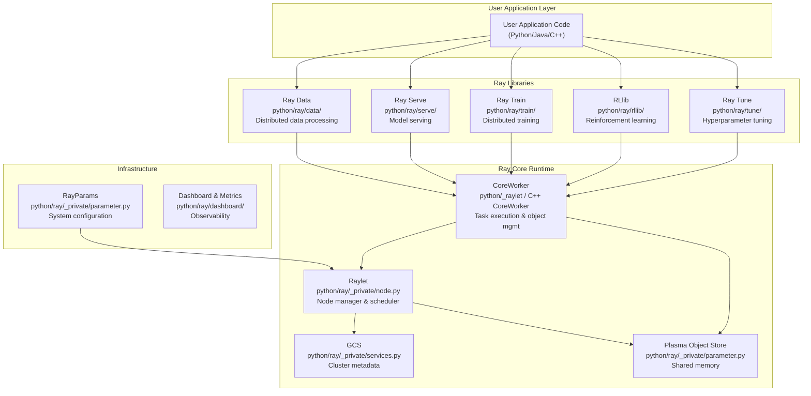
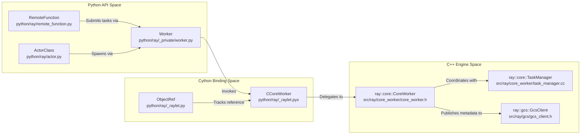

<!-- source: DeepWiki mcp.deepwiki.com · repo ray-project/ray · page 1 Ray Overview · fetched 2026-10-21 -->

# Ray Overview

<details>
<summary>Relevant source files</summary>

The following files were used as context for generating this wiki page:

- [ci/lint/pydoclint-baseline.txt](ci/lint/pydoclint-baseline.txt)
- [doc/source/_static/img/run-on-anyscale.svg](doc/source/_static/img/run-on-anyscale.svg)
- [doc/source/data/examples/batch_inference_object_detection.ipynb](doc/source/data/examples/batch_inference_object_detection.ipynb)
- [doc/source/data/examples/huggingface_vit_batch_prediction.ipynb](doc/source/data/examples/huggingface_vit_batch_prediction.ipynb)
- [doc/source/data/examples/pytorch_resnet_batch_prediction.ipynb](doc/source/data/examples/pytorch_resnet_batch_prediction.ipynb)
- [doc/source/ray-overview/getting-started.md](doc/source/ray-overview/getting-started.md)
- [doc/source/serve/doc_code/stable_diffusion.py](doc/source/serve/doc_code/stable_diffusion.py)
- [doc/source/serve/tutorials/stable-diffusion.md](doc/source/serve/tutorials/stable-diffusion.md)
- [doc/source/templates/04_finetuning_llms_with_deepspeed/utils.py](doc/source/templates/04_finetuning_llms_with_deepspeed/utils.py)
- [doc/source/train/examples/deepspeed/gptj_deepspeed_fine_tuning.ipynb](doc/source/train/examples/deepspeed/gptj_deepspeed_fine_tuning.ipynb)
- [doc/source/train/examples/lightning/lightning_cola_advanced.ipynb](doc/source/train/examples/lightning/lightning_cola_advanced.ipynb)
- [doc/source/train/examples/lightning/vicuna_13b_lightning_deepspeed_finetune.ipynb](doc/source/train/examples/lightning/vicuna_13b_lightning_deepspeed_finetune.ipynb)
- [doc/source/train/examples/pytorch/torch_detection.ipynb](doc/source/train/examples/pytorch/torch_detection.ipynb)
- [doc/source/train/examples/transformers/huggingface_text_classification.ipynb](doc/source/train/examples/transformers/huggingface_text_classification.ipynb)
- [java/test/src/main/java/io/ray/test/NodeLabelSchedulingTest.java](java/test/src/main/java/io/ray/test/NodeLabelSchedulingTest.java)
- [python/ray/_common/ray_option_utils.py](python/ray/_common/ray_option_utils.py)
- [python/ray/_private/accelerators/accelerator.py](python/ray/_private/accelerators/accelerator.py)
- [python/ray/_private/accelerators/apple_gpu.py](python/ray/_private/accelerators/apple_gpu.py)
- [python/ray/_private/label_utils.py](python/ray/_private/label_utils.py)
- [python/ray/_private/node.py](python/ray/_private/node.py)
- [python/ray/_private/parameter.py](python/ray/_private/parameter.py)
- [python/ray/_private/services.py](python/ray/_private/services.py)
- [python/ray/_private/utils.py](python/ray/_private/utils.py)
- [python/ray/_private/worker.py](python/ray/_private/worker.py)
- [python/ray/actor.py](python/ray/actor.py)
- [python/ray/remote_function.py](python/ray/remote_function.py)
- [python/ray/scripts/scripts.py](python/ray/scripts/scripts.py)
- [python/ray/tests/accelerators/test_apple_gpu.py](python/ray/tests/accelerators/test_apple_gpu.py)
- [python/ray/tests/test_actor.py](python/ray/tests/test_actor.py)
- [python/ray/tests/test_basic.py](python/ray/tests/test_basic.py)
- [python/ray/tests/test_client_terminate.py](python/ray/tests/test_client_terminate.py)
- [python/ray/tests/test_label_utils.py](python/ray/tests/test_label_utils.py)
- [python/ray/tests/test_node_label_scheduling_strategy.py](python/ray/tests/test_node_label_scheduling_strategy.py)
- [python/ray/tests/test_node_labels.py](python/ray/tests/test_node_labels.py)
- [python/ray/tests/test_utils.py](python/ray/tests/test_utils.py)
- [python/ray/tests/unit/test_decorator_validation.py](python/ray/tests/unit/test_decorator_validation.py)
- [release/ray_release/byod/byod_dolly_test.sh](release/ray_release/byod/byod_dolly_test.sh)
- [release/ray_release/byod/byod_gptj_test.sh](release/ray_release/byod/byod_gptj_test.sh)
- [release/ray_release/byod/byod_vicuna_test.sh](release/ray_release/byod/byod_vicuna_test.sh)

</details>


Ray is a unified distributed computing platform designed to scale Python applications and AI workloads from a single machine to a large cluster [doc/source/ray-overview/getting-started.md:11-18](). It provides a general-purpose core distributed runtime along with an ecosystem of specialized domain-specific libraries for AI and machine learning.

**Core Value Proposition:**
- **Unified API**: Use consistent primitives (`@ray.remote`, `ray.put`, `ray.get`) across tasks, actors, and distributed objects [python/ray/_private/worker.py:151-185](), [python/ray/actor.py:91-110]().
- **Composable Libraries**: Ray Data, Serve, Train, Tune, RLlib, and LLM libraries share the same underlying execution runtime.
- **Production-Ready Infrastructure**: Built-in cluster management, autoscaling, fault tolerance, and observability [doc/source/ray-overview/getting-started.md:18]().

For detailed architecture and core concepts, see [Architecture and Core Concepts](#1.1). For contribution workflows, see [Contributing and Documentation Workflow](#1.2).

**Sources:** [doc/source/ray-overview/getting-started.md:11-18](), [python/ray/_private/worker.py:151-185](), [python/ray/actor.py:91-110]()

---

## High-Level Architecture

Ray abstracts a physical cluster of nodes into a uniform pool of compute and memory resources. The architecture divides cleanly into a core execution layer and an upper library ecosystem.

### System Topology

The following diagram maps high-level system subsystems to their primary implementation entities in the codebase.



**Sources:** [python/ray/_private/parameter.py:14-124](), [python/ray/_private/services.py:59-66]()

---

## Major Subsystems

Ray is structured around a foundational core infrastructure and several specialized domain libraries:

| Subsystem | Primary Role | Code Base Entry Point / Module |
|-----------|--------------|--------------------------------|
| **Ray Core** | Tasks, actors, objects, scheduling, and process management | `python/ray/_private/worker.py` [python/ray/_private/worker.py:1-60]() |
| **Ray Data** | Scalable batch data processing and LLM data ingestion | `python/ray/data/` |
| **Ray Serve** | Scalable and programmable model serving | `python/ray/serve/` |
| **Ray Train** | Distributed deep learning training across frameworks | `python/ray/train/` |
| **Ray Tune** | Scalable hyperparameter tuning | `python/ray/tune/` |
| **RLlib** | Scalable reinforcement learning | `python/ray/rllib/` |

---

## Code Entity Mapping

The following diagram bridges natural language runtime concepts ("Remote Functions", "Actors", "Workers") to their concrete code entities and binding classes in Python and C++.



**Sources:** [python/ray/_private/worker.py:55-60](), [python/ray/actor.py:26-30](), [python/ray/remote_function.py:40-45]()

---

## Getting Started and Node Lifecycle

Nodes and local clusters are initialized via the Python API (`ray.init()`) or the command-line interface (`ray start`) [python/ray/_private/node.py:80-110](), [python/ray/scripts/scripts.py:1-25](). 

To start a head node from the CLI:
```bash
ray start --head
```
This command invokes the CLI entrypoint in `python/ray/scripts/scripts.py` [python/ray/scripts/scripts.py:180-195](), instantiating the `Node` manager in `python/ray/_private/node.py` [python/ray/_private/node.py:68-115]() which sets up process configurations via `RayParams` [python/ray/_private/parameter.py:14-45]().

For deeper architectural details, see [Architecture and Core Concepts](#1.1). For developer workflow and documentation guidelines, see [Contributing and Documentation Workflow](#1.2).

**Sources:** [python/ray/_private/node.py:68-115](), [python/ray/_private/parameter.py:14-45](), [python/ray/scripts/scripts.py:180-195]()

---

