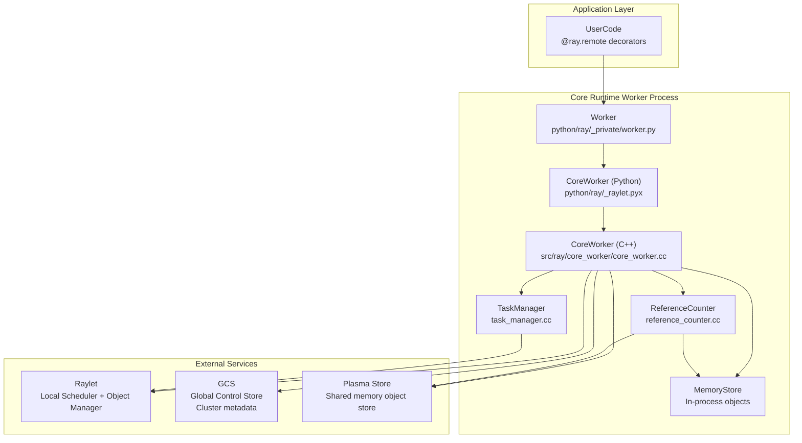
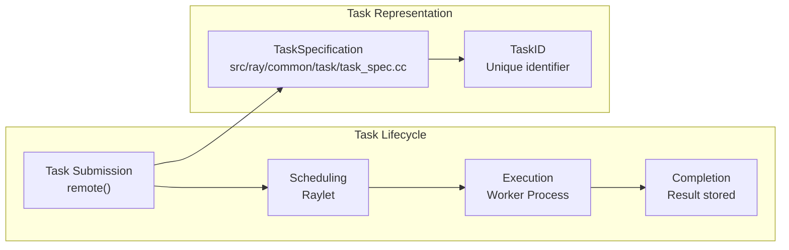
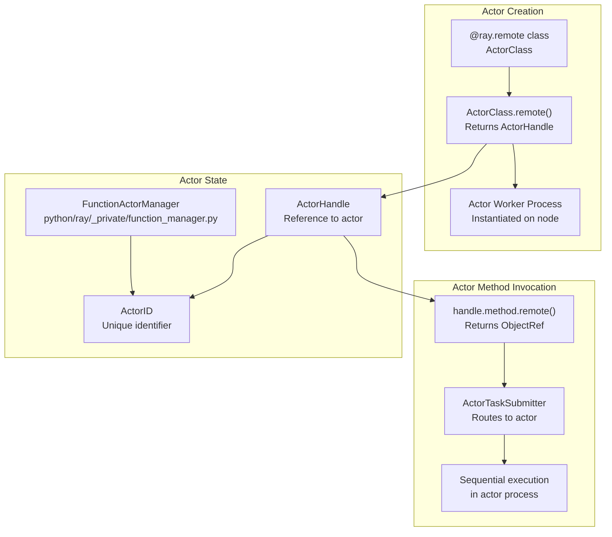
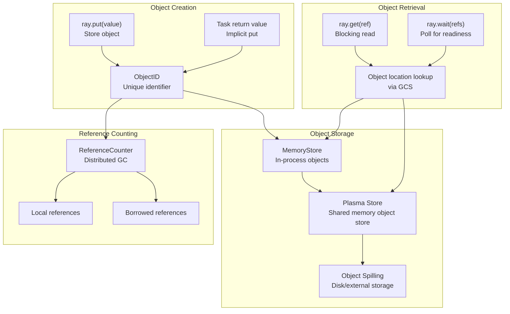
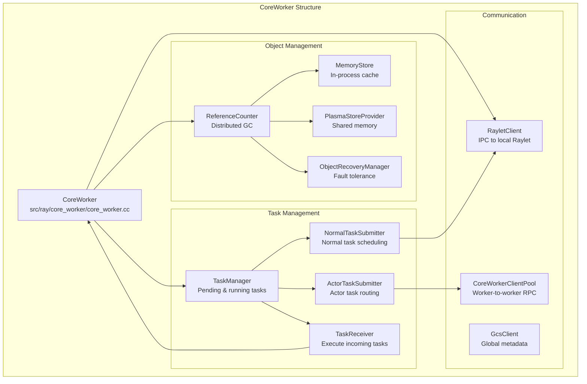
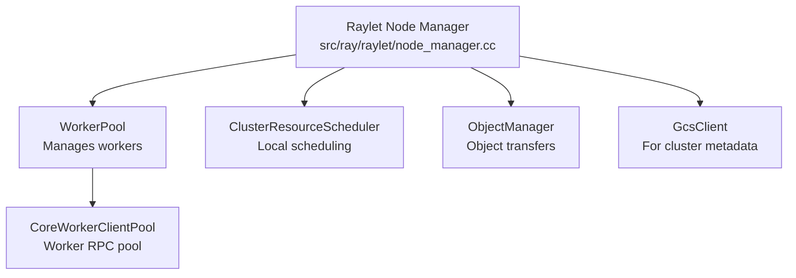
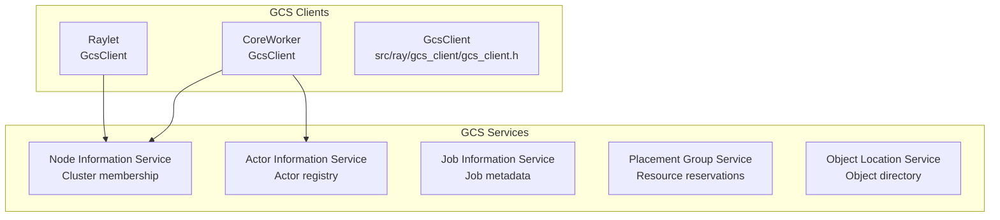

<!-- source: DeepWiki mcp.deepwiki.com · repo ray-project/ray · page 1.1 Architecture and Core Concepts · fetched 2026-10-21 -->

# Architecture and Context

Relevant source files

The following files were used as context for generating this wiki page:

- [ci/lint/pydoclint-baseline.txt](ci/lint/pydoclint-baseline.txt)
- [cpp/src/ray/runtime/task/local_mode_task_submitter.cc](cpp/src/ray/runtime/task/local_mode_task_submitter.cc)
- [java/test/src/main/java/io/ray/test/NodeLabelSchedulingTest.java](java/test/src/main/java/io/ray/test/NodeLabelSchedulingTest.java)
- [python/ray/_common/ray_option_utils.py](python/ray/_common/ray_option_utils.py)
- [python/ray/_private/accelerators/accelerator.py](python/ray/_private/accelerators/accelerator.py)
- [python/ray/_private/accelerators/apple_gpu.py](python/ray/_private/accelerators/apple_gpu.py)
- [python/ray/_private/custom_types.py](python/ray/_private/custom_types.py)
- [python/ray/_private/label_utils.py](python/ray/_private/label_utils.py)
- [python/ray/_private/node.py](python/ray/_private/node.py)
- [python/ray/_private/parameter.py](python/ray/_private/parameter.py)
- [python/ray/_private/services.py](python/ray/_private/services.py)
- [python/ray/_private/utils.py](python/ray/_private/utils.py)
- [python/ray/_private/worker.py](python/ray/_private/worker.py)
- [python/ray/actor.py](python/ray/actor.py)
- [python/ray/remote_function.py](python/ray/remote_function.py)
- [python/ray/scripts/scripts.py](python/ray/scripts/scripts.py)
- [python/ray/tests/accelerators/test_apple_gpu.py](python/ray/tests/accelerators/test_apple_gpu.py)
- [python/ray/tests/test_actor.py](python/ray/tests/test_actor.py)
- [python/ray/tests/test_basic.py](python/ray/tests/test_basic.py)
- [python/ray/tests/test_client_terminate.py](python/ray/tests/test_client_terminate.py)
- [python/ray/tests/test_label_utils.py](python/ray/tests/test_label_utils.py)
- [python/ray/tests/test_node_label_scheduling_strategy.py](python/ray/tests/test_node_label_scheduling_strategy.py)
- [python/ray/tests/test_node_labels.py](python/ray/tests/test_node_labels.py)
- [python/ray/tests/test_utils.py](python/ray/tests/test_utils.py)
- [python/ray/tests/unit/test_decorator_validation.py](python/ray/tests/unit/test_decorator_validation.py)
- [src/ray/common/scheduling/cluster_resource_data.cc](src/ray/common/scheduling/cluster_resource_data.cc)
- [src/ray/common/scheduling/cluster_resource_data.h](src/ray/common/scheduling/cluster_resource_data.h)
- [src/ray/common/task/task_spec.cc](src/ray/common/task/task_spec.cc)
- [src/ray/common/task/task_spec.h](src/ray/common/task/task_spec.h)
- [src/ray/common/task/task_util.h](src/ray/common/task/task_util.h)
- [src/ray/core_worker/common.h](src/ray/core_worker/common.h)
- [src/ray/gcs/gcs_resource_manager.cc](src/ray/gcs/gcs_resource_manager.cc)
- [src/ray/gcs/gcs_resource_manager.h](src/ray/gcs/gcs_resource_manager.h)
- [src/ray/gcs/tests/gcs_placement_group_scheduler_test.cc](src/ray/gcs/tests/gcs_placement_group_scheduler_test.cc)
- [src/ray/gcs/tests/gcs_resource_manager_test.cc](src/ray/gcs/tests/gcs_resource_manager_test.cc)
- [src/ray/protobuf/common.proto](src/ray/protobuf/common.proto)
- [src/ray/raylet/scheduling/BUILD.bazel](src/ray/raylet/scheduling/BUILD.bazel)
- [src/ray/raylet/scheduling/cluster_resource_manager.cc](src/ray/raylet/scheduling/cluster_resource_manager.cc)
- [src/ray/raylet/scheduling/cluster_resource_manager.h](src/ray/raylet/scheduling/cluster_resource_manager.h)
- [src/ray/raylet/scheduling/cluster_resource_scheduler.cc](src/ray/raylet/scheduling/cluster_resource_scheduler.cc)
- [src/ray/raylet/scheduling/cluster_resource_scheduler.h](src/ray/raylet/scheduling/cluster_resource_scheduler.h)
- [src/ray/raylet/scheduling/local_resource_manager.cc](src/ray/raylet/scheduling/local_resource_manager.cc)
- [src/ray/raylet/scheduling/local_resource_manager.h](src/ray/raylet/scheduling/local_resource_manager.h)
- [src/ray/raylet/scheduling/policy/scorer.cc](src/ray/raylet/scheduling/policy/scorer.cc)
- [src/ray/raylet/scheduling/policy/tests/hybrid_scheduling_policy_test.cc](src/ray/raylet/scheduling/policy/tests/hybrid_scheduling_policy_test.cc)
- [src/ray/raylet/scheduling/policy/tests/scheduling_policy_test.cc](src/ray/raylet/scheduling/policy/tests/scheduling_policy_test.cc)
- [src/ray/raylet/scheduling/tests/BUILD.bazel](src/ray/raylet/scheduling/tests/BUILD.bazel)
- [src/ray/raylet/scheduling/tests/cluster_lease_manager_test.cc](src/ray/raylet/scheduling/tests/cluster_lease_manager_test.cc)
- [src/ray/raylet/scheduling/tests/cluster_resource_manager_test.cc](src/ray/raylet/scheduling/tests/cluster_resource_manager_test.cc)
- [src/ray/raylet/scheduling/tests/cluster_resource_scheduler_2_test.cc](src/ray/raylet/scheduling/tests/cluster_resource_scheduler_2_test.cc)
- [src/ray/raylet/scheduling/tests/cluster_resource_scheduler_test.cc](src/ray/raylet/scheduling/tests/cluster_resource_scheduler_test.cc)
- [src/ray/raylet/scheduling/tests/local_resource_manager_test.cc](src/ray/raylet/scheduling/tests/local_resource_manager_test.cc)

This page explains the fundamental architecture of Ray and its core concepts including tasks, actors, objects, and the key components (`CoreWorker`, `Raylet`, `GCS`) that enable distributed execution. For details on higher-level libraries built on Ray Core (Data, Serve, RLlib), see their respective sections ([Ray Data](#3), [Ray Serve](#4), [Ray RLlib](#5)).

## Overview

Ray is a distributed computing framework with a three-tier architecture:

1.  **Application Layer**: User code written in Python, Java, or C++.
2.  **Core Runtime Layer**: Distributed task execution, object management, and scheduling.
3.  **Infrastructure Layer**: Cluster management and resource coordination.

The core runtime provides abstractions for distributed computing (`tasks` and `actors`) while managing object storage, reference counting, and fault tolerance transparently.

Sources: `src/ray/core_worker/core_worker.cc:167-280]`, `[python/ray/_raylet.pyx:157-200]`, `[python/ray/_private/worker.py:58-100]`

## Core Concepts

### Tasks

Tasks are the fundamental unit of computation in Ray. A task is a stateless function decorated with `@ray.remote` that executes asynchronously and returns an `ObjectRef`.

**Task Types** (defined via `TaskType` in `src/ray/protobuf/common.proto`):
*   **Normal tasks**: Stateless functions executed by worker processes (`NORMAL_TASK = 0`).
*   **Actor creation tasks**: Special tasks that instantiate an actor process (`ACTOR_CREATION_TASK = 1`).
*   **Actor tasks**: Methods executed on stateful actor instances (`ACTOR_TASK = 2`).
*   **Driver tasks**: The main script that orchestrates execution (`DRIVER_TASK = 3`).

Sources: `[src/ray/protobuf/common.proto:42-51]`, `[src/ray/common/task/task_spec.h:82-122]`, `[python/ray/_private/worker.py:156-250]`

**Implementation Details**:
*   Python tasks are defined using the `@ray.remote` decorator in `[python/ray/_private/worker.py:156-250]()`.
*   Task specifications are wrapped by `TaskSpecification` in `[src/ray/common/task/task_spec.h:82-122]()`.
*   Task execution and tracking are managed by the `TaskManager` within the CoreWorker.

Sources: `[python/ray/_private/worker.py:156-250]`, `[src/ray/common/task/task_spec.h:82-122]`, `[src/ray/common/task/task_spec.cc:59-114]`

### Actors

Actors are stateful workers that execute methods sequentially. Each actor is a long-running Ray worker process that maintains state across method invocations.

Sources: `[python/ray/actor.py:91-250]`, `[python/ray/_private/worker.py:68]`

**Key Properties**:
*   **Statefulness**: Instance variables persist across method calls.
*   **Sequential execution**: Methods execute one at a time by default.
*   **Concurrency control**: Configurable with `max_concurrency` parameter (`DEFAULT_MAX_CONCURRENCY_ASYNC` in `[python/ray/actor.py:29-32]()`).
*   **Async actors**: Support for `async def` methods with higher concurrency.

Sources: `[python/ray/actor.py:29-50]`, `[python/ray/actor.py:91-241]`

### Objects and ObjectRefs

Ray objects are immutable data stored in the distributed object store. An `ObjectRef` is a reference to an object that may not yet exist (future).

Sources: `[src/ray/core_worker/core_worker.cc:93-126]`, `[src/ray/core_worker/core_worker.h:44-48]`

**Object Lifecycle**:
1.  **Creation**: Objects created via `ray.put()` or task returns.
2.  **Storage**: Small objects stored in-process `MemoryStore`, large objects in `Plasma`.
3.  **Reference tracking**: `ReferenceCounter` tracks local and borrowed references (`[src/ray/core_worker/core_worker.h:44-48]()`).
4.  **Retrieval**: `ray.get()` fetches object data, potentially from remote nodes.
5.  **Garbage collection**: Objects deleted when all references go out of scope.

Sources: `[src/ray/core_worker/core_worker.cc:93-126]`, `[src/ray/core_worker/core_worker.h:44-48]`, `[python/ray/_private/ray_constants.py:37-91]`

## Key Components

### CoreWorker

The `CoreWorker` is the central coordinator of Ray functionality within each worker process. It manages task execution, object storage, and communication with external services.

Sources: `[src/ray/core_worker/core_worker.cc:166-280]`, `[src/ray/core_worker/core_worker.h:15-180]`

**CoreWorker Responsibilities**:

| Component | Responsibility | Key Files |
| :--- | :--- | :--- |
| `TaskManager` | Tracks stats for inbound tasks (pending, running, finished) | `[src/ray/core_worker/core_worker.h:64-140]()` |
| `ReferenceCounter` | Maintains reference counts for distributed GC | `[src/ray/core_worker/core_worker.h:44-45]()` |
| `NormalTaskSubmitter` | Submits normal tasks to Raylet for scheduling | `[src/ray/core_worker/core_worker.h:51]()` |
| `ActorTaskSubmitter` | Submits actor tasks internally | `[src/ray/core_worker/core_worker.h:51]()` |
| `TaskReceiver` | Executes tasks assigned to this worker | `[src/ray/core_worker/core_worker.h:50]()` |
| `MemoryStore` | Stores small objects in worker heap | `[src/ray/core_worker/core_worker.h:47]()` |
| `PlasmaStoreProvider` | Interfaces with the external plasma store | `[src/ray/core_worker/core_worker.h:48]()` |
| `ObjectRecoveryManager` | Reconstructs lost objects via lineage | `[src/ray/core_worker/core_worker.h:42]()` |

Sources: `[src/ray/core_worker/core_worker.h:15-180]`, `[src/ray/core_worker/core_worker.cc:166-280]`

### Raylet

The Raylet is a per-node daemon that handles local scheduling, resource management, and object transfer. Each node runs exactly one Raylet process (`RAYLET_EXECUTABLE` in `[python/ray/_private/services.py:61-63]()`).

**Raylet Components**:
*   **NodeManager**: Manages workers, resource scheduling, and node-level lifecycle (`[src/ray/raylet/node_manager.h:138-142]()`).
*   **WorkerPool**: Manages a pool of worker processes for task execution (`[src/ray/raylet/node_manager.h:55]()`).
*   **ClusterResourceScheduler**: Makes local scheduling decisions based on cluster resources (`[src/ray/raylet/node_manager.h:50]()`).
*   **ObjectManager**: Manages object transfers and shared memory (Plasma) (`[src/ray/raylet/node_manager.h:40]()`).

Sources: `[src/ray/raylet/node_manager.h:138-188]`, `[src/ray/raylet/node_manager.cc:164-200]`

Sources: `[src/ray/raylet/node_manager.h:138-188]`, `[src/ray/raylet/node_manager.cc:164-200]`, `[python/ray/_private/services.py:61-63]`

### Global Control Service (GCS)

The GCS is Ray's centralized metadata service that maintains cluster-wide state using `GcsClient` (`[src/ray/raylet/node_manager.h]` and `[python/ray/_private/services.py:196-202]()`).

Sources: `[python/ray/_private/services.py:32-36]`, `[src/ray/raylet/node_manager.h]`

**GCS Functionality**:
*   **Node Management**: Tracks node health and resources via `GcsNodeInfo` (`[python/ray/_private/services.py:32-36]()`).
*   **Actor Management**: Tracks actor locations and states.
*   **Job Management**: Stores job configurations (`[python/ray/_raylet.pyx]`).
*   **Authentication**: Supports token-based authentication for RPC calls if auth is enabled.

Sources: `[python/ray/_private/services.py:32-36]`, `[python/ray/_raylet.pyx]`

## Node Lifecycle and Process Management

### ray start CLI
The `ray start` command (implemented via `RayCLI` in `[python/ray/scripts/scripts.py:146-189]()`) initializes a Ray node process.

1.  **Head Node**: Starts GCS, Raylet, Plasma Store, and Dashboard processes (`[python/ray/_private/node.py:80-133]()`).
2.  **Worker Node**: Starts Raylet and Plasma Store, connecting to the head node's GCS.

### Process Management
Ray manages several types of processes encapsulated by the `Node` class (`[python/ray/_private/node.py:68-183]()`):
*   **Raylet**: Starts the local node manager daemon (`RAYLET_EXECUTABLE`, `[python/ray/_private/services.py:61-63]()`).
*   **GCS Server**: A standalone metadata service process (`GCS_SERVER_EXECUTABLE`, `[python/ray/_private/services.py:64-66]()`).
*   **Workers**: Task execution processes started by the Raylet’s `WorkerPool`. Python workers use the Python interpreter (`sys.executable`) with specific environment variables (`[python/ray/_private/services.py:144-193]()`).

Sources: `[python/ray/scripts/scripts.py:146-189]`, `[python/ray/_private/node.py:68-183]`, `[python/ray/_private/services.py:61-66]`

---

This page provides foundational knowledge to understand Ray’s distributed execution model built on tasks, actors, and objects managed by core components `CoreWorker`, `Raylet`, and `GCS`.

---

