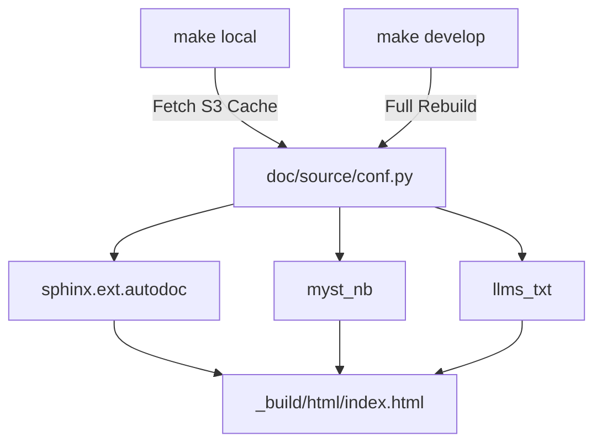
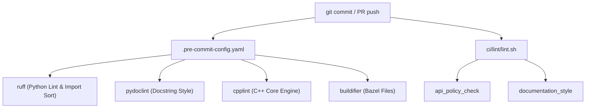
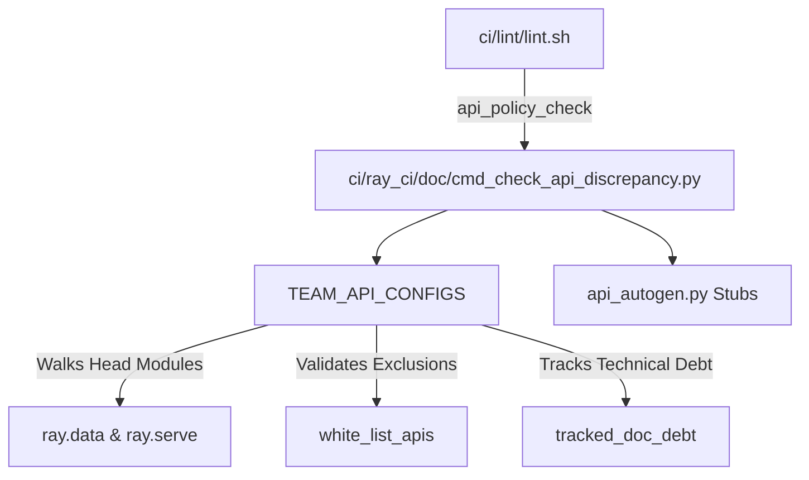

<!-- source: DeepWiki mcp.deepwiki.com · repo ray-project/ray · page 1.2 Contributing and Documentation Workflow · fetched 2026-10-21 -->

# Contributing and Documentation Workflow

Relevant source files

The following files were used as context for generating this wiki page:

- [.buildkite/lint.rayci.yml](.buildkite/lint.rayci.yml)
- [.claude/agents/README.md](.claude/agents/README.md)
- [.claude/settings.json](.claude/settings.json)
- [.claude/skills/backport-docs/SKILL.md](.claude/skills/backport-docs/SKILL.md)
- [.claude/skills/fetch-buildkite-logs/SKILL.md](.claude/skills/fetch-buildkite-logs/SKILL.md)
- [.gitignore](.gitignore)
- [.pre-commit-config.yaml](.pre-commit-config.yaml)
- [.readthedocs.yaml](.readthedocs.yaml)
- [bazel/python.bzl](bazel/python.bzl)
- [ci/lint/lint.sh](ci/lint/lint.sh)
- [ci/ray_ci/doc/BUILD.bazel](ci/ray_ci/doc/BUILD.bazel)
- [ci/ray_ci/doc/api.py](ci/ray_ci/doc/api.py)
- [ci/ray_ci/doc/autodoc.py](ci/ray_ci/doc/autodoc.py)
- [ci/ray_ci/doc/build_cache.py](ci/ray_ci/doc/build_cache.py)
- [ci/ray_ci/doc/cmd_build.py](ci/ray_ci/doc/cmd_build.py)
- [ci/ray_ci/doc/cmd_check_api_discrepancy.py](ci/ray_ci/doc/cmd_check_api_discrepancy.py)
- [ci/ray_ci/doc/massage_cache.py](ci/ray_ci/doc/massage_cache.py)
- [ci/ray_ci/doc/mock/__init__.py](ci/ray_ci/doc/mock/__init__.py)
- [ci/ray_ci/doc/mock/_internal/__init__.py](ci/ray_ci/doc/mock/_internal/__init__.py)
- [ci/ray_ci/doc/mock/mock_module.py](ci/ray_ci/doc/mock/mock_module.py)
- [ci/ray_ci/doc/module.py](ci/ray_ci/doc/module.py)
- [ci/ray_ci/doc/test_api.py](ci/ray_ci/doc/test_api.py)
- [ci/ray_ci/doc/test_autodoc.py](ci/ray_ci/doc/test_autodoc.py)
- [ci/ray_ci/doc/test_build_cache.py](ci/ray_ci/doc/test_build_cache.py)
- [ci/ray_ci/doc/test_cmd_check_api_discrepancy.py](ci/ray_ci/doc/test_cmd_check_api_discrepancy.py)
- [ci/ray_ci/doc/test_module.py](ci/ray_ci/doc/test_module.py)
- [ci/raydepsets/configs/docs.depsets.yaml](ci/raydepsets/configs/docs.depsets.yaml)
- [doc/.claude/CLAUDE.md](doc/.claude/CLAUDE.md)
- [doc/.gitignore](doc/.gitignore)
- [doc/BUILD.bazel](doc/BUILD.bazel)
- [doc/Makefile](doc/Makefile)
- [doc/README.md](doc/README.md)
- [doc/requirements-doc.lock.txt](doc/requirements-doc.lock.txt)
- [doc/requirements-doc.txt](doc/requirements-doc.txt)
- [doc/rtd_doctor.py](doc/rtd_doctor.py)
- [doc/source/_ext/llms_txt.py](doc/source/_ext/llms_txt.py)
- [doc/source/_ext/test_llms_txt.py](doc/source/_ext/test_llms_txt.py)
- [doc/source/_intersphinx/README.md](doc/source/_intersphinx/README.md)
- [doc/source/_intersphinx/refresh.py](doc/source/_intersphinx/refresh.py)
- [doc/source/_intersphinx/torch.inv](doc/source/_intersphinx/torch.inv)
- [doc/source/_static/css/custom.css](doc/source/_static/css/custom.css)
- [doc/source/_static/img/ray_logo.svg](doc/source/_static/img/ray_logo.svg)
- [doc/source/cluster/images/ray-job-diagram.png](doc/source/cluster/images/ray-job-diagram.png)
- [doc/source/cluster/kubernetes/troubleshooting/troubleshooting.md](doc/source/cluster/kubernetes/troubleshooting/troubleshooting.md)
- [doc/source/cluster/running-applications/job-submission/api.md](doc/source/cluster/running-applications/job-submission/api.md)
- [doc/source/cluster/running-applications/job-submission/index.md](doc/source/cluster/running-applications/job-submission/index.md)
- [doc/source/cluster/running-applications/job-submission/jobs-package-ref.rst](doc/source/cluster/running-applications/job-submission/jobs-package-ref.rst)
- [doc/source/cluster/running-applications/job-submission/openapi.yml](doc/source/cluster/running-applications/job-submission/openapi.yml)
- [doc/source/cluster/running-applications/job-submission/rest.rst](doc/source/cluster/running-applications/job-submission/rest.rst)
- [doc/source/conf.py](doc/source/conf.py)
- [doc/source/custom_directives.py](doc/source/custom_directives.py)
- [doc/source/data/examples.yml](doc/source/data/examples.yml)
- [doc/source/data/examples/BUILD.bazel](doc/source/data/examples/BUILD.bazel)
- [doc/source/images/ray_header_logo.png](doc/source/images/ray_header_logo.png)
- [doc/source/images/ray_logo.png](doc/source/images/ray_logo.png)
- [doc/source/llm/doc_code/serve/tpu/serve_tpu_multihost.py](doc/source/llm/doc_code/serve/tpu/serve_tpu_multihost.py)
- [doc/source/llms_txt_summary.txt](doc/source/llms_txt_summary.txt)
- [doc/source/ray-contribute/agent-development.md](doc/source/ray-contribute/agent-development.md)
- [doc/source/ray-contribute/api-policy.md](doc/source/ray-contribute/api-policy.md)
- [doc/source/ray-contribute/ci.md](doc/source/ray-contribute/ci.md)
- [doc/source/ray-contribute/debugging.md](doc/source/ray-contribute/debugging.md)
- [doc/source/ray-contribute/development.md](doc/source/ray-contribute/development.md)
- [doc/source/ray-contribute/docs.md](doc/source/ray-contribute/docs.md)
- [doc/source/ray-contribute/getting-involved.md](doc/source/ray-contribute/getting-involved.md)
- [doc/source/ray-contribute/involvement.md](doc/source/ray-contribute/involvement.md)
- [doc/source/ray-contribute/profiling.md](doc/source/ray-contribute/profiling.md)
- [doc/source/ray-contribute/publishing-examples-legacy.md](doc/source/ray-contribute/publishing-examples-legacy.md)
- [doc/source/ray-contribute/publishing-examples.md](doc/source/ray-contribute/publishing-examples.md)
- [doc/source/ray-contribute/stability.md](doc/source/ray-contribute/stability.md)
- [doc/source/ray-contribute/testing-tips.md](doc/source/ray-contribute/testing-tips.md)
- [doc/source/ray-contribute/whitepaper.md](doc/source/ray-contribute/whitepaper.md)
- [doc/source/ray-contribute/writing-code-snippets.md](doc/source/ray-contribute/writing-code-snippets.md)
- [doc/source/ray-core/examples/BUILD.bazel](doc/source/ray-core/examples/BUILD.bazel)
- [doc/source/ray-overview/images/ray_svg_logo.svg](doc/source/ray-overview/images/ray_svg_logo.svg)
- [doc/source/serve/examples.yml](doc/source/serve/examples.yml)
- [doc/source/serve/llm/architecture/routing-policies.md](doc/source/serve/llm/architecture/routing-policies.md)
- [doc/source/serve/llm/images/kv_aware_routing_flow.png](doc/source/serve/llm/images/kv_aware_routing_flow.png)
- [doc/source/serve/llm/images/kv_offload_dashboard.png](doc/source/serve/llm/images/kv_offload_dashboard.png)
- [doc/source/serve/llm/images/ray_serve_llm_tpu.png](doc/source/serve/llm/images/ray_serve_llm_tpu.png)
- [doc/source/serve/llm/user-guides/index.md](doc/source/serve/llm/user-guides/index.md)
- [doc/source/serve/llm/user-guides/kv-aware-routing.md](doc/source/serve/llm/user-guides/kv-aware-routing.md)
- [doc/source/serve/llm/user-guides/kv-cache-offloading.md](doc/source/serve/llm/user-guides/kv-cache-offloading.md)
- [doc/source/serve/llm/user-guides/tpu.md](doc/source/serve/llm/user-guides/tpu.md)
- [doc/source/serve/tutorials/batch.md](doc/source/serve/tutorials/batch.md)
- [doc/source/serve/tutorials/serve-deepseek.md](doc/source/serve/tutorials/serve-deepseek.md)
- [doc/source/train/deepspeed.rst](doc/source/train/deepspeed.rst)
- [doc/source/train/examples.yml](doc/source/train/examples.yml)
- [doc/source/train/examples/BUILD.bazel](doc/source/train/examples/BUILD.bazel)
- [doc/source/train/examples/aws-trainium/llama3.rst](doc/source/train/examples/aws-trainium/llama3.rst)
- [doc/source/train/examples/jax/intro_to_jax_trainer/README.ipynb](doc/source/train/examples/jax/intro_to_jax_trainer/README.ipynb)
- [doc/source/train/examples/jax/intro_to_jax_trainer/README.md](doc/source/train/examples/jax/intro_to_jax_trainer/README.md)
- [doc/source/train/examples/lightning/BUILD.bazel](doc/source/train/examples/lightning/BUILD.bazel)
- [doc/source/train/examples/pytorch/BUILD.bazel](doc/source/train/examples/pytorch/BUILD.bazel)
- [doc/source/train/examples/transformers/BUILD.bazel](doc/source/train/examples/transformers/BUILD.bazel)
- [doc/source/tune/examples/BUILD.bazel](doc/source/tune/examples/BUILD.bazel)
- [doc/source/tune/examples/index.rst](doc/source/tune/examples/index.rst)
- [doc/source/tune/examples/tune-pytorch-cifar.ipynb](doc/source/tune/examples/tune-pytorch-cifar.ipynb)
- [python/deplocks/docs/docbuild_depset_py3.11.lock](python/deplocks/docs/docbuild_depset_py3.11.lock)
- [python/ray/serve/_private/tracing_utils.py](python/ray/serve/_private/tracing_utils.py)
- [python/ray/serve/pyrefly-serve.toml](python/ray/serve/pyrefly-serve.toml)
- [python/ray/serve/tests/test_tracing_utils.py](python/ray/serve/tests/test_tracing_utils.py)
- [release/requirements-doc.txt](release/requirements-doc.txt)

## Purpose and Scope
This wiki page serves as the comprehensive technical guide for contributors working on the Ray codebase. It covers the repository layout, the Sphinx-based documentation build pipeline (`doc/source/conf.py`), editorial style and style checks (Vale), linting infrastructure (`.pre-commit-config.yaml` and `ci/lint/lint.sh`), API policy consistency verifications (`ci/ray_ci/doc/cmd_check_api_discrepancy.py`), and the integration of development agent skills used for automated maintenance.

Sources: [`doc/source/conf.py:1-45`](), [`doc/source/ray-contribute/docs.md:1-25`](), [.pre-commit-config.yaml:1-23]()

---

## Repository Layout and Directory Organization
The Ray repository is structured to separate core distributed systems implementations, framework libraries, build scripts, and documentation sources. Understanding this layout is essential for locating module sources, test targets, and configuration files.

| Directory Path | Primary Components and Responsibilities |
| :--- | :--- |
| `python/ray/` | Python library implementations including Ray Core, Serve, Data, Train, Tune, and RLlib. |
| `src/ray/` | C++ core runtime engines, including `raylet`, `core_worker`, `gcs`, and the Plasma object store. |
| `doc/` | Documentation source files (`doc/source/`), Sphinx configuration, extensions (`doc/source/_ext/`), and build scripts. |
| `ci/` | Continuous integration scripts, lint runners (`ci/lint/`), and validation utilities (`ci/ray_ci/`). |
| `bazel/` | Bazel build definitions, platform toolchains, and Python dependency rules. |

Sources: [`doc/source/conf.py:37-44`](), [.pre-commit-config.yaml:1-22]()

---

## Documentation Build System and Sphinx Pipeline
The Ray documentation is built using Sphinx (`sphinx==8.2.3`), MyST Parser for Markdown, and a custom pydata-sphinx-theme [doc/requirements-doc.txt:1-51](). The core configuration resides in `doc/source/conf.py`, which initializes extensions such as `sphinx.ext.autodoc`, `myst_nb`, and custom in-repo agent extensions like `llms_txt` [doc/source/conf.py:58-82]().

### Local Build Commands and Caching
Contributors can run local builds via the `doc/Makefile` using incremental or full build targets:
- **Incremental Build (`make local`)**: Uses global caches from upstream commits stored on S3 to rebuild only changed files with live reloading.
- **Full Build (`make develop`)**: Performs a complete clean build from scratch inside the `_build/` directory [doc/source/ray-contribute/docs.md:59-98]().
- **RTD-Faithful Build (`make rtd-build`)**: Simulates the Read the Docs production pipeline with strict warning enforcement via `make rtd-doctor` [doc/source/ray-contribute/docs.md:102-118]().

Sources: [`doc/source/conf.py:1-83`](), [`doc/requirements-doc.txt:1-35`](), [`doc/source/ray-contribute/docs.md:60-118`](), [`doc/BUILD.bazel:1-22`]()

---

## Linting, Pre-Commit Hooks, and CI Infrastructure
Ray enforces strict code formatting, linting, and style policies via `.pre-commit-config.yaml` and pipeline scripts in `ci/lint/lint.sh`. Pre-commit hooks run checkers such as `ruff`, `pydoclint`, `cpplint`, `buildifier`, `black`, and `mypy` [.pre-commit-config.yaml:23-169]().

### Pre-Commit and Lint Script Execution
The lint runner script `ci/lint/lint.sh` aggregates checks into isolated functions, executed across Buildkite pipeline matrices defined in `.buildkite/lint.rayci.yml` [ci/lint/lint.sh:1-154](), [.buildkite/lint.rayci.yml:1-117]().

Sources: [.pre-commit-config.yaml:1-169](), [ci/lint/lint.sh:1-154](), [.buildkite/lint.rayci.yml:1-117]()

---

## API Policy Checks and Consistency Verification
Ray maintains strict consistency between public APIs, docstring parameter annotations, and Sphinx documentation stubs. The verification suite is coordinated by `ci/ray_ci/doc/cmd_check_api_discrepancy.py` [ci/ray_ci/doc/cmd_check_api_discrepancy.py:1-646]().

### API Discrepancy Checks
The script `ci/ray_ci/doc/cmd_check_api_discrepancy.py` walks designated module roots (e.g., `ray.data`, `ray.serve`) defined in `TEAM_API_CONFIGS` and validates that every `@PublicAPI` annotated symbol is accounted for in documentation autosummary files or explicit exemption lists (`white_list_apis` and `tracked_doc_debt`) [ci/ray_ci/doc/cmd_check_api_discrepancy.py:31-108]().

Sources: [ci/lint/lint.sh:115-132](), [ci/ray_ci/doc/cmd_check_api_discrepancy.py:1-123](), [doc/source/conf.py:29-35]()

---

## Agent Skills and Developer Workflow Automation
Ray incorporates automated agent capabilities (housed under `.claude/`) to streamline code navigation, error resolution, and doc synchronization. These agent definitions interact with core testing utilities and Bazel targets specified in `doc/BUILD.bazel` to validate code snippets embedded in rST/Markdown files [doc/BUILD.bazel:29-241]().

Sources: [doc/BUILD.bazel:1-241]()

---

