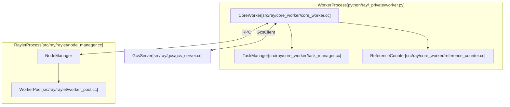
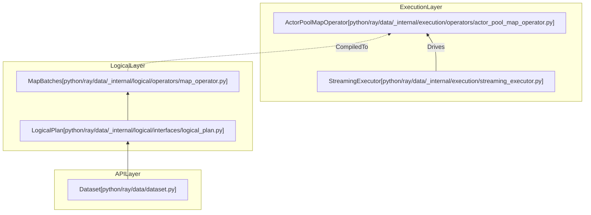

<!-- source: DeepWiki mcp.deepwiki.com · repo ray-project/ray · page 10 Glossary · fetched 2026-10-21 -->

# Glossary

Relevant source files

The following files were used as context for generating this wiki page:

- [cpp/src/ray/runtime/task/task_executor.cc](cpp/src/ray/runtime/task/task_executor.cc)
- [cpp/src/ray/runtime/task/task_executor.h](cpp/src/ray/runtime/task/task_executor.h)
- [doc/source/data/api/expressions.rst](doc/source/data/api/expressions.rst)
- [doc/source/ray-core/configure.rst](doc/source/ray-core/configure.rst)
- [doc/source/ray-core/internals/port-service-discovery.rst](doc/source/ray-core/internals/port-service-discovery.rst)
- [doc/source/ray-observability/user-guides/debug-apps/debug-worker-thread-count.md](doc/source/ray-observability/user-guides/debug-apps/debug-worker-thread-count.md)
- [doc/source/ray-observability/user-guides/debug-apps/index.md](doc/source/ray-observability/user-guides/debug-apps/index.md)
- [doc/source/serve/monitoring.md](doc/source/serve/monitoring.md)
- [python/ray/_raylet.pyx](python/ray/_raylet.pyx)
- [python/ray/data/_internal/datasource/range_datasource.py](python/ray/data/_internal/datasource/range_datasource.py)
- [python/ray/data/_internal/execution/util.py](python/ray/data/_internal/execution/util.py)
- [python/ray/data/_internal/logical/interfaces/__init__.py](python/ray/data/_internal/logical/interfaces/__init__.py)
- [python/ray/data/_internal/logical/interfaces/logical_operator.py](python/ray/data/_internal/logical/interfaces/logical_operator.py)
- [python/ray/data/_internal/logical/operators/all_to_all_operator.py](python/ray/data/_internal/logical/operators/all_to_all_operator.py)
- [python/ray/data/_internal/logical/operators/count_operator.py](python/ray/data/_internal/logical/operators/count_operator.py)
- [python/ray/data/_internal/logical/operators/from_operators.py](python/ray/data/_internal/logical/operators/from_operators.py)
- [python/ray/data/_internal/logical/operators/input_data_operator.py](python/ray/data/_internal/logical/operators/input_data_operator.py)
- [python/ray/data/_internal/logical/operators/join_operator.py](python/ray/data/_internal/logical/operators/join_operator.py)
- [python/ray/data/_internal/logical/operators/map_operator.py](python/ray/data/_internal/logical/operators/map_operator.py)
- [python/ray/data/_internal/logical/operators/n_ary_operator.py](python/ray/data/_internal/logical/operators/n_ary_operator.py)
- [python/ray/data/_internal/logical/operators/one_to_one_operator.py](python/ray/data/_internal/logical/operators/one_to_one_operator.py)
- [python/ray/data/_internal/logical/operators/read_operator.py](python/ray/data/_internal/logical/operators/read_operator.py)
- [python/ray/data/_internal/logical/operators/streaming_split_operator.py](python/ray/data/_internal/logical/operators/streaming_split_operator.py)
- [python/ray/data/_internal/logical/operators/write_operator.py](python/ray/data/_internal/logical/operators/write_operator.py)
- [python/ray/data/_internal/logical/rules/limit_pushdown.py](python/ray/data/_internal/logical/rules/limit_pushdown.py)
- [python/ray/data/_internal/logical/rules/predicate_pushdown.py](python/ray/data/_internal/logical/rules/predicate_pushdown.py)
- [python/ray/data/_internal/logical/rules/projection_pushdown.py](python/ray/data/_internal/logical/rules/projection_pushdown.py)
- [python/ray/data/_internal/planner/exchange/split_repartition_task_scheduler.py](python/ray/data/_internal/planner/exchange/split_repartition_task_scheduler.py)
- [python/ray/data/_internal/planner/plan_expression/expression_evaluator.py](python/ray/data/_internal/planner/plan_expression/expression_evaluator.py)
- [python/ray/data/_internal/planner/plan_expression/expression_visitors.py](python/ray/data/_internal/planner/plan_expression/expression_visitors.py)
- [python/ray/data/_internal/planner/plan_udf_map_op.py](python/ray/data/_internal/planner/plan_udf_map_op.py)
- [python/ray/data/dataset.py](python/ray/data/dataset.py)
- [python/ray/data/datasource/datasource.py](python/ray/data/datasource/datasource.py)
- [python/ray/data/expressions.py](python/ray/data/expressions.py)
- [python/ray/data/tests/test_execution_optimizer_limit_pushdown.py](python/ray/data/tests/test_execution_optimizer_limit_pushdown.py)
- [python/ray/data/tests/test_map.py](python/ray/data/tests/test_map.py)
- [python/ray/data/tests/test_predicate_pushdown.py](python/ray/data/tests/test_predicate_pushdown.py)
- [python/ray/data/tests/test_projection_fusion.py](python/ray/data/tests/test_projection_fusion.py)
- [python/ray/data/tests/test_repartition_e2e.py](python/ray/data/tests/test_repartition_e2e.py)
- [python/ray/data/tests/unit/test_logical_plan.py](python/ray/data/tests/unit/test_logical_plan.py)
- [python/ray/includes/libcoreworker.pxd](python/ray/includes/libcoreworker.pxd)
- [python/ray/llm/tests/serve/cpu/deployments/routers/test_make_fastapi_ingress.py](python/ray/llm/tests/serve/cpu/deployments/routers/test_make_fastapi_ingress.py)
- [python/ray/serve/_private/application_state.py](python/ray/serve/_private/application_state.py)
- [python/ray/serve/_private/build_app.py](python/ray/serve/_private/build_app.py)
- [python/ray/serve/_private/client.py](python/ray/serve/_private/client.py)
- [python/ray/serve/_private/constants.py](python/ray/serve/_private/constants.py)
- [python/ray/serve/_private/controller.py](python/ray/serve/_private/controller.py)
- [python/ray/serve/_private/deploy_utils.py](python/ray/serve/_private/deploy_utils.py)
- [python/ray/serve/_private/deployment_state.py](python/ray/serve/_private/deployment_state.py)
- [python/ray/serve/_private/direct_ingress_grpc_util.py](python/ray/serve/_private/direct_ingress_grpc_util.py)
- [python/ray/serve/_private/haproxy.py](python/ray/serve/_private/haproxy.py)
- [python/ray/serve/_private/haproxy_metrics.py](python/ray/serve/_private/haproxy_metrics.py)
- [python/ray/serve/_private/haproxy_templates.py](python/ray/serve/_private/haproxy_templates.py)
- [python/ray/serve/_private/http_util.py](python/ray/serve/_private/http_util.py)
- [python/ray/serve/_private/ingress_request_router.lua.tmpl](python/ray/serve/_private/ingress_request_router.lua.tmpl)
- [python/ray/serve/_private/local_testing_mode.py](python/ray/serve/_private/local_testing_mode.py)
- [python/ray/serve/_private/proxy.py](python/ray/serve/_private/proxy.py)
- [python/ray/serve/_private/replica.py](python/ray/serve/_private/replica.py)
- [python/ray/serve/experimental/round_robin_router.py](python/ray/serve/experimental/round_robin_router.py)
- [python/ray/serve/tests/BUILD.bazel](python/ray/serve/tests/BUILD.bazel)
- [python/ray/serve/tests/test_callback.py](python/ray/serve/tests/test_callback.py)
- [python/ray/serve/tests/test_cli_4.py](python/ray/serve/tests/test_cli_4.py)
- [python/ray/serve/tests/test_config_files/multi_fastapi.py](python/ray/serve/tests/test_config_files/multi_fastapi.py)
- [python/ray/serve/tests/test_controller_recovery.py](python/ray/serve/tests/test_controller_recovery.py)
- [python/ray/serve/tests/test_direct_ingress.py](python/ray/serve/tests/test_direct_ingress.py)
- [python/ray/serve/tests/test_failure.py](python/ray/serve/tests/test_failure.py)
- [python/ray/serve/tests/test_fastapi.py](python/ray/serve/tests/test_fastapi.py)
- [python/ray/serve/tests/test_gcs_failure.py](python/ray/serve/tests/test_gcs_failure.py)
- [python/ray/serve/tests/test_grpc.py](python/ray/serve/tests/test_grpc.py)
- [python/ray/serve/tests/test_haproxy.py](python/ray/serve/tests/test_haproxy.py)
- [python/ray/serve/tests/test_haproxy_api.py](python/ray/serve/tests/test_haproxy_api.py)
- [python/ray/serve/tests/test_haproxy_metrics.py](python/ray/serve/tests/test_haproxy_metrics.py)
- [python/ray/serve/tests/test_metrics.py](python/ray/serve/tests/test_metrics.py)
- [python/ray/serve/tests/test_metrics_2.py](python/ray/serve/tests/test_metrics_2.py)
- [python/ray/serve/tests/test_metrics_3.py](python/ray/serve/tests/test_metrics_3.py)
- [python/ray/serve/tests/test_metrics_haproxy.py](python/ray/serve/tests/test_metrics_haproxy.py)
- [python/ray/serve/tests/test_multiplex.py](python/ray/serve/tests/test_multiplex.py)
- [python/ray/serve/tests/test_proxy.py](python/ray/serve/tests/test_proxy.py)
- [python/ray/serve/tests/test_runtime_env_2.py](python/ray/serve/tests/test_runtime_env_2.py)
- [python/ray/serve/tests/unit/BUILD.bazel](python/ray/serve/tests/unit/BUILD.bazel)
- [python/ray/serve/tests/unit/test_application_state.py](python/ray/serve/tests/unit/test_application_state.py)
- [python/ray/serve/tests/unit/test_build_app.py](python/ray/serve/tests/unit/test_build_app.py)
- [python/ray/serve/tests/unit/test_deployment_state.py](python/ray/serve/tests/unit/test_deployment_state.py)
- [python/ray/serve/tests/unit/test_haproxy_process_manager.py](python/ray/serve/tests/unit/test_haproxy_process_manager.py)
- [python/ray/serve/tests/unit/test_http_util.py](python/ray/serve/tests/unit/test_http_util.py)
- [python/ray/serve/tests/unit/test_local_testing_mode.py](python/ray/serve/tests/unit/test_local_testing_mode.py)
- [python/ray/serve/tests/unit/test_round_robin_router.py](python/ray/serve/tests/unit/test_round_robin_router.py)
- [python/ray/serve/tests/unit/test_user_callable_wrapper.py](python/ray/serve/tests/unit/test_user_callable_wrapper.py)
- [rllib/algorithms/algorithm.py](rllib/algorithms/algorithm.py)
- [rllib/algorithms/algorithm_config.py](rllib/algorithms/algorithm_config.py)
- [rllib/algorithms/appo/appo.py](rllib/algorithms/appo/appo.py)
- [rllib/algorithms/appo/appo_learner.py](rllib/algorithms/appo/appo_learner.py)
- [rllib/algorithms/appo/appo_rl_module.py](rllib/algorithms/appo/appo_rl_module.py)
- [rllib/algorithms/appo/tests/test_appo_learner.py](rllib/algorithms/appo/tests/test_appo_learner.py)
- [rllib/algorithms/appo/torch/appo_torch_learner.py](rllib/algorithms/appo/torch/appo_torch_learner.py)
- [rllib/algorithms/appo/utils.py](rllib/algorithms/appo/utils.py)
- [rllib/algorithms/impala/impala.py](rllib/algorithms/impala/impala.py)
- [rllib/algorithms/impala/impala_learner.py](rllib/algorithms/impala/impala_learner.py)
- [rllib/algorithms/tests/test_algorithm.py](rllib/algorithms/tests/test_algorithm.py)
- [rllib/algorithms/utils.py](rllib/algorithms/utils.py)
- [rllib/core/learner/learner.py](rllib/core/learner/learner.py)
- [rllib/core/learner/learner_group.py](rllib/core/learner/learner_group.py)
- [rllib/core/learner/tests/test_learner_group.py](rllib/core/learner/tests/test_learner_group.py)
- [rllib/core/learner/torch/torch_learner.py](rllib/core/learner/torch/torch_learner.py)
- [rllib/env/env_runner.py](rllib/env/env_runner.py)
- [rllib/env/env_runner_group.py](rllib/env/env_runner_group.py)
- [rllib/env/multi_agent_env_runner.py](rllib/env/multi_agent_env_runner.py)
- [rllib/env/single_agent_env_runner.py](rllib/env/single_agent_env_runner.py)
- [rllib/evaluation/rollout_worker.py](rllib/evaluation/rollout_worker.py)
- [rllib/execution/rollout_ops.py](rllib/execution/rollout_ops.py)
- [rllib/utils/actor_manager.py](rllib/utils/actor_manager.py)
- [rllib/utils/metrics/__init__.py](rllib/utils/metrics/__init__.py)
- [rllib/utils/test_utils.py](rllib/utils/test_utils.py)
- [src/mock/ray/raylet/worker.h](src/mock/ray/raylet/worker.h)
- [src/ray/core_worker/core_worker.cc](src/ray/core_worker/core_worker.cc)
- [src/ray/core_worker/core_worker.h](src/ray/core_worker/core_worker.h)
- [src/ray/core_worker/core_worker_options.h](src/ray/core_worker/core_worker_options.h)
- [src/ray/core_worker/core_worker_process.cc](src/ray/core_worker/core_worker_process.cc)
- [src/ray/core_worker/core_worker_process.h](src/ray/core_worker/core_worker_process.h)
- [src/ray/core_worker/lib/java/io_ray_runtime_RayNativeRuntime.cc](src/ray/core_worker/lib/java/io_ray_runtime_RayNativeRuntime.cc)
- [src/ray/core_worker/metrics.h](src/ray/core_worker/metrics.h)
- [src/ray/core_worker/task_manager.cc](src/ray/core_worker/task_manager.cc)
- [src/ray/core_worker/task_manager.h](src/ray/core_worker/task_manager.h)
- [src/ray/core_worker/tests/core_worker_test.cc](src/ray/core_worker/tests/core_worker_test.cc)
- [src/ray/core_worker/tests/task_manager_test.cc](src/ray/core_worker/tests/task_manager_test.cc)
- [src/ray/raylet/BUILD.bazel](src/ray/raylet/BUILD.bazel)
- [src/ray/raylet/fake_worker.h](src/ray/raylet/fake_worker.h)
- [src/ray/raylet/main.cc](src/ray/raylet/main.cc)
- [src/ray/raylet/node_manager.cc](src/ray/raylet/node_manager.cc)
- [src/ray/raylet/node_manager.h](src/ray/raylet/node_manager.h)
- [src/ray/raylet/noop_worker_killing_policy.h](src/ray/raylet/noop_worker_killing_policy.h)
- [src/ray/raylet/tests/BUILD.bazel](src/ray/raylet/tests/BUILD.bazel)
- [src/ray/raylet/tests/node_manager_test.cc](src/ray/raylet/tests/node_manager_test.cc)
- [src/ray/raylet/tests/util.h](src/ray/raylet/tests/util.h)
- [src/ray/raylet/tests/worker_killing_policy_group_by_owner_test.cc](src/ray/raylet/tests/worker_killing_policy_group_by_owner_test.cc)
- [src/ray/raylet/tests/worker_pool_test.cc](src/ray/raylet/tests/worker_pool_test.cc)
- [src/ray/raylet/worker.cc](src/ray/raylet/worker.cc)
- [src/ray/raylet/worker.h](src/ray/raylet/worker.h)
- [src/ray/raylet/worker_interface.h](src/ray/raylet/worker_interface.h)
- [src/ray/raylet/worker_killing_policy_group_by_owner.cc](src/ray/raylet/worker_killing_policy_group_by_owner.cc)
- [src/ray/raylet/worker_killing_policy_group_by_owner.h](src/ray/raylet/worker_killing_policy_group_by_owner.h)
- [src/ray/raylet/worker_killing_policy_interface.h](src/ray/raylet/worker_killing_policy_interface.h)
- [src/ray/raylet/worker_pool.cc](src/ray/raylet/worker_pool.cc)
- [src/ray/raylet/worker_pool.h](src/ray/raylet/worker_pool.h)

## Purpose and Scope
This glossary defines codebase-specific terms, jargon, abbreviations, and domain concepts used throughout the Ray project. It serves as a technical reference for onboarding engineers to navigate the implementation of Ray Core, Ray Data, Ray Serve, and other subsystems, complete with direct code pointers for quick navigation.

---

## Core System Components

### CoreWorker
The `CoreWorker` is the primary process-level entity that manages task submission, execution, and object lifecycle. Every Ray driver and worker process contains a `CoreWorker` instance. It handles the interface between the language-specific frontend (Python, Java, C++) and the Ray backend (Raylet, GCS).
*   **Implementation**: `CoreWorker` is implemented in C++ [src/ray/core_worker/core_worker.cc:15-16]() and exposed to Python via Cython [python/ray/_raylet.pyx:157-170]().
*   **Key Components**: 
    *   `TaskManager`: Manages state for tasks submitted by this worker [src/ray/core_worker/task_manager.cc]().
    *   `ReferenceCounter`: Tracks local and remote references to objects for distributed GC [src/ray/core_worker/core_worker.cc:114-128]().
    *   `TaskCounter`: Maintains metrics for tasks by state (Running, In-Get, In-Wait) [src/ray/core_worker/core_worker.cc:168-172]().

Sources: [src/ray/core_worker/core_worker.cc:15-172](), [python/ray/_raylet.pyx:157-170]()

### Raylet
The `Raylet` is the node-manager process that runs on every node in a Ray cluster. It is responsible for resource management, local task scheduling, and managing the local object store (Plasma).
*   **Implementation**: The node management logic resides in `NodeManager` [src/ray/raylet/node_manager.cc:15-70]().
*   **Worker Pool**: Manages a pool of worker processes, including specialized workers like `SPILL_WORKER` and `RESTORE_WORKER` [python/ray/_raylet.pyx:123-126]().

Sources: [src/ray/raylet/node_manager.cc:15-70](), [python/ray/_raylet.pyx:123-126]()

### GCS (Global Control Service)
The GCS is the cluster-wide metadata store and control plane. It manages cluster layout, resource usage, and actor registration.
*   **Client**: Workers interact with it via the `GcsClient` [python/ray/includes/gcs_client.pxi]() and `GlobalStateAccessor` [python/ray/_raylet.pyx:178-182]().

Sources: [python/ray/includes/gcs_client.pxi](), [python/ray/_raylet.pyx:178-182]()

### Plasma / Object Store
The distributed shared-memory object store. Objects are identified by `ObjectID` and accessed via `ObjectRef`s.
*   **Code Pointers**: `ObjectRef` definition in [python/ray/includes/object_ref.pxi]() and [python/ray/_raylet.pyx:187]().

Sources: [python/ray/includes/object_ref.pxi](), [python/ray/_raylet.pyx:187]()

---

## Ray Data Terminology

### Dataset
The primary abstraction in Ray Data for distributed data loading and processing. It represents a pipeline producing `ObjectRef[Block]` outputs.
*   **Definition**: [python/ray/data/dataset.py:200-210]()
*   **Blocks**: The unit of data parallelism. Blocks can be in Arrow or Pandas format [python/ray/data/dataset.py:118-128]().

Sources: [python/ray/data/dataset.py:118-210]()

### LogicalPlan & PhysicalOperator
Ray Data uses a lazy execution model. Operations are recorded as `LogicalOperator` nodes and then translated into a physical execution graph.
*   **Logical Operators**: Includes `MapBatches`, `Filter`, `Join`, and `Sort` [python/ray/data/dataset.py:67-91]().
*   **Physical Operators**: Concrete execution implementations like `ActorPoolMapOperator` [python/ray/data/_internal/execution/operators/actor_pool_map_operator.py:86-100]().

Sources: [python/ray/data/dataset.py:67-91](), [python/ray/data/_internal/execution/operators/actor_pool_map_operator.py:86-100]()

### StreamingExecutor
The engine that executes the physical operator graph. It manages task scheduling and backpressure.
*   **Implementation**: [python/ray/data/_internal/execution/streaming_executor.py]().
*   **DataContext**: Singleton containing global configuration for Data execution (e.g., `target_max_block_size`) [python/ray/data/context.py:33-48]().

Sources: [python/ray/data/_internal/execution/streaming_executor.py](), [python/ray/data/context.py:33-48]()

---

## Ray Serve Terminology

### Deployment & Replica
A `Deployment` is a managed group of `Replica` actors.
*   **Replica**: The `Replica` class wraps user-defined code, handling request metadata and metrics [python/ray/serve/_private/replica.py:46-70]().
*   **DeploymentState**: The `DeploymentStateManager` in the controller reconciles the desired vs. actual number of replicas [python/ray/serve/_private/deployment_state.py:27-36]().

Sources: [python/ray/serve/_private/replica.py:46-70](), [python/ray/serve/_private/deployment_state.py:27-36]()

### ServeController
The central control plane for Ray Serve.
*   **Constants**: Registered as `SERVE_CONTROLLER_ACTOR` [python/ray/serve/_private/constants.py:23-25]().
*   **Long Polling**: Used by proxies and handles to receive updates about replica locations [python/ray/serve/_private/long_poll.py]().

Sources: [python/ray/serve/_private/constants.py:23-25](), [python/ray/serve/_private/long_poll.py]()

---

## Execution Concepts

### Task vs. Actor
*   **Task**: A stateless execution unit. Types include `TASK_TYPE_NORMAL_TASK` [python/ray/_raylet.pyx:120]().
*   **Actor**: A stateful, long-lived process. Types include `TASK_TYPE_ACTOR_CREATION_TASK` and `TASK_TYPE_ACTOR_TASK` [python/ray/_raylet.pyx:121-122]().

Sources: [python/ray/_raylet.pyx:120-122]()

### Compiled DAG (CGraph)
An accelerated path for task graphs using persistent "channels" for low-latency communication.
*   **Implementation**: Managed via `CompiledDAGNode` [python/ray/dag/compiled_dag_node.py:11-19]().
*   **Execution**: Actors run an infinite loop in `do_exec_tasks` to process the schedule [python/ray/dag/compiled_dag_node.py:186-203]().
*   **Channels**: Primitives like `SharedMemoryChannel` and `IntraProcessChannel` [python/ray/dag/compiled_dag_node.py:53-68]().

Sources: [python/ray/dag/compiled_dag_node.py:11-68]()

---

## System Architecture Diagrams

### Diagram: Ray Core Entity Mapping

Sources: [src/ray/core_worker/core_worker.cc:15-16](), [python/ray/_private/worker.py:85-90](), [python/ray/_raylet.pyx:157-170]()

### Diagram: Ray Data Execution Stack

Sources: [python/ray/data/dataset.py:200-210](), [python/ray/data/_internal/execution/operators/actor_pool_map_operator.py:86-100](), [python/ray/data/context.py:33-48]()

---

## Technical Abbreviations

| Abbreviation | Full Term | Context | Code Reference |
| :--- | :--- | :--- | :--- |
| **GCS** | Global Control Service | Cluster Metadata | [python/ray/_raylet.pyx:178-182]() |
| **ObjectRef** | Object Reference | Distributed Memory | [python/ray/includes/object_ref.pxi]() |
| **Raylet** | Ray Node Manager | Resource Scheduling | [python/ray/_raylet.pyx:200]() |
| **CGraph** | Compiled Graph | High-performance DAGs | [python/ray/dag/compiled_dag_node.py:149]() |
| **UDF** | User Defined Function | Ray Data / RLlib | [python/ray/data/block.py:125-128]() |
| **vLLM** | virtual Large Language Model | LLM Inference | [python/ray/llm/_internal/batch/stages/vllm_engine_stage.py]() |

Sources: [python/ray/_raylet.pyx:120-156](), [python/ray/data/dataset.py:147-160](), [python/ray/dag/compiled_dag_node.py:74-78]()