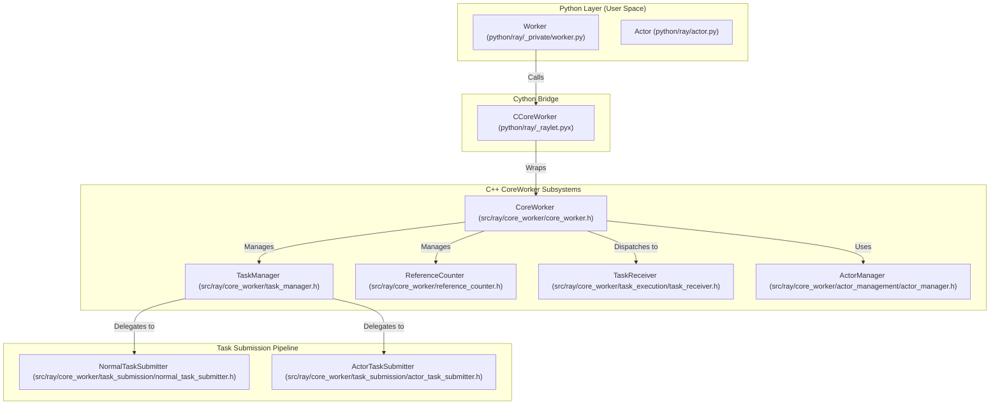
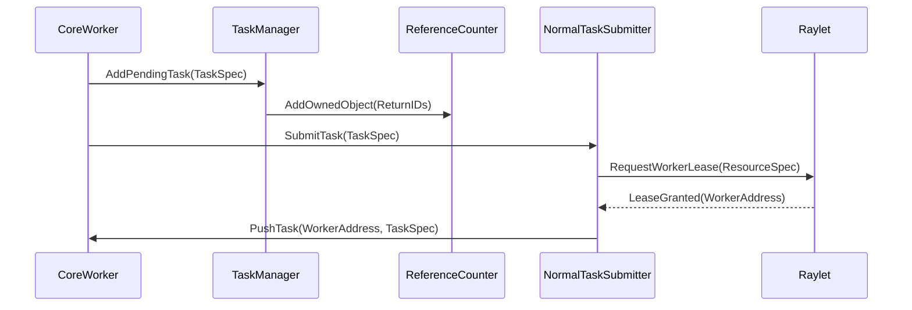

<!-- source: DeepWiki mcp.deepwiki.com · repo ray-project/ray · page 2.1 Core Worker and Task Execution · fetched 2026-10-21 -->

# Core Worker and Task Execution

Relevant source files

The following files were used as context for generating this wiki page:

- [cpp/src/ray/runtime/task/task_executor.cc](cpp/src/ray/runtime/task/task_executor.cc)
- [cpp/src/ray/runtime/task/task_executor.h](cpp/src/ray/runtime/task/task_executor.h)
- [doc/source/ray-core/api/direct-transport.rst](doc/source/ray-core/api/direct-transport.rst)
- [doc/source/ray-core/api/exceptions.rst](doc/source/ray-core/api/exceptions.rst)
- [doc/source/ray-core/direct-transport/custom-tensor-transport.rst](doc/source/ray-core/direct-transport/custom-tensor-transport.rst)
- [doc/source/ray-core/direct-transport/direct-transport.rst](doc/source/ray-core/direct-transport/direct-transport.rst)
- [doc/source/ray-core/doc_code/direct_transport_custom.py](doc/source/ray-core/doc_code/direct_transport_custom.py)
- [doc/source/ray-core/doc_code/direct_transport_gloo.py](doc/source/ray-core/doc_code/direct_transport_gloo.py)
- [doc/source/ray-security/token-auth.md](doc/source/ray-security/token-auth.md)
- [python/ray/_private/authentication/authentication_constants.py](python/ray/_private/authentication/authentication_constants.py)
- [python/ray/_private/authentication/http_token_authentication.py](python/ray/_private/authentication/http_token_authentication.py)
- [python/ray/_private/object_ref_generator.py](python/ray/_private/object_ref_generator.py)
- [python/ray/_private/serialization.py](python/ray/_private/serialization.py)
- [python/ray/_raylet.pyx](python/ray/_raylet.pyx)
- [python/ray/dashboard/client/src/authentication/TokenAuthenticationDialog.component.test.tsx](python/ray/dashboard/client/src/authentication/TokenAuthenticationDialog.component.test.tsx)
- [python/ray/dashboard/client/src/authentication/TokenAuthenticationDialog.tsx](python/ray/dashboard/client/src/authentication/TokenAuthenticationDialog.tsx)
- [python/ray/dashboard/tests/test_dashboard_auth.py](python/ray/dashboard/tests/test_dashboard_auth.py)
- [python/ray/exceptions.py](python/ray/exceptions.py)
- [python/ray/experimental/__init__.py](python/ray/experimental/__init__.py)
- [python/ray/experimental/rdt/__init__.py](python/ray/experimental/rdt/__init__.py)
- [python/ray/experimental/rdt/nixl_memory_pool.py](python/ray/experimental/rdt/nixl_memory_pool.py)
- [python/ray/experimental/rdt/nixl_tensor_transport.py](python/ray/experimental/rdt/nixl_tensor_transport.py)
- [python/ray/experimental/rdt/rdt_manager.py](python/ray/experimental/rdt/rdt_manager.py)
- [python/ray/experimental/rdt/rdt_store.py](python/ray/experimental/rdt/rdt_store.py)
- [python/ray/experimental/rdt/tensor_transport_manager.py](python/ray/experimental/rdt/tensor_transport_manager.py)
- [python/ray/experimental/rdt/util.py](python/ray/experimental/rdt/util.py)
- [python/ray/includes/libcoreworker.pxd](python/ray/includes/libcoreworker.pxd)
- [python/ray/tests/rdt/test_nixl_backend_selection.py](python/ray/tests/rdt/test_nixl_backend_selection.py)
- [python/ray/tests/rdt/test_nixl_memory_pool.py](python/ray/tests/rdt/test_nixl_memory_pool.py)
- [python/ray/tests/rdt/test_rdt_gloo.py](python/ray/tests/rdt/test_rdt_gloo.py)
- [python/ray/tests/rdt/test_rdt_manager.py](python/ray/tests/rdt/test_rdt_manager.py)
- [python/ray/tests/rdt/test_rdt_nixl.py](python/ray/tests/rdt/test_rdt_nixl.py)
- [python/ray/tests/test_exceptions.py](python/ray/tests/test_exceptions.py)
- [python/ray/tests/test_failure.py](python/ray/tests/test_failure.py)
- [python/ray/tests/test_streaming_generator.py](python/ray/tests/test_streaming_generator.py)
- [python/ray/tests/test_traceback.py](python/ray/tests/test_traceback.py)
- [python/ray/tests/test_wait.py](python/ray/tests/test_wait.py)
- [src/ray/common/protobuf_utils.cc](src/ray/common/protobuf_utils.cc)
- [src/ray/core_worker/BUILD.bazel](src/ray/core_worker/BUILD.bazel)
- [src/ray/core_worker/core_worker.cc](src/ray/core_worker/core_worker.cc)
- [src/ray/core_worker/core_worker.h](src/ray/core_worker/core_worker.h)
- [src/ray/core_worker/core_worker_options.h](src/ray/core_worker/core_worker_options.h)
- [src/ray/core_worker/core_worker_process.cc](src/ray/core_worker/core_worker_process.cc)
- [src/ray/core_worker/core_worker_process.h](src/ray/core_worker/core_worker_process.h)
- [src/ray/core_worker/future_resolver.cc](src/ray/core_worker/future_resolver.cc)
- [src/ray/core_worker/lib/java/io_ray_runtime_RayNativeRuntime.cc](src/ray/core_worker/lib/java/io_ray_runtime_RayNativeRuntime.cc)
- [src/ray/core_worker/metrics.h](src/ray/core_worker/metrics.h)
- [src/ray/core_worker/profile_event.cc](src/ray/core_worker/profile_event.cc)
- [src/ray/core_worker/profile_event.h](src/ray/core_worker/profile_event.h)
- [src/ray/core_worker/task_event_buffer.cc](src/ray/core_worker/task_event_buffer.cc)
- [src/ray/core_worker/task_event_buffer.h](src/ray/core_worker/task_event_buffer.h)
- [src/ray/core_worker/task_execution/tests/task_receiver_test.cc](src/ray/core_worker/task_execution/tests/task_receiver_test.cc)
- [src/ray/core_worker/task_manager.cc](src/ray/core_worker/task_manager.cc)
- [src/ray/core_worker/task_manager.h](src/ray/core_worker/task_manager.h)
- [src/ray/core_worker/task_submission/BUILD.bazel](src/ray/core_worker/task_submission/BUILD.bazel)
- [src/ray/core_worker/task_submission/actor_task_submitter.cc](src/ray/core_worker/task_submission/actor_task_submitter.cc)
- [src/ray/core_worker/task_submission/actor_task_submitter.h](src/ray/core_worker/task_submission/actor_task_submitter.h)
- [src/ray/core_worker/task_submission/dependency_resolver.cc](src/ray/core_worker/task_submission/dependency_resolver.cc)
- [src/ray/core_worker/task_submission/normal_task_submitter.cc](src/ray/core_worker/task_submission/normal_task_submitter.cc)
- [src/ray/core_worker/task_submission/normal_task_submitter.h](src/ray/core_worker/task_submission/normal_task_submitter.h)
- [src/ray/core_worker/task_submission/tests/BUILD.bazel](src/ray/core_worker/task_submission/tests/BUILD.bazel)
- [src/ray/core_worker/task_submission/tests/actor_task_submitter_test.cc](src/ray/core_worker/task_submission/tests/actor_task_submitter_test.cc)
- [src/ray/core_worker/task_submission/tests/dependency_resolver_test.cc](src/ray/core_worker/task_submission/tests/dependency_resolver_test.cc)
- [src/ray/core_worker/task_submission/tests/direct_actor_transport_test.cc](src/ray/core_worker/task_submission/tests/direct_actor_transport_test.cc)
- [src/ray/core_worker/task_submission/tests/normal_task_submitter_test.cc](src/ray/core_worker/task_submission/tests/normal_task_submitter_test.cc)
- [src/ray/core_worker/tests/BUILD.bazel](src/ray/core_worker/tests/BUILD.bazel)
- [src/ray/core_worker/tests/core_worker_test.cc](src/ray/core_worker/tests/core_worker_test.cc)
- [src/ray/core_worker/tests/future_resolver_test.cc](src/ray/core_worker/tests/future_resolver_test.cc)
- [src/ray/core_worker/tests/memory_store_test.cc](src/ray/core_worker/tests/memory_store_test.cc)
- [src/ray/core_worker/tests/task_event_buffer_test.cc](src/ray/core_worker/tests/task_event_buffer_test.cc)
- [src/ray/core_worker/tests/task_manager_test.cc](src/ray/core_worker/tests/task_manager_test.cc)
- [src/ray/gcs/gcs_job_manager.cc](src/ray/gcs/gcs_job_manager.cc)
- [src/ray/gcs/gcs_job_manager.h](src/ray/gcs/gcs_job_manager.h)
- [src/ray/gcs/gcs_ray_event_converter.cc](src/ray/gcs/gcs_ray_event_converter.cc)
- [src/ray/gcs/gcs_ray_event_converter.h](src/ray/gcs/gcs_ray_event_converter.h)
- [src/ray/gcs/gcs_task_manager.cc](src/ray/gcs/gcs_task_manager.cc)
- [src/ray/gcs/gcs_task_manager.h](src/ray/gcs/gcs_task_manager.h)
- [src/ray/gcs/tests/export_api/gcs_job_manager_export_event_test.cc](src/ray/gcs/tests/export_api/gcs_job_manager_export_event_test.cc)
- [src/ray/gcs/tests/gcs_job_manager_test.cc](src/ray/gcs/tests/gcs_job_manager_test.cc)
- [src/ray/gcs/tests/gcs_ray_event_converter_test.cc](src/ray/gcs/tests/gcs_ray_event_converter_test.cc)
- [src/ray/observability/ray_driver_job_definition_event.cc](src/ray/observability/ray_driver_job_definition_event.cc)
- [src/ray/protobuf/public/events_actor_task_definition_event.proto](src/ray/protobuf/public/events_actor_task_definition_event.proto)
- [src/ray/protobuf/public/events_task_definition_event.proto](src/ray/protobuf/public/events_task_definition_event.proto)
- [src/ray/protobuf/public/events_task_lifecycle_event.proto](src/ray/protobuf/public/events_task_lifecycle_event.proto)
- [src/ray/pubsub/BUILD.bazel](src/ray/pubsub/BUILD.bazel)

## Purpose and Scope

The `CoreWorker` is the fundamental runtime component that powers distributed task execution in Ray. Every worker process (including drivers) contains a `CoreWorker` instance that handles:

- **Task submission**: Submitting tasks and actor methods to the distributed system via `CoreWorker::SubmitTask` and `CoreWorker::SubmitActorTask` [python/ray/includes/libcoreworker.pxd:140-178]().
- **Task execution**: Receiving and executing tasks on worker processes through `TaskReceiver` [src/ray/core_worker/core_worker.h:51]().
- **Object management**: Storing, retrieving, and tracking distributed objects through reference counting via `ReferenceCounter` [src/ray/core_worker/core_worker.h:45]().
- **Actor lifecycle**: Managing actor creation, method invocation, and state via `ActorManager` [src/ray/core_worker/core_worker.h:34]().

This document details the `CoreWorker` implementation, its internal pipeline (including `NormalTaskSubmitter` and `ActorTaskSubmitter`), and its role in the task/actor execution lifecycle.

Sources: [src/ray/core_worker/core_worker.h:33-60](), [python/ray/includes/libcoreworker.pxd:136-183]()

---

## CoreWorker Architecture

The `CoreWorker` is implemented in C++ with Python bindings via Cython, providing a unified interface for both driver and worker processes.

### Component Map: Natural Language to Code Entities

The following diagram maps high-level system responsibilities to the specific C++ classes and Python modules that implement them, bridging natural language concepts to concrete code entities.

**Architecture and Code Entity Mapping**

Sources: [python/ray/includes/libcoreworker.pxd:136-183](), [src/ray/core_worker/core_worker.h:33-60](), [python/ray/_raylet.pyx:1-253]()

### Key Classes and Responsibilities

| Class | File | Responsibility |
| :--- | :--- | :--- |
| `CoreWorker` | [python/ray/includes/libcoreworker.pxd:136-183]() | Central orchestrator for task submission, execution, and object management. |
| `WorkerContext` | [python/ray/includes/libcoreworker.pxd:92-100]() | Tracks thread-local state like `current_task_id`, `current_actor_id`, and `job_id`. |
| `TaskManager` | [src/ray/core_worker/task_manager.h:34-45]() | Tracks pending tasks, manages return values, and handles generator streams (`ObjectRefStream`). |
| `TaskReceiver` | [src/ray/core_worker/task_execution/task_receiver.h:51-51]() | Receives tasks from the Raylet and dispatches them to the language-specific execution callback. |
| `ReferenceCounter` | [src/ray/core_worker/reference_counter.h:45-46]() | Tracks object lifetimes (local, submitted, and contained) for distributed GC. |
| `NormalTaskSubmitter` | [src/ray/core_worker/task_submission/normal_task_submitter.h:51-51]() | Handles lease requests from Raylets and pushes non-actor tasks. |
| `ActorTaskSubmitter` | [src/ray/core_worker/task_submission/actor_task_submitter.h:23-23]() | Manages actor task ordering, pending call limits, and actor state resolution. |

Sources: [python/ray/includes/libcoreworker.pxd:136-183](), [src/ray/core_worker/core_worker.h:33-60]()

---

## Task Submission Pipeline

Task submission is split into two primary paths: **Normal Tasks** (stateless) managed by `NormalTaskSubmitter` and **Actor Tasks** (stateful) managed by `ActorTaskSubmitter`. Both paths utilize the `TaskManager` to register pending tasks and their expected return objects [src/ray/core_worker/task_manager.h:34-45]().

### 1. Normal Task Submission
Normal tasks use `NormalTaskSubmitter`. The process involves requesting a worker lease from the local Raylet before pushing the task directly to the leased worker.

**Normal Task Submission Code Entity Flow**

Sources: [src/ray/core_worker/task_submission/normal_task_submitter.h:51-51](), [src/ray/core_worker/task_manager.h:34-45]()

### 2. Actor Task Submission
Actor tasks use `ActorTaskSubmitter`. Unlike normal tasks, actor tasks are routed based on the `ActorID`. The submitter ensures that tasks are sent in order and respects the `max_pending_calls` limit defined in the `ActorHandle` [python/ray/includes/libcoreworker.pxd:123-135]().

- **Ordering**: `ActorTaskSubmitter` maintains a per-actor queue to ensure sequential execution for non-concurrent actors.
- **Resolution**: If the actor's location is unknown, `ActorManager` resolves the actor's address via the GCS before submission.

Sources: [src/ray/core_worker/task_submission/actor_task_submitter.h:23-23](), [python/ray/includes/libcoreworker.pxd:123-135]()

---

## Task Execution and Lifecycle

When a worker receives a task, it enters the execution loop managed by `TaskReceiver` [src/ray/core_worker/core_worker.h:51]().

### Execution Flow
1. **Dependency Resolution**: `TaskReceiver` ensures all `ObjectRef` arguments are available locally (fetching from Plasma if necessary).
2. **Execution Callback**: `CoreWorker` invokes the task execution callback (provided during initialization and bound in Cython) [src/ray/core_worker/tests/core_worker_test.cc:78-104]().
3. **Metric Tracking**: `TaskCounter` updates the task status using methods like `MovePendingToRunning` and `MoveRunningToFinished` [src/ray/core_worker/core_worker.h:95-108]().
4. **Return Object Allocation**: The worker reserves space in the Object Store (Plasma) or Memory Store for results [src/ray/core_worker/task_manager.cc:44-63]().

### Task Status Transitions in CoreWorker
| Status | Method | Description |
| :--- | :--- | :--- |
| `kPending` | `IncPending` | Task is submitted but not yet running [src/ray/core_worker/core_worker.h:90-93](). |
| `kRunning` | `MovePendingToRunning` | Worker has started executing the task logic [src/ray/core_worker/core_worker.h:95-100](). |
| `kFinished` | `MoveRunningToFinished` | Task logic completed; results are being sealed [src/ray/core_worker/core_worker.h:102-108](). |

Sources: [src/ray/core_worker/core_worker.h:65-117](), [src/ray/core_worker/task_manager.cc:44-63]()

---

## Object Lifecycle and Reference Counting

Ray uses a distributed reference counting mechanism implemented in `ReferenceCounter` [src/ray/core_worker/core_worker.h:45]().

### Reference Types
`ReferenceCounter` tracks three types of references to an `ObjectID`:
1. **Local References**: Held by the language runtime (e.g., a Python `ObjectRef` object) [python/ray/_private/serialization.py:79-81]().
2. **Submitted Task References**: Objects passed as arguments to pending tasks.
3. **Contained References**: Objects nested inside other objects.

### Reference Counting Logic
- **Ownership**: The worker that creates an object (via `ray.put` or as a task return) is the **owner**.
- **Borrowing**: Workers that receive an `ObjectRef` are **borrowers**. Borrowers report their local reference counts back to the owner.
- **Fate Sharing**: If an owner dies, all objects it owned become unreachable, throwing an `OwnerDiedError` [python/ray/_private/serialization.py:42]().

Sources: [src/ray/core_worker/core_worker.h:45-46](), [python/ray/_private/serialization.py:28-54]()

---

## Actor Management and Fault Tolerance

### Actor Lifecycle
Actors are created via `ACTOR_CREATION_TASK` [python/ray/includes/libcoreworker.pxd:121](). `ActorManager` tracks the state of all actor handles visible to the worker [src/ray/core_worker/core_worker.h:34]().

- **Creation**: Handled by GCS; `CoreWorker` submits the creation task and waits for instantiation [python/ray/includes/libcoreworker.pxd:151-157]().
- **Death Detection**: `CoreWorker` subscribes to actor state changes from GCS. If an actor dies, `ActorManager` marks the handle as dead, and subsequent tasks fail with `RayActorError` [python/ray/_private/serialization.py:211]().

### Fault Tolerance Mechanisms
1. **Task Retries**: Controlled by `max_retries` in `TaskSpecification`. If a worker or actor dies, `TaskManager` triggers a retry using exponential backoff via `GetTaskRetryDelayMs` [src/ray/core_worker/task_manager.h:61-73]().
2. **Lineage Reconstruction**: If an object is lost and was created by a task, Ray can re-execute the task lineage to recover the object [src/ray/core_worker/core_worker.h:43]().
3. **Object Recovery**: Managed by `ObjectRecoveryManager`, which coordinates with `ReferenceCounter` and GCS to find or recreate lost objects [src/ray/core_worker/core_worker.h:43]().

Sources: [src/ray/core_worker/task_manager.h:61-73](), [src/ray/core_worker/core_worker.h:34-43]()

---

## Generator Tasks and Streaming Returns

For tasks returning multiple values (Generators), Ray uses `ObjectRefStream` to manage dynamic returns [src/ray/core_worker/task_manager.h:102-122]().

- **`ObjectRefStream`**: Manages a sequence of `ObjectIDs` associated with a single generator task [src/ray/core_worker/task_manager.h:102-122]().
- **Backpressure**: `TaskGeneratorBackpressureWaiter` prevents a generator from producing objects faster than the consumer can process them [python/ray/includes/libcoreworker.pxd:101-110]().
- **EndOfStream**: The stream is closed when the task finishes or explicitly signals EOF [src/ray/core_worker/task_manager.cc:100-113]().

Sources: [src/ray/core_worker/task_manager.h:102-122](), [python/ray/includes/libcoreworker.pxd:101-110]()

---

## Worker Initialization and Shutdown

### Initialization
`CoreWorkerProcess` initializes the singleton `CoreWorker` instance [src/ray/core_worker/core_worker_process.cc:91-95]().
1. **IO Service**: Starts a background `io_service_` thread for RPC and GCS communication [src/ray/core_worker/core_worker_process.cc:147-152]().
2. **GCS Registration**: Registers the worker with GCS to receive a `WorkerID`.
3. **Signal Handling**: Sets up signal handlers to trigger graceful shutdown.

### Shutdown
Shutdown is coordinated by `ShutdownCoordinator` and `CoreWorkerShutdownExecutor` [src/ray/core_worker/core_worker.h:27-28]().
- **Graceful Shutdown**: The worker stops accepting new tasks, flushes pending task events via `TaskEventBuffer`, and notifies the Raylet [src/ray/core_worker/core_worker.h:50]().
- **Exit Types**: Workers exit with specific types like `INTENDED_USER_EXIT`, `SYSTEM_ERROR`, or `NODE_OUT_OF_MEMORY`, which map to `ShutdownReason` [src/ray/core_worker/core_worker.cc:134-150]().

Sources: [src/ray/core_worker/core_worker_process.cc:91-125](), [src/ray/core_worker/core_worker.cc:27-28]()

---

