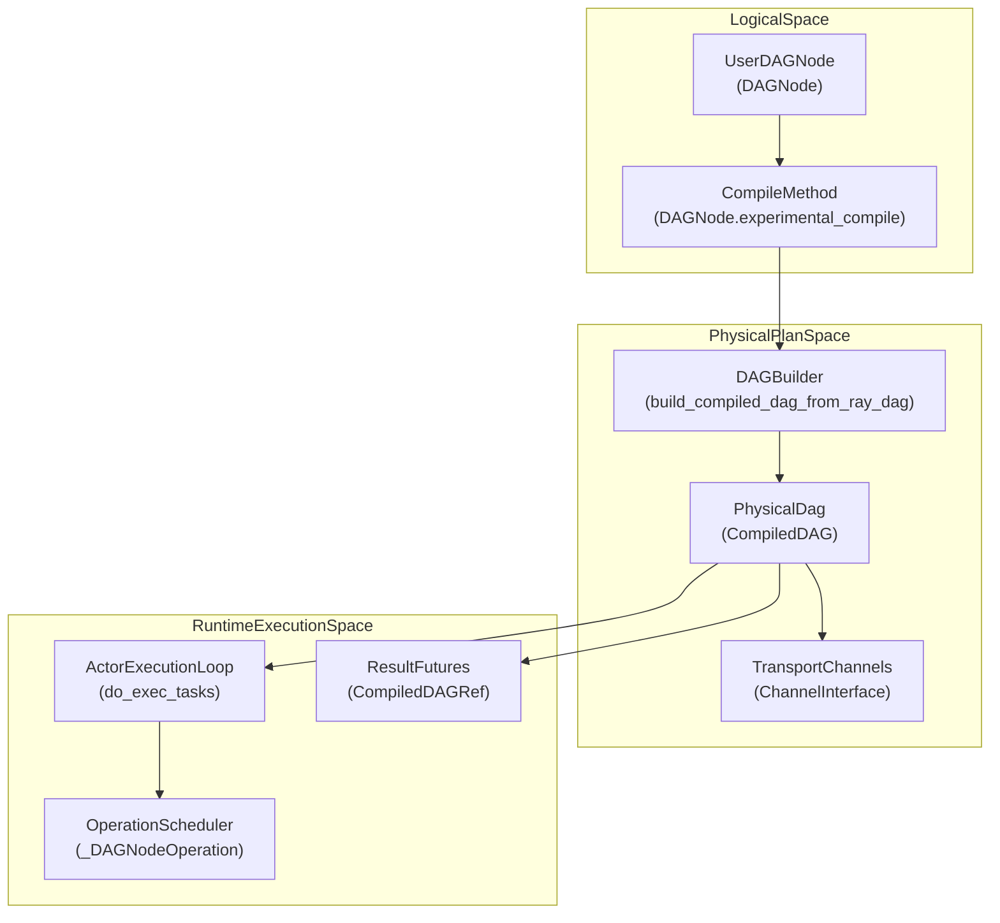
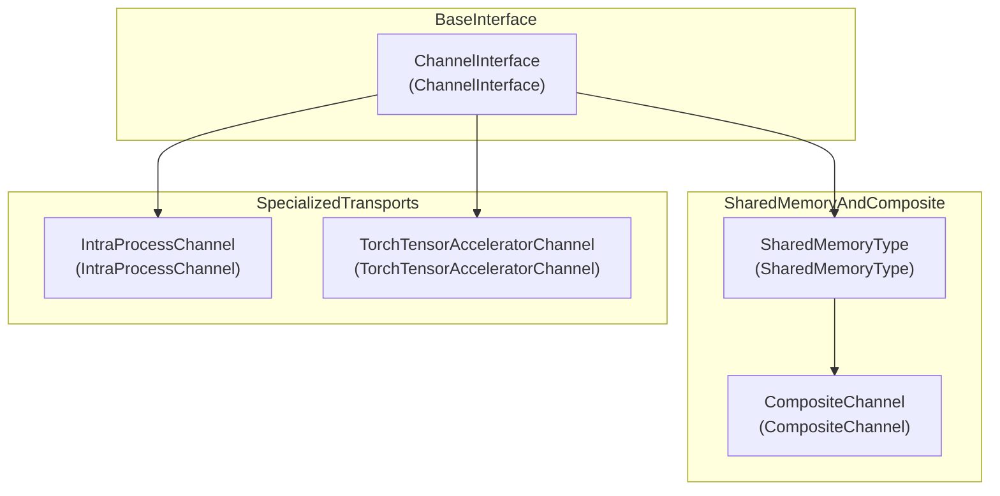
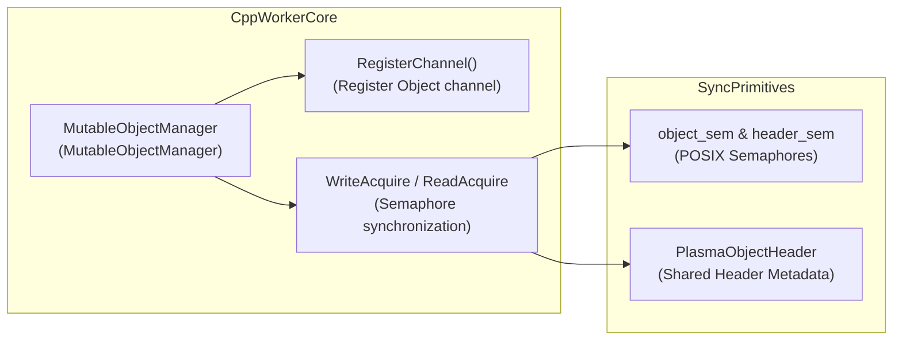

<!-- source: DeepWiki mcp.deepwiki.com · repo ray-project/ray · page 2.2 Compiled DAG and Accelerated Execution · fetched 2026-10-21 -->

# Compiled DAG and Accelerated Execution

Relevant source files

The following files were used as context for generating this wiki page:

- [python/ray/_private/ray_experimental_perf.py](python/ray/_private/ray_experimental_perf.py)
- [python/ray/dag/__init__.py](python/ray/dag/__init__.py)
- [python/ray/dag/collective_node.py](python/ray/dag/collective_node.py)
- [python/ray/dag/compiled_dag_node.py](python/ray/dag/compiled_dag_node.py)
- [python/ray/dag/constants.py](python/ray/dag/constants.py)
- [python/ray/dag/context.py](python/ray/dag/context.py)
- [python/ray/dag/dag_node.py](python/ray/dag/dag_node.py)
- [python/ray/dag/dag_node_operation.py](python/ray/dag/dag_node_operation.py)
- [python/ray/dag/tests/experimental/test_collective_dag.py](python/ray/dag/tests/experimental/test_collective_dag.py)
- [python/ray/dag/tests/experimental/test_cpu_communicator_dag.py](python/ray/dag/tests/experimental/test_cpu_communicator_dag.py)
- [python/ray/dag/tests/experimental/test_execution_schedule.py](python/ray/dag/tests/experimental/test_execution_schedule.py)
- [python/ray/dag/tests/experimental/test_execution_schedule_gpu.py](python/ray/dag/tests/experimental/test_execution_schedule_gpu.py)
- [python/ray/dag/tests/experimental/test_mocked_nccl_dag.py](python/ray/dag/tests/experimental/test_mocked_nccl_dag.py)
- [python/ray/dag/tests/experimental/test_multi_args_gpu.py](python/ray/dag/tests/experimental/test_multi_args_gpu.py)
- [python/ray/dag/tests/experimental/test_multi_node_dag.py](python/ray/dag/tests/experimental/test_multi_node_dag.py)
- [python/ray/dag/tests/experimental/test_torch_tensor_dag.py](python/ray/dag/tests/experimental/test_torch_tensor_dag.py)
- [python/ray/dag/tests/experimental/test_torch_tensor_transport.py](python/ray/dag/tests/experimental/test_torch_tensor_transport.py)
- [python/ray/experimental/channel/auto_transport_type.py](python/ray/experimental/channel/auto_transport_type.py)
- [python/ray/experimental/channel/common.py](python/ray/experimental/channel/common.py)
- [python/ray/experimental/channel/communicator.py](python/ray/experimental/channel/communicator.py)
- [python/ray/experimental/channel/conftest.py](python/ray/experimental/channel/conftest.py)
- [python/ray/experimental/channel/cpu_communicator.py](python/ray/experimental/channel/cpu_communicator.py)
- [python/ray/experimental/channel/intra_process_channel.py](python/ray/experimental/channel/intra_process_channel.py)
- [python/ray/experimental/channel/nccl_group.py](python/ray/experimental/channel/nccl_group.py)
- [python/ray/experimental/channel/serialization_context.py](python/ray/experimental/channel/serialization_context.py)
- [python/ray/experimental/channel/shared_memory_channel.py](python/ray/experimental/channel/shared_memory_channel.py)
- [python/ray/experimental/channel/torch_tensor_type.py](python/ray/experimental/channel/torch_tensor_type.py)
- [python/ray/experimental/channel/utils.py](python/ray/experimental/channel/utils.py)
- [python/ray/experimental/collective/conftest.py](python/ray/experimental/collective/conftest.py)
- [python/ray/experimental/collective/operations.py](python/ray/experimental/collective/operations.py)
- [python/ray/experimental/compiled_dag_ref.py](python/ray/experimental/compiled_dag_ref.py)
- [python/ray/tests/test_channel.py](python/ray/tests/test_channel.py)
- [python/ray/tests/test_nccl_channel.py](python/ray/tests/test_nccl_channel.py)
- [src/ray/core_worker/experimental_mutable_object_manager.cc](src/ray/core_worker/experimental_mutable_object_manager.cc)
- [src/ray/core_worker/experimental_mutable_object_manager.h](src/ray/core_worker/experimental_mutable_object_manager.h)
- [src/ray/core_worker/experimental_mutable_object_provider.cc](src/ray/core_worker/experimental_mutable_object_provider.cc)
- [src/ray/core_worker/experimental_mutable_object_provider.h](src/ray/core_worker/experimental_mutable_object_provider.h)
- [src/ray/object_manager/common.cc](src/ray/object_manager/common.cc)
- [src/ray/object_manager/common.h](src/ray/object_manager/common.h)

## Purpose and Scope

This document describes the experimental Compiled DAG system in Ray, which provides accelerated task graph execution through pre-allocated communication channels, static scheduling, shared memory optimization, and GPU-direct tensor transport via NCCL. Compiled DAGs eliminate traditional Ray task submission overhead by bypassing the distributed scheduler for iterative execution.

For general Ray task execution and worker architecture, see [Core Worker and Task Execution (2.1)](). For lower-level node management and the Plasma object store, see [Raylet, GCS, and Object Store (2.3)]().

Sources: [python/ray/dag/dag_node.py:1-40](), [python/ray/dag/compiled_dag_node.py:1-80]()

## Overview and Motivation

Traditional Ray task graphs submit tasks dynamically, generating new `ObjectRef`s and incurring scheduling and serialization overhead on each iteration. The Compiled DAG (also known as Ray Compiled Graphs) framework addresses this by introducing:
- **Pre-allocated communication channels** between persistent actors and drivers [python/ray/experimental/channel/common.py:177-182]().
- **Zero-copy memory transport** via host shared memory (`SharedMemoryType`) and intra-process buffers (`IntraProcessChannel`) [python/ray/experimental/channel/shared_memory_channel.py:94-112](), [python/ray/experimental/channel/intra_process_channel.py:1-15]().
- **Direct GPU-to-GPU transport** using NCCL (`_NcclGroup`) for `torch.Tensor` workloads [python/ray/experimental/channel/torch_tensor_type.py:17-49](), [python/ray/experimental/channel/nccl_group.py:21-38]().
- **Static execution schedules** where actors execute deterministic sequences of `READ`, `COMPUTE`, and `WRITE` operations [python/ray/dag/dag_node_operation.py:14-24]().

Sources: [python/ray/dag/dag_node.py:1-40](), [python/ray/experimental/channel/common.py:177-182](), [python/ray/experimental/channel/torch_tensor_type.py:17-49](), [python/ray/dag/dag_node_operation.py:14-24]()

## Core Architecture and Component Mapping

The Compiled DAG subsystem transforms a logical `DAGNode` tree into a compiled execution plan managed by `CompiledDAG` [python/ray/dag/compiled_dag_node.py:805-830](). 

### System-to-Code Entity Mapping

The diagram below maps the high-level system concepts of Compiled DAGs to their concrete code entities in the Ray codebase.

Sources: [python/ray/dag/dag_node.py:1-40](), [python/ray/dag/compiled_dag_node.py:150-200](), [python/ray/experimental/channel/common.py:177-182](), [python/ray/experimental/compiled_dag_ref.py:36-75]()

### Key Components Table

| Component Name | Role / Responsibility | Code Entity (Class / Function) |
|---|---|---|
| **Compiled DAG Coordinator** | Manages compilation, resource allocation, actor startup, and result tracking. | `CompiledDAG` [python/ray/dag/compiled_dag_node.py:805]() |
| **Executable Task Wrapper** | Encapsulates actor methods and their binding in compiled tasks. | `ExecutableTask` [python/ray/dag/compiled_dag_node.py:478]() |
| **Channel Interface** | Abstract transport contract between writer and reader actors. | `ChannelInterface` [python/ray/experimental/channel/common.py:177]() |
| **Operation Graph Node** | Represents an individual execution step (`READ`, `COMPUTE`, `WRITE`). | `_DAGOperationGraphNode` [python/ray/dag/dag_node_operation.py:87]() |
| **Operation Sentinel** | Defines sequencing instructions for the actor execution loop. | `_DAGNodeOperation` [python/ray/dag/dag_node_operation.py:41]() |

Sources: [python/ray/dag/compiled_dag_node.py:478-805](), [python/ray/dag/dag_node_operation.py:41-87](), [python/ray/experimental/channel/common.py:177-182]()

## Channel-Based Communication

Data movement between actors in a Compiled DAG is mediated by channels that implement `ChannelInterface` [python/ray/experimental/channel/common.py:177-182]().

### Channel Hierarchy Diagram

Sources: [python/ray/experimental/channel/common.py:177-182](), [python/ray/experimental/channel/shared_memory_channel.py:94-152](), [python/ray/experimental/channel/torch_tensor_type.py:17-156]()

### Transport Mechanisms
- **`IntraProcessChannel`**: Used when sender and receiver are co-located in the same worker process, bypassing serialization entirely via `_SerializationContext` [python/ray/experimental/channel/serialization_context.py:28-69]().
- **`SharedMemoryType` & `CompositeChannel`**: Allocates memory buffers using Ray's object store (Plasma) and coordinates multi-reader or remote access using semaphores [python/ray/experimental/channel/shared_memory_channel.py:94-152]().
- **`TorchTensorAcceleratorChannel`**: Optimized for PyTorch tensors, routing them through NCCL communicator groups or fallback shared memory channels depending on configuration [python/ray/experimental/channel/torch_tensor_type.py:17-156]().

Sources: [python/ray/experimental/channel/common.py:177-182](), [python/ray/experimental/channel/shared_memory_channel.py:94-152](), [python/ray/experimental/channel/serialization_context.py:28-69](), [python/ray/experimental/channel/torch_tensor_type.py:17-156]()

## ExecutableTask and Operations

Compiled DAG actor methods are invoked through a dedicated worker execution loop rather than standard Ray task scheduling.

### Operation Types and Scheduling
Each task execution is broken down into ordered operations (`_DAGNodeOperationType`) [python/ray/dag/dag_node_operation.py:14-24]():
1. `READ`: Fetch input arguments from input channels.
2. `COMPUTE`: Execute the bound actor method.
3. `WRITE`: Serialize and push return values to output channels.

The `do_exec_tasks` function runs an infinite loop on participant actors, executing operations according to the pre-computed schedule [python/ray/dag/compiled_dag_node.py:186-210]().

Sources: [python/ray/dag/dag_node_operation.py:14-24](), [python/ray/dag/compiled_dag_node.py:186-210]()

## Mutable Objects and Zero-Precision Memory Management

To avoid allocating new objects in the Plasma store on every graph execution, Compiled DAGs leverage mutable objects managed by C++ code.

### MutableObjectManager Architecture
The `MutableObjectManager` class handles channel registration and cross-process synchronization using POSIX semaphores and plasma object headers [src/ray/core_worker/experimental_mutable_object_manager.cc:59-108]().

Sources: [src/ray/core_worker/experimental_mutable_object_manager.cc:59-182](), [src/ray/core_worker/experimental_mutable_object_manager.h:1-50]()

- **`RegisterChannel`**: Associates an `ObjectID` with a `plasma::MutableObject` and initializes synchronization semaphores (`object_sem`, `header_sem`) [src/ray/core_worker/experimental_mutable_object_manager.cc:59-83]().
- **Write/Read Synchronization**: Writers acquire the object semaphore before writing and release the header semaphore upon completion. Readers wait on the header semaphore and release the object semaphore when done reading [src/ray/core_worker/experimental_mutable_object_manager.cc:212-403]().

Sources: [src/ray/core_worker/experimental_mutable_object_manager.cc:59-403](), [src/ray/core_worker/experimental_mutable_object_manager.h:1-50]()

## GPU Tensor Transport via NCCL

For GPU actor workloads, Compiled DAGs utilize NCCL via `_NcclGroup` to achieve high-throughput, low-latency tensor transport [python/ray/experimental/channel/nccl_group.py:21-38]().

### Communicator Setup and Overlap
- **`_NcclGroup`**: Implements `Communicator` and wraps NCCL primitives (`ncclComm_t`) for peer-to-peer send/recv and collectives (`allreduce`) [python/ray/experimental/channel/nccl_group.py:21-115]().
- **Stream Overlap**: Supports dedicated send and receive CUDA streams (`_send_stream`, `_recv_stream`) to overlap communication with GPU computation kernels [python/ray/experimental/channel/nccl_group.py:102-113]().

Sources: [python/ray/experimental/channel/communicator.py:1-50](), [python/ray/experimental/channel/nccl_group.py:21-115]()

## Compilation and Execution Flow

The end-to-end execution lifecycle of a Compiled DAG proceeds through three distinct phases:

1. **Logical Definition**: The user builds a task graph using `DAGNode` and `.bind()` syntax [python/ray/dag/dag_node.py:33-65]().
2. **Compilation**: Calling `.experimental_compile()` triggers `build_compiled_dag_from_ray_dag()`, which validates the graph, allocates input/output channels via `do_allocate_channel`, and dispatches execution loop tasks to actors [python/ray/dag/compiled_dag_node.py:150-182]().
3. **Execution**: Invoking `compiled_dag.execute()` writes inputs to root channels, drives the actor execution loops, and returns a `CompiledDAGRef` whose `.get()` retrieves the final outputs [python/ray/experimental/compiled_dag_ref.py:36-118]().

Sources: [python/ray/dag/dag_node.py:33-65](), [python/ray/dag/compiled_dag_node.py:150-182](), [python/ray/experimental/compiled_dag_ref.py:36-118]()

---

