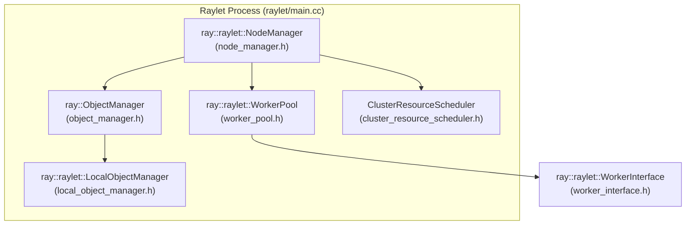
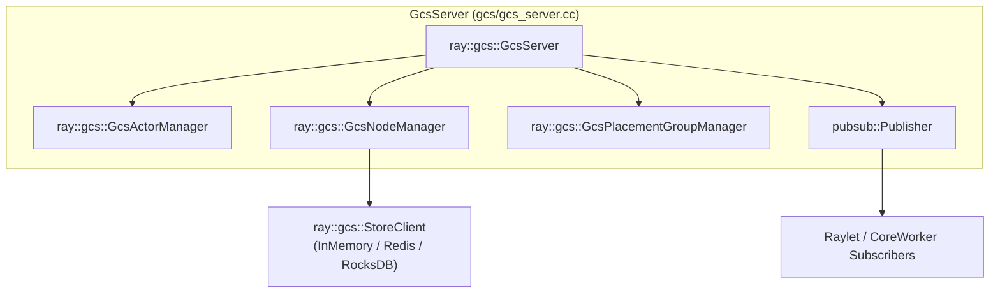
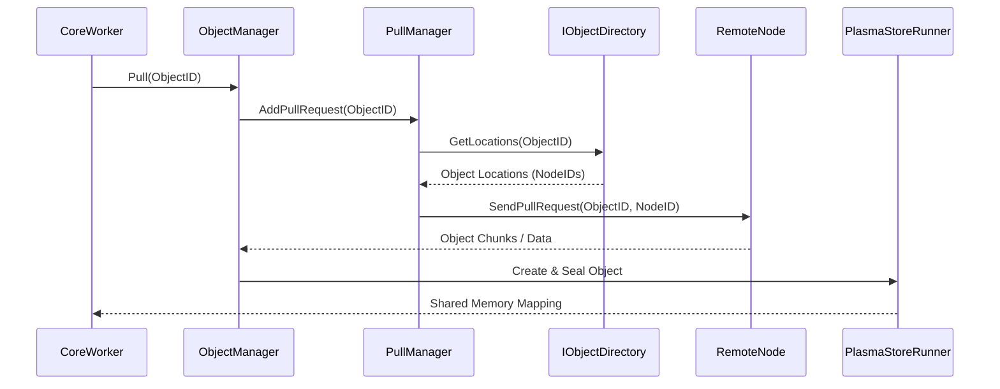
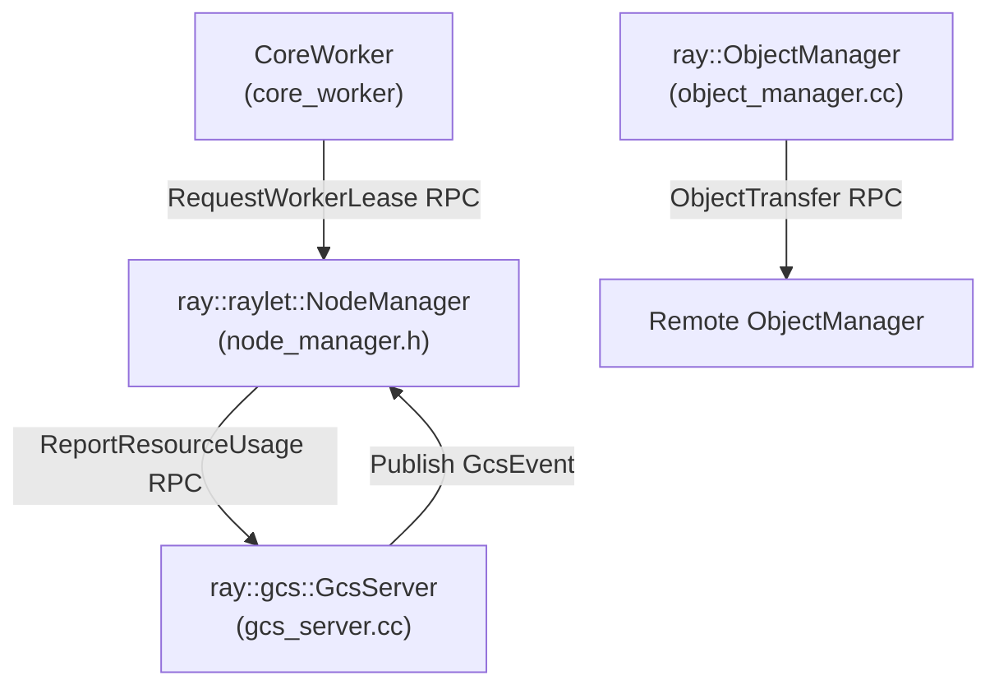

<!-- source: DeepWiki mcp.deepwiki.com · repo ray-project/ray · page 2.3 Raylet, GCS, and Object Store · fetched 2026-10-21 -->

# Raylet, GCS, and Object Store

Relevant source files

The following files were used as context for generating this wiki page:

- [cpp/src/ray/runtime/object/local_mode_object_store.cc](cpp/src/ray/runtime/object/local_mode_object_store.cc)
- [doc/source/ray-core/configure.rst](doc/source/ray-core/configure.rst)
- [doc/source/ray-core/internals/port-service-discovery.rst](doc/source/ray-core/internals/port-service-discovery.rst)
- [doc/source/ray-observability/user-guides/debug-apps/debug-worker-thread-count.md](doc/source/ray-observability/user-guides/debug-apps/debug-worker-thread-count.md)
- [doc/source/ray-observability/user-guides/debug-apps/index.md](doc/source/ray-observability/user-guides/debug-apps/index.md)
- [python/ray/_private/state.py](python/ray/_private/state.py)
- [python/ray/includes/common.pxd](python/ray/includes/common.pxd)
- [python/ray/includes/common.pxi](python/ray/includes/common.pxi)
- [python/ray/includes/gcs_client.pxi](python/ray/includes/gcs_client.pxi)
- [python/ray/includes/global_state_accessor.pxd](python/ray/includes/global_state_accessor.pxd)
- [python/ray/includes/global_state_accessor.pxi](python/ray/includes/global_state_accessor.pxi)
- [python/ray/tests/test_actor_advanced.py](python/ray/tests/test_actor_advanced.py)
- [python/ray/tests/test_actor_lineage_reconstruction.py](python/ray/tests/test_actor_lineage_reconstruction.py)
- [python/ray/tests/test_core_worker_fault_tolerance.py](python/ray/tests/test_core_worker_fault_tolerance.py)
- [python/ray/tests/test_global_state.py](python/ray/tests/test_global_state.py)
- [python/ray/tests/test_object_manager_fault_tolerance.py](python/ray/tests/test_object_manager_fault_tolerance.py)
- [python/ray/tests/test_raylet_fault_tolerance.py](python/ray/tests/test_raylet_fault_tolerance.py)
- [python/ray/tests/test_state_api_2.py](python/ray/tests/test_state_api_2.py)
- [python/ray/tests/test_streaming_generator_4.py](python/ray/tests/test_streaming_generator_4.py)
- [python/ray/tests/test_task_events_3.py](python/ray/tests/test_task_events_3.py)
- [src/mock/ray/gcs/gcs_actor_manager.h](src/mock/ray/gcs/gcs_actor_manager.h)
- [src/mock/ray/gcs_client/accessor.h](src/mock/ray/gcs_client/accessor.h)
- [src/mock/ray/object_manager/object_directory.h](src/mock/ray/object_manager/object_directory.h)
- [src/mock/ray/object_manager/object_manager.h](src/mock/ray/object_manager/object_manager.h)
- [src/mock/ray/raylet/worker.h](src/mock/ray/raylet/worker.h)
- [src/mock/ray/raylet_client/raylet_client.h](src/mock/ray/raylet_client/raylet_client.h)
- [src/ray/common/BUILD.bazel](src/ray/common/BUILD.bazel)
- [src/ray/common/constants.h](src/ray/common/constants.h)
- [src/ray/common/event_stats.cc](src/ray/common/event_stats.cc)
- [src/ray/common/event_stats.h](src/ray/common/event_stats.h)
- [src/ray/common/tests/BUILD.bazel](src/ray/common/tests/BUILD.bazel)
- [src/ray/core_worker/store_provider/memory_store/memory_store.cc](src/ray/core_worker/store_provider/memory_store/memory_store.cc)
- [src/ray/core_worker/store_provider/memory_store/memory_store.h](src/ray/core_worker/store_provider/memory_store/memory_store.h)
- [src/ray/core_worker/store_provider/plasma_store_provider.cc](src/ray/core_worker/store_provider/plasma_store_provider.cc)
- [src/ray/core_worker/store_provider/plasma_store_provider.h](src/ray/core_worker/store_provider/plasma_store_provider.h)
- [src/ray/flatbuffers/node_manager.fbs](src/ray/flatbuffers/node_manager.fbs)
- [src/ray/gcs/BUILD.bazel](src/ray/gcs/BUILD.bazel)
- [src/ray/gcs/gcs_node_manager.cc](src/ray/gcs/gcs_node_manager.cc)
- [src/ray/gcs/gcs_node_manager.h](src/ray/gcs/gcs_node_manager.h)
- [src/ray/gcs/gcs_resource_load_puller.cc](src/ray/gcs/gcs_resource_load_puller.cc)
- [src/ray/gcs/gcs_resource_load_puller.h](src/ray/gcs/gcs_resource_load_puller.h)
- [src/ray/gcs/gcs_server.cc](src/ray/gcs/gcs_server.cc)
- [src/ray/gcs/gcs_server.h](src/ray/gcs/gcs_server.h)
- [src/ray/gcs/gcs_server_io_context_policy.h](src/ray/gcs/gcs_server_io_context_policy.h)
- [src/ray/gcs/gcs_server_main.cc](src/ray/gcs/gcs_server_main.cc)
- [src/ray/gcs/grpc_service_interfaces.h](src/ray/gcs/grpc_service_interfaces.h)
- [src/ray/gcs/grpc_services.cc](src/ray/gcs/grpc_services.cc)
- [src/ray/gcs/grpc_services.h](src/ray/gcs/grpc_services.h)
- [src/ray/gcs/metrics.h](src/ray/gcs/metrics.h)
- [src/ray/gcs/pubsub_handler.cc](src/ray/gcs/pubsub_handler.cc)
- [src/ray/gcs/pubsub_handler.h](src/ray/gcs/pubsub_handler.h)
- [src/ray/gcs/tests/BUILD.bazel](src/ray/gcs/tests/BUILD.bazel)
- [src/ray/gcs/tests/export_api/gcs_actor_manager_export_event_test.cc](src/ray/gcs/tests/export_api/gcs_actor_manager_export_event_test.cc)
- [src/ray/gcs/tests/export_api/gcs_node_manager_export_event_test.cc](src/ray/gcs/tests/export_api/gcs_node_manager_export_event_test.cc)
- [src/ray/gcs/tests/gcs_node_manager_test.cc](src/ray/gcs/tests/gcs_node_manager_test.cc)
- [src/ray/gcs/tests/gcs_resource_load_puller_test.cc](src/ray/gcs/tests/gcs_resource_load_puller_test.cc)
- [src/ray/gcs/tests/gcs_server_rpc_test.cc](src/ray/gcs/tests/gcs_server_rpc_test.cc)
- [src/ray/gcs/tests/gcs_server_test_util.h](src/ray/gcs/tests/gcs_server_test_util.h)
- [src/ray/gcs/tests/pubsub_handler_test.cc](src/ray/gcs/tests/pubsub_handler_test.cc)
- [src/ray/gcs_rpc_client/accessor.cc](src/ray/gcs_rpc_client/accessor.cc)
- [src/ray/gcs_rpc_client/accessor.h](src/ray/gcs_rpc_client/accessor.h)
- [src/ray/gcs_rpc_client/rpc_client.h](src/ray/gcs_rpc_client/rpc_client.h)
- [src/ray/gcs_rpc_client/tests/gcs_client_reconnection_test.cc](src/ray/gcs_rpc_client/tests/gcs_client_reconnection_test.cc)
- [src/ray/gcs_rpc_client/tests/gcs_client_test.cc](src/ray/gcs_rpc_client/tests/gcs_client_test.cc)
- [src/ray/gcs_rpc_client/tests/global_state_accessor_test.cc](src/ray/gcs_rpc_client/tests/global_state_accessor_test.cc)
- [src/ray/object_manager/chunk_object_reader.h](src/ray/object_manager/chunk_object_reader.h)
- [src/ray/object_manager/object_directory.h](src/ray/object_manager/object_directory.h)
- [src/ray/object_manager/object_manager.cc](src/ray/object_manager/object_manager.cc)
- [src/ray/object_manager/object_manager.h](src/ray/object_manager/object_manager.h)
- [src/ray/object_manager/ownership_object_directory.cc](src/ray/object_manager/ownership_object_directory.cc)
- [src/ray/object_manager/ownership_object_directory.h](src/ray/object_manager/ownership_object_directory.h)
- [src/ray/object_manager/plasma/fake_plasma_client.h](src/ray/object_manager/plasma/fake_plasma_client.h)
- [src/ray/object_manager/push_manager.cc](src/ray/object_manager/push_manager.cc)
- [src/ray/object_manager/push_manager.h](src/ray/object_manager/push_manager.h)
- [src/ray/object_manager/tests/BUILD.bazel](src/ray/object_manager/tests/BUILD.bazel)
- [src/ray/object_manager/tests/object_manager_test.cc](src/ray/object_manager/tests/object_manager_test.cc)
- [src/ray/object_manager/tests/ownership_object_directory_test.cc](src/ray/object_manager/tests/ownership_object_directory_test.cc)
- [src/ray/object_manager/tests/push_manager_test.cc](src/ray/object_manager/tests/push_manager_test.cc)
- [src/ray/protobuf/gcs_service.proto](src/ray/protobuf/gcs_service.proto)
- [src/ray/protobuf/node_manager.proto](src/ray/protobuf/node_manager.proto)
- [src/ray/pubsub/gcs_subscriber.cc](src/ray/pubsub/gcs_subscriber.cc)
- [src/ray/pubsub/gcs_subscriber.h](src/ray/pubsub/gcs_subscriber.h)
- [src/ray/raylet/BUILD.bazel](src/ray/raylet/BUILD.bazel)
- [src/ray/raylet/fake_worker.h](src/ray/raylet/fake_worker.h)
- [src/ray/raylet/lease_dependency_manager.cc](src/ray/raylet/lease_dependency_manager.cc)
- [src/ray/raylet/lease_dependency_manager.h](src/ray/raylet/lease_dependency_manager.h)
- [src/ray/raylet/main.cc](src/ray/raylet/main.cc)
- [src/ray/raylet/node_manager.cc](src/ray/raylet/node_manager.cc)
- [src/ray/raylet/node_manager.h](src/ray/raylet/node_manager.h)
- [src/ray/raylet/noop_worker_killing_policy.h](src/ray/raylet/noop_worker_killing_policy.h)
- [src/ray/raylet/tests/BUILD.bazel](src/ray/raylet/tests/BUILD.bazel)
- [src/ray/raylet/tests/lease_dependency_manager_test.cc](src/ray/raylet/tests/lease_dependency_manager_test.cc)
- [src/ray/raylet/tests/node_manager_test.cc](src/ray/raylet/tests/node_manager_test.cc)
- [src/ray/raylet/tests/util.h](src/ray/raylet/tests/util.h)
- [src/ray/raylet/tests/worker_killing_policy_group_by_owner_test.cc](src/ray/raylet/tests/worker_killing_policy_group_by_owner_test.cc)
- [src/ray/raylet/tests/worker_pool_test.cc](src/ray/raylet/tests/worker_pool_test.cc)
- [src/ray/raylet/worker.cc](src/ray/raylet/worker.cc)
- [src/ray/raylet/worker.h](src/ray/raylet/worker.h)
- [src/ray/raylet/worker_interface.h](src/ray/raylet/worker_interface.h)
- [src/ray/raylet/worker_killing_policy_group_by_owner.cc](src/ray/raylet/worker_killing_policy_group_by_owner.cc)
- [src/ray/raylet/worker_killing_policy_group_by_owner.h](src/ray/raylet/worker_killing_policy_group_by_owner.h)
- [src/ray/raylet/worker_killing_policy_interface.h](src/ray/raylet/worker_killing_policy_interface.h)
- [src/ray/raylet/worker_pool.cc](src/ray/raylet/worker_pool.cc)
- [src/ray/raylet/worker_pool.h](src/ray/raylet/worker_pool.h)
- [src/ray/raylet_ipc_client/fake_raylet_ipc_client.h](src/ray/raylet_ipc_client/fake_raylet_ipc_client.h)
- [src/ray/raylet_ipc_client/raylet_ipc_client.cc](src/ray/raylet_ipc_client/raylet_ipc_client.cc)
- [src/ray/raylet_ipc_client/raylet_ipc_client.h](src/ray/raylet_ipc_client/raylet_ipc_client.h)
- [src/ray/raylet_ipc_client/raylet_ipc_client_interface.h](src/ray/raylet_ipc_client/raylet_ipc_client_interface.h)
- [src/ray/raylet_rpc_client/fake_raylet_client.h](src/ray/raylet_rpc_client/fake_raylet_client.h)
- [src/ray/raylet_rpc_client/raylet_client.cc](src/ray/raylet_rpc_client/raylet_client.cc)
- [src/ray/raylet_rpc_client/raylet_client.h](src/ray/raylet_rpc_client/raylet_client.h)
- [src/ray/raylet_rpc_client/raylet_client_interface.h](src/ray/raylet_rpc_client/raylet_client_interface.h)
- [src/ray/rpc/BUILD.bazel](src/ray/rpc/BUILD.bazel)
- [src/ray/rpc/client_call.h](src/ray/rpc/client_call.h)
- [src/ray/rpc/grpc_client.h](src/ray/rpc/grpc_client.h)
- [src/ray/rpc/grpc_server.cc](src/ray/rpc/grpc_server.cc)
- [src/ray/rpc/grpc_server.h](src/ray/rpc/grpc_server.h)
- [src/ray/rpc/node_manager/node_manager_server.h](src/ray/rpc/node_manager/node_manager_server.h)
- [src/ray/rpc/rpc_chaos.cc](src/ray/rpc/rpc_chaos.cc)
- [src/ray/rpc/rpc_chaos.h](src/ray/rpc/rpc_chaos.h)
- [src/ray/rpc/server_call.h](src/ray/rpc/server_call.h)
- [src/ray/rpc/tests/rpc_chaos_test.cc](src/ray/rpc/tests/rpc_chaos_test.cc)
- [src/ray/util/BUILD.bazel](src/ray/util/BUILD.bazel)
- [src/ray/util/tests/BUILD.bazel](src/ray/util/tests/BUILD.bazel)
- [src/ray/util/time.h](src/ray/util/time.h)

This page documents the primary system components of a Ray node: the **Raylet** (node manager and scheduler), the **Global Control Service (GCS)** (cluster metadata and control plane), and the **Plasma Object Store** (shared memory and object management). It covers process management, resource scheduling, storage backends, object spilling, and the RPC/pub-sub infrastructure.

---

## 1. Raylet: Node Management and Scheduling

The Raylet is the per-node daemon responsible for worker process management, local resource scheduling, and object management. Its core control logic is implemented in `ray::raylet::NodeManager` [src/ray/raylet/node_manager.h:146]().

### 1.1 NodeManager and Worker Lifecycle
The `NodeManager` interacts closely with `WorkerPool` to manage worker processes (`WorkerInterface`) across languages like Python, Java, and C++ [src/ray/raylet/worker_pool.h:55]().

*   **Worker Pool**: `WorkerPool` tracks idle and busy worker instances, coordinating startup concurrency limits via `maximum_startup_concurrency_` [src/ray/raylet/worker_pool.cc:149-154]() and prestarted python workers [src/ray/raylet/worker_pool.cc:162]().
*   **Worker Process Startup**: When a task or actor requires a worker that cannot be satisfied from the idle pool, `WorkerPool::StartWorkerProcess` spawns a new worker process using commands defined in `WorkerCommandMap` [src/ray/raylet/worker_pool.h:55]().
*   **Resource Isolation**: On Linux systems supporting cgroups v2, `NodeManager` can enforce CPU and memory boundaries between system processes and worker processes using `AddProcessToCgroupHook` [src/ray/raylet/node_manager.h:73-137]().

### 1.2 Resource Scheduling
The Raylet performs local scheduling decisions via `ClusterResourceScheduler` and `LocalLeaseManager`.

*   **Lease Requests**: Core workers request execution leases via the `RequestWorkerLease` RPC handler [src/ray/raylet/node_manager.h:146]().
*   **Spillback**: If local resources are insufficient to satisfy a task's resource requirements, the Raylet can spill back the lease request to other nodes in the cluster using `ClusterLeaseManager` [src/ray/raylet/node_manager.h:168]().

### 1.3 System Entity Mapping (Raylet Architecture)

*Sources: [src/ray/raylet/main.cc](), [src/ray/raylet/node_manager.h](), [src/ray/raylet/worker_pool.h](), [src/ray/object_manager/object_manager.cc](), [src/ray/raylet/local_object_manager.h]()*.

---

## 2. Global Control Service (GCS)

The Global Control Service (GCS) serves as the cluster's centralized metadata store and control plane, coordinating actors, placement groups, node registrations, and job lifecycles.

### 2.1 Metadata Managers
The GCS server (`GcsServer`) instantiates several specialized managers to handle domain-specific cluster state [src/ray/gcs/gcs_server.cc:68]():
*   **Actor Manager (`GcsActorManager`)**: Manages actor creation, state transitions, placement, and reconstruction [src/ray/gcs/gcs_server.cc:28]().
*   **Node Manager (`GcsNodeManager`)**: Tracks node liveliness, registration, and failure detection [src/ray/gcs/gcs_server.cc:89]().
*   **Placement Group Manager (`GcsPlacementGroupManager`)**: Coordinates multi-node resource bundle allocation and scheduling [src/ray/gcs/gcs_server.cc:31]().

### 2.2 Storage Backends
GCS metadata persistence is abstracted through `StoreClient` implementations, configured via `StorageType` [src/ray/gcs/gcs_server.cc:53]():
1.  **In-Memory Store (`InMemoryStoreClient`)**: Non-persistent backend primarily utilized for unit testing and transient clusters [src/ray/gcs/gcs_server.cc:35]().
2.  **Redis Store (`RedisStoreClient`)**: Standard high-availability persistent storage backend for production clusters [src/ray/gcs/gcs_server.cc:37]().
3.  **RocksDB Store (`RocksDBStoreClient`)**: Local embedded key-value storage option for single-node or durable configurations [src/ray/gcs/gcs_server.cc:39]().

### 2.3 Pub/Sub Infrastructure
The GCS uses `pubsub::Publisher` to broadcast cluster-wide state changes (such as node heartbeats and actor updates) to subscribed raylets and core workers [src/ray/gcs/gcs_server.cc:44]().

#### GCS Server Control Plane

*Sources: [src/ray/gcs/gcs_server.cc](), [src/ray/gcs/BUILD.bazel]()*.

---

## 3. Object Store (Plasma)

Ray utilizes the Plasma object store for zero-copy shared memory access among local worker processes, complemented by an object manager for inter-node transfers and spilling.

### 3.1 Object Management and Shared Memory
*   **Plasma Store Runner (`PlasmaStoreRunner`)**: Manages the lifecycle of the shared memory store process (`plasma_store_runner`), allocating shared memory segments via `/dev/shm` or temporary directories [src/ray/object_manager/object_manager.cc:37-47]().
*   **Object Manager (`ObjectManager`)**: Coordinates pull and push operations across nodes [src/ray/object_manager/object_manager.cc:66](). It relies on `PullManager` to fetch remote objects and `PushManager` to transmit chunks over TCP [src/ray/object_manager/object_manager.cc:104-131]().

### 3.2 Object Spilling
When the object store hits capacity limits, `LocalObjectManager` initiates object spilling to offload objects to external storage targets (such as cloud object stores or local disk) [src/ray/raylet/local_object_manager.h:45-50]().
*   `SpillObjects`: Asynchronously serializes and writes objects to configured URLs [python/ray/includes/common.pxd:79-80]().
*   `AsyncRestoreSpilledObject`: Reloads spilled objects back into local plasma memory on demand [python/ray/includes/common.pxd:82-86]().

### 3.3 Data Flow: Remote Object Retrieval

*Sources: [src/ray/object_manager/object_manager.cc](), [src/ray/raylet/local_object_manager.cc](), [python/ray/includes/common.pxd]()*.

---

## 4. RPC and Pub/Sub Layer

Communication across Ray components relies heavily on gRPC services and lightweight asynchronous client pools.

*   **Node Manager Server (`NodeManagerServiceHandler`)**: Handles remote procedure calls from workers and other raylets, including task leasing, worker registration, and cancellation requests [src/ray/raylet/node_manager.h:146]().
*   **GCS Client (`InnerGcsClient`)**: Provides bindings for interacting with GCS services and internal key-value stores from Python and C++ [python/ray/includes/gcs_client.pxi:48]().
*   **Client Pools**: `ray::rpc::RayletClientPool` and `ray::rpc::CoreWorkerClientPool` manage persistent gRPC client connections across nodes with automatic timeout handling and failure callbacks [src/ray/gcs/gcs_server.cc:85-98]().

#### Inter-Component RPC Flow

*Sources: [src/ray/raylet/node_manager.h](), [src/ray/gcs/gcs_server.cc](), [src/ray/object_manager/object_manager.cc](), [python/ray/includes/gcs_client.pxi]()*.

---

