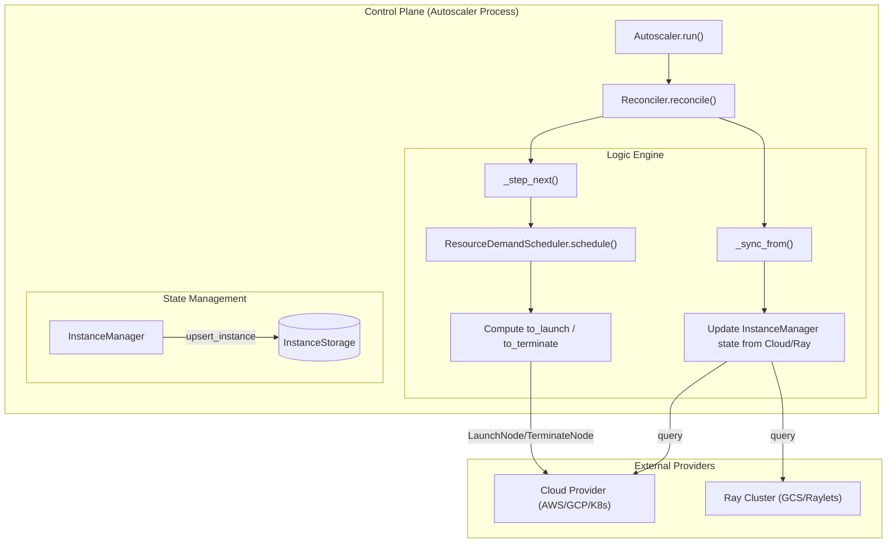
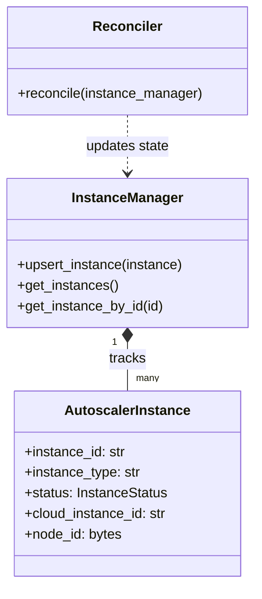

<!-- source: DeepWiki mcp.deepwiki.com · repo ray-project/ray · page 2.4 Autoscaler and Cluster Management · fetched 2026-10-21 -->

# Autoscaler and Cluster Management

Relevant source files

The following files were used as context for generating this wiki page:

- [doc/source/cluster/kubernetes/user-guides/configuring-autoscaling.md](doc/source/cluster/kubernetes/user-guides/configuring-autoscaling.md)
- [doc/source/cluster/vms/references/ray-cluster-configuration.rst](doc/source/cluster/vms/references/ray-cluster-configuration.rst)
- [doc/source/data/data.md](doc/source/data/data.md)
- [doc/source/ray-contribute/fake-autoscaler.md](doc/source/ray-contribute/fake-autoscaler.md)
- [doc/source/ray-core/api/scheduling.rst](doc/source/ray-core/api/scheduling.rst)
- [doc/source/ray-core/api/utility.rst](doc/source/ray-core/api/utility.rst)
- [doc/source/ray-core/scheduling/accelerators.rst](doc/source/ray-core/scheduling/accelerators.rst)
- [doc/source/ray-observability/user-guides/debug-apps/optimize-performance.rst](doc/source/ray-observability/user-guides/debug-apps/optimize-performance.rst)
- [doc/source/ray-overview/installation.md](doc/source/ray-overview/installation.md)
- [doc/source/rllib/multi-agent-envs.rst](doc/source/rllib/multi-agent-envs.rst)
- [doc/source/serve/tutorials/aws-neuron-core-inference-stable-diffusion.md](doc/source/serve/tutorials/aws-neuron-core-inference-stable-diffusion.md)
- [doc/source/train/getting-started-jax.rst](doc/source/train/getting-started-jax.rst)
- [doc/source/train/overview.rst](doc/source/train/overview.rst)
- [python/ray/_private/accelerators/__init__.py](python/ray/_private/accelerators/__init__.py)
- [python/ray/_private/accelerators/mblt.py](python/ray/_private/accelerators/mblt.py)
- [python/ray/_private/accelerators/tpu.py](python/ray/_private/accelerators/tpu.py)
- [python/ray/_private/logging_utils.py](python/ray/_private/logging_utils.py)
- [python/ray/_private/runtime_env/uri_cache.py](python/ray/_private/runtime_env/uri_cache.py)
- [python/ray/air/tests/test_utils.py](python/ray/air/tests/test_utils.py)
- [python/ray/autoscaler/_private/autoscaler.py](python/ray/autoscaler/_private/autoscaler.py)
- [python/ray/autoscaler/_private/gcp/config.py](python/ray/autoscaler/_private/gcp/config.py)
- [python/ray/autoscaler/_private/gcp/node.py](python/ray/autoscaler/_private/gcp/node.py)
- [python/ray/autoscaler/_private/kuberay/run_autoscaler.py](python/ray/autoscaler/_private/kuberay/run_autoscaler.py)
- [python/ray/autoscaler/_private/load_metrics.py](python/ray/autoscaler/_private/load_metrics.py)
- [python/ray/autoscaler/_private/local/config.py](python/ray/autoscaler/_private/local/config.py)
- [python/ray/autoscaler/_private/monitor.py](python/ray/autoscaler/_private/monitor.py)
- [python/ray/autoscaler/_private/readonly/defaults.yaml](python/ray/autoscaler/_private/readonly/defaults.yaml)
- [python/ray/autoscaler/_private/resource_demand_scheduler.py](python/ray/autoscaler/_private/resource_demand_scheduler.py)
- [python/ray/autoscaler/_private/util.py](python/ray/autoscaler/_private/util.py)
- [python/ray/autoscaler/v2/autoscaler.py](python/ray/autoscaler/v2/autoscaler.py)
- [python/ray/autoscaler/v2/event_logger.py](python/ray/autoscaler/v2/event_logger.py)
- [python/ray/autoscaler/v2/instance_manager/cloud_providers/kuberay/cloud_provider.py](python/ray/autoscaler/v2/instance_manager/cloud_providers/kuberay/cloud_provider.py)
- [python/ray/autoscaler/v2/instance_manager/common.py](python/ray/autoscaler/v2/instance_manager/common.py)
- [python/ray/autoscaler/v2/instance_manager/config.py](python/ray/autoscaler/v2/instance_manager/config.py)
- [python/ray/autoscaler/v2/instance_manager/instance_manager.py](python/ray/autoscaler/v2/instance_manager/instance_manager.py)
- [python/ray/autoscaler/v2/instance_manager/node_provider.py](python/ray/autoscaler/v2/instance_manager/node_provider.py)
- [python/ray/autoscaler/v2/instance_manager/ray_installer.py](python/ray/autoscaler/v2/instance_manager/ray_installer.py)
- [python/ray/autoscaler/v2/instance_manager/reconciler.py](python/ray/autoscaler/v2/instance_manager/reconciler.py)
- [python/ray/autoscaler/v2/instance_manager/subscribers/threaded_ray_installer.py](python/ray/autoscaler/v2/instance_manager/subscribers/threaded_ray_installer.py)
- [python/ray/autoscaler/v2/monitor.py](python/ray/autoscaler/v2/monitor.py)
- [python/ray/autoscaler/v2/scheduler.py](python/ray/autoscaler/v2/scheduler.py)
- [python/ray/autoscaler/v2/schema.py](python/ray/autoscaler/v2/schema.py)
- [python/ray/autoscaler/v2/tests/test_config.py](python/ray/autoscaler/v2/tests/test_config.py)
- [python/ray/autoscaler/v2/tests/test_e2e.py](python/ray/autoscaler/v2/tests/test_e2e.py)
- [python/ray/autoscaler/v2/tests/test_event_logger.py](python/ray/autoscaler/v2/tests/test_event_logger.py)
- [python/ray/autoscaler/v2/tests/test_instance_util.py](python/ray/autoscaler/v2/tests/test_instance_util.py)
- [python/ray/autoscaler/v2/tests/test_node_provider.py](python/ray/autoscaler/v2/tests/test_node_provider.py)
- [python/ray/autoscaler/v2/tests/test_ray_installer.py](python/ray/autoscaler/v2/tests/test_ray_installer.py)
- [python/ray/autoscaler/v2/tests/test_reconciler.py](python/ray/autoscaler/v2/tests/test_reconciler.py)
- [python/ray/autoscaler/v2/tests/test_scheduler.py](python/ray/autoscaler/v2/tests/test_scheduler.py)
- [python/ray/autoscaler/v2/tests/test_schema.py](python/ray/autoscaler/v2/tests/test_schema.py)
- [python/ray/autoscaler/v2/tests/test_sdk.py](python/ray/autoscaler/v2/tests/test_sdk.py)
- [python/ray/autoscaler/v2/tests/test_threaded_ray_installer.py](python/ray/autoscaler/v2/tests/test_threaded_ray_installer.py)
- [python/ray/autoscaler/v2/tests/test_utils.py](python/ray/autoscaler/v2/tests/test_utils.py)
- [python/ray/autoscaler/v2/utils.py](python/ray/autoscaler/v2/utils.py)
- [python/ray/dashboard/modules/reporter/jax_profile_manager.py](python/ray/dashboard/modules/reporter/jax_profile_manager.py)
- [python/ray/dashboard/modules/reporter/tests/test_jax_profiler_manager.py](python/ray/dashboard/modules/reporter/tests/test_jax_profiler_manager.py)
- [python/ray/tests/BUILD.bazel](python/ray/tests/BUILD.bazel)
- [python/ray/tests/accelerators/test_accelerators.py](python/ray/tests/accelerators/test_accelerators.py)
- [python/ray/tests/accelerators/test_mblt.py](python/ray/tests/accelerators/test_mblt.py)
- [python/ray/tests/accelerators/test_tpu.py](python/ray/tests/accelerators/test_tpu.py)
- [python/ray/tests/gcp/test_gcp_node_provider.py](python/ray/tests/gcp/test_gcp_node_provider.py)
- [python/ray/tests/kuberay/test_run_autoscaler_logging.py](python/ray/tests/kuberay/test_run_autoscaler_logging.py)
- [python/ray/tests/test_autoscaler.py](python/ray/tests/test_autoscaler.py)
- [python/ray/tests/test_autoscaler_e2e.py](python/ray/tests/test_autoscaler_e2e.py)
- [python/ray/tests/test_autoscaler_fake_multinode.py](python/ray/tests/test_autoscaler_fake_multinode.py)
- [python/ray/tests/test_autoscaling_policy.py](python/ray/tests/test_autoscaling_policy.py)
- [python/ray/tests/test_cli_patterns/test_ray_status.txt](python/ray/tests/test_cli_patterns/test_ray_status.txt)
- [python/ray/tests/test_cli_patterns/test_ray_status_multinode.txt](python/ray/tests/test_cli_patterns/test_ray_status_multinode.txt)
- [python/ray/tests/test_cli_patterns/test_ray_status_multinode_v1.txt](python/ray/tests/test_cli_patterns/test_ray_status_multinode_v1.txt)
- [python/ray/tests/test_cli_patterns/test_ray_status_v1.txt](python/ray/tests/test_cli_patterns/test_ray_status_v1.txt)
- [python/ray/tests/test_monitor.py](python/ray/tests/test_monitor.py)
- [python/ray/tests/test_placement_group.py](python/ray/tests/test_placement_group.py)
- [python/ray/tests/test_placement_group_2.py](python/ray/tests/test_placement_group_2.py)
- [python/ray/tests/test_placement_group_3.py](python/ray/tests/test_placement_group_3.py)
- [python/ray/tests/test_resource_demand_scheduler.py](python/ray/tests/test_resource_demand_scheduler.py)
- [python/ray/tests/test_scheduling.py](python/ray/tests/test_scheduling.py)
- [python/ray/tests/test_scheduling_2.py](python/ray/tests/test_scheduling_2.py)
- [python/ray/tests/test_tpu.py](python/ray/tests/test_tpu.py)
- [python/ray/tests/unit/test_node_affinity_validation.py](python/ray/tests/unit/test_node_affinity_validation.py)
- [python/ray/train/v2/_internal/callbacks/__init__.py](python/ray/train/v2/_internal/callbacks/__init__.py)
- [python/ray/train/v2/jax/config.py](python/ray/train/v2/jax/config.py)
- [python/ray/train/v2/jax/jax_trainer.py](python/ray/train/v2/jax/jax_trainer.py)
- [python/ray/train/v2/tests/test_jax_trainer.py](python/ray/train/v2/tests/test_jax_trainer.py)
- [python/ray/util/accelerators/__init__.py](python/ray/util/accelerators/__init__.py)
- [python/ray/util/accelerators/accelerators.py](python/ray/util/accelerators/accelerators.py)
- [python/ray/util/scheduling_strategies.py](python/ray/util/scheduling_strategies.py)
- [python/ray/util/tpu.py](python/ray/util/tpu.py)
- [src/ray/common/placement_group.h](src/ray/common/placement_group.h)
- [src/ray/protobuf/autoscaler.proto](src/ray/protobuf/autoscaler.proto)
- [src/ray/protobuf/instance_manager.proto](src/ray/protobuf/instance_manager.proto)
- [src/ray/protobuf/reporter.proto](src/ray/protobuf/reporter.proto)

Ray's autoscaling system is responsible for dynamically adjusting the cluster size to meet resource demands while minimizing costs. The system has evolved into the **Autoscaler v2** architecture, which provides a more robust, state-machine-driven approach to node lifecycle management, integration with Kubernetes via KubeRay, and support for various cloud providers.

## Purpose and Scope

This document details Ray's autoscaling subsystem, focusing on the Autoscaler v2 architecture, its core components (`InstanceManager`, `Reconciler`, `ResourceDemandScheduler`), Kubernetes integration through KubeRay, cloud provider adapters, and the complete node lifecycle from initial provisioning to termination.

Sources: `[python/ray/autoscaler/v2/autoscaler.py:1-50]()`, `[python/ray/autoscaler/v2/instance_manager/reconciler.py:59-80]()`

## Autoscaler v2 Architecture

The v2 autoscaler is built around a reconciliation loop that synchronizes the desired cluster state (based on resource demands) with the actual state of the cloud provider and the Ray cluster.

### Key Components

| Component | Role | Code Entity |
| :--- | :--- | :--- |
| **InstanceManager** | Tracks the state of all instances (nodes) in the cluster and persists them to storage. | `InstanceManager` [python/ray/autoscaler/v2/instance_manager/instance_manager.py:15]() |
| **Reconciler** | The central logic engine that computes state transitions and triggers actions. | `Reconciler` [python/ray/autoscaler/v2/instance_manager/reconciler.py:56]() |
| **ResourceDemandScheduler** | Calculates the target cluster shape based on pending tasks, actors, and placement groups. | `ResourceDemandScheduler` [python/ray/autoscaler/v2/scheduler.py:216]() |
| **NodeProvider** | Interface for interacting with cloud/infrastructure backends (AWS, GCP, KubeRay). | `ICloudInstanceProvider` [python/ray/autoscaler/v2/instance_manager/node_provider.py:20]() |

### System Data Flow and Entity Mapping

The following diagram illustrates how the v2 autoscaler components interact during a single reconciliation tick, bridging natural language concepts to concrete code entities.

**Autoscaler v2 Reconciliation Loop**

Sources: `[python/ray/autoscaler/v2/instance_manager/reconciler.py:64-144]()`, `[python/ray/autoscaler/v2/scheduler.py:91-106]()`

## Resource Scheduling and Demand Calculation

The `ResourceDemandScheduler` is responsible for mapping resource requests (e.g., CPU, GPU, TPU bundles) to specific node types defined in the `AutoscalingConfig`.

### Scheduling Logic
1.  **Request Grouping**: Resource requests are grouped by count to optimize scheduling calculations `[python/ray/autoscaler/v2/utils.py:22]()`.
2.  **Bin Packing**: The scheduler attempts to fit pending `ResourceRequest` bundles into existing `SCHEDULABLE` nodes `[python/ray/autoscaler/v2/scheduler.py:188]()`.
3.  **Upscaling**: If existing nodes cannot satisfy demand, the scheduler selects the cheapest/best-fit `NodeType` to launch `[python/ray/autoscaler/v2/scheduler.py:216]()` `[python/ray/autoscaler/v2/scheduler.py:300]()`.
4.  **Constraints**: It respects `ClusterResourceConstraint` (minimum cluster size) and `GangResourceRequest` (atomic allocation of multiple bundles) `[python/ray/autoscaler/v2/scheduler.py:59-65]()`.

Sources: `[python/ray/autoscaler/v2/scheduler.py:48-89]()`, `[python/ray/autoscaler/v2/scheduler.py:216-300]()`

## Node Lifecycle Management

The `Reconciler` manages nodes through a series of states defined in `instance_manager_pb2`.

### State Transitions
The `Reconciler._sync_from` method performs "passive" transitions based on external observations, while `_step_next` performs "active" transitions.

| Initial Status | Condition | Target Status | Action |
| :--- | :--- | :--- | :--- |
| `QUEUED` | Instance assigned by scheduler | `REQUESTED` | Call `CloudProvider.launch_node` |
| `REQUESTED` | Cloud instance ID becomes available | `ALLOCATED` | Node is provisioning in cloud |
| `ALLOCATED` | Ray process starts and registers | `RAY_RUNNING` | Node is ready for tasks |
| `RAY_RUNNING` | Idle timeout or scale-down | `TERMINATING` | Call `CloudProvider.terminate_node` |

Sources: `[python/ray/autoscaler/v2/instance_manager/reconciler.py:147-167]()`, `[python/ray/autoscaler/v2/instance_manager/reconciler.py:291-320]()`

## Cloud Provider Integration

Ray uses adapters to support various environments. Each provider implements the `NodeProvider` interface.

### KubeRay (Kubernetes)
KubeRay integrates Ray with Kubernetes using Custom Resource Definitions (CRDs) like `RayCluster`.
*   **Config Production**: The `AutoscalingConfigProducer` fetches the `RayCluster` CR and derives the autoscaling configuration `[python/ray/autoscaler/_private/kuberay/autoscaling_config.py:42]()`.
*   **Node Management**: The `KubeRayNodeProvider` communicates with the Kubernetes API server to adjust the `replicas` field of `workerGroupSpecs` or to delete specific pods via `scaleStrategy` `[python/ray/autoscaler/_private/kuberay/node_provider.py:69-80]()`.
*   **TPU Support**: KubeRay supports Google Cloud TPUs, including multi-host TPU slices. The `AutoscalingConfigProducer` extracts TPU-specific labels (`cloud.google.com/gke-tpu-topology`, `cloud.google.com/gke-tpu-accelerator`) from the `RayCluster` CR to correctly configure TPU resources for autoscaling `[python/ray/autoscaler/_private/kuberay/autoscaling_config.py:35-36]()`. It also infers the number of TPUs from the `rayStartParams` or container resource limits `[python/ray/autoscaler/_private/kuberay/autoscaling_config.py:20-21]()`.

### Ray on Spark
Ray can run inside a Spark cluster, utilizing Spark executors as Ray nodes.
*   **Cluster Initialization**: `RayClusterOnSpark` manages the lifecycle of Ray processes on Spark `[python/ray/util/spark/cluster_init.py:72]()`.
*   **Resource Mapping**: It maps Spark executor cores and memory to Ray resources `[python/ray/util/spark/cluster_init.py:24-33]()`.

### Cloud Adapters (AWS, GCP, Azure)
These providers use SDKs (boto3, google-cloud-sdk) to manage VM instances.
*   **Launch Config**: Configs include `node_config` (e.g., InstanceType, ImageId) and `auth` (ssh_user) `[python/ray/autoscaler/v2/instance_manager/config.py:196-210]()`.
*   **Termination**: Nodes are terminated when the `ResourceDemandScheduler` identifies them as idle and redundant `[python/ray/autoscaler/v2/scheduler.py:78]()`.

Sources: `[python/ray/autoscaler/_private/kuberay/autoscaling_config.py:90-142]()`, `[python/ray/autoscaler/_private/kuberay/node_provider.py:152-165]()`, `[python/ray/util/spark/cluster_init.py:120-170]()`, `[python/ray/autoscaler/_private/kuberay/autoscaling_config.py:35-36]()`, `[python/ray/autoscaler/_private/kuberay/autoscaling_config.py:20-21]()`

## Implementation Detail: The Instance Manager

The `InstanceManager` is the source of truth for node states within the autoscaler process. It uses an underlying `InstanceStorage` (often `InMemoryStorage` or backed by a persistent store) to track `AutoscalerInstance` objects.

**Instance Entity Mapping**

Sources: `[python/ray/autoscaler/v2/instance_manager/instance_manager.py:15]()`, `[python/ray/autoscaler/v2/instance_manager/reconciler.py:56]()`

## Failure Handling and Timeouts

The autoscaler includes robust error handling for common cloud issues:
*   **Launch Failures**: If `CloudInstanceProviderError` occurs, the reconciler marks the request as failed and allows the scheduler to retry `[python/ray/autoscaler/v2/instance_manager/reconciler.py:151]()`.
*   **Timeouts**: `InstanceReconcileConfig` defines timeouts for each state (e.g., `allocate_status_timeout_s`). If an instance hangs in `ALLOCATED` but never reaches `RAY_RUNNING`, it is terminated `[python/ray/autoscaler/v2/instance_manager/config.py:83-113]()`.
*   **Resource Availability**: The `CloudResourceMonitor` tracks if specific node types are currently unavailable in the cloud (e.g., Spot instance preemption or stock-out) to avoid repeated failed launch attempts `[python/ray/autoscaler/v2/instance_manager/reconciler.py:24-26]()`.

Sources: `[python/ray/autoscaler/v2/instance_manager/reconciler.py:217-250]()`, `[python/ray/autoscaler/v2/instance_manager/config.py:83-113]()`

---

