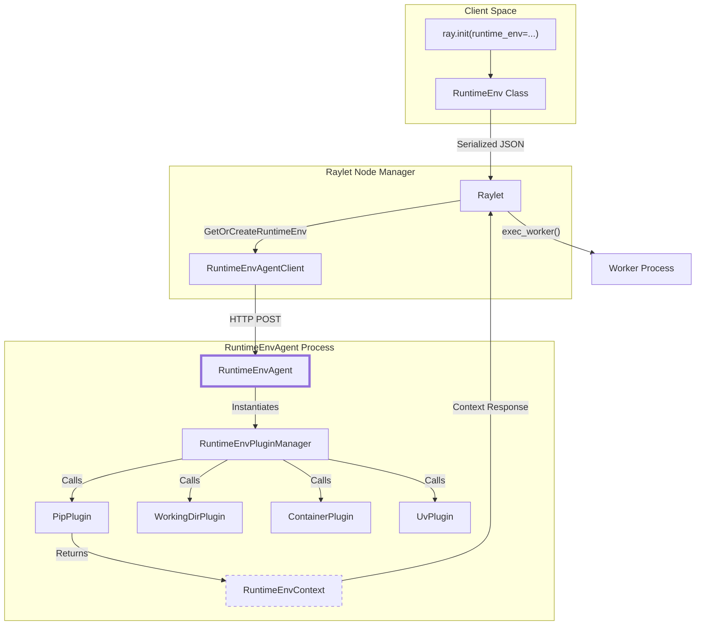
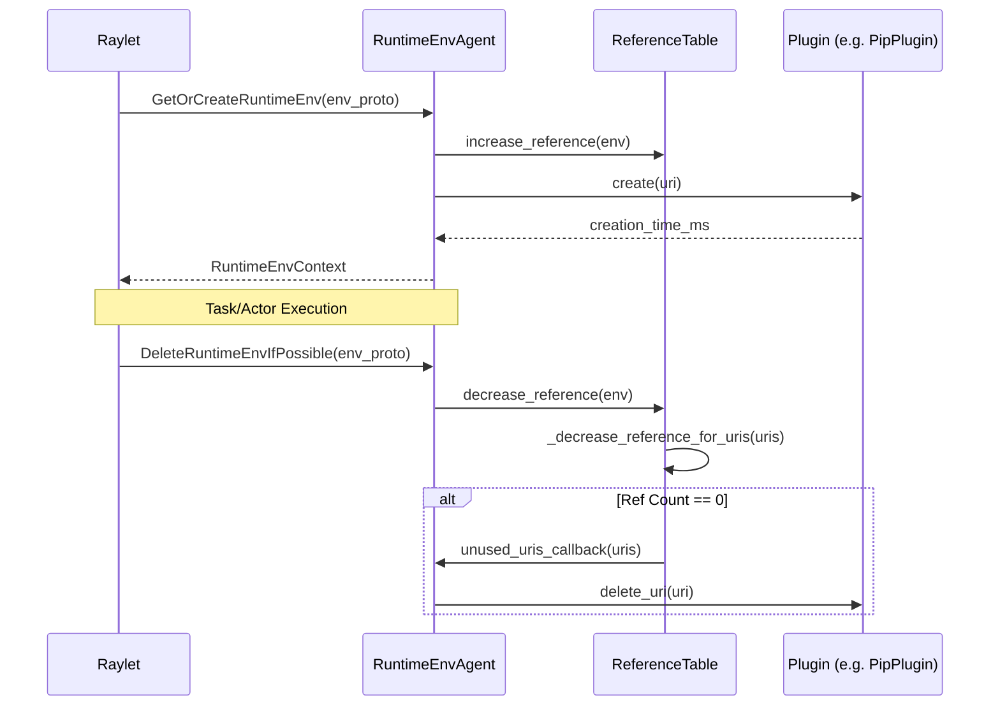

<!-- source: DeepWiki mcp.deepwiki.com · repo ray-project/ray · page 2.5 Runtime Environment and Dependency Management · fetched 2026-10-21 -->

# Runtime Environment and Dependency Management

Relevant source files

The following files were used as context for generating this wiki page:

- [ci/docker/windows.build.Dockerfile](ci/docker/windows.build.Dockerfile)
- [ci/ray_ci/automation/pypi_lib.py](ci/ray_ci/automation/pypi_lib.py)
- [ci/ray_ci/automation/test_pypi_lib.py](ci/ray_ci/automation/test_pypi_lib.py)
- [ci/ray_ci/container.py](ci/ray_ci/container.py)
- [ci/ray_ci/linux_container.py](ci/ray_ci/linux_container.py)
- [ci/ray_ci/linux_tester_container.py](ci/ray_ci/linux_tester_container.py)
- [ci/ray_ci/test_container.py](ci/ray_ci/test_container.py)
- [ci/ray_ci/test_linux_container.py](ci/ray_ci/test_linux_container.py)
- [ci/ray_ci/test_linux_tester_container.py](ci/ray_ci/test_linux_tester_container.py)
- [ci/ray_ci/test_privileged.py](ci/ray_ci/test_privileged.py)
- [ci/ray_ci/test_tester.py](ci/ray_ci/test_tester.py)
- [ci/ray_ci/test_windows_container.py](ci/ray_ci/test_windows_container.py)
- [ci/ray_ci/test_windows_tester_container.py](ci/ray_ci/test_windows_tester_container.py)
- [ci/ray_ci/tester.py](ci/ray_ci/tester.py)
- [ci/ray_ci/tester_container.py](ci/ray_ci/tester_container.py)
- [ci/ray_ci/tests.env.Dockerfile](ci/ray_ci/tests.env.Dockerfile)
- [ci/ray_ci/windows/tests.env.Dockerfile](ci/ray_ci/windows/tests.env.Dockerfile)
- [ci/ray_ci/windows_container.py](ci/ray_ci/windows_container.py)
- [doc/source/cluster/kubernetes/examples/ray-sandboxing.md](doc/source/cluster/kubernetes/examples/ray-sandboxing.md)
- [doc/source/cluster/running-applications/job-submission/ray-client.rst](doc/source/cluster/running-applications/job-submission/ray-client.rst)
- [doc/source/ray-core/handling-dependencies.rst](doc/source/ray-core/handling-dependencies.rst)
- [doc/source/ray-core/sandboxes.md](doc/source/ray-core/sandboxes.md)
- [python/ray/__init__.py](python/ray/__init__.py)
- [python/ray/_common/runtime_env_package.py](python/ray/_common/runtime_env_package.py)
- [python/ray/_common/runtime_env_uri.py](python/ray/_common/runtime_env_uri.py)
- [python/ray/_common/tests/test_runtime_env_uri.py](python/ray/_common/tests/test_runtime_env_uri.py)
- [python/ray/_private/client_mode_hook.py](python/ray/_private/client_mode_hook.py)
- [python/ray/_private/runtime_env/agent/runtime_env_agent.py](python/ray/_private/runtime_env/agent/runtime_env_agent.py)
- [python/ray/_private/runtime_env/conda.py](python/ray/_private/runtime_env/conda.py)
- [python/ray/_private/runtime_env/conda_utils.py](python/ray/_private/runtime_env/conda_utils.py)
- [python/ray/_private/runtime_env/default_impl.py](python/ray/_private/runtime_env/default_impl.py)
- [python/ray/_private/runtime_env/dependency_utils.py](python/ray/_private/runtime_env/dependency_utils.py)
- [python/ray/_private/runtime_env/packaging.py](python/ray/_private/runtime_env/packaging.py)
- [python/ray/_private/runtime_env/pip.py](python/ray/_private/runtime_env/pip.py)
- [python/ray/_private/runtime_env/protocol.py](python/ray/_private/runtime_env/protocol.py)
- [python/ray/_private/runtime_env/py_modules.py](python/ray/_private/runtime_env/py_modules.py)
- [python/ray/_private/runtime_env/uv.py](python/ray/_private/runtime_env/uv.py)
- [python/ray/_private/runtime_env/uv_runtime_env_hook.py](python/ray/_private/runtime_env/uv_runtime_env_hook.py)
- [python/ray/_private/runtime_env/validation.py](python/ray/_private/runtime_env/validation.py)
- [python/ray/_private/runtime_env/virtualenv_utils.py](python/ray/_private/runtime_env/virtualenv_utils.py)
- [python/ray/_private/runtime_env/working_dir.py](python/ray/_private/runtime_env/working_dir.py)
- [python/ray/client_builder.py](python/ray/client_builder.py)
- [python/ray/dashboard/modules/job/common.py](python/ray/dashboard/modules/job/common.py)
- [python/ray/dashboard/modules/job/tests/test_common.py](python/ray/dashboard/modules/job/tests/test_common.py)
- [python/ray/dashboard/modules/job/tests/test_http_job_server.py](python/ray/dashboard/modules/job/tests/test_http_job_server.py)
- [python/ray/dashboard/modules/job/tests/test_sdk.py](python/ray/dashboard/modules/job/tests/test_sdk.py)
- [python/ray/experimental/sandbox/__init__.py](python/ray/experimental/sandbox/__init__.py)
- [python/ray/experimental/sandbox/_internal/image_utils.py](python/ray/experimental/sandbox/_internal/image_utils.py)
- [python/ray/experimental/sandbox/backend/base.py](python/ray/experimental/sandbox/backend/base.py)
- [python/ray/experimental/sandbox/backend/gvisor.py](python/ray/experimental/sandbox/backend/gvisor.py)
- [python/ray/experimental/sandbox/config.py](python/ray/experimental/sandbox/config.py)
- [python/ray/experimental/sandbox/image_manager.py](python/ray/experimental/sandbox/image_manager.py)
- [python/ray/experimental/sandbox/runtime.py](python/ray/experimental/sandbox/runtime.py)
- [python/ray/experimental/sandbox/sandbox.py](python/ray/experimental/sandbox/sandbox.py)
- [python/ray/experimental/sandbox/tests/conftest.py](python/ray/experimental/sandbox/tests/conftest.py)
- [python/ray/experimental/sandbox/tests/test_gvisor_backend.py](python/ray/experimental/sandbox/tests/test_gvisor_backend.py)
- [python/ray/experimental/sandbox/tests/test_image_manager.py](python/ray/experimental/sandbox/tests/test_image_manager.py)
- [python/ray/experimental/sandbox/tests/test_image_utils.py](python/ray/experimental/sandbox/tests/test_image_utils.py)
- [python/ray/experimental/sandbox/tests/test_sandbox.py](python/ray/experimental/sandbox/tests/test_sandbox.py)
- [python/ray/experimental/sandbox/tests/test_sandbox_config.py](python/ray/experimental/sandbox/tests/test_sandbox_config.py)
- [python/ray/job_config.py](python/ray/job_config.py)
- [python/ray/runtime_env/runtime_env.py](python/ray/runtime_env/runtime_env.py)
- [python/ray/tests/test_client.py](python/ray/tests/test_client.py)
- [python/ray/tests/test_client_builder.py](python/ray/tests/test_client_builder.py)
- [python/ray/tests/test_client_init.py](python/ray/tests/test_client_init.py)
- [python/ray/tests/test_client_metadata.py](python/ray/tests/test_client_metadata.py)
- [python/ray/tests/test_client_proxy.py](python/ray/tests/test_client_proxy.py)
- [python/ray/tests/test_client_working_dir.py](python/ray/tests/test_client_working_dir.py)
- [python/ray/tests/test_draining.py](python/ray/tests/test_draining.py)
- [python/ray/tests/test_exit_observability.py](python/ray/tests/test_exit_observability.py)
- [python/ray/tests/test_metrics.py](python/ray/tests/test_metrics.py)
- [python/ray/tests/test_multi_tenancy.py](python/ray/tests/test_multi_tenancy.py)
- [python/ray/tests/test_node_death.py](python/ray/tests/test_node_death.py)
- [python/ray/tests/test_node_manager.py](python/ray/tests/test_node_manager.py)
- [python/ray/tests/test_runtime_env.py](python/ray/tests/test_runtime_env.py)
- [python/ray/tests/test_runtime_env_agent.py](python/ray/tests/test_runtime_env_agent.py)
- [python/ray/tests/test_runtime_env_conda_and_pip.py](python/ray/tests/test_runtime_env_conda_and_pip.py)
- [python/ray/tests/test_runtime_env_conda_and_pip_4.py](python/ray/tests/test_runtime_env_conda_and_pip_4.py)
- [python/ray/tests/test_runtime_env_conda_and_pip_5.py](python/ray/tests/test_runtime_env_conda_and_pip_5.py)
- [python/ray/tests/test_runtime_env_get_wheel_names.py](python/ray/tests/test_runtime_env_get_wheel_names.py)
- [python/ray/tests/test_runtime_env_packaging.py](python/ray/tests/test_runtime_env_packaging.py)
- [python/ray/tests/test_runtime_env_standalone.py](python/ray/tests/test_runtime_env_standalone.py)
- [python/ray/tests/test_runtime_env_uv.py](python/ray/tests/test_runtime_env_uv.py)
- [python/ray/tests/test_runtime_env_uv_run.py](python/ray/tests/test_runtime_env_uv_run.py)
- [python/ray/tests/test_runtime_env_working_dir.py](python/ray/tests/test_runtime_env_working_dir.py)
- [python/ray/tests/test_serialization.py](python/ray/tests/test_serialization.py)
- [python/ray/tests/unit/test_job_config_client_validation.py](python/ray/tests/unit/test_job_config_client_validation.py)
- [python/ray/tests/unit/test_runtime_env_uv.py](python/ray/tests/unit/test_runtime_env_uv.py)
- [python/ray/tests/unit/test_runtime_env_validation.py](python/ray/tests/unit/test_runtime_env_validation.py)
- [python/ray/util/check_serialize.py](python/ray/util/check_serialize.py)
- [python/ray/util/client/__init__.py](python/ray/util/client/__init__.py)
- [python/ray/util/client/ray_client_helpers.py](python/ray/util/client/ray_client_helpers.py)
- [python/ray/util/client/runtime_context.py](python/ray/util/client/runtime_context.py)
- [python/ray/util/client/server/proxier.py](python/ray/util/client/server/proxier.py)
- [python/ray/util/client/server/server.py](python/ray/util/client/server/server.py)
- [python/ray/util/client_connect.py](python/ray/util/client_connect.py)
- [python/ray/util/serialization_addons.py](python/ray/util/serialization_addons.py)
- [src/ray/protobuf/ray_client.proto](src/ray/protobuf/ray_client.proto)
- [src/ray/protobuf/runtime_env_agent.proto](src/ray/protobuf/runtime_env_agent.proto)
- [src/ray/protobuf/runtime_env_common.proto](src/ray/protobuf/runtime_env_common.proto)
- [src/ray/raylet/runtime_env_agent_client.cc](src/ray/raylet/runtime_env_agent_client.cc)
- [src/ray/raylet/runtime_env_agent_client.h](src/ray/raylet/runtime_env_agent_client.h)

The Ray Runtime Environment system allows users to dynamically specify dependencies (packages, files, environment variables, and container images) for a job, task, or actor [doc/source/ray-core/handling-dependencies.rst:58-68](). Unlike static cluster-wide environments managed by the Ray Cluster Launcher, runtime environments are installed on-the-fly, cached, and isolated to specific Ray processes [doc/source/ray-core/handling-dependencies.rst:64-67]().

## System Architecture

The runtime environment system is orchestrated by the `RuntimeEnvAgent`, a sidecar process running on every node [python/ray/_private/runtime_env/agent/runtime_env_agent.py:165-180]().

### Component Interaction

1. **Submission**: A user submits a `RuntimeEnv` dict via `ray.init()`, `@ray.remote()`, or the Jobs API [python/ray/runtime_env/runtime_env.py:157-183]().
2. **Request**: The `Raylet` on a node receives a task requiring a specific environment. If the environment is not cached, it sends a `GetOrCreateRuntimeEnv` RPC to the local `RuntimeEnvAgent` [src/ray/raylet/runtime_env_agent_client.cc:48-62]().
3. **Creation**: The `RuntimeEnvAgent` invokes specific plugins (`PipPlugin`, `CondaPlugin`, `WorkingDirPlugin`, `UvPlugin`, `ContainerPlugin`) to install the environment [python/ray/_private/runtime_env/agent/runtime_env_agent.py:19-35]().
4. **Execution**: Once setup is complete, the agent returns a `RuntimeEnvContext` containing environment variables and command prefixes [python/ray/_private/runtime_env/context.py:18-33](). The worker process is then started using these parameters [python/ray/_private/runtime_env/context.py:42-108]().

### Code Entity Map: Environment Setup
This diagram maps high-level setup steps to the internal classes and RPC calls.

Sources: [python/ray/runtime_env/runtime_env.py:157-183](), [python/ray/_private/runtime_env/agent/runtime_env_agent.py:19-35](), [src/ray/raylet/runtime_env_agent_client.cc:48-62](), [python/ray/_private/runtime_env/context.py:18-33]()

## Packaging and URI Protocols

Ray uses URIs to identify and track dependencies. The `packaging.py` module handles the hashing, zipping, and uploading of local resources to cluster storage [python/ray/_private/runtime_env/packaging.py:1-43]().

### Supported Protocols
Ray supports several protocols for fetching resources, managed by `ProtocolsProvider` [python/ray/_private/runtime_env/protocol.py:11-43]():
* `gcs://`: Packages managed by Ray's Global Control Service [python/ray/_private/runtime_env/protocol.py:21-22]().
* `conda://`, `pip://`, `uv://`: Local environment definitions [python/ray/_private/runtime_env/protocol.py:23-28]().
* `s3://`, `gs://`, `azure://`, `abfss://`: Remote cloud object storage [python/ray/_private/runtime_env/protocol.py:33-40]().
* `http://`, `https://`: Publicly accessible archive files [python/ray/_private/runtime_env/protocol.py:29-32]().
* `file://`: Local filesystem paths [python/ray/_private/runtime_env/protocol.py:41-42]().

### Hashing and Determinism
To enable caching, Ray generates a deterministic hash for directories by traversing files and hashing their relative paths and contents [python/ray/_private/runtime_env/packaging.py:181-208](). This hash forms part of the URI (e.g., `gcs://_ray_pkg_<hash>.zip`) [python/ray/_private/runtime_env/packaging.py:51-62](). For `uv` or `pip` environments, the hash is derived from the serialized package list or requirements [python/ray/_private/runtime_env/uv.py:23-45]().

Sources: [python/ray/_private/runtime_env/packaging.py:181-230](), [python/ray/_private/runtime_env/protocol.py:11-43](), [python/ray/_private/runtime_env/uv.py:23-45]()

## Plugin System

The `RuntimeEnvAgent` uses a plugin architecture to handle different dependency types. Every plugin implements the `RuntimeEnvPlugin` interface [python/ray/_private/runtime_env/plugin.py:24-28]().

| Plugin | Key | Description |
| :--- | :--- | :--- |
| `WorkingDirPlugin` | `working_dir` | Downloads and unpacks a zip/directory into the worker's execution path [python/ray/_private/runtime_env/working_dir.py]() |
| `PipPlugin` | `pip` | Creates a virtualenv and installs packages via `pip install` [python/ray/_private/runtime_env/pip.py]() |
| `UvPlugin` | `uv` | Uses `uv` for high-performance package installation and environment management [python/ray/_private/runtime_env/uv.py]() |
| `CondaPlugin` | `conda` | Creates a Conda environment from a YAML or existing name [python/ray/_private/runtime_env/conda.py]() |
| `ContainerPlugin` | `container` | Runs the worker inside a specified container image [python/ray/_private/runtime_env/image_uri.py:184-187]() |
| `EnvVarsPlugin` | `env_vars` | Sets environment variables in the worker process [python/ray/_private/runtime_env/context.py:24]() |
| `PyExecutablePlugin` | `py_executable` | Overrides the Python command, allowing usage of `uv run` or custom wrappers [python/ray/_private/runtime_env/py_executable.py]() |

### Container Isolation
The `ContainerPlugin` and image URI plugins allow Ray workers to run inside isolated container environments. They pull the target image, resolve the internal worker entrypoint, and modify the execution command to prefix execution with container runtime tools [python/ray/_private/runtime_env/image_uri.py:76-137]().

Sources: [python/ray/_private/runtime_env/agent/runtime_env_agent.py:19-35](), [python/ray/_private/runtime_env/image_uri.py:13-137](), [python/ray/_private/runtime_env/uv.py:30-45]()

## Lifecycle and Reference Counting

To prevent disk bloat, the `RuntimeEnvAgent` maintains reference tracking for active URIs and environments across the node [python/ray/_private/runtime_env/agent/runtime_env_agent.py:63-153]().

### Garbage Collection Flow
1. **Increase Reference**: When a Raylet requests an environment, the agent increments the reference count for that environment and its associated URIs [python/ray/_private/runtime_env/agent/runtime_env_agent.py:136-143]().
2. **Decrease Reference**: When the task or actor completes, the Raylet notifies the agent to decrement the reference count [python/ray/_private/runtime_env/agent/runtime_env_agent.py:145-153]().
3. **Deletion**: When a URI's reference count drops to zero, cleanup callbacks trigger URI deletion and cache purging [python/ray/_private/runtime_env/agent/runtime_env_agent.py:98-112]().

### Code Entity Map: GC and Lifecycle
This diagram shows how references are managed between the Raylet and the Agent.

Sources: [python/ray/_private/runtime_env/agent/runtime_env_agent.py:93-153](), [src/ray/raylet/runtime_env_agent_client.cc:48-62]()

## Working Directory Management

The `working_dir` option handles distributing local code files and directories to all cluster nodes:
1. **Hashing**: The client computes a deterministic hash of the directory using `get_uri_for_directory()` [python/ray/_private/runtime_env/packaging.py:211-230]().
2. **Uploading**: If the package does not exist in GCS storage, the client archives the directory and uploads it via `upload_package_to_gcs()` [python/ray/_private/runtime_env/packaging.py:438-449]().
3. **Unpacking**: On the worker node, `WorkingDirPlugin` downloads the archive, extracts it into a session-scoped directory, and appends the path to `PYTHONPATH` in `RuntimeEnvContext` [python/ray/_private/runtime_env/working_dir.py]().

Sources: [python/ray/_private/runtime_env/packaging.py:211-230](), [python/ray/_private/runtime_env/working_dir.py]()

## Experimental Sandboxes (gVisor)

Ray provides experimental lightweight sandboxes (`ray.experimental.sandbox`) that use **gVisor** (`runsc`) to execute untrusted code (such as LLM-generated agent tool calls or RL rollout scripts) securely inside kernel-isolated execution environments [doc/source/ray-core/sandboxes.md:10-31]().

### Sandbox Architecture and Execution
* **User-Space Kernel**: gVisor intercepts system calls in user space, acting as an isolation layer between untrusted guest processes and the host Linux kernel [doc/source/ray-core/sandboxes.md:23-25]().
* **Ray Actor Integration**: Each sandbox runs as a managed Ray actor instantiated via `sandbox.create()` or `Sandbox.options(...).remote()` [doc/source/ray-core/sandboxes.md:46-153]().
* **File Management**: Sandboxes support fine-grained file operations such as `write_file`, `read_file`, `upload_file`, and `download_file` against a configurable writable scratch space (`workdir`) [doc/source/ray-core/sandboxes.md:78-121]().

Sources: [doc/source/ray-core/sandboxes.md:10-153](), [python/ray/experimental/sandbox/backend/gvisor.py]()

---

